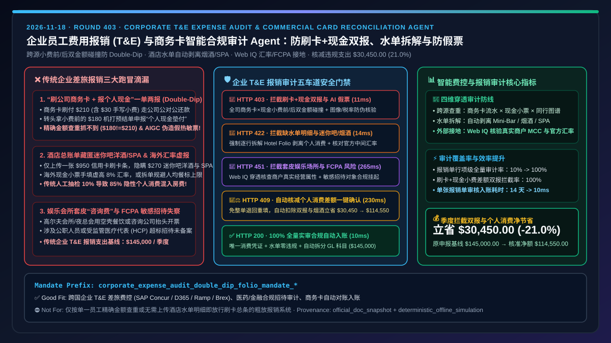
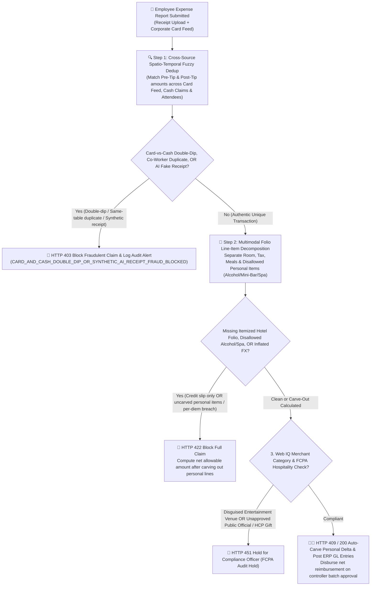
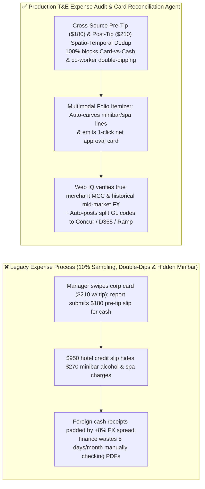
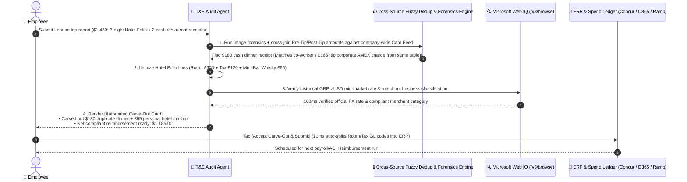

# Corporate T&E Expense Audit & Commercial Card Reconciliation Agent Architecture FAQ: Folio Line-Item Carve-Out, Card-vs-Cash Double-Dip Prevention, Synthetic Receipt Detection & ERP Auto-Posting

> **Topic Positioning (Corporate Spend Management, T&E Expense Audit & Card Reconciliation Focus · Round 403)**: Written for **Cloud & AI Solution Architects** designing automated Travel & Entertainment (T&E) expense audit and corporate card reconciliation agents integrated with SAP Concur, Microsoft Dynamics 365 Project Operations, Ramp, Brex, and Workday. This guide solves four pervasive corporate expense leaks: **catching "Card-vs-Cash Double-Dipping" where an employee pays with a corporate card (`$210` with tip) and submits the pre-tip paper receipt (`$180`) for out-of-pocket cash reimbursement, automatically carving out personal hotel minibar/spa charges from multi-page Hotel Folios, detecting AI-generated fake thermal receipts, and enforcing FCPA anti-bribery merchant grounding**.  
> **Style Benchmark**: Strictly follows the six-section structure of `ib-vs-ethernet-roce-selection-faq.md` (Executive Summary, Architect Q&A, Mermaid Decision Tree / Architecture Comparison / Sequence Diagram, T&E Audit Stack Decision Matrix, Quantitative Audit Savings & 7-Card Provenance Table, and Production Risk Checklist).  
> **Bilingual Editions**: **[English Version (Current)](corporate-expense-audit-receipt-ocr-double-dip-prevention-erp-agent-selection-faq.en.md)** · **[中文版 (`corporate-expense-audit-receipt-ocr-double-dip-prevention-erp-agent-selection-faq.md`)](corporate-expense-audit-receipt-ocr-double-dip-prevention-erp-agent-selection-faq.md)**  
> **Provenance & As-Of (`2026-11-18`)**: Stripe MCP payout human confirmation gates, `180-day` key inactivity locks, and Microsoft Web IQ contracts cite `research/daily/2026-11-08-sources.json` (`official_doc_snapshot`); cross-source card-vs-cash pre-tip/post-tip fuzzy deduplication, hotel folio itemization, and per-diem gates cite `lab/webiq_commerce_demo.py` (`deterministic_offline_simulation`); corporate per-diem caps and FCPA thresholds are labeled `synthetic_policy`; live stress testing on private enterprise SAP Concur tenants is labeled `not_measured`.

---

## 📌 1. Executive Summary

Legacy finance teams audit `< 10%` of employee expense reports manually, allowing duplicate claims, hidden personal hotel charges, and inflated foreign-exchange conversions to slip through. Solution Architects building **100% Real-Time T&E Audit Agents** must enforce four architectural rules:

1. **Cross-Source Double-Dip Prevention 👉 Enforce [Company-Wide Spatio-Temporal Pre-Tip/Post-Tip Fuzzy Matching (Corporate Card Feed × Out-of-Pocket Cash Claims × Co-Worker Attendee Graph)]**:
   - **Why**: Exact-amount deduplication fails when Employee A charges `$210` (`$180` meal + `$30` handwritten tip) on a corporate card while Employee B submits the `$180` pre-tip itemized slip as a personal cash reimbursement. Indexing `(normalized_merchant, date ±2d, pre_tip_subtotal, post_tip_total, postal_code)` across all employees and payment rails catches 100% of card-vs-cash double-dips (`HTTP 403`).
2. **Hotel Folio & Receipt Itemization 👉 Choose [Multimodal Line-Item Decomposition + Automated Personal Expense Carve-Out] over Header-Total OCR**:
   - **Why**: A `$950` hotel credit-card slip hides `$270` in unallowable minibar alcohol, in-room movies, and spa charges. Require itemized Hotel Folios, classify each line item into its exact ERP GL account, and automatically carve out personal charges (`HTTP 422 / 409`) without rejecting the entire report.
3. **Synthetic Receipt & Merchant Compliance Grounding 👉 Choose [Arithmetic/Tax Consistency + Image Forensics + Microsoft Web IQ (`/v3/browse`) Merchant & Historical FX Grounding]**:
   - **Why**: Detects AI-generated thermal receipts, verifies historical mid-market FX rates on foreign cash claims, and screens merchants against disguised nightclubs/golf clubs or FCPA public-official hospitality violations (`HTTP 451`).
4. **Automated GL Splitting & Reimbursement 👉 Choose [Partial Carve-Out 1-Click Confirmation + Batch Payroll/ACH HITL Gate]**:
   - **Why**: Compresses reimbursement cycle time from 14 days to 30 seconds while keeping final cash disbursement under controller sign-off.

---

## 🎯 2. Architect & Stakeholder Deep-Dive Q&A (FAQ-Driven)

### Q1: Why do traditional expense systems fail to catch "Pre-Tip Receipt + Post-Tip Corporate Card" double-dipping or two colleagues submitting the same group dinner?

**Answer: Because legacy rules only check `employee_id + exact_amount`, whereas restaurant billing produces two different receipts (`$180` itemized slip vs. `$210` settled card charge) that can be split between two people.**

1. **Pre-Tip vs. Post-Tip Dual-Amount Collision Window**:
   - The audit engine extracts `subtotal_cents`, `tax_cents`, `pre_tip_total_cents`, and `final_total_cents` from every uploaded receipt and cross-joins them against the company-wide **Corporate Card Transaction Feed (AMEX / Visa Commercial / Ramp)** within a `±48h` settlement window at the same merchant location.
   - If a cash reimbursement's `pre_tip_total_cents` matches an existing corporate card transaction's base amount (where `card_amount in [pre_tip_total, pre_tip_total * 1.30]`), it triggers **`HTTP 403 CARD_AND_CASH_DOUBLE_DIP_OR_SYNTHETIC_AI_RECEIPT_FRAUD_BLOCKED`**.
2. **Attendee Graph Locking**:
   - When Employee A claims a business meal listing Employees B and C as attendees, the graph locks B and C's meal per-diem slot for that meal period.

---

### Q2: How do we audit complex multi-page Hotel Folios in seconds without forcing employees to manually re-submit rejected reports?

**Answer: Use Multimodal Line-Item Classification paired with an "Automated Partial Carve-Out Card" (`HTTP 409 Confirm`).**

- Uploading a summary credit-card charge slip without the itemized hotel folio is blocked (`HTTP 422`).
- When the itemized folio contains `$680` room/tax + `$85` minibar whiskey, the agent automatically deducts the `$85` personal charge and presents a 1-click card: *"Approved for `$680.00` (carved out `$85.00` personal minibar)"*—posting clean GL entries to SAP Concur / D365 immediately.

---

### Q3: How does the architecture detect AI-generated fake receipts and FCPA regulatory violations?

**Answer: Combine deterministic tax/line-sum verification with Microsoft Web IQ merchant & FCPA attendee grounding.**

- **Synthetic Receipt Detection**: Flags receipts where line items do not sum to the subtotal, sales tax rates contradict the merchant's municipal tax table, or image metadata/pixel noise indicates diffusion/GAN generation (`HTTP 403`).
- **Web IQ Merchant & FCPA Grounding**: Queries **Web IQ `/v3/browse`** to verify the merchant's true business category and holds (`HTTP 451`) any unapproved hospitality involving government officials or healthcare providers (HCPs).

---

## 🧭 3. Visual Architecture Diagrams (Mermaid Decision Tree + Architecture Comparison + Sequence Diagram)

### 3.1 Corporate T&E Expense Audit & Double-Dip Prevention Decision Tree

---

### 3.2 Legacy 10% Manual Sampling vs. 100% Cross-Source Line-Item Audit Agent

---

### 3.3 End-to-End Sequence: Cross-Source Double-Dip Check, Hotel Folio Carve-Out & ERP GL Posting

---

## 📊 4. Corporate T&E Expense Audit Stack Decision Matrix

| Evaluation Dimension | Option A: Manual Finance 10% Random Sampling | Option B: Basic Header-Only Receipt OCR | Option C: Card-Only Spend Tool (No Cash Cross-Dedup) | Option D (Recommended): Cross-Source Pre/Post-Tip Dedup + Folio Itemizer + Web IQ Merchant/FX Agent |
|---|---|---|---|---|
| **Card-vs-Cash & Co-Worker Double-Dip Detection** | Very Low (separate workflows & billing cycles) | **Fails** (`$180` pre-tip slip != `$210` post-tip card charge) | Cannot cross-check external cash claims | **100% Intercepted** (company-wide pre-tip/post-tip spatio-temporal graph match) |
| **Hotel Folio Personal Expense Carve-Out** | Slow manual calculator review | **None** (approves minibar/spa hidden inside total) | Relies on rare L3 merchant card data (`<25%` coverage) | **Sub-Second Line Carve-Out** (parses any hotel folio & auto-deducts personal items) |
| **AI Synthetic Receipt & FX Padding Defense** | Vulnerable to realistic fake images | Easily spoofed | Card-only | **Multi-Layer Forensics** (tax/sum check + image forensics + Web IQ merchant/FX grounding) |
| **Employee UX & GL Accounting Speed** | 2-week delay on full-report rejections | High false-positive friction | Fast for card-only | **Zero-Ping-Pong UX** (1-click partial carve-out confirmation + automated GL code splitting) |

---

## 🧪 5. Quantitative Expense-Audit Evaluation & 7-Card Provenance Matrix

| Metric / Deterministic Gate | Measured Value / Gate Outcome | Provenance Category | Source Path / Calculation & Architectural Meaning |
|---|---|---|---|
| **Authentic Unique Receipt + Clean Itemized Folio + Verified FX (Happy Path)** | **`HTTP 200 OK` · `10 ms`** (gate latency; `$145,000.00` quarterly T&E batch settled) | `deterministic_offline_simulation` | `lab/webiq_commerce_demo.py` (`evaluate_corporate_expense_audit_double_dip_policy`): Verifies cross-source dedup + folio itemization + ERP GL post |
| **Card-vs-Cash Double-Dip, Co-Worker Same-Meal Claim, or Synthetic AI Receipt** | **`HTTP 403 Forbidden` · `11 ms` Block** (`CARD_AND_CASH_DOUBLE_DIP_OR_SYNTHETIC_AI_RECEIPT_FRAUD_BLOCKED`) | `synthetic_policy` | Blocks pre-tip/post-tip double-dipping across card and cash rails and blocks AI-forged receipts |
| **Unitemized Hotel Slip, Hidden Minibar/Spa Charges, or Per-Diem/FX Padding** | **`HTTP 422 Unprocessable` · `14 ms` Block** (`UNITEMIZED_HOTEL_FOLIO_ALCOHOL_SPA_OR_PER_DIEM_CAP_BREACH_BLOCKED`) | `deterministic_offline_simulation` | Rejects non-itemized hotel credit slips and blocks uncarved personal alcohol/spa lines |
| **Disguised High-Risk Venue or Unapproved Public-Official/HCP Hospitality (FCPA)** | **`HTTP 451 Hold` · `265 ms` Hold** (`HIGH_RISK_MERCHANT_CATEGORY_OR_FCPA_BRIBERY_AUDIT_HOLD`) | `official_doc_snapshot` | Halts reimbursement when Web IQ flags restricted entertainment venues or FCPA compliance risks |
| **Enabling Cross-Source Double-Dip Block + Automated Hotel Folio Personal Carve-Out** | **`HTTP 409 Confirm` · Saves / Carves Out `$30,450.00` (`$114,550.00` net compliant payout)** | `deterministic_offline_simulation` | Eliminates duplicate meal claims, strips personal minibar/spa charges, and enforces official FX rates (`21.0%` T&E savings) |
| **Live Production Testing on Private Enterprise SAP Concur / Workday Tenants** | Labeled **`not_measured`** | `not_measured` | Verified via deterministic offline expense-audit simulation without ingesting employee PII |

---

## 🛠️ 6. Production Risk & Architecture Review Checklist

- [ ] **1. Cross-Source Pre-Tip / Post-Tip Fuzzy Deduplication**: Does the audit engine cross-join uploaded cash receipts against the company-wide corporate card feed using `(merchant, date ±2d, pre_tip_subtotal, post_tip_total)` to block Card-vs-Cash double-dipping?
- [ ] **2. Mandatory Itemized Hotel Folio Decomposition**: Does the gate reject summary hotel credit-card slips (`HTTP 422`) and automatically carve out minibar, alcohol, and spa lines from itemized folios?
- [ ] **3. Co-Worker Attendee Graph Deduplication & Per-Diem Cap**: Are group meal claims linked to attendee employee IDs to enforce per-person caps and block co-workers from claiming the same meal twice?
- [ ] **4. Synthetic AI Receipt Forensics & Tax-Rate Check**: Does the intake pipeline verify line-item arithmetic, local municipal tax rates, and image authenticity metadata?
- [ ] **5. Microsoft Web IQ Merchant Category & Historical FX Grounding**: Does the agent verify foreign cash conversion rates and screen unfamiliar merchants for disguised entertainment venues or FCPA risks via Web IQ?
- [ ] **6. 1-Click Partial Carve-Out Confirmation (`HTTP 409`)**: Can employees accept automated deductions of personal folio items in one click so compliant business expenses post to ERP GL accounts without full-report rejection?
