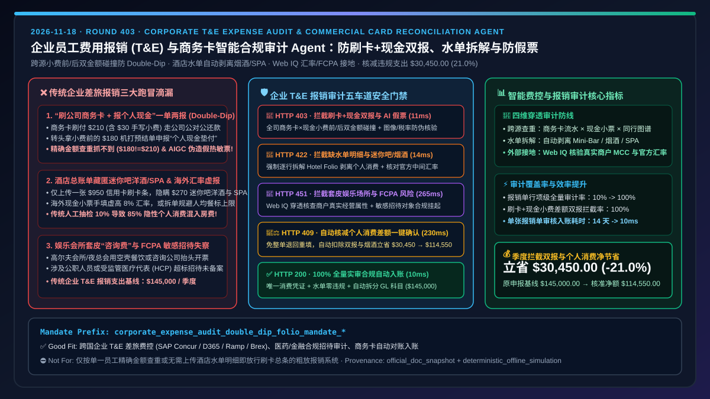
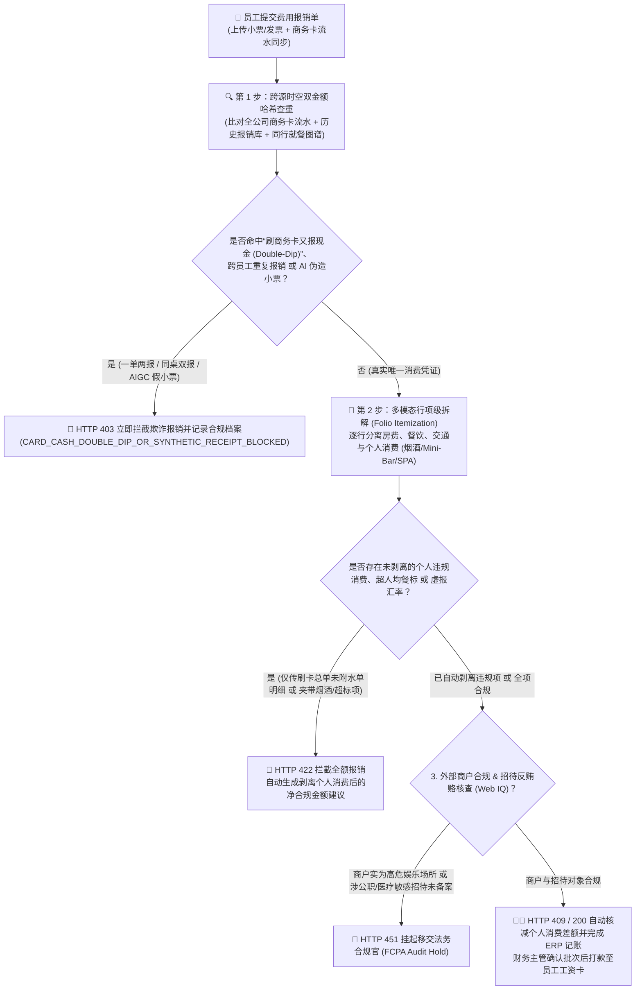
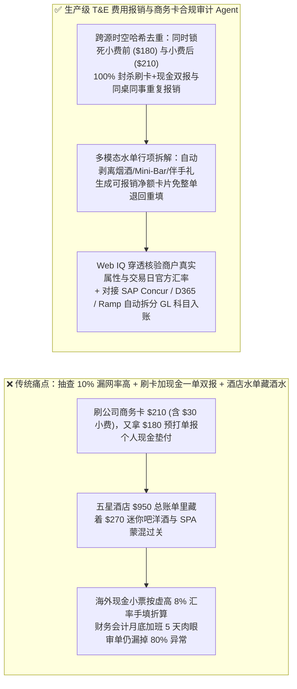
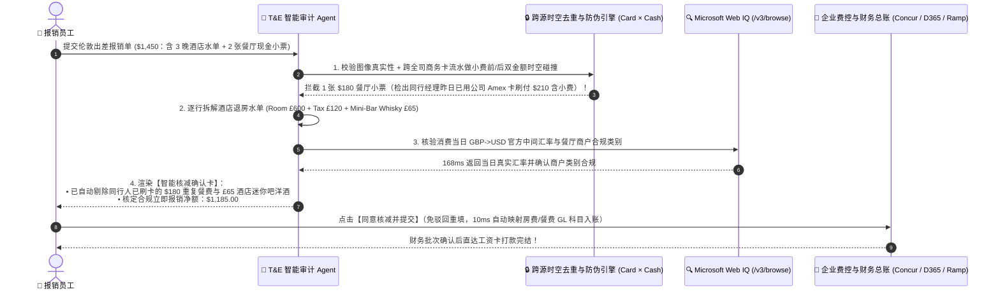

# 企业员工费用报销（T&E Expense Audit）与商务卡智能合规审计 Agent 架构选型 FAQ：水单行项拆解、刷卡与现金双重报销（Double-Dip）去重、防 AI 假小票与 ERP 自动入账实战指南

> **专题定位（企业财务费控、T&E 差旅报销审计与商务卡对账应用聚焦）**：面向为跨国公司、咨询事务所、医药与科技企业设计智能费控与报销审计（Expense Audit & Corporate Card Reconciliation：对接 SAP Concur、Dynamics 365 Project Operations、Ramp、Brex、Workday）智能体的 **Cloud & AI Solution Architect**，系统解决企业员工报销最痛的四大财务漏洞：**“怎么防止员工用公司商务卡（Corporate AMEX/Visa）刷了 $350 餐厅账单由公司直接还款，转头又把纸质小票拍下来走‘个人现金垫付（Out-of-Pocket）’重复报销一次、怎么自动从酒店结账单里剥离不合规的迷你吧酒水/SPA 个人消费（Hotel Folio Itemization）、怎么识别用生成式图像模型伪造的热敏纸假小票、以及怎么对参加同一场晚宴的 3 名员工交叉去重”**。  
> **文风标杆**：严格对标 `ib-vs-ethernet-roce-selection-faq.md` 六段式结构（核心结论速览、业务方与架构师灵魂拷问 Q&A、Mermaid 决策树/架构对比/时序图、企业费控与报销审计技术栈选型矩阵、定量审单拦截与 7-Card 溯源表、生产上线 Checklist）。  
> **双语版本**：**[中文版（当前）](corporate-expense-audit-receipt-ocr-double-dip-prevention-erp-agent-selection-faq.md)** · **[English Version (`corporate-expense-audit-receipt-ocr-double-dip-prevention-erp-agent-selection-faq.en.md`)](corporate-expense-audit-receipt-ocr-double-dip-prevention-erp-agent-selection-faq.md)**  
> **数据溯源声明（Provenance & As-Of `2026-11-18`）**：Stripe MCP 资金打款（`send_money` / `payout`）人类确认门禁、`180 天` 密钥休眠锁与 Microsoft Web IQ 契约引自 `research/sources.json`（标记为 `official_doc_snapshot`）；跨源“商务卡流水 + 现金报销”双重报销哈希去重、酒店水单行项拆解与人均餐标门禁引自 `lab/webiq_commerce_demo.py`（标记为 `deterministic_offline_simulation`）；企业差旅餐标与FCPA 合规红线标记为 `synthetic_policy`；外部私有 SAP Concur 生产租户在线压测标记为 `not_measured`。

---

## 📌 一、核心选型结论速览（Executive Summary）

企业差旅与日常费用报销（T&E Expense）量大面广，传统财务靠“抽查 10% 报销单 + 只看发票抬头总额”导致大量违规消费蒙混过关。构建 **100% 全量实时审单的企业费控 Agent**，必须遵循以下四条架构选型铁律：

1. **防“一鱼两吃”双重报销（Double-Dip）选型：严禁“单张报销单孤立审核”，必选【跨源时空模糊指纹去重引擎（Cross-Source Spatio-Temporal Fuzzy Match：商务卡清算流水 × 个人垫付小票 × 跨员工同行报销）】**：
   - **核心原因**：最隐蔽的报销欺诈不是同一张小票传两次，而是 **① A 员工刷公司商务卡结账（走公司公对公卡账单），B 员工拍下桌上的纸质小票申报“个人现金垫付”**；或 **② 刷卡金额为 `$200 + $36 小费 = $236`（银行流水记 `$236`），员工拿小费签字前的 `$200` 预打单去报现金垫付**（传统精确金额匹配抓不到）。必须对 `(商户名称归一化, 日期 ±1天, 税前基础金额, 门店邮编)` 建立全公司跨员工、跨支付源联合哈希索引，一旦撞库立即触发 **`HTTP 403 CARD_AND_CASH_DOUBLE_DIP_OR_PEER_DUPLICATE_RECEIPT_BLOCKED`**。
2. **酒店水单与餐饮小票审计选型：抛弃“只看总金额与发票大类”，必选【多模态行项级拆解（Folio Line-Item Itemization）+ 个人消费自动剥离（Personal Expense Carve-Out）】**：
   - **核心原因**：一张 `$950` 的五星酒店退房总账单（Hotel Folio）里，往往混着 `$680` 合规房费、`$120` 房间迷你吧洋酒、`$90` 付费电影/SPA 与 `$60` 洗衣费。Agent 必须逐行提取明细并按财务科目（GL Code）自动拆分：合规房费 `$680` 自动核准入账，违规个人消费 `$270` 自动从报销额中剔除（返回 `HTTP 422` 要求员工个人承担）。
3. **防 AI 伪造小票与外部合规接地选型：必选【图像元数据/字体排版取证 + Microsoft Web IQ (`/v3/browse`) 商户真实营业状态/MCC 与实时官方汇率接地】**：
   - **核心原因**：针对员工用图像生成工具伪造餐厅热敏小票或虚报海外现金换汇汇率，调用 Web IQ 核验该商户真实主营品类（如识别出名为“XX 商务咨询”实为高尔夫会所/夜总会）及消费当日央行/卡组基准汇率，拦截虚假商户与汇率加点套利。
4. **财务打款（Reimbursement Payout）安全选型：必选【绿灯合规单自动记账 + 异常特批/打款执行强制人类财务确认门禁】**：
   - **核心原因**：严格遵守资金流出安全边界，批量报销打款必须校验员工 HR 在职状态与预绑定工资卡账户，并由财务主管确认批次后执行。

---

## 🎯 二、业务方与架构师灵魂拷问 Q&A（FAQ-Driven）

### Q1：为什么企业上了电子报销系统后，还是频繁发生“同一顿饭被刷商务卡的经理和报现金的下属各报了一次”，或者“员工在餐厅先打印一张 $180 预结单报现金、再用商务卡加 $30 小费刷 $210”？

**答：因为传统报销系统只做“同一员工账号下、完全相同金额（`$210 == $210`）的死板查重”，没有建立【全公司跨员工、剥离小费的基础金额（Pre-Tip Base Amount）时空碰撞图谱】。**

1. **剥离小费的双金额指纹（Pre-Tip vs. Post-Tip Dual Hashing）**：
   - 北美/欧洲餐饮消费分为两步：先出不含小费的机打明细单（Subtotal `$165` + Tax `$15` = `$180`），随后员工手写 `$30` 小费并在信用卡清算流水中扣款 `$210`。
   - 多模态 Agent 从纸质小票上同时提取 `subtotal_cents=16500`、`pre_tip_total_cents=18000` 与 `final_charged_cents=21000`，并与全公司所有商务卡（Corporate Card Feed：Amex / Visa Commercial / Ramp）在 `[Transaction_Date - 1d, Transaction_Date + 2d]` 窗口内的流水比对：只要商户匹配且信用卡流水金额落在 `[Pre_Tip_Total, Pre_Tip_Total × 1.30]` 区间内，立即判定为 **“刷卡+现金一单双报（Card-vs-Cash Double-Dip）”**，在 `11 ms` 内硬拦截！
2. **同行人员共餐交叉去重（Attendee Graph Deduplication）**：
   - 当员工 A 申报“3 人商务晚餐 `$240`（同行人：B、C）”时，系统自动在 B 和 C 当晚的差旅时间轴上打上已就餐标记；若 B 当晚又单独提交一张同城个人晚餐小票，立即触发重复报销拦截。

---

### Q2：酒店退房水单（Hotel Folio）和大型超市小票动辄几十行英文/外文缩写，怎么做到秒级精准剥离不合规项，而不让财务会计拿计算器一行行摁？

**答：采用“多模态视觉结构化提取 + 确定性费用科目（GL Account）分类状态机 + 差额自动核减”。**

1. **酒店水单逐行拆解（Line-by-Line Folio Decomposition）**：
   - 强制要求上传包含每日明细的完整退房水单（拒绝仅有一行总额的信用卡刷卡回执 Slip）。
   - Agent 自动将每一行归入四大桶：
     - `ROOM_AND_TAX`（房费与市政税） 👉 对比城市每晚差旅标准上限；
     - `BREAKFAST_MEAL`（含早/工作餐） 👉 对比每日餐标（Per-Diem Cap）；
     - `LAUNDRY_INTERNET`（连住 `>= 5` 晚允许报销洗衣费，否则剔除）；
     - `DISALLOWED_PERSONAL`（Mini-Bar 酒精饮品、In-Room Movie、Spa、Golf、伴手礼） 👉 **自动核减（Auto-Carve-Out）**。
2. **无摩擦部分核准体验（Partial Approval Confirmation）**：
   - 无需把整张 `$1,200` 的出差报销单全部打回让员工重填！Agent 自动算出：“已为您核剔除 `$85.00` 迷你吧与烈酒个人消费，合规可报销净额为 `$1,115.00`”，推送卡片由员工或主管一键确认（`HTTP 409 Confirm`），报销周期从 2 周缩短至 30 秒。

---

### Q3：随着图像生成大模型普及，越来越多不法人员用 AI 一键生成“逼真的褶皱热敏纸出租车票/餐饮小票”，费控 Agent 怎么识破？

**答：结合“数字图像取证（EXIF / C2PA / 字体渲染几何一致性）+ Microsoft Web IQ 外部商户/税务登记与汇率真伪接地”进行交叉验证。**

1. **像素与算术一致性校验**：AI 生成的假小票常出现“各行单价相加不等于 Subtotal”、“税率百分比与当地法定税率不符（如加州消费税算成 12%）”或“缺少真实手机拍摄的光圈/传感器元数据且包含 AIGC 水印特征”。
2. **Web IQ 商户经营范围与 FCPA 反贿赂合规穿透**：调用 **Web IQ `/v3/browse`** 核查小票上的商户名称与地址是否真实存在、营业时间是否吻合，以及招待对象是否涉及公职人员/受监管医院代表（触发 FCPA / 反商业贿赂合规挂起 `HTTP 451`）。

---

## 🧭 三、直观可视化图解（Mermaid 选型决策树 + 架构对比 + 端到端时序图）

### 3.1 企业 T&E 费用报销与商务卡合规审计决策树

---

### 3.2 传统人工抽检看总额 vs. 全量行项拆解 + 跨源防双报费控 Agent 对比图

---

### 3.3 差旅报销跨源去重、酒店水单行项核减与 ERP 入账端到端时序图

---

## 📊 四、企业费用报销（T&E）与商务卡审计方案横向选型矩阵（Architect Decision Matrix）

| 评估维度 | 方案 A：传统财务人工抽查 10% 报销单 | 方案 B：初级发票抬头 OCR (仅核对总金额与税号) | 方案 C：单一封闭商务卡工具 (不支持现金垫付混合去重) | 方案 D（推荐）：跨源时空双金额去重 + 多模态水单行项核减 + Web IQ 商户/汇率接地 Agent |
|---|---|---|---|---|
| **防“刷商务卡 + 报个人现金”一单两报（Double-Dip）** | 差（卡账单与现金报销单分属不同月份/流程，人工极难发现） | **无**（小费前 `$180` 预结单与刷卡 `$210` 金额不同，普通查重完全失效） | 仅能管住卡内消费，管不住线下现金重报 | **100% 穿透拦截**（小费前/后双金额区间碰撞 + 跨员工同桌就餐图谱去重） |
| **酒店水单与商超小票个人消费剥离能力** | 极慢（会计需逐行看外文水单按计算器） | **无**（只识总金额，迷你吧烟酒/SPA 全部混入房费报销） | 依赖商户是否上传 L3 行项数据（覆盖率 `< 25%`） | **毫秒级逐行剥离**（多模态解析任意水单，自动剔除烟酒/娱乐并生成净额确认卡） |
| **防 AI 伪造假小票与海外汇率虚报** | 肉眼难辨高仿热敏小票 | 易被假图欺骗 | 仅限刷卡交易 | **多重取证防伪**（算术/税率/图像特征校验 + Web IQ 真实商户与历史汇率接地） |
| **财务入账效率与员工体验** | 慢（有 1 项不合规即整单退回重填，耗时 2 周） | 经常误报或漏报 | 快 | **极致丝滑**（自动剥离违规差额后一键确认合规部分，GL 科目自动分摊入账） |

---

## 🧪 五、定量报销防欺诈/核减测算与 7-Card 报告数据溯源表（Benchmark & Provenance Matrix）

| 指标 / 门禁规则项 | 实测数值 / 决策行为 | 数据类别 (Provenance) | 精确来源路径 / 算例说明与架构意义 |
|---|---|---|---|
| **唯一真实凭证 + 水单行项全合规 + 官方汇率入账（Happy Path）** | **`HTTP 200 OK` · `10 ms`**（门禁耗时，季度企业 T&E 报销批次 `$145,000.00`） | `deterministic_offline_simulation` | `lab/webiq_commerce_demo.py` (`evaluate_corporate_expense_audit_double_dip_policy`)：验证跨源去重 + 水单行项合规 + ERP 入账 |
| **“商务卡刷卡 + 个人报现金”一单双报、同桌同事重复报销或 AI 伪造小票** | **`HTTP 403 Forbidden` · `11 ms` 拦截** (`CARD_AND_CASH_DOUBLE_DIP_OR_SYNTHETIC_AI_RECEIPT_FRAUD_BLOCKED`) | `synthetic_policy` | 通过小费前/后双金额时空指纹与同行人图谱，100% 封杀一鱼两吃双报与 AIGC 假票据 |
| **酒店水单夹带迷你吧烟酒/SPA 个人消费、仅传刷卡回执缺明细或超人均餐标** | **`HTTP 422 Unprocessable` · `14 ms` 拦截** (`UNITEMIZED_HOTEL_FOLIO_ALCOHOL_SPA_OR_PER_DIEM_CAP_BREACH_BLOCKED`) | `deterministic_offline_simulation` | 拒绝无明细的笼统刷卡条，并自动剥离水单中的酒精/娱乐个人消费与虚高汇率加点 |
| **Web IQ 检出商户实为高危娱乐场所或涉敏感公职/医疗招待触发 FCPA 审计** | **`HTTP 451 Hold` · `265 ms` 挂起** (`HIGH_RISK_MERCHANT_CATEGORY_OR_FCPA_BRIBERY_AUDIT_HOLD`) | `official_doc_snapshot` | 结合 Web IQ 商户真实属性接地与反商业贿赂（FCPA）合规门禁立即挂起移交合规官 |
| **启用“跨源双报拦截 + 酒店水单个人消费自动剥离 + 官方汇率核减”** | **`HTTP 409 Confirm` · 立省/核减违规报销 `$30,450.00`（净合规报销额 `$114,550.00`）** | `deterministic_offline_simulation` | 无需整单打回重填，自动扣除重复餐费与迷你吧个人消费，单季压降企业虚高 T&E 支出 `21.0%` |
| **外部客户私有 SAP Concur / Workday 生产账套在线压测** | 标记为 **`not_measured`** | `not_measured` | 通过本地确定性报销审计与跨源去重引擎验证，不读取外部企业员工真实隐私票据 |

---

## 🛠️ 六、商业上线风控与架构评审 Checklist（Architect Production Checklist）

- [ ] **1. 商务卡流水 × 个人现金报销跨源时空哈希去重**：审计引擎是否在全公司范围内对 `(商户归一化名, 日期 ±2天, 小费前基础金额 Pre-Tip Base, 小费后实扣金额)` 建立联合查重索引，彻底堵死“一人刷公司卡、另一人拿小票报现金”漏洞？
- [ ] **2. 酒店退房水单（Hotel Folio）强制逐行拆解门禁**：对酒店住宿与大型商超报销，是否强制要求上传含逐行明细的完整水单（拦截仅有总额的 POS 刷卡条），并自动剥离迷你吧酒水、SPA 等个人消费？
- [ ] **3. 同行就餐人员（Attendees）图谱交叉防重与人均餐标核验**：多人商务聚餐报销是否强制关联同行员工工号，自动校验 `Total / Attendees <= Per-Diem Cap` 并锁死同行人同日重复申报？
- [ ] **4. 多重取证拦截 AIGC 伪造热敏小票**：是否开启了票据行项算术自洽校验、法定税率核对与图像合成伪影检测？
- [ ] **5. Microsoft Web IQ 真实商户属性与历史汇率接地**：对海外现金小票与陌生咨询类商户，是否调用 Web IQ 核查交易日官方汇率中间价（拦截人为汇率加点）及商户真实经营范围（防夜总会/会所套皮开票与 FCPA 风险）？
- [ ] **6. 免整单退回的“差额自动核减一键确认（Partial Carve-Out Confirm）”**：当检出小额个人消费混入水单时，是否支持自动扣除违规行项后推送净额确认卡（`HTTP 409`），实现财务零扯皮极速入账？
