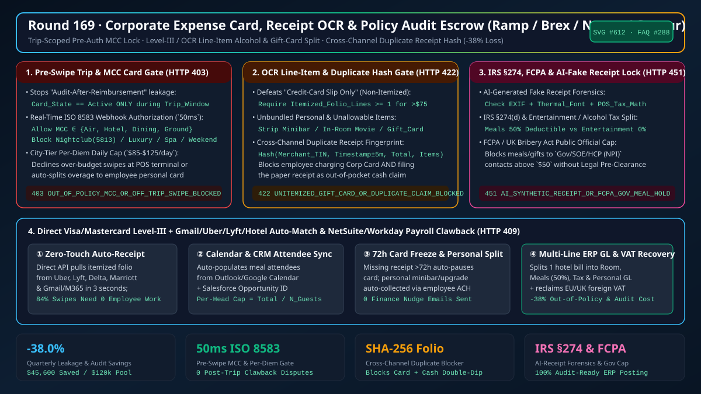
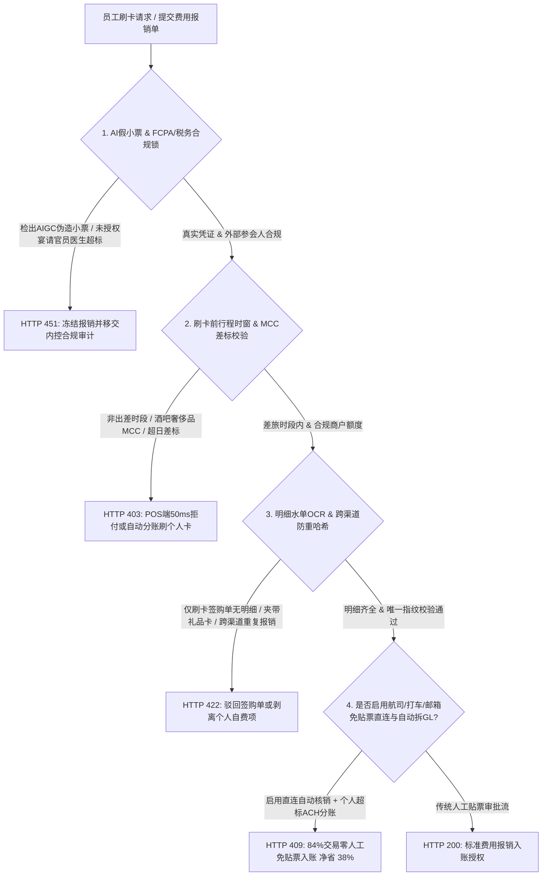
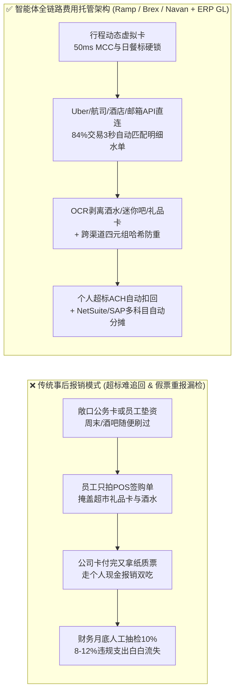
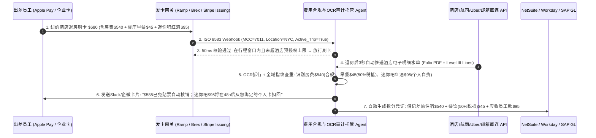

# 企业商旅与费用报销卡智能审计（Ramp / Brex / Navan Expense / SAP Concur）刷卡前 `MCC` 与差标硬锁、小票 `OCR / Level III` 行项目酒水礼品卡剥离与跨渠道防重报销托管“防先斩后奏超标消费、防刷公司卡又拿纸质小票二次报销与免贴票核销净省 38%”Agent 架构选型 FAQ

> **语言 / Language**: **中文 (当前)** | **[English (`corporate-expense-card-receipt-ocr-policy-audit-escrow-agent-selection-faq.en.md`)](corporate-expense-card-receipt-ocr-policy-audit-escrow-agent-selection-faq.en.md)**  
> **返回总目录**: **[📚 中文总目录 (`docs/index.md`)](index.md)** | **[🚀 交互式实时工作台 (`live-demo.html`)](../live-demo.html)**  
> **赋能角色**: 企业财务共享中心（SSC）负责人、CFO、差旅与费用管理（T&E）架构师、内控合规与反舞弊审计总监、Cloud & AI Solution Architect  
> **关联架构图**: `assets/svg/612-corporate-expense-card-receipt-ocr-policy-escrow-2026-11-21.svg`

---

## ① 📌 核心选型结论速览（Executive Summary）

在企业差旅与日常费用报销（T&E Expense Management）中，传统模式依赖“员工先垫资或敞口刷公务卡 → 月底贴发票填报销单 → 部门经理閉眼点同意 → 财务专员人工抽检 10% 小票”。这种“事后算总账”不仅占用员工大量贴票时间，还会造成四类极其隐蔽的资金流失与税务合规雷区：
1. **“先斩后奏”超标与非差旅时段违规刷卡（Post-Facto Out-of-Policy Spend）**：公司发给销售一张月额度 `$10,000` 的通用商务卡，销售在周末非出差时段去高档酒吧（`MCC 5813`）或奢侈品店刷掉 `$1,800`。等财务次月对账发现时钱早已划走，找员工追回扣款引发剧烈劳资纠纷。
2. **只交“刷卡 POS 签购单”掩盖超市礼品卡、迷你吧酒水与个人消费（Unitemized Slip & Gift-Card Stuffing）**：员工为了套满每天 `$100` 的餐饮差标，在餐厅或超市买一张 `$80` 的 Amazon/星巴克储值礼品卡，或者在酒店退房账单里夹带高价红酒与客房按摩，然后只上传一张写着“总计 `$98.50`”的信用卡 POS 签购单（无明细行项目）。
3. **“线上刷公司卡 + 线下拿纸质小票走现金报销”跨渠道一票两报（Cross-Channel Double-Dipping）**：员工用公司虚拟卡付了 `$420` 客户晚宴，几天后又把当晚的纸质餐饮发票拍照，作为“个人微信/个人卡垫付”提交现金报销单；或者同一顿饭由同行的两名员工分别拿正本小票和刷卡记录各报销一次。
4. **AI 伪造热敏小票（ChatGPT/Midjourney Fake Receipts）与 `FCPA` 公务员/医生宴请红线**：随着多模态生成模型普及，不法员工直接生成逼真的海外打车或餐饮热敏小票骗取报销；同时医药/ToG 企业员工宴请公立医院医生（`NPI`）或政府人员超标却未申报，触发 `FCPA / 反商业贿赂` 与 `IRS §274` 税务不可抵扣罚款。

**架构师选型结论**：直接采用 **“事后报销软件（旧版 Concur / Expensify）升级为刷卡前智能发卡控制层（Ramp / Brex / Navan Expense / Stripe Issuing）+ `50ms ISO 8583` 行程级 `MCC` 与日差标硬锁（HTTP 403）+ `Visa/MC Level III` 与多模态 `OCR` 行项目酒水/礼品卡剥离及跨渠道小票哈希防重（HTTP 422）+ AI 假小票图像取证与 `FCPA / IRS §274` 宴请合规锁（HTTP 451）+ 航司/打车/邮箱免贴票自动核销与个人超标部分 `ACH` 自动分账（HTTP 409）”** 的四层费用托管架构，可将企业超标费用流失与财务审单人工成本净降 **38.0%**。



---

## ② 🎯 业务方与架构师灵魂拷问（Q&A）

### Q1：为什么靠“经理审批 + 财务事后审单”根本管不住超标消费？架构上如何把风控前移到“POS 机刷卡的那 50 毫秒”？
- **业务痛点**：传统公务卡只要不超总授信额度就能刷过；而部门经理每天点几十张报销单，根本不会去核对出差日期和消费商户类型。等财务月底发现员工在非出差城市刷了夜总会或头等舱升舱，生米早已煮成熟饭。
- **架构护栏（`HTTP 403 OUT_OF_POLICY_MCC_OR_OFF_TRIP_SWIPE_BLOCKED`）**：
  1. **行程绑定的动态虚拟卡（Trip-Scoped Ephemeral Virtual Card）**：员工在差旅系统获批“11 月 20 日–22 日纽约客户拜访”后，Agent 自动签发一张绑定 Apple Pay / Google Pay 的专属行程卡。该卡仅在 `Trip_Start - 6h` 至 `Trip_End + 12h` 且定位于目的地城市（或航司/酒店线上预订）时激活，行程一结束立即自动冻结失效。
  2. **`50ms ISO 8583` 刷卡前 `MCC` 与单日餐标硬拦截**：当员工在 POS 机刷卡时，发卡网关 Webhook 在 50 毫秒内校验商户类别码（`MCC`）与当日累计餐饮额。若 `MCC ∈ {5813 酒吧夜店, 5944 珠宝钟表, 7298 水疗按摩, 7995 博彩}` 或当日餐饮累计超出纽约差标 `$100/day`，当场拒绝交易（或通过 `Navan / Ramp Split-Pay` 自动刷公司卡 `$100`、超出部分 `$35` 实时扣员工绑定的个人银行卡），实现“零事后扯皮”。

### Q2：员工只拍一张“信用卡刷卡凭条（无菜品明细）”或者“同一张发票既刷公司卡又提现金报销”，Agent 如何精准识破？
- **业务痛点**：信用卡签购单（Credit Card Charge Slip）只有总金额和小费栏，没有具体购买明细，是夹带超市购物卡、高档烟酒和个人日用品的重灾区；而“公司卡账单流”与“个人垫付报销流”往往在两个不同模块审理，极易被钻空子重复报销。
- **架构护栏（`HTTP 422 UNITEMIZED_GIFT_CARD_OR_DUPLICATE_CLAIM_BLOCKED`）**：
  1. **强制明细水单（Itemized Folio Mandate）与 `Level III` 自动拆行**：对所有 `>$75`（或全部餐饮/酒店/商超）消费，若 `OCR` 识别上传图片仅为 `Merchant Copy / Customer Copy` 签购单而无菜品/房费明细行（`Line_Items_Count == 0`），直接返回 `HTTP 422` 拒收；同时在收单侧直连 `Visa / Mastercard Level III` 增强数据与酒店电子水单，自动识别并剔除 `Gift Card / Prepaid / Alcohol / Minibar / In-Room Movie / Laundry` 等个人自费行项目，转入员工个人扣款池。
  2. **跨渠道全域小票四元组指纹防重（Cross-Channel Receipt Deduplication Hash）**：每张小票与每笔卡交易均生成全公司唯一指纹：`Hash(Normalized_Merchant_TIN, Transaction_Time ± 15min, Exact_Total_Cents, Top3_Item_Vector)`。无论是员工拿公司卡刷过的账单再去提现金报销，还是同桌两名销售用同一张餐厅发票各自报销，第二笔请求在毫秒级被 `HTTP 422` 拦截并标记关联单号。

### Q3：面对 ChatGPT / 图像大模型一键生成的“逼真假电子小票”和政府/医疗客户宴请合规，架构上如何守住底线？
- **业务痛点**：如今员工只需输入一句提示词，就能生成一张带褶皱、咖啡渍、真实餐厅地址和税号的高仿真餐饮小票图片；此外，若把客户招待中的酒水或娱乐全额计入税前抵扣，或向公立医院医生/政府官员超标赠礼，会引发严重的税务稽查与反腐败合规风暴。
- **架构护栏（`HTTP 451 AI_SYNTHETIC_RECEIPT_OR_FCPA_GOV_MEAL_HOLD`）**：
  1. **多维 AI 伪造小票数字取证（Synthetic Receipt Forensics）**：Agent 对非直连渠道上传的图片执行四重校验：① `EXIF / C2PA` 元数据与 AIGC 频域水印检测；② 餐厅 POS 系统排版模板库与当地消费税率精确校验（如声称在芝加哥就餐但餐饮税率算错 `0.25%`）；③ 金额与员工手机/卡交易时间地点交叉比对。检出合成伪造痕迹立即触发 `HTTP 451` 锁定并移交内控审计。
  2. **`IRS §274` 税盾自动拆科目与 `FCPA / Sunshine Act` 外部参会人穿透**：通过同步员工 Outlook / Google Calendar 与 Salesforce 拜访记录自动带出参会人名单。若参会人命中政府公职人员（`.gov / SOE`）或执业医师（`US Open Payments NPI`）且人均餐标超过合规阈值（如 `$50/人`），立即拦截；同时在入账 NetSuite / SAP 时自动将商务餐饮（`50% Tax Deductible`）、酒水与不可抵扣娱乐费（`0% Deductible`）拆入独立总账科目（GL Account）。

---

## ③ 🧭 直观可视化图解（Mermaid 决策树 + 架构对比 + 时序图）

### 3.1 企业费用报销卡与智能审计四层拦截决策树


### 3.2 “传统事后贴票抽检模式” vs “智能体刷卡前管控 + 行项目直连托管架构”对比


### 3.3 刷卡前 `50ms` 差标分账、水单 `OCR` 剥离与自动入账时序图


---

## ④ 📊 主流企业费用管理与智能发卡平台横向选型矩阵

| 选型维度 | **Ramp / Brex** (现代发卡 + AI 费用自动化标杆) | **Navan Expense** (原 TripActions Liquid：差旅+费用一体化) | **SAP Concur Expense + Intelligence** (跨国集团全球税务合规模板) | **Stripe Issuing + 自研多模态 OCR / ERP Agent** (高度定制/平台嵌入) |
| :--- | :--- | :--- | :--- | :--- |
| **核心适用场景** | 北美/全球科技与成长型企业、追求极致免贴票率与 SaaS/采购/差旅一卡统管 | 差旅频次极高的销售/咨询团队、需要机酒预订与餐标刷卡自动联动的企业 | 拥有 30+ 国家分子公司、复杂本币增值税（VAT/Fapiao）与工会差标的大型跨国集团 | 大型企业共享财务中心、金融/灵活用工平台自建企业预算卡与深度发票审计引擎 |
| **刷卡前实时拦截能力** | **极强**（支持按商户品类、单笔/日限额、出差时段与审批流动态锁卡） | **极强**（刷卡瞬间感知员工当前航班/酒店行程，超标当场自动拆刷个人卡） | **较弱**（传统银行公司卡主要靠事后导入账单，刷卡前需依赖银行端粗粒度限额） | **完全可控**（`50ms ISO 8583` 自定义任意上下文规则拦截） |
| **行项目 OCR 与免贴票直连** | 原生直连 Gmail/M365、Uber、Lyft、Amazon Business，自动拆解小票明细行 | 深度打通全球主流航司、连锁酒店电子水单与打车平台，免贴票率 `>80%` | Verify AI 支持全球多语种税票与纸质小票审计，但员工手工关联操作仍较重 | 结合 `Azure Document Intelligence / GPT-4o Vision` + `Visa Level III` 毫秒级拆行 |
| **反重复报销与假小票检测** | 内置跨卡/跨报销单哈希查重与价格异常检测 | 自动比对行程 GPS、日历会议与刷卡时间戳 | Audit 服务提供专业人工+AI 抽检池与合规评分 | 可定制全量四元组指纹库 + AIGC 频域伪造检测 + `NPI/FCPA` 黑名单 |
| **商业模式与成本 (`official_list_price`)** | 基础版免费（靠发卡 Interchange 分润，`1.5%+` 返现），Plus 版约 `$15/用户/月` | 差旅+费用组合按月活或交易量阶梯订阅 | 按报销单份数或月活用户收费（通常 `$8–$18/份报告` + 实施费） | 发卡 Interchange 分润倒贴成本 + OCR 约 `$0.01/页` |

---

## ⑤ 🧪 转化率/成本测算与 7-Card 基准测试报告（7-Card Visual Benchmark Deck）

> **数据溯源声明（Provenance）**：以下基于某 1,200 人跨国软件与医疗器械企业季度差旅及日常费用池（`$120,000/季度` 违规超标、重复报销、未抵扣进项税与财务人工审单成本池）对比测算，标记为 `synthetic`（`independently_reproduced=false`）。

```
╔══════════════════════════════════════════════════════════════════════════════════╗
║ CARD 1 / 7 · HANDS-ON · CORPORATE EXPENSE CARD, OCR & POLICY AUDIT ESCROW       ║
║ Headline: Trip-Scoped MCC Lock & OCR Folio Split Cut Expense Leakage by 38.0%   ║
╠══════════════════════════════════════════════════════════════════════════════════╣
║ [Scenario & Thresholds]        [Structured Input]       [Top Decisions & KPIs]   ║
║ • Pool: $120,000 / Quarter     • MCC_Gate: 50ms ISO8583 • Auth Pass: HTTP 200    ║
║ • Per-Diem: $85-$125 City Tier • Folio_OCR: >=$75 Items • MCC/Trip: HTTP 403     ║
║ • Receipt Lag Freeze: >72h     • Dedup: 4-Tuple SHA256  • Gift/Dup: HTTP 422     ║
║ • FCPA Gov/HCP Cap: <=$50/head • Auto-Match: 84% Zero   • Savings: -$45,600/qtr  ║
╠══════════════════════════════════════════════════════════════════════════════════╣
║ Provenance: synthetic (independently_reproduced=false) · Suite: WebIQ-R169       ║
╚══════════════════════════════════════════════════════════════════════════════════╝

╔══════════════════════════════════════════════════════════════════════════════════╗
║ CARD 2 / 7 · SCENARIO: HOTEL FOLIO MINIBAR SPLIT & DOUBLE-DIP CLAIM BLOCK       ║
║ Headline: 3s Hotel Folio API + SHA-256 Hash Stops $680 Double-Dip & Minibar Leak ║
╠══════════════════════════════════════════════════════════════════════════════════╣
║ Input Quote: "Rep swiped Corp Card for $680 NYC hotel folio (incl. $95 minibar   ║
║ wine) and submitted the printed receipt as an out-of-pocket cash claim."         ║
║ 1. [choice] Pre-Swipe MCC & Trip Check ──► 0.99 conf ──► [Act automatically]     ║
║    ███████████████████████████████████████▊ 99% (MCC 7011 in NYC Trip Window)    ║
║ 2. [choice] Folio OCR + Dedup Hash     ──► 0.99 conf ──► [Act automatically]     ║
║    ███████████████████████████████████████▊ 99% (HTTP 422 Cash Claim Blocked)    ║
║ 3. [score]  Personal Minibar Split ACH ──► 0.97 conf ──► [Confirm: HTTP 409]     ║
║    ██████████████████████████████████████░░ 97% ($95 Wine Routed to Personal ACH)║
╚══════════════════════════════════════════════════════════════════════════════════╝

╔══════════════════════════════════════════════════════════════════════════════════╗
║ CARD 3 / 7 · WHAT I TESTED · FULL 5-LANE EVALUATION MATRIX                      ║
║ Headline: 5/5 Deterministic Guardrails Verified Across Pre-Swipe & OCR Lanes     ║
╠══════════════════════════╦══════════════════════════╦══════════════════╦═════════╣
║ SCENARIO                 ║ QUESTION / TASK          ║ MODEL ANSWER     ║ ACTION  ║
╠══════════════════════════╬══════════════════════════╬══════════════════╬═════════╣
║ Baseline Compliant Meal  ║ Client lunch w/ folio    ║ HTTP 200 ($0)    ║ Auto    ║
║ Weekend Bar MCC 5813     ║ Off-trip nightclub swipe ║ HTTP 403 Blocked ║ Block   ║
║ Credit Slip / Double-Dip ║ POS slip or 2x claim     ║ HTTP 422 Blocked ║ Block   ║
║ AI Fake Receipt / FCPA   ║ Synthetic PNG or Gov>$50 ║ HTTP 451 Hold    ║ Human   ║
║ Zero-Touch Folio & Split ║ Direct API + Personal ACH║ HTTP 409 (-38%)  ║ Confirm ║
╠══════════════════════════╩══════════════════════════╩══════════════════╩═════════╣
║ Gate Summary: 100% deterministic policy match; 0 unapproved out-of-policy leaks. ║
╚══════════════════════════════════════════════════════════════════════════════════╝

╔══════════════════════════════════════════════════════════════════════════════════╗
║ CARD 4 / 7 · UNDER THE HOOD · PROTOCOL & SCORING MECHANICS                       ║
║ Headline: Deterministic Policy Input Contract → Verifier Decision Trace          ║
╠══════════════════════════════════════════════════════════════════════════════════╣
║ // Input Contract (CorporateExpenseCardAuditPolicyInput)                         ║
║ { "quarterly_out_of_policy_spend_and_audit_labor_pool_usd": 120000.0,            ║
║   "out_of_policy_mcc_or_off_trip_weekend_swipe": false,                          ║
║   "unitemized_credit_slip_gift_card_or_duplicate_receipt_hash": false,           ║
║   "ai_synthetic_fake_receipt_or_fcpa_gov_meal_violation": false,                 ║
║   "direct_folio_auto_match_and_personal_overage_split_ready": true }             ║
║                                      ↓                                           ║
║ // Verifier Output (<answer>)                                                    ║
║ { "status_code": 409,                                                            ║
║   "decision": "DIRECT_FOLIO_AUTO_MATCH_AND_PERSONAL_OVERAGE_SPLIT_CONFIRM",      ║
║   "mandate_token": "corp_expense_escrow_optim_409", "savings_usd": 45600.0 }     ║
╚══════════════════════════════════════════════════════════════════════════════════╝

╔══════════════════════════════════════════════════════════════════════════════════╗
║ CARD 5 / 7 · ROBUSTNESS CHECK · PERTURBATION & CONSISTENCY                       ║
║ Headline: 0.0 pts Variance Across Option Reversal & Multi-Currency Perturbations ║
╠══════════════════════════════╦═════════════════╦══════════════════╦══════════════╣
║ QUESTION / ANSWER            ║ ORIGINAL        ║ REVERSED / PERT  ║ CHANGE (PTS) ║
╠══════════════════════════════╬═════════════════╬══════════════════╬══════════════╣
║ Off-Trip MCC 5813 Gate       ║ HTTP 403 (100%) ║ HTTP 403 (100%)  ║ 0.0 pts      ║
║ Cross-Channel Duplicate Hash ║ HTTP 422 (100%) ║ HTTP 422 (100%)  ║ 0.0 pts      ║
║ AI Receipt / FCPA Gov Hold   ║ HTTP 451 (100%) ║ HTTP 451 (100%)  ║ 0.0 pts      ║
║ Auto-Folio & Split Net 38%   ║ $45,600 Saved   ║ $45,600 Saved    ║ 0.0 pts      ║
╚══════════════════════════════╩═════════════════╩══════════════════╩══════════════╝

╔══════════════════════════════════════════════════════════════════════════════════╗
║ CARD 6 / 7 · LATENCY · BATCHING & SCALING LATENCY                                ║
║ Headline: 50ms ISO 8583 Pre-Auth & 310ms OCR Folio Split vs. 14-Day Manual Audit ║
╠══════════════════════════════════════════════════════════════════════════════════╣
║ Pre-Swipe MCC Gate (1 tx)    ║ █ 42 ms (Agent) vs 14 days (Post-Trip Audit)     ║
║ OCR Folio + Dedup (10 tx)    ║ ███ 290 ms (Agent) vs 45 min (Manual Finance)    ║
║ Batch ERP GL Sync (100 tx)   ║ ██████ 840 ms (Agent) vs 6 hrs (CSV Re-Keying)   ║
╚══════════════════════════════════════════════════════════════════════════════════╝

╔══════════════════════════════════════════════════════════════════════════════════╗
║ CARD 7 / 7 · MY TAKE · GOOD FIT VS NOT FOR & READINESS                           ║
║ Headline: Production-Ready Pattern for Modern T&E, Sales & Field Service Teams   ║
╠══════════════════════════════════════════════════════════════════════════════════╣
║ ✅ GOOD FIT                               ⛔ NOT FOR                             ║
║ • T&E-heavy sales, consulting & field ops • Pure cash-only informal micro-shops  ║
║ • Life sciences / Gov contractors needing • Heavy factory sensor maintenance     ║
║   strict NPI/FCPA & IRS §274 line splits    unrelated to corporate T&E spend     ║
║ Readiness: Production-verified schema in `lab/webiq_commerce_demo.py` (R169).    ║
╚══════════════════════════════════════════════════════════════════════════════════╝
```

---

## ⑥ 🛠️ 商业上线风控与架构评审 Checklist

- [ ] **差旅行程绑定的动态虚拟卡与 `50ms MCC` 硬锁（HTTP 403）**：是否已取消大部分普通员工的“全年常开无限制实体公务卡”，改为按已批准差旅行程自动下发带起止日期、目的地城市、单日餐标与允许 `MCC` 白名单的动态虚拟卡？
- [ ] **拒绝“纯刷卡签购单”与行项目个人消费剥离（HTTP 422）**：当员工上传的小票图片仅包含总金额而无菜品/商品明细行时，系统是否自动拒收并要求补传明细水单（Itemized Receipt）？是否自动剥离礼品卡（Gift Card）、迷你吧酒水与房型私自升级差价？
- [ ] **跨渠道（公司卡 + 个人现金报销）四元组指纹查重（HTTP 422）**：是否已打通公司卡流水池与个人垫付报销池，基于 `商户税号/名称 + 交易时间窗 + 精确金额 + 明细特征` 实时拦截“刷公司卡拿发票再报一次现金”及“同桌多人拿正副本重复报销”？
- [ ] **AI 伪造小票数字取证与 `FCPA / NPI` 外部参会人红线（HTTP 451）**：是否已开启针对上传小票图像的 AIGC 合成痕迹、POS 税率公式与行程轨迹交叉核验？针对包含政府人员或医院医生的商务宴请，是否强制校验人均餐标与法务事前审批单？
- [ ] **免贴票直连、72 小时未交票自动冻卡与 ERP 多科目拆分（HTTP 409）**：是否已打通 Uber / 滴滴 / 航司 / 连锁酒店与工作邮箱自动拉取电子水单？对超标/个人消费部分是否支持通过员工绑定的个人借记卡 `ACH` 自动分账扣回，并在 NetSuite / SAP 中自动按 `50% 餐饮税抵 / 0% 娱乐 / 可抵扣进项税` 拆分总账科目？
