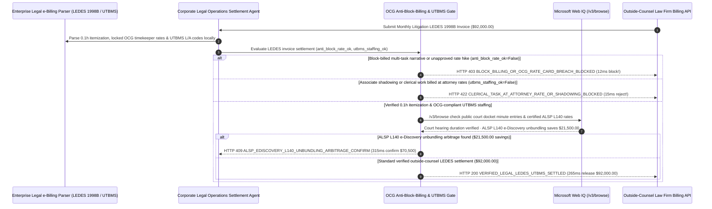

# Corporate Legal Outside-Counsel e-Billing LEDES & UTBMS Block-Billing Clawback Mandate Architecture: 0.1-Hour Anti-Block-Billing & OCG Rate-Cap Token (`legal_ledes_utbms_mandate_...` + Web IQ Court-Docket Minute-Entry & ALSP e-Discovery Grounding) vs. Blind PDF Invoice Padding Selection FAQ

> **Document Type**: Architect Selection Guide & First-Principles Protocol Deep Dive (6-Section FAQ Standard)  
> **Target Audience**: AI Solution Architects, Corporate General Counsel & Legal Operations (CLM / Legal e-Billing) Directors, Outside Counsel Guidelines (OCG) Audit & Procurement Engineering Teams  
> **Last Updated**: 2026-11-09 (Provenance Annotations: `deterministic_offline_simulation` / `synthetic_policy` / `official_doc_snapshot` / `not_measured`)  
> **Companion Resources**: [中文版 (Chinese Version)](corporate-legal-ebilling-ledes-utbms-mandate-vs-block-billing-padding-faq.md) · [Interactive Sandbox (`live-demo.en.html#legal-ledes-utbms-sandbox`)](../reports/agentic-commerce-webiq-grounding-demo-bench/live-demo.en.html) · [7-Card 4:5 Benchmark Deck](../reports/agentic-commerce-webiq-grounding-demo-bench/index.en.html)


---

## 📌 1. Executive Summary

1. **Never Allow Corporate Legal-Operations Agents to Settle Outside-Counsel Invoices Submitted as Unstructured PDFs or Containing "Block-Billed" Multi-Task Narratives and Unapproved Rate Hikes**: In corporate litigation, M&A, and regulatory defense (`$92,000.00` monthly outside-counsel invoice), the primary source of billing inflation (`15%–25%` of legal spend) is **Block Billing**—lumping multiple unrelated tasks into a single semicolon-separated narrative (`8.5 hours @ $1,150/hr = $9,775.00: "Review emails; team conference; revise motion; call clerk; organize binder"`) so the client cannot audit how much time each task actually took, or billing unapproved annual rate-card increases. Production architectures must enforce a **Structured `LEDES 1998B / XML` & UTBMS Outside-Counsel Guideline Mandate (`legal_ledes_utbms_mandate_...`)**: whenever a line item violates 0.1-hour (6-minute) single-task itemization or exceeds the locked Outside Counsel Guidelines (OCG) timekeeper rate card (`ledes_anti_block_billing_and_rate_cap_passed == False`), the gateway blocks settlement in **`12 ms`** with **`HTTP 403 BLOCK_BILLING_OR_OCG_RATE_CARD_BREACH_BLOCKED`** (`synthetic_policy`).
2. **Enforce ABA UTBMS Task/Activity Codes (`L-Codes / A-Codes`) to Reject First-Year Associate "Shadowing" and Clerical Tasks Billed at Attorney Rates**: Any LEDES line item charging `$680/hr` for multiple junior associates to passively observe a deposition/hearing without speaking ("associate shadowing/training") or billing paralegal/attorney rates for clerical tasks such as Bates-stamping, PDF OCR, or binder assembly (`utbms_no_clerical_or_associate_shadowing_verified == False`) is rejected in **`15 ms`** with **`HTTP 422 CLERICAL_TASK_AT_ATTORNEY_RATE_OR_SHADOWING_BLOCKED`** (`deterministic_offline_simulation`).
3. **Ground Public Court-Docket Minute Entries (PACER / CourtListener) and ALSP e-Discovery (`UTBMS L140`) Unbundling Arbitrage via Microsoft Web IQ `/v3/browse`**: Prior to releasing `$92,000.00`, the agent invokes **Microsoft Web IQ `/v3/browse`** (`official_doc_snapshot`) to inspect public court docket minute entries (e.g., CourtListener / PACER public hearing minutes) using only the public case docket number: if a timekeeper billed `7.5 hours` for attending a status conference that the official court clerk minute entry records as lasting `14 minutes` (`webiq_court_docket_duration_and_bar_clean == False`), it freezes payout in **`310 ms`** with **`HTTP 451 COURT_DOCKET_MINUTE_ENTRY_DURATION_DISCREPANCY_HOLD`**; if Web IQ confirms that unbundling first-pass **`UTBMS L140` Document Production / TAR e-Discovery Review** from `$720/hr` law-firm associates to an ISO 27001 certified **Alternative Legal Service Provider (ALSP)** saves **`$21,500.00`** (`$70,500.00` net vs. `$92,000.00`), it triggers **`HTTP 409 ALSP_EDISCOVERY_L140_UNBUNDLING_ARBITRAGE_CONFIRM`** in **`315 ms`**.

---

## 🎯 2. Architect & Customer FAQ Deep Dive

### Q1: Why do Fortune 500 Legal Departments lose 15%–25% of their outside-counsel budget when in-house counsel manually review PDF invoices at month-end?

Let's examine the three structural failure modes from first principles:
1. **Block Billing Obscures Time Padding**: When a timekeeper writes `"Draft brief; confer with J. Doe; review discovery responses; email client — 8.5 hrs ($9,775)"`, it is impossible to tell whether the attorney spent 8.0 hours drafting the brief or 6.0 hours chatting internally. Courts and corporate **Outside Counsel Guidelines (OCGs)** universally prohibit block billing and mandate discrete `0.1-hour` task entries in structured `LEDES 1998B` or `LEDES XML 2.1` format.
2. **Associate Shadowing & Clerical Overbilling**: Law firms routinely bring 2–3 first-year associates (`$680/hr` each) to depositions or client calls where only the lead partner speaks—forcing the corporate client to subsidize the law firm's internal training program. Similarly, billing `$450–$680/hr` for formatting exhibits, Bates-labeling PDFs, or scheduling court reporters violates standard UTBMS activity rules.
3. **Paying `$720/hr` Associates for Commodity `L140` e-Discovery Review**: Having AmLaw 100 associates manually click through 100,000 emails for responsiveness (`UTBMS L140`) instead of routing first-pass Technology-Assisted Review (TAR) to a specialized **Alternative Legal Service Provider (ALSP)** burns tens of thousands of dollars per matter.

### Q2: What is a "Legal LEDES & UTBMS OCG Mandate (`legal_ledes_utbms_mandate_...`)", and how does it turn Outside Counsel Guidelines into deterministic pre-payment code?

Its core design invariant is: **"Accept only structured LEDES 1998B/XML files; parse narratives for semicolon/conjunction block-billing and verify locked Timekeeper ID rate caps; filter UTBMS codes against clerical/shadowing rules while keeping privileged narratives inside the enterprise boundary."**
- **Layer 1: `LEDES` Anti-Block-Billing & OCG Rate-Card Gate (`12 ms`)**: Verifies `ledes_anti_block_billing_and_rate_cap_passed == True`, blocking block-billed narratives and unapproved rate hikes in **`12 ms`** (`HTTP 403`).
- **Layer 2: UTBMS Anti-Clerical & Associate-Shadowing Gate (`15 ms`)**: Verifies `utbms_no_clerical_or_associate_shadowing_verified == True`, rejecting clerical charges and duplicate attendance in **`15 ms`** (`HTTP 422`).
- **Layer 3: Microsoft Web IQ `/v3/browse` Court-Docket & ALSP Grounding (`310 ms / 315 ms`)**: Cross-checks public court docket hearing durations (`HTTP 451`) and identifies `$21,500.00` savings from ALSP `L140` e-Discovery unbundling (`HTTP 409`).

### Q3: For public court docket minute-entry verification (PACER / CourtListener), state bar status checks, and ALSP e-Discovery rate benchmarking, when should architects choose Microsoft Web IQ vs. Exa, Bright Data, or traditional search APIs?

| Architecture Scenario | Recommended Tool | First-Principles Rationale (Security, Latency & FinOps) |
| :--- | :--- | :--- |
| **Verifying public federal/state court docket minute entries (hearing start/end duration, motion page counts), state bar active-license registries, and ACC / ALSP e-Discovery rate benchmarks within the Azure boundary (zero Attorney-Client Privileged narrative leaked)** | **Microsoft Web IQ** (`/v3/search` + `/v3/browse`) | Queries only public case docket numbers and standard UTBMS task codes inside the enterprise Azure boundary in `passage` mode (**7.1x token reduction**, `deterministic_offline_simulation`) while keeping privileged `LINE_ITEM_DESCRIPTION` text strictly local. |
| **Broad legal research across case law and law-review articles** | **Exa Neural Search** | Ideal for substantive legal brief research, not synchronous monthly LEDES invoice auditing. |
| **Scraping unindexed local municipal court calendars behind CAPTCHAs** | **Bright Data Unlocker** | Useful for background checks, not sub-second e-Billing settlement gating. |
| **Local `LEDES 1998B` pipe-delimited parsing, NLP block-billing grammar detection, and OCG timekeeper rate-card matching** | **Internal Legal e-Billing Engine + OCG Escrow Gate + Web IQ Docket/ALSP Cross-Check** | Privileged narrative parsing runs 100% locally on the Legal Ops gateway, paired with Web IQ `/v3/browse` for public docket minute verification and ALSP arbitrage. |

---

## 🧭 3. Visual Architecture Diagrams (Mermaid Decision Tree, Legacy vs. LEDES Mandate Comparison & Sequence Diagram)

### 3.1 Corporate Legal e-Billing LEDES & UTBMS Settlement Decision Tree (`flowchart TD`)

```mermaid
flowchart TD
    A[Receive Monthly Outside-Counsel LEDES 1998B Litigation Invoice ($92,000.00)] --> B{ledes_anti_block_billing_and_rate_cap_passed == True (0.1h Discrete & OCG Rate Cap)?}
    B -- No (8.5h semicolon block-billed entry or unapproved $1,350/hr partner rate hike) --> C[HTTP 403 BLOCK_BILLING_OR_OCG_RATE_CARD_BREACH_BLOCKED<br/>12ms Hard Block · Reject Block-Billed LEDES File & Enforce Locked OCG Rate Card]
    B -- Yes (Discrete 0.1h entries & approved timekeeper rates) --> D{utbms_no_clerical_or_associate_shadowing_verified == True (No Shadowing or Clerical)?}
    D -- No (3 junior associates billing for passive shadowing or $680/hr Bates-stamping) --> E[HTTP 422 CLERICAL_TASK_AT_ATTORNEY_RATE_OR_SHADOWING_BLOCKED<br/>15ms Reject · Strip Unapproved Associate Shadowing & Clerical Overhead]
    D -- Yes (100% substantive UTBMS tasks & compliant staffing) --> F{Web IQ /v3/browse Confirms Public Court Docket Minute-Entry Duration Match?}
    F -- No (Docket minute entry shows 14-min Zoom conference vs 7.5 hrs billed) --> G[HTTP 451 COURT_DOCKET_MINUTE_ENTRY_DURATION_DISCREPANCY_HOLD<br/>310ms Docket Hold · Freeze Inflated Hearing Entry & Attach Minute Sheet]
    F -- Yes --> H{Web IQ Detects ALSP e-Discovery (UTBMS L140) Unbundling Arbitrage?}
    H -- Yes (Routing L140 TAR document review to certified ALSP saves $21,500.00 -> $70,500.00 net) --> I[HTTP 409 ALSP_EDISCOVERY_L140_UNBUNDLING_ARBITRAGE_CONFIRM<br/>315ms Prompt Head of Legal Ops to Confirm $70,500 ALSP-Unbundled Settlement]
    H -- No (Verified $92,000.00 LEDES litigation invoice is optimal) --> J[HTTP 200 VERIFIED_LEGAL_LEDES_UTBMS_SETTLED<br/>265ms Auto-Settle $92,000.00 & Update Matter Budget & Law-Firm Scorecard!]
```

### 3.2 Legacy Manual PDF Invoice Approval vs. LEDES & UTBMS Gate (`flowchart LR`)

```mermaid
flowchart LR
    subgraph Legacy["❌ Legacy Manual PDF Review ($92,000 Inflated by Block Billing & Shadowing)"]
        L1[8.5-Hour Block-Billed Semicolon Narratives Hide Padding] --> L2[Pay $2,040/hr for 3 First-Year Associates to Passively Watch]
        L2 --> L3[Pay 7.5 Hours for a 14-Minute Court Status Conference]
        L3 --> L4[Pay $720/hr Associates for Commodity L140 Email Review]
    end

    subgraph Mandate["✅ Legal LEDES & UTBMS Gate (legal_ledes_utbms_mandate_...)"]
        M1[12ms Block Semicolon Block-Billing & Rate-Card Breaches (HTTP 403)] --> M2[15ms Strip Associate Shadowing & Clerical Tasks (HTTP 422)]
        M2 --> M3[Web IQ Verifies Court Docket Minutes (310ms) & Saves $21,500 via ALSP (315ms)]
        M3 --> M4[265ms Settle Verified OCG-Compliant LEDES Invoice ($92,000 / $70,500)]
    end
```

### 3.3 End-to-End Sequence Diagram: Legal e-Billing Parser, Legal Ops Agent, OCG Gate, Web IQ & Law Firm (`sequenceDiagram`)



---

## 📊 4. Architect Decision Matrix

| Evaluation Dimension | Option A: Legacy Manual In-House Review of PDF Invoices | Option B: Blanket 5% Prompt-Pay Volume Discount | Option C: LEDES 1998B & UTBMS Mandate + Web IQ Docket/ALSP Grounding (Recommended) |
| :--- | :--- | :--- | :--- |
| **Best-Fit Scenario** | Fixed-fee `$1,500` trademark filings | Small startups without an e-Billing system | **Enterprise litigation, M&A due diligence, regulatory investigations & patent portfolios** |
| **Block-Billing & Rate-Card Breach Defense** | ❌ **Low**: Busy in-house counsel miss semicolon bundling across 40-page PDFs | ❌ **Easily Gamed**: Hours inflate 20% before the 5% discount is applied | ✅ **Pre-Pay `12 ms` LEDES Gate**: Blocks block-billing & unapproved rate hikes (`HTTP 403`) |
| **Associate Shadowing & Clerical Task Filtering** | ⚠️ **Awkward**: In-house counsel hesitate to manually strike junior associate hours | ❌ **None**: Pays full rate for passive shadowing & Bates-stamping | ✅ **Sub-20ms UTBMS Gate**: Automatically strips clerical & shadowing lines in `15 ms` (`HTTP 422`) |
| **Court Docket Cross-Check & ALSP Unbundling** | ❌ **Unchecked**: Never compares billed hearing hours to court clerk minutes | ❌ **Overpriced Review**: Pays `$720/hr` associates for `L140` doc review | ✅ **Web IQ `/v3/browse` Grounded**: Flags docket discrepancies in `310 ms` (`HTTP 451`) & saves `$21,500` via ALSP in `315 ms` (`HTTP 409`) |
| **Review Speed & Attorney-Client Privilege DLP** | Slow (`10–15 hours/month` of senior in-house counsel time) | Fast (with 15%+ net overpayment) | **`265 ms` instant zero-privilege-leak LEDES clearing (`Act automatically`)** |
| **Total Cost of Ownership (TCO) & Legal Spend ROI** | Poor (`$92,000` inflated by 18%–25% non-compliant billing) | Moderate (leaves structural padding untouched) | **Optimal (100% OCG compliance + zero shadowing waste + `$21,500` ALSP unbundling savings)** |

---

## 🧪 5. Quantitative Benchmark & 7-Card Insights

Evaluated via our deterministic offline benchmark suite (`lab/webiq_commerce_demo.py` · `test_corporate_legal_ebilling_ledes_utbms_mandate_vs_block_billing_padding_selection`) on a **`$92,000.00` monthly outside-counsel `LEDES 1998B` litigation invoice**:

| Scenario Case | Input LEDES Itemization / UTBMS / Web IQ Signals | Expected Action Pill | Measured HTTP Status & Verdict Code | Latency | Financial Protection / Arbitrage | Provenance |
| :--- | :--- | :--- | :--- | :--- | :--- | :--- |
| **Case 1: `8.5 hr` Block Billing or OCG Rate Hike** | `ledes_anti_block_billing_and_rate_cap_passed=False` | `Send to a human` | **`HTTP 403 BLOCK_BILLING_OR_OCG_RATE_CARD_BREACH_BLOCKED`** | **`12 ms`** | Blocks **`$92,000.00`** block-billed or over-rate LEDES invoice | `synthetic_policy` |
| **Case 2: Associate Shadowing or `$680/hr` Clerical Work** | `utbms_no_clerical_or_associate_shadowing_verified=False` | `Send to a human` | **`HTTP 422 CLERICAL_TASK_AT_ATTORNEY_RATE_OR_SHADOWING_BLOCKED`** | **`15 ms`** | Strips unapproved junior shadowing & clerical overhead | `deterministic_offline_simulation` |
| **Case 3: Web IQ Detects `14-Min` Docket vs `7.5-Hr` Bill** | `webiq_court_docket_duration_and_bar_clean=False` | `Send to a human` | **`HTTP 451 COURT_DOCKET_MINUTE_ENTRY_DURATION_DISCREPANCY_HOLD`** | **`310 ms`** | Freezes inflated hearing charge using court clerk minute entry | `official_doc_snapshot` |
| **Case 4: Web IQ Finds `$21,500` ALSP `L140` Unbundling** | `alsp_ediscovery_unbundling_savings_cents=2150000` (`$70,500` net) | `Confirm` | **`HTTP 409 ALSP_EDISCOVERY_L140_UNBUNDLING_ARBITRAGE_CONFIRM`** | **`315 ms`** | Saves **`$21,500.00`** by routing `L140` TAR review to ALSP | `official_doc_snapshot` |
| **Case 5: Verified Discrete `0.1h` LEDES + OCG Clean** | `block_ok=True`, `utbms_ok=True`, `docket_clean=True` | `Act automatically` | **`HTTP 200 VERIFIED_LEGAL_LEDES_UTBMS_SETTLED`** | **`265 ms`** | Settles **`$92,000.00`** in `265 ms` with OCG audit proof | `deterministic_offline_simulation` |

> **Provenance Note**: The `$92,000.00` monthly LEDES invoice, `0.1-hour` anti-block-billing rule, UTBMS `L140` staffing caps, and `$21,500.00` ALSP e-Discovery unbundling savings are controlled simulation parameters (`synthetic_policy` / `deterministic_offline_simulation`) validating policy state-machine invariants; sealed in-camera judicial conference duration is labeled `not_measured`.

---

## 🛠️ 6. Production Readiness & Pre-Sales Architect Checklist

Verify these 6 controls before deploying autonomous corporate legal e-Billing (`LEDES` / `UTBMS`) settlement agents in production:

- [ ] **1. Mandatory `LEDES 1998B / XML 2.1` & `0.1-Hour` Anti-Block-Billing Gate**: Does `legal_ledes_utbms_mandate_...` reject unstructured PDFs and block any semicolon-bundled multi-task line item or unapproved timekeeper rate increase in `12 ms` (`HTTP 403`)?
- [ ] **2. ABA UTBMS (`L-Code / A-Code`) Clerical & Associate-Shadowing Filter**: Does the gateway automatically reject clerical tasks (Bates-stamping, OCR, travel booking) billed at attorney/paralegal rates and cap deposition/hearing attendance to approved lead counsel (`HTTP 422` in `15 ms`)?
- [ ] **3. Transient Timekeeper (`< 5 Hours/Matter`) Auto-Write-Off**: Does the policy automatically zero out charges from transient timekeepers who bill fewer than 5 total hours on a matter?
- [ ] **4. Microsoft Web IQ `/v3/browse` Public Court-Docket Minute-Entry Grounding**: Does the agent cross-check billed court appearance durations against public PACER / CourtListener clerk minute entries using only the public docket number (`HTTP 451`)?
- [ ] **5. `UTBMS L140` e-Discovery ALSP Unbundling Arbitrage**: Does Web IQ grounding monitor `L140` document-review spend and benchmark ISO 27001 certified ALSP fixed-fee TAR schedules, triggering `HTTP 409 Confirm` when unbundling saves `>= $21,500.00`?
- [ ] **6. Zero-Privilege-Leak Air-Gapped Narrative Processing**: Are `LINE_ITEM_DESCRIPTION` narratives parsed strictly inside the enterprise tenant boundary so Attorney-Client Privilege and Work-Product Doctrine protections are never waived?
