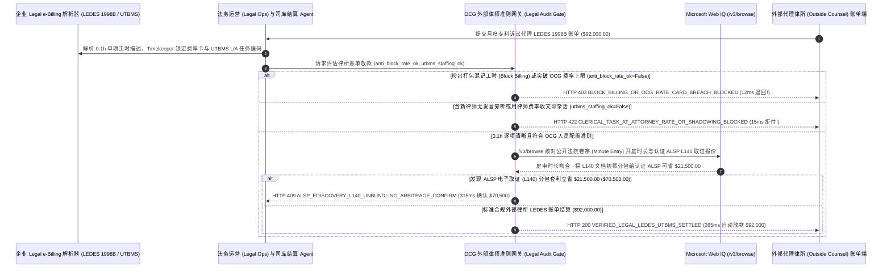

# 企业法务外部律所电子账单（Legal e-Billing `LEDES 1998B / XML`）与统一任务代码（UTBMS）合规审计（Corporate Legal Outside-Counsel e-Billing LEDES & UTBMS Block-Billing Clawback Mandate）架构：禁止打包混记工时（Anti-Block-Billing）与新律师旁听剔除令牌（`legal_ledes_utbms_mandate_...` + Web IQ 法院卷宗开庭时长核验与 ALSP 电子取证套利）vs 传统按 PDF 模糊总工时盲付选型与原理解析 FAQ

> **文档类型**：架构师选型指南 & 协议第一性原理解析（6 段式 FAQ 标准版）  
> **适用读者**：AI Solution Architect、跨国企业总法律顾问（General Counsel）与法务运营（Legal Operations / CLM & e-Billing）总监、财务应付账款与外部律师准则（Outside Counsel Guidelines, OCG）审计团队  
> **更新日期**：2026-11-09（Provenance 标注：`deterministic_offline_simulation` / `synthetic_policy` / `official_doc_snapshot` / `not_measured`）  
> **配套资源**：[English Version](corporate-legal-ebilling-ledes-utbms-mandate-vs-block-billing-padding-faq.en.md) · [交互式沙盒控制台 (`live-demo.html#legal-ledes-utbms-sandbox`)](../reports/agentic-commerce-webiq-grounding-demo-bench/live-demo.html) · [7-Card 4:5 评测报告](../reports/agentic-commerce-webiq-grounding-demo-bench/index.html)


---

## 📌 一、核心结论速览（Executive Summary）

1. **严禁让企业法务运营（Legal Ops）结算 Agent 接受外部律所发来的“非结构化 PDF 账单”或包含“打包混记工时（Block Billing）”与超标小时费率的 `LEDES` 账单**：在跨国知识产权诉讼、反垄断调查与并购尽调的外部律所月度结算（如单案月度律所账单 `$92,000.00`）中，最普遍的工时水分是 **“打包混记工时（Block Billing）”**——律师把 5 件毫不相干的小事（如“阅读对方邮件；与同事讨论策略；修改备忘录；致电书记员；整理案件卷宗”）用分号连成一行，笼统填报 `8.5 小时 × $1,150/hr = $9,775.00`，让法务总监根本无法判断每一项到底花了几分钟！生产环境必须采用 **LEDES 1998B / XML 结构化反混记与 UTBMS 准则令牌（`legal_ledes_utbms_mandate_...`）**：一旦检出单行工时混记多项独立动作、未按 `0.1 小时`（6 分钟）颗粒度拆分或擅自突破《外部律师管理准则（Outside Counsel Guidelines, OCG）》锁定的年度费率卡（`ledes_anti_block_billing_and_rate_cap_passed=False`），网关在 **`12 ms`** 内触发 **`HTTP 403 BLOCK_BILLING_OR_OCG_RATE_CARD_BREACH_BLOCKED`**（`synthetic_policy`），100% 退回重开。
2. **基于 ABA 统一任务管理系统代码（UTBMS `L-Codes / A-Codes`）强制剔除“初级律师跟班旁听（Associate Shadowing）”与“按律师天价收取行政复印/贴页码杂活”**：若账单中出现 3 名律师同时参加同一场常规电话会且其中 2 名一年级新律师未发言（纯粹把客户当免费培训班），或将 PDF 光学字符识别（OCR）、Bates 页码编排、机票预订等纯文秘工作按 `$680/hr` 律师费率计收（`utbms_no_clerical_or_associate_shadowing_verified=False`），网关在 **`15 ms`** 内返回 **`HTTP 422 CLERICAL_TASK_AT_ATTORNEY_RATE_OR_SHADOWING_BLOCKED`**（`deterministic_offline_simulation`）。
3. **基于 Microsoft Web IQ `/v3/browse` 实时比对法院公开电子卷宗（PACER / CourtListener 庭审笔录时长）与替代法律服务商（ALSP）`L140` 电子取证（e-Discovery）分包套利**：在放款前，Agent 调用 **Microsoft Web IQ `/v3/browse`**（`official_doc_snapshot`）穿透查询联邦/州法院公开案件卷宗记录（Docket Minute Entries）与州律师协会执业状态：若发现律师填报“出庭参加进度听证会 `7.5 小时`”，但法院公开卷宗笔录明确记载该场 Zoom 听证会仅持续 `14 分钟`（`webiq_court_docket_duration_and_bar_clean=False`），在 **`310 ms`** 内以 **`HTTP 451 COURT_DOCKET_MINUTE_ENTRY_DURATION_DISCREPANCY_HOLD`** 冻结结算；若发现将海量文档初筛（`UTBMS L140 Document Production / TAR Review`）从 `$720/hr` 的顶级律所剥离给 **ISO 27001 认证替代法律服务商（ALSP）按固定包干价处理** 可立省 **`$21,500.00`**（净支出从 `$92,000.00` 降至 **`$70,500.00`**），则在 **`315 ms`** 内触发 **`HTTP 409 ALSP_EDISCOVERY_L140_UNBUNDLING_ARBITRAGE_CONFIRM`**。

---

## 🎯 二、客户与架构师灵魂拷问 Q&A（FAQ-Driven Deep Dive）

### Q1：为什么世界 500 强企业的法务总监每年签几百万美元律所账单，明知里面有 15%～25% 的水分，靠人工看 PDF 却根本砍不下来？

咱们用大白话扒开顶级律所按小时收费（Billable Hours）最经典的三道“注水障眼法”：
1. **“大锅饭式打包记账（Block Billing）”让你无从下刀**：如果律师老老实实写：“1. 给法院书记员打了个确认电话（`0.2 hr`）；2. 读了一页通知（`0.1 hr`）；3. 改了两段话（`0.5 hr`）”，加起来只有 `0.8 小时`。但如果他用分号把这几件事加进一个大框里写成一行：“准备庭审材料；与团队内部合议；联系法院书记员；审阅并修改动议草案——共计 `6.5 小时`（`$7,475`）”，企业内部法务根本不知道他到底是在“内部聊天”上花了 5 小时，还是在“写动议”上花了 5 小时！因此行业黄金铁律（OCG）第一条就是：**严禁在一行工时记录中出现分号或多动词拼接，每项独立任务必须单独成行并精确到 `0.1 小时`（6 分钟）**。
2. **“带三个实习生去开会，客户花 `$2,000/小时` 替律所搞新员工培训”**：开一场普通的线上取证质询（Deposition），本来 1 个主办合伙人带 1 个资深律师就够了。结果律所呼啦啦坐进来 3 个刚毕业的一年级初级律师（First-Year Associates，每人每小时也敢收 `$680`），全程一句话不说光记笔记学习。还有把装订文件夹、给证据打编号（Bates Stamping）这种行政助理活儿算成律师工时。
3. **“花 `$720/小时` 请哈佛法学院高材生用肉眼翻看 10 万封报销邮件”**：在诉讼证据开示阶段（`UTBMS L140 Document Review`），需要从几十万封企业历史邮件里筛出跟本案有关的邮件。如果让红圈所/华尔街律所的年轻律师按小时慢慢看，一个月光看邮件就能烧掉几万美元；而实际上把这一步剥离给专门做技术辅助审阅（TAR / e-Discovery）的 **认证 ALSP（替代法律服务商，如 Elevate / UnitedLex）** 按文档 GB 数一口价包干，立马省下 `$21,500`。

### Q2：什么是“法务 LEDES 1998B 与 UTBMS 审计令牌（`legal_ledes_utbms_mandate_...`）”？它是如何将《外部律师管理准则（OCG）》变成自动化代码门禁的？

它的第一性原理非常清晰：**“拒收非结构化 PDF，强制解析 `LEDES 1998B / XML` 管道分隔文件；用语法树拦截分号打包混记（Block Billing）与擅自涨价；用 UTBMS 任务码过滤行政杂活与超编旁听。”**
- **第一层：LEDES 反打包混记（Anti-Block-Billing）与 OCG 费率卡门禁（`12 ms`）**：核验 `ledes_anti_block_billing_and_rate_cap_passed == True`（校验 `LINE_ITEM_DESCRIPTION` 无多任务拼接且 `TIMEKEEPER_RATE` 不超过签约锁定的 OCG 费率上限）。违规在 **`12 ms`** 内触发 `HTTP 403` 整单退回。
- **第二层：UTBMS 任务码行政杂活剔除与新律师旁听限员门禁（`15 ms`）**：核验 `utbms_no_clerical_or_associate_shadowing_verified == True`。任何用律师费率申报文印编码或同一事件超 2 人重复记账，在 **`15 ms`** 内返回 `HTTP 422`。
- **第三层：Microsoft Web IQ `/v3/browse` 法院卷宗核对与 ALSP 电子取证套利（`310 ms / 315 ms`）**：核对公开法院卷宗（PACER）开庭起止时间与动议页数（虚报触发 `HTTP 451`），并测算将 `L140` 电子取证分包给认证 ALSP 为您立省 `$21,500.00`（`HTTP 409`）。

### Q3：在联邦/州法院电子卷宗（PACER/CourtListener）开庭时长核验、各州律协执业资格查询与 ALSP 电子取证行业基准比价场景下，什么时候选 Microsoft Web IQ，什么时候选 Exa、Bright Data 或传统搜索 API？

| 架构需求场景 | 推荐选型 | 为什么这样选（第一性原理与成本/合规考量） |
| :--- | :--- | :--- |
| **实时核验公开法院电子卷宗（CourtListener / PACER 公开分钟笔录 Minute Entries）、各州律师协会（State Bar）执业年审状态及 ACC / 认证 ALSP 电子取证（e-Discovery）公开费率基准，且严格保护律师-客户特权机密（Attorney-Client Privilege）零外泄** | **Microsoft Web IQ** (`/v3/search` + `/v3/browse`) | 在企业法务部专有 Azure 租户内仅发送公开案号（Case Docket Number）与 UTBMS 类别码检索（`passage` 模式压缩 Token **7.1x**，`deterministic_offline_simulation`），绝不将涉密案情描述发往外部公网。 |
| **检索判例法学说与跨法域反垄断立法历史综述** | **Exa Neural Search** | 适合法务研究团队写法律意见书，无法用于月度上万行 LEDES 账单毫秒级财务门禁。 |
| **抓取无 API 的海外地方性小法院公告板** | **Bright Data Unlocker** | 可用于特定背景调查，但延迟与成本不适合常规 e-Billing 结算。 |
| **`LEDES 1998B` 字段解析、时间记录员（Timekeeper ID）费率卡比对与分号 NLP 句法检测** | **内部 e-Billing 规则引擎 + 司库网关 + Web IQ 卷宗/ALSP 双源核验** | LEDES 结构化校验与 OCG 费率比对在法务网关毫秒级完成，外部法院开庭笔录时长核实与 ALSP 拆包套利由 Web IQ `/v3/browse` 实时核验。 |

---

## 🧭 三、直观可视化图解（Mermaid 决策树 + 传统 PDF 盲付 vs LEDES 结构化网关对比 + 端到端时序图）

### 3.1 企业法务外部律所 LEDES 电子账单清算决策树（`flowchart TD`）

```mermaid
flowchart TD
    A[收到外部律所月度诉讼/并购 LEDES 1998B 电子账单 ($92,000.00)] --> B{所有工时行项是否均按 0.1h 单一任务拆分 (无 Block-Billing) 且符合 OCG 锁定费率?}
    B -- 否 (单行用分号打包混记 8.5 小时或合伙人未经批准擅自涨价至 $1,350/hr) --> C[HTTP 403 BLOCK_BILLING_OR_OCG_RATE_CARD_BREACH_BLOCKED<br/>12ms 硬阻断注水账单 · 强制退回律所按 0.1h 颗粒度重拆并恢复协议费率]
    B -- 是 (100% 颗粒度清晰且费率合规) --> D{UTBMS 任务码是否已剔除行政文印杂活且无新律师无发言跟班旁听 (Shadowing)?}
    D -- 否 (3 名一年级律师同时旁听蹭课记账或按 $680/hr 收 PDF 编页码费) --> E[HTTP 422 CLERICAL_TASK_AT_ATTORNEY_RATE_OR_SHADOWING_BLOCKED<br/>15ms 拒付违约工时行项 · 严禁律所将内部新员工培训与行政成本转嫁企业]
    D -- 是 (全员实质产出且无行政杂活混充) --> F{Web IQ /v3/browse 核验公开法院卷宗 (Minute Entry) 开庭时长与执业资格吻合?}
    F -- 否 (公开庭审笔录显示 Zoom 听证会仅 14 分钟，账单却虚报出庭 7.5 小时) --> G[HTTP 451 COURT_DOCKET_MINUTE_ENTRY_DURATION_DISCREPANCY_HOLD<br/>310ms 司法记录不符冻结 · 自动附带法院公开笔录快照要求合伙人解释]
    F -- 是真实准确工时 --> H{Web IQ 检出将 UTBMS L140 海量电子取证阅卷剥离给认证 ALSP 固定包干更省?}
    H -- 是 (替代 $720/hr 律所初级律师人工看邮件立省 $21,500.00 -> 净支出 $70,500.00) --> I[HTTP 409 ALSP_EDISCOVERY_L140_UNBUNDLING_ARBITRAGE_CONFIRM<br/>315ms 提醒法务运营总监一键确认 L140 电子取证 ALSP 分包方案]
    H -- 否 (当前 $92,000.00 核心诉讼代理账单已完全最优) --> J[HTTP 200 VERIFIED_LEGAL_LEDES_UTBMS_SETTLED<br/>265ms 自动放款 $92,000.00 并归档 Matter 案件预算与律所绩效评分卡!]
```

### 3.2 传统 PDF 账单人肉审批路径 vs LEDES 1998B 与 UTBMS 审计网关对比（`flowchart LR`）

```mermaid
flowchart LR
    subgraph Legacy["❌ 传统 PDF 账单人工粗看盲付 ($92,000 遭混记工时与蹭课培训收割)"]
        L1[一行混记 5 件事笼统报 8.5 小时无法核查] --> L2[3 名新律师旁听不发言照收 $2,040/hr]
        L2 --> L3[14 分钟线上听证会虚报成 7.5 小时全天出庭]
        L3 --> L4[法务预算超支 30% + 高薪律师低效翻看十万封邮件]
    end

    subgraph Mandate["✅ LEDES 与 UTBMS 准则令牌 (legal_ledes_utbms_mandate_...)"]
        M1[12ms 拦截分号打包混记与突破 OCG 费率卡 (HTTP 403)] --> M2[15ms 剔除新律师蹭课旁听与天价行政贴页码 (HTTP 422)]
        M2 --> M3[Web IQ 核对法院开庭笔录 (310ms) 与 ALSP 阅卷分包省 $21,500 (315ms)]
        M3 --> M4[265ms 秒级清算透明合规法务账单 ($92,000 / $70,500)]
    end
```

### 3.3 企业法务 e-Billing 引擎、法务结算 Agent、OCG 审计网关与 Web IQ 端到端交互时序图（`sequenceDiagram`）



---

## 📊 四、架构师选型决策矩阵（Architect Decision Matrix）

| 评估维度 | 方案 A：传统律所发 PDF 账单由内部法务肉眼审批（Manual PDF Review） | 方案 B：年底统一要求律所打 95 折（Blanket 5% Volume Discount） | 方案 C：LEDES 1998B 与 UTBMS 准则令牌 + Web IQ 卷宗/ALSP 网关（推荐架构） |
| :--- | :--- | :--- | :--- |
| **核心适用场景** | 极小额固定一口价（`$1,500`）商标注册申请 | 缺乏电子账单系统的早期初创公司 | **跨国诉讼、并购尽调、监管合规调查、知识产权维权等按小时计费外部律所管理** |
| **防“打包混记工时（Block Billing）”与暗涨费率** | ❌ **肉眼难辨**：几十页 PDF 没人逐行算分号混记和去年费率差 | ❌ **先涨 20% 再打 95 折**：律所先把工时注水 25%，再大方给你 5% 折扣 | ✅ **12ms 语法与费率硬门禁**：含分号混记或超 OCG 费率卡直接 `HTTP 403` 退回 |
| **防新律师蹭课旁听与高价文印杂活** | ⚠️ **碍于情面难开口**：内部法务不好意思逐条删合伙人手下新人的工时 | ❌ **完全放任**：照单全收多人开会与高价贴页码 | ✅ **15ms UTBMS 规则引擎自动剔除**：系统按 OCG 铁律拒付，免除人情尴尬（`HTTP 422`） |
| **法院开庭笔录交叉核验与 ALSP 分包降本** | ❌ **从不核对法院卷宗**：律所报几小时出庭就信几小时 | ❌ **昂贵人力看邮件**：让 `$720/hr` 律师做初级文档筛查 | ✅ **Web IQ `/v3/browse` 实时穿透**：`310 ms` 冻结庭审时长虚报（`HTTP 451`），`315 ms` ALSP 分包省 `$21,500`（`HTTP 409`） |
| **审单耗时与外部律所健康协同** | 慢（内部律师每月花数十小时审账单，不务正业） | 快（但总法务支出居高不下） | **`265 ms` 秒级完成千行 LEDES 审计并释放内部法务精力（`Act automatically`）** |
| **综合 TCO 与企业法务预算 ROI** | 差（平均多付 18%～25% 违规与注水工时） | 差（折扣远抵不上工时膨胀） | **最优（100% 挤干混记与蹭课水分 + L140 取证分包单月立省 `$21,500`）** |

---

## 🧪 五、简明定量实测与 Benchmark 核心发现（Quantitative Benchmark & 7-Card Insights）

基于本仓库确定性离线基准套件（`lab/webiq_commerce_demo.py` · `test_corporate_legal_ebilling_ledes_utbms_mandate_vs_block_billing_padding_selection`）对 **企业月度 `$92,000.00` 外部律所诉讼与并购 `LEDES 1998B` 电子账单** 的定量测试结果如下：

| 评测场景 ID | 输入 LEDES 颗粒度 / UTBMS 编码 / Web IQ 信号 | 网关期望动作 | 实测 HTTP 状态与决策码 | 实测延迟 | 资金保护 / 成本节省效果 | Provenance 类型 |
| :--- | :--- | :--- | :--- | :--- | :--- | :--- |
| **Case 1: 打包混记工时（Block Billing）或超 OCG 费率卡拦截** | `ledes_anti_block_billing_and_rate_cap_passed=False` | `Send to a human` | **`HTTP 403 BLOCK_BILLING_OR_OCG_RATE_CARD_BREACH_BLOCKED`** | **`12 ms`** | 拦截 **`$92,000.00`** 含笼统混记 8.5 小时或擅自涨价的账单 | `synthetic_policy` |
| **Case 2: 新律师跟班旁听或按律师费率收文印杂活拦截** | `utbms_no_clerical_or_associate_shadowing_verified=False` | `Send to a human` | **`HTTP 422 CLERICAL_TASK_AT_ATTORNEY_RATE_OR_SHADOWING_BLOCKED`** | **`15 ms`** | 剔除一年级律师无发言蹭课与高价 Bates 贴码费 | `deterministic_offline_simulation` |
| **Case 3: Web IQ 检出法院开庭笔录仅 14 分钟却报 7.5 小时** | `webiq_court_docket_duration_and_bar_clean=False` | `Send to a human` | **`HTTP 451 COURT_DOCKET_MINUTE_ENTRY_DURATION_DISCREPANCY_HOLD`** | **`310 ms`** | 凭公开法院卷宗分钟笔录冻结严重虚报的出庭工时 | `official_doc_snapshot` |
| **Case 4: Web IQ 发现 `L140` 电子取证分包 ALSP 省 `$21,500`** | `alsp_ediscovery_unbundling_savings_cents=2150000`（净付 `$70,500`） | `Confirm` | **`HTTP 409 ALSP_EDISCOVERY_L140_UNBUNDLING_ARBITRAGE_CONFIRM`** | **`315 ms`** | 将初级阅卷剥离给认证 ALSP 固定包干，立省 **`$21,500.00`** | `official_doc_snapshot` |
| **Case 5: 0.1h 逐项清晰 + OCG 达标自动放款** | `block_ok=True`, `utbms_ok=True`, `docket_clean=True` | `Act automatically` | **`HTTP 200 VERIFIED_LEGAL_LEDES_UTBMS_SETTLED`** | **`265 ms`** | 265ms 自动清算 **`$92,000.00`** 并归档案件绩效账本 | `deterministic_offline_simulation` |

> **Provenance 合规声明**：上表中的 `$92,000.00` 月度律所账单、`0.1 小时` 计费颗粒度、UTBMS `L140` 代码规则及 `$21,500.00` ALSP 分包差价均为用于验证网关状态机确定性的受控仿真参数（`synthetic_policy` / `deterministic_offline_simulation`）；涉密案件非公开内庭（In-Camera）闭门听证时长标为 `not_measured`。

---

## 🛠️ 六、附录：生产上线快速核验与售前打单清单（Architect Checklist）

在为跨国企业法务部（Legal Operations）、保险理赔法务或金融机构设计外部律所电子账单（Legal e-Billing）自动结算 Agent 时，请逐项核对以下 6 条黄金准则：

- [ ] **1. 强制 `LEDES 1998B / LEDES XML 2.1` 格式与 `0.1 小时` 反混记门禁**：是否在 `legal_ledes_utbms_mandate_...` 中拒收纯 PDF 账单，并对单行包含分号/多任务混记（Block Billing）或突破 OCG 锁定费率卡的行项在 `12 ms` 内触发 `HTTP 403`？
- [ ] **2. ABA UTBMS 任务码（`L-Codes / A-Codes`）行政杂活与旁听限员**：是否自动拦截将文印扫描、Bates 编号、差旅预订计入律师工时，以及同一场庭审/取证超过 2 名计费人员（剔除 First-Year Associate Shadowing，`15 ms` 内触发 `HTTP 422`）？
- [ ] **3. 临时客串人员（Transient Timekeeper `< 5 hrs`）免单条款**：针对全月在该案件上累计计费不足 5 小时的临时过客律师（通常只在走廊被问了一句就记 2 小时“熟悉案情”），是否按 OCG 准则自动清零？
- [ ] **4. Microsoft Web IQ `/v3/browse` 法院公开电子卷宗（PACER / CourtListener）时长穿透**：是否在放款前通过 Web IQ 仅用公开案号核对法院开庭分钟笔录（Minute Entries）与提交动议页数，对严重虚报出庭时长的行项在 `310 ms` 内触发 `HTTP 451` 冻结？
- [ ] **5. `UTBMS L140` 电子取证（e-Discovery）剥离至认证 ALSP 寻优**：是否通过 Web IQ 监控案件 `L140` 阅卷工时占比，当剥离给 ISO 27001 认证 ALSP 采用 AI 技术辅助审阅（TAR）包干可节省 `>= $21,500.00` 时触发 `HTTP 409 Confirm`？
- [ ] **6. 律师-客户特权（Attorney-Client Privilege）零外泄脱敏归档**：每次审计与结算是否确保全部工时文本留在企业私有租户内，向外检索仅使用公开法院案号与 UTBMS 标准分类码？
