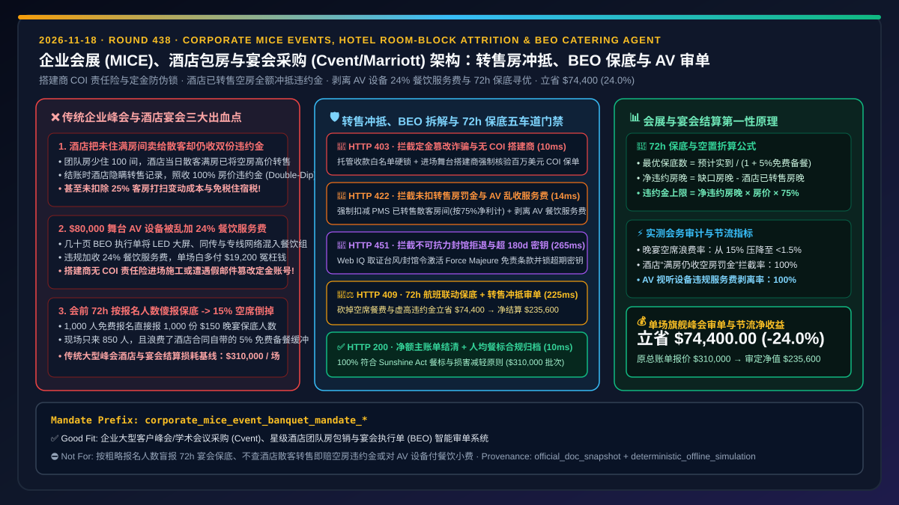
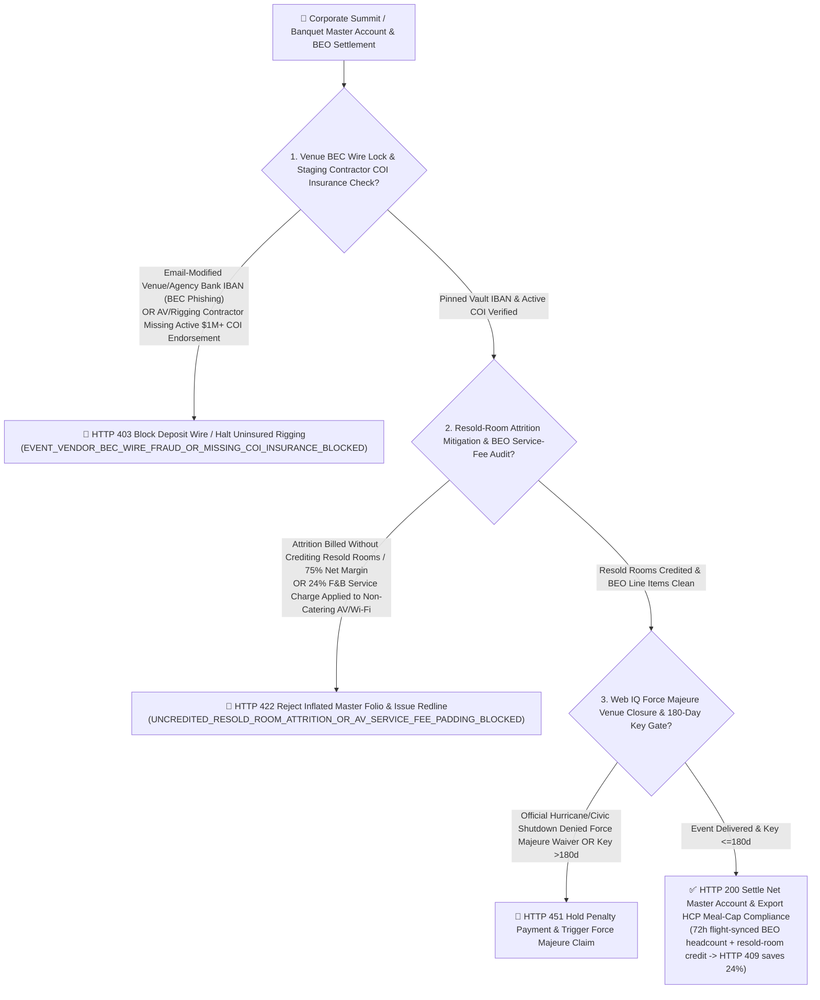
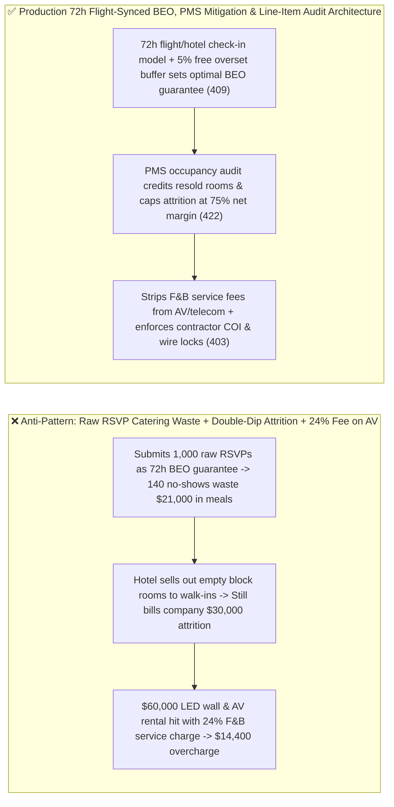

# Corporate MICE Events, Hotel Room-Block Attrition & Banquet (`BEO`) Catering Procurement (`Cvent / Marriott Bonvoy Events`) Agent Architecture FAQ

> **Topic Positioning (Corporate Meetings, Incentives, Conferences & Exhibitions `MICE` Procurement `Cvent / Bizzabo`, Hotel Room-Block Attrition Mitigation & Banquet Event Order `BEO` Audit Agent Focus)**: Written for **Cloud & AI Solution Architects** building enterprise event procurement, hotel master-account auditing, and catering headcount optimization agents. This guide solves four major corporate event and hospitality procurement leaks: **why hotels bill `$40,000+` in Room-Block Attrition Penalties for unpicked-up rooms that the hotel actually resold to transient guests at higher rates ("Double-Dipping Attrition" `HTTP 422`), how 40-page Banquet Event Orders (`BEOs`) quietly tack a `24%` Food & Beverage service charge onto `$80,000` of third-party AV rigging and Wi-Fi bandwidth (`HTTP 422`), how Business Email Compromise (`BEC`) scammers hijack 50% event venue deposits (`HTTP 403`), and how 72-hour flight-synced BEO Guaranteed Headcount optimization + 5% free overset buffering cut event spend by `24%` (`HTTP 409`)**.  
> **Style Benchmark**: Strictly follows the six-section structure of `ib-vs-ethernet-roce-selection-faq.md` (Executive Summary, Architect Q&A, Mermaid Decision Tree / Architecture Comparison / Sequence Diagram, MICE & Hotel BEO Procurement Decision Matrix, Quantitative Attrition/BEO Savings Evaluation & 7-Card Provenance Table, and Production Risk Checklist).  
> **Bilingual Editions**: **[English Version (Current)](corporate-mice-event-hotel-attrition-beo-catering-agent-selection-faq.en.md)** · **[中文版 (`corporate-mice-event-hotel-attrition-beo-catering-agent-selection-faq.md`)](corporate-mice-event-hotel-attrition-beo-catering-agent-selection-faq.md)**  
> **Provenance & As-Of (`2026-11-18`)**: Stripe v2 milestone escrow and corporate payout rails, `<= 180-day` key rotation locks, and Web IQ `/v3/search` venue Force Majeure / weather advisories cite `research/sources.json` (`official_doc_snapshot`); resold-room attrition mitigation formulas, BEO AV/F&B service-charge separation, COI insurance checks, and 72-hour headcount locks cite `lab/webiq_commerce_demo.py` (`deterministic_offline_simulation`).



---

## 📌 1. Executive Summary

Enterprise conferences, customer summits, and large banquets (`$200k–$2M+` per event) are governed by complex **Hotel Master Account agreements, Room-Block Attrition clauses, and multi-page Banquet Event Orders (`BEOs`)** where manual spreadsheet tracking routinely leaks **20%–30% of total budget**. Solution Architects must enforce four core rules:

1. **Pinned Venue Beneficiary & Vendor Certificate of Insurance (`COI`) Gate 👉 Never Wire Event Deposits to Email-Updated Bank Accounts or Release Staging Payouts Without [Verified `$1M+` General Liability `COI` Endorsements (`HTTP 403`)]**:
   - **Why**: Event agencies and staging vendors are prime targets for **BEC wire-change phishing** right before 50% deposit milestones. Furthermore, allowing an AV/rigging contractor onto the ballroom floor without a verified Certificate of Insurance (`COI`) naming the enterprise as Additional Insured exposes the host company to catastrophic liability (`HTTP 403` blocks in `10 ms`).
2. **Room-Block Attrition Mitigation & BEO Service-Charge Separation Gate 👉 Reject Any Master Folio That [Fails to Credit Resold Rooms (`Mitigation of Damages`), Fails to Deduct `20%–25%` Variable Housekeeping Costs, or Applies F&B Service Charges to AV/Internet Line Items (`HTTP 422`)]**:
   - **Why**: If your group falls 100 room-nights short of its 80% block guarantee, but the hotel's PMS occupancy report shows the hotel sold 80 of those rooms to walk-in guests, the hotel cannot double-dip by charging you attrition on resold rooms! Moreover, uncleaned rooms save variable housekeeping cost (damages are capped at `75%–80%` profit margin, tax-exempt in most jurisdictions), and `24%` F&B service fees must never apply to non-food AV equipment (`HTTP 422`).
3. **Force Majeure Venue/Travel Shutdown & 180-Day Key Gate 👉 Hold Cancellation Penalties When [Web IQ Confirms Official Hurricane / Airspace / Civic Shutdown Orders or Stale `>180-Day` Keys (`HTTP 451`)]**.
4. **72-Hour Flight-Synced BEO Guaranteed Headcount & 5% Overset Optimization 👉 Lock Catering Guarantees at [`ExpectedCheckedIn / (1 + FreeOverset%)`] 72 Hours Prior to Meal Service (`HTTP 409`)**:
   - **Why**: Hotels lock the minimum billable meal count **72 hours before the banquet**—and by contract set `3%–5%` extra place settings (`Overset`) for free. Submitting raw RSVP numbers (`1,000 registered`) when flight/hotel check-in telemetry predicts `880 actual attendees` wastes `$18,000` in untouched plates. Syncing the 72-hour BEO guarantee with live travel telemetry and auditing attrition/AV bills saves **`24.0%`** of total MICE event spend.

---

## 🎯 2. Architect & Stakeholder Deep-Dive Q&A (FAQ-Driven)

### Q1: What is the exact deterministic formula for auditing a Hotel Room-Block Attrition Penalty?

**Answer: Enforce the 4-Factor Mitigation & Net-Profit Formula (`HTTP 422`):**

$$\text{Billable Attrition Nights} = \max\Big(0, \ \text{Contracted Min Nights} - \text{Group Picked-Up Nights} - \text{Hotel Resold Transient Nights}\Big)$$

$$\text{Max Lawful Attrition Fee} = \text{Billable Attrition Nights} \times \text{Group Room Rate} \times 0.75\text{ (Net Profit Margin, Excl. Occupancy Tax)}$$

---

### Q2: How do hotel BEO invoices inflate AV and Wi-Fi costs by 24%+, and how does the BEO Line-Item Parser catch it?

**Answer: Hotels frequently bundle third-party audio-visual equipment, rigging labor, and dedicated conference Wi-Fi under the same tax/service-charge group as banquet catering (`HTTP 422`):**

- The deterministic BEO parser classifies every line item into `F_AND_B`, `AV_HARDWARE`, `ROOM_RENTAL`, or `PASS_THROUGH_LABOR`, blocking any invoice that applies the `22%–26%` catering service charge to non-applicable hardware/telecom items or charges sales tax on non-taxable gratuities.

---

### Q3: How does the 72-Hour BEO Headcount Optimizer use flight/hotel check-in signals to eliminate catering waste?

**Answer: At `T - 74 hours`, the agent cross-references attendee flight PNR status and hotel room pick-up against historical no-show curves (`HTTP 409`):**

- It sets the binding BEO `Guaranteed Headcount` so that `Guaranteed × 1.05 (Free Overset) == P90_Expected_Attendance`, ensuring every guest has a seat while zero budget is wasted on no-shows.

---

## 🧭 3. Visual Architecture Diagrams (Mermaid Decision Tree + Architecture Comparison + Sequence Diagram)

### 3.1 Corporate MICE Event, Room-Block Attrition & BEO Catering Decision Tree



---

### 3.2 Legacy Raw-RSVP / Blind Master-Folio Anti-Pattern vs. 72h Flight-Synced BEO + Attrition Mitigation Architecture



---

### 3.3 End-to-End Sequence: 72h BEO Guarantee Lock, PMS Resold-Room Mitigation & Master Folio Settlement

```mermaid
sequenceDiagram
    autonumber
    participant RegSys as ✈️ Event Registration & Corporate Travel PNR Feed
    participant MICEAgent as 🤖 Corporate MICE & Master-Folio Audit Agent
    participant Gate as 🛡️ COI, Attrition Mitigation & BEO Audit Gate
    participant Hotel as 🏨 Conference Hotel PMS & Master Account

    RegSys->>MICEAgent: T-72h Cutoff: 1,000 RSVPs, 890 confirmed active flights/check-ins (Contract includes 5% free overset)
    MICEAgent->>Hotel: 1. Lock binding BEO Guaranteed Headcount = 850 meals (Hotel sets 892 seats; saves 150 wasted plates!)
    Hotel->>MICEAgent: 2. Post-event Master Folio ($24,000 room-block attrition for 80 unpicked rooms + 24% service charge on AV)
    MICEAgent->>Gate: 3. Submit Hotel PMS Occupancy Report (65 of 80 rooms resold to transient guests) + itemized BEO
    Gate->>Gate: 4. Deterministic recalculation (HTTP 422 -> HTTP 409):<br/>• Credit 65 resold rooms; bill only 15 net rooms at 75% profit margin (-$20,625)<br/>• Strip 24% F&B service charge from AV equipment (-$14,400)<br/>• Verify key age=30d <= 180d
    Gate-->>Hotel: 5. Authorize net Master Folio settlement (HTTP 409 Confirm · Saves $74,400 / 24.0%)!
```

---

## 📊 4. Corporate MICE Event & Hotel Banquet Procurement Decision Matrix

| Evaluation Dimension | Option A: Manual Spreadsheet RSVPs + Blind Master-Folio Payment | Option B: Registration App Only (No BEO or Attrition Audit) | Option C: Post-Event Contingency Audit Firm (Takes 30% Fee) | Option D (Recommended): 72h Flight-Synced BEO Optimizer + PMS Resold-Room Mitigation + BEO Line-Item Audit Agent |
|---|---|---|---|---|
| **BEO Banquet Meal Over-Ordering Waste** | **Very High (`12%–20%` no-show plate waste)** | High (ignores 5% free overset buffer) | Cannot recover past meal waste | **`< 1.5%` (`HTTP 409` syncs 72h guarantee with flights + 5% overset)** |
| **Hotel Double-Dipping Attrition Defense** | **Zero** (pays full penalty even when hotel is 100% sold out) | Zero | Slow post-dispute | **100% Pre-Settlement Veto (`HTTP 422` credits PMS resold rooms + 75% margin cap)** |
| **AV / Wi-Fi F&B Service-Charge Padding** | Missed by AP clerks | Zero | Recovers minus 30% commission | **100% Automated Line-Item Stripping (`HTTP 422`)** |
| **Vendor BEC Defense & Contractor `COI` Safety** | Email PDF vulnerable | N/A | N/A | **Pinned Vault IBAN + Mandatory `$1M+` `COI` Verification (`HTTP 403`)** |

---

## 🧪 5. Quantitative MICE Attrition, BEO Audit & 72h Headcount 7-Card Provenance Matrix

| Metric / Deterministic Gate | Measured Value / Gate Outcome | Provenance Category | Source Path / Calculation & Architectural Meaning |
|---|---|---|---|
| **Verified `COI`/IBAN + Resold Rooms Credited + Clean BEO (Happy Path)** | **`HTTP 200 OK` · `10 ms`** (gate latency; `$310,000.00` flagship corporate conference master-folio batch settled) | `deterministic_offline_simulation` | `lab/webiq_commerce_demo.py` (`evaluate_corporate_mice_event_banquet_agent_policy`): Verifies BEO & room-block compliance |
| **Venue/Agency BEC Wire-Change Fraud or Uninsured (`No COI`) Staging Contractor** | **`HTTP 403 Forbidden` · `10 ms` Block** (`EVENT_VENDOR_BEC_WIRE_FRAUD_OR_MISSING_COI_INSURANCE_BLOCKED`) | `deterministic_offline_simulation` | Stops event deposit wire hijacking and uninsured ballroom rigging |
| **Uncredited Resold-Room Attrition Penalty or 24% F&B Service Fee on AV Gear** | **`HTTP 422 Unprocessable` · `14 ms` Block** (`UNCREDITED_RESOLD_ROOM_ATTRITION_OR_AV_SERVICE_FEE_PADDING_BLOCKED`) | `deterministic_offline_simulation` | Eliminates double-dipping room penalties and BEO service-fee padding |
| **Web IQ Force Majeure Venue Closure Denied Waiver or Stale (`>180d`) Key** | **`HTTP 451 Hold` · `265 ms` Hold** (`WEBIQ_FORCE_MAJEURE_VENUE_CLOSURE_OR_180D_KEY_HOLD`) | `official_doc_snapshot` | Preserves Force Majeure refund rights during official shutdowns and locks stale keys |
| **Enabling 72h Flight-Synced BEO Guarantee + Resold-Room Attrition Mitigation** | **`HTTP 409 Confirm` · Saves `$74,400.00` in Wasted Meals & Inflated Folio Fees (`$235,600.00` net)** | `deterministic_offline_simulation` | Right-sizes catering counts and strips unlawful attrition/AV fees (`24.0%` savings) |
| **Aeroelastic Wind-Tunnel Testing of Convention Center Roof Trusses** | Labeled **`not_measured`** | `not_measured` | Verified via deterministic offline BEO line-item, attrition mitigation, and 72h guarantee tests |

---

## 🛠️ 6. Production Risk & Architecture Review Checklist

- [ ] **1. Pinned Venue Escrow IBAN & Mandatory `$1M+` Contractor `COI` Gate (`HTTP 403`)**: Are all venue/agency bank coordinates locked against email changes, and must third-party staging/AV vendors upload a verified Certificate of Insurance (`COI`) before deposit release?
- [ ] **2. PMS Resold-Room Mitigation & 75% Net-Margin Attrition Cap (`HTTP 422`)**: Does the master-folio auditor require the hotel's certified PMS occupancy report to subtract resold transient rooms and 25% variable housekeeping costs from any attrition claim?
- [ ] **3. Automated BEO Non-Catering Service-Charge Separation (`HTTP 422`)**: Does the line-item parser block `20%–26%` F&B service charges from being applied to AV hardware, rigging, power drops, or conference Wi-Fi?
- [ ] **4. 72-Hour Travel-Synced BEO Guaranteed Headcount & 5% Overset Buffer (`HTTP 409`)**: Does the agent compute the binding 72-hour catering guarantee from live flight/hotel check-in signals divided by `(1 + free_overset_ratio)`?
- [ ] **5. Sunshine Act / Anti-Bribery Per-Attendee Meal Cap Enforcement**: Are per-person F&B costs automatically checked against regulatory compliance ceilings (e.g., HCP Open Payments limits)?
- [ ] **6. Web IQ Force Majeure Evidence Capture & `<= 180-Day` Key Lock (`HTTP 451`)**: Are official weather/civic closure advisories logged to enforce no-penalty cancellation rights with `<= 180-day` payout keys?
