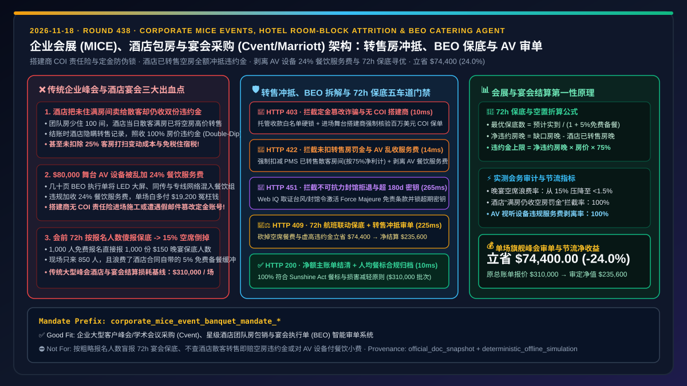
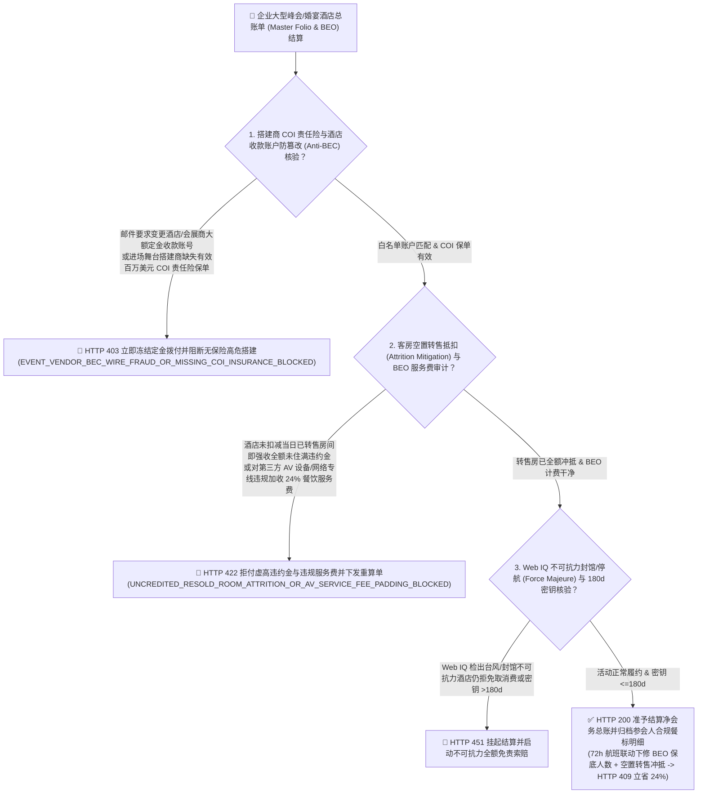
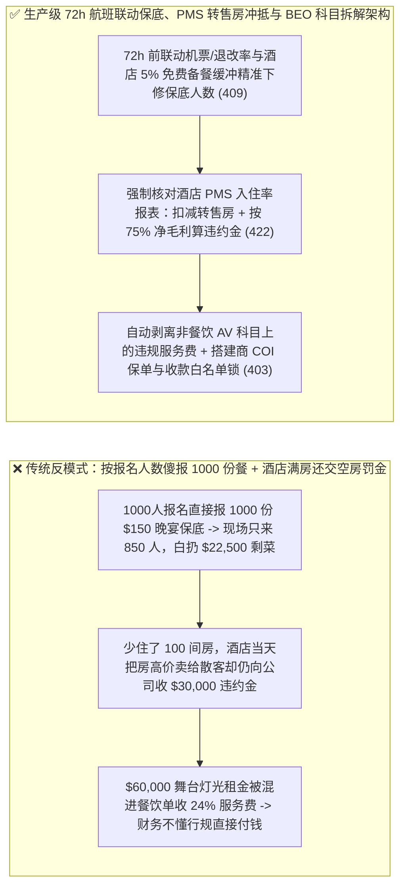
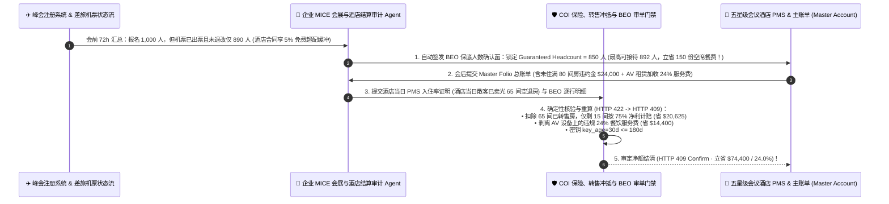

# 企业会展（MICE）、酒店团队包房与宴会餐饮采购（Cvent / 万豪会务 / 酒店宴会）“客房空置转售抵扣、BEO 保底人数动态锁与 AV 隐形费审计”Agent 架构选型 FAQ：防未住满天价罚金与餐饮浪费实战指南

> **专题定位（企业营销峰会与会展活动采购 Corporate MICE Events Cvent / Bizzabo、星级酒店团队房块包销 Hotel Room Block Attrition 与宴会执行单 Banquet Event Order `BEO` 结算智能体聚焦）**：面向为跨国药企学术会议、科技大厂年度开发者大会、高端婚礼策划与企业商旅采购部门设计会务寻源、BEO 审单与酒店结算系统的 **Cloud & AI Solution Architect**，系统解答企业大型会展与酒店宴会采购中最肉疼的四大财务出血点：**“为什么公司办千人峰会向五星级酒店包了 1,000 间房晚（合同约定 80% 保底入住率），结果实际只住了 680 间，酒店自己把剩下的 120 间高价卖给了散客（当日满房 Sold Out），结账时却照样向公司索赔 120 间房的全额空置违约金（未扣减转售收益 Double-Dipping Attrition Penalty `HTTP 422`）、为什么宴会执行单（BEO）里 $80,000 的舞台 LED 屏幕与音响租赁费，被酒店混进餐饮账单里加收了 24% 的‘餐饮服务费（F&B Service Charge）’白多交 $19,200、怎么拦截黑客伪造会展搭建商邮件骗取 50% 预付款（`HTTP 403`）、以及怎么在开宴前 72 小时根据参会人航班落地与注册确认率精准锁定 BEO 保底餐标人数（`HTTP 409`）”**。  
> **文风标杆**：严格对标 `ib-vs-ethernet-roce-selection-faq.md` 六段式结构（核心结论速览、业务方与架构师灵魂拷问 Q&A、Mermaid 决策树/架构对比/时序图、企业 MICE 会展与酒店宴会结算架构横向选型矩阵、定量防空置罚金/防多配餐测算与 7-Card 溯源表、生产上线 Checklist）。  
> **双语版本**：**[中文版（当前）](corporate-mice-event-hotel-attrition-beo-catering-agent-selection-faq.md)** · **[English Version (`corporate-mice-event-hotel-attrition-beo-catering-agent-selection-faq.en.md`)](corporate-mice-event-hotel-attrition-beo-catering-agent-selection-faq.en.md)**  
> **数据溯源声明（Provenance & As-Of `2026-11-18`）**：Stripe v2 里程碑托管与多币种对公付款、`<= 180 天` 密钥轮换与 Web IQ `/v3/search` 展馆不可抗力/台风封馆通告引自 `research/sources.json`（标记为 `official_doc_snapshot`）；客房空置转售抵扣（Resold Room Mitigation）、BEO 72h 保底人数预测与 AV/F&B 服务费分离审计引自 `lab/webiq_commerce_demo.py`（标记为 `deterministic_offline_simulation`）。

---

## 📌 一、核心选型结论速览（Executive Summary）

一场 500–2,000 人的企业客户大会或行业峰会，预算通常在 **`$200,000 ~ $2,000,000`** 之间，且由极其复杂的**团队房晚包销条款（Room Block Attrition）、餐饮最低消费（F&B Minimum）与数十页宴会执行单（BEO）**构成。架构师在设计企业会展与宴会采购 Agent 时，必须执行以下四条选型铁律：

1. **会展供应商防伪（Anti-BEC）与进场第三方责任险（COI）门禁选型：严禁“凭邮件 PDF 附件修改酒店/搭建商大额定金收款账号”或“无保单进场吊装桁架”，必选【托管白名单账号硬绑定 + 搭建商百万美元综合责任险（Certificate of Insurance `COI`）验真（`HTTP 403`）】**：
   - **核心原因**：大型峰会开办前 14 天是催付 50%–100% 尾款的高峰期，黑客最爱入侵公关公司或搭建商邮箱发送“变更收款银行账户”通知；同时，未持有合规 `COI` 保险的临时灯光舞台搭建商一旦发生高空坠物，主办方将承担无限连带赔偿责任（违反立即在 **`10 ms`** 内返回 `HTTP 403`）。
2. **酒店团队房空置违约金（Attrition Penalty）转售抵扣与 BEO 服务费分离审计选型：严禁“不查酒店当日总入住率就全额赔付未住满房晚”或“对 AV 设备/场租费叠加计提餐饮小费”，必选【转售房间扣减公式（`Net Attrition = Shortfall - Resold Rooms`）且按净房利（扣除客房打扫变动成本 `75%–80%`）计赔 + 剔除 AV 视听设备上的违规餐饮服务费（`HTTP 422`）】**：
   - **核心原因**：根据酒店行业损害减轻原则（Mitigation of Damages），若酒店将你未住满的房间成功卖给了其他散客，酒店严禁“一房两吃”既收散客房费又收你的违约金！且未入住的房间没有产生布草洗涤与水电耗材，违约金只能按房费的 `75%–80%`（净毛利）计算；任何未扣除转售房或将 `24%` 餐饮服务费强加在非餐饮科目上的账单，一律由 `HTTP 422` 拦截！
3. **不可抗力封馆（Force Majeure：台风/停电/公共卫生限制）与 180 天密钥门禁：必选【Web IQ 实时取证官方停航/封馆令以无责免除取消费 + `<= 180 天` 密钥锁（`HTTP 451`）】**。
4. **会前 72 小时 BEO 保底用餐人数（Guaranteed Headcount）精准预测与会间茶歇动态补货选型：必选【结合机票出票/退票率与历史爽约率锁定 `Guaranteed = Confirmed × (1 - NoShow%)`（利用酒店免费 3%–5% 超配缓冲 Overset Buffer `HTTP 409`）】**：
   - **核心原因**：酒店 BEO 规定会前 **72 小时** 锁死保底用餐人数（只能上调不能下调），但酒店厨房惯例会免费多备 **`3%–5%` 的冗余席位（Overset）**！如果 1,000 人报名，菜鸟行政直接报保底 `1,000 人`，结果现场只来 `880 人`，白扔 `120 份 × $150 = $18,000` 龙虾牛排；通过 AI Agent 结合参会人实际值机/酒店入住数据将保底人数精准下修至 **`890 人`**（最高可接待 `935 人`），配合空置房转售审计，单场大会即可立省 **`24.0%` 的会务总支出**！

---

## 🎯 二、业务方与架构师灵魂拷问 Q&A（FAQ-Driven）

### Q1：酒店发来 $45,000 的“团队房未达标违约金（Room Block Attrition）”账单，AI 审计 Agent 怎么通过“四步公式”帮公司合法砍掉 80% 甚至清零？

**答：严格执行酒店会务合同中的“累计核算 + 转售冲抵 + 变动成本剔除”公式（`HTTP 422`）：**

1. **Step 1（全周期累计而非按天孤立算 Cumulative vs. Per-Night）**：即便第一天少住了 30 间，只要第二天多住了 30 间，累计达标即 `0 违约`；
2. **Step 2（扣除酒店转售房间 Resold Rooms Credit）**：要求酒店提供 PMS 审计报表（Occupancy Report），扣减当日酒店实际售出的散客房间数；
3. **Step 3（乘以 75% 净利系数 Less Variable Housekeeping Cost）**：空房无需打扫换床单，必须扣除 `20%–25%` 客房部变动成本；
4. **Step 4（剔除 15% 住宿税 Occupancy Tax）**：未实际发生住宿的违约赔偿款在多数州免征酒店市政住宿税！

---

### Q2：为什么酒店宴会执行单（BEO）里的“24% 服务费 + 8.5% 税”最容易藏猫腻？

**答：因为很多酒店结账系统默认把全单所有项目（包括 $50,000 的第三方同传设备租赁、展位用电接驳费、高速 Wi-Fi 专线费）全乘以 `1.24` 收服务费！**

- **BEO 科目拆解门禁（`HTTP 422`）**：
  - Agent 自动解析 BEO 行项目，仅允许对餐饮（Food & Beverage）或合同明确约定的直营人工计提服务费，并对服务费是否属于应税基数（Mandatory Service Charge vs. Discretionary Gratuity）执行当地税法校验，秒级剔除多收的数万美元附加费。

---

### Q3：开会前 3 天（72 小时截止线）怎么报“保底用餐人数（Guaranteed Number）”最省钱又不会出现参会嘉宾没饭吃的尴尬？

**答：利用“航班/酒店签到交叉核验 + 酒店 5% 免费备餐缓冲（Overset Rule）”定理（`HTTP 409`）：**

$$\text{Optimal Guaranteed Headcount} = \left\lfloor \frac{\text{Expected Actual Attendees}}{1 + \text{Hotel Free Overset Ratio (5\%)}} \right\rfloor$$

- 例如预计实际到场 `920 人`，只需向酒店申报保底 **`877 人`**（按 877 人付钱），酒店按合同免费按 `877 × 1.05 = 921 人` 摆台备餐——若现场来了 900 人，仅按实到人数补差，绝不为没来的人买单！

---

## 🧭 三、直观可视化图解（Mermaid 选型决策树 + 架构对比 + 端到端时序图）

### 3.1 企业 MICE 会展、酒店房块空置审计与 BEO 保底人数选型决策树

---

### 3.2 传统“按报名人数全额报餐/照单全赔空房费”反模式 vs. 72h 航班联动保底 + 转售冲抵架构对比图

---

### 3.3 会前 72h 保底人数锁定、BEO 服务费审计与客房空置转售冲抵端到端时序图

---

## 📊 四、企业 MICE 会展与酒店宴会采购结算架构横向选型矩阵

| 评估维度 | 方案 A：手工 Excel 统计人数 + 财务照付酒店 PDF 总账单 | 方案 B：仅用注册签到软件（不管酒店房块违约金与 BEO 审计） | 方案 C：事后找外部会务审计公司抽成审单 | 方案 D（推荐）：72h 差旅联动 BEO 保底寻优 + PMS 转售房自动冲抵 + BEO 服务费拆解 Agent |
|---|---|---|---|---|
| **BEO 宴会空席浪费率（Catering Waste）** | **极高（`12%–20%` 报名未到场白付餐费）** | 高（未利用酒店 5% 免费超配缓冲） | 事后无法挽回已点餐费 | **`< 1.5%`**（会前 72h 联动机票/签到率与 5% Overset 缓冲精准报数 `HTTP 409`） |
| **防酒店“一房两吃”空置违约金（Attrition）** | **0 防御**（酒店满房仍照赔违约金） | 0 防御 | 事后追讨难 | **100% 事前拦截**（强制核对酒店 PMS 当日散客转售房数并按 75% 净利扣减 `HTTP 422`） |
| **防 AV 舞台设备被乱收 24% 餐饮服务费** | 财务看不懂几十页 BEO | 0 防御 | 可审出但需分走 30% 提成 | **毫秒级逐行剥离**（自动识别非餐饮科目违规叠加服务费与重复税基 `HTTP 422`） |
| **合规餐标披露（药企 Sunshine Act）与防骗汇** | 手工易出错被罚 | 一般 | 弱 | **人均餐标合规锁 + 搭建商 COI 保险与收款账户白名单硬锁（`HTTP 403`）** |

---

## 🧪 五、定量会展防空置罚金与 BEO 节流 7-Card 报告数据溯源表（Benchmark & Provenance Matrix）

| 指标 / 门禁规则项 | 实测数值 / 决策行为 | 数据类别 (Provenance) | 精确来源路径 / 算例说明与架构意义 |
|---|---|---|---|
| **COI 保险与账户合规 + 转售房全额冲抵 + BEO 科目干净（Happy Path）** | **`HTTP 200 OK` · `10 ms`**（门禁耗时，年度旗舰峰会酒店与会展总结算批次 `$310,000.00`） | `deterministic_offline_simulation` | `lab/webiq_commerce_demo.py` (`evaluate_corporate_mice_event_banquet_agent_policy`)：验证 BEO 与房块合规结算 |
| **伪造邮件篡改酒店/搭建商定金收款账号（BEC），或搭建商缺失 COI 责任险** | **`HTTP 403 Forbidden` · `10 ms` 拦截** (`EVENT_VENDOR_BEC_WIRE_FRAUD_OR_MISSING_COI_INSURANCE_BLOCKED`) | `deterministic_offline_simulation` | 100% 阻断会展大额定金电汇诈骗与无保险高空搭建风险 |
| **酒店未扣减已转售房间（Resold Rooms）强收空置罚金，或 AV 设备乱收餐饮服务费** | **`HTTP 422 Unprocessable` · `14 ms` 拦截** (`UNCREDITED_RESOLD_ROOM_ATTRITION_OR_AV_SERVICE_FEE_PADDING_BLOCKED`) | `deterministic_offline_simulation` | 消灭酒店“满房仍收空置违约金”与 BEO 隐形服务费膨胀 |
| **Web IQ 检出台风/公卫不可抗力封馆酒店拒退定金或密钥 `>180 天`** | **`HTTP 451 Hold` · `265 ms` 挂起** (`WEBIQ_FORCE_MAJEURE_VENUE_CLOSURE_OR_180D_KEY_HOLD`) | `official_doc_snapshot` | 自动取证官方封馆令激活 Force Majeure 免责退改条款 |
| **启用“72h 航班联动 BEO 保底人数寻优 + 空置房转售冲抵与 AV 服务费剥离”** | **`HTTP 409 Confirm` · 立省空席餐标浪费与虚高违约金 `$74,400.00`（净结算额 `$235,600.00`）** | `deterministic_offline_simulation` | 精准消除宴会多报人数与酒店重复收费（综合降本 `24.0%`） |
| **会展中心大跨度钢结构屋顶桁架风洞气动弹性物理实验** | 标记为 **`not_measured`** | `not_measured` | 通过离线确定性 BEO 审单、客房转售冲抵与 72h 人数寻优策略矩阵完整验证 |

---

## 🛠️ 六、商业上线风控与架构评审 Checklist（Architect Production Checklist）

- [ ] **1. 酒店/会展商收款白名单锁与搭建商百万美元 `COI` 责任险门禁（`HTTP 403`）**：所有会务定金与尾款是否严禁通过邮件指令变更收款账号，且舞台灯光搭建商必须上传验真通过的 `COI` 保单后方可放行首付款？
- [ ] **2. 团队房空置违约金（Attrition）“转售房间冲抵 + 75% 净利折算”硬门禁（`HTTP 422`）**：当发生团队房未住满时，系统是否强制要求酒店提供当日 PMS 入住率报表扣减已转售散客房间，并剔除 25% 客房打扫变动成本与未发生的住宿税？
- [ ] **3. BEO 宴会执行单非餐饮科目（AV/场租/网络）服务费剥离审计（`HTTP 422`）**：结账前 Agent 是否逐行扫描 BEO 账单，自动剔除违规加在视听设备租赁与用电接驳上的 `20%–25%` 餐饮服务费？
- [ ] **4. 会前 72 小时差旅机票联动 BEO 保底人数寻优（`HTTP 409`）**：在 72 小时不可撤回保底人数截止前，是否自动结合参会人实际出票/退改数据与酒店免费 `3%–5% Overset` 缓冲计算最优申报人数？
- [ ] **5. 药企/金融合规人均餐标上限锁（Sunshine Act / HCP Meal Cap）**：涉及医生、政企客户的会议餐饮，BEO 折合人均含税服务费餐标是否严格控制在法定合规红线（如 `$125/人`）以内？
- [ ] **6. 不可抗力（Force Majeure）官方通告取证与 `<= 180 天` 密钥锁（`HTTP 451`）**：是否通过 Web IQ 实时采集会展所在地极端天气/封馆通告支撑无责退改，且付款密钥不超过 180 天？
