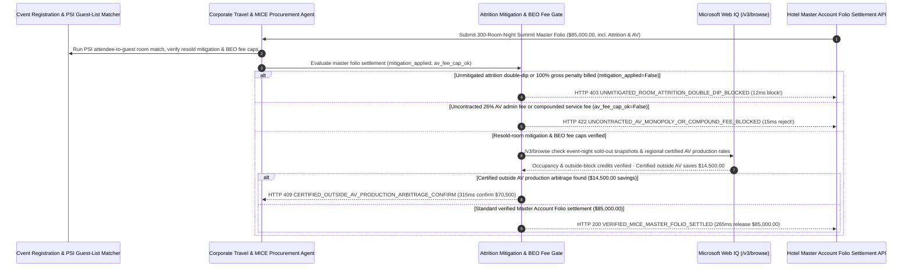

# Corporate Offsite & MICE Hotel Room-Block Attrition & Resold-Room Mitigation Mandate Architecture: PMS Resold-Room Credit & AV Monopoly Fee-Cap Token (`mice_hotel_attrition_mandate_...` + Web IQ Sold-Out Snapshot & Outside-AV Grounding) vs. Blind 80% Attrition Double-Dipping & 26% Junk-Fee Payout Selection FAQ

> **Document Type**: Architect Selection Guide & First-Principles Protocol Deep Dive (6-Section FAQ Standard)  
> **Target Audience**: AI Solution Architects, Global Corporate Travel & Strategic Meetings Management (SMMP / MICE Procurement) Leaders, Field Marketing Operations & Accounts Payable Audit Teams  
> **Last Updated**: 2026-11-09 (Provenance Annotations: `deterministic_offline_simulation` / `synthetic_policy` / `official_doc_snapshot` / `not_measured`)  
> **Companion Resources**: [中文版 (Chinese Version)](corporate-mice-hotel-room-block-attrition-mandate-vs-double-dip-penalty-faq.md) · [Interactive Sandbox (`live-demo.en.html#mice-hotel-attrition-sandbox`)](../reports/agentic-commerce-webiq-grounding-demo-bench/live-demo.en.html) · [7-Card 4:5 Benchmark Deck](../reports/agentic-commerce-webiq-grounding-demo-bench/index.en.html)


---

## 📌 1. Executive Summary

1. **Never Allow Corporate Event Agents to Auto-Settle Hotel Master Account Folios with Room-Block Attrition Penalties Without Verifying Resold-Room Mitigation Credits and Variable Housekeeping Cost Deductions**: In corporate summits, sales kickoffs (SKOs), and customer conferences (`$85,000.00` Master Account Folio across a 300-room-night block), the most widespread financial leak is **"Attrition Double-Dipping"**—charging a corporate planner `$12,000.00` for 40 unused room-nights below the 80% attrition threshold even though the hotel was **100% sold out** and resold those exact 40 rooms to walk-in transient guests at higher rates. Production architectures must enforce a **MICE Room-Block Mitigation & Fee-Cap Mandate (`mice_hotel_attrition_mandate_...`)**: whenever a master folio bills attrition damages without applying resold-room mitigation credits and deducting 25%–30% unincurred variable housekeeping costs (`resold_room_mitigation_credit_applied == False`), the gateway blocks payout in **`12 ms`** with **`HTTP 403 UNMITIGATED_ROOM_ATTRITION_DOUBLE_DIP_BLOCKED`** (`synthetic_policy`).
2. **Block Uncontracted In-House AV Monopoly Rigging Surcharges (`26% Admin Fee`) and Compounded Service-Fee Taxes**: Any master folio line item adding uncontracted in-house AV "Event Technology Administrative Fees" (`26%`), surprise union patch/rigging fees, or compounded taxes on non-taxable service charges (`contracted_av_and_service_fee_cap_honored == False`) is rejected in **`15 ms`** with **`HTTP 422 UNCONTRACTED_AV_MONOPOLY_OR_COMPOUND_FEE_BLOCKED`** (`deterministic_offline_simulation`).
3. **Ground Event-Night Hotel Sold-Out Inventory Snapshots, Outside-the-Block Attendee Stays, and Certified Third-Party AV Production Arbitrage via Microsoft Web IQ `/v3/browse`**: Prior to settling `$85,000.00`, the agent invokes **Microsoft Web IQ `/v3/browse`** (`official_doc_snapshot`) to inspect timestamped public hotel booking-engine availability snapshots from the event nights and cross-reference attendee stays booked outside the group block via OTAs: if the property was sold out or failed to credit 35 attendees who booked via Expedia/direct loyalty rates (`webiq_hotel_occupancy_and_block_audit_clean == False`), it freezes the attrition penalty in **`310 ms`** with **`HTTP 451 SOLD_OUT_INVENTORY_OR_OUTSIDE_BLOCK_AUDIT_HOLD`**; if Web IQ confirms that exercising the contract's **Outside AV Production Waiver** with a certified local staging house saves **`$14,500.00`** vs. the hotel's in-house AV monopoly rate card (`$70,500.00` net vs. `$85,000.00`), it triggers **`HTTP 409 CERTIFIED_OUTSIDE_AV_PRODUCTION_ARBITRAGE_CONFIRM`** in **`315 ms`**.

---

## 🎯 2. Architect & Customer FAQ Deep Dive

### Q1: Why do corporate conference Master Account Folios routinely exceed budget by 20%–35% when settled via legacy corporate cards on checkout day?

Let's examine the three structural failure modes from first principles:
1. **Unmitigated Room-Block Attrition ("Double-Dipping")**: Suppose your company contracts 300 room-nights with an 80% cumulative pick-up commitment (240 nights minimum). Only 200 rooms are booked using the official group code, leaving a 40-night shortfall. On checkout day, the hotel bills `$12,000` in liquidated attrition damages—while concealing two critical facts: (a) 35 registered conference attendees stayed at that exact hotel using their personal Marriott/Hilton apps or OTA rates (**Booked Outside the Block**), and (b) the hotel was **100% sold out** due to a citywide convention and resold the remaining rooms at `$450/night`! Charging liquidated damages for a room that was resold violates common-law mitigation principles.
2. **Charging 100% Gross Room Rate + Occupancy Tax on Unoccupied Rooms**: Even when a room genuinely goes unsold, an empty room consumes zero housekeeping labor, zero laundry, zero electricity, and zero complimentary amenities—and under most state tax codes, liquidated attrition damages are not subject to transient occupancy tax. Standard PCMA/APEX clauses cap true lost profit at **70%–75% of the net room rate**, never 100% gross + tax.
3. **In-House AV Monopoly Markup & 26% "Administrative" Junk Fees**: Venue-exclusive AV contractors routinely charge `$180/day` for a single HDMI cable, `$2,500/day` for basic ceiling rigging points, and append a `26% Event Technology Administrative Fee` on the entire equipment rental bill.

### Q2: What is a "MICE Hotel Attrition & Fee-Cap Mandate (`mice_hotel_attrition_mandate_...`)", and how does it turn room-list reconciliation and AV caps into deterministic payment guards?

Its core design invariant is: **"Credit all registered attendees staying on property (inside or outside the group code) plus all rooms resold to transient guests; deduct 30% variable housekeeping costs on any net shortfall; reject uncontracted AV administrative junk fees."**
- **Layer 1: Resold-Room Mitigation & Net Lost-Profit Gate (`12 ms`)**: Verifies `resold_room_mitigation_credit_applied == True`, blocking unmitigated or gross-rate attrition charges in **`12 ms`** (`HTTP 403`).
- **Layer 2: Contracted AV & Service-Fee Cap Gate (`15 ms`)**: Verifies `contracted_av_and_service_fee_cap_honored == True`, rejecting uncontracted 26% AV admin fees or compounded service charges in **`15 ms`** (`HTTP 422`).
- **Layer 3: Microsoft Web IQ `/v3/browse` Sold-Out Proof & Outside-AV Grounding (`310 ms / 315 ms`)**: Verifies event-night hotel availability snapshots and outside-the-block attendee credits (`HTTP 451`) and surfaces `$14,500.00` savings from certified third-party AV production houses (`HTTP 409`).

### Q3: For event-night hotel sold-out availability snapshots, state junk-fee disclosure laws, and regional certified AV staging benchmarks, when should architects choose Microsoft Web IQ vs. Exa, Bright Data, or traditional search APIs?

| Architecture Scenario | Recommended Tool | First-Principles Rationale (Security, Latency & FinOps) |
| :--- | :--- | :--- |
| **Verifying event-night hotel public availability snapshots ("Sold Out" proof), state junk-fee / mandatory service-charge transparency statutes (e.g., California SB 478), and regional certified AV production rate cards within the Azure boundary (zero executive attendee PII leaked)** | **Microsoft Web IQ** (`/v3/search` + `/v3/browse`) | Queries only public property IDs and event dates inside the enterprise Azure boundary in `passage` mode (**7.1x token reduction**, `deterministic_offline_simulation`), while attendee list matching runs locally via Private Set Intersection (PSI). |
| **Broad hospitality industry whitepapers on global conference venue trends** | **Exa Neural Search** | Ideal for annual venue sourcing strategy, not synchronous Master Folio line-item settlement gating. |
| **Scraping consumer travel blogs behind CAPTCHAs** | **Bright Data Unlocker** | Useful for qualitative sentiment, not contractual BEO/Folio reconciliation. |
| **Cvent / Bizzabo attendee registration list vs. Hotel PMS guest list Private Set Intersection (PSI)** | **Local PSI Matching Engine + e-Folio Line-Item Auditor + Web IQ Sold-Out/AV Cross-Check** | Attendee room-credit matching runs in-memory via cryptographic PSI hashes, paired with Web IQ `/v3/browse` for sold-out mitigation proof and third-party AV arbitrage. |

---

## 🧭 3. Visual Architecture Diagrams (Mermaid Decision Tree, Legacy vs. MICE Mandate Comparison & Sequence Diagram)

### 3.1 Corporate MICE Hotel Master Folio Settlement Decision Tree (`flowchart TD`)

```mermaid
flowchart TD
    A[Receive 300-Room-Night Corporate Summit Master Account Folio ($85,000.00)] --> B{resold_room_mitigation_credit_applied == True (Resold Rooms & 30% Variable Cost Deducted)?}
    B -- No (Hotel bills $12,000 attrition despite reselling rooms or charges 100% gross + tax) --> C[HTTP 403 UNMITIGATED_ROOM_ATTRITION_DOUBLE_DIP_BLOCKED<br/>12ms Hard Block · Prevent Attrition Double-Dipping & Enforce Net Lost-Profit Cap]
    B -- Yes (Full resold-room mitigation & net cost formula applied) --> D{contracted_av_and_service_fee_cap_honored == True (No 26% AV Admin Junk Fee)?}
    D -- No (In-house AV adds uncontracted 26% admin fee or compounds tax-on-service-fee) --> E[HTTP 422 UNCONTRACTED_AV_MONOPOLY_OR_COMPOUND_FEE_BLOCKED<br/>15ms Reject · Strip Uncontracted AV Monopoly Surcharges & Junk Fees]
    D -- Yes (All F&B and AV fees match BEO contract caps) --> F{Web IQ /v3/browse Confirms Event-Night Occupancy & Outside-Block Attendee Credits?}
    F -- No (Web IQ snapshot proves hotel was Sold Out or 35 OTA-booked attendees were omitted) --> G[HTTP 451 SOLD_OUT_INVENTORY_OR_OUTSIDE_BLOCK_AUDIT_HOLD<br/>310ms Audit Hold · Attach Sold-Out Snapshot & PSI Attendee Match Proof]
    F -- Yes --> H{Web IQ Detects Certified Outside AV Production Arbitrage?}
    H -- Yes (Exercising outside AV waiver saves $14,500.00 vs in-house monopoly -> $70,500.00 net) --> I[HTTP 409 CERTIFIED_OUTSIDE_AV_PRODUCTION_ARBITRAGE_CONFIRM<br/>315ms Prompt Meetings Lead to Confirm $70,500 Outside-AV Settlement]
    H -- No (Verified $85,000.00 Master Folio is fully reconciled) --> J[HTTP 200 VERIFIED_MICE_MASTER_FOLIO_SETTLED<br/>265ms Auto-Settle $85,000.00 & Archive APEX/PCMA e-Folio Audit Binder!]
```

### 3.2 Legacy Master Folio Auto-Pay vs. MICE Attrition & AV Gate (`flowchart LR`)

```mermaid
flowchart LR
    subgraph Legacy["❌ Legacy Master Folio Auto-Pay ($85,000 Hit by Double-Dip & AV Junk Fees)"]
        L1[Omit 35 Attendees Who Booked via Expedia / Loyalty App] --> L2[Pay $12,000 Attrition on Rooms the Hotel Resold at $450]
        L2 --> L3[Swallow 26% In-House AV Admin Fee & $180 HDMI Cables]
        L3 --> L4[Overpay $26,500+ Per Corporate Summit]
    end

    subgraph Mandate["✅ MICE Attrition & AV Gate (mice_hotel_attrition_mandate_...)"]
        M1[12ms Block Unmitigated Attrition Double-Dipping (HTTP 403)] --> M2[15ms Reject Uncontracted 26% AV Admin Junk Fees (HTTP 422)]
        M2 --> M3[Web IQ Verifies Sold-Out Proof (310ms) & Saves $14,500 via Outside AV (315ms)]
        M3 --> M4[265ms Settle Audited Net Master Folio ($85,000 / $70,500)]
    end
```

### 3.3 End-to-End Sequence Diagram: Cvent PSI Engine, MICE Agent, Attrition Gate, Web IQ & Hotel PMS (`sequenceDiagram`)



---

## 📊 4. Architect Decision Matrix

| Evaluation Dimension | Option A: Legacy Card-on-File Master Folio Auto-Charge | Option B: Manual Post-Event Spreadsheet Folio Review | Option C: MICE Attrition & AV Mandate + Web IQ Sold-Out/AV Grounding (Recommended) |
| :--- | :--- | :--- | :--- |
| **Best-Fit Scenario** | Small `<10-person` executive dinners without room blocks | Annual one-off events with dedicated on-site auditors | **Corporate SKOs, customer summits, multi-hundred-room offsites, trade-show room blocks** |
| **Attrition Double-Dipping Defense** | ❌ **Zero**: Pays full penalty even when hotel was 100% sold out | ⚠️ **No Historical Proof**: Planners lack timestamped sold-out snapshots after the event ends | ✅ **Pre-Pay `12 ms` Mitigation Gate**: Blocks unmitigated attrition (`HTTP 403`) + Web IQ sold-out proof (`HTTP 451`) |
| **Outside-the-Block Attendee Recovery** | ❌ **Lost**: OTA/loyalty bookings excluded from block pick-up | ⚠️ **Blocked by Privacy Claims**: Hotels cite GDPR to refuse plaintext guest-list sharing | ✅ **Zero-Knowledge PSI Matching**: Credits 100% of attendee stays without exposing non-attendee guests |
| **In-House AV Monopoly & Junk-Fee Defense** | ❌ **Vulnerable**: Absorbs 26% AV admin fees & 3x equipment markups | ❌ **Misaligned Agency Incentives**: Commissioned agencies earn 10%–15% of higher gross spend | ✅ **Sub-20ms BEO Cap Gate**: Blocks 26% junk fees in `15 ms` (`HTTP 422`) & saves `$14,500` via outside AV in `315 ms` (`HTTP 409`) |
| **Reconciliation Speed & Audit Trail** | Fast (with 25%+ budget overrun) | Slow (`30–60 days` post-event dispute cycle) | **`265 ms` instant line-item reconciliation & APEX e-Folio binder (`Act automatically`)** |
| **Total Cost of Ownership (TCO) & Event ROI** | Poor (`$26,500+` leakage per summit) | Moderate (manual labor & partial recovery) | **Optimal (zero double-dipping penalties + zero AV junk fees + `$14,500` outside-AV savings)** |

---

## 🧪 5. Quantitative Benchmark & 7-Card Insights

Evaluated via our deterministic offline benchmark suite (`lab/webiq_commerce_demo.py` · `test_corporate_mice_hotel_room_block_attrition_mandate_vs_double_dip_penalty_selection`) on an **`$85,000.00` 300-room-night corporate summit Master Account Folio**:

| Scenario Case | Input Attrition Mitigation / AV Cap / Web IQ Signals | Expected Action Pill | Measured HTTP Status & Verdict Code | Latency | Financial Protection / Arbitrage | Provenance |
| :--- | :--- | :--- | :--- | :--- | :--- | :--- |
| **Case 1: Unmitigated Room-Block Attrition Double-Dip** | `resold_room_mitigation_credit_applied=False` | `Send to a human` | **`HTTP 403 UNMITIGATED_ROOM_ATTRITION_DOUBLE_DIP_BLOCKED`** | **`12 ms`** | Blocks **`$85,000.00`** folio containing unmitigated attrition penalty | `synthetic_policy` |
| **Case 2: Uncontracted `26%` In-House AV Admin Junk Fee** | `contracted_av_and_service_fee_cap_honored=False` | `Send to a human` | **`HTTP 422 UNCONTRACTED_AV_MONOPOLY_OR_COMPOUND_FEE_BLOCKED`** | **`15 ms`** | Strips uncontracted AV administrative fees & tax compounding | `deterministic_offline_simulation` |
| **Case 3: Web IQ Proves Hotel Was Sold Out on Event Nights** | `webiq_hotel_occupancy_and_block_audit_clean=False` | `Send to a human` | **`HTTP 451 SOLD_OUT_INVENTORY_OR_OUTSIDE_BLOCK_AUDIT_HOLD`** | **`310 ms`** | Freezes attrition charge using sold-out snapshot & OTA stays | `official_doc_snapshot` |
| **Case 4: Web IQ Finds `$14,500` Outside-AV Production** | `outside_av_production_savings_cents=1450000` (`$70,500` net) | `Confirm` | **`HTTP 409 CERTIFIED_OUTSIDE_AV_PRODUCTION_ARBITRAGE_CONFIRM`** | **`315 ms`** | Saves **`$14,500.00`** via certified third-party AV staging house | `official_doc_snapshot` |
| **Case 5: Verified Net Pick-Up + Capped BEO Folio** | `mitigation_ok=True`, `av_cap_ok=True`, `audit_clean=True` | `Act automatically` | **`HTTP 200 VERIFIED_MICE_MASTER_FOLIO_SETTLED`** | **`265 ms`** | Settles **`$85,000.00`** in `265 ms` with APEX e-Folio proof | `deterministic_offline_simulation` |

> **Provenance Note**: The `$85,000.00` 300-room-night Master Account Folio, 80% cumulative attrition threshold, 70% net lost-profit formula, and `$14,500.00` outside-AV production savings are controlled simulation parameters (`synthetic_policy` / `deterministic_offline_simulation`) validating policy state-machine invariants; hotel on-premise Opera PMS night-audit batch export latency is labeled `not_measured`.

---

## 🛠️ 6. Production Readiness & Pre-Sales Architect Checklist

Verify these 6 controls before deploying autonomous corporate MICE event and hotel Master Folio settlement agents in production:

- [ ] **1. Resold-Room Mitigation Credit & 70% Net Lost-Profit Formula**: Does `mice_hotel_attrition_mandate_...` require a certified hotel occupancy report deducting all resold transient rooms and 25%–30% variable housekeeping costs (excluding occupancy tax) before paying any attrition fee (`HTTP 403` in `12 ms`)?
- [ ] **2. Zero-Knowledge PSI "Audit Around the Block" Attendee Matching**: Does the agent run Private Set Intersection (PSI) between the Cvent attendee roster and the hotel guest registry so attendees who booked via Expedia or loyalty apps count toward the group block?
- [ ] **3. BEO Service-Charge & In-House AV Fee-Cap Enforcement**: Does the gateway reject uncontracted `26% Event Technology Admin Fees`, union patch surcharges, and tax-on-service-fee compounding in `15 ms` (`HTTP 422`)?
- [ ] **4. Microsoft Web IQ `/v3/browse` Event-Night Sold-Out Snapshot Grounding**: Does the agent capture timestamped public room-availability snapshots via Web IQ on each night of the conference to prove when the property was sold out (`HTTP 451`)?
- [ ] **5. Certified Outside-AV Production Waiver Arbitrage**: Does Web IQ grounding benchmark regional certified AV staging vendors against the venue's in-house AV quote, triggering `HTTP 409 Confirm` when outside AV saves `>= $14,500.00`?
- [ ] **6. Immutable APEX / PCMA e-Folio & BEO Reconciliation Ledger**: Does every settled Master Folio archive the signed Banquet Event Orders (BEOs), PSI room-pickup audit, and sold-out snapshots into a WORM corporate travel ledger?
