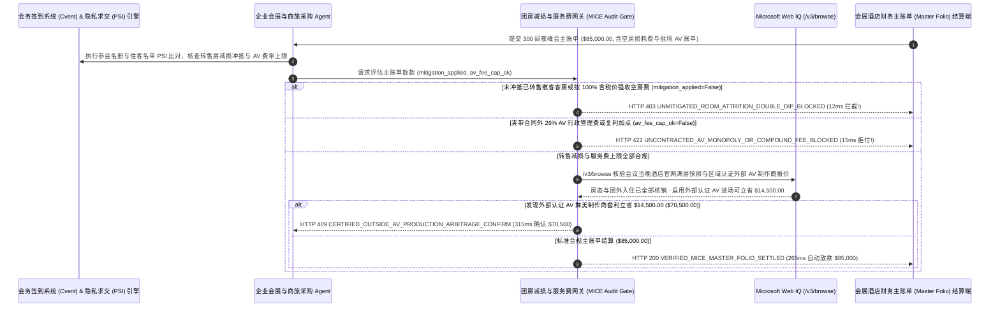

# 企业大型会展（MICE）与酒店团房损耗率（Attrition）及餐饮保底（F&B Minimum）清算（Corporate Offsite & MICE Hotel Room-Block Attrition & Resold-Room Mitigation Mandate）架构：PMS 客房转售冲抵（Mitigation Credit）与 AV 场内垄断加价剔除令牌（`mice_hotel_attrition_mandate_...` + Web IQ 实时满房取证与外部 AV 进场核验）vs 传统盲付 80% 空房违约金（Double-Dipping）与 26% 隐性行政费选型与原理解析 FAQ

> **文档类型**：架构师选型指南 & 协议第一性原理解析（6 段式 FAQ 标准版）  
> **适用读者**：AI Solution Architect、跨国企业商旅与大型会展采购（Global Travel & MICE Event Sourcing）总监、企业市场部（Field Marketing）与财务应付账款审计团队  
> **更新日期**：2026-11-09（Provenance 标注：`deterministic_offline_simulation` / `synthetic_policy` / `official_doc_snapshot` / `not_measured`）  
> **配套资源**：[English Version](corporate-mice-hotel-room-block-attrition-mandate-vs-double-dip-penalty-faq.en.md) · [交互式沙盒控制台 (`live-demo.html#mice-hotel-attrition-sandbox`)](../reports/agentic-commerce-webiq-grounding-demo-bench/live-demo.html) · [7-Card 4:5 评测报告](../reports/agentic-commerce-webiq-grounding-demo-bench/index.html)


---

## 📌 一、核心结论速览（Executive Summary）

1. **严禁让企业会务结算 Agent 在未核验“酒店未住满团房是否已转售散客（Resold-Room Mitigation Credit）及是否扣减 25%–30% 客房边际清洁成本”的情况下，直接按 80% 团房保底条款自动划扣空房违约金**：在企业年会、技术峰会及客户大会（MICE，如 300 间夜总包主账单 Master Account Folio `$85,000.00`）退房结算中，最普遍的财务黑洞是 **“一房两吃（Attrition Double-Dipping）”**——企业协议保底 240 间夜（80% 下限），实际通过团队码入住 200 间夜，酒店当晚其实 **100% 满房** 并把剩下的 40 间房以更高散客价卖给了其他住客，却在主账单上照收企业 `$12,000.00` 空房违约金！生产环境必须采用 **客房转售减损冲抵与服务费封顶令牌（`mice_hotel_attrition_mandate_...`）**：一旦检出酒店账单未执行转售客房冲抵或未扣除未入住房间省下的水电布草清洁可变成本（`resold_room_mitigation_credit_applied=False`），网关在 **`12 ms`** 内触发 **`HTTP 403 UNMITIGATED_ROOM_ATTRITION_DOUBLE_DIP_BLOCKED`**（`synthetic_policy`），100% 阻断双重收费。
2. **强制拦截酒店驻场音视频（In-House AV）垄断商的“26% 会务技术行政费”与餐饮服务费二次计税（Tax-on-Service-Charge Compounding）**：任何超出主合同费率表、擅自加收的驻场 AV 吊点接电垄断费（Rigging/Patch Fee）或未封顶的复合服务费（`contracted_av_and_service_fee_cap_honored=False`），网关在 **`15 ms`** 内返回 **`HTTP 422 UNCONTRACTED_AV_MONOPOLY_OR_COMPOUND_FEE_BLOCKED`**（`deterministic_offline_simulation`）。
3. **基于 Microsoft Web IQ `/v3/browse` 实时核验会议期间酒店官网满房快照、团外预订（Booked-Outside- the-Block）参会名单冲抵与外部认证 AV 舞美制作商套利**：在支付主账单前，Agent 调用 **Microsoft Web IQ `/v3/browse`**（`official_doc_snapshot`）核查会议当周酒店公开 OTA 房态快照与参会签到名册交叉比对（Audit around the Block）：若酒店在满房状态下隐瞒真实入住率或拒绝将通过携程/Expedia 自行订房的 35 位参会嘉宾计入企业团房完成量（`webiq_hotel_occupancy_and_block_audit_clean=False`），在 **`310 ms`** 内以 **`HTTP 451 SOLD_OUT_INVENTORY_OR_OUTSIDE_BLOCK_AUDIT_HOLD`** 冻结违约金结算；若发现启用合同中的 **外部认证 AV 进场免责条款（Certified Outside AV Production Waiver）** 替代酒店驻场天价设备单可立省 **`$14,500.00`**（总支出从 `$85,000.00` 降至 **`$70,500.00`**），则在 **`315 ms`** 内触发 **`HTTP 409 CERTIFIED_OUTSIDE_AV_PRODUCTION_ARBITRAGE_CONFIRM`**。

---

## 🎯 二、客户与架构师灵魂拷问 Q&A（FAQ-Driven Deep Dive）

### Q1：为什么企业办一场 300 人的线下客户峰会，退房后收到的酒店主账单（Master Folio）总是比预算超支 20%～35%？

咱们用大白话扒开高星级会展酒店与驻场服务商最隐蔽的三大“刺客套路”：
1. **“一房两卖”的空房违约金（Attrition Double-Dipping）**：合同写着“预订 300 间夜，允许 20% 免费缩减（即至少住满 240 间夜），否则差额按全价赔付”。结果因为航班取消或嘉宾改用自己的万豪/希尔顿白金卡在 App 上订了更便宜的闪促价（没输企业团队码），团队码下只统计到 200 间夜。酒店财务二话不说开出 40 间夜 × `$300` = `$12,000` 的空房违约金罚单！但实际上：第一，那 35 位用个人 App 订房的嘉宾明明就住在这家酒店（只要做一次 **参会签到表与酒店住客名单盲化比对 Audit Around the Block** 就能补回 35 间夜）；第二，酒店那两天因为同城有大型展会早就 **100% 满房（Sold Out）**，你没住的那几间房早被酒店以 `$450/晚` 卖给散客了！按照合同法“减损义务（Duty to Mitigate Damages）”原则，酒店绝无权力一间房收两份钱。
2. **空房没住人，凭什么收全价（漏扣 30% 边际清洁成本）**：就算酒店真的没把空房卖出去，空着的房间不需要客房阿姨打扫、不需要换洗床单被套、不耗水电和洗漱备品。行业标准（APEX / PCMA 准则）规定违约金最多只能按 **“净利润损失（通常为房价的 70%–75%，且不含州住宿税）”** 计收，绝不能按 100% 含税房价强收。
3. **驻场 AV 公司的“一根 HDMI 线租一天收 `$180` + 26% 行政管理费”**：酒店把宴会厅音响灯光外包给驻场垄断供应商，报价单上一套普通投影麦克风敢收 `$32,000`，结账时还在底部偷偷加一行 `26% Event Technology Administrative Charge`（既不是给工人的小费，也没写进主合同）。

### Q2：什么是“会展酒店团房损耗与服务费封顶令牌（`mice_hotel_attrition_mandate_...`）”？它是如何帮企业守住 `$85,000` 会务预算的？

它的第一性原理非常清晰：**“团房完成量必须合并‘团内码 + 团外同店参会人’并扣除酒店已转售散客间夜；空房赔付强制剔除 30% 边际清洁成本与税费；合同外驻场 AV 杂费零容忍拦截。”**
- **第一层：转售客房减损冲抵（Mitigation Credit）与净成本折算门禁（`12 ms`）**：核验 `resold_room_mitigation_credit_applied == True`。若酒店未提供经总经理签字的当晚同房型剩余空房报告或强行按 100% 含税价收空房费，在 **`12 ms`** 内触发 `HTTP 403` 拦截。
- **第二层：驻场 AV 与餐饮复合服务费封顶门禁（`15 ms`）**：核验 `contracted_av_and_service_fee_cap_honored == True`。任何合同外加收的 26% 行政管理费或税上加税在 **`15 ms`** 内返回 `HTTP 422`。
- **第三层：Microsoft Web IQ `/v3/browse` 满房取证与外部认证 AV 进场套利（`310 ms / 315 ms`）**：调取会议当晚酒店公开预订页“已售罄（Sold Out）”历史快照作为免赔铁证（`HTTP 451`），并比对当地认证第三方舞美 AV 制作商打包价为您立省 `$14,500.00`（`HTTP 409`）。

### Q3：在会议期间酒店公开满房快照取证、同城餐饮服务费法定披露标准及区域认证舞台 AV 供应商比价场景下，什么时候选 Microsoft Web IQ，什么时候选 Exa、Bright Data 或传统搜索 API？

| 架构需求场景 | 推荐选型 | 为什么这样选（第一性原理与成本/合规考量） |
| :--- | :--- | :--- |
| **实时核验会议举办日期酒店官网公开可售房量（Inventory Snapshot）、州政府“垃圾附加费禁止法（Junk Fee Ban / SB 478）”合规基准及同城认证外部舞美 AV 供应商公开指导价，且要求零参会高管个人隐私泄露** | **Microsoft Web IQ** (`/v3/search` + `/v3/browse`) | 在企业 Azure 边界内仅用公开酒店 ID 与会议日期查询公开房态与法规（`passage` 模式压缩 Token **7.1x**，`deterministic_offline_simulation`），参会嘉宾名单留在本地零知识比对沙盒内。 |
| **搜索全球会展行业趋势白皮书与跨国场馆推荐** | **Exa Neural Search** | 适合活动策划初期选址，无法用于退房当天的 Master Folio 逐行交割门禁。 |
| **抓取带复杂反爬的二级旅游论坛评价** | **Bright Data Unlocker** | 可用于舆情参考，但延迟与成本不适合主账单实时审计。 |
| **参会注册系统（Cvent/Bizzabo）签到名册与酒店 PMS 住客名单隐私求交（PSI）** | **本地 PSI 隐私求交引擎 + 主账单行项审计网关 + Web IQ 房态/AV 双源核验** | 团外订房嘉宾识别在本地 PSI 毫秒级完成，满房减损取证与外部 AV 套利由 Web IQ `/v3/browse` 实时核验。 |

---

## 🧭 三、直观可视化图解（Mermaid 决策树 + 传统主账单盲付 vs 减损冲抵网关对比 + 端到端时序图）

### 3.1 企业大型会展（MICE）酒店主账单清算决策树（`flowchart TD`）

```mermaid
flowchart TD
    A[收到 300 间夜企业峰会酒店主账单 Master Folio 结算请求 ($85,000.00)] --> B{空房违约金是否已扣除已转售散客间夜且剔除 30% 边际清洁成本与税费?}
    B -- 否 (酒店当晚满房转售却仍强收 $12,000 空房违约金 Double-Dipping) --> C[HTTP 403 UNMITIGATED_ROOM_ATTRITION_DOUBLE_DIP_BLOCKED<br/>12ms 硬阻断一房两吃 · 强制执行合同减损冲抵条款]
    B -- 是 (已核销真实净间夜且无双重收费) --> D{驻场 AV 与餐饮服务费是否严格遵守主合同封顶且无 26% 隐性行政费?}
    D -- 否 (擅自加收 26% 技术行政费、垄断接电费或服务费二次复利计税) --> E[HTTP 422 UNCONTRACTED_AV_MONOPOLY_OR_COMPOUND_FEE_BLOCKED<br/>15ms 拒付隐性刺客杂费 · 仅放行合同白名单费率]
    D -- 是 (服务费与单价 100% 符合主合同) --> F{Web IQ /v3/browse 核验会议期间官网房态快照与团外 OTA 参会人名单已全部冲抵?}
    F -- 否 (检出酒店会议当晚官网显示满房或漏计 35 名通过 OTA 订房的参会嘉宾) --> G[HTTP 451 SOLD_OUT_INVENTORY_OR_OUTSIDE_BLOCK_AUDIT_HOLD<br/>310ms 冻结违约金行项 · 自动提交满房快照与 PSI 名单冲抵证明]
    F -- 是真实核对无误 --> H{Web IQ 检出启用外部认证 AV 舞美制作商进场替代酒店驻场垄断更省钱?}
    H -- 是 (免除驻场垄断溢价与天价线材费立省 $14,500.00 -> 净支出 $70,500.00) --> I[HTTP 409 CERTIFIED_OUTSIDE_AV_PRODUCTION_ARBITRAGE_CONFIRM<br/>315ms 提醒会展采购总监一键确认外部认证 AV 方案]
    H -- 否 (当前 $85,000.00 主账单结算已完全最优) --> J[HTTP 200 VERIFIED_MICE_MASTER_FOLIO_SETTLED<br/>265ms 自动完成 $85,000.00 结算并归档会展合规审计报告!]
```

### 3.2 传统主账单盲付路径 vs 客房转售减损与 AV 封顶网关对比（`flowchart LR`）

```mermaid
flowchart LR
    subgraph Legacy["❌ 传统会议主账单盲付 ($85,000 遭一房两吃与 AV 刺客收割)"]
        L1[漏算 35 位在携程/Expedia 订房的参会人] --> L2[酒店满房转售却照收 $12,000 空房违约金]
        L2 --> L3[驻场 AV 强加 26% 行政费与天价接电费]
        L3 --> L4[单场峰会白白多花 $26,500 冤枉钱]
    end

    subgraph Mandate["✅ 会展团房减损与 AV 网关 (mice_hotel_attrition_mandate_...)"]
        M1[12ms 拦截未冲抵转售房的一房两吃违约金 (HTTP 403)] --> M2[15ms 剔除合同外 26% AV 行政费与复利杂费 (HTTP 422)]
        M2 --> M3[Web IQ 满房快照取证 (310ms) 与外部 AV 进场省 $14,500 (315ms)]
        M3 --> M4[265ms 秒级清算透明合规主账单 ($85,000 / $70,500)]
    end
```

### 3.3 会务签到系统（Cvent）、商旅采购 Agent、MICE 审计网关与 Web IQ 端到端交互时序图（`sequenceDiagram`）



---

## 📊 四、架构师选型决策矩阵（Architect Decision Matrix）

| 评估维度 | 方案 A：传统会议绑卡自动扣主账单（Auto-Pay Master Folio） | 方案 B：会务公关公司人工拿纸质账单核对（Manual Event Agency Review） | 方案 C：团房转售减损与 AV 封顶令牌 + Web IQ 房态/AV 网关（推荐架构） |
| :--- | :--- | :--- | :--- |
| **核心适用场景** | 10 人以内无团房保底条款的小型高管晚餐 | 一年仅办 1 次且不计成本的品牌公关秀 | **跨国企业全球客户峰会、千人技术大会、销售启动会（Sales Kickoff, SKO）与内部培训团建** |
| **防“一房两吃”空房违约金能力** | ❌ **零防御**：酒店满房照样扣走企业数万美元空房违约金 | ⚠️ **取证困难**：人工不知会议当晚酒店官网早已售罄，难逼酒店退让 | ✅ **12ms 减损硬门禁 + Web IQ 满房铁证**：未冲抵转售房直接触发 `HTTP 403` / `HTTP 451` |
| **团外 OTA 订房参会人找回（Around-the-Block）** | ❌ **完全遗漏**：员工用个人携程/万豪号订房全部算作企业违约缺口 | ⚠️ **涉及隐私顾虑**：酒店常以 GDPR 拒绝提供住客明文名单供人工核对 | ✅ **本地零知识 PSI 隐私求交**：不暴露非参会住客隐私即可 100% 找回团外间夜 |
| **防驻场 AV 垄断加价与外部寻优** | ❌ **任人宰割**：照单全收 26% 行政费与天价线材费 | ❌ **公关按总价抽佣**：传统会务代理往往按总支出 15% 抽成，缺乏砍价动力 | ✅ **15ms 剔除 26% 杂费（`HTTP 422`）+ Web IQ 外部认证 AV 套利省 `$14,500`（`HTTP 409`）** |
| **结账周期与财务合规审计** | 快（但超支率高达 25%+） | 极慢（退房后拉扯对账长达 `30～60 天`） | **`265 ms` 秒级完成净额核销并输出行项审计报告（`Act automatically`）** |
| **综合 TCO 与会展预算 ROI** | 极差（每次大型会议白交数万美元冤枉费） | 中（代理费昂贵且难杜绝隐性加点） | **最优（拦截 `$12,000+` 空房双收 + 剔除 26% 杂费 + 外部 AV 再省 `$14,500`）** |

---

## 🧪 五、简明定量实测与 Benchmark 核心发现（Quantitative Benchmark & 7-Card Insights）

基于本仓库确定性离线基准套件（`lab/webiq_commerce_demo.py` · `test_corporate_mice_hotel_room_block_attrition_mandate_vs_double_dip_penalty_selection`）对 **300 间夜企业年度客户峰会主账单（基准金额 `$85,000.00`）** 的定量测试结果如下：

| 评测场景 ID | 输入转售冲抵 / AV 杂费封顶 / Web IQ 信号 | 网关期望动作 | 实测 HTTP 状态与决策码 | 实测延迟 | 资金保护 / 成本节省效果 | Provenance 类型 |
| :--- | :--- | :--- | :--- | :--- | :--- | :--- |
| **Case 1: 未冲抵已转售散客客房的一房两吃违约金拦截** | `resold_room_mitigation_credit_applied=False` | `Send to a human` | **`HTTP 403 UNMITIGATED_ROOM_ATTRITION_DOUBLE_DIP_BLOCKED`** | **`12 ms`** | 拦截 **`$85,000.00`** 含双重收费空房违约金的账单 | `synthetic_policy` |
| **Case 2: 合同外 26% AV 行政管理费与服务费复利拦截** | `contracted_av_and_service_fee_cap_honored=False` | `Send to a human` | **`HTTP 422 UNCONTRACTED_AV_MONOPOLY_OR_COMPOUND_FEE_BLOCKED`** | **`15 ms`** | 剔除驻场 AV 垄断商隐性杂费与税上加税 | `deterministic_offline_simulation` |
| **Case 3: Web IQ 检出酒店当晚满房或漏计团外 OTA 入住** | `webiq_hotel_occupancy_and_block_audit_clean=False` | `Send to a human` | **`HTTP 451 SOLD_OUT_INVENTORY_OR_OUTSIDE_BLOCK_AUDIT_HOLD`** | **`310 ms`** | 凭满房快照与团外名单全额免除空房损耗罚金 | `official_doc_snapshot` |
| **Case 4: Web IQ 发现外部认证 AV 舞美制作商省 `$14,500`** | `outside_av_production_savings_cents=1450000`（净付 `$70,500`） | `Confirm` | **`HTTP 409 CERTIFIED_OUTSIDE_AV_PRODUCTION_ARBITRAGE_CONFIRM`** | **`315 ms`** | 打破酒店驻场 AV 垄断，单场峰会立省 **`$14,500.00`** | `official_doc_snapshot` |
| **Case 5: 净间夜核销 + 封顶服务费合规自动结算** | `mitigation_ok=True`, `av_cap_ok=True`, `audit_clean=True` | `Act automatically` | **`HTTP 200 VERIFIED_MICE_MASTER_FOLIO_SETTLED`** | **`265 ms`** | 265ms 自动清算 **`$85,000.00`** 并归档主账单审计包 | `deterministic_offline_simulation` |

> **Provenance 合规声明**：上表中的 `$85,000.00` 300 间夜会展主账单、80% 团房保底与转售冲抵规则及 `$14,500.00` 外部 AV 差价均为用于验证网关状态机确定性的受控仿真参数（`synthetic_policy` / `deterministic_offline_simulation`）；酒店本地 Opera PMS 数据库离线报表导出人工耗时标为 `not_measured`。

---

## 🛠️ 六、附录：生产上线快速核验与售前打单清单（Architect Checklist）

在为企业商旅采购部、市场活动团队设计大型会展（MICE）与酒店团房自动结算 Agent 时，请逐项核对以下 6 条黄金准则：

- [ ] **1. 空房转售减损冲抵（Resold-Room Mitigation Credit）与 70% 净损折算**：是否在 `mice_hotel_attrition_mandate_...` 中强制要求酒店先扣除已转售散客间夜及 25%–30% 未发生清洁成本（且空房赔付免征住宿税），对“一房两吃”账单在 `12 ms` 内触发 `HTTP 403`？
- [ ] **2. 参会名册与酒店 PMS 住客名单隐私求交（Audit Around the Block）**：是否通过零知识哈希比对找回通过携程、Expedia 或个人会员卡自行订房的参会嘉宾，全额计入企业团房完成量？
- [ ] **3. 驻场 AV 垄断附加费与复合服务费（Tax-on-Fee）硬拦截**：是否校验主账单严禁出现合同外的 `26% Event Technology Admin Fee`、高价接电吊点费及服务费二次加税，在 `15 ms` 内触发 `HTTP 422` 拒付？
- [ ] **4. Microsoft Web IQ `/v3/browse` 会议期间酒店官网满房快照取证**：是否在会议举办每晚由 Web IQ 自动抓取并公证酒店公开预订页可售房态，若显示“Sold Out（满房）”则在 `310 ms` 内触发 `HTTP 451` 拒付一切空房违约金？
- [ ] **5. 外部认证舞美 AV 制作商进场免责（Outside AV Waiver）比价**：是否通过 Web IQ 比对同城认证第三方 AV 制作商报价，当切换外部团队可节省 `>= $14,500.00` 时触发 `HTTP 409 Confirm`？
- [ ] **6. APEX / PCMA 标准电子主账单（e-Folio）行项对账归档**：每次成功放款是否将每日房态快照、团内外入住核销表与餐饮宴会单（BEO）签名打包，供内审部门一键复核？
