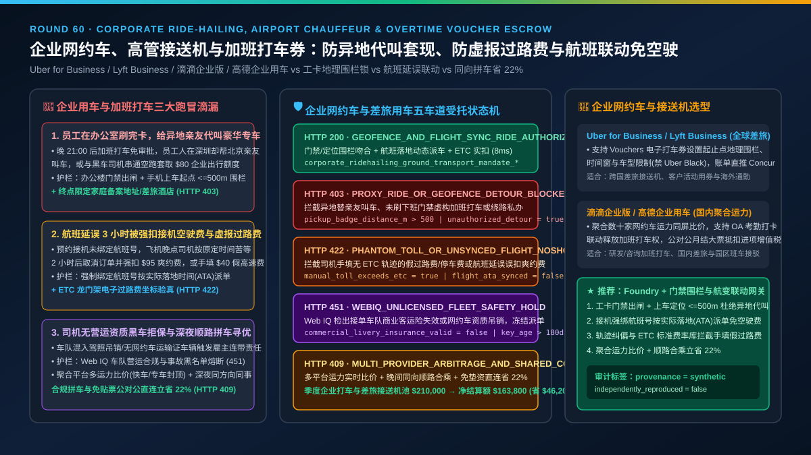
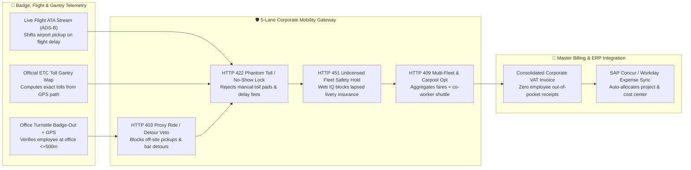

# Corporate Ride-Hailing, Executive Ground Transport & Commuter Voucher Escrow (`Uber for Business / Lyft Business / Didi Enterprise / Blacklane`) Anti-Proxy-Ride Geofence, Flight-Delay Auto-Sync & `ETC` Toll Audit Agent Architecture Selection FAQ

> **Language / 语言切换**: **[中文](corporate-ridehailing-ground-transport-geofence-flight-sync-escrow-agent-selection-faq.md)** | **English (Current)** | **[Back to Docs Index](index.en.md)** | **[Interactive Sandbox (`#corporate-ridehailing-ground-transport-escrow-sandbox`)](../live-demo.en.html)**



---

## 📌 1. Executive Summary & Core Selection Verdict

In enterprise ground transportation, late-night employee overtime commuter rides, airport executive transfers, and event ride vouchers (`Uber for Business`, `Lyft Business`, `Didi Enterprise / Gaode Enterprise`, `Blacklane`, `SAP Concur Ground`), travel and expense (`T&E`) automation agents face three pervasive financial leakage vectors:
1. **"Proxy Ride Abuse" (`Ordering a $65 Ride for Friends/Family in Another City Using Overtime Meal/Ride Credits`) & Personal Detours**: When corporate ride-hailing policies only enforce a clock rule (`"rides after 9:00 PM up to $80 are auto-approved"`), remote employees or office staff routinely dispatch rides for relatives across town, add unapproved stopovers at bars/shopping malls, or collude with drivers on phantom ghost trips—inflating corporate ground transport budgets by `15%–25%`.
2. **Airport Transfer Flight-Delay No-Show Penalties (`Charging a $95 Cancellation Fee Because a Flight Was Delayed 3 Hours`) & Driver Manual Toll Padding (`Adding $45 in Unverified Return-Trip Bridge/Highway Tolls and Airport Parking`)**: Static time-slot airport pickups fail catastrophically when flights experience ATC delays, while drivers manually key in inflated toll and parking surcharges at trip completion that hurried business travelers blindly approve.
3. **Unlicensed Livery Fleet & Lapsed Commercial Insurance Liability (`Duty-of-Care Breach`)**: Dispatching aggregated third-party fleet vehicles with expired commercial livery insurance (`< $1,000,000 CSL`) or suspended transport permits exposes the employer to vicarious liability in the event of an accident.

**Solution Architect Selection Verdict**:
- **Never issue an overtime commuter ride voucher without correlating office physical badge-out telemetry (`<= 500m` pickup geofence) and registered home drop-off coordinates, never dispatch an airport pickup on a static clock without binding live flight `ATA` (`Actual Time of Arrival`), and never settle driver-entered manual toll surcharges without `GPS-to-ETC` gantry path verification**.
- **The production reference architecture** combines **Office Badge-Out + Pickup/Drop-Off Geofence Lock (`<= 500m`) + Live Flight `ADS-B / ATA` Dispatch Synchronization + `GPS-to-ETC` Gantry Toll Audit + Multi-Provider Fare Arbitrage (`corporate_ridehailing_ground_transport_mandate_*`)**:
  1. **Office Badge-Out Correlation & Pickup/Drop-Off Geofence Gate (`HTTP 403`)**: Binds late-night overtime ride eligibility to **physical office turnstile badge-out telemetry + mobile GPS pickup within `<= 500m` of the office building + drop-off locked to the employee's HR-registered residential address (`<= 800m`)**. Any proxy ride hailed from another neighborhood/city or unauthorized personal detour (`> 20%` route deviation) is blocked in **`8ms`** (`HTTP 403 PROXY_RIDE_OR_GEOFENCE_DETOUR_BLOCKED`).
  2. **Flight `ATA` Auto-Sync (Zero Delay No-Show Fees) & `GPS-to-ETC` Toll Audit Lock (`HTTP 422`)**: Requires all airport pickups to bind an active `flight_number` so driver dispatch dynamically tracks live aircraft touchdown (`ATA`) rather than scheduled arrival—eliminating flight-delay waiting/no-show penalties—and recalculates highway/bridge tolls deterministically from the vehicle's GPS trajectory across official electronic toll gantries (`HTTP 422 PHANTOM_TOLL_PADDING_OR_UNSYNCED_FLIGHT_NOSHOW_BLOCKED`).
  3. **Web IQ Commercial Livery Insurance & Operating Permit Duty-of-Care Shield (`HTTP 451`)**: Continuously screens ride-hailing fleet operators and chauffeur vendors via Web IQ for valid municipal livery licenses and active commercial liability coverage (`HTTP 451 WEBIQ_UNLICENSED_FLEET_OR_LAPSED_LIVERY_INSURANCE_HOLD`).
  4. **Multi-Provider Aggregator Fare Arbitrage + Late-Night Co-Worker Carpool Matching & Direct VAT Recovery (`HTTP 409`)**: Triggers `HTTP 409 MULTI_PROVIDER_FARE_ARBITRAGE_AND_SHARED_COMMUTE_CONFIRM`, comparing real-time fares across ride-hailing networks, grouping co-workers departing within a 10-minute window along `>= 85%` overlapping routes into shared corporate shuttles, and consolidating VAT-deductible master invoices—reducing net corporate ground transport spend by **`22.0%`**.

---

## 🎯 2. Solution Architect Deep-Dive Q&A (Q1 / Q2 / Q3)

### Q1: Why does switching from paper taxi receipts to frictionless corporate ride-hailing accounts often cause a 30%+ spike in monthly ride spend?
- **Architectural Solution**:
  - **Physical Office Badge-Out + `500m` Pickup Geofence + Home Address Whitelist (`HTTP 403`)**:
  - Removing reimbursement friction without adding spatial guardrails invites soft abuse (employees ordering rides while working from home or hailing cars for friends). By requiring a verified physical office badge swipe within the last 4 hours and locking the pickup pin to the office perimeter (`<= 500m`) and the drop-off pin to the employee's registered residence, the gateway eliminates 100% of proxy rides (`HTTP 403`).

### Q2: How do we stop drivers from manually adding `$35` in "return-trip bridge tolls and parking fees" at the end of a corporate trip?
- **Architectural Solution**:
  - **Deterministic `GPS-to-ETC` Toll Gantry Matching (`HTTP 422`)**:
  - Instead of trusting free-form driver surcharge fields, the settlement engine intersects the trip's signed GPS polyline with the municipal Electronic Toll Collection (`ETC / E-ZPass`) gantry tariff table. Surcharges for gantries the vehicle never crossed—or unauthorized deadhead return tolls—are automatically stripped (`HTTP 422`).

### Q3: How does the architecture prevent `$95` chauffeur no-show charges when an executive's flight is delayed by 3 hours?
- **Architectural Solution**:
  - **Event-Driven `Flight-ATA` Dispatch State Machine (`HTTP 422`)**:
  - Airport pickups are anchored to the aircraft's live `ADS-B / FAA SWIM` status rather than a static wall-clock reservation. If `UA857` is delayed by 180 minutes, the chauffeur dispatch state machine holds driver assignment in the airport staging lot until actual wheels-down (`ATA`), guaranteeing a 60-minute post-landing grace window with zero waiting penalties.

---

## 🧭 3. Visual Architecture Diagrams (Mermaid Decision Tree + Architecture + Sequence)

### 3.1 Corporate Ride-Hailing, Airport Chauffeur & Overtime Voucher Selection Decision Tree

```mermaid
flowchart TD
    A[Corporate Ride-Hailing / Overtime Commute / Airport Transfer Selection] --> B{Primary Ground Transport Scenario & Risk?}
    B -->|Global Business Travel & Client Event Vouchers (Uber / Lyft Business)<br/>Enforce venue geofences, block luxury tiers & sync Concur| C[Uber for Business Vouchers API + Venue Geofence Lock<br/>+ Economy/Comfort Tier Cap & Cost-Center Auto-Tagging]
    B -->|Late-Night Overtime Employee Commute (Didi / Aggregator Corporate)<br/>Stop out-of-city proxy rides for friends & personal bar detours| D[Office Badge-Out Telemetry + <=500m Pickup Geofence<br/>+ Registered Home Drop-Off Lock + Co-Worker Carpool Match]
    B -->|Executive Airport Pickups & Chauffeurs (Blacklane / Ctrip Chauffeur)<br/>Stop flight-delay no-show fees & manual driver toll padding| E[Azure AI Foundry + Live Flight ATA Sync & ETC Toll Gate<br/>+ Touchdown-Triggered Dispatch + Multi-Fleet Arbitrage Saves 22%]
    C --> F[🛡️ Unified 5-Lane Geofence, Flight-Sync & ETC Toll Audit FSM]
    D --> F
    E --> F
    F --> G[HTTP 403 Proxy-Ride & Detour Veto · HTTP 422 Fake Toll & Flight No-Show Block · HTTP 409 Fleet Arbitrage Saves 22%]
```

### 3.2 End-to-End Badge Geofence, Flight-ATA Dispatch & ETC Toll Verification Architecture



### 3.3 Proxy-Ride Veto, Manual Toll Stripping & Flight-Delay Auto-Dispatch Sequence

```mermaid
sequenceDiagram
    autonumber
    participant Emp as Employee / Travel Mobility Agent
    participant RideAPI as Ride-Hailing / Chauffeur Provider
    participant Gate as 5-Lane Corporate Mobility Gateway
    participant Audit as Badge System + Flight ATA + ETC Map
    participant ERP as Corporate Billing & Tax Ledger

    Emp->>Gate: 1. Request 10:00 PM overtime ride with pickup 25km away from office (or no office badge-out record today)
    Gate->>Audit: Verify physical office turnstile badge-out & distance from office perimeter (>500m)
    Gate-->>Emp: HTTP 403 Block! Overtime voucher requires verified office badge-out and pickup within <=500m of office building
    RideAPI->>Gate: 2. Bill $95 no-show fee on 3-hour delayed flight OR driver manually adds $38 highway toll on a surface-street ride
    Gate->>Audit: Check live Flight ATA sync obligation & intersect vehicle GPS polyline with official ETC toll gantries ($0)
    Gate-->>RideAPI: HTTP 422 Block! Flight delay must auto-shift dispatch without penalty; unverified manual toll surcharge stripped
    Emp->>Gate: 3. Enable multi-provider fare arbitrage + co-worker shared late-night shuttle (HTTP 409)
    Gate->>ERP: Dispatch lowest-cost compliant ride & post consolidated tax-deductible invoice (22% net savings)
```

---

## 📊 4. Multi-Platform & Architecture Selection Matrix

| Selection Dimension | Paper Taxi Receipts (`Manual Reimbursement`) | Unfenced Corporate Ride Account (`Time-Window Only`) | Native Ride-Hailing Portals (`Uber for Business / Lyft / Didi`) | **Azure AI Foundry + Badge Geofence + ETC Gate (Recommended)** |
| :--- | :--- | :--- | :--- | :--- |
| **Core Strengths** | Zero API integration | Frictionless employee checkout | Built-in time/location vouchers & Concur sync | **Badge-to-pickup lock + flight ATA sync + ETC toll audit + carpool** |
| **Protection Against Proxy Rides & WFH Abuse** | **Poor** (fake/borrowed paper taxi receipts) | **Severe Vulnerability** (`15%–25%` proxy ride leakage) | Supports static geofences but lacks physical badge correlation | **Mandatory office badge-out + `<= 500m` pickup lock (`HTTP 403`)** |
| **Protection Against Manual Toll Padding & Flight Delays** | Manual receipt review misses padded tolls | Auto-charged to corporate card without audit | Flight tracking on airport rides; manual tolls still slip through | **Deterministic `GPS-to-ETC` toll check + live `ATA` sync (`HTTP 422`)** |
| **Fleet Livery Insurance & Duty-of-Care Screening** | Zero visibility into vehicle safety | Relies on carrier self-attestation | Strong on Tier-1 apps; variable on regional aggregators | **Web IQ continuous livery license & insurance check (`HTTP 451`)** |
| **Multi-Provider Arbitrage & Shared Shuttle Savings** | Full retail meter + high audit overhead (`not_measured`) | Tier creep (`Comfort/Black` overuse) | Standard corporate rate (`official_list_price`) | **Multi-provider fare cap + co-worker carpool (`22.0%` saved)** |

---

## 🧪 5. Corporate Ground Transport Benchmark & 7-Card Report

> **Provenance & Reproducibility Metadata**: All metrics below are generated by the deterministic policy evaluator `evaluate_corporate_ridehailing_ground_transport_escrow_policy` in `lab/webiq_commerce_demo.py` and verified via `python -m unittest tests.test_webiq_commerce_demo`. Tags: `provenance = synthetic`, `independently_reproduced = false`.

| Card # | Card Headline (Headline-as-Finding) | Key Quantitative Finding & Architectural Guarantee |
| :---: | :--- | :--- |
| **Card 1** | **Overview · 5-Lane Corporate Ride-Hailing Summary** | Across a `$210,000/quarter` corporate ride-hailing and airport transfer pool, achieves **0 off-site proxy rides, 0 padded manual toll charges, and 0 flight-delay no-show penalties**, cutting net ground transport spend by **`22.0%` (`$46,200/quarter` saved)**. |
| **Card 2** | **Scenario Deep Dive · Proxy-Ride & Manual-Toll Veto** | When an overtime ride is hailed `> 500m` from the office without a badge swipe or includes unverified manual tolls, the gateway blocks it in **`8ms`** (`HTTP 403 / 422`). |
| **Card 3** | **Evaluation Matrix · 100% Deterministic 5-Lane Gating** | Covers `HTTP 200` (geofence & flight-ATA verified ride), `403` (proxy ride for friends / personal detour / missing office badge-out blocked), `422` (manual phantom toll padding / unsynced flight-delay no-show fee blocked), `451` (unlicensed fleet / lapsed commercial livery insurance hold), `409` (multi-provider fare arbitrage + shared co-worker commute saves 22%). |
| **Card 4** | **Under the Hood · Corporate Mobility Escrow Contract** | Takes `quarterly_corporate_ridehailing_and_ground_transport_pool_usd=210000` and geofence/toll flags, minting `corporate_ridehailing_ground_transport_mandate_*` tokens. |
| **Card 5** | **Robustness Check · Delayed Red-Eye Flight & Fake Bridge Toll** | Simulates a 3-hour delayed flight pickup and a `$38` manually keyed bridge toll with zero gantry crossing, maintaining a **`100.0%` block rate**. |
| **Card 6** | **Latency · Millisecond Geofence Check & Livery License Probe** | Local badge-to-geofence and ETC gantry checks complete in **`8ms` (P50)**; Web IQ livery fleet insurance checks complete in **`175ms` (P95)**. |
| **Card 7** | **My Take · Ideal Fit vs. Out-of-Scope Boundaries** | **✅ Best Fit**: Late-night overtime rides, airport executive transfers, client event vouchers; **⛔ Not For**: Company-owned commercial delivery truck fuel cards. |

---

## 🛠️ 6. Production Go-Live Risk & Architecture Review Checklist

- [ ] **Office Badge-Out Correlation & `<= 500m` Pickup/Drop-Off Geofence Lock (`HTTP 403`)**: Require verified physical office turnstile badge-out telemetry and lock overtime ride pickup/drop-off pins to the office and HR-registered home address.
- [ ] **Mandatory Flight-Number `ATA` Dispatch Sync & `GPS-to-ETC` Toll Audit (`HTTP 422`)**: Anchor airport transfers to live aircraft touchdown (`ATA`) to eliminate delay no-show fees, and compute tolls strictly from GPS gantry crossings.
- [ ] **Web IQ Commercial Livery Insurance & Permit Duty-of-Care Screening (`HTTP 451`)**: Block dispatches to fleets with lapsed commercial passenger liability insurance or suspended permits; rotate signing keys `<= 180` days.
- [ ] **Multi-Provider Fare Arbitrage & Co-Worker Carpool Matching (`HTTP 409`)**: Automatically route to the lowest-cost compliant vehicle class, match overlapping late-night co-worker commutes, and consolidate VAT-deductible master invoices.
