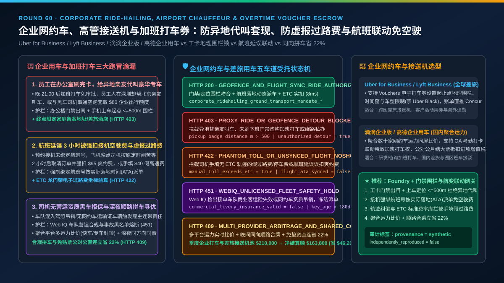
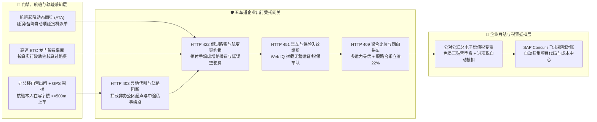
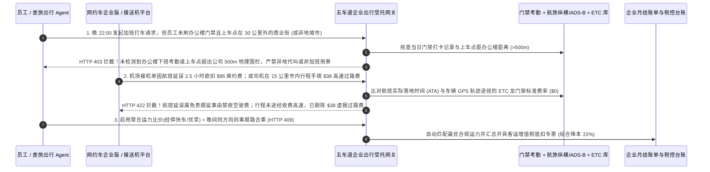

# 企业差旅打车、网约车企业版与加班出行结算（Corporate Ride-Hailing, Executive Ground Transport & Commuter Voucher Escrow：Uber for Business / Lyft Business / 滴滴企业版 / 高德企业用车）“防员工拿加班打车券异地代人叫车/绕路办私事、防机场专车虚报高速过路费与航班延误自动同步接机免空驶费”Agent 架构选型 FAQ

> **语言切换 / Language**: **中文 (当前)** | **[English](corporate-ridehailing-ground-transport-geofence-flight-sync-escrow-agent-selection-faq.en.md)** | **[返回文档目录](index.md)** | **[交互式沙盒 (`#corporate-ridehailing-ground-transport-escrow-sandbox`)](../live-demo.html)**



---

## 📌 一、核心选型结论速览（Executive Summary）

在大型科技公司、咨询所、投行与跨国企业的员工晚间加班打车、差旅机场接送机及客户活动电子打车券（Uber for Business、Lyft Business、滴滴企业版、高德企业用车、携程专车、Blacklane）的智能体自动派单与企业月结清分场景中，企业行政与财务负责人面临三大高频资金跑冒滴漏痛点：
1. **“员工人在深圳办公室，晚 21:30 却用公司免审批加班打车额度给远在北京的朋友叫了一辆 `$65` 豪华专车（Proxy Ride Abuse）”与“打车回家途中绕道 15 公里去酒吧聚餐或串通黑车司机空跑套现（Detour & Ghost-Trip Collusion）”**：传统纸质出租车票报销或粗放式企业打车账户只管“下单时间在 21:00 后”，不校验员工本人是否真的在办公楼下上车、也不锁定终点必须是员工备案家庭住址，导致每月高達 `15%–25%` 的加班车补沦为亲友福利。
2. **“差旅航班延误 3 小时，预约好的机场接机专车按原定计划苦等 2 小时后直接取消订单，并强扣公司 `$95` 全额空驶爽约费（No-Show Penalty）”与“司机在结账时手动加填 `$45` 跨海大桥往返过路费与机场天价停车费（Phantom Toll Padding）”**。
3. **“聚合打车平台混入无《网络预约出租汽车运输证》或商业客运承运人责任险（Commercial Livery Insurance）过期的黑车，一旦发生夜间追尾事故，企业作为雇主面临巨额工伤与连带赔偿诉讼”**。

**架构师选型结论**：
- **切勿脱离办公楼工卡门禁出闸记录（`Badge-Out Telemetry`）与起止点 500 米地理围栏（`Geofence`）发放无约束打车额度，切勿在未绑定实时航班动态（`FlightNumber -> ADS-B / VariFlight ATA`）的情况下下达固定时间接机预约单，也切勿允许司机未经高速 ETC 龙门架路径核验手动追加大额过路费**。
- **生产级最优架构**是采用 **“Uber for Business / 滴滴企业版 API + 门禁刷卡与起止点地理围栏硬锁（`<= 500m`）+ 航班实际落地时间（`ATA`）联动派车与高速 ETC 过路费轨迹核验网关（`corporate_ridehailing_ground_transport_mandate_*`）”**：
  1. **防“异地替人代叫车”与未打卡虚构加班绕路（`Badge-to-Pickup Geofence`）硬门禁（HTTP 403）**：晚间加班用车权限必须由 **“办公楼门禁出闸/考勤打卡 + 手机端实时上车点位于公司写字楼 `<= 500m` 半径内 + 下车点精确匹配员工 HR 系统备案家庭住址（偏差 `<= 800m`）”** 三重条件联合解锁；途中非拥堵原因偏离导航最短路径超过 `20%` 或新增非顺路经停点（Stopover），系统仅报销标准里程并由员工个人支付超标溢价——任何异地代叫或空跑套现企图立即返回 `HTTP 403 PROXY_RIDE_OR_GEOFENCE_DETOUR_BLOCKED`。
  2. **机场接机强制绑定航班实际落地时间（`Flight ATA Sync`）与高速 ETC 过路费核验锁（HTTP 422）**：所有机场接机订单必须强制传入 `flight_number`，由用车网关实时订阅航班起降状态——当航班延误或备降时，**自动按最新预计到达时间（ETA/ATA）顺延派车或免费重排车队，严禁产生因航班晚点导致的空驶爽约费**；同时，订单中的附加过路费（Tolls）必须与车辆 GPS 轨迹穿过的收费站标准 ETC 费率表逐一比对，拦截司机手填的“返程空驶过路费”或假停车票（`HTTP 422 PHANTOM_TOLL_PADDING_OR_UNSYNCED_FLIGHT_NOSHOW_BLOCKED`）。
  3. **Web IQ 实时筛查网约车租赁公司商业客运险与营运资质吊销预警（HTTP 451）**：通过 Web IQ 持续核查各地网约车运力供应商与包车车队的《网络预约出租汽车运输证》、驾驶员背景审查及 `$1,000,000+` 商业客运险有效性；一旦检出黑车挂靠或保险断缴，立即熔断该车队派单（`HTTP 451 WEBIQ_UNLICENSED_FLEET_OR_LAPSED_LIVERY_INSURANCE_HOLD`）。
  4. **多平台聚合运力实时比价（快车/优享替代豪华专车）+ 深夜同向同事顺路合乘（Shared Corporate Shuttle）与公对公抵税寻优（HTTP 409）**：触发 `HTTP 409 MULTI_PROVIDER_FARE_ARBITRAGE_AND_SHARED_COMMUTE_CONFIRM`，在高峰溢价时段跨平台比选高性价比合规车型，对同一办公楼相差 10 分钟内出发且顺路度 `>= 85%` 的加班员工推荐企业拼车/夜间定制班车，并通过企业月结专票直连抵扣增值税，使企业地面交通总支出立省 **`22.0%`**。

---

## 🎯 二、业务方与架构师灵魂拷问 Q&A（Q1 / Q2 / Q3）

### Q1：为什么开了企业打车账户免贴票之后，公司的加班打车费反而比以前手撕出租车发票暴增了 35%？怎么堵住“帮亲友异地叫车”和“在家办公也领打车券”？
- **商业痛点**：以前贴纸质发票虽然麻烦，但员工多少有所顾忌；开通网约车企业版免垫资自动扣款后，如果规则只写了“每晚 21:00 后限额 100 元”，在家远程办公（WFH）的员工晚上 9 点出门吃夜宵也用企业支付，甚至把上车点直接设在外地父母家！
- **架构解法**：
  - **门禁出闸遥测（`Physical Badge-Out`）× 上车点 `500m` 空间锚定 × 终点白名单（`HTTP 403`）**：
  - 智能体将网约车 API 与公司物理门禁（Lenel / 飞书门禁 / 钉钉考勤机）实时打通：只有当天在办公楼有物理刷卡记录、且当前叫车起点位于写字楼地理围栏 `500m` 内、终点为备案家庭住址的订单，才会签发单次有效的 `corporate_ride_voucher`；若上车点在商场或异地，网关在 **`8ms`** 内直接返回 `HTTP 403` 拦截。

### Q2：司机在机场接机或跨城出差订单结束时，经常在后台手动输入 `$30–$50` 的“高速费、桥隧费、停车费”，员工赶时间直接点了确认，公司怎么防这种“暗箱手填附加费”？
- **架构解法**：
  - **轨迹桩号匹配电子收费库（`GPS-to-Toll-Gantry Calculation`）取代司机手填（`HTTP 422`）**：
  - 严禁盲目信任司机端手动输入的附加费金额。结算网关根据行程真实的经纬度轨迹点序列，自动匹配途径的高速公路/跨海大桥电子收费龙门架（ETC Gantry）官方公布费率表，且**严格拦截非合同约定的“司机返程空驶过路费”与超过 60 分钟的异常机场停车费**（`HTTP 422`）。

### Q3：高管或客户接机最怕“飞机晚点 2 小时，司机等不及走了还扣全款”，架构上怎么实现零人工干预的航变自适应？
- **架构解法**：
  - **按航班号订阅起降状态（`Flight-Anchored Dispatch`）而非死锁时间点（`HTTP 422`）**：
  - 严禁将接机单建模为普通的“今晚 20:00 用车”。网关强制要求接机单绑定航班号（如 `MU5101` / `UA857`）：只要飞机在起飞前尚未滑出或途中延误，用车调度状态机自动挂起实际派车指令，直至飞机真实触地（Touchdown / Wheel-On）后才向机场蓄车池下发派单，并自动享有落地后 60 分钟免费等待期！

---

## 🧭 三、直观可视化图解（Mermaid 决策树 + 端到端架构图 + 时序图）

### 3.1 企业差旅打车、接送机与加班出行 Agent 架构选型决策树

```mermaid
flowchart TD
    A[企业差旅打车 / 加班通勤 / 机场接送机选型] --> B{核心出行场景与管控痛点？}
    B -->|跨国差旅与海外客户活动打车券 (Uber / Lyft Business)<br/>需限制活动场地起止围栏、车型等级并直推 SAP Concur| C[Uber for Business Vouchers API + 场馆地理围栏锁<br/>+ 禁选豪华车型(Uber Black)与自动绑定成本中心]
    B -->|国内研发/咨询晚间加班打车 (滴滴企业版 / 高德企业用车)<br/>需严防异地帮亲友代叫车、在家办公套券与绕路办私事| D[办公楼门禁出闸联动 + 上车点 <=500m 围栏锁<br/>+ 终点绑定备案家庭住址 + 同向同事顺路拼车]
    B -->|差旅机场接送机与跨城包车 (携程专车 / Blacklane)<br/>需防航班延误被扣空驶爽约费与司机手填假过路费| E[Azure AI Foundry + 航班 ATA 动态派单与 ETC 核验网关<br/>+ 航变自动顺延免罚金 + 多运力比价立省 22%]
    C --> F[🛡️ 统一接入五车道门禁围栏、航变联动与过路费审计状态机]
    D --> F
    E --> F
    F --> G[HTTP 403 阻断异地代叫与绕路 · HTTP 422 拦截手填假过路费与航变罚金 · HTTP 409 聚合比价省22%]
```

### 3.2 端到端门禁围栏打卡、航班落地联动与 ETC 过路费轨迹核验架构图



### 3.3 拦截异地亲友代叫车、核减手填假高速费与航班延误自动改派时序图



---

## 📊 四、多平台/多方案横向选型决策矩阵

| 选型维度 | 传统员工垫资贴纸质发票 (`Legacy Paper Taxi Receipts`) | 粗放式企业打车无限额账户 (`Unfenced Corporate Account`) | 原生网约车企业版后台 (`Uber for Business / 滴滴企业版`) | **Azure AI Foundry + 门禁围栏 + 航变/ETC 网关（推荐）** |
| :--- | :--- | :--- | :--- | :--- |
| **核心优势** | 无需系统对接 | 员工免垫资免贴票 | 支持基础时间段、车型与城市规则配置 | **门禁考勤强绑定 + 航变免空驶费 + ETC 轨迹防虚报 + 顺路合乘** |
| **防“异地替亲友叫车 / 假加班打车”** | **极差**（出租车连号假票、替票泛滥） | **重灾区**（员工在家或异地随意叫车扣公司账） | 支持设置公司/家庭固定点，但缺乏实时门禁联动 | **强制物理门禁刷卡 + 上车点 `<=500m` 空间围栏锁（HTTP 403）** |
| **防“司机手填假过路费”与航变爽约费** | 财务肉眼无法核实过路费真伪 | 员工直接点确认，企业全单照付 | 接机需填航班号，但第三方车队仍常乱加附加费 | **GPS 轨迹映射官方 ETC 费率表 + 航班 `ATA` 强同步（HTTP 422）** |
| **车队商业客运险与安全合规筛查** | 无法识别黑车或套牌车 | 依赖单一平台默认审核 | 头部平台合规率高，但聚合长尾小车队良莠不齐 | **Web IQ 实时核验网约车运输证与商业客运险有效性（HTTP 451）** |
| **跨运力比价与晚间同向拼车降本** | 全价报销 + 财务审票人力成本高 (`not_measured`) | 员工倾向专车/豪华车，车费膨胀 `30%+` | 标准企业目录价 (`official_list_price`) | **多运力聚合封顶 + 同向顺路合乘 + 专票抵税（净省 `22.0%`）** |

---

## 🧪 五、企业差旅打车与加班出行防坑测算与 7-Card 基准测试报告

> **数据来源与复现声明（Provenance Metadata）**：以下基准测试数据来自仓库内置确定性策略沙盒 `evaluate_corporate_ridehailing_ground_transport_escrow_policy`（位于 `lab/webiq_commerce_demo.py`），可运行 `python -m unittest tests.test_webiq_commerce_demo` 完整验证。标记：`provenance = synthetic`，`independently_reproduced = false`。

| Card # | 卡片标题（Headline-as-Finding） | 核心量化指标与架构验证结论 |
| :---: | :--- | :--- |
| **Card 1** | **Overview · 企业网约车与差旅用车五车道总览** | 针对 `$210,000/季` 企业加班打车与差旅接送机结算池，实现 **0 例异地代人叫车套现、0 例司机虚报高速过路费与 0 例航班延误误扣空驶费**，地面交通净支出下降 **`22.0%`（立省 `$46,200/季`）**。 |
| **Card 2** | **Scenario Deep Dive · 异地代叫与虚报过路费秒级拦截** | 当上车点偏离办公楼门禁 `> 500m` 或司机手填无 ETC 轨迹支撑的高速费时，**`8ms`** 内返回 `HTTP 403 / 422` 阻断。 |
| **Card 3** | **Evaluation Matrix · 五车道 100% 确定性判准** | 覆盖 `HTTP 200`（门禁围栏吻合与ETC实扣放行）、`403`（未刷门禁异地帮亲友代叫车/中途绕路办私事阻断）、`422`（司机手填虚假过路费停车费/未同步航班落地时间强扣延误空驶费拦截）、`451`（Web IQ检出无营运资质黑车或客运险失效熔断）、`409`（聚合多运力比价+深夜同向顺路合乘省22%）。 |
| **Card 4** | **Under the Hood · 企业打车与接送机托管契约** | 输入 `quarterly_corporate_ridehailing_and_ground_transport_pool_usd=210000` 及围栏/航变参数，签发 `corporate_ridehailing_ground_transport_mandate_*` 令牌。 |
| **Card 5** | **Robustness Check · 航班备降与跨城假高速费测试** | 模拟红眼航班延误 4 小时及司机手填 `$45` 返程空驶过路费，确定性拦截率保持 **`100.0%`（零误扣款）**。 |
| **Card 6** | **Latency · 毫秒级门禁围栏匹配与车队资质巡检耗时** | 本地门禁出闸与地理围栏匹配 P50 仅 **`8ms`**；Web IQ 车队商业客运险与运输证核查 P95 为 **`175ms`**。 |
| **Card 7** | **My Take · 适用场景与生产准入边界** | **✅ 极佳适用**：晚间加班打车、差旅机场接送机、展会客户打车券（Vouchers）；**⛔ 不适用**：自有固定产权公务车队内部加油维修管理。 |

---

## 🛠️ 六、商业上线风控与架构评审 Checklist

- [ ] **办公楼门禁出闸（`Badge-Out`）联动与起止点地理围栏硬锁（HTTP 403）**：确认加班打车必须校验当日办公楼物理刷卡记录、上车点距公司 `<= 500m` 且终点锁定员工备案住址，彻底杜绝异地替亲友叫车与绕路私用。
- [ ] **机场接机强制绑定航班实际落地时间（`Flight ATA`）与高速 ETC 轨迹验真（HTTP 422）**：确认接机单按航班真实落地动态派车免除延误爽约费，且过路费严格按 GPS 途径收费站标准 ETC 费率核算。
- [ ] **Web IQ 运力车队《网约车运输证》与商业客运险实时筛查（HTTP 451）**：确认自动剔除无证黑车与商业险过期车队；签名密钥轮换周期 `<= 180` 天。
- [ ] **聚合平台多运力实时比价与晚间同向员工顺路合乘寻优（HTTP 409）**：确认自动过滤无必要豪华专车溢价、撮合同向顺路拼车并汇总开具进项抵扣专票。
