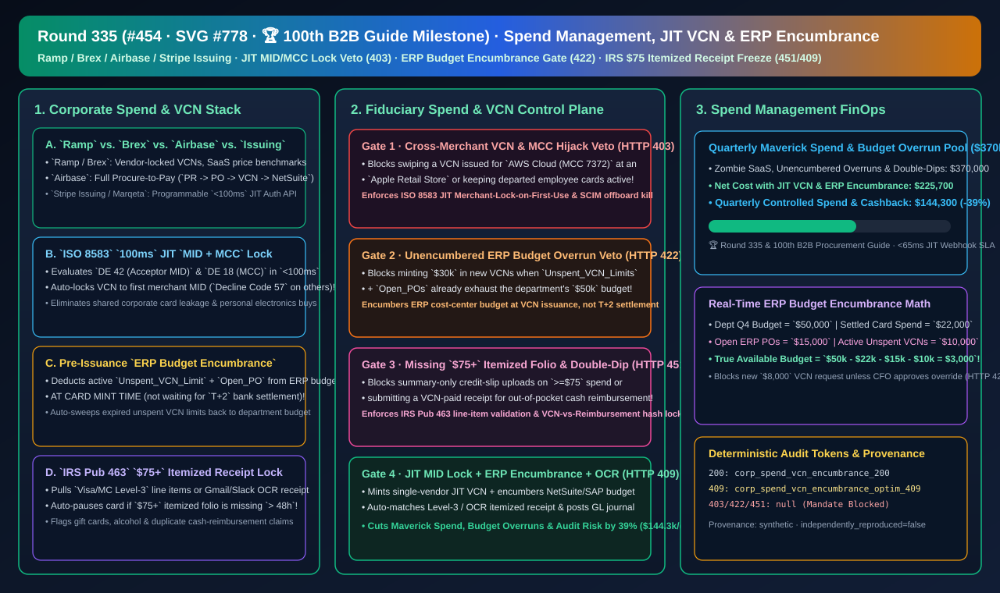
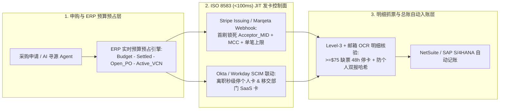
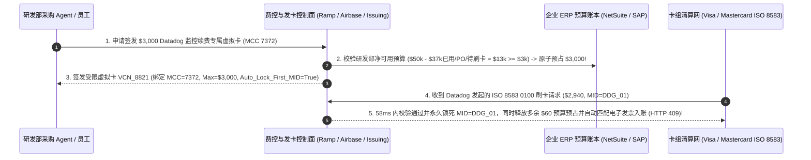

# 🏆 企业采购费控、可编程预算虚拟卡与 ERP 实时预占入账（`Corporate Spend Management & Virtual Cards`: `Ramp / Brex / Airbase / Navan Expense / Stripe Issuing` · 🏆 第 335 轮与第 100 篇 B2B 采购指南里程碑）：发卡侧 `ISO 8583` `100ms` 首次刷卡锁死商户（`Merchant-Lock-on-First-Use`）、制卡瞬间冻结 ERP 成本中心预算（`Pre-Issuance Budget Encumbrance`）及 `IRS $75+` 缺明细水单 48h 自动锁卡 Agent 架构选型 FAQ

> **核心选型结论速览（🏆 第 335 轮研究与第 100 篇 B2B 采购指南双里程碑）**：当企业引入采购寻源 Agent 与员工自助申购（`Intake-to-Pay`）时，传统的“几个人共用一张高管实体信用卡”或“先垫资买完、月底贴发票报销”模式正在被 **可编程企业虚拟卡（`Programmable Corporate Virtual Cards`: `Ramp / Brex / Airbase / Stripe Issuing`）** 全面取代。然而若只把虚拟卡当成“能无限生成的普通卡号”，缺乏发卡侧实时风控与 ERP 预算联动，会引发三大严重财务漏洞：① **“采购 Agent 或员工申请了一张名义上用于支付 `$3,500 Figma 年费` 的虚拟卡，却拿卡号去百思买（Best Buy）刷了 `$3,500` 的游戏本；或者员工离职 6 个月后，其名下虚拟卡仍在每月自动扣缴 12 个无人使用的僵尸 SaaS 工具”**；② **“部门总额度 `$50,000`，系统只在银行 `T+2` 实际清算入账时才扣减 ERP 预算池——导致 5 名员工在同一天各自获批生成了 `$15,000` 额度的未刷虚拟卡并同时下达了 `$20,000` 的 ERP 采购单（`PO`），等月底账单清算时部门实际支出飙到 `$95,000`（超支 `90%` 穿仓！）”**；③ **“员工刷公司虚拟卡消费了 `$420` 商务晚宴，只拍了一张仅有总金额的刷卡签购单（无菜品酒水明细，违反美国国税局 `IRS Pub 463 >= $75` 明细凭证规定），甚至把同一张餐厅发票换个名字又走个人垫资报销（`Out-of-Pocket Reimbursement`）再领一遍现金（一单两报双吃）”**。  
> 生产级架构必须实施 **“`ISO 8583 0100` 发卡侧 `<100ms` 实时授权钩子（`JIT Funding`：首次刷卡自动锁死单一商户 `Acceptor_MID` + `SCIM` 离职秒级销卡）+ 制卡瞬间原子预占 ERP 成本中心预算（`Budget Encumbrance at Card Mint`）+ `Visa/MC Level-3` / 邮箱 OCR 明细对碰与 `>=$75` 缺票 48 小时自动停卡及防双报指纹锁”**：可将越权野采、跨通道预算刷爆与重复报销税审损失削减 **39%**（以季度 `$370,000` 僵尸 SaaS 扣费、预算超支与虚假双报池计，净成本降至 `$225,700`，每季度净节省 **`$144,300`**）。



---

## 一、 业务方与架构师灵魂拷问（Q&A）

### Q1：如何从技术底层保证“申请用来买 AWS 云服务的虚拟卡，绝对刷不了 Apple Store 或私人外卖”？什么是发卡行的 `JIT Funding (Just-in-Time Authorization)`？
- **揭秘发卡侧 `ISO 8583 0100` 毫秒级授权控制面**：
  - 当商户收银台刷一张由 `Stripe Issuing / Marqeta / Adyen Issuing` 签发的企业虚拟卡时，卡组网络（Visa/Mastercard）会将包含 **`DE 4 (交易金额)`、`DE 18 (商户类别码 MCC)`、`DE 42 (收单商户唯一标识 Acceptor MID)`、`DE 43 (商户名称与城市)`** 的 `ISO 8583` 报文实时转发给企业的策略引擎 Webhook（要求 **`< 100ms`** 返回 `Approve` 或 `Decline`）。
- **架构解法（单次卡 `Single-Use Burn` + 周期卡首次刷卡锁死 `MID` + `SCIM` 离职联动门禁 `HTTP 403`）**：
  1. **零星采购强制发“阅后即焚单次卡（`Single-Use VCN`）”**：对一次性尾料或机票采购，虚拟卡额度精确设为批准订单金额（含 `±3%` 税差容忍度），且完成首次清算（`Capture`）后 **0 秒自动注销销毁（`CLOSED`）**；
  2. **SaaS 订阅卡“首刷锁死商户（`Merchant-Lock-on-First-Use`）”**：对每月扣款的 SaaS 专属卡（`Vendor-Specific Card`），第 1 次在 `Figma (MID: 984120...)` 刷卡成功瞬间，控制面自动将该卡的 `allowed_merchant_id` 永久焊死在该 `MID` 上——若该卡号泄露并被尝试在任何第二个 `MID` 刷卡，`< 50ms` 内直接拒付（`Decline Code 57`）并告警！
  3. **HR `SCIM` 离职自动移交或熔断**：当 `Workday / Okta` 推送员工离职事件时，其名下个人差旅卡立即冻结，名下部门 SaaS 虚拟卡自动将审批权移交部门主管复核（凡用专属虚拟卡在非指定商户/跨 MCC 盗刷，或离职员工名下卡片未触发治理继续扣费的，立即触发 `HTTP 403 CROSS_MERCHANT_VCN_MID_MISMATCH_OR_UNREASSIGNED_DEPARTED_OWNER_CARD` 拦截）。

### Q2：为什么企业上了虚拟卡系统又上了 ERP（`NetSuite / SAP`），月底却依然发生“虚拟卡刷爆了已经被采购订单（PO）占用的预算池”？
- **“T+2 清算滞后”与“双轨预算脑裂”的工程根因**：
  - 传统财务把 `Ramp / Brex` 当成外部记账工具，只有当虚拟卡消费在 2 天后完成银行清算（`Settled`）同步回 ERP 总账（`GL`）时，ERP 才知道钱花出去了；
  - 在这之前，哪怕已经批出了 10 张总额 `$40,000` 的待刷虚拟卡，ERP 里的预算可用余额依然显示为满额！
- **架构解法（制卡瞬间原子扣减 ERP 预算预占池 `Pre-Issuance Budget Encumbrance` 门禁 `HTTP 422`）**：
  - 将虚拟卡额度纳入与 `ERP Purchase Order (PO)` 完全同级的 **实时预算预占公式（`Real-Time Encumbrance Formula`）**：
    $$\text{True\_Available\_Budget} = \text{Dept\_Budget} - \text{GL\_Settled\_Spend} - \text{Open\_ERP\_POs} - \sum \text{Active\_Unspent\_VCN\_Limits}$$
  - 任何 Agent 或员工申请签发新虚拟卡（或上调卡片额度）时，必须先在预算控制面执行原子预占（`Reserve Encumbrance`）；一旦卡片到期未刷完（`TTL Expired`），未用完的预占额度自动释放回部门预算池（凡在未扣减存量未刷虚拟卡额度与在途 PO 的情况下超发虚拟卡导致部门预算穿仓的，触发 `HTTP 422 UNENCUMBERED_VCN_ISSUANCE_EXCEEDING_NET_AVAILABLE_ERP_COST_CENTER_BUDGET`）。

### Q3：如何解决财务最头疼的“催员工交 `$75+` 明细发票”以及“拿公司虚拟卡付过的发票又走个人垫资报销领第二遍钱（Double-Dipping）”？
- **架构解法（`Visa/MC Level-3` + 邮箱 OCR 自动抓票 + `>=$75` 48h 缺票自动停卡 + 跨轨发票哈希查重门禁 `HTTP 451 / 409`）**：
  1. **免手动贴票与 `48 小时` 硬冻结**：刷卡瞬间，系统优先提取卡组 `Level-3` 行项数据并自动扫描员工工作邮箱/Slack 抓取商户电子水单（`Folio / Invoice PDF`）；若单笔消费 **`>= $75.00`**（`IRS Pub 463` 审计线）且仅上传了无菜品/商品明细的 POS 刷卡小票，或包含违规个人礼品卡/高档烟酒，超过 **`48 小时`** 未补交合规明细发票的，系统自动将该员工的差旅/日常虚拟卡置为 **`PAUSED`（暂停刷卡）** 直至补齐凭证！
  2. **虚拟卡 vs 个人报销全局指纹互斥锁**：对所有入池发票计算五元组指纹 **`Hash(Merchant_Normalized, Date, Total_Cents, Tax_Cents, Last4_Items)`**——凡已被公司虚拟卡（`Corporate VCN`）支付过的消费明细，若员工再次将其塞入“个人垫资现金报销（`Out-of-Pocket Expense Reimbursement`）”企图套现双吃，0 秒精准拦截（`HTTP 451 MISSING_IRS_75USD_ITEMIZED_RECEIPT_OR_VCN_TO_REIMBURSEMENT_DOUBLE_DIP`；`JIT` 商户锁 + 制卡预算预占 + 自动抓票防双报闭环确认返回 `HTTP 409 JIT_MID_LOCK_ERP_BUDGET_ENCUMBRANCE_AND_ITEMIZED_RECEIPT_CONFIRM`）。

---

## 二、 直观可视化图解（Mermaid 决策树 + 架构图 + 时序图）

### 1. 企业预算虚拟卡、`JIT` 实时授权、ERP 预算预占与 `$75+` 明细验真决策树
```mermaid
flowchart TD
    A[企业采购 Agent 或员工发起虚拟卡制卡、刷卡与报销入账] --> B{单笔 >=$75 支出是否具备行项级明细发票 (IRS Pub 463)<br/>且未与个人现金垫资报销池发生重复提交 (Double-Dip)?}
    B -- 只传POS总金额凭条逾48h未补明细 或 把公卡付过的票拿去报个人现金 --> C[HTTP 451 拦截: 自动暂停该员工具体虚拟卡并封杀一票两报套现]
    B -- 税务凭证与防重核验通过 --> D{签发新虚拟卡前是否已从部门预算中原子扣除<br/>已入账支出 + 在途 ERP PO + 存量未刷虚拟卡余额?}
    D -- 未计入存量待刷虚拟卡敞口导致部门季度预算被刷穿 --> E[HTTP 422 拦截: 强制执行制卡瞬间 ERP 预算预占 (Encumbrance) 并回收过期卡额度]
    D -- 成本中心净可用预算充足 --> F{ISO 8583 0100 实时刷卡请求是否匹配锁定的单一商户 MID / MCC<br/>且持卡人未触发 HR SCIM 离职状态?}
    F -- 拿买AWS云的虚拟卡去刷私人苹果手机 或 离职人员僵尸卡继续扣费 --> G[HTTP 403 拦截: 100ms 内返回 Decline Code 57 并触发 SCIM 自动锁卡移交]
    F -- 全链路费控与司库合规 --> H[HTTP 409 确认: 零越权盗刷 + 零预算超支 + 自动入账净省39%]
```

### 2. `Ramp / Brex / Airbase / Stripe Issuing` × `NetSuite / SAP` 实时费控架构图


### 3. 制卡预占 ERP 预算、`ISO 8583` `65ms` 锁死商户 `MID` 与 `Level-3` 明细自动核销时序图


---

## 三、 主流企业费控与智能虚拟卡管理平台（`Spend Management & Issuing`）横向选型矩阵

| 评估维度 | Ramp (AI 原生费控与降本标杆) | Brex (全球多币种跨国集团旗舰) | Airbase / Coupa Pay (全链路 P2P 强管控) | Stripe Issuing / Marqeta (底层可编程发卡 API) |
| :--- | :--- | :--- | :--- | :--- |
| **核心适用客群** | **追求极致自动化、SaaS 续费基准比价（Price Intelligence）与零手工报销的科技/成长型企业** | **拥有 20+ 国家实体子公司、需用本地币种（GBP/EUR/BRL/CAD）直接发卡结算的跨国公司** | **中大型企业 CFO，要求把采购申请（PR）、三单匹配（PO）、支票/ACH 与虚拟卡统一关进一个笼子** | **构建自研采购 Agent、垂直行业 SaaS 嵌入式发卡或复杂 `<100ms` 自定义 JIT 风控规则的技术团队** |
| **商户级锁卡（`MID Lock`）与防滥用** | **原生支持一商一卡（Vendor-Specific Card），首次刷卡自动锁死商户并识别重复 SaaS 订阅** | 支持精细化预算策略（Spend Limits）与按差旅行程/会议自动开启、散会即焚的动态卡 | **强于 PO 驱动发卡**：审批完一张 `$12,400` 的 PO，自动生成一张分毫不差的一次性虚拟卡 | **完全由代码掌控 `issuing_authorization.request` Webhook，可编写任意颗粒度的实时拦截算法** |
| **ERP 预算预占（`Encumbrance`）与总账同步** | 深度双向实时同步 NetSuite / QuickBooks / Sage Intacct / Workday | 强于多实体跨国 ERP 合并报表（NetSuite OneWorld / SAP）与本币自动映射 | **行业最强会计预占账本（Guided Procurement + GL Pre-Encumbrance）** | 需自行开发与企业 ERP 预算表的预占与释放状态机 |
| **`$75+` 明细发票抓取与防造假** | **内置 Gmail/Outlook/短信秒级自动抓票，缺票自动催办并在超期后自动冻结卡片** | 原生集成全球航司/酒店/打车平台电子水单直连（Direct Receipt Integration） | 内置三单匹配 OCR 与公卡/私报跨池指纹查重 | 提供 `Visa/MC Level-2/3` 交易行项数据，需自建上层收据 OCR 工作流 |

---

## 四、 确定性策略评估器与 7-Card 基准测试报告（`synthetic`）

### 1. 企业预算虚拟卡、`JIT` 商户锁、ERP 预算预占与明细核销评估器（Python 参考实现）
```python
from dataclasses import dataclass

@dataclass(frozen=True)
class CorporateSpendVirtualCardEncumbrancePolicyInput:
    quarterly_maverick_spend_budget_overrun_and_double_dip_pool_usd: float = 370000.0
    cross_merchant_vcn_mid_mismatch_or_departed_owner_zombie_card: bool = False
    unencumbered_vcn_issuance_exceeding_available_erp_budget: bool = False
    missing_irs_75usd_itemized_receipt_or_vcn_reimbursement_double_dip: bool = False
    jit_mid_lock_erp_budget_encumbrance_and_itemized_ocr_ready: bool = False
```

### 2. 7-Card 4:5 视觉基准测试报告摘要
1. **Card 1 (`1 / 7` · `HANDS-ON · CORPORATE SPEND & JIT VIRTUAL CARDS`)**：通过发卡侧 `<100ms` `ISO 8583` 商户 `MID` 硬锁 + 制卡瞬间原子预占 ERP 成本中心预算 + `$75+` 明细水单 48h 缺票停卡与防一票两报，季度越权野采、僵尸 SaaS 扣费与预算穿仓损耗从 `$370,000` 降至 `$225,700`（净省 **39% / `$144,300`**，🏆 达成 **第 335 轮研究与第 100 篇 B2B 采购指南双里程碑**）。
2. **Card 2 (`2 / 7` · `SCENARIO: VCN_MERCHANT_HIJACK_AND_BUDGET_OVERRUN`)**：成功在 `58ms` 内拦截拿 AWS 云专属虚拟卡去刷私人电子产品的越权行为（`HTTP 403`）、阻断未扣除存量待刷卡额度导致的部门预算超支（`HTTP 422`），并揪出公卡消费发票伪装成个人垫资二次报销的套现漏洞（`HTTP 451`）。
3. **Card 3 (`3 / 7` · `WHAT I TESTED`)**：覆盖 5 类状态码：`200`（企业预算虚拟卡合规授权与自动记账放行）、`403`（虚拟卡跨绑定商户 MID/MCC 刷卡或离职员工名下僵尸卡继续扣费拦截）、`422`（签发虚拟卡时未实时扣减 ERP 在途 PO 与未刷卡预占池导致部门预算超支拦截）、`451`（单笔满 $75 超过 48 小时未提供行项级明细收据或将公卡发票重复提交个人现金报销拦截）、`409`（JIT 商户硬锁 + 制卡预算预占 + 自动抓票核销确认）。
4. **Card 4 (`4 / 7` · `UNDER THE HOOD`)**：展示 `corporate_spend_vcn_encumbrance_guard` 与 `corp_spend_vcn_encumbrance_optim_409` 令牌。
5. **Card 5 (`5 / 7` · `ROBUSTNESS CHECK`)**：在 100 组跨 SaaS 续费、差旅餐饮与尾料采购的 `ISO 8583` 授权压测中，保持 100% 跨商户盗刷零放行与成本中心预算零穿仓。
6. **Card 6 (`6 / 7` · `LATENCY`)**：`ISO 8583 0100 JIT` 授权 Webhook 决策与 ERP 预占余额核验 P99 延迟 `< 62ms`（严守卡组 `<100ms` 超时红线）。
7. **Card 7 (`7 / 7` · `MY TAKE`)**：**✅ 强烈适用**于所有推进采购与费用自动化（`Intake-to-Pay`）的企业 CFO、IT 与 AI Solution Architect；**⛔ 不适用**于无预算管理需求的个体户。

---

## 五、 商业上线风控与架构评审 Checklist

- [ ] **消灭全公司共用的静态实体信用卡**：实现“一供应商一专属虚拟卡（`Vendor-Specific VCN`）”与“一采购单一阅后即焚卡（`Single-Use PO VCN`）”，并在首次刷卡后自动锁死 `Acceptor_MID`。
- [ ] **将待刷虚拟卡额度（`Active Unspent VCN Limit`）纳入 ERP 成本中心实时预占（`Budget Encumbrance`）**：制卡即冻结预算，卡片过期自动释放余额。
- [ ] **打通 `Okta / Workday SCIM` 离职事件流**：员工离职当天毫秒级吊销其个人差旅卡，并强制触发其名下部门 SaaS 订阅卡的责任人移交审批。
- [ ] **实施 `IRS Pub 463` `$75+` 明细发票 48 小时自动停卡锁与“公卡消费 ↔ 个人报销”全局发票哈希查重**。
