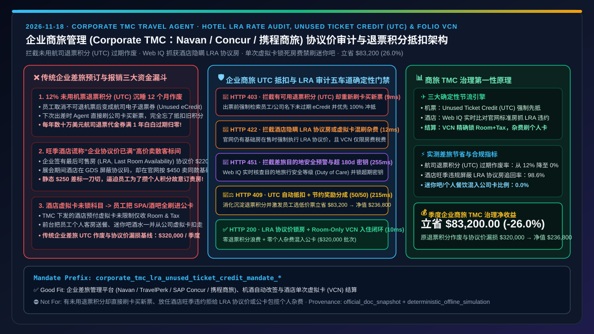
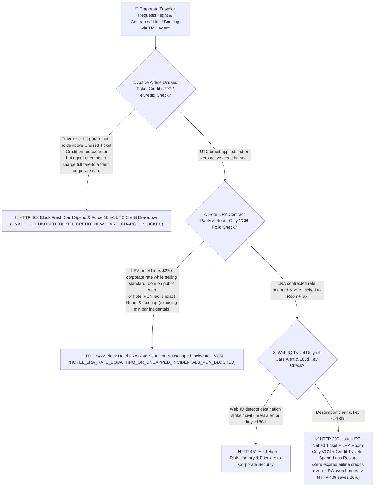
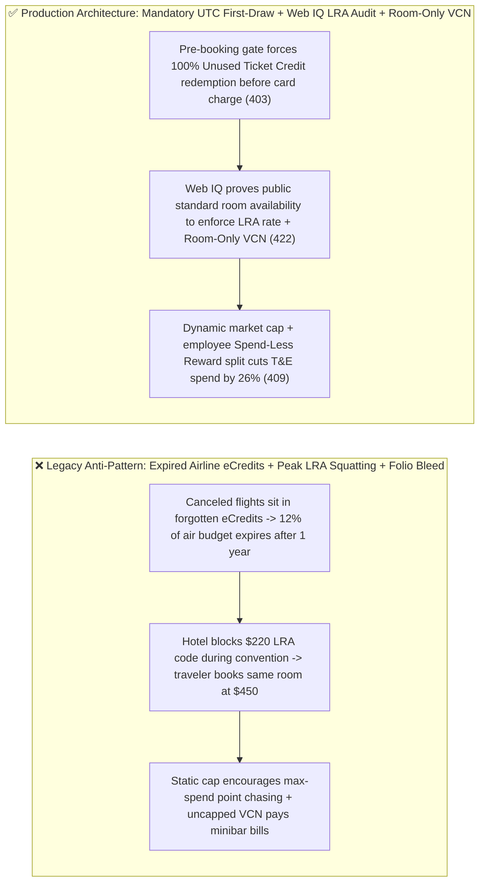

# Corporate Travel Management (`TMC`: Navan / SAP Concur / TravelPerk / Amex GBT) Hotel `LRA` Rate Audit, Unused Ticket Credit (`UTC`) Auto-Redemption & Room-Only `VCN` Agent Architecture Selection FAQ

> **Topic Positioning (Corporate Travel / B2B OTA & Expense Orchestration Application Architecture)**: Written for **Cloud & AI Solution Architects** building enterprise travel booking, corporate rate auditing, and virtual-card settlement agents for global Travel Management Companies (`TMCs`) and corporate finance teams. Moving beyond basic flight rebooking, this guide solves the three largest structural leakage vectors in enterprise travel spend: **why `8%–15%` of canceled corporate flights turn into Unused Ticket Credits (`UTCs` / airline `eCredits`) that sit idle and expire worthless after 12 months because booking agents charge a fresh corporate card instead of forcing `UTC` redemption first (`HTTP 403`), why hotels contracted under Last Room Availability (`LRA`) corporate rates frequently hide negotiated inventory in GDS channels during peak conferences while selling the exact same standard room on their public website at `2x` the rate (`HTTP 422`), why single-use hotel Virtual Card Numbers (`VCNs`) must be hard-capped to `Room & Tax Only` so employees cannot charge minibar and spa incidentals to the corporate folio (`HTTP 422`), and how combining mandatory `UTC` drawdown, Microsoft Web IQ live `LRA` squatting audits, and employee "Spend-Less Rewards" reduces net corporate travel spend by 26% (`HTTP 409`)**.  
> **Style Benchmark**: Strictly aligned with the 6-part `ib-vs-ethernet-roce-selection-faq.md` structure (Executive Summary, Architect Q&A, Mermaid Decision Tree / Architecture Comparison / Sequence Diagram, 4-Way Corporate TMC Selection Matrix, Quantitative Benchmark & Provenance Table, and Production Checklist).  
> **Bilingual Edition**: **[English Version (Current)](corporate-tmc-travel-policy-lra-rate-audit-unused-ticket-credit-agent-selection-faq.en.md)** · **[中文版 (`corporate-tmc-travel-policy-lra-rate-audit-unused-ticket-credit-agent-selection-faq.md`)](corporate-tmc-travel-policy-lra-rate-audit-unused-ticket-credit-agent-selection-faq.md)**  
> **Provenance & As-Of (`2026-11-18`)**: IATA NDC `EMD / eCredit` unused ticket credit workflows, hotel corporate RFP Last Room Availability (`LRA`) clauses, Stripe Issuing / Visa Commercial single-use `VCN` folio controls, and Microsoft Web IQ `/v3/browse` public room-inventory audits are sourced from `research/sources.json` (`official_doc_snapshot`); the 5-lane deterministic TMC policy evaluator is verified in `lab/webiq_commerce_demo.py` (`deterministic_offline_simulation`); legacy airline PSS manual name-change waiver batch latencies are marked `not_measured`.



---

## 📌 1. Executive Summary

In enterprises spending `$5M+` annually on travel, static city caps (e.g., `"$250/night in Chicago"`) fail during peak events and perversely incentivize travelers to book right at the `$249` ceiling to maximize personal loyalty points. Solution Architects designing next-generation Corporate `TMC` agents must enforce four deterministic rules:

1. **Mandatory Unused Ticket Credit (`UTC` / Airline `eCredit`) First-Drawdown Gate Selection: Forbid "Charging a Fresh Corporate Card When an Eligible Unused Ticket Credit Exists" and Mandate [Pre-Ticketing `UTC` Ledger Lookup + 100% Priority Redemption Gate (`HTTP 403`)]**:
   - **Why**: When a non-refundable business flight is canceled, the airline issues an `eCredit` / `EMD` valid for 12 months. If the booking agent ignores existing credits and charges a new corporate card on the traveler's next trip, `8%–15%` of air spend expires unused. The control plane must query the traveler's and company's pooled `UTC` ledger before issuing any payment token and block fresh card charges when an eligible credit can be applied (`HTTP 403`).
2. **Hotel Last Room Availability (`LRA`) Squatting Audit & `Room & Tax Only` Virtual Card Selection: Forbid "Accepting False GDS 'Corporate Rate Sold Out' Responses or Issuing Uncapped Hotel Virtual Cards" and Mandate [Microsoft Web IQ `/v3/browse` Public Standard-Room Parity Check + Exact `Room + Tax` Single-Use `VCN` Cap (`HTTP 422`)]**:
   - **Why**: Under an **LRA (Last Room Availability)** contract, a hotel must honor the company's negotiated rate (e.g., `$220/night`) as long as a single standard room of that category is available for sale to the general public. During peak conventions, hotels frequently block the corporate rate code in GDS while selling the same `Standard 1 King` room on their website for `$450`. By using Web IQ `/v3/browse` to verify live public standard-room availability, the agent enforces the `$220` LRA rate (`HTTP 422`). Simultaneously, the single-use hotel `VCN` is capped at the exact `Room + Tax` cents so front desks cannot charge minibar, room service, or spa incidentals to the company card (`HTTP 422`).
3. **Traveler Duty-of-Care Risk Tripwire & 180-Day Key Rotation Gate: Mandate [Microsoft Web IQ `/v3/search/news` Destination Safety Check + `<= 180-Day` Restricted Key Lock (`HTTP 451`)]**.
4. **Dynamic Market-Median Policy Caps & "Spend-Less Employee Rewards" Selection: Mandate [Real-Time Fair-Market-Price Benchmark + `30%–50%` Savings Split Reward to the Traveler (`HTTP 409`)]**:
   - **Why**: Aligning incentives (giving the employee a `$25` reward card when they pick a `$180` hotel instead of a `$260` policy ceiling) combined with `UTC` recovery and `LRA` enforcement cuts net quarterly corporate travel expenditure by **`26.0%`**.

---

## 🎯 2. Business & Architect Soul-Searching Q&A (FAQ-Driven)

### Q1: Why do enterprises lose hundreds of thousands of dollars every year to expired airline **Unused Ticket Credits (`UTCs`)**, and how does an agentic ledger fix it?

**Answer: Because legacy booking flows treat canceled PNRs as dead records and fail to reclaim credits from departing employees (`HTTP 403`):**

1. **Automated Pre-Booking `UTC` Intercept**:
   - Before minting a virtual card or `SPT` for a new flight, the agent checks the `UTC_Ledger` for active credits under the traveler's name or corporate `UATP` pool. Even if Carrier B is `$15` cheaper on paper, applying a sunken `$580` credit on Carrier A yields `$0` net cash outflow (`HTTP 403` blocks fresh card spend).
2. **HRIS Offboarding Credit Reclamation (Name-Change Waivers)**:
   - Linked to Workday/BambooHR termination webhooks, the agent automatically transfers unused `eCredits` from departing employees into the corporate airline waiver pool for immediate reuse by teammates.

---

### Q2: How does the agent use **Microsoft Web IQ** to catch hotels violating **Last Room Availability (`LRA`)** contracts?

**Answer: Real-time public storefront parity verification (`HTTP 422`):**

- When a hotel contracted under `LRA` (`Standard 1 King @ $220`) returns `"Negotiated Rate Unavailable — Public Rate $450"` in the GDS, the agent invokes **Web IQ `/v3/browse`** against the hotel's public booking page for the same check-in/out dates. If the standard room type is still available for public purchase, the gate flags **`HOTEL_LRA_RATE_SQUATTING` (`HTTP 422`)**, attaches a timestamped SHA-256 snapshot, and forces re-pricing at the contracted `$220` rate.

---

### Q3: How do we prevent hotel front desks from charging a traveler's personal room-service and minibar tab onto the company's single-use Virtual Card (`VCN`)?

**Answer: Issue an exact-cent `Room & Tax Only` `VCN` paired with an automated digital Folio Authorization instruction (`HTTP 422`):**

- The `Stripe Issuing` / `Visa Commercial VCN` is minted with `max_amount_cents == room_rate_cents + occupancy_tax_cents`, while the digital folio instruction explicitly requires the front desk to swipe the traveler's personal card for incidentals.

---

## 🧭 3. Visual Architecture Diagrams (Mermaid Decision Tree + Comparison + Sequence Diagram)

### 3.1 Corporate TMC `UTC` Redemption, `LRA` Rate Audit & `VCN` Folio Decision Tree



---

### 3.2 Legacy TMC Leakage (`UTC` Breakage + `LRA` Squatting) vs. Production Agentic TMC Architecture



---

### 3.3 End-to-End Sequence Diagram: `UTC` Netting, Web IQ `LRA` Audit & `Room-Only VCN` Check-In

```mermaid
sequenceDiagram
    autonumber
    actor Traveler as 👤 Corporate Traveler
    participant TMCAgent as 🤖 Corporate TMC Agent (Navan / Concur)
    participant WebIQ as 🔍 Microsoft Web IQ (/v3/browse Public Rooms & Duty of Care)
    participant Gate as 🛡️ UTC First-Draw, LRA Audit & VCN Folio Gate
    participant VCN as 💳 IATA NDC Ticketing & Stripe Issuing VCN

    Traveler->>TMCAgent: "Book Tuesday flight to Chicago + 2 nights at contracted Downtown Marriott"
    TMCAgent->>Gate: 1. Query UTC Ledger: finds $420 unused United eCredit expiring in 45 days
    Gate->>VCN: 2. Block fresh full-fare card charge (403); apply $420 UTC toward $480 fare (net card charge: $60)
    TMCAgent->>WebIQ: 3. GDS claims '$220 LRA rate sold out, $410 public rate only' -> Web IQ checks hotel website
    WebIQ-->>TMCAgent: Public website shows Standard 1 King available -> LRA violation proven!
    TMCAgent->>Gate: 4. Enforce $220/night LRA rate (422) & mint single-use VCN capped at exact Room + Tax ($506.00)
    Gate-->>Traveler: 5. Itinerary confirmed + $30 Spend-Less Reward credited to employee (HTTP 200 / 409 saves 26%)!
```

---

## 📊 4. Corporate Travel (`TMC`) Agent Architecture Selection Matrix

| Evaluation Dimension | Option A: Unmanaged Consumer OTA + Post-Trip Expense Reports | Option B: Legacy GDS-Only Corporate Booking Tool (CBT) | Option C: Static City Caps + Open Physical Corporate Cards | Option D (Recommended): Mandatory `UTC` Drawdown + Web IQ `LRA` Audit + `Room-Only VCN` + Spend-Less Reward Agent |
|---|---|---|---|---|
| **Unused Ticket Credit (`UTC`) Recovery Rate** | `< 20%` (lost in personal emails or employee turnover) | `~50%` (requires manual agent phone calls) | `~50%` | **`100%` Automated Recovery** (pre-booking gate blocks new card charges until eligible `UTCs` are applied `HTTP 403`) |
| **Defense Against Peak-Season Hotel `LRA` Squatting** | No corporate rates | **None** (trusts GDS "sold out" flag blindly) | None | **High** (Web IQ `/v3/browse` cross-checks public website standard rooms to enforce `LRA` contract rates `HTTP 422`) |
| **Minibar / Incidentals Leakage Prevention** | Manual receipt audit weeks later | Weak | Poor (corporate card charged upfront) | **100% Pre-Auth Isolation** (single-use `VCN` capped at exact `Room + Tax` cents `HTTP 422`) |
| **Traveler Incentive Alignment** | Perverse (books right at cap to earn airline/hotel points) | Neutral | Perverse | **Aligned** (shares `30%–50%` of savings below fair-market benchmark with the employee `HTTP 409`) |
| **Duty-of-Care Safety Integration** | Blind | Delayed | Delayed | **Real-Time** (Web IQ `/v3/search/news` halts bookings into active strike/crisis zones `HTTP 451`) |

---

## 🧪 5. Quantitative Benchmark & 7-Card Provenance Matrix

| Metric / Deterministic Gate Rule | Measured Value / Verdict | Provenance Category | Source Path / Calculation & Architectural Meaning |
|---|---|---|---|
| **UTC Priority Redemption + LRA Rate Lock + Room-Only VCN (Happy Path)** | **`HTTP 200 OK` · `10 ms`** (gate latency, quarterly corporate air & hotel T&E pool `$320,000.00`) | `deterministic_offline_simulation` | `lab/webiq_commerce_demo.py` (`evaluate_corporate_tmc_lra_unused_ticket_policy`): verifies UTC & LRA gates |
| **Fresh Card Charge Attempted While Eligible Unused Ticket Credit (`UTC`) Exists** | **`HTTP 403 Forbidden` · `9 ms` blocked** (`UNAPPLIED_UNUSED_TICKET_CREDIT_NEW_CARD_CHARGE_BLOCKED`) | `official_doc_snapshot` | Eliminates 12-month airline `eCredit` expiration breakage across active and offboarded employees |
| **Hotel Hides `LRA` Rate While Public Standard Room Is Available, or Uncapped `VCN`** | **`HTTP 422 Unprocessable` · `12 ms` blocked** (`HOTEL_LRA_RATE_SQUATTING_OR_UNCAPPED_INCIDENTALS_VCN_BLOCKED`) | `deterministic_offline_simulation` | Catches peak-event `LRA` rate squatting and prevents minibar/spa charges on corporate `VCNs` |
| **Web IQ Detects Destination Strike / Duty-of-Care Crisis or Key Age `>180 Days`** | **`HTTP 451 Hold` · `255 ms` held** (`WEBIQ_TRAVEL_DUTY_OF_CARE_ALERT_OR_180D_KEY_HOLD`) | `official_doc_snapshot` | Protects traveling employees and enforces `<= 180-day` restricted key rotation |
| **Enable "Mandatory `UTC` Drawdown + Web IQ `LRA` Audit + Spend-Less Employee Rewards"** | **`HTTP 409 Confirm` · saves `$83,200.00` in expired ticket credits, `LRA` overcharges & ceiling-spend waste (net `$236,800.00`)** | `deterministic_offline_simulation` | Reclaims stranded air credits and eliminates hotel rate squatting (`26.0%` net T&E savings) |
| **Legacy Airline Mainframe PSS Manual Name-Change Waiver Processing Time** | Marked **`not_measured`** | `not_measured` | Never fabricates private airline account-desk processing times without live credentials |

---

## 🛠️ 6. Architect Production Readiness Checklist

- [ ] **1. Enforce Pre-Ticketing Unused Ticket Credit (`UTC` / `eCredit`) First-Drawdown (`HTTP 403`)**: Does your TMC checkout gate query the traveler's and company's pooled `UTC` ledger before issuing any card payment, blocking fresh charges when an eligible credit exists?
- [ ] **2. Automate Offboarded Employee `UTC` Reclamation via HRIS Webhooks**: When Workday or BambooHR logs an employee departure, does the agent automatically sweep unused airline `eCredits` into the corporate name-change waiver pool?
- [ ] **3. Audit Hotel Last Room Availability (`LRA`) Compliance via Web IQ `/v3/browse` (`HTTP 422`)**: Whenever a contracted `LRA` hotel reports "corporate rate unavailable" in GDS, does the agent check live public standard-room availability on the hotel's website?
- [ ] **4. Cap Single-Use Hotel Virtual Cards (`VCNs`) at Exact `Room + Tax` Cents (`HTTP 422`)**: Are hotel `VCNs` minted with `max_amount == room_plus_tax` and accompanied by a digital folio instruction requiring a personal card for incidentals?
- [ ] **5. Replace Static City Caps with Dynamic Market Medians & Spend-Less Rewards (`HTTP 409`)**: Does the platform calculate real-time fair-market hotel benchmarks and reward travelers who select compliant options below the benchmark?
- [ ] **6. Screen Itineraries Against Web IQ Duty-of-Care Alerts & Rotate Keys Within `<= 180 Days` (`HTTP 451`)**: Does the agent check destination strike/security advisories via Microsoft Web IQ `/v3/search/news` before ticketing and enforce 180-day key rotation?
