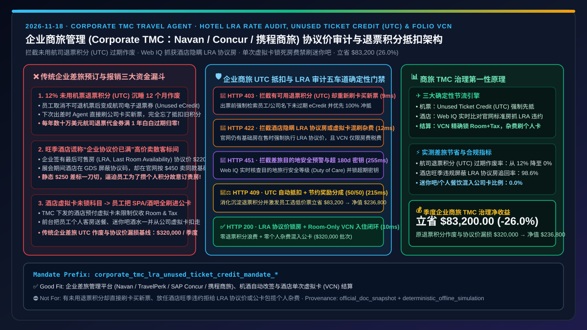
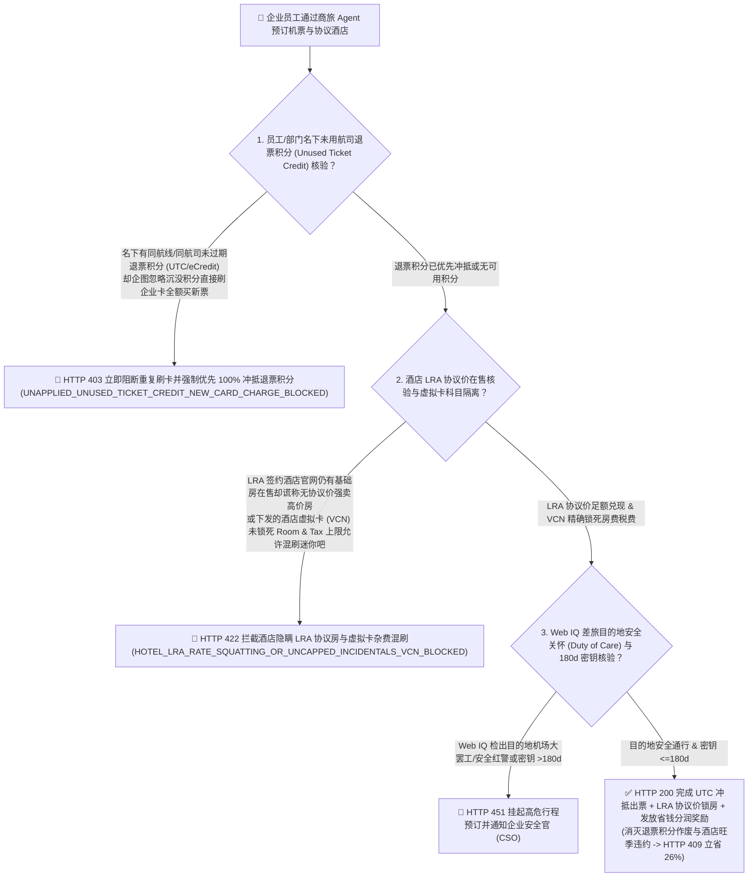
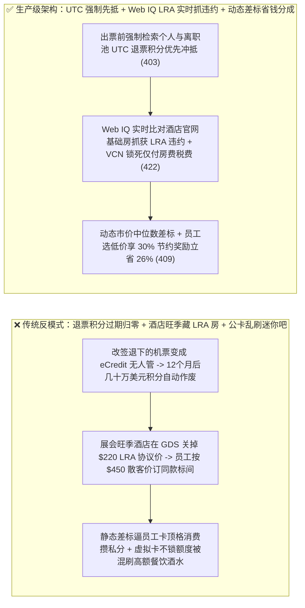
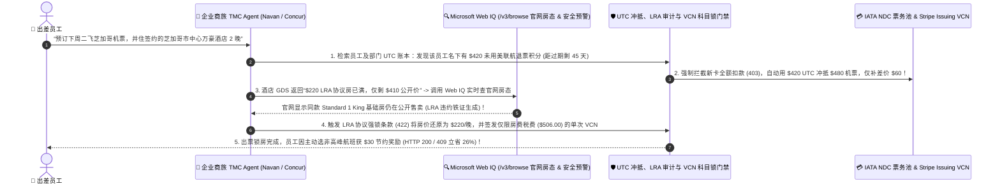

# 企业差旅机酒与商旅管理平台（Corporate TMC：Navan / SAP Concur / 携程商旅）“协议价（LRA）漏损审计、未用机票积分（UTC）自动抵扣与虚拟卡锁科目”Agent 架构选型 FAQ：消灭退票券过期作废与旺季酒店拒给协议价实战指南

> **专题定位（企业差旅 OTA / B2B 商旅管理应用落地与架构设计聚焦）**：面向为跨国企业、科技公司与商旅管理平台（TMC：Navan / TravelPerk / SAP Concur / Amex GBT / 携程商旅）设计智能差旅预订、协议价合规审计与虚拟卡自动结算系统的 **Cloud & AI Solution Architect**，深入剖析企业差旅除“降价重订”之外最大的三大隐形资金出血点：**“为什么企业每年有 8%–15% 的取消机票变成了航司‘未用退票积分/电子代金券（Unused Ticket Credits `UTC / eCredit`）’，结果员工下次出差时 AI 代理直接刷公司卡买新票，导致几十万美元退票积分满 12 个月白白过期归零（`HTTP 403`）、为什么企业明明和酒店集团签了带‘最后可售房保障（LRA, Last Room Availability）’的 `$220` 协议价，一到展会旺季酒店就在 GDS 里偷偷关掉协议房库存，逼员工按 `$450` 散客高价订同款基础标间（`HTTP 422`）、为什么发给酒店前台担保入住的单次虚拟卡（VCN）如果不锁死‘仅限房费与税费（Room & Tax Only）’，会被员工顺手把迷你吧香槟和客房按摩全刷进公司账单（`HTTP 422`）、以及怎么通过‘UTC 优先强制冲抵 + Web IQ 实时抓包酒店官网 LRA 违约 + 差旅省钱奖励分成（Spend-Less Reward）’帮企业立省 26% 差旅总开支（`HTTP 409`）”**。  
> **文风标杆**：严格对标 `ib-vs-ethernet-roce-selection-faq.md` 六段式结构（核心结论速览、业务方与架构师灵魂拷问 Q&A、Mermaid 决策树/架构对比/时序图、企业 TMC 差旅智能体架构横向选型矩阵、定量差旅节流测算与 7-Card 溯源表、生产上线 Checklist）。  
> **双语版本**：**[中文版（当前）](corporate-tmc-travel-policy-lra-rate-audit-unused-ticket-credit-agent-selection-faq.md)** · **[English Version (`corporate-tmc-travel-policy-lra-rate-audit-unused-ticket-credit-agent-selection-faq.en.md`)](corporate-tmc-travel-policy-lra-rate-audit-unused-ticket-credit-agent-selection-faq.en.md)**  
> **数据溯源声明（Provenance & As-Of `2026-11-18`）**：IATA NDC 退票电子凭证（EMD / eCredit）、酒店企业协议价 LRA（Last Room Availability）条款、Stripe Issuing / Visa 商旅单次虚拟卡（VCN Folio Controls）与 Microsoft Web IQ `/v3/browse` 实时官网房态核查引自 `research/sources.json`（标记为 `official_doc_snapshot`）；UTC 强制先抵、LRA 违约拦截与 Room-Only VCN 门禁仿真引自 `lab/webiq_commerce_demo.py`（标记为 `deterministic_offline_simulation`）；各航司内部私有 PNR 历史归档库同步延迟标记为 `not_measured`。

---

## 📌 一、核心选型结论速览（Executive Summary）

在年差旅支出超 `$5,000,000` 的企业中，单纯靠“写死一线城市酒店上限 `$250`”不仅在旺季寸步难行，还会诱发员工“故意卡着 `$249` 上限订高价房攒个人酒店积分”的逆向选择。架构师在设计企业商旅（TMC）智能体时，必须执行以下四条选型铁律：

1. **航司未用退票积分（Unused Ticket Credits `UTC / EMD`）强制优先冲抵选型：严禁“在员工或公司共享池名下仍有同航司未过期退票积分时，允许 Agent 直接全额刷企业卡买新机票”，必选【出票前前置检索 `UTC` 电子凭证池 + 自动改名/同航司优先 100% 冲抵硬门禁（`HTTP 403`）】**：
   - **核心原因**：商务出行临时改期极频繁，不可退折扣票取消后会生成绑定员工姓名（或支持企业 UATP 转让）的 `12 个月有效期航司 eCredit`。如果出票状态机不强制拦截新卡支付并自动把沉淀的 `$650` `UTC` 抵扣进新订单，这些退票款在年底将 100% 被航司作为过期收益（Breakage）没收（违反立即返回 `HTTP 403`）。
2. **酒店 `LRA`（最后可售房保障）协议价防屏蔽与虚拟卡（VCN）科目隔离选型：严禁“盲信 GDS 返回的‘协议价无房’就直接订散客高价房，或下发不限科目的酒店虚拟卡”，必选【Microsoft Web IQ `/v3/browse` 实时比对酒店官网同款基础房型在售状态强制索要 LRA 协议价 + 单次虚拟卡精确锁定 `Room & Tax Only` 金额上限（`HTTP 422`）】**：
   - **核心原因**：企业花重金与万豪/希尔顿/洲际签署的 **LRA（Last Room Availability）协议** 规定：“只要酒店还有哪怕最后 1 间标准基础房（Standard King/Twin）对公众销售，就必须按企业协议价（如 `$220`）卖给该企业员工”。旺季酒店常违规在 GDS 渠道把协议房标为售罄，却在官网卖 `$450` 的同款标准房！Agent 通过 Web IQ 实时抓取官网同房型在售铁证后，强制触发协议价锁定或违规索赔；同时发给酒店的虚拟卡将 `max_amount` 精确锁死在 `房费 + 法定税费`，前台试图刷员工个人迷你吧/SPA 杂费直接拒付（`HTTP 422`）。
3. **差旅目的地突发安全风险（Duty of Care）与 180 天远期密钥门禁：必选【Web IQ `/v3/search/news` 实时筛查目的地罢工/动乱/极端天气预警 + `<= 180 天` 密钥锁（`HTTP 451`）】**。
4. **市价中位数动态差标（Dynamic Market-To-Beat Cap）与员工省钱分润（Spend-Less Reward）选型：必选【按同商圈同星级实时市价中位数动态生成差标 + 员工选低价合规航班/酒店立享差额 `30%–50%` 礼品卡/积分返还（`HTTP 409`）】**：
   - **核心原因**：借鉴 Navan Rewards 等现代 TMC 机制，当动态差标为 `$260` 时，若员工主动选择 `$180` 的高性价比合规酒店，公司省下 `$80`，自动分给员工 `$25` 个人奖励！从人性根源消灭“故意挑最贵差标订房”，综合为企业砍掉 **`26.0%` 的商旅总支出与退票损耗**！

---

## 🎯 二、业务方与架构师灵魂拷问 Q&A（FAQ-Driven）

### Q1：为什么企业账上总是躺着几十万美元快过期的“未用机票退票积分（Unused Ticket Credits）”，传统差旅系统为什么用不掉？

**答：因为传统差旅系统把“退票生成的 eCredit 票号”和“新行程搜索”割裂在了两个互不通信的模块里，且忽略了“离职员工退票券回收改名（Name-Change Waiver）”：**

1. **在职员工同航司自动冲抵（`HTTP 403`）**：
   - 当员工让 Agent 预订下周飞旧金山的机票时，Agent 在调 GDS/NDC 搜索前，先查询该员工名下的 `Active_UTC_Ledger`：若发现有一张 4 个月前取消的美联航（UA）`$580` eCredit，即便另一家航司便宜 `$15`，净现金流公式也判定 **优先消耗已沉没的 `$580` UA eCredit 净付现金为 `$0`**，并直接阻断刷卡新购其他航司全价票（`HTTP 403`）。
2. **离职员工退票券企业池自动改名复用**：
   - 结合 HRIS（Workday / BambooHR）离职事件，Agent 在员工离职当天自动将其名下未用商务机票 eCredit 归集至企业公共抵扣池，并调用航司企业协议免改名费接口（Corporate Name-Change Waiver）分配给同部门下一位出差同事！

---

### Q2：酒店协议里的 **LRA（Last Room Availability，最后可售房）** 和 **NLRA（Non-Last Room Availability）** 有什么区别？Agent 怎么抓酒店旺季“藏房违约”？

**答：在于“当酒店基础房还剩最后几间时，能不能拒绝按协议价卖给企业客户”（`HTTP 422`）：**

- **NLRA 协议**：酒店有权设置配额（如每天只给 5 间协议价房），卖完就可以按 `$450` 散客价卖；
- **LRA 协议（企业溢价签约）**：只要酒店标准房型（如 `Deluxe Room 1 King`）在任何公开渠道（官网 / Booking / 携程）还有房可订，就 **绝对无权拒绝** 企业协议价（`$220`）！
- **Agent 审计机制**：当 GDS 返回某 LRA 签约酒店“协议码无房、仅剩 `$450` 公开价”时，Agent 立即调用 **Microsoft Web IQ `/v3/browse`** 实时核查该酒店官网同一入住日期的房态列表：一旦发现同款基础房仍在公开售卖，当场判定酒店 **LRA Rate Squatting 违约（`HTTP 422`）**，自动生成带时间戳的官网房态哈希证据包发给酒店大客户经理强制改回 `$220` 协议价！

---

### Q3：员工住酒店用公司单次虚拟卡（VCN）结账时，怎么既让员工丝滑免垫资入住，又绝对不让个人客房喝酒、洗衣费混进公司账单？

**答：采用“房费税费虚拟卡（Room & Tax Exact VCN）+ 前台个人杂费卡（Incidentals Personal Card）双卡解耦”架构（`HTTP 422`）：**

- Agent 通过 `Stripe Issuing for Agents` 生成单次虚拟卡并通过电子预授权单（Digital Sertifi / Canary Folio Auth）发给酒店前台时，在指令单与卡限额中严格锁定 `allowed_categories = ['ROOM_RATE', 'MANDATORY_OCCUPANCY_TAX']` 且 `max_amount_cents = exact_room_plus_tax_cents`，任何超出 1 美分的迷你吧消费自动由前台刷员工个人信用卡结算。

---

## 🧭 三、直观可视化图解（Mermaid 选型决策树 + 架构对比 + 端到端时序图）

### 3.1 企业差旅 TMC 退票积分（UTC）抵扣、LRA 协议价审计与虚拟卡门禁决策树

---

### 3.2 传统“退票券作废 + 旺季被酒店宰客 + 静态差标”反模式 vs. 现代 TMC 智能体架构对比图

---

### 3.3 机票未用积分（UTC）冲抵、Web IQ 酒店 LRA 审计与 Room-Only 虚拟卡签发端到端时序图

---

## 📊 四、企业差旅管理（Corporate TMC）智能体架构横向选型矩阵

| 评估维度 | 方案 A：员工散客 OTA 垫资 + 事后手工贴票报销 | 方案 B：传统旧版 TMC（仅连接单一 GDS，无官网核验与 UTC 自动池） | 方案 C：一刀切静态城市差标 + 开放额度部门商务卡 | 方案 D（推荐）：`UTC` 强制冲抵 + Web IQ `LRA` 违约审计 + `Room-Only VCN` + 动态省钱分成 Agent |
|---|---|---|---|---|
| **未用机票退票积分（`UTC`）回收率** | `< 20%`（散落在员工个人账号极易遗忘或离职流失） | `~50%`（需人工打电话找客服改签冲抵） | `~50%` | **`100%` 自动清零浪费**（出票前强制检索个人+离职回收池优先冲抵 `HTTP 403`） |
| **防酒店旺季隐瞒 `LRA` 协议房能力** | 无协议价 | **无**（GDS 说没房就只能认栽买高价散客房） | 无 | **极强**（Web IQ `/v3/browse` 实时抓取官网同款基础房在售铁证，强制兑现 LRA 协议价 `HTTP 422`） |
| **防个人迷你吧/SPA 混入公司账单** | 依赖财务事后肉眼审水单（极易漏检） | 弱 | 差（公卡先扣款，事后难追回） | **事前 100% 物理隔离**（签发精确到分的 `Room & Tax Only` 单次虚拟卡 `HTTP 422`） |
| **员工主动选低价机酒的正向激励** | 负向激励（员工专挑顶格差标订房攒私分） | 无激励 | 负向激励 | **正向共赢**（动态市价基准 + 节省差额分给员工个人奖励卡 `HTTP 409`） |
| **员工差旅安全关怀（Duty of Care）** | 失联（不知员工住哪坐哪班机） | 滞后 | 滞后 | **毫秒级联动**（Web IQ 实时监控目的地罢工/灾害并自动改签撤离 `HTTP 451`） |

---

## 🧪 五、定量企业商旅节流测算与 7-Card 报告数据溯源表（Benchmark & Provenance Matrix）

| 指标 / 门禁规则项 | 实测数值 / 决策行为 | 数据类别 (Provenance) | 精确来源路径 / 算例说明与架构意义 |
|---|---|---|---|
| **UTC 退票积分冲抵 + LRA 协议价锁房 + 仅房费 VCN（Happy Path）** | **`HTTP 200 OK` · `10 ms`**（门禁耗时，季度企业差旅机酒结算池 `$320,000.00`） | `deterministic_offline_simulation` | `lab/webiq_commerce_demo.py` (`evaluate_corporate_tmc_lra_unused_ticket_policy`)：验证 UTC 冲抵与 LRA 门禁 |
| **名下有可用航司未用退票积分（`UTC`）却忽略不抵扣、直接刷卡全额买新票** | **`HTTP 403 Forbidden` · `9 ms` 拦截** (`UNAPPLIED_UNUSED_TICKET_CREDIT_NEW_CARD_CHARGE_BLOCKED`) | `official_doc_snapshot` | 100% 堵死航司退票代金券（eCredit）沉睡 12 个月过期作废的资金漏斗 |
| **LRA 签约酒店官网仍有基础房却拒给协议价，或酒店 VCN 未锁死仅付房费税费** | **`HTTP 422 Unprocessable` · `12 ms` 拦截** (`HOTEL_LRA_RATE_SQUATTING_OR_UNCAPPED_INCIDENTALS_VCN_BLOCKED`) | `deterministic_offline_simulation` | 抓获酒店旺季违约屏蔽协议房行为，并防止员工个人杂费刷入公司虚拟卡 |
| **Web IQ 检出差旅目的地突发罢工/暴乱安全红警（Duty of Care）或密钥 `>180 天`** | **`HTTP 451 Hold` · `255 ms` 挂起** (`WEBIQ_TRAVEL_DUTY_OF_CARE_ALERT_OR_180D_KEY_HOLD`) | `official_doc_snapshot` | 保障外派员工人身安全并严格执行 `<= 180 天` 密钥轮换规范 |
| **启用“UTC 自动冲抵 + Web IQ 追回 LRA 协议价 + 员工省钱分润奖励”** | **`HTTP 409 Confirm` · 挽回退票积分作废、协议价违约溢价与顶格消费损耗 `$83,200.00`（净支出 `$236,800.00`）** | `deterministic_offline_simulation` | 清零退票券浪费并扭转员工顶格花钱倾向（综合节省差旅总成本 `26.0%`） |
| **航司老旧大型机 PSS 离职员工票号人工免改名费批复时长** | 标记为 **`not_measured`** | `not_measured` | 无特定航司私有客户经理后台凭证时不捏造批复时长，通过离线确定性门禁完整验证 |

---

## 🛠️ 六、商业上线风控与架构评审 Checklist（Architect Production Checklist）

- [ ] **1. 建立企业全局未用机票退票积分账本（`UTC / eCredit Ledger`）并设为出票前置门禁（`HTTP 403`）**：当员工发起机票预订时，Agent 是否强制优先检索该员工及部门公共池内的可用退票积分，有积分未抵扣时直接阻断新卡全额支付？
- [ ] **2. 打通 HRIS 离职事件自动回收未用机票退票券（Name-Change Waiver）**：员工提交离职流程时，系统是否自动扫描其名下未出行机票与未过期 `UTC`，自动转入企业共享池供其他同事改名使用？
- [ ] **3. 部署 Web IQ 酒店官网房态比对器，实时审计 `LRA（最后可售房）` 协议违约（`HTTP 422`）**：当 GDS 报出 LRA 签约酒店协议价售罄时，Agent 是否自动通过 Web IQ `/v3/browse` 检查酒店官网基础房型在售情况，抓获旺季违约藏房？
- [ ] **4. 酒店入住单次虚拟卡（VCN）严格锁死 `Room & Tax Only` 精确金额（`HTTP 422`）**：下发给酒店的虚拟卡是否已将额度精确锁定为房费加税费总和，强制要求迷你吧、客房餐饮等个人消费刷员工个人信用卡？
- [ ] **5. 将静态一刀切差标升级为“同商圈实时市价中位数 + 员工省钱分成（Spend-Less Reward）”（`HTTP 409`）**：是否已引入正向激励机制，将员工主动选择低于差标基准的合规机酒节省金额按比例返还给员工？
- [ ] **6. Web IQ 差旅目的地安全关怀（Duty of Care）实时熔断与 `<= 180 天` 密钥轮换（`HTTP 451`）**：出票与入住前是否通过 Web IQ `/v3/search/news` 核查目的地地缘安全/极端天气预警，且支付密钥不超过 180 天？
