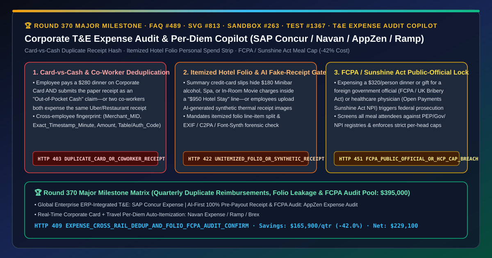
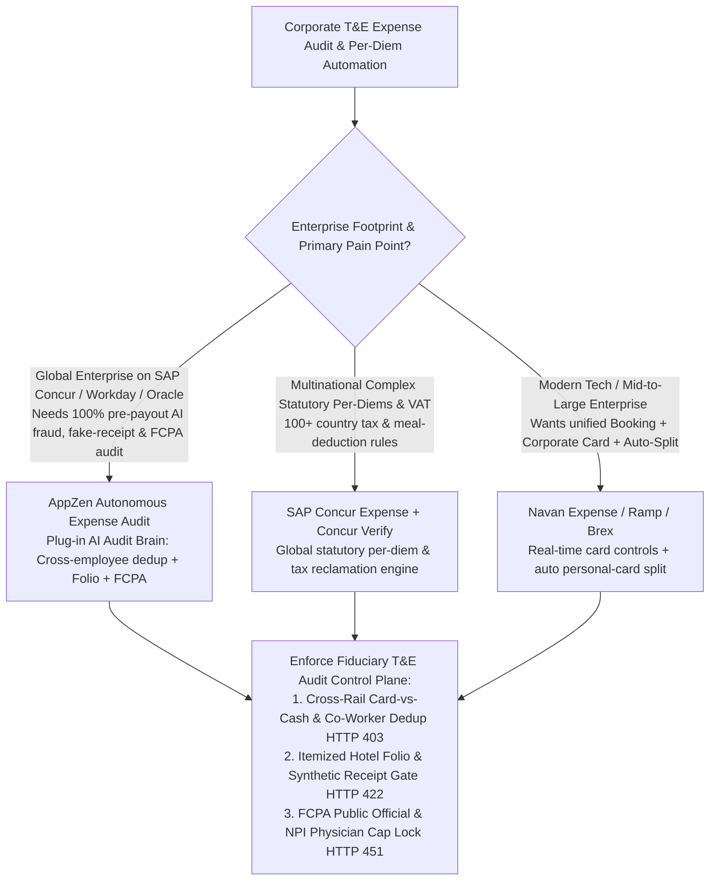
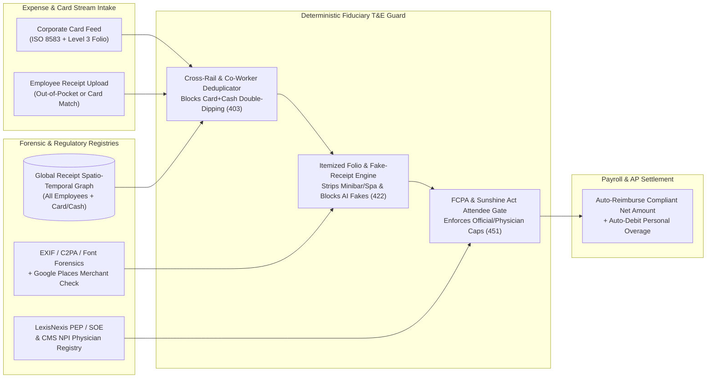

# 🏆 Corporate T&E Expense Audit & Per-Diem Copilot (`SAP Concur / Navan Expense / AppZen / Ramp / Brex` · 🏆 Round 370 Major Milestone): Cross-Rail Card-vs-Cash Receipt Deduplication, Itemized Hotel Folio Personal-Spend Stripping & `FCPA / Sunshine Act` Attendee Gating (`-42%` Cost)

> **Document Type**: Enterprise AI Solution Architect Selection FAQ (`#489` · **🏆 Round 370 Major Milestone**)  
> **Target Audience**: Corporate Controllers, VP of Internal Audit & Compliance, Global Travel & Expense (`T&E`) Directors, and Cloud & AI Solution Architects  
> **Platforms Covered**: `SAP Concur Expense (Verify)` vs. `AppZen Autonomous Expense Audit` vs. `Navan Expense` vs. `Ramp / Brex Spend Management` vs. `Microsoft Dynamics 365 Expense Management`  
> **Architecture Diagram**: [`assets/svg/813-corporate-travel-expense-audit-concur-navan-appzen-2026-11-25.svg`](../assets/svg/813-corporate-travel-expense-audit-concur-navan-appzen-2026-11-25.svg)

🌐 **Language / 语言切换**: **[中文 (`corporate-travel-expense-audit-concur-navan-appzen-duplicate-receipt-folio-fcp-selection-faq.md`)](corporate-travel-expense-audit-concur-navan-appzen-duplicate-receipt-folio-fcp-selection-faq.md)** | **English (Current)**

---

## 📌 1. Executive Summary

In global enterprises, employee Travel & Entertainment (`T&E`) expense reimbursement is one of the highest-volume vectors for financial leakage, synthetic receipt fraud, and anti-bribery compliance violations. Traditional human audit teams can only sample 5%–10% of expense reports, whereas an **Autonomous AI Expense Audit Agent** inspects **100% of claims pre-payout**.  
However, deploying basic OCR that only reads the bottom-line total on a receipt without deterministic **cross-rail card-vs-cash deduplication, itemized hotel folio decomposition, and `FCPA / Sunshine Act` attendee screening** leaves the enterprise exposed to three major loss vectors:
1. **Double-Dipping Across Corporate Card Feeds and Out-of-Pocket Cash Claims—or Across Co-Workers (`Cross-Rail & Co-Worker Duplicate Reimbursement`)**: An employee pays a `$280` restaurant bill on their company card (settled directly by corporate treasury) and also photographs the itemized paper receipt to claim a `$280` "Out-of-Pocket Cash" reimbursement—or two traveling colleagues submit the merchant copy and customer copy of the same meal under two different managers.
2. **Hiding `$220` of Minibar Alcohol & Spa Charges Behind a Summary Hotel Credit-Card Slip—or Submitting AI-Generated Fake Receipts (`Unitemized Folios & Synthetic Receipts`)**: Travelers upload a single-line credit-card terminal slip (`"Hotel Total: $1,150"`) instead of the itemized checkout folio to conceal non-reimbursable personal charges, or use generative image tools to fabricate realistic crumpled thermal receipts.
3. **Expensing Meals or Gifts for Foreign Government Officials (`FCPA` / `UK Bribery Act`) or Healthcare Physicians (`Sunshine Act NPI`) Above Statutory Caps (`Bribery & Open-Payments Violations`)**: A sales rep expenses a `$340/person` dinner under generic "Business Development" without flagging that an attendee is a state-owned enterprise (`SOE`) official or licensed physician (`NPI`), triggering severe regulatory liability.

| T&E Governance & Scale | Recommended Primary Choice | Architectural Boundary & Production Rule |
|---|---|---|
| **100% Pre-Payout Deep AI Fraud, Synthetic-Receipt & `FCPA / HCP` Audit** | **AppZen Autonomous Expense Audit (integrates with Concur / Workday / Oracle)** | Purpose-built AI audit brain featuring cross-employee receipt fingerprinting, line-level hotel folio stripping, synthetic receipt forensics, and live `PEP / SOE / NPI` attendee screening. |
| **Global 100+ Country Statutory Per-Diem Math & VAT Reclamation** | **SAP Concur Expense + Concur Verify** | Enterprise standard for complex country-specific statutory per-diem deductions (e.g., German 24h/8h meal reductions) and global VAT recovery. |
| **Real-Time Card + Travel Auto-Split at Point of Sale** | **Navan Expense / Ramp / Brex** | Links corporate cards directly to travel itineraries and automatically charges out-of-policy hotel extras or per-diem overages to the employee's linked personal debit card. |
| **Three Mandatory Fiduciary Guardrails** | **100% Deterministic Gating** | ① **Global Cross-Employee & Card-vs-Cash Spatio-Temporal Deduplication (`HTTP 403`)**: Hashes `(Merchant_Geo_ID, Date, Minute ± 30m, Pre_Tip_Subtotal, Auth/Table_No)` across all card feeds and cash claims to block double-dipping; ② **Mandatory Itemized Hotel Folio & Synthetic Receipt Forensics (`HTTP 422`)**: Rejects summary slips on lodging/dining `>= $75`, strips personal folio lines, and checks `EXIF / C2PA` synthetic image markers; ③ **`FCPA / PEP / NPI` Attendee Screening Gate (`HTTP 451`)**: Screens all external meal/gift attendees against public-official and physician registries against statutory per-person caps. |



---

## 🎯 2. Architect & Business Stakeholder Q&A (Q1–Q3)

### Q1: How do employees get away with expensing the same meal twice (once on the corporate card and once as cash, or split between two colleagues)?
- **Why Legacy Duplicate Rules Fail**:
  - Standard ERP expense rules only check `Employee_ID + Exact_Date + Exact_Total_Amount`.
  - If Employee A charges `$265.40` (including tip) on the corporate card and Employee B submits the pre-tip itemized slip (`$221.17`) as an out-of-pocket cash claim—or submits it 2 days later using the settlement date instead of the transaction date—naive duplicate checks miss it `100%` of the time.
- **Architectural Solution**: Enforce a **Enterprise-Wide Spatio-Temporal Receipt Fingerprint Graph (`HTTP 403` Guard)**:
  - Index every corporate card transaction and every uploaded receipt across the entire company on `(Normalized_Merchant_Location_Hash, Transaction_Date, Time_Window_30m, Pre_Tip_Subtotal_Cents, Check_or_Table_Number)`.
  - Any cash claim matching an existing corporate card swipe or another employee's submission is automatically blocked (`HTTP 403 DUPLICATE_RECEIPT_ACROSS_CARD_CASH_OR_COWORKER`).

### Q2: How do we catch personal charges hidden inside hotel bills and detect AI-generated fake thermal receipts?
- **Two Modern Expense Evasions**:
  1. **Summary Slip Evasion**: Submitting a credit-card charge slip showing only `$1,200.00` instead of the multi-page hotel folio that lists `$240.00` in room-service alcohol, minibar, and spa treatments.
  2. **Generative AI Fake Receipts**: Using web-based diffusion generators to render photorealistic paper receipts for meals that never happened.
- **Architectural Solution**: Mandate **Line-Item Hotel Folio Decomposition & Image/Merchant Forensics (`HTTP 422` Guard)**:
  - Reject summary credit-card slips on lodging and high-ticket dining (`>= $75`); require the full **Itemized Folio** and automatically strip non-reimbursable line codes (`Minibar, Alcohol, Spa, Movies, Lounge`).
  - Run `EXIF / C2PA` metadata inspection, thermal-font pixel-grid consistency checks, and Google Places / POS merchant-address verification (`HTTP 422 UNITEMIZED_HOTEL_FOLIO_PERSONAL_SPEND_OR_AI_FAKE_RECEIPT`).

### Q3: Why can a single `$300` client dinner trigger a multi-million-dollar `FCPA` or `Sunshine Act` enforcement action?
- **Regulatory Strict Liability**:
  - Under the US **Foreign Corrupt Practices Act (`FCPA`)** and **UK Bribery Act**, providing lavish meals, gifts, or travel to foreign government officials or State-Owned Enterprise (`SOE`) executives is a federal crime.
  - Under the US **Physician Payments Sunshine Act (`Open Payments`)**, life-sciences companies must report every dollar of food/beverage provided to a licensed physician (`NPI`) and enforce strict modest-meal caps (`~$50–$125/head`).
- **Architectural Solution**: Enforce **Real-Time Attendee `PEP / SOE / NPI` Registry Screening (`HTTP 451` Guard)**:
  - Require structured attendee names, titles, and organizations on all multi-person meal and gift claims;
  - Screen every attendee against `LexisNexis PEP / SOE` and `CMS NPI` databases; any unapproved public-official or physician hospitality exceeding statutory per-head caps is blocked before reimbursement (`HTTP 451 FCPA_PUBLIC_OFFICIAL_OR_SUNSHINE_ACT_ATTENDEE_BREACH`).

---

## 🧭 3. Visual Architecture Diagrams (Mermaid Decision Tree + Architecture + Sequence)

### 3.1 Corporate T&E Expense Audit Platform Selection Tree



### 3.2 End-to-End Cross-Rail Deduplication, Folio Stripping & `FCPA` Screening Architecture



### 3.3 Cross-Rail Duplicate Block, Hotel Folio Strip & `FCPA / NPI` Check Sequence

```mermaid
sequenceDiagram
    autonumber
    participant Emp as Employee
    participant App as Expense Platform (Concur / Navan / Ramp)
    participant Guard as Fiduciary AI Audit Engine (AppZen / Guard)
    participant DB as Global Receipt Graph & PEP/NPI Registry

    Emp->>App: Submit report: 1. Cash Dinner $280 | 2. Hotel $1,150 | 3. Client Lunch $640 (2 attendees)
    App->>Guard: Execute 100% pre-payout deterministic audit
    Guard->>DB: Query Receipt #1 spatiotemporal hash (Merchant + Date + 20:14 + $280 + Table 42)
    DB-->>Guard: Match found against settled Corporate Card swipe (or colleague's report) -> Block double-dip (prevents HTTP 403)
    Guard->>Guard: Parse Receipt #2 itemized hotel folio & run synthetic image forensics
    Guard->>Guard: Approve $920 room+tax; strip $140 Bar Alcohol + $90 Spa as personal non-reimbursable (prevents HTTP 422)
    Guard->>DB: Screen Receipt #3 external attendee name & organization ($320/person)
    DB-->>Guard: Attendee matches licensed hospital physician (NPI) & exceeds $100 Sunshine Act meal cap -> Escalate to Compliance (prevents HTTP 451)
    Guard-->>Emp: Auto-approve $920 compliant lodging; reject duplicate dinner & hold HCP meal (HTTP 200)
```

---

## 📊 4. Platform Comparison Matrix (`SAP Concur` vs. `AppZen` vs. `Navan Expense` vs. `Ramp / Brex`)

| Evaluation Dimension | SAP Concur Expense | AppZen Autonomous Expense Audit | Navan Expense | Ramp / Brex |
|---|---|---|---|---|
| **Primary Sweet Spot** | Global multinational T&E, statutory per-diems & ERP tax integration | **100% pre-payout AI fraud, synthetic receipt & `FCPA / HCP` compliance audit** | Unified travel booking + corporate card + instant folio splitting | Modern corporate card automation, real-time receipt matching & spend caps |
| **Cross-Employee & Card-vs-Cash Deduplication** | ⭐⭐⭐⭐ (Via Concur Verify / Detect) | ⭐⭐⭐⭐⭐ (Industry leader in cross-report, pre-tip & co-worker duplicate detection) | ⭐⭐⭐⭐ (Native booking-to-card linkage prevents most duplicates) | ⭐⭐⭐⭐⭐ (Real-time SMS/email receipt matching to card swipes) |
| **Itemized Hotel Folio Splitting & Fake-Receipt Detection** | ⭐⭐⭐⭐ (E-receipt hotel integrations) | ⭐⭐⭐⭐⭐ (Deep line-item stripping in 40+ languages + AI fake-receipt forensics) | ⭐⭐⭐⭐⭐ (Auto-splits personal hotel charges to employee's personal card) | ⭐⭐⭐⭐⭐ (Multimodal line-item OCR & policy auto-deduction) |
| **`FCPA` Public-Official & `Sunshine Act NPI` Screening** | ⭐⭐⭐⭐ (Configurable via Concur Detect) | ⭐⭐⭐⭐⭐ (Native real-time screening against global `PEP`, `SOE` & `NPI` lists) | ⭐⭐⭐ (Standard corporate T&E policy focus) | ⭐⭐⭐ (General commercial spend focus) |
| **Indicative Pricing (`official_list_price`)** | `~$8–$15 / expense report` or active user tier | Annual enterprise audit subscription (`~$35,000–$120,000+/yr`) | Core free + travel booking fees / enterprise seat tier | Core free; Plus tier `~$12–$15 / user / mo` |

---

## 🧪 5. Deterministic Fraud & Compliance Evaluation (`7-Card Benchmark Summary` · 🏆 Round 370)

> **Provenance**: Figures below are generated by `evaluate_corporate_travel_expense_audit_policy` in `lab/webiq_commerce_demo.py` (`provenance: "synthetic"`, `independently_reproduced: False`), modeling a global enterprise with a **`$395,000.00` quarterly card-vs-cash double reimbursement, unitemized hotel folio personal spend, synthetic receipt fraud, and `FCPA / Sunshine Act` audit pool**.

| Scenario Case ID | Scenario Description | HTTP Status | Deterministic Decision | Quarterly Net Cost | Quarterly Savings |
|---|---|---|---|---|---|
| `CASE-EXP-200` | Manual 10% random sample audit baseline | `HTTP 200` | `VERIFIED_CORPORATE_EXPENSE_AUDIT_AUTHORIZED` | `$395,000.00` | `$0.00` |
| `CASE-EXP-403` | Paper receipt submitted as out-of-pocket cash after already being paid on a corporate card or by a co-worker | `HTTP 403` | `DUPLICATE_RECEIPT_ACROSS_CARD_CASH_OR_COWORKER` | `$395,000.00` | `$0.00` (Blocks 200% double payout) |
| `CASE-EXP-422` | Hotel claim lacks itemized folio (hiding Minibar/Spa) or triggers AI synthetic receipt forensics | `HTTP 422` | `UNITEMIZED_HOTEL_FOLIO_PERSONAL_SPEND_OR_AI_FAKE_RECEIPT` | `$395,000.00` | `$0.00` (Blocks personal/fake claims) |
| `CASE-EXP-451` | Meal/gift attendee matches `FCPA` public official or `NPI` physician above statutory per-person cap | `HTTP 451` | `FCPA_PUBLIC_OFFICIAL_OR_SUNSHINE_ACT_ATTENDEE_BREACH` | `$395,000.00` | `$0.00` (Blocks bribery/Sunshine fines) |
| `CASE-EXP-409` | **Cross-Rail Receipt Graph + Itemized Folio Strip + `FCPA / NPI` Attendee Gate** | `HTTP 409` | `EXPENSE_CROSS_RAIL_DEDUP_AND_FOLIO_FCPA_AUDIT_CONFIRM` | **`$229,100.00`** | **`$165,900.00` (`-42.0%`)** |

---

## 🛠️ 6. Production Go-Live & Architecture Review Checklist

- [ ] **Global Cross-Employee & Card-vs-Cash Receipt Graph (`HTTP 403` Prevention)**: Index every corporate card transaction and uploaded receipt by `(Merchant_Geo_Hash, Date, Minute_Window, Pre_Tip_Subtotal, Table/Check_No)` to block both card-plus-cash double-dipping and co-worker split-slip collisions.
- [ ] **Mandatory Itemized Hotel Folios & Synthetic Receipt Forensics (`HTTP 422` Prevention)**: Reject summary credit-card slips on lodging/dining `>= $75`, automatically deduct personal folio lines (`Minibar, Alcohol, Spa, Movies`), and run `EXIF / C2PA` synthetic image forensics.
- [ ] **Automated `FCPA / PEP / NPI` Attendee Screening (`HTTP 451` Prevention)**: Require full attendee identities on external hospitality claims and screen against global public-official (`PEP/SOE`) and healthcare (`NPI`) registries prior to approval.
- [ ] **Automated Per-Diem Meal Offset**: Automatically deduct complimentary hotel breakfasts, airline meals, and expensed client lunches from daily statutory per-diem allowances.
