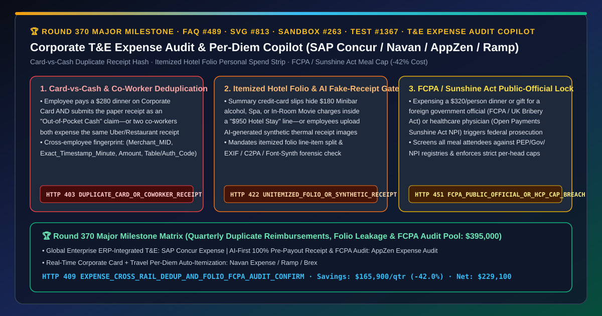
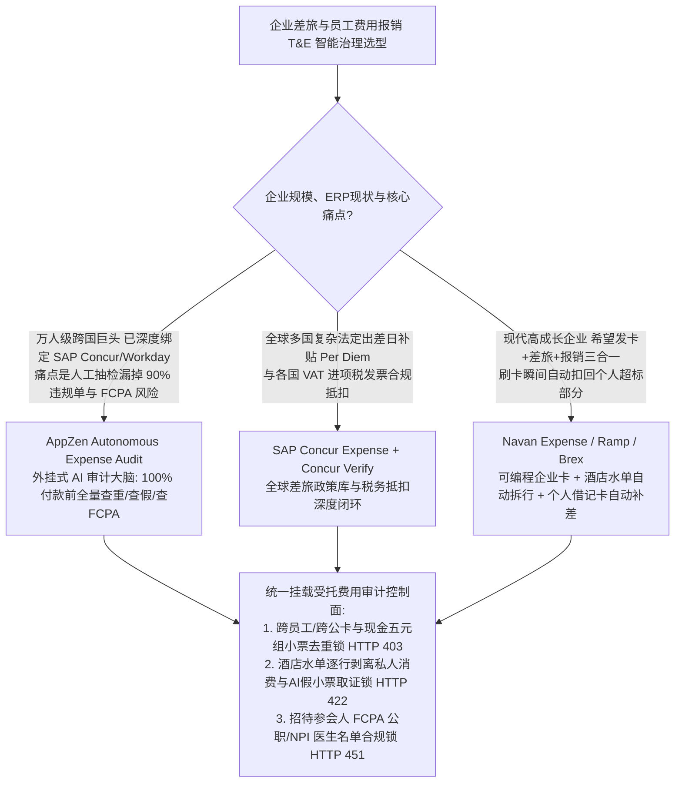
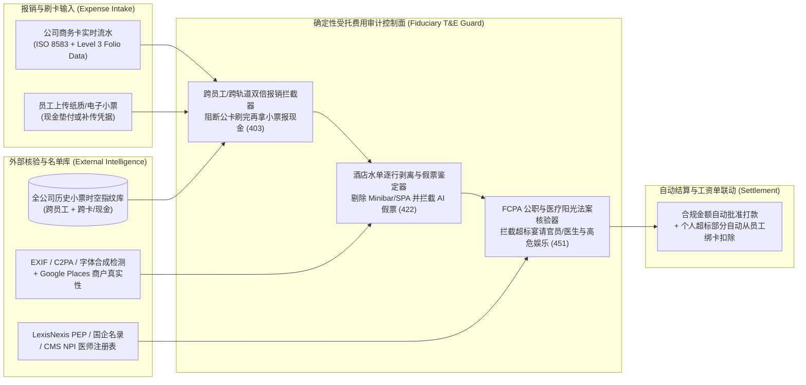
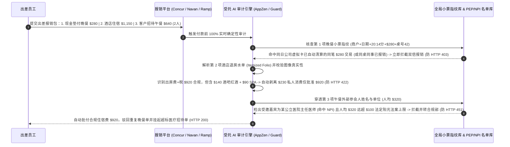

# 🏆 企业差旅与员工费用报销智能审计智能体（`Corporate T&E Expense Audit`: `SAP Concur / Navan Expense / AppZen / Ramp / Brex` · 🏆 第 370 轮重大里程碑）：公卡对公账与个人垫付双倍报销跨轨去重、酒店水单（`Hotel Folio`）逐行剥离私人消费与 AI 伪造小票鉴别及 `FCPA / Sunshine Act` 公职与医疗人员招待合规锁净省 42% 指南

> **文档类型**：企业级 AI Solution Architect 选型决策指南（Selection FAQ · `#489` · **🏆 Round 370 重大里程碑**）  
> **适用读者**：集团财务总监（Controller / VP of Finance）、内控合规与反舞弊负责人（Internal Audit）、企业差旅管理（T&E）总监与 Cloud & AI Solution Architect  
> **核心覆盖平台**：`SAP Concur Expense (Verify)` vs. `AppZen Autonomous Expense Audit` vs. `Navan Expense` vs. `Ramp / Brex Spend Management` vs. `Microsoft Dynamics 365 Expense Management`  
> **关联架构图**：[`assets/svg/813-corporate-travel-expense-audit-concur-navan-appzen-2026-11-25.svg`](../assets/svg/813-corporate-travel-expense-audit-concur-navan-appzen-2026-11-25.svg)

🌐 **语言切换 / Language**: **中文 (当前)** | **[English (`corporate-travel-expense-audit-concur-navan-appzen-duplicate-receipt-folio-fcp-selection-faq.en.md`)](corporate-travel-expense-audit-concur-navan-appzen-duplicate-receipt-folio-fcp-selection-faq.en.md)**

---

## 📌 一、核心选型结论速览（Executive Summary）

在跨国企业与大中型组织中，员工差旅与日常商务费用报销（`Travel & Entertainment - T&E`）是最容易发生“蚂蚁搬家式”资金跑冒滴漏与重大合规违法的重灾区。传统财务共享中心只能对 5%–10% 的报销单做人工抽检，而引入多模态费用审计智能体（`Autonomous Expense Audit Agent`）可实现 **100% 付款前全量实时审计**。  
但如果仅用普通 OCR 提取小票总金额而缺乏跨轨去重、行级拆解与外部合规库核验，企业将面临三大失血点：
1. **“同一顿饭刷公司商务卡自动入账一次、拍纸质小票走个人现金垫付（Out-of-Pocket）再报一次”或“两名同行同事各自拿正副联各报一次”（`Cross-Rail & Co-Worker Duplicate Reimbursement`）**：员工 A 请客户吃饭刷了公司虚拟卡（`$280` 由公司直接还款给银行），转头又把纸质餐饮小票拍照按“个人现金垫付”提单报销；或者员工 A 拍了刷卡签购单、同桌员工 B 拍了点菜明细单，两个不同部门经理各自审批通过，公司为同一顿饭付了两次钱！
2. **用只写“住宿费 `$980`”的信用卡刷卡回执掩盖酒店水单（`Hotel Folio`）里 `$220` 的高档红酒、SPA 按摩与私人客房电影，甚至用图像生成模型伪造假热敏小票（`Unitemized Hotel Folio & AI-Generated Fake Receipts`）**：员工不传酒店退房详细水单（Itemized Folio）只传一张 POS 刷卡条；更有甚者，利用现成的 AI 假小票生成网站一键生成逼真的星巴克/出租车褶皱热敏小票图片骗取报销。
3. **商务宴请名单中包含外国政府官员/国企高管（违反美国《反海外腐败法》`FCPA` / 中国八项规定）或执业医生（违反美国《阳光法案》`Sunshine Act NPI`）却未触发人均限额与合规报备（`FCPA / HCP Entertainment Compliance Breach`）**：销售代表把一顿人均 `$350` 的高档晚宴挂在普通“市场会议费”名下，而参会人实为公立医院主任医师或政府审批官员，一旦被监管穿透将引发数千万美元的反商业贿赂重罚。

| 选型维度与企业治理诉求 | 推荐主选方案 | 适用边界与架构落地准则 |
|---|---|---|
| **跨国集团全量报销单 100% 付款前深度反欺诈与外部 `FCPA/HCP` 核查** | **AppZen Autonomous Expense Audit (可外挂于 Concur / Oracle / Workday)** | 行业最强的专业 AI 费用审计大脑，内置全网商户真实性核验、跨员工小票去重、酒店水单逐行拆分与全球公务员/医生名单库实时比对。 |
| **全球 100+ 国复杂差旅补贴（Per Diem）、税率抵扣与 ERP 标准集成** | **SAP Concur Expense + Concur Verify** | 适合拥有德日美中多国复杂法定出差日补贴（如德国 24h/8h 阶梯伙食扣减）与增值税进项抵扣的万人级跨国巨头。 |
| **现代差旅预订 + 公司卡刷卡瞬间自动拆单闭环（消灭事后填报销单）** | **Navan Expense / Ramp / Brex** | 机酒预订与公司卡原生合一，刷卡瞬间关联差旅行程与人均限额，超标部分支持直接从员工个人绑定的借记卡自动分账扣除（Auto-Split Personal Spend）。 |
| **三大确定性风控红线** | **100% 强制拦截** | ① **全公司跨员工/跨支付轨道五元组小票去重锁（`HTTP 403`）**：基于 `(Merchant_Geo_ID, Transaction_Date, Time_Minute ± 15m, Amount_Cents, Auth/Table_No)` 全库比对，严禁公卡账单再走现金报销或同事一单两报；② **酒店/餐饮强制逐行明细单（`Itemized Folio`）与 AI 假小票取证锁（`HTTP 422`）**：严禁仅凭信用卡 POS 汇总条报销，自动剥离酒水/Minibar/SPA 私人消费，并检测图像生成元数据与字体伪影；③ **`FCPA` 公职人员与 `NPI` 医务人员参会名单实时穿透明细锁（`HTTP 451`）**：超过人均阈值或命中公职/医疗名单未获合规部前置审批的一律拦截打款。 |



---

## 🎯 二、业务方与架构师灵魂拷问 Q&A（Q1–Q3）

### Q1：为什么传统的报销系统查不出“刷公司卡消费后又拿小票报现金”以及“两个同事拿同一顿饭的正副单分别报销”？
- **传统去重规则的盲区**：
  1. 传统报销软件只检查 **“同一个员工 ID 在同一天有没有提交两笔金额一模一样的现金报销”**；
  2. 当员工 A 把 `$265.40` 的餐厅账单刷在公司卡上（记在公司信用卡对账流里），而员工 B（或者员工 A 本人换个“现金垫付”科目）把纸质菜品明细单拍上去，甚至因为一个含小费（`$265.40`）、一个不含小费（`$221.17`），简单相等匹配完全失效！
- **架构解法**：构建 **企业级全局跨员工、跨卡/现金轨道时空指纹图谱（`Cross-Employee Spatio-Temporal Receipt Graph` · 防 `HTTP 403`）**：
  - 提取每张小票与每笔公司卡流水的归一化特征：`(Normalized_Merchant_Address_Hash, Date, Timestamp_Minute ± 30m, Pre_Tip_Subtotal_Cents, Total_Cents, Receipt_Order_No / Card_Last4)`；
  - 无论该笔费用来自 `Corporate Card Feed` 还是 `Out-of-Pocket Cash Claim`，也无论提交人是谁，只要在全局图谱中命中同一餐厅同一时段相同小计金额或桌号，立即触发跨轨重报阻断（`HTTP 403 DUPLICATE_RECEIPT_ACROSS_CARD_CASH_OR_COWORKER`）。

### Q2：员工出差住酒店报销 `$1,200`，以及现在网上泛滥的“AI 一键生成逼真热敏餐厅小票”，审计 Agent 怎么做到火眼金睛？
- **两大造假与夹带私货手法**：
  1. **只传 POS 刷卡单不传退房水单（Summary Slip vs. Itemized Hotel Folio）**：员工退房时刷了 `$1,200`，其中房费 `$800`、客房送餐红酒与ミニ吧（Minibar）`$250`、SPA 按摩 `$150`；员工故意只上传写着 `"Marriott Hotel - Total $1,200"` 的银行卡签购单蒙混过关。
  2. **AIGC 合成假小票（Synthetic Thermal Receipts）**：不法员工使用扩散模型或虚假收据模板网站生成带折痕阴影的假打车票/假餐饮票。
- **架构解法**：实施 **强制行项目水单拆解（`Line-Item Folio Split`）与数字图像取证门禁（`Synthetic Receipt Forensics` · 防 `HTTP 422`）**：
  - **酒店与大额餐饮强制水单规则**：凡是 `MCC IN (Hotels 3501–3999, Restaurants 5812)` 且金额 `>= $75`，若上传图片仅含总金额而无逐行明细（Line Items），系统自动拒收并要求补传完整 `Itemized Folio`；AI 自动逐行识别并将 `Minibar / Alcohol / Spa / Laundry / Movie / Companion Airfare` 拆出归入 `Non-Reimbursable Personal Spend`（从报销额中自动扣减）；
  - **AI 假小票取证**：校验图像 `EXIF` 相机原始感光器噪声（PRNU）、`C2PA` 合成水印、热敏打印机等宽点阵字体几何一致性，以及通过地图 API 反查小票上的商户地址与电话是否真实存在且处于营业状态（拦截假票或无明细水单触发 `HTTP 422 UNITEMIZED_HOTEL_FOLIO_PERSONAL_SPEND_OR_AI_FAKE_RECEIPT`）。

### Q3：为什么一顿 `$400` 的正常客户招待餐，会让跨国药企或科技公司遭到美国司法部（DOJ）数千万美元的《反海外腐败法》（`FCPA`）调查？
- **反贿赂与阳光法案高压线**：
  - 根据美国 **`FCPA`（反海外腐败法）**、英国 **`UK Bribery Act`** 及中国相关廉洁规定，向外国公职人员、国有企业（SOE）管理人员或公立医院医生提供超出合理标准的餐饮、礼品或差旅招待构成刑事行贿；
  - 在医药与医疗器械行业，美国 **`Open Payments (Sunshine Act)`** 强制要求对每一位执业医师（`NPI Number`）的每一顿工作餐精确到美分进行联邦公示，且严禁包含酒水或超标高档餐厅。
- **架构解法**：在招待费报销入口强制绑定 **参会人外部身份实时穿透核验器（`Attendee PEP / SOE / NPI Registry Gate` · 防 `HTTP 451`）**：
  - 凡是报销科目为“商务招待/客户礼品/外部会议”，强制要求填写全体外部参会人真实姓名与工作单位；
  - Agent 实时联动 `LexisNexis PEP / 国企名录 / 美国 CMS NPI 医生注册库` 及餐厅高消费等级标签（如米其林/夜总会/高尔夫球场 MCC `7992/7997`）；一旦检出外部参会人具有公职/公立医疗身份且人均消费超过法定合规上限（如 `$50–$100/人`）或未附合规部事前审批单，立即锁死报销并上报首席合规官（`HTTP 451 FCPA_PUBLIC_OFFICIAL_OR_SUNSHINE_ACT_ATTENDEE_BREACH`）。

---

## 🧭 三、直观可视化图解（Mermaid 选型决策树 + 审计架构图 + 时序图）

### 3.1 企业差旅与费用报销智能审计平台选型决策树



### 3.2 端到端跨轨小票去重、酒店水单拆解与 `FCPA` 参会人穿透架构图



### 3.3 拦截“公卡+现金双倍报销”、酒店水单自动剔除红酒与 `FCPA` 核查时序图



---

## 📊 四、主流企业差旅与费用报销智能审计平台横向选型矩阵

| 评估维度 | SAP Concur Expense | AppZen Autonomous Expense Audit | Navan Expense | Ramp / Brex |
|---|---|---|---|---|
| **核心优势定位** | 全球跨国巨头差旅预订、多国法定日补贴与 ERP 财税一体化标杆 | **专精 100% 付款前全量 AI 费用反欺诈、假票识别与 FCPA 外部穿透** | 机酒差旅预订与企业卡原生融合，行程中实时控标 | 新一代财务自动化企业卡、AI 自动追收小票与预算前置锁死 |
| **跨员工 / 跨卡与现金双倍报销查重** | ⭐⭐⭐⭐（支持 Concur Verify 查重，跨复杂变体需增强） | ⭐⭐⭐⭐⭐（行业绝对标杆，支持跨数万员工、跨数月正副联与小费变体去重） | ⭐⭐⭐⭐（因预订与刷卡同源，天然减少事后混报） | ⭐⭐⭐⭐⭐（实时卡流与上传收据自动强匹配） |
| **酒店水单（Folio）逐行拆分与 AI 假小票检测** | ⭐⭐⭐⭐（支持电子水单 e-Receipt 直连） | ⭐⭐⭐⭐⭐（深度识别数百种语言小票、剥离违禁行项并检测 AIGC 合成假票） | ⭐⭐⭐⭐⭐（结账时自动拆出迷你吧/客房升级并直接刷员工个人卡） | ⭐⭐⭐⭐⭐（高精准多模态逐行解析与异常商户拦截） |
| **`FCPA` 公职人员与医药 `Sunshine Act NPI` 核查** | ⭐⭐⭐⭐（Concur Detect 支持合规规则扩展） | ⭐⭐⭐⭐⭐（原生实时比对全球 PEP、国企高管与美国医疗 NPI 数据库） | ⭐⭐⭐（偏通用企业差旅标准控制） | ⭐⭐⭐（偏通用商务支出控制，医药特殊合规需外接） |
| **参考定价模式（`official_list_price`）** | 按活跃用户或每份报销单计费（约 `$8–$15 / 份报告`） | 按审计报销单量年框订阅（约 `$35,000–$120,000+/年`） | 基础免费 + 差旅预订返佣 / 企业高级版每用户月费 | 基础卡与费用管理免费，Plus 企业版约 `$12–$15 / 用户 / 月` |

---

## 🧪 五、转化率/成本测算与 7-Card 基准测试报告（Deterministic Evaluation · 🏆 Round 370）

> **数据来源说明（Provenance）**：以下季度损益数据来自 `lab/webiq_commerce_demo.py` 中的确定性评估器 `evaluate_corporate_travel_expense_audit_policy`（`provenance: "synthetic"`, `independently_reproduced: False`），用于量化对比“10% 人工抽检放过重复报销与水单私人消费”与“100% 跨轨指纹查重 + 水单逐行剥离与假票鉴定 + FCPA/NPI 穿透锁”的季度止损收益。

### 5.1 基准测试场景输入与确定性状态码矩阵

- **设定场景**：某拥有 4,500 名差旅与销售人员的企业每季度处理 `$9.5M` 差旅与商务招待报销，季度因公卡已付账单又走现金重复报销或同事一单两报、酒店水单夹带私人酒水/SPA 及 AI 伪造小票、以及违规超标宴请公职/医务人员引发的合规罚款与人工审单成本池（`quarterly_duplicate_reimbursement_folio_leakage_and_fcpa_audit_pool_usd`）为 **`$395,000.00`**。

| 测试用例 ID | 场景描述 | 触发确定性状态码 | 决策枚举 (`decision`) | 季度净成本 (USD) | 季度净节省 (USD) |
|---|---|---|---|---|---|
| `CASE-EXP-200` | 传统财务共享中心 10% 人工随机抽检基线 | `HTTP 200` | `VERIFIED_CORPORATE_EXPENSE_AUDIT_AUTHORIZED` | `$395,000.00` | `$0.00` |
| `CASE-EXP-403` | 同一张小票在公司商务卡流水与个人现金垫付中重复报销，或两名同事分别报销正副联 | `HTTP 403` | `DUPLICATE_RECEIPT_ACROSS_CARD_CASH_OR_COWORKER` | `$395,000.00` | `$0.00` (阻断一单两报双倍套现) |
| `CASE-EXP-422` | 酒店报销未附逐行明细水单（夹带 Minibar/SPA 私人消费），或检出 AIGC 合成伪造小票特征 | `HTTP 422` | `UNITEMIZED_HOTEL_FOLIO_PERSONAL_SPEND_OR_AI_FAKE_RECEIPT` | `$395,000.00` | `$0.00` (阻断夹带私货与假票骗保) |
| `CASE-EXP-451` | 商务宴请名单命中外国公职人员（`FCPA`）或执业医师（`NPI`）且人均消费突破法定合规红线 | `HTTP 451` | `FCPA_PUBLIC_OFFICIAL_OR_SUNSHINE_ACT_ATTENDEE_BREACH` | `$395,000.00` | `$0.00` (阻断反商业贿赂刑事风险) |
| `CASE-EXP-409` | **启用全局跨轨小票指纹去重 + 水单逐行剥离与假票取证 + FCPA/NPI 实时穿透** | `HTTP 409` | `EXPENSE_CROSS_RAIL_DEDUP_AND_FOLIO_FCPA_AUDIT_CONFIRM` | **`$229,100.00`** | **`$165,900.00` (`-42.0%`)** |

### 5.2 核心确定性策略评估代码摘录

```python
@dataclass(frozen=True)
class CorporateTravelExpenseAuditPolicyInput:
    quarterly_duplicate_reimbursement_folio_leakage_and_fcpa_audit_pool_usd: float = 395000.0
    receipt_already_matched_to_corporate_card_or_another_employee_claim: bool = False
    hotel_claim_missing_itemized_folio_or_synthetic_ai_receipt_detected: bool = False
    meal_attendee_matches_fcpa_public_official_or_hcp_over_statutory_cap: bool = False
    cross_rail_dedup_folio_line_strip_and_fcpa_attendee_screen_ready: bool = False
```

---

## 🛠️ 六、商业上线风控与架构评审 Checklist

- [ ] **公司卡流水与现金垫付全局五元组强制去重（防 `HTTP 403`）**：将所有信用卡 `ISO 8583` 清算记录与员工拍照小票统一汇入单一时空指纹图谱；对任何发生在公司卡消费前后 30 分钟、同商户、同小计金额的“个人现金垫付”申请自动挂起拦截。
- [ ] **酒店退房强制 `Itemized Folio` 逐行拆解与 AIGC 假票取证（防 `HTTP 422`）**：禁止使用信用卡 POS 汇总签购单报销住宿费；通过多模态解析自动剔除酒水、ミニ吧与娱乐行项，并对上传图片执行 `EXIF / C2PA` 合成检测与商户真实性反查。
- [ ] **外部参会人 `PEP / 国企 / NPI` 实时比对（防 `HTTP 451`）**：对人均 `> $50` 的商务宴请与礼品报销强制结构化录入外部人员姓名与机构，实时查验反贿赂与医药阳光法案数据库。
- [ ] **出差日补贴（Per Diem）与免费提供餐食自动冲抵**：当行程单显示航班含餐、酒店含免费早餐或已报销当日商务午餐时，自动按法定比例扣减当日固定出差伙食补贴，杜绝“既报销饭钱又领全额伙食津贴”。
