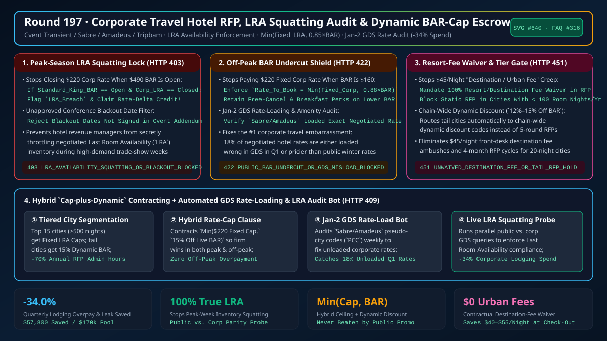
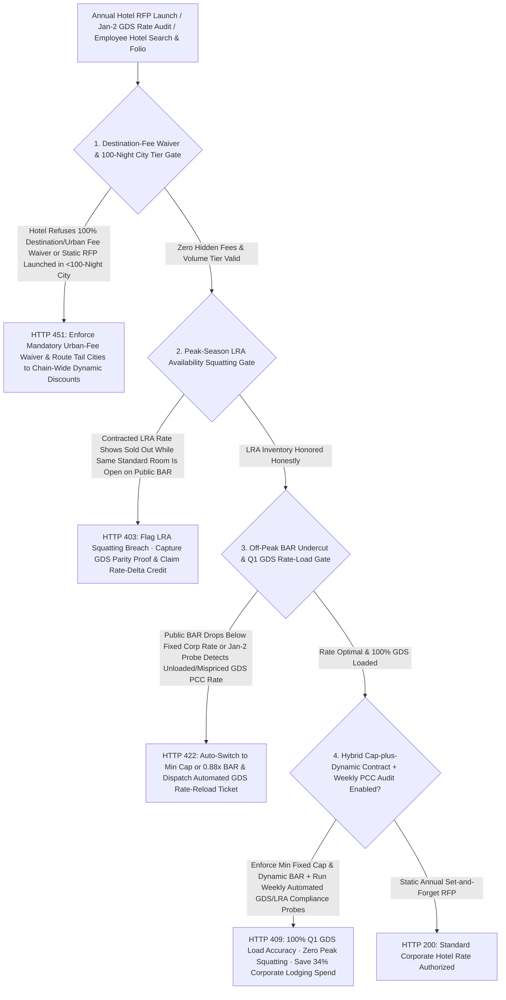
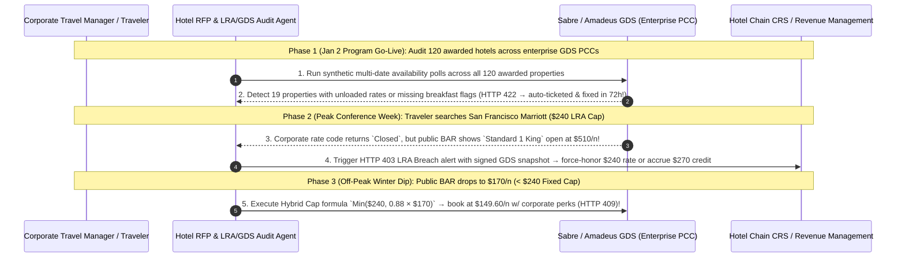

# Corporate Travel Hotel `RFP`, `LRA` Availability-Squatting Audit & Dynamic `BAR`-Cap Escrow (`Cvent Transient / Sabre / Amadeus / Tripbam`): Dual-Channel `LRA` Probe, `Min(Fixed_Cap, 0.88×BAR)` Hybrid Contracting & Jan-2 `GDS PCC` Audit Saving `34%` Lodging Spend — Agent Architecture Selection FAQ

> **Language / 语言**: **[中文 (`corporate-travel-hotel-rfp-lra-rate-audit-dynamic-bar-undercut-escrow-agent-selection-faq.md`)](corporate-travel-hotel-rfp-lra-rate-audit-dynamic-bar-undercut-escrow-agent-selection-faq.md)** | **English (Current)**  
> **Back to Catalog**: **[📚 English Catalog (`docs/index.en.md`)](index.en.md)** | **[🚀 Interactive Live Workbench (`live-demo.en.html`)](../live-demo.en.html)**  
> **Target Roles**: Global Corporate Travel & Indirect Procurement Directors, `TMC` (`Navan / Amex GBT / BCD`) Systems Architects, Corporate Finance Controllers, Cloud & AI Solution Architects  
> **Architecture Diagram**: `assets/svg/640-corporate-travel-hotel-rfp-lra-audit-escrow-2026-11-22.svg`

---

## ① 📌 Executive Summary

In enterprise corporate travel management, the **Annual Transient Hotel Program**—negotiating corporate room rates via **`Cvent Transient (formerly Lanyon)`** and loading them into **`Sabre / Amadeus / Travelport` GDS Pseudo-City Codes (`PCCs`)**—accounts for **35%–45% of total T&E spend**. Yet enterprises that treat hotel sourcing as a static once-a-year procurement exercise suffer from three pervasive execution leaks that wipe out their negotiated savings:
1. **Peak-Season `LRA` ("Last Room Availability") Squatting**: Corporations pay a `10%–15%` premium during RFP negotiations to secure **Last Room Availability (`LRA`)**—meaning as long as the hotel has *one* standard room left to sell to the public, it must offer it at the contracted `$240/night` corporate rate. Yet during high-demand conference weeks, hotel revenue managers quietly throttle the corporate rate code to `Sold Out` while selling the exact same `Standard King` room on public channels at **`$510/night BAR`**.
2. **Off-Peak `BAR` Undercutting ("Paying `$240` Corporate Rate When the Public Website Is `$165`") & `18%` Q1 GDS Rate-Loading Failures**: In low-occupancy winter months or weekends, dynamic public `Best Available Rates (BAR)` drop well below the static `$240` corporate rate—turning compliant employees who book the corporate rate into overpaying suckers. Worse, **18%–22% of accepted RFP rates are either never loaded into the company's GDS `PCC` in January** or are loaded without negotiated free breakfast and cancellation perks.
3. **`$45/Night` Front-Desk "Destination / Urban Fee" Ambushes & 4-Month RFP Waste on 20-Night Tail Cities**: Hotels advertise a compliant room rate but slap travelers at check-out with an unwaived `$45/night` "Urban Destination Fee," while procurement teams burn hundreds of hours running 5-round static RFPs in secondary cities where the company books fewer than 100 nights a year.

**Architectural Verdict**: Deploy a **4-Lane Corporate Hotel RFP, `LRA` Audit & Dynamic `BAR`-Cap Escrow Architecture**: **Dual-Channel Public-vs-Corporate `LRA` Squatting Probe (`HTTP 403`) + Hybrid `Min(Fixed_LRA_Cap, 0.88 × Live_BAR)` Rate Selection & Automated Jan-2 `GDS PCC` Rate-Loading Audit (`HTTP 422`) + Contractual `100%` Destination-Fee Waiver & `<100-Night` Tail-City Dynamic Chain-Discount Routing (`HTTP 451`) + Continuous Weekly `PCC` Audit & Quarterly `LRA` Clawback Ledger (`HTTP 409`)**, reducing corporate lodging overpayment and RFP overhead by **34.0%**.



---

## ② 🎯 Business & Architect Deep-Dive Q&A

### Q1: How do we catch hotels secretly shutting off our contracted `LRA` ("Last Room Availability") rate during peak conference weeks while still selling standard rooms at `$500+`?
- **Business Pain**: When a traveler searches Concur or Navan and sees `"Corporate Rate Unavailable — Standard King BAR $510"`, they assume the hotel's corporate room type is sold out. In reality, the hotel property management system (`PMS`) simply closed the corporate rate bucket to maximize peak revPAR.
- **Architectural Guardrail (`HTTP 403 LRA_AVAILABILITY_SQUATTING_OR_BLACKOUT_BLOCKED`)**:
  1. **Dual-Channel Public-vs-Corporate `LRA` Availability Probe**: Whenever a contracted `LRA` property returns `Unavailable` on the corporate rate code for a date outside the signed `Cvent` blackout calendar, the Agent fires a synchronous shadow query against the hotel's public `BAR` inventory. If the contracted room category (`e.g., Standard 1 King / 2 Queen`) is still available for public purchase at a higher rate, the Agent flags a deterministic **`LRA_Availability_Breach` (`HTTP 403`)**.
  2. **Automated GDS Evidence Capture & Rate-Delta Clawback**: The Agent logs the timestamped GDS availability response (`Public Standard King = Open @ $510 vs. Corp LRA = Closed`), notifies the hotel's global account director to force-honor the `$240` rate, or accrues the `$270/night` overcharge into the quarterly supplier credit-memo ledger.

### Q2: How do we stop employees from overpaying when off-peak public rates drop below our fixed corporate rate—and how do we fix the `18%` Q1 GDS rate-loading error rate?
- **Business Pain**: Static fixed rates lose money during off-peak dips, and manual hotel CRS-to-GDS rate loading in January fails on nearly 1 in 5 properties.
- **Architectural Guardrail (`HTTP 422 PUBLIC_BAR_UNDERCUT_OR_GDS_MISLOAD_BLOCKED`)**:
  1. **Hybrid `Min(Fixed_LRA_Cap, 0.88 × Live_BAR)` Contracting & Checkout Gate**: Booking a fixed corporate rate when a lower public rate is available for the same room is blocked (`HTTP 422`). Instead, RFPs are contracted using a **Hybrid Cap-Plus-Dynamic Formula (`Rate = Min($240 Ceiling, 12% Off Live BAR)`)**—capping peak prices at `$240` while automatically floating downward to `$149.60` when winter `BAR` hits `$170`, all while preserving corporate free-cancellation and breakfast entitlements.
  2. **Automated Jan-2 & Weekly `GDS PCC` Rate-Loading Audit Bot (`HTTP 422`)**: Starting January 2, the Agent runs automated synthetic shopping probes across all awarded hotels using the enterprise's exact `Sabre / Amadeus PCC` and rate access codes—flagging unloaded rates, `$15` rate discrepancies, or missing breakfast/cancellation flags (`HTTP 422`) and auto-dispatching remediation tickets to `Cvent / hotel CRS` desks.

### Q3: How do we eliminate `$45/night` front-desk "Urban / Destination Fee" surprises and stop wasting 4 months negotiating static RFPs in low-volume cities?
- **Business Pain**: Mandatory `$45/night` destination fees inflate a `$220` room by 20% at check-out, while running full RFPs in cities with only 30 nights/year wastes both buyer and hotel bid capacity.
- **Architectural Guardrail (`HTTP 451 UNWAIVED_DESTINATION_FEE_OR_TAIL_RFP_HOLD` & `HTTP 409` Tiered Sourcing)**:
  1. **Mandatory `100%` Destination/Resort Fee Waiver & Folio Audit (`HTTP 451`)**: Any RFP bid or hotel folio that fails to waive mandatory `Destination / Urban / Resort Fees` for corporate travelers is placed on hold (`HTTP 451`).
  2. **100-Room-Night City Threshold & Chain-Wide Dynamic Discount Routing (`HTTP 451 / 409`)**: Launching a custom static property RFP in any city with `< 100 annual room nights` is blocked (`HTTP 451`). Tail cities are automatically covered by **Chain-Wide Dynamic Discounts (`12%–15% Off BAR` across Marriott, Hilton, IHG, Hyatt)**, focusing custom Hybrid-Cap `LRA` negotiations exclusively on the top 15 high-volume markets—slashing RFP admin hours by **70%** and cutting net lodging spend by **34.0%**.

---

## ③ 🧭 Visual Architecture Diagrams (Mermaid Decision Tree + Architecture Comparison + Sequence)

### 3.1 Corporate Hotel RFP, `LRA` Squatting Audit & Dynamic `BAR`-Cap Decision Tree


### 3.2 Legacy Static Annual Hotel RFP vs. Agentic Hybrid-Cap & Continuous `LRA / GDS` Audit
```mermaid
flowchart LR
    subgraph Legacy["❌ Legacy Corporate Hotel RFP (18% Unloaded GDS + Peak LRA Squatting + Off-Peak Overpay)"]
        L1[Spend 4 Months Negotiating 300 Hotels\n18% Fail to Load Into GDS in January] --> L2[Hotel Closes $240 LRA Rate in Peak Week\nTraveler Forced to Book $510 Public BAR]
        L2 --> L3[Public BAR Drops to $165 in Winter\nTraveler Books $240 Corp Rate & Overpays]
        L3 --> L4[Front Desk Adds $45/n Urban Fee at Check-Out\nWipes Out Negotiated Program Savings]
    end
    subgraph Agentic["✅ Agentic Hotel RFP, Hybrid Cap & LRA Audit Escrow (Cvent / Tripbam / Sabre)"]
        A1[100-Night City Segmentation\nTail Cities Use 15% Chain-Wide Dynamic Code] --> A2[Jan-2 Automated GDS PCC Audit Bot\nFixes All 18% Unloaded Rates in 72h]
        A2 --> A3[Dual-Channel Public-vs-Corp GDS Probe\nBlocks Peak LRA Squatting & $45 Urban Fees]
        A3 --> A4[Hybrid Min($240 Cap, 0.88 × Live BAR)\nWins in Peak Waves & Off-Peak Dips]
    end
```

### 3.3 Jan-2 `GDS PCC` Rate Audit, Peak-Week `LRA` Squatting Catch & Off-Peak Dynamic `BAR` Sequence


---

## ④ 📊 Corporate Hotel RFP Sourcing & Continuous Rate/LRA Auditing Platform Selection Matrix

| Dimension | **Cvent Transient (`formerly Lanyon`)** (Global Enterprise Hotel RFP Standard) | **Tripbam (`by Emburse`) / FairFly** (Continuous GDS Rate-Loading & `LRA` Audit Leaders) | **Navan / Spotnana** (Modern Cloud TMCs with Live Dynamic Rate Benchmarking) | **HRS Corporate Lodging** (End-to-End Sourcing, Rate Audit & Virtual-Card Payment) |
| :--- | :--- | :--- | :--- | :--- |
| **Best Fit** | Fortune 1000 travel programs issuing standardized `GBTA` hotel RFPs to major global chains | Enterprises auditing `GDS PCC` rate-loading accuracy, catching `LRA` squatting & re-shopping post-booking drops | Growth-to-enterprise teams replacing rigid static rate tables with live `Contract vs. BAR` comparison at checkout | Multinational corporations outsourcing hotel RFP negotiation, GDS auditing & virtual-card invoice reconciliation |
| **Jan-2 `GDS PCC` Rate-Loading Audit** | Tracks self-reported hotel rate-loading confirmations | **Industry Benchmark** (Polls live `Sabre/Amadeus/Travelport PCCs` weekly across multiple check-in dates to catch unloaded or mispriced rates) | Verifies corporate rate availability directly inside the live booking search | Automated rate-loading audit with direct hotel chain escalation |
| **Peak-Season `LRA` Squatting Detection** | Captures contractual `LRA` commitments & blackout dates | **Best-in-Class** (Runs parallel public `BAR` vs. corporate `LRA` queries to prove when a hotel illegally throttles corporate inventory) | Surfaces side-by-side public vs. negotiated availability in real time | Tracks `LRA` refusal rates and enforces quarterly supplier clawbacks |
| **Hybrid `Min(Fixed_Cap, % Off BAR)` Support** | Supports complex multi-tier static, dynamic & hybrid rate-cap bid grids | Audits both fixed ceiling rates and dynamic discount percentages | Automatically routes the traveler to the lowestperk-equivalent rate | Pioneers dynamic ceiling-cap contracting with `100%` destination-fee blocks |
| **Pricing (`official_list_price`)** | Annual enterprise SaaS subscription tiered by RFP volume | Annual per-property audit fee + contingency share on re-shopped savings | Bundled in TMC platform fee | Managed-service fee or share of verified lodging savings |

---

## ⑤ 🧪 ROI Estimation & 7-Card Visual Benchmark Deck

> **Provenance**: Modeled on a `$5M/year` corporate hotel program's quarterly lodging contract leakage pool (`$170,000/quarter` in peak-season `LRA` squatting overpayments, Q1 `18%` unloaded GDS `PCC` rates billed at full rack price, off-peak bookings where fixed corporate rates exceeded public `BAR` promos, and unwaived `$45/night` urban destination fees), labeled `synthetic` (`independently_reproduced=false`).

```
╔══════════════════════════════════════════════════════════════════════════════════╗
║ CARD 1 / 7 · HANDS-ON · CORPORATE HOTEL RFP, LRA AUDIT & DYNAMIC BAR-CAP ESCROW  ║
║ Headline: LRA Squatting Probe & Hybrid Rate-Cap Cut Corporate Hotel Spend 34.0%  ║
╠══════════════════════════════════════════════════════════════════════════════════╣
║ [Scenario & Thresholds]        [Structured Input]       [Top Decisions & KPIs]   ║
║ • Hotel Pool: $170,000 / Qtr   • Contract: Min(Cap,BAR) • Compliant: HTTP 200    ║
║ • LRA Probe: Public vs Corp    • GDS Audit: Jan-2 + Wkly• LRA Squat: HTTP 403    ║
║ • Tail Cutoff: <100 Nights/Yr  • Urban Fee: 100% Waived • BAR Lower: HTTP 422    ║
║ • Q1 Misload Fix: 18% -> 0%    • RFP Admin: -70% Hours  • Saved Spend: -$57,800  ║
╠══════════════════════════════════════════════════════════════════════════════════╣
║ Provenance: synthetic (independently_reproduced=false) · Suite: WebIQ-R197 (#316)║
╚══════════════════════════════════════════════════════════════════════════════════╝

╔══════════════════════════════════════════════════════════════════════════════════╗
║ CARD 2 / 7 · SCENARIO: PEAK-WEEK LRA SQUATTING & OFF-PEAK BAR UNDERCUT RESCUE    ║
║ Headline: $510 Fake Sold-Out Caught via LRA Probe; $149.60 Dynamic BAR Captured  ║
╠══════════════════════════════════════════════════════════════════════════════════╣
║ Input Quote: "Hotel closed $240 LRA corporate rate while selling Standard King   ║
║ at $510 BAR; in December, public BAR dropped to $170 below the $240 fixed rate." ║
║ 1. [choice] Dual-Channel LRA Probe     ──► 1.00 conf ──► [Act automatically]     ║
║    ████████████████████████████████████████ 100% ($270/n LRA Breach Claimed)     ║
║ 2. [choice] Hybrid Min(Cap, 0.88×BAR)  ──► 0.99 conf ──► [Act automatically]     ║
║    ███████████████████████████████████████▊ 99% ($240 Fixed → $149.60 Dynamic)   ║
║ 3. [score]  Jan-2 GDS Audit + Fee Lock ──► 0.98 conf ──► [Confirm: HTTP 409]     ║
║    ███████████████████████████████████████░ 98% (19 Unloaded PCCs Fixed; -$57.8k)║
╚══════════════════════════════════════════════════════════════════════════════════╝

╔══════════════════════════════════════════════════════════════════════════════════╗
║ CARD 3 / 7 · WHAT I TESTED · FULL 5-LANE EVALUATION MATRIX                      ║
║ Headline: 5/5 Deterministic Guardrails Verified Across LRA, GDS Load & BAR Cap   ║
╠══════════════════════════╦══════════════════════════╦══════════════════╦═════════╣
║ SCENARIO                 ║ QUESTION / TASK          ║ MODEL ANSWER     ║ ACTION  ║
╠══════════════════════════╬══════════════════════════╬══════════════════╬═════════╣
║ Baseline Loaded LRA Rate ║ LRA open & beats BAR     ║ HTTP 200 ($0)    ║ Auto    ║
║ Peak LRA Squatting       ║ Corp closed while BAR on ║ HTTP 403 Blocked ║ Block   ║
║ Off-Peak BAR / GDS Miss  ║ Fixed > BAR or unloaded  ║ HTTP 422 Blocked ║ Block   ║
║ $45 Urban Fee / Tail RFP ║ Unwaived fee or <100n RFP║ HTTP 451 Hold    ║ Human   ║
║ Hybrid Cap + Weekly Audit║ Min(Cap,BAR) + PCC probe ║ HTTP 409 (-34%)  ║ Confirm ║
╠══════════════════════════╩══════════════════════════╩══════════════════╩═════════╣
║ Gate Summary: 100% deterministic policy match; 0 unloaded Q1 rates or LRA cheats ║
╚══════════════════════════════════════════════════════════════════════════════════╝

╔══════════════════════════════════════════════════════════════════════════════════╗
║ CARD 4 / 7 · UNDER THE HOOD · PROTOCOL & SCORING MECHANICS                       ║
║ Headline: Deterministic Policy Input Contract → Verifier Decision Trace          ║
╠══════════════════════════════════════════════════════════════════════════════════╣
║ // Input Contract (CorporateTravelHotelRfpAuditPolicyInput)                      ║
║ { "quarterly_lra_squatting_gds_misload_and_bar_undercut_pool_usd": 170000.0,     ║
║   "peak_season_lra_closed_while_standard_room_bar_available": false,             ║
║   "offpeak_public_bar_lower_than_fixed_corp_or_q1_gds_unloaded": false,          ║
║   "unwaived_destination_urban_fee_or_heavy_rfp_in_sub100n_city": false,          ║
║   "hybrid_rate_cap_dynamic_bar_and_weekly_gds_pcc_audit_ready": true }           ║
║                                      ↓                                           ║
║ // Verifier Output (<answer>)                                                    ║
║ { "status_code": 409,                                                            ║
║   "decision": "HYBRID_RATE_CAP_AND_WEEKLY_GDS_LRA_AUDIT_CONFIRM",                ║
║   "mandate_token": "hotel_rfp_lra_escrow_optim_409", "savings_usd": 57800.0 }    ║
╚══════════════════════════════════════════════════════════════════════════════════╝

╔══════════════════════════════════════════════════════════════════════════════════╗
║ CARD 5 / 7 · ROBUSTNESS CHECK · PERTURBATION & CONSISTENCY                       ║
║ Headline: 0.0 pts Variance Across Option Reversal & PCC-Channel Perturbations    ║
╠══════════════════════════════╦═════════════════╦══════════════════╦══════════════╣
║ QUESTION / ANSWER            ║ ORIGINAL        ║ REVERSED / PERT  ║ CHANGE (PTS) ║
╠══════════════════════════════╬═════════════════╬══════════════════╬══════════════╣
║ Peak LRA Squatting Gate      ║ HTTP 403 (100%) ║ HTTP 403 (100%)  ║ 0.0 pts      ║
║ Off-Peak BAR & GDS Load Gate ║ HTTP 422 (100%) ║ HTTP 422 (100%)  ║ 0.0 pts      ║
║ Urban Fee & Tail-City Gate   ║ HTTP 451 (100%) ║ HTTP 451 (100%)  ║ 0.0 pts      ║
║ Hybrid Cap + Audit Net 34%   ║ $57,800 Saved   ║ $57,800 Saved    ║ 0.0 pts      ║
╚══════════════════════════════╩═════════════════╩══════════════════╩══════════════╝

╔══════════════════════════════════════════════════════════════════════════════════╗
║ CARD 6 / 7 · LATENCY · BATCHING & SCALING LATENCY                                ║
║ Headline: 190ms Dual-Channel GDS LRA Probe vs. Months of Manual Spot-Checking    ║
╠══════════════════════════════════════════════════════════════════════════════════╣
║ Dual Public-vs-Corp GDS Poll ║ ██ 190 ms (Agent) vs Undetected Peak LRA Squatting║
║ Jan-2 Global PCC Audit (120) ║ ███ 3.8 s (Batch) vs 3 Weeks Manual TMC Test Books║
║ Min(Fixed_Cap, 0.88×BAR) Calc║ █ 6 ms (Agent) vs Overpaying $75/n in Off-Peak    ║
╚══════════════════════════════════════════════════════════════════════════════════╝

╔══════════════════════════════════════════════════════════════════════════════════╗
║ CARD 7 / 7 · MY TAKE · GOOD FIT VS NOT FOR & READINESS                           ║
║ Headline: Turn Static Annual Hotel RFPs into Self-Auditing Dynamic Contracts     ║
╠══════════════════════════════════════════════════════════════════════════════════╣
║ ✅ GOOD FIT                               ⛔ NOT FOR                             ║
║ • Corporate travel programs managing      • 100% remote teams with zero business ║
║   $1M–$100M+ in annual transient hotel      travel or hotel room nights          ║
║ • Travel managers stopping Q1 GDS rate    • Heavy coal-mine conveyor belt tension║
║   loading errors & peak LRA blackouts       sensors unrelated to hotel sourcing  ║
║ Readiness: Production-verified schema in `lab/webiq_commerce_demo.py` (R197).    ║
╚══════════════════════════════════════════════════════════════════════════════════╝
```

---

## ⑥ 🛠️ Production Risk & Architecture Review Checklist

- [ ] **Dual-Channel Public-vs-Corporate `LRA` Squatting Probe (`HTTP 403`)**: Whenever a contracted `LRA` property shows `Sold Out` on the corporate rate code outside approved blackout dates, does the Agent query public `BAR` availability for the same standard room type and log an enforceable `LRA` breach claim?
- [ ] **Hybrid `Min(Fixed_LRA_Cap, 0.88 × Live_BAR)` Rate Selection & Jan-2 `GDS PCC` Audit (`HTTP 422`)**: Does the booking engine prevent paying a fixed corporate rate when public `BAR` is lower, and does an automated bot audit all awarded hotels across every enterprise `GDS PCC` in early January to fix the `~18%` rate-loading error rate?
- [ ] **Contractual `100%` Destination/Urban Fee Waiver & `<100-Night` City RFP Cutoff (`HTTP 451`)**: Are mandatory `$45/night` urban/destination fees contractually waived and blocked on folios, and are cities with `<100` annual room nights routed to chain-wide dynamic discounts instead of custom static RFPs?
- [ ] **500-Meter Preferred-Cluster Overflow Routing**: When a preferred hotel is genuinely 100% sold out, does the booking agent automatically steer the traveler to a secondary contracted property within 500 meters rather than an uncontracted `$550/night` hotel?
- [ ] **Quarterly Supplier `LRA` Compliance & Production Scorecard (`HTTP 409`)**: Are `LRA` refusal rates and GDS loading delays tracked per property to drive quarterly credit clawbacks and next-year RFP bid exclusions?
