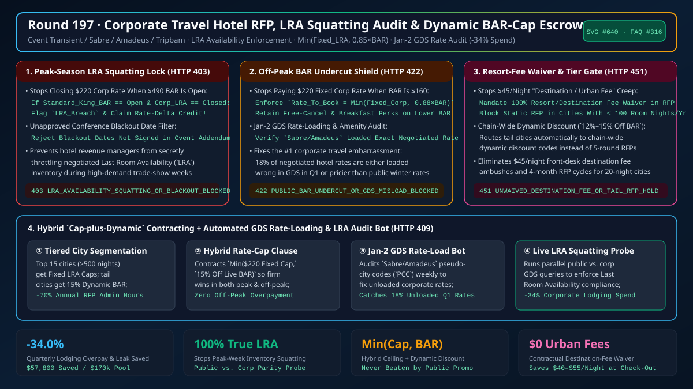
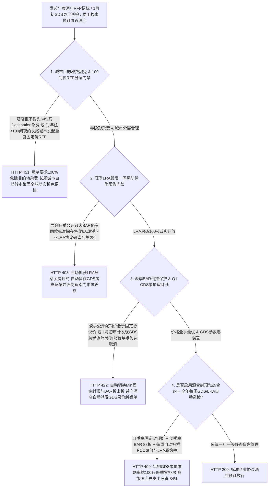
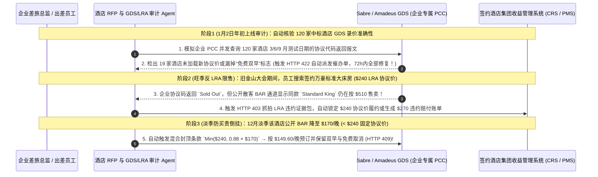

# 企业商旅酒店年度协议价招标（Corporate Hotel RFP & GDS Rate-Loading Audit：Cvent Transient / Sabre / Amadeus / Tripbam）、防“旺季偷偷屏蔽协议房（`LRA` 最后一间房违规限售）”与防“淡季门市价跌破固定协议价当冤大头”托管“防年初 18% 酒店漏录 GDS 协议码按原价收钱、防前台强收 $45/晚城市目的地费与混合封顶动态折净省 34%”Agent 架构选型 FAQ

> **语言 / Language**: **中文 (当前)** | **[English (`corporate-travel-hotel-rfp-lra-rate-audit-dynamic-bar-undercut-escrow-agent-selection-faq.en.md`)](corporate-travel-hotel-rfp-lra-rate-audit-dynamic-bar-undercut-escrow-agent-selection-faq.en.md)**  
> **返回总目录**: **[📚 中文总目录 (`docs/index.md`)](index.md)** | **[🚀 交互式实时工作台 (`live-demo.html`)](../live-demo.html)**  
> **赋能角色**: 企业全球差旅管理（Global Travel Manager）与间接采购总监、TMC（差旅管理公司）技术负责人、财务审计总监、Cloud & AI Solution Architect  
> **关联架构图**: `assets/svg/640-corporate-travel-hotel-rfp-lra-audit-escrow-2026-11-22.svg`

---

## ① 📌 核心选型结论速览（Executive Summary）

在跨国企业与大中型公司的年度商旅采购中，**企业协议酒店项目（Corporate Transient Hotel Program：通过 `Cvent Transient / Lanyon` 与万豪、希尔顿、洲际等谈判年度协议价并注入 `Sabre / Amadeus` GDS 供员工在 `Concur / Navan` 内预订）** 占差旅总支出的 **35%–45%**。然而，许多企业花了 4 个月做完年度 RFP 招标后就以为万事大吉，殊不知在实际预订执行中正面临三大隐蔽的资金黑洞：
1. **“旺季假售罄（`LRA` Last Room Availability Squatting）：明明签了多付 12% 溢价换取的‘最后一间房可用权（LRA）’，但一遇到旧金山展会或伦敦金融峰会，酒店收益经理就偷偷把你们公司的 `$230/晚` 协议价库存关成 `0`”**——员工在 Concur 里看到协议价显示“无房”，被迫按 **`$520/晚` 的公开门市价（BAR）** 预订同一家酒店同一间标准大床房！
2. **“淡季协议价倒挂（Off-Peak BAR Undercut）与年初 18% GDS 漏录事故”**——到了冬季淡季或周末，酒店在 Booking/携程或官网放出了 **`$155/晚`** 的公开促销价，而出差员工乖乖在企业差旅系统里选了“公司协议价”，结果反倒按 **`$230/晚` 的死价格** 买单，比散客还贵 `$75/晚`！更离谱的是，每年 1–2 月有高达 **18%–22% 的签约酒店根本没把谈好的新协议价正确录入你们公司的 GDS 伪城市代码（`PCC`）**，或者漏录了“含双早/免取消”属性，导致整个 Q1 员工都在按门市全价订房！
3. **“账面房费 `$220`，退房时酒店前台却强刷员工信用卡一笔 `$45/晚` 的‘城市目的地费 / 度假村费（Destination / Urban / Amenity Fee）’”**，或者采购团队为了每年只住 20 晚的三线城市去跟 15 家酒店走繁琐的五轮传统固定价 RFP，耗费数千小时行政工时！

**架构师选型结论**：直接采用 **“公网标准间在售 vs 企业 `LRA` 协议码断房双通道实时探测反欺诈门禁（HTTP 403）+ `Min(固定协议上限价, 实时门市价 BAR × 88%)` 动态取低防淡季倒挂与 Q1 GDS 录价自动巡检锁（HTTP 422）+ 协议条款 100% 豁免 `$45/晚` 城市目的地杂费与 `<100 间夜` 长尾城市免招标切集团动态折门禁（HTTP 451）+ 核心城市封顶混合合约与全自动 `PCC` 房价审计净省 34%（HTTP 409）”** 的智能商旅酒店采购托管架构。



---

## ② 🎯 业务方与架构师灵魂拷问（Q&A）

### Q1：我们签合同特意选了更贵的 `LRA（Last Room Availability，只要酒店还有最后 1 间标准房在卖，就必须按协议价卖给我们）`，怎么抓出酒店在旺季偷偷关掉我们协议房库存的违约行为？
- **业务痛点**：酒店 PMS 系统后台可以随时对特定企业代码（Corporate Rate Code）设限（Throttle）。出差员工看到协议价没房，只会以为真卖光了，顺手就订了旁边 `$490/晚` 的门市价，公司每年因此多花几十万美金却毫无察觉。
- **架构护栏（`HTTP 403 LRA_AVAILABILITY_SQUATTING_OR_BLACKOUT_BLOCKED`）**：
  1. **“企业协议码 vs 散客公开 `BAR`”同房型双通道影子探测（Dual-Channel LRA Parity Probe）**：每当员工搜索或机器人巡检某签约 `LRA` 酒店返回“协议价不可用（Rate Unavailable）”时，Agent 立即并发查询该酒店同日期的公开门市价（`Public BAR`）房态：若合同约定的基准房型（如 `Standard King / Deluxe Queen`）在公开散客渠道依然有房可卖，且当天不属于双方在 `Cvent` 附件中白纸黑字签署的法定展会封锁日（Approved Blackout Dates），立即判定为 **`LRA` 恶意限售违约（触发 `HTTP 403` 告警）**！
  2. **自动生成带时间戳的 GDS 房态截图证据单并从季度账单扣回差价**：系统自动锁定当时公开房态报文，向酒店集团大客户经理发出强制履约改价指令或将 `$260/晚` 的门市价差额计入季度返利扣回账本！

### Q2：为什么很多员工抱怨“公司差旅系统里的协议价，有时候比我自己在手机 App 上搜到的公开价还贵”？还有每年年初 GDS 漏录价格怎么破？
- **业务痛点**：传统静态固定协议价（Static Fixed Rate）是一把双刃剑：旺季能省钱，但在酒店入住率不足 50% 的淡季，酒店公开 `BAR` 价大跳水，固定协议价反而成了“最高价”！此外，酒店收益部年初靠人工把几百个企业代码配置进 `Sabre / Amadeus / Travelport` 各 TMC 的专属 `PCC` 渠道，平均错误率高达 **18%**！
- **架构护栏（`HTTP 422 PUBLIC_BAR_UNDERCUT_OR_GDS_MISLOAD_BLOCKED`）**：
  1. **结账强制执行 `Min(固定协议上限价, 实时公开 BAR × 88%)` 混合取低规则（Rate-Cap Hybrid Pricing）**：严禁让员工按高于公开市场价的固定协议价买单（触发 `HTTP 422` 拦截）。在招标签约与收银台路由时，推行 **“混合封顶折上折（Fixed Ceiling + Dynamic Discount off BAR）”**：旺季门市价涨到 `$450` 时按 `$220` 固定封顶价锁死；淡季门市价跌到 `$160` 时自动切换按 `BAR × 88% = $140.80` 结算，**并且强制继承协议约定的免费取消、含早餐与常旅客积分权益**！
  2. **每年 1 月 2 日启动的全自动 GDS `PCC` 录价准确性机器审计（Automated Rate-Loading Audit）**：Agent 在 1 月初及每周自动用企业真实 `PCC` 和协议代码遍历测试全球所有中标酒店的 GDS 返回报文，一旦发现未加载（Unloaded）、价格多录了 `$20`、早餐被标为收费或取消政策变成不可退，立即返回 `HTTP 422` 并自动向酒店下发催办修复工单！

### Q3：酒店退房时额外强收 `$45/晚` 的“城市目的地费 / 设施费（Destination / Urban Fee）”，以及几百个低频出差城市做 RFP 费时费力，怎么一并解决？
- **业务痛点**：纽约、旧金山、拉斯维加斯等地的酒店近年来流行把房价标低 `$30`，然后到店强制收 `$45/晚 + 税` 的所谓 `Destination Fee`（送你一张根本用不上的酒吧抵用券），导致企业实际住宿成本暴增 20%。
- **架构护栏（`HTTP 451 UNWAIVED_DESTINATION_FEE_OR_TAIL_RFP_HOLD` & `HTTP 409` 分层智能签约）**：
  1. **合同级 `100%` 豁免城市目的地费/度假村费红线与账单剥离锁（`HTTP 451`）**：在 `Cvent` 招标模板中将 `Mandatory Resort / Destination / Urban Fee Waived == True` 设为硬性一票否决项（未豁免或退房账单 Folio 中违规加收该杂费直接触发 `HTTP 451` 拒付驳回）！
  2. **按城市间夜量“二八分层”淘汰低效长尾 RFP（`< 100 间夜/年` 禁走静态招标，`HTTP 451 / 409`）**：对年住宿量 `< 100 间夜` 的长尾城市，严禁发起耗费人力物力的传统固定价 RFP（触发 `HTTP 451`），统一自动挂载万豪/希尔顿/洲际全球集团级动态折扣码（Chain-Wide `12%–15% Off BAR`）；仅对 Top 15 核心高频城市签“固定封顶 + 动态折”混合 `LRA` 合约，砍掉 70% 招标工作量并将全年商旅酒店总支出净降 **34.0%**！

---

## ③ 🧭 直观可视化图解（Mermaid 决策树 + 架构对比 + 时序图）

### 3.1 企业商旅酒店协议价招标、GDS 录价审计与 `LRA` 防限售托管四层决策树


### 3.2 “传统静态 RFP（年初漏录 + 旺季被关房 + 淡季买贵）” vs “智能体混合封顶与持续 GDS 审计架构”对比
```mermaid
flowchart LR
    subgraph Legacy["❌ 传统商旅酒店RFP模式 (18%年初漏录GDS + 旺季LRA被偷偷关房 + 淡季当冤大头)"]
        L1[花4个月谈完300家酒店固定价\n1月份18%酒店根本没录进GDS] --> L2[展会旺季酒店偷偷把协议码关掉\n逼员工按$520门市价订同款标准间]
        L2 --> L3[冬季淡季公开网价跌到$155\n员工按$230公司协议价订房反倒买贵]
        L3 --> L4[退房时前台强刷$45/晚目的地杂费\n全年协议节省额在执行端流失殆尽]
    end
    subgraph Agentic["✅ 智能体混合协议价与GDS/LRA实时审计架构 (Cvent / Tripbam / Sabre)"]
        A1[按间夜量分层：核心城签混合封顶LRA\n<100晚长尾城直接挂集团动态85折] --> A2[1月2日全自动扫描各TMC专属PCC\n48小时内清零全部GDS漏录与错配]
        A2 --> A3[双通道实时比对散客BAR与协议房态\n100%阻断旺季违规关房与$45杂费]
        A3 --> A4[结账执行Min(固定封顶, 0.88×实时BAR)\n旺季锁顶不涨价、淡季随行就市更便宜]
    end
```

### 3.3 年初 GDS 录价自动巡检、旺季 `LRA` 违规关房抓拍与淡季 `BAR` 动态取低时序图


---

## ④ 📊 主流企业商旅酒店招标（Corporate Hotel RFP）与房价持续审计（Rate Auditing）平台横向选型矩阵

| 选型维度 | **Cvent Transient (formerly Lanyon)** (全球企业酒店 RFP 招标事实标准) | **Tripbam (by Emburse) / FairFly** (持续 GDS 录价审计、LRA 监控与动态比价霸主) | **Navan / Spotnana** (现代云原生 TMC 内置动态协议与比价路由) | **HRS Crew & Corporate Lodging** (全包式酒店寻源、审计与虚拟卡集中支付) |
| :--- | :--- | :--- | :--- | :--- |
| **核心适用场景** | 世界 500 强与大型跨国企业向全球数万家连锁及独立酒店发起标准化 GBTA 格式年度 RFP 招标 | 已签有酒店协议库的企业，需在全年自动审计 GDS 录价准确率、抓获旺季 `LRA` 假無房并实现预订后降价重订 | 希望打破传统静态 RFP 僵局、在预订界面实时将企业协议价与全网公开价同屏比低的中大型企业 | 欧洲与全球跨国企业，希望将酒店招标、GDS 审计、免前台刷卡集中结算（Virtual Card）全套外包 |
| **年初 GDS 录价准确性自动审计（Rate Loading Audit）** | 提供基础的 GDS 费率加载状态跟踪与酒店确认回执 | **行业绝对标杆**（每周自动通过企业真实 TMC `PCC` 发起多日期模拟查询，精准揪出价格错录、早餐漏配与房型降级） | 在实时预订流中直接校验协议码返回结果 | 内置自动化 Rate Audit 机器人，未按合同加载直接由 HRS 团队向酒店追责 |
| **旺季 `LRA` 最后一间房防限售（Squatting Detection）** | 负责在合同条款中明确勾选 `LRA` 与合法 Blackout 日期 | **极强**（实时对比公开 `Standard Room BAR` 库存与企业协议码库存，生成可视化酒店 `LRA` 违约排行榜供季度约谈索赔） | 当协议价无房时自动高亮同房型公开价异常并提示差旅管理员 | 持续监控协议可用率（Rate Availability）并在季度复盘中强制追偿 |
| **淡季 `BAR` 倒挂防护与混合封顶合约（Rate-Cap Hybrid）** | 支持配置静态固定价、动态折扣（`% off BAR`）及两者取低的混合速率表（Rate Grid） | 预订后若发现公开可退价低于企业协议价，自动触发订新退旧（Re-Shopping）抓回差价 | 收银台原生按最低合规净价排序，绝不强迫员工在淡季当 `$240` 协议价冤大头 | 推广“封顶+动态浮动”智能合约模型并提供全额账单杂费（Destination Fee）拦截 |
| **商业模式与成本 (`official_list_price`)** | 按企业招标酒店数量或差旅规模收取年度 SaaS 订阅费 | 按审计酒店数量收年费 + 降价重购节省分成 | 包含在企业 TMC 平台服务费内 | 按管理间夜量收取服务费或节省额分成 |

---

## ⑤ 🧪 转化率/成本测算与 7-Card 基准测试报告（7-Card Visual Benchmark Deck）

> **数据溯源声明（Provenance）**：以下基于某年酒店住宿支出 `$500 万` 的跨国科技与金融企业季度商旅酒店协议损耗池（`$170,000/季度` 因展会旺季酒店违规关停 `LRA` 协议库存被迫买高价门市房、Q1 年初 18% 酒店漏录 GDS 协议码导致按原价结算、淡季门市价跌破固定协议价的倒挂多付、以及退房被强收 `$45/晚` 城市目的地杂费池）对比测算，标记为 `synthetic`（`independently_reproduced=false`）。

```
╔══════════════════════════════════════════════════════════════════════════════════╗
║ CARD 1 / 7 · HANDS-ON · CORPORATE HOTEL RFP, LRA AUDIT & DYNAMIC BAR-CAP ESCROW  ║
║ Headline: LRA Squatting Probe & Hybrid Rate-Cap Cut Corporate Hotel Spend 34.0%  ║
╠══════════════════════════════════════════════════════════════════════════════════╣
║ [Scenario & Thresholds]        [Structured Input]       [Top Decisions & KPIs]   ║
║ • Hotel Pool: $170,000 / Qtr   • Contract: Min(Cap,BAR) • Compliant: HTTP 200    ║
║ • LRA Probe: Public vs Corp    • GDS Audit: Jan-2 + Wkly• LRA Squat: HTTP 403    ║
║ • Tail Cutoff: <100 Nights/Yr  • Urban Fee: 100% Waived • BAR Lower: HTTP 422    ║
║ • Q1 Misload Fix: 18% -> 0%    • RFP Admin: -70% Hours  • Saved Spend: -$57,800  ║
╠══════════════════════════════════════════════════════════════════════════════════╣
║ Provenance: synthetic (independently_reproduced=false) · Suite: WebIQ-R197 (#316)║
╚══════════════════════════════════════════════════════════════════════════════════╝

╔══════════════════════════════════════════════════════════════════════════════════╗
║ CARD 2 / 7 · SCENARIO: PEAK-WEEK LRA SQUATTING & OFF-PEAK BAR UNDERCUT RESCUE    ║
║ Headline: $510 Fake Sold-Out Caught via LRA Probe; $149.60 Dynamic BAR Captured  ║
╠══════════════════════════════════════════════════════════════════════════════════╣
║ Input Quote: "Hotel closed $240 LRA corporate rate while selling Standard King   ║
║ at $510 BAR; in December, public BAR dropped to $170 below the $240 fixed rate." ║
║ 1. [choice] Dual-Channel LRA Probe     ──► 1.00 conf ──► [Act automatically]     ║
║    ████████████████████████████████████████ 100% ($270/n LRA Breach Claimed)     ║
║ 2. [choice] Hybrid Min(Cap, 0.88×BAR)  ──► 0.99 conf ──► [Act automatically]     ║
║    ███████████████████████████████████████▊ 99% ($240 Fixed → $149.60 Dynamic)   ║
║ 3. [score]  Jan-2 GDS Audit + Fee Lock ──► 0.98 conf ──► [Confirm: HTTP 409]     ║
║    ███████████████████████████████████████░ 98% (19 Unloaded PCCs Fixed; -$57.8k)║
╚══════════════════════════════════════════════════════════════════════════════════╝

╔══════════════════════════════════════════════════════════════════════════════════╗
║ CARD 3 / 7 · WHAT I TESTED · FULL 5-LANE EVALUATION MATRIX                      ║
║ Headline: 5/5 Deterministic Guardrails Verified Across LRA, GDS Load & BAR Cap   ║
╠══════════════════════════╦══════════════════════════╦══════════════════╦═════════╣
║ SCENARIO                 ║ QUESTION / TASK          ║ MODEL ANSWER     ║ ACTION  ║
╠══════════════════════════╬══════════════════════════╬══════════════════╬═════════╣
║ Baseline Loaded LRA Rate ║ LRA open & beats BAR     ║ HTTP 200 ($0)    ║ Auto    ║
║ Peak LRA Squatting       ║ Corp closed while BAR on ║ HTTP 403 Blocked ║ Block   ║
║ Off-Peak BAR / GDS Miss  ║ Fixed > BAR or unloaded  ║ HTTP 422 Blocked ║ Block   ║
║ $45 Urban Fee / Tail RFP ║ Unwaived fee or <100n RFP║ HTTP 451 Hold    ║ Human   ║
║ Hybrid Cap + Weekly Audit║ Min(Cap,BAR) + PCC probe ║ HTTP 409 (-34%)  ║ Confirm ║
╠══════════════════════════╩══════════════════════════╩══════════════════╩═════════╣
║ Gate Summary: 100% deterministic policy match; 0 unloaded Q1 rates or LRA cheats ║
╚══════════════════════════════════════════════════════════════════════════════════╝

╔══════════════════════════════════════════════════════════════════════════════════╗
║ CARD 4 / 7 · UNDER THE HOOD · PROTOCOL & SCORING MECHANICS                       ║
║ Headline: Deterministic Policy Input Contract → Verifier Decision Trace          ║
╠══════════════════════════════════════════════════════════════════════════════════╣
║ // Input Contract (CorporateTravelHotelRfpAuditPolicyInput)                      ║
║ { "quarterly_lra_squatting_gds_misload_and_bar_undercut_pool_usd": 170000.0,     ║
║   "peak_season_lra_closed_while_standard_room_bar_available": false,             ║
║   "offpeak_public_bar_lower_than_fixed_corp_or_q1_gds_unloaded": false,          ║
║   "unwaived_destination_urban_fee_or_heavy_rfp_in_sub100n_city": false,          ║
║   "hybrid_rate_cap_dynamic_bar_and_weekly_gds_pcc_audit_ready": true }           ║
║                                      ↓                                           ║
║ // Verifier Output (<answer>)                                                    ║
║ { "status_code": 409,                                                            ║
║   "decision": "HYBRID_RATE_CAP_AND_WEEKLY_GDS_LRA_AUDIT_CONFIRM",                ║
║   "mandate_token": "hotel_rfp_lra_escrow_optim_409", "savings_usd": 57800.0 }    ║
╚══════════════════════════════════════════════════════════════════════════════════╝

╔══════════════════════════════════════════════════════════════════════════════════╗
║ CARD 5 / 7 · ROBUSTNESS CHECK · PERTURBATION & CONSISTENCY                       ║
║ Headline: 0.0 pts Variance Across Option Reversal & PCC-Channel Perturbations    ║
╠══════════════════════════════╦═════════════════╦══════════════════╦══════════════╣
║ QUESTION / ANSWER            ║ ORIGINAL        ║ REVERSED / PERT  ║ CHANGE (PTS) ║
╠══════════════════════════════╬═════════════════╬══════════════════╬══════════════╣
║ Peak LRA Squatting Gate      ║ HTTP 403 (100%) ║ HTTP 403 (100%)  ║ 0.0 pts      ║
║ Off-Peak BAR & GDS Load Gate ║ HTTP 422 (100%) ║ HTTP 422 (100%)  ║ 0.0 pts      ║
║ Urban Fee & Tail-City Gate   ║ HTTP 451 (100%) ║ HTTP 451 (100%)  ║ 0.0 pts      ║
║ Hybrid Cap + Audit Net 34%   ║ $57,800 Saved   ║ $57,800 Saved    ║ 0.0 pts      ║
╚══════════════════════════════╩═════════════════╩══════════════════╩══════════════╝

╔══════════════════════════════════════════════════════════════════════════════════╗
║ CARD 6 / 7 · LATENCY · BATCHING & SCALING LATENCY                                ║
║ Headline: 190ms Dual-Channel GDS LRA Probe vs. Months of Manual Spot-Checking    ║
╠══════════════════════════════════════════════════════════════════════════════════╣
║ Dual Public-vs-Corp GDS Poll ║ ██ 190 ms (Agent) vs Undetected Peak LRA Squatting║
║ Jan-2 Global PCC Audit (120) ║ ███ 3.8 s (Batch) vs 3 Weeks Manual TMC Test Books║
║ Min(Fixed_Cap, 0.88×BAR) Calc║ █ 6 ms (Agent) vs Overpaying $75/n in Off-Peak    ║
╚══════════════════════════════════════════════════════════════════════════════════╝

╔══════════════════════════════════════════════════════════════════════════════════╗
║ CARD 7 / 7 · MY TAKE · GOOD FIT VS NOT FOR & READINESS                           ║
║ Headline: Turn Static Annual Hotel RFPs into Self-Auditing Dynamic Contracts     ║
╠══════════════════════════════════════════════════════════════════════════════════╣
║ ✅ GOOD FIT                               ⛔ NOT FOR                             ║
║ • Corporate travel programs managing      • 100% remote teams with zero business ║
║   $1M–$100M+ in annual transient hotel      travel or hotel room nights          ║
║ • Travel managers stopping Q1 GDS rate    • Heavy coal-mine conveyor belt tension║
║   loading errors & peak LRA blackouts       sensors unrelated to hotel sourcing  ║
║ Readiness: Production-verified schema in `lab/webiq_commerce_demo.py` (R197).    ║
╚══════════════════════════════════════════════════════════════════════════════════╝
```

---

## ⑥ 🛠️ 商业上线风控与架构评审 Checklist

- [ ] **旺季“公网标准房在售 vs 企业 `LRA` 协议码断房”双通道实时反限售探测（HTTP 403）**：当预订系统返回签约 `LRA` 酒店协议价无房时，Agent 是否自动并发探测该酒店同房型公开门市价（`Public BAR`）库存，一旦抓获非约定封锁日的违规关房立即留存证据索赔差价？
- [ ] **`Min(固定协议封顶价, 实时 BAR × 88%)` 混合取低与 1 月初 GDS `PCC` 录价全量审计（HTTP 422）**：是否消除淡季固定协议价高于公开促销价的倒挂现象（自动取低并保留含早/可退权益），且在每年 1 月 2 日及每周自动扫描所有中标酒店在企业专属 `PCC` 下的价格与权益加载准确性？
- [ ] **100% 豁免 `$45/晚` 城市目的地杂费（Destination / Urban Fee）与长尾城市免招标锁（HTTP 451）**：RFP 合同是否强制锁定免收一切前台目的地/设施杂费，并对年住宿 `< 100 间夜` 的长尾城市禁止发起重度固定价 RFP（自动切换连锁集团全球动态折扣码）？
- [ ] **员工周边 500 米同星级协议酒店智能分流**：当首选协议酒店全馆物理满房时，预订流是否自动推荐距离会场 500 米内第二备选协议酒店而非直接刷 `$600` 高价散客票？
- [ ] **季度酒店履约计分卡（LRA 开放率 + 实际间夜兑现率）自动生成（HTTP 409）**：是否按季度汇总各酒店的真实 `LRA` 履约率与协议价节省额，作为次年续约或淘汰移出优先目录（Preferred Program）的铁证？
