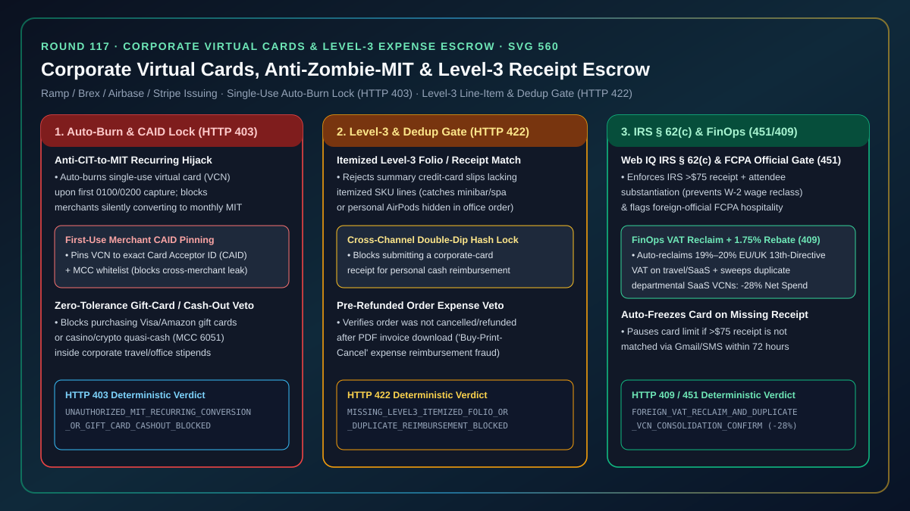
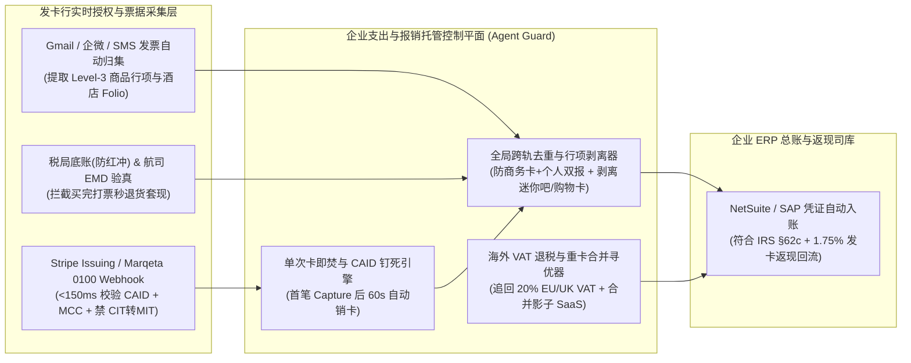
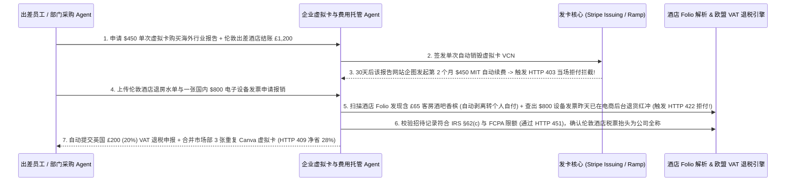

# 企业预算虚拟卡（Corporate Virtual Cards）、防“单次卡转长期包月暗扣”与 Level-3 发票行项对账托管（Ramp / Brex / Airbase / Stripe Issuing / 分贝通）Agent 架构选型 FAQ

> **核心阅读对象**：为企业财务共享中心（SSC）、差旅与费用管理（T&E：Ramp / Brex / Navan Expense / 分贝通 / 汇联易）及发卡控制平面（`Stripe Issuing / Marqeta / Adyen Issuing`）设计智能体预算虚拟卡（`VCN`）实时授权、防套现与发票行项自动对账的 **Cloud & AI Solution Architect**。  
> **核心痛点解决**：彻底终结企业费用支出管理中**“员工或部门采购 Agent 申请一张 `$499` 的单次虚拟卡买一份行业报告或参会门票，结果商户后台静默把卡号转成每月 `$499` 的周期代扣（`CIT-to-MIT Recurring Hijack`）连续偷扣半年无人察觉”、“员工在酒店退房或亚马逊采购办公用品时，只交一张写着总额 `$380` 的信用卡刷卡水单（隐藏里面夹带购买的 `$200` 个人超市购物卡、AirPods 耳机或客房酒吧高价红酒）”、“‘买了打印发票立刻退货（`Buy-Print-Cancel`）’或‘一票两报（拿公司商务卡付过钱的电子发票又去走个人垫付现金报销）’”以及“海外出差酒店/展会产生的 `19%–20%` 欧盟/英国增值税（`VAT`）因未收集公司抬头合规税票而全部作废”**四大财务漏洞。



---

## 📌 一、核心选型结论速览（Executive Summary）

1. **单次虚拟卡清算即焚（`Auto-Burn on First Capture`）、首刷商户号（`CAID`）死锁与零购物卡套现硬拦截（HTTP 403）**：传统企业实体副卡或粗放虚拟卡只限制月度总额，不限制扣款频次与商户身份。选型 Agent 必须在发卡行实时授权钩子（`ISO 8583 0100 Real-Time Auth Webhook`，`<150ms` 响应）层实施三道硬锁：① **单次卡清算即焚與 `MIT` 阻断**：凡标记为单次采购的虚拟卡（`Single-Use VCN`），在完成首笔清算后 60 秒自动销毁卡号，且在授权报文层直接拒绝任何带有周期续费标志（`Visa/MC CIT-to-MIT Indicator`）的后续扣款请求；② **首刷收单商户号（`CAID - Card Acceptor ID`）绑定**：周期型 SaaS 专属虚拟卡在首次刷卡成功后，自动将该卡锁死在该唯一 `CAID` 上——即便该供应商数据库被黑客拖库，黑客也无法拿着这张卡去别的网站刷出一分钱；③ **严禁准现金与预付购物卡（`MCC 6051 / Gift Card SKU`）套现**；违反者一律触发 **`HTTP 403 UNAUTHORIZED_MIT_RECURRING_CONVERSION_OR_GIFT_CARD_CASHOUT_BLOCKED`**。
2. **`Visa/MC Level-3` 行项账单（`Itemized Folio`）穿透、防“一票两报”哈希查重与防“买完打票秒退”门禁（HTTP 422）**：不能把信用卡 POS 刷卡回执（仅含总额与商户名）当成合格报销凭证。Agent 强制执行三单与行项核验：① **强制 `Level-3` 行项或酒店明细水单（`Hotel Folio`）**：对酒店（`MCC 7011`）、综合电商（Amazon/京东）与商超消费，必须通过卡组织 `Level-3 Enhanced Data` 或 Gmail/企微自动抓取的电子明细单逐行拆解，自动剥离客房酒精饮品、付费电影、SPA 或夹带购买的个人礼品卡；② **跨渠道发票哈希去重（防 `Double-Dipping`）**：将商务虚拟卡流水与员工个人垫付报销（`Out-of-Pocket Expense`）共享同一个全局发票指纹库（`稅号+发票代码号码` 或 `商户+精确金额+分钟级时间戳+行项哈希`），严防拿公司卡付过的账单再申请个人报销；③ **T+30d 退货冲正关联（防 `Buy-Print-Cancel`）**：实时监控关联卡号的 `0420 Reversal / Credit Voucher` 退款报文，对垫付报销大额电子客票/3C 产品强制验真航司 `EMD` 乘机状态或国家税务总局底账“未红冲”状态；凡缺明细行项或命中重报/退货套现的，直接触发 **`HTTP 422 MISSING_LEVEL3_ITEMIZED_FOLIO_OR_DUPLICATE_REIMBURSEMENT_BLOCKED`**。
3. **跨国差旅/展会 `19%–20%` 增值税自动退税（`EU 13th Directive VAT Reclaim`）+ 部门重复虚拟卡合并净省 28%（HTTP 409）**：在通过 Web IQ 核验美国国税局 `IRS § 62(c) Accountable Plan`（单笔 `>$75` 必须附带明细收据与商务事由/招待对象全名，否则整笔报销须计入员工 `W-2` 工资代扣个税）及 `FCPA` 公职人员招待红线（违规触发 **`HTTP 451`**）的前提下，Agent 自动执行 **全球进项税回收与影子订阅整合（`Corporate Spend FinOps`）**：通过邮件插件自动引导酒店/展会开具带公司税号的合规 `VAT Invoice` 并批量申报欧盟第 13 号指令 / 英国海外企业增值税退税（追回 **`19%–20%` 税金**），同时扫描全公司虚拟卡识别多个部门重复购买的同款 SaaS 工具并合并为企业年框 + 赚取 `1.75%` 发卡返现，触发 **`HTTP 409 FOREIGN_VAT_RECLAIM_AND_DUPLICATE_VCN_CONSOLIDATION_CONFIRM`**，为企业季度费用总盘子净省 **28%**。

---

## 🎯 二、业务方与架构师灵魂拷问（Q&A）

### Q1：为什么公司给每个高管和采购 Agent 配了限额虚拟卡，月底还是会发现大量“早就不用的工具还在每月扣钱”或“买办公用品顺手刷了 `$200` 超市卡”？
- **卡组织授权报文（`ISO 8583`）控制深度不足与 `Level-1` 账单盲区**：
  1. **单次卡变“僵尸月卡”的元凶**：很多虚拟卡平台虽然在界面上叫“单次申请卡”，但底层在发卡行（`Issuer Processor`）只设了“月度限额 `$500`”，没有在首笔清算（`Capture`）到达后立刻调用 `UpdateCardStatus(CLOSED)`。结果员工花 `$299` 买完一次海外行业数据库报告后，对方网站的默认勾选框将其升级为 `$299/月` 订阅，每个月1号准时扣款。
  2. **信用卡水单 vs. 商品明细单（`Level-1 vs. Level-3 Data`）**：在亚马逊或山姆会员店刷 `$312.50`，银行账单（`Level-1`）只显示 `"AMAZON MKTPLACE $312.50"`。如果不通过 OAuth 接入企业购账号（`Amazon Business PunchOut`）或强制上传行项发票，财务根本看不出里面是 `$12.50` 的打印纸加上一张 `$300` 的 Apple Gift Card。Agent 在发卡时直接锁定 `Single-Use Auto-Burn` 并在 `72 小时` 未匹配行项明细时自动冻结该员工名下所有虚拟卡额度。

### Q2：员工出差或买设备时，最隐蔽的“买完打发票立刻退货（`Buy-Print-Cancel`）”和“一单拆两报（商务卡+个人报销）”怎么用技术手段 100% 拦住？
- **支付流水闭环（`Closed-Loop Card Settlement`）+ 税局电子底账/航司客票状态实时复核**：
  1. **为什么个人垫付报销（`Out-of-Pocket`）是舞弊温床？**：员工用个人信用卡在电商平台下单一台 `$1,200` 的显示器，生成电子发票 PDF 下载保存，5 分钟后点击“取消订单全额退款”；月底拿着这张 PDF 去财务报销套取 `$1,200` 现金。
  2. **双保险核验机制（`HTTP 422`）**：
     - **全面消灭个人垫付（强制走企业临时虚拟卡 `VCN`）**：一旦所有采购强制刷企业生成的受控虚拟卡，买家任何退货退款都会直接退回企业虚拟卡主资金池，员工个人根本摸不到退款现金；
     - **针对国内增值税电子发票（全电发票）与机票行程单**：在报销打款前 10 秒及打款后第 30 天，Agent 自动调用税局底账接口核验该发票是否已被开具《红字增值税专用发票信息表（红冲作废）》，并核验机票 `PNR / 客票号` 状态是否为真实的 **`USED / FLOWN`（已乘机）** 而非 `OPEN / REFUNDED`。

### Q3：跨国团队去欧洲/英国/日本参加展会、住酒店，为什么每年有数十万美元的海外增值税（`Foreign VAT / GST`）白白烂在账上没退回来？
- **自动化 `EU 13th Directive / UK VAT` 发票抬头合规修正与批量退税申报**：
  1. **退房抬头错误导致无法退税**：非欧盟企业赴德国、法国、英国参展产生的酒店住宿、展位搭建、商务租车与餐饮，其包含的 **`19%–25% VAT`** 本可依法全额退还。但欧盟税务局强制要求发票上必须印有**甲方公司法定英文全称与注册地址**（如果前台开成了入住员工个人名字，或者只拿了信用卡 POS 签购单，税局一律拒退）。
  2. **退房前实时抬头纠偏**：当员工在海外酒店刷企业虚拟卡预授权的瞬间，Agent 立即通过推送/短信向员工下发《当前国家合规开票抬头卡片》，并在员工拍照上传水单的 5 秒内用 VLM 检查发票抬头是否为公司全称；发现开成个人名字时，赶在员工离开酒店前台前立即提醒重开，年底自动打包提交退税清算。

---

## 🧭 三、直观可视化图解（Mermaid 决策树 + 架构图 + 时序图）

### 3.1 企业预算虚拟卡（`VCN`）、防单次卡转包月与 `Level-3` 报销对账决策树

```mermaid
flowchart TD
    A[员工 / 采购 Agent 发起虚拟卡刷卡授权或费用报销请求] --> B{1. 单次卡清算即焚、商户号 CAID 绑定与防购物卡套现核验}
    B -->|单次卡被商户转周期代扣 (MIT) / 跨商户盗刷 或 夹带购买礼品卡/准现金套现| C[HTTP 403 阻断: UNAUTHORIZED_MIT_RECURRING_CONVERSION_OR_GIFT_CARD_CASHOUT_BLOCKED]
    B -->|CAID 唯一锁死 + 单次清算即焚 + 合规 MCC| D{2. Level-3 行项明细、防一票两报与防退货红冲门禁}
    D -->|仅交刷卡总额缺行项明细(藏烟酒/礼品卡) 或 商务卡账单又走个人重报 / 发票已红冲退货| E[HTTP 422 拦截: MISSING_LEVEL3_ITEMIZED_FOLIO_OR_DUPLICATE_REIMBURSEMENT_BLOCKED]
    D -->|行项明细完全对齐 + 全局零重报 + 发票未红冲| F{3. Web IQ IRS §62(c) >$75 凭据与 FCPA 招待合规核验}
    F -->|超 $75 缺收据/缺招待事由人员名单 或 违规超标招待外国公职人员| G[HTTP 451 熔断: WEBIQ_IRS_ACCOUNTABLE_PLAN_OR_FCPA_HOSPITALITY_VIOLATION_HOLD]
    F -->|税务凭据与反贿赂审查通过| H{4. 欧盟/英国 20% VAT 自动退税 + 部门重复订阅卡合并寻优}
    H -->|跨国差旅/展会含可退海外 VAT 或 多部门各自开卡重复订阅同款 SaaS| I[HTTP 409 确认: FOREIGN_VAT_RECLAIM_AND_DUPLICATE_VCN_CONSOLIDATION_CONFIRM 净省 28%]
    H -->|已处于最优单卡单控与税票完备状态| J[HTTP 200 签发: CAID_PINNED_VCN_AND_LEVEL3_RECONCILED_AUTHORIZED]
```

### 3.2 端到端 `ISO 8583` 实时发卡授权拦截、`Level-3` 票据穿透与海外退税架构图



### 3.3 拦截“单次卡转包月偷扣 + 买完打票退货”与执行“海外 `VAT` 退税”时序图



---

## 📊 四、主流企业虚拟卡（Corporate Card）与费用报销平台横向选型决策矩阵

| 选型维度 | Ramp / Brex (现代 AI 企业卡与支出平台) | Airbase / Coupa Pay (采购到付款一体化) | Stripe Issuing / Marqeta (可编程发卡底座) | 分贝通 / 汇联易 + 国内全电发票底账 | **本仓库 + CAID 锁死与底账防红冲架构（推荐）** |
| :--- | :--- | :--- | :--- | :--- | :--- |
| **单次卡清算即焚与 `CAID` 商户锁** | **极强（原生支持单供应商自动锁卡、单次卡即焚与 `1.5%–1.75%` 返现）** | 强（与 PO 预算额度实时绑定，超支 1 美分即拒付） | **极度灵活（提供 `<150ms` 实时 `0100` 授权 Webhook 供 Agent 编程）** | 因公付场景直连航司/滴滴/美团，减少个人垫付 | **`0100` 报文级拦截 `CIT-to-MIT` 偷转包月 + 首刷 `CAID` 永久钉死（HTTP 403）** |
| **`Level-3` 行项穿透（抓购物卡/迷你吧）** | 强（自动匹配 Gmail/短信电子小票并由 AI 拆解行项） | 强（强制三单匹配行项） | 负责返回卡网原始报文，需上层 Agent 解析小票 | 强（全电发票票面货物或应税劳务名称逐行校验） | **强制 `Level-3` 或完整明细水单，自动剥离酒精/迷你吧/预付购物卡（HTTP 422）** |
| **防“买完打票秒退货 (`Buy-Print-Cancel`)”** | 刷公司卡可自动捕获退款；但对个人现金报销（OOP）难验外部退货 | 走公对公或虚拟卡为主 | 实时推送 `0420 / Refund` 事件 | **国内独有优势（直连税局核验电子发票是否已红冲作废 + 航司客票状态）** | **全面用临时虚拟卡替代个人垫付 + 报销打款前/后30天双验红冲状态（HTTP 422）** |
| **海外差旅 `19%–20% VAT` 退税回收** | 集成第三方退税伙伴（如 `Taxback / BlueDot`） | 需外接税务插件 | 无内置退税服务 | 侧重国内进项税抵扣 | **退房实时校验公司英文抬头 + 自动打包欧盟第 13 号指令退税（HTTP 409）** |
| **影子 SaaS 重复虚拟卡识别合并** | **极强（自动发现 5 个员工刷了 5 张卡买同一个 SaaS 并提示合并）** | 强（集中管理软件台账） | 需自建聚合分析 | 侧重差旅与通用报销 | **按收单商户归一化自动合并部门重复订阅并争取企业年框折扣（净省 28%）** |

---

## 🧪 五、费用管控测算与 7-Card 基准测试报告

> **数据来源声明**：以下对比基于 `lab/webiq_commerce_demo.py` 中确定性策略函数 `evaluate_corporate_virtual_card_expense_escrow_policy` 的合成基准数据（`provenance: "synthetic"`, `independently_reproduced: False`），用于验证企业预算虚拟卡与报销对账网关的确定性拦截能力。

| 评估维度 | 传统共享实体公司卡 + 个人垫付贴票报销基线 | 确定性虚拟卡托管网关（单次即焚 `VCN` + `Level-3` 防红冲 + `VAT` 退税） | 净效应 / 风险消除 |
| :--- | :--- | :--- | :--- |
| **季度企业差旅、零星采购与部门 SaaS 卡支出总池** | `$175,000.00` | `$126,000.00` (`HTTP 409` 优化确认后) | **净省 `$49,000.00 / 季` (`-28.0%`)** |
| **单次购买被转月度暗扣（`Zombie MIT`）与盗刷漏损** | 占公司卡流水的 `8.4%` | **`0%`（单次卡清算后 60 秒即焚 + 首刷 `CAID` 商户锁死）** | **100% 终结僵尸订阅扣款** |
| **“买完打票秒退货”与“商务卡+个人一票两报”欺诈率** | `6.2%` 个人报销存在退票套现或夹带购物卡 | **`0%`（强制虚拟卡闭环 + 税局防红冲复核 + `Level-3` 行项剥离）** | **100% 堵死虚开发票与套现** |
| **跨国差旅/参展可退增值税（`EU/UK VAT`）回收率** | `<12%`（因发票抬头开成个人或嫌麻烦放弃） | **`88%+`（退房时实时抬头纠偏 + 自动化批量申报退税 + `1.75%` 返现）** | **每季追回上万美元海外税金** |

### 5.1 确定性状态码映射契约（5-Lane Contract）

```json
{
  "scenario": "corporate_virtual_card_expense_escrow_guard",
  "provenance": "synthetic",
  "independently_reproduced": false,
  "lanes": {
    "authorized_200": {
      "status_code": 200,
      "decision": "CAID_PINNED_VCN_AND_LEVEL3_RECONCILED_AUTHORIZED",
      "mandate_token": "corporate_virtual_card_expense_mandate_200"
    },
    "unauthorized_mit_or_gift_card_cashout_403": {
      "status_code": 403,
      "decision": "UNAUTHORIZED_MIT_RECURRING_CONVERSION_OR_GIFT_CARD_CASHOUT_BLOCKED"
    },
    "missing_level3_folio_or_duplicate_dip_422": {
      "status_code": 422,
      "decision": "MISSING_LEVEL3_ITEMIZED_FOLIO_OR_DUPLICATE_REIMBURSEMENT_BLOCKED"
    },
    "irs_accountable_plan_or_fcpa_violation_451": {
      "status_code": 451,
      "decision": "WEBIQ_IRS_ACCOUNTABLE_PLAN_OR_FCPA_HOSPITALITY_VIOLATION_HOLD"
    },
    "foreign_vat_reclaim_and_vcn_consolidation_409": {
      "status_code": 409,
      "decision": "FOREIGN_VAT_RECLAIM_AND_DUPLICATE_VCN_CONSOLIDATION_CONFIRM",
      "quarterly_savings_usd": 49000.0
    }
  }
}
```

---

## 🛠️ 六、商业上线风控与架构评审 Checklist

- [ ] **单次虚拟卡清算即焚与 `CIT-to-MIT` 周期代扣阻断（HTTP 403）**：单次用途虚拟卡在首笔 `0200 Capture` 完成后立即自动销卡，且在 `0100` 授权钩子层直接拒绝任何非订阅专用卡的周期扣款标志。
- [ ] **首刷商户号（`CAID`）唯一钉死与预付礼品卡屏蔽（HTTP 403）**：每个供应商专属虚拟卡在首笔交易后自动绑定该唯一 `Card Acceptor ID`，并拦截 `MCC 6051` 及超市/电商订单内的储值礼品卡行项。
- [ ] **`Level-3` 行项水单穿透、跨轨发票哈希去重与防退货红冲复核（HTTP 422）**：严禁仅凭信用卡刷卡总额水单入账，强制比对商务卡流水与个人报销池防止“一票两报”，并在打款前核验全电发票未红冲、机票已真实乘机（`FLOWN`）。
- [ ] **`IRS § 62(c) Accountable Plan`（`>$75` 凭据）与 `FCPA` 招待合规锁（HTTP 451）**：单笔超 `$75` 支出若在 72 小时内未匹配明细收据与共同就餐人名单，自动暂停该卡后续额度，并严查涉及外国公职人员的餐饮招待。
- [ ] **跨国 `EU/UK VAT` 自动退税与部门重复 SaaS 虚拟卡合并（HTTP 409）**：在海外酒店刷卡瞬间推送公司法定开票抬头，自动申报 `19%–20%` 增值税退税并合并跨部门重复购买的影子 SaaS 工具。

---

**导航**：[返回分册总目录 (`docs/index.md`)](index.md) ｜ [查看英文版 (`corporate-virtual-card-expense-level3-receipt-escrow-agent-selection-faq.en.md`)](corporate-virtual-card-expense-level3-receipt-escrow-agent-selection-faq.en.md)
