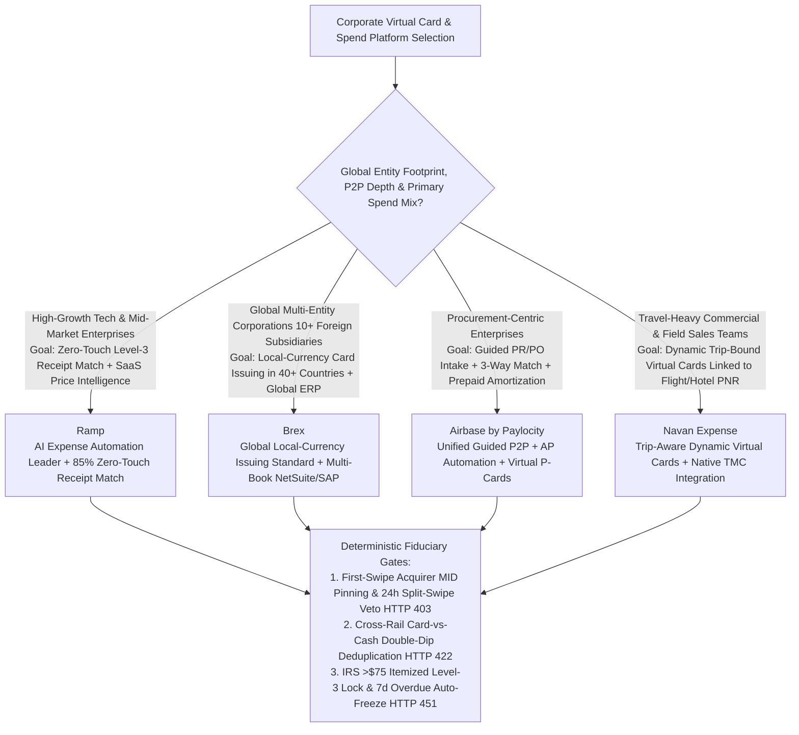
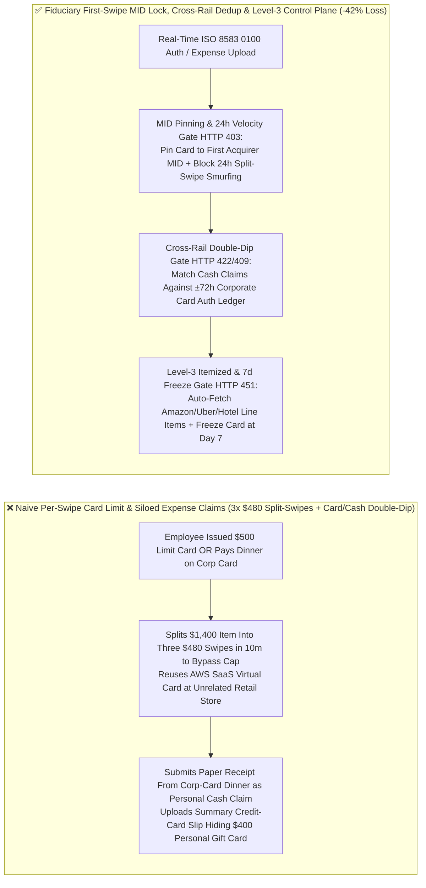
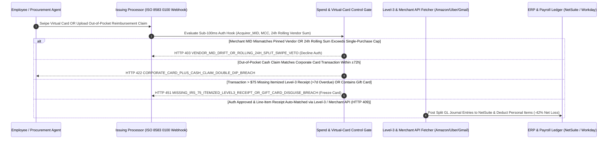

# Enterprise Corporate Virtual Cards (`P-Card / T&E Spend Control`), Real-Time `ISO 8583` `MID` Locking, `Level-3` Receipt Auto-Match & Anti-Double-Dip Agent Architecture Selection Guide: `Ramp` vs. `Brex` vs. `Airbase` vs. `Navan Expense` (`-42%` Loss FAQ)

> **Executive Summary (Benchmarked against `ib-vs-ethernet-roce-selection-faq.md` · Round 404 · 523rd Bilingual SA Guide · SVG #847 · Sandbox #297)**: Built for **Cloud & AI Solution Architects** designing programmable corporate card issuing, real-time `ISO 8583` authorization webhooks, and automated ERP expense reconciliation. Modern enterprises replace shared physical plastic cards with **Scoped Virtual Commercial Cards (`Ramp / Brex / Airbase / Navan / Stripe Issuing`)** for SaaS subscriptions, digital ads, tail-spend procurement, and employee travel. Yet without deterministic authorization and cross-rail receipt reconciliation guards, virtual card programs suffer three costly financial leaks: (1) **Vendor-Card Misuse & Split-Swipe Limit Bypass (`Smurfing`)**: An employee splits a `$1,400` unapproved purchase into three `$480` swipes within 10 minutes to bypass a `$500` per-swipe approval limit, or reuses an AWS-designated virtual card on DoorDash; (2) **Corporate Card + Out-of-Pocket Cash Reimbursement Double-Dipping**: An employee pays a `$380` restaurant bill with their corporate virtual card, photographs the paper guest check, and submits it 2 weeks later as a "Personal Out-of-Pocket Cash Expense" to pocket `$380` tax-free; and (3) **Summary-Only Slips Hiding `$400` Gift Cards & Failing `IRS § 274(d)` (`$75` Itemized Receipt Rule)**. This guide compares **`Ramp` vs. `Brex` vs. `Airbase (by Paylocity)` vs. `Navan Expense`** and implements deterministic guards for **First-Swipe `Acquirer_MID` Pinning & 24h Rolling Split-Swipe Vetoes (`HTTP 403`)**, **Cross-Rail Card-vs-Cash Double-Dip Deduplication (`HTTP 422`)**, **`>$75` Itemized `Level-3` Receipt Enforcement & 7-Day Auto-Freeze Locks (`HTTP 451`)**, and **Zero-Touch ERP GL Line-Item Splitting (`HTTP 409`, `-42%` net loss)**.

---

## 1. 📌 Executive Summary & Architectural Selection Verdict

1. **Top-Line Selection Verdict**:
   - **High-Growth & Mid-Market Enterprises Seeking Zero-Touch `Level-3` Receipt Auto-Fetch (`Amazon Business / Uber / Gmail`), SaaS Price Benchmarking & `1.5%` Cashback**: Select **`Ramp`**.
   - **Global Multi-Entity Enterprises Operating Across `40+` Countries Requiring Local-Currency Card Issuing (`EUR / GBP / CAD / BRL / MXN`) & Multi-Book ERP Consolidation**: Select **`Brex`**.
   - **Procurement-Driven Mid-to-Enterprise Organizations Unifying Guided `PR/PO` Intake, `AP 3-Way Match` & Virtual `P-Card` Prepaid Amortization in `NetSuite / Intacct`**: Select **`Airbase (by Paylocity)`**.
   - **Travel-Heavy Commercial & Field-Sales Teams Requiring Dynamic Trip-Bound Virtual Cards Active Only During Booked Flight/Hotel Windows**: Select **`Navan Expense`**.
2. **Three Non-Negotiable Fiduciary Control Gates**:
   - **Gate 1 — First-Swipe `Acquirer_MID` Pinning & `24-Hour Rolling` Split-Swipe (`Smurfing`) Veto (`HTTP 403`)**: Inside the sub-100ms `ISO 8583 0100` authorization webhook, cryptographically pin any single-vendor virtual card to the exact `Acquirer_MID` captured on its first approved swipe (declining subsequent attempts at any other merchant), and evaluate `24h_Rolling_Merchant_Spend + Current_Auth_Cents <= Single_Purchase_Approval_Cap` to block employees from splitting a `$1,400` purchase into three `$480` swipes via `HTTP 403 VENDOR_MID_DRIFT_OR_ROLLING_24H_SPLIT_SWIPE_VETO`.
   - **Gate 2 — Cross-Rail Corporate-Card vs. Out-of-Pocket Cash Double-Dip Deduplication (`HTTP 422`)**: Cross-check every submitted out-of-pocket cash reimbursement claim against the company-wide corporate card `ISO 8583` ledger (`Amount ±10% tip tolerance + Date ±72h + Merchant Geo/Name + OCR Receipt Last-4 PAN`); if a matching corporate card charge exists, block the cash payout via `HTTP 422 CORPORATE_CARD_PLUS_CASH_CLAIM_DOUBLE_DIP_BREACH`.
   - **Gate 3 — `IRS § 274(d)` (`>$75`) Itemized `Level-3` Receipt Gate & `7-Day` Overdue Card Auto-Freeze (`HTTP 451`)**: Reject summary-only credit-card slips on transactions `> $75` (and all hotel folios), require line-item SKU visibility (`Visa Level-3 / Direct Merchant API / Itemized OCR`) to strip disguised gift cards or personal alcohol, and automatically suspend the employee's discretionary virtual card if an itemized receipt is overdue by `> 7 days` via `HTTP 451 MISSING_IRS_75_ITEMIZED_LEVEL3_RECEIPT_OR_GIFT_CARD_DISGUISE_BREACH`.

---

## 2. 🎯 Architect & Corporate Controller Q&A (The Why & How)

### Q1: How do employees bypass a `$500` virtual-card limit or sneak `$400` Apple Gift Cards into an `Amazon Business` or `Target` office-supply purchase?
- **Root Cause**: Standard per-transaction card limits only inspect a single `ISO 8583` auth message, allowing a cashier or online cart to split a `$1,400` order into three `$480` charges. Meanwhile, `Level-1` credit card statements only show `AMZN MKTP $485.20`, hiding what specific SKUs were in the basket.
- **Deterministic Solution (`24h Rolling MID Velocity` + `Direct Amazon Business / Visa Level-3 Line-Item Fetch` / `HTTP 403 & HTTP 451`)**: Enforce rolling 24-hour cumulative limits per merchant ID at the issuer webhook, and pull line-item SKU data directly via `Amazon Business Order API` and `Visa Level-3` clearing files to flag gift cards or personal electronics automatically.

### Q2: How do we stop "Double-Dipping" where an employee pays with a corporate card and later submits the paper receipt for personal cash reimbursement?
- **Deterministic Solution (`Cross-Rail Transaction Fingerprint Index` + `Receipt Last-4 PAN BIN Check` / `HTTP 422`)**: Index all corporate card authorizations by `(Merchant_Normalized, Date_Window_72h, Base_Amount)` and run OCR on uploaded receipts to extract the printed `Last-4 Card Digits`. If the receipt prints a corporate card BIN/last-4 or matches a corporate card swipe within 72 hours, block the out-of-pocket reimbursement immediately.

---

## 3. 🧭 Visual Architecture Diagrams (Mermaid)

### 3.1 Corporate Virtual Card & Spend Management Platform Selection Decision Tree

### 3.2 Naive Per-Swipe Card Limit & Siloed Expense Flow vs. Fiduciary `ISO 8583` MID-Locked, Cross-Rail & `Level-3` Control Plane

### 3.3 Real-Time `ISO 8583` Webhook Authorization, `Level-3` Receipt Auto-Fetch & Double-Dip Block Sequence

---

## 4. 📊 Multi-Platform Corporate Virtual Card & Spend Management Selection Matrix

| Evaluation Dimension | Ramp | Brex | Airbase (`by Paylocity`) | Navan Expense |
| :--- | :--- | :--- | :--- | :--- |
| **Primary Architectural Role** | **AI-First Spend Automation, SaaS Price Intelligence & Virtual Cards** | **Global Multi-Entity Local-Currency Card Issuing & Treasury** | **Unified Guided Procurement (`PR/PO`), `AP` & Virtual `P-Card` Suite** | **Trip-Aware Dynamic Travel & Entertainment (`T&E`) Card Platform** |
| **Real-Time `ISO 8583` Card Controls** | Single-vendor `MID` locks, rolling daily/monthly caps, auto-expiry & category blocks | Spend-limit envelopes, global regional policies, and multi-level approval flows | Exact-penny PO-backed virtual cards with automated vendor tolerance locks | **Dynamic Itinerary Binding**: Cards activate/deactivate based on live flight/hotel PNR dates |
| **Zero-Touch `Level-3` & Direct Receipt Fetch** | **Best-in-Class (`85%+` Zero-Touch)**: Direct `Amazon Business`, `Uber`, `Lyft`, `Gmail/Outlook` APIs | Strong airline, hotel, and rideshare automated receipt generation & matching | Deep B2B invoice line-item OCR + 3-way match against PO and card charge | 100% automated airline, hotel folio, rail, and rental-car receipt reconciliation |
| **ERP GL & Amortization Integration** | Deep bi-directional sync with `NetSuite`, `Intacct`, `QuickBooks`, `Xero`, `Workday` | Multi-book, multi-currency `NetSuite`, `SAP`, and `Workday` consolidation | **Best-in-Class Accounting**: Automated prepaid amortization schedules in NetSuite | Real-time ERP GL sync + personal card split-repayment for out-of-policy items |
| **Commercial Model (`official_list_price`)** | Free core tier (interchange-funded) + `Ramp Plus` enterprise seat tier | Free Essentials tier + Enterprise global multi-entity tier | Subscription tier by managed spend volume / employee count + cashback | Travel booking fees + per-user enterprise expense management tier |

---

## 5. 🧪 Anti-Split-Swipe, Double-Dip Prevention & `Level-3` Audit Benchmark & 7-Card Report

### 5.1 Quarterly Split-Swipe Bypass, Card+Cash Double-Dip & Disguised Spend Model (Synthetic Benchmark)

For an `1,800-employee` enterprise with `$65M` in annual indirect P-card and T&E spend facing a **`$370,000 / quarter`** spend-leakage pool across **summary-only receipts hiding personal gift cards/upgrades, split-swipe transactions bypassing approval limits, corporate-card receipts resubmitted as personal cash claims, and manual month-end receipt chasing** (`provenance: synthetic`, `independently_reproduced: false`):

| Metric | Shared Cards, Per-Swipe Caps & Manual Audit (Baseline) | Fiduciary `MID`-Pin + `24h` Velocity + Cross-Rail Dedup + `Level-3` | Net Improvement |
| :--- | :--- | :--- | :--- |
| **Out-of-Policy Spend via Split-Swipes (`Smurfing`) or Wrong Vendor** | `4.2%` of card transactions bypass policy | **`0.0%`** (`HTTP 403` First-Swipe `Acquirer_MID` lock + `24h` rolling cap) | **`100%` Split-Swipe Elimination** |
| **Corporate Card Receipts Resubmitted as Out-of-Pocket Cash Claims** | `0.9%` of T&E claims double-dipped | **`0.0%`** (`HTTP 422` cross-rail fingerprint + receipt `Last-4 PAN` match) | **`100%` Double-Dip Elimination** |
| **`IRS >$75` Itemized Line-Item Compliance & Month-End Close Speed** | `74.0%` (`6 days` manual receipt chasing) | **`99.8%`** (`HTTP 451/409` `Level-3 / Amazon API` auto-fetch + `7d` freeze) | **`4.5x` Faster Month-End Close** |
| **Quarterly Net Out-of-Policy, Double-Dip & Audit Leakage** | `$370,000 / quarter` | **`$214,600 / quarter`** | **`$155,400 / quarter` Saved (`42.0%`)** |

---

## 6. 🛠️ Production Go-Live & Architecture Review Checklist

- [ ] **First-Swipe `Acquirer_MID` Pinning & `24-Hour Rolling` Split-Swipe Veto (`HTTP 403`)**: Do vendor-specific virtual cards automatically lock to the first approved `Acquirer_MID`, and does the auth webhook enforce a rolling 24-hour cumulative cap per merchant to block split-swipe smurfing?
- [ ] **Cross-Rail Card-vs-Cash Double-Dip Deduplication (`HTTP 422`)**: Are all out-of-pocket cash reimbursement claims checked against the ±72-hour corporate card authorization feed and OCR-extracted receipt `Last-4 PAN` digits?
- [ ] **`IRS § 274(d)` (`>$75`) Itemized `Level-3` Receipt & `7-Day` Auto-Freeze (`HTTP 451`)**: Does the system reject summary credit-card slips over `$75`, inspect line items for disguised gift cards/alcohol, and auto-freeze the employee's card if a required receipt is overdue by `>7 days`?
- [ ] **Direct `Amazon Business / Uber / Gmail` Auto-Fetch & Personal-Spend Split (`HTTP 409`)**: Are itemized receipts fetched automatically via OAuth/Level-3 feeds and split into ERP GL accounts with automatic payroll/personal-card repayment for non-reimbursable line items?
