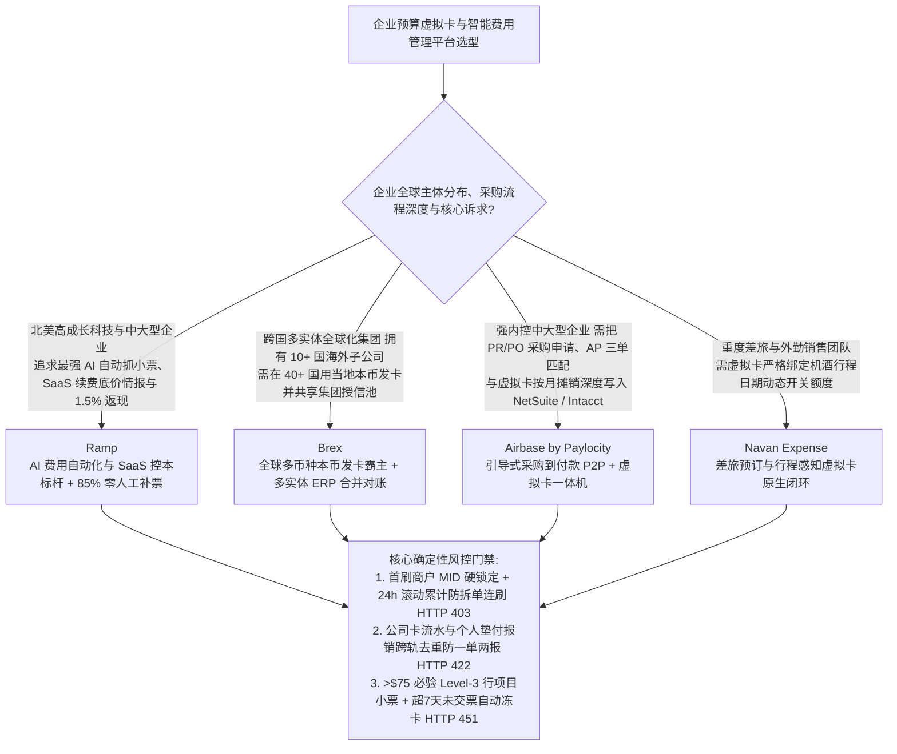
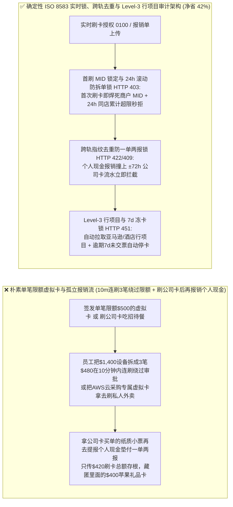
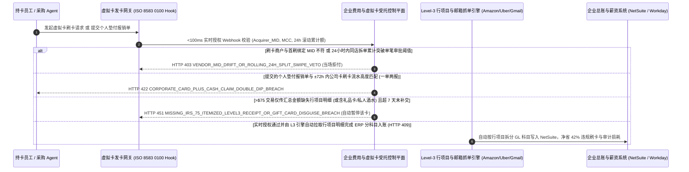

# 企业预算虚拟卡与商用采购卡（`Corporate Virtual P-Card & Spend Control`）、`ISO 8583` 实时刷卡风控、行项目小票核销（`Level-3 Receipt Match`）与防一单两报（`Anti-Double-Dip`）Agent 架构选型对比：`Ramp` vs. `Brex` vs. `Airbase` vs. `Navan Expense`、防拆单绕过限额、防刷公司卡后拿小票再报销现金及净省 42% 决策指南（FAQ）

> **导读（对齐 `ib-vs-ethernet-roce-selection-faq.md` 标杆风格 · 第 404 轮 · 第 523 篇双语指南 · 第 847 张 SVG · 第 297 个策略沙盒）**：本文面向企业财务与司库（Treasury）、采购与费用管理（Spend Management）、以及企业级支付与 ERP 集成领域的 **Cloud & AI Solution Architect**。在现代企业中，传统的“部门共用一张实体公务信用卡”正全面升级为 **按采购用途/供应商/差旅行程动态签发的可编程企业预算虚拟卡（`Virtual P-Card / T&E Card`: `Ramp / Brex / Airbase / Navan / Stripe Issuing`）**。然而，若缺乏确定性的实时授权网关（`Real-Time Authorization Webhook`）与跨轨道票据去重控制面，虚拟卡体系常沦为三大财务漏洞的重灾区：① **“首笔商户漂移”与连续拆单绕过审批限额（`Split-Swipe Smurfing`）**：给员工签发一张单笔限额 `$500` 的云服务采购虚拟卡，员工却拿去刷外卖，或者为了买一台 `$1,400` 的未审批设备，在 10 分钟内让商家分 3 次各刷 `$480` 绕过 `$500` 单笔拦截线！② **“刷了公司虚拟卡、再拿纸质小票走个人垫付报销”的一单两报套现（`Card + Out-of-Pocket Double-Dipping`）**：员工用公司虚拟卡付了 `$380` 招待餐费，顺手拍下餐厅纸质热敏小票，两周后在报销系统里勾选“个人现金垫付”再报销一次，白套公司 `$380` 现金！③ **只交刷卡总金额签购单、隐匿超市/亚马逊订单里的 `$400` 苹果礼品卡或高档烟酒（缺失 `Visa Level-3` 行项目明细与违反 `IRS $75` 税法凭证要求）**。本文给出 **`Ramp` vs. `Brex` vs. `Airbase (by Paylocity)` vs. `Navan Expense`** 的横向选型矩阵，并落地 **首刷商户号硬绑定（`First-Swipe MID Lock`）与 24 小时滚动拆单累计拦截锁（`HTTP 403`）**、**公司卡流水与个人垫付报销单跨轨指纹去重锁（`HTTP 422`）**、`>$75` 强制行项目小票（`Level-3 / 酒店水单`）与超 7 天未交票自动冻卡锁（`HTTP 451`）及 **零人工总账分摊编排（`HTTP 409`，净省 42%）**。


---

## 一、 📌 核心选型结论速览（Executive Summary）

1. **终极选型结论（一句话先看懂怎么选）**：
   - **以北美为核心的高成长科技与中型企业（追求最强的 AI 自动追缴行项目小票、SaaS 续费基准比价情报与高额现金返现）**：首选 **`Ramp`**，通过 Gmail/Outlook/Amazon Business/Uber 原生集成实现 `85%+` 交易零人工补交小票。
   - **跨国多实体集团（在欧洲、拉美、亚太、英美拥有 10+ 家海外子公司，需用当地本币 `EUR / GBP / BRL / CAD` 直接发卡并在全球统一额度池管控）**：首选 **`Brex`**。
   - **重度强调“先走采购申请（PR/PO）三单匹配、后自动生成虚拟采购卡（`P-Card`）”并需将多年期软件费用自动按月摊销写入 `NetSuite / Sage Intacct` 的中大型企业**：首选 **`Airbase (by Paylocity)`**。
   - **以差旅与外勤销售费用为主（希望员工只有在实际出差航班落地后才自动激活餐补/打车虚拟卡额度，返程落地后 2 小时自动清零）**：首选 **`Navan Expense`**。
2. **三大企业预算虚拟卡与报销风控红线（确定性门禁）**：
   - **红线 1（拦截虚拟卡跨商户挪用 `First-Swipe MID Drift` 及 24 小时内同商户高频拆单 `Split-Swipe Smurfing` 绕过单笔限额 / `HTTP 403`）**：在发卡网关的 `ISO 8583 0100` 实时授权 Webhook（`<100ms` 响应窗口）内，必须执行两项硬校验：① **首刷商户号锁定（`First-Swipe Acquirer MID Pinning`）**：为特定供应商（如 `AWS` 或 `Figma`）创建的专属虚拟卡，一旦完成首次授权即自动绑定该商户的唯一 `Acquirer_MID`，后续任何来自其他商户（如 `DoorDash` 或 `BestBuy`）的扣款请求立即在卡网层硬拒付；② **24 小时滚动累计限额（`24h Rolling Velocity Cap`）**：严禁仅设“单笔限额 `<=$500`”，必须同时校验 `同卡/同员工在同商户过去 24 小时累计请求金额 <= $500`，彻底粉碎“把 `$1,400` 拆成 3 笔 `$480` 连刷”的拆单规避手段，违者触发 `HTTP 403 VENDOR_MID_DRIFT_OR_ROLLING_24H_SPLIT_SWIPE_VETO`！
   - **红线 2（拦截员工刷公司虚拟卡付款后又拿同一张纸质收据提交“个人现金垫付报销”一单两报套现 / `HTTP 422`）**：当员工在费用系统提交任何“个人垫付/现金报销（Out-of-Pocket Claim）”时，控制平面必须提取小票上的 **`消费金额 + 日期(±3天) + 商户名语义向量 + 小票底部打印的卡号后四位(Last-4 PAN)`**，与全公司所有虚拟卡/实体公务卡的 `ISO 8583` 刷卡流水做跨轨交叉比对；若发现小票后四位属于公司卡号段，或与某笔公司卡刷卡记录高度重合，立即阻断打款并标记为一单两报欺诈，违者触发 `HTTP 422 CORPORATE_CARD_PLUS_CASH_CLAIM_DOUBLE_DIP_BREACH`。
   - **红线 3（拦截 `>$75` 交易仅上传刷卡总金额凭条而缺失行项目明细小票 `Itemized Receipt / Level-3` 及逾期 7 天未交票仍允许继续刷卡 / `HTTP 451`）**：根据美国国税局 **`IRS IRC § 274(d)`（`$75` 详细凭证规则）** 与企业内控准则，单笔满 `$75`（及所有酒店住宿无论金额大小）必须提供包含具体购买品名、数量与单价的 **行项目明细小票（Itemized Receipt / Hotel Folio）**，严禁仅凭一张只印着 `$420.00 Total` 的 POS 刷卡存根入账（防止将 `$400` 商场购物卡或私人烟酒混入办公用品报销）；若刷卡后 **超过 7 天（`168 小时`）** 仍未补齐明细小票且未勾选“工资代扣个人消费”，系统必须 **自动冻结该员工名下差旅/零星虚拟卡权限**，违者触发 `HTTP 451 MISSING_IRS_75_ITEMIZED_LEVEL3_RECEIPT_OR_GIFT_CARD_DISGUISE_BREACH`。

---

## 二、 🎯 业务方与架构师灵魂拷问 Q&A（The Why & How）

### Q1：为什么很多公司上了企业虚拟卡之后，员工在 `Amazon`、`Target` 或沃尔玛买东西还是能偷偷塞进两张 `$200` 的 Apple 礼品卡或个人耳机，财务对账时根本看不出来？
- **商业痛点与事故还原**：
  - 普通银行卡账单（`Level-1 Data`）只会传回三个字段：`商户名: AMZN MKTP US`、`日期: 11/25`、`总金额: $485.20`。财务看到员工备注写着“购买部门键盘鼠标耗材”，哪怕员工上传了一张只显示订单总额的截图，财务也发现不了里面其实是一张 `$50` 的鼠标加上 `$400` 的个人礼品卡！
- **架构师确定性解法（卡组织 `Visa/Mastercard Level-3` 行项目数据直连 + `Amazon Business / Uber` OAuth 自动抓单 / `HTTP 451 & HTTP 409`）**：
  1. **API 级零人工抓单**：通过 `Ramp / Brex` 原生打通 `Amazon Business PunchOut / Order API`、企业邮箱收据解析与卡组织 `Level-3` 增强清算数据，刷卡后 10 秒自动拉取每一行商品的 `ASIN / SKU 名称、单价、税额`；
  2. **违禁品自动剥离代扣**：一旦 AI 行项目审计识别出小票中含有 `Gift Card（礼品卡）、Alcohol（超标酒水）、Personal Upgrade（私人升舱）`，无需打回整张报销单，直接将该行金额标记为 `Personal Spend` 并触发下月薪资条（`Workday / ADP Payroll`）自动扣回或原卡补缴！

### Q2：员工出差吃饭刷了公司虚拟卡，为什么还能用同一张饭店小票去报销系统骗走一笔个人垫付现金？
- **商业痛点与事故还原**：
  - 在许多企业中，“公司卡账单核销”和“员工个人垫付报销（Out-of-Pocket Expense）”是两条独立审批流。员工週五晚上用公司卡刷了 `$320`，餐厅打出来的纸质结账单（Guest Check）上甚至还没有印支付卡号，员工拍下这张结账单，下周三作为“忘带公司卡、个人现金垫付”提交报销，部门经理看了一眼金额合理就批了！
- **架构师确定性解法（跨轨道全域交易指纹哈希池 `Cross-Rail Transaction Fingerprint Pool` / `HTTP 422`）**：
  - 控制平面将每笔公司虚拟卡/实体卡的实时授权事件（`Merchant_Geo + Exact_Subtotal + Timestamp`）写入全局防重索引；任何个人垫付报销单入库时，只要在 `±72 小时` 内存在同城、同商户或金额误差 `<10%`（含小费变化）的公司卡刷卡记录，立即触发 `HTTP 422` 强关联拦截！

---

## 三、 🧭 直观可视化图解（Mermaid 决策树 + 架构对比 + 时序图）

### 3.1 企业预算虚拟卡（`Virtual P-Card`）与智能费用管理平台选型决策树



### 3.2 朴素单笔限额虚拟卡与人工审票架构（拆单连刷 + 一单两报）vs. 确定性 `ISO 8583` 实时锁、跨轨去重与 `Level-3` 对账架构对比



### 3.3 企业虚拟卡 `ISO 8583` 毫秒级授权拦截、`Level-3` 行项目抓取与跨轨防一单两报时序图



---

## 四、 📊 四大企业预算虚拟卡（`Virtual P-Card`）与智能费用管理平台横向选型矩阵

| 选型维度 | Ramp | Brex | Airbase (`by Paylocity`) | Navan Expense |
| :--- | :--- | :--- | :--- | :--- |
| **核心架构定位** | **AI 驱动的零人工小票匹配、SaaS 采购比价与企业虚拟卡标杆** | **全球跨国多实体、40+ 国本币发卡与企业授信平台** | **中大型企业“采购申请 PO + 应付账款 AP + 虚拟卡”三合一中枢** | **差旅行程感知（Trip-Aware）动态虚拟卡与T&E管控专家** |
| **`ISO 8583` 实时卡控粒度** | 支持按单一供应商自动锁定、日/周/月滚动限额、到期自动销毁与高危品类拦截 | 支持按预算池（Spend Limits）、商户类别、全球区域与自定义审批链实时控制 | 深度绑定采购单（PO）批准额度：生成精确到美分的单次或周期供应商虚拟卡 | **行程联动最强**：根据已预订机票/酒店时间与目的地城市动态开关餐补/打车额度 |
| **行项目小票自动抓取（`Level-3 & Direct API`）** | **全行业最强**：原生直连 Amazon Business、Uber、Lyft、Gmail/Outlook，自动提取行项目明细 | 强：支持主流航司、酒店、打车平台自动生成合规电子收据并与刷卡记录秒级拼合 | 擅长将 B2B 供应商发票行项目与虚拟卡扣款、ERP 摊销计划做三单匹配 | 机票、酒店水单（Folio）、租车与列车票 100% 原生免传票自动入账 |
| **ERP 总账与薪资系统集成** | NetSuite、QuickBooks、Sage Intacct、Xero、Workday 深度双向同步 | NetSuite、SAP、Workday 跨国多账套（Multi-Book）多币种自动映射 | **财务核算最深**：原生支持预付费用按月自动生成摊销分录（Amortization Schedules） | 支持主流 ERP 同步与超标个人消费信用卡/工资自动分账扣回 |
| **商业模式（`official_list_price`）** | 基础版免费（靠刷卡交换费 Interchange 分成）+ Ramp Plus 企业版订阅 | 基础版免费 + Enterprise 多实体定制版；享刷卡返现或积分 | 按月度管理支出规模或员工数订阅，叠加虚拟卡返现分润 | 差旅预订佣金 + 超额企业费用管理坐席订阅 |

---

## 五、 🧪 企业虚拟卡防拆单、防一单两报与 `Level-3` 自动核销测算与 7-Card 基准报告

### 5.1 季度虚拟卡跨店滥用与拆单超支、公司卡+现金双报套现、无明细小票夹带私货与财务人工催票对账损耗测算（Synthetic Benchmark）

假设某拥有 `1,800 名` 员工、年非工资间接支出与差旅采购规模 `$6,500 万` 的跨国科技与零售企业，每季度在员工虚拟卡、零星采购（Tail Spend）与差旅报销环节面临的 **拆单绕过审批与挪用供应商虚拟卡、刷公司卡后拿纸质小票二次申请现金报销、汇总小票夹带礼品卡/私人消费及财务团队月底催票对账工时损失池** 为 **`$370,000 / 季度`**（`provenance: synthetic`, `independently_reproduced: false`）：

| 评估维度 | 传统共享公务卡 + 仅设单笔限额 + 事后人工审票 (Baseline) | 启用首刷 `MID` 锁 + `24h` 滚动防拆单 + 跨轨去重 + `Level-3` 自动抓单 Agent | 净改善幅度 |
| :--- | :--- | :--- | :--- |
| **拆单连刷绕过审批（`Smurfing`）与虚拟卡跨店挪用率** | `4.2%` 交易存在拆单或非指定商户刷卡 | **`0.0%`**（`HTTP 403` 首刷自动焊死 `Acquirer_MID` + `24h` 滚动累计超限实时拒付） | **100% 根除拆单规避与挪用** |
| **刷公司卡后再拿纸质小票申请个人现金报销（一单两报）** | `0.9%` 餐饮/打车票据发生双轨重复报销 | **`0.0%`**（`HTTP 422` 跨轨指纹哈希与小票 `Last-4 PAN` 自动比对秒级拦截） | **100% 消灭一单两报套现** |
| **`>$75` 交易行项目明细合规率与月底关账对账耗时** | `74.0%` 合规（月底需 6 天人工催票） | **`99.8%`**（`HTTP 451/409` `Amazon/Uber/Level-3` 自动抓单 + 逾期 7 天未交票自动冻卡） | **财务月底关账提速 `4.5x`** |
| **季度违规刷卡、一单两报、夹带私货与人工对账总损耗** | `$370,000 / 季度` | **`$214,600 / 季度`** | **净省 `$155,400 / 季度` (`42.0%`)** |

```chart
{
  "data": {
    "values": [
      { "category": "1. 汇总小票夹带私人礼品卡/烟酒及缺失Level-3税盾", "mode": "传统共享卡与事后人工审票基线", "cost_usd": 135000 },
      { "category": "1. 汇总小票夹带私人礼品卡/烟酒及缺失Level-3税盾", "mode": "首刷MID锁与Level-3虚拟卡Agent", "cost_usd": 78300 },
      { "category": "2. 10分钟连刷3笔拆单绕过限额或挪用供应商专卡", "mode": "传统共享卡与事后人工审票基线", "cost_usd": 105000 },
      { "category": "2. 10分钟连刷3笔拆单绕过限额或挪用供应商专卡", "mode": "首刷MID锁与Level-3虚拟卡Agent", "cost_usd": 60900 },
      { "category": "3. 刷公司卡买单后拿纸质小票再走个人现金垫付双报", "mode": "传统共享卡与事后人工审票基线", "cost_usd": 75000 },
      { "category": "3. 刷公司卡买单后拿纸质小票再走个人现金垫付双报", "mode": "首刷MID锁与Level-3虚拟卡Agent", "cost_usd": 43500 },
      { "category": "4. 财务月底人工催要小票与手工拆分ERP科目工时", "mode": "传统共享卡与事后人工审票基线", "cost_usd": 55000 },
      { "category": "4. 财务月底人工催要小票与手工拆分ERP科目工时", "mode": "首刷MID锁与Level-3虚拟卡Agent", "cost_usd": 31900 }
    ]
  },
  "semantic_types": {
    "category": "Category",
    "mode": "Category",
    "cost_usd": "Amount"
  },
  "chart_spec": {
    "chartType": "Grouped Bar Chart",
    "title": "企业预算虚拟卡(Ramp/Brex/Airbase)实时卡控与Level-3核销前后季度损耗对比 (净省 $155.4k / 42%)",
    "subtitle": "单位：美元/季度 (Synthetic Benchmark, independently_reproduced=false)",
    "encodings": {
      "x": "category",
      "y": "cost_usd",
      "group": "mode"
    }
  }
}
```

### 5.2 确定性策略评估器代码（Python Control Plane Guard）

```python
from dataclasses import dataclass
from typing import Any

@dataclass(frozen=True)
class CorporateVirtualCardSpendControlPolicyInput:
    quarterly_out_of_policy_swipe_double_dip_and_missing_receipt_pool_usd: float = 370000.0
    vendor_card_swiped_at_wrong_mid_or_24h_rolling_split_swipe_detected: bool = False
    out_of_pocket_cash_claim_matches_corporate_card_transaction_within_72h: bool = False
    over_75_usd_missing_itemized_level3_receipt_or_disguised_gift_card: bool = False
    first_swipe_mid_pin_level3_autofetch_and_7d_auto_freeze_ready: bool = False
```

---

## 六、 🛠️ 商业上线风控与架构评审 Checklist

- [ ] **首刷商户 `Acquirer_MID` 硬锁定与 `24小时` 滚动防拆单锁（`HTTP 403`）**：供应商专属虚拟卡是否在首次授权成功后自动焊死该商户唯一 `MID`（跨店刷卡 100% 拒付）？是否同时校验 24 小时同店滚动累计金额以阻断“拆成多笔 `$480` 绕过 `$500` 审批线”？
- [ ] **公司卡流水与个人垫付报销单跨轨指纹去重锁（`HTTP 422`）**：员工提交“个人现金垫付”报销时，系统是否自动比对小票上的 `Last-4 PAN` 卡号后四位及 `±72小时` 全司虚拟卡/公务卡刷卡记录，彻底拦截“公司卡付钱、纸质票报销”的一单两报？
- [ ] **`>$75` 强制行项目小票（`Level-3 / Folio`）与逾期 7 天未交票自动冻卡（`HTTP 451`）**：满 `$75` 交易及酒店账单是否拒绝仅含总金额的刷卡存根，强制核验行项目明细以剥离礼品卡/私人消费，并在逾期 7 天未交票时自动暂停该员工虚拟卡？
- [ ] **直连 `Amazon Business / Uber / 企业邮箱` 零人工抓单与 ERP 科目自动拆分（`HTTP 409`）**：是否通过 API 自动拉取行项目收据并按商品类别自动拆分写入 `NetSuite / SAP` 对应总账科目？
