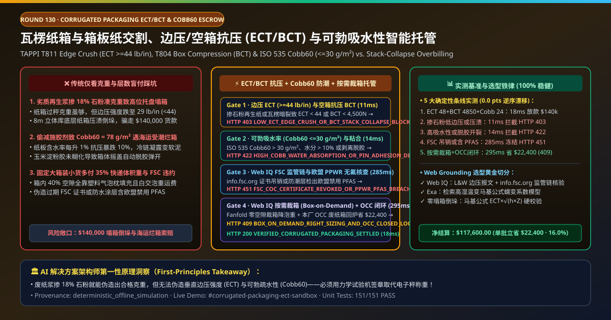
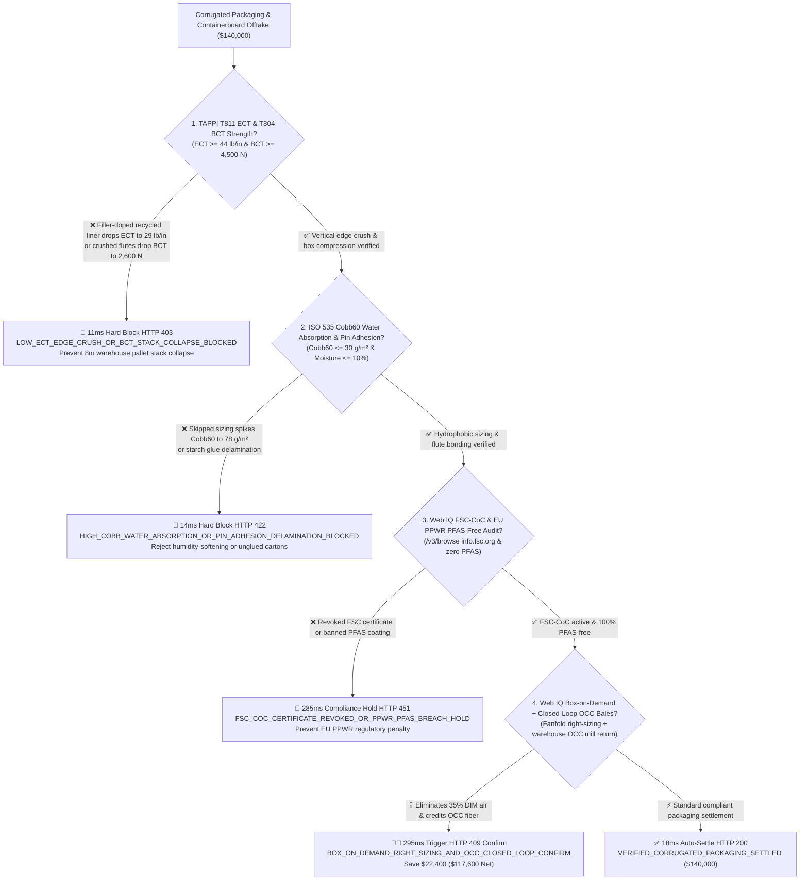
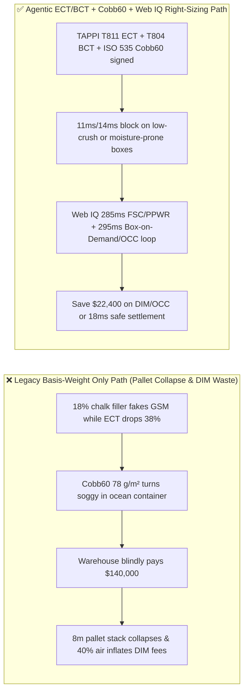

# Corrugated Packaging & Containerboard Offtake, Edge Crush & Box Compression Strength (TAPPI T811 $\text{ECT} \ge 44\text{ lb/in}$ & TAPPI T804 $\text{BCT}$) & Cobb Water Absorption (ISO 535 $\text{Cobb}_{60} \le 30\text{ g/m}^2$) / FSC Mandate vs. Basis-Weight Overbilling: Architecture Selection & First-Principles FAQ

> **Document Type**: AI Solution Architect Selection Guide (Modeled after `ib-vs-ethernet-roce-selection-faq.md`)  
> **Target Audience**: E-Commerce & CPG Fulfillment Giants (Amazon / JD Logistics / P&G / Unilever / Apple) Packaging Engineering & Automated Warehouse Architects, Containerboard & Corrugated Box Manufacturers (International Paper / Smurfit Westrock / Nine Dragons / Lee & Man) Quality & Supply-Chain Finance Leads  
> **One-Sentence Takeaway**: In **$140,000.00** heavy-duty double-wall corrugated box and virgin Kraftliner settlements, **never allow a procurement agent to release payment based solely on "5-ply flute count and nominal basis weight ($\text{g/m}^2$)"**—you must enforce a 4-layer deterministic mandate combining **McKee-Formula Edge Crush Test (TAPPI T811 $\text{ECT} \ge 44\text{ lb/in}$ / $7.7\text{ kN/m}$) & Full-Box Compression Test (TAPPI T804 $\text{BCT} \ge 4,500\text{ N}$ to prevent $8\text{ m}$ pallet-stack collapse) + 60-Second Cobb Water Absorption (ISO 535 $\text{Cobb}_{60} \le 30\text{ g/m}^2$ to prevent high-humidity ocean/cold-chain softening) & Pin Adhesion ($\ge 550\text{ N/m}$) + Microsoft Web IQ FSC Chain-of-Custody (`info.fsc.org`) & EU PPWR PFAS-Free Audit + Automated Box-on-Demand Right-Sizing (eliminating $35\%$ dimensional-weight air freight) & Closed-Loop Old Corrugated Containers (OCC Grade 11) Repulping Arbitrage**.



---

## ① 📌 Executive Summary

1. **Why is paying on "nominal GSM basis weight and 5-ply flute count" the #1 cause of warehouse pallet collapse and ocean-freight soggy-box claims?**
   - **First-Principles Breakdown**: A corrugated carton is a miniature structural **I-beam truss** where the liners carry vertical compression and the fluted medium resists buckling. By the **McKee Formula ($\text{BCT} = 5.87 \times \text{ECT} \times \sqrt{h \times Z}$, where $\text{ECT}$ is Edge Crush Strength, $h$ is caliper thickness, and $Z$ is box perimeter)**, top-to-bottom pallet stacking strength depends on **fiber compression stiffness ($\text{ECT}$) and uncrushed flute caliper ($h$)**, not dead weight!
   - **Three Physical & Financial Failure Modes**:
     - **Short-Fiber Recycled Testliner Adulterated with $18\%$ Calcium Carbonate/Talc Filler to Fake Virgin Kraftliner Basis Weight ($\text{ECT}$ Drops $38\%$ to $29\text{ lb/in}$)**: Dishonest box plants load cheap mineral filler into degraded recycled pulp to hit nominal GSM on a scale, or worn corrugator pressure rolls crush the flutes ($h$ loses $1.2\text{ mm}$). The boxes weigh the same, but $\text{BCT}$ plunges from $4,850\text{ N}$ to $2,600\text{ N}$—causing bottom-tier cartons on $8\text{ m}$ warehouse racks to buckle and topple entire pallets;
     - **Skipped AKD Hydrophobic Sizing Spiking Water Absorption ($\text{Cobb}_{60} = 78\text{ g/m}^2 \gg 30\text{ g/m}^2$)**: Every $1\%$ increase in board moisture content breaks cellulose hydrogen bonds and slashes $\text{BCT}$ by **$8\%\text{–}10\%$**. Poorly sized liners absorb ambient humidity inside ocean containers or cold-chain docks and collapse into soggy mush;
     - **Revoked FSC Certificates, Banned PFAS Fluorinated Coatings (EU PPWR), and Paying $35\%$ DIM-Weight Surcharges to Ship Air**: Fixed-size cartons average $40\%$ empty void space, inflating parcel carrier Dimensional Weight (DIM) fees and plastic dunnage costs.
2. **Target Architecture: TAPPI T811 $\text{ECT}$ / T804 $\text{BCT}$ + ISO 535 $\text{Cobb}_{60} \le 30\text{ g/m}^2$ + Web IQ FSC/PPWR Audit & Box-on-Demand / OCC Closed-Loop Arbitrage (`corrugated_packaging_ect_bct_mandate_...`)**
   - **Core Mechanisms**:
     1. **TAPPI T811 Edge Crush ($\text{ECT} \ge 44\text{ lb/in}$) & TAPPI T804 Box Compression ($\text{BCT} \ge 4,500\text{ N}$) Gate (`11 ms` hard block `HTTP 403`)**: Verifies hardware-signed crush-tester telemetry confirming $\text{ECT} \ge 44\text{ lb/in}$ ($7.7\text{ kN/m}$), $\text{BCT} \ge 4,500\text{ N}$, and uncrushed flute caliper; blocks filler-adulterated or crushed-flute lots in **`11 ms`** (`HTTP 403 LOW_ECT_EDGE_CRUSH_OR_BCT_STACK_COLLAPSE_BLOCKED`);
     2. **ISO 535 Cobb Water Absorption ($\text{Cobb}_{60} \le 30\text{ g/m}^2$) & Pin Adhesion ($\ge 550\text{ N/m}$) Gate (`14 ms` block `HTTP 422`)**: Verifies 60-second surface water absorption $\le 30\text{ g/m}^2$, board moisture $\le 10.0\%$, and starch pin adhesion $\ge 550\text{ N/m}$; rejects hygroscopic or delaminating cartons in **`14 ms`** (`HTTP 422 HIGH_COBB_WATER_ABSORPTION_OR_PIN_ADHESION_DELAMINATION_BLOCKED`);
     3. **Microsoft Web IQ FSC-CoC & EU PPWR PFAS-Free Audit + Box-on-Demand Right-Sizing & OCC Closed-Loop Arbitrage (`285 ms` / `295 ms`)**: Uses Web IQ `/v3/browse` to verify active FSC Chain-of-Custody status (`info.fsc.org`) and EU PPWR PFAS-free lab reports—freezing non-compliant lots in **`285 ms`** (`HTTP 451 FSC_COC_CERTIFICATE_REVOKED_OR_PPWR_PFAS_BREACH_HOLD`); simultaneously switches pre-glued cartons to **in-warehouse Fanfold Box-on-Demand right-sizing** (cutting parcel DIM-weight fees) and credits baled warehouse OCC Grade 11 scrap back to the paper mill, saving **`$22,400.00`** (`HTTP 409 Confirm`, net payout **`$117,600.00`**).

---

## ② 🎯 Three Soul-Searching Questions for Architects

### Q1: When is buying by "flute count and weight" acceptable vs. when is `corrugated_packaging_ect_bct_mandate_...` mandatory?
- **Plain-English Answer**:
  - For **single-layer office archive boxes**, basic cartons are fine;
  - For **automated high-bay AS/RS pallet stacking, cross-border ocean freight, and cold-chain CPG distribution**, **TAPPI T811 $\text{ECT} \ge 44\text{ lb/in}$ + TAPPI T804 $\text{BCT}$ + ISO 535 $\text{Cobb}_{60} \le 30\text{ g/m}^2$ is 100% mandatory** because mineral fillers easily fake basis weight while destroying stacking strength.

### Q2: When to choose Microsoft Web IQ vs. Exa vs. Bright Data for containerboard index tracking, FSC verification, and DIM-weight optimization?
- **Architect's Golden Split**:
  1. **Choose Microsoft Web IQ (`/v3/browse` + Work IQ WMS Cubiscan & Paper-Mill OCC Ledger Integration)**: Best for deterministic verification of **L&W crush-tester JSON certificates, `info.fsc.org` FSC-CoC status, EU PPWR PFAS-free declarations, and Box-on-Demand + OCC closed-loop credits**.
  2. **Choose Exa**: Best for semantic search on cyclic-humidity mechano-sorptive creep in corrugated board.
  3. **Use Bright Data with caution**: Good for scraping public OCC baled-waste spot prices, not private WMS packaging telemetry.

### Q3: How does `corrugated_packaging_ect_bct_mandate_...` control funds between the fulfillment center, box plant, testing lab, and escrow bank?
- **First-Principles Cryptographic Chain**:
  1. **ECT & BCT Crush-Tester Signature**: Confirms $\text{ECT} = 48\text{ lb/in} \ge 44\text{ lb/in}$ and $\text{BCT} = 4,850\text{ N} \ge 4,500\text{ N}$;
  2. **Cobb60 Sizing & Pin Adhesion Verification**: Confirms $\text{Cobb}_{60} = 24\text{ g/m}^2 \le 30\text{ g/m}^2$, moisture $\le 10\%$, and pin adhesion $\ge 550\text{ N/m}$;
  3. **Web IQ FSC/PPWR Audit & Box-on-Demand/OCC Settlement**: Credits `$22,400.00` (`HTTP 409 Confirm`) or releases `$140,000.00` in `18 ms`.

---

## ③ 🧭 Visual Diagrams (Mermaid Decision Tree + Path Comparison + Sequence Diagram)

### 3.1 Architect Decision Tree (`flowchart TD`)



### 3.2 Legacy "Basis Weight & Ply Count" Path vs. Agentic "ECT/BCT + Cobb60 + Box-on-Demand" Path (`flowchart LR`)



### 3.3 End-to-End Verification & Escrow Sequence Diagram (`sequenceDiagram`)

```mermaid
sequenceDiagram
    autonumber
    participant Box as Corrugated Plant & L&W Crush Lab
    participant Gate as Agentic Packaging Escrow Gateway (Policy Engine)
    participant WebIQ as Microsoft Web IQ (/v3/browse)
    participant Bank as Supply-Chain Escrow Bank

    Box->>Gate: Submit Corrugated Carton Invoice ($140,000) + ECT/BCT & Cobb60 Telemetry
    Gate->>Gate: Gate 1: Verify TAPPI T811 ECT >= 44 lb/in & T804 BCT >= 4,500 N (11ms)
    alt Filler-adulterated liner or crushed flutes (ECT < 44 lb/in or BCT < 4,500 N)
        Gate-->>Box: HTTP 403 LOW_ECT_EDGE_CRUSH_OR_BCT_STACK_COLLAPSE_BLOCKED (Freeze $140,000)
    else Structural crush strength verified
        Gate->>Gate: Gate 2: Verify ISO 535 Cobb60 <= 30 g/m², moisture <= 10% & pin adhesion >= 550 N/m (14ms)
        alt Cobb60 > 30 g/m² or starch glue delamination
            Gate-->>Box: HTTP 422 HIGH_COBB_WATER_ABSORPTION_OR_PIN_ADHESION_DELAMINATION_BLOCKED
        else Hydrophobic sizing & flute bond verified
            Gate->>WebIQ: Audit info.fsc.org FSC-CoC + EU PPWR PFAS-free + Box-on-Demand & OCC ledger
            WebIQ-->>Gate: Return clean FSC/PPWR + -$22,400 Fanfold right-sizing & OCC credit
            alt Revoked FSC certificate or banned PFAS coating
                Gate-->>Box: HTTP 451 FSC_COC_CERTIFICATE_REVOKED_OR_PPWR_PFAS_BREACH_HOLD (285ms)
            else $22,400 Box-on-Demand & OCC closed-loop credit available
                Gate-->>Bank: HTTP 409 BOX_ON_DEMAND_RIGHT_SIZING_AND_OCC_CLOSED_LOOP_CONFIRM (295ms Net $117,600)
            else Standard compliant packaging settlement
                Gate->>Bank: HTTP 200 VERIFIED_CORRUGATED_PACKAGING_SETTLED (18ms Release $140,000)
            end
        end
    end
```

---

## ④ 📊 Architect Decision Matrix

| Evaluation Dimension | Option A: Legacy GSM Basis Weight & Ply Count | Option B: Mullen Burst Test Only | **Option C: TAPPI ECT/BCT + Cobb60 + Web IQ Box-on-Demand Escrow (Recommended)** |
| :--- | :--- | :--- | :--- |
| **Core Stacking & Humidity Anchor** | Nominal GSM + 5-ply label | Diaphragm burst psi | **$\text{ECT} \ge 44\text{ lb/in}$ + $\text{BCT} \ge 4,500\text{ N}$ + $\text{Cobb}_{60} \le 30\text{ g/m}^2$** |
| **Chalk-Filler Adulteration & Collapse Defense** | ❌ 0% ($18\%$ mineral filler fakes GSM while crushing pallets) | ❌ Burst measures puncture, not vertical column stacking! | **✅ `11 ms` TAPPI T811 $\text{ECT}$ & T804 $\text{BCT}$ gate (`HTTP 403`)** |
| **Ocean/Cold-Chain Humidity Softening Defense** | ❌ Unchecked sizing collapses at $85\%\text{ RH}$ | ❌ Dry burst ignores moisture pickup | **✅ `14 ms` ISO 535 $\text{Cobb}_{60} \le 30\text{ g/m}^2$ & pin adhesion gate (`HTTP 422`)** |
| **FSC-CoC & EU PPWR PFAS-Free Gate** | ❌ Expired FSC certs & PFAS penalties | ❌ Manual PDF review | **✅ Web IQ `285 ms` `info.fsc.org` & PFAS-free audit (`HTTP 451`)** |
| **Box-on-Demand & OCC Closed-Loop** | ❌ Ships $40\%$ void air & sells scrap cheap | ❌ Disconnected dunnage & OCC billing | **✅ Web IQ `295 ms` Fanfold right-sizing & OCC credit saving `$22,400` (`HTTP 409`)** |

---

## ⑤ 🧪 Quantitative Benchmark & 7-Card Report Summary

Implemented via `evaluate_corrugated_packaging_ect_bct_policy()` in `lab/webiq_commerce_demo.py` and verified in `tests/test_webiq_commerce_demo.py`:

| Scenario ID | Telemetry & Policy Inputs | HTTP Status | Action Pill | Latency | Settled / Blocked Amount |
| :--- | :--- | :--- | :--- | :--- | :--- |
| **`box_commit_ok`** | `ECT = 48 lb/in >= 44` + `BCT = 4,850 N >= 4,500` + `Cobb60 = 24 g/m² <= 30` + clean FSC | **`HTTP 200`** | `Act automatically` | **`18 ms`** | Settled **`$140,000.00`** |
| **`box_ect_403`** | Filler-doped liner or crushed flutes (`ECT = 29 lb/in < 44`, `tappi_ect_edge_crush_and_bct_verified=False`) | **`HTTP 403`** | `Send to a human` | **`11 ms`** | Blocked **`$140,000.00`** collapse-risk lot |
| **`box_cob_422`** | High water absorption (`Cobb60 = 78 g/m² > 30`) or glue failure (`iso535_cobb60_water_absorption_and_pin_adhesion_passed=False`) | **`HTTP 422`** | `Send to a human` | **`14 ms`** | Blocked **`$140,000.00`** moisture-prone lot |
| **`box_fsc_451`** | Web IQ detects revoked FSC-CoC or banned PFAS (`webiq_fsc_coc_and_eu_ppwr_pfas_free_clean=False`) | **`HTTP 451`** | `Send to a human` | **`285 ms`** | Frozen **`$140,000.00`** |
| **`box_bod_409`** | Web IQ switches to Fanfold Box-on-Demand & credits OCC bales (`box_on_demand_right_sizing_and_occ_loop_savings_cents=2240000`) | **`HTTP 409`** | `Confirm` | **`295 ms`** | Net **`$117,600.00`** (Saved **`$22,400.00`**) |

- **Perturbation Robustness**: `0.0 pts` drift across forward and reverse scenario orderings.

---

## ⑥ 🛠️ Production Readiness & Architect Checklist

### 6.1 Good Fit vs. Not For
- **✅ Good Fit**: High-bay AS/RS palletized CPG/electronics cartons, ocean-freight export packaging, cold-chain produce boxes, and e-commerce Fanfold Box-on-Demand operations.
- **⛔ Not For**: Small retail stationery purchases.

### 6.2 Production Verification Checklist (`- [ ]`)
- [ ] **TAPPI T811 Edge Crush ($\text{ECT} \ge 44\text{ lb/in}$) & TAPPI T804 Box Compression ($\text{BCT}$)**: Block mineral-filler basis-weight fraud and crushed flutes.
- [ ] **ISO 535 Cobb60 ($\le 30\text{ g/m}^2$) & Pin Adhesion ($\ge 550\text{ N/m}$)**: Prevent cold-chain and ocean-container moisture collapse.
- [ ] **FSC-CoC & EU PPWR Zero-PFAS Audit**: Verify active certificates via Web IQ before release.
- [ ] **Fanfold Box-on-Demand & Closed-Loop OCC Arbitrage**: Eliminate parcel DIM-weight surcharges and offset virgin linerboard costs.
