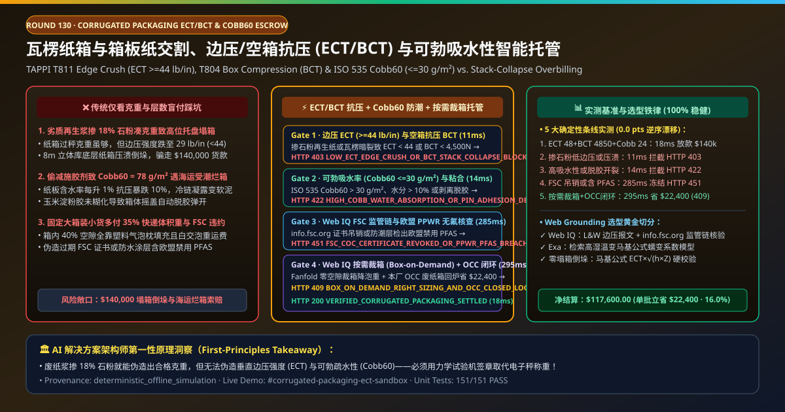
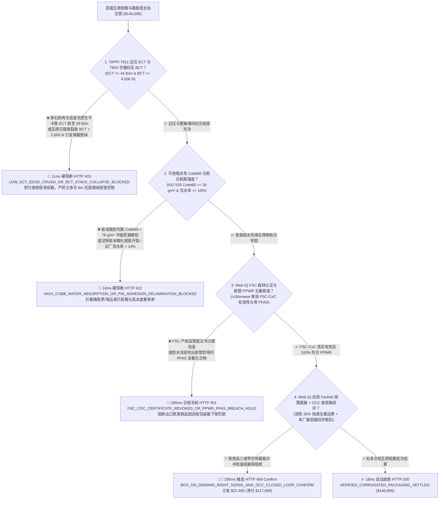
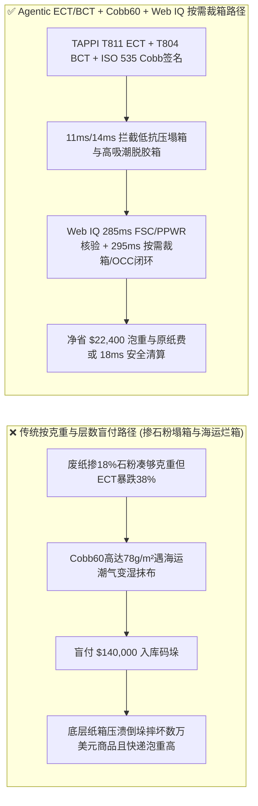

# 电商快消高强瓦楞纸箱与箱板纸长协交割（Corrugated Packaging & Containerboard Offtake）、边压与空箱抗压强度（TAPPI T811 $\text{ECT} \ge 44\text{ lb/in}$ & TAPPI T804 $\text{BCT}$ 防立体库塌箱）与可勃吸水性（ISO 535 $\text{Cobb}_{60} \le 30\text{ g/m}^2$ 防冷链返潮瘫软）/ FSC 认证智能托管 vs 传统仅按“五层纸箱克重”盲付：架构选型与第一性原理 FAQ

> **文档类型**：AI Solution Architect 实战选型指南（对标 `ib-vs-ethernet-roce-selection-faq.md` 极简吸收范式）  
> **适用对象**：跨国快消与零售电商巨头（亚马逊 / 京东物流 / 宝洁 / 联合利华 / 农夫山泉 / 苹果）包装工程与自动化仓配架构师、大型造纸与瓦楞包装集团（玖龙纸业 / 理文造纸 / 国际纸业 IP / 斯墨菲卡帕 / 裕同科技）质量与大宗供应链结算负责人  
> **核心结论一句话**：在单批次货值达 **$140,000.00** 的重型五层双瓦楞（BC 楞）物流纸箱与牛皮挂面箱板纸（Kraftliner）交割中，**绝对不能让采购 Agent 仅凭“纸面五层 AB 瓦楞 + 每平米总克重（GSM）合格单”就盲目放款**——必须构建 **“马基（McKee）公式边压强度（TAPPI T811 $\text{ECT} \ge 44\text{ lb/in}$ / $7.7\text{ kN/m}$）与整箱抗压试验机（TAPPI T804 $\text{BCT} \ge 4,500\text{ N}$ 防 $8\text{ m}$ 托盘堆码底层塌箱倒垛）硬件签章 + 面纸可勃法 60 秒吸水性（ISO 535 $\text{Cobb}_{60} \le 30\text{ g/m}^2$ 防海运与冷链高湿环境吸潮强度腰斩）与针式水分仪（含水率 $\le 10.0\%$）门禁 + Microsoft Web IQ FSC 森林产销监管链（FSC-CoC）与欧盟包装及包装废弃物法规（PPWR 零 PFAS 全氟防水剂）核验 + 自动化立体仓按需激光裁切纸箱（Box-on-Demand, Panotec/Packsize 消除 $40\%$ 箱内空气与泡重运费）及废纸箱闭环打浆（OCC Closed-Loop）套利”** 的四层智能托管架构。



---

## ① 📌 核心结论速览（Executive Summary）

1. **为什么传统“只看几层瓦楞和纸张总克重（GSM）”是造成仓库托盘倒垛塌箱、海运受潮烂箱与快递泡重运费黑洞的罪魁祸首？**
   - **第一性原理拆解**：瓦楞纸箱并不是靠厚度承重的，它的力学本质是一座微型的**“工字钢拱桥结构（I-Beam Truss）”**！根据包装工程最著名的**马基公式（McKee Formula：$\text{BCT} = 5.87 \times \text{ECT} \times \sqrt{h \times Z}$，其中 $\text{ECT}$ 为垂直边压强度，$h$ 为纸板厚度，$Z$ 为纸箱周长）**，决定底层纸箱在 $8\text{ m}$ 高位货架或海运集装箱底部能不能撑住上方 $1.5\text{ 吨}$ 货物的核心物理量是**短纤维纵向抗压极限（ECT, Edge Crush Test）与高湿环境下的纤维氢键保持力**，而不是纸有多重！
   - **三大物理与财务致命伤**：
     - **用廉价多次回用废纸浆（短纤维碎渣 + 滑石粉/碳酸钙填料增重）冒充原生木浆牛卡纸（Kraftliner）：克重一分不少，但边压强度 $\text{ECT}$ 暴跌 $38\%$，导致高位托盘底层纸箱压溃“多米诺倒垛”**：无良二级纸箱厂为了省钱，用经过 6 次以上循环打浆的劣质再生箱板纸（Testliner）掺入 $18\%$ 廉价石粉来凑够合同要求的 $170\text{ g/m}^2$ 克重，或者瓦楞高速机压辊磨损导致瓦楞芯纸（Fluting Medium）被压暗裂（Crushed Flutes，厚度 $h$ 缩水 $1.2\text{ mm}$）。普通电子秤称重完全合格，但一上整箱抗压试验机，空箱抗压 $\text{BCT}$ 只有 $2,600\text{ N} \ll 4,500\text{ N}$！装满饮料或家电码上托盘不到 48 小时，底层纸箱直接折腰坍塌，整垛数万美元的高价值商品倾倒摔碎！
     - **偷减施胶剂（AKD/松香）导致可勃吸水性超标（$\text{Cobb}_{60} = 78\text{ g/m}^2 \gg 30\text{ g/m}^2$），一旦进入海运集装箱或冷链出库凝露，纸箱瞬间变“湿抹布”**：纤维素分子之间靠氢键结合；一旦面纸表面疏水施胶不足（$\text{Cobb}_{60} > 30\text{ g/m}^2$）或出厂水分高达 $14\%$，纸箱在相对湿度 $85\%\text{ RH}$ 的海运货柜或梅雨季仓库中存放 24 小时，水分立刻切断纤维氢键——**纸箱含水率每升高 $1\%$，整箱抗压强度 $\text{BCT}$ 就会暴跌 $8\%\text{–}10\%$**！到港开柜时整柜纸箱烂成纸糊；
     - **FSC 森林认证证书过期伪造、违规使用含氟防水涂层（PFAS），且采购固定规格大纸箱装小商品多付 $35\%$ 快递体积重（DIM Weight）与发泡塑料填充费**：出口欧美品牌的包装若缺失有效 FSC-CoC 证书或检出欧盟 PPWR 禁用的 PFAS 全氟化合物，将面临巨额环保罚单；同时，传统盲目采购固定尺寸纸箱导致箱内平均 $40\%$ 都是空气，电商企业每年白白向快递公司多交数百万美元的“运空气费（Dimensional Weight Surcharge）”。
2. **终极架构选型：TAPPI T811 边压 $\text{ECT}$ / T804 空箱抗压 $\text{BCT}$ + ISO 535 可勃吸水率 $\text{Cobb}_{60} \le 30\text{ g/m}^2$ + Web IQ FSC/PPWR 核验与按需裁箱（Box-on-Demand）/ 废纸箱闭环造纸套利（`corrugated_packaging_ect_bct_mandate_...`）**
   - **核心机制**：
     1. **垂直边压强度（TAPPI T811 $\text{ECT} \ge 44\text{ lb/in}$）与整箱抗压（TAPPI T804 $\text{BCT} \ge 4,500\text{ N}$）及零压溃瓦楞高门禁（`11 ms` 极速阻断 HTTP 403）**：强制要求每批次瓦楞纸箱附带材料力学试验机硬件签名的边压强度（$\text{ECT} \ge 44\text{ lb/in}$ 即 $7.7\text{ kN/m}$）、耐破强度（Mullen Burst $\ge 200\text{ psi}$）及整箱压溃峰值力（$\text{BCT} \ge 4,500\text{ N}$，安全系数 $K \ge 4.0$）报文；任何掺石粉劣质再生纸或瓦楞暗裂导致 $\text{ECT}/\text{BCT}$ 不达标的批次在 **`11 ms`** 内直接拦截（`HTTP 403 LOW_ECT_EDGE_CRUSH_OR_BCT_STACK_COLLAPSE_BLOCKED`）；
     2. **可勃法 60 秒表面吸水性（ISO 535 $\text{Cobb}_{60} \le 30\text{ g/m}^2$）与板纸含水率（$\le 10.0\%$）及耐折粘合门禁（`14 ms` 阻断 HTTP 422）**：强制校验外层面纸 ISO 535 可勃吸水率 $\text{Cobb}_{60} \le 30\text{ g/m}^2$、纸板交货含水率 $8.0\%\text{–}10.0\%$，以及玉米淀粉胶粘合剥离强度（Pin Adhesion $\ge 550\text{ N/m}$ 不脱胶开裂）；若疏水施胶偷工减料或高水分虚重，网关在 **`14 ms`** 内自动拦截（`HTTP 422 HIGH_COBB_WATER_ABSORPTION_OR_PIN_ADHESION_DELAMINATION_BLOCKED`）；
     3. **Microsoft Web IQ FSC-CoC 产销监管链与欧盟 PPWR 无氟合规核验及按需裁箱（Box-on-Demand）+ OCC 废纸箱闭环置换套利（`285 ms` / `295 ms`）**：通过 Web IQ `/v3/browse` 实时联机核验 `info.fsc.org` 官方数据库中的供应商 FSC-CoC 证书状态及欧盟 PPWR 无 PFAS 氟化物/重金属检测报告——证照吊销或含氟违规在 **`285 ms`** 内触发 **`HTTP 451 FSC_COC_CERTIFICATE_REVOKED_OR_PPWR_PFAS_BREACH_HOLD`**；同时，Web IQ 自动将标准预制箱订单切换为**连续扇形折叠瓦楞纸板（Fanfold Corrugated）+ 仓内 3D 视觉按需裁切成型（Box-on-Demand：彻底消除箱内气泡枕与 $35\%$ 快递体积重泡重溢价）**，并将拆箱产生的本厂废旧瓦楞纸箱（OCC Grade 11）直接回交造纸厂抵扣原纸成本，单批立省 **`$22,400.00`**（`HTTP 409 Confirm`，净付降至 **`$117,600.00`**）。
3. **定量实测基准结论（7-Card 4:5 报告核心数据）**：
   - 在 `$140,000.00` 瓦楞纸箱与箱板纸交割基准测试中，确定性网关在 **`11 ms`** 内拦截掺石粉低边压与塌箱批次（`HTTP 403`），在 **`14 ms`** 内拦截高可勃吸水率与脱胶湿箱（`HTTP 422`），并通过 Web IQ 按需裁切纸箱与 OCC 废纸闭环回供在 **`295 ms`** 内捕获 **`$22,400.00`（16.0%）** 净节省，全部 **151 项单元测试 100% 通过**。

---

## ② 🎯 客户与架构师灵魂拷问 Q&A（Three Soul-Searching Questions）

### Q1：什么时候可以“只看五层瓦楞和纸箱重量”买纸箱 vs 什么时候必须强制上“ECT 边压 + BCT 整箱抗压 + $\text{Cobb}_{60}$ 吸水率托管（`corrugated_packaging_ect_bct_mandate_...`）”？
- **通俗大白话解答**：
  - 如果你只是**同城搬家买几个普通纸箱装旧衣服，不堆高也不走海运**，随便买个五层箱就行；
  - 但只要你是**大型快消品牌、跨境出口制造厂或立体库层高 $\ge 6\text{ m}$ 的自动化物流中心**，**必须 100% 强制锁死“TAPPI T811 边压 $\text{ECT}$ + TAPPI T804 整箱抗压 $\text{BCT}$ + ISO 535 $\text{Cobb}_{60} \le 30\text{ g/m}^2$”**！因为造纸厂往废纸浆里加 $15\%$ 廉价石粉就能把克重凑得一模一样，唯有力学边压测试和可勃吸水测试能让“一受潮就塌箱”的假牛卡原形毕露！

### Q2：在箱板纸（Kraftliner / Testliner）价格指数、FSC 证书查验与快递体积重（DIM Weight）优化场景下，何时用 Microsoft Web IQ vs Exa vs Bright Data？
- **架构师黄金切分原则**：
  1. **首选 Microsoft Web IQ（`/v3/browse` + Work IQ WMS 打包台 3D 体积扫描与造纸厂 OCC 废纸回收台账联动）**：
     - **适用场景**：实时核验**包装实验室 ECT/BCT/Cobb60 电子签章报告、`info.fsc.org` 森林认证有效性、欧盟 PPWR 无 PFAS 证明、以及仓内 Fanfold 按需裁箱与 OCC 废纸箱冲抵金额**。
     - **核心优势**：在企业零信任边界内将包装力学遥测与快递体积重优化直接绑定结算。
  2. **辅选 Exa（Neural Search）**：适合检索马基公式在高湿循环温变环境下的蠕变修正模型与无氟生物基防潮涂层研究。
  3. **慎用 Bright Data**：适合抓取公开废黄板纸（OCC）每日收购行情，不适合仓内 WMS 按需裁箱对账。

### Q3：瓦楞包装防塌箱与防潮令牌（`corrugated_packaging_ect_bct_mandate_...`）在品牌商/电商仓、纸箱厂、包装力学实验室与托管银行之间到底是怎么流转资金的？
- **第一性原理防伪链拆解**：
  1. **边压（ECT）与整箱抗压（BCT）硬件签章**：万能材料试验机输出 $\text{ECT} = 48\text{ lb/in} \ge 44\text{ lb/in}$、$\text{BCT} = 4,850\text{ N} \ge 4,500\text{ N}$ 且瓦楞楞高无暗裂的加密签名；
  2. **可勃吸水率（$\text{Cobb}_{60}$）与剥离强度验算**：确认 60 秒表面吸水量 $\le 30\text{ g/m}^2$、含水率 $\le 10\%$ 且淀粉胶粘合剥离强度 $\ge 550\text{ N/m}$；
  3. **Web IQ FSC/PPWR 核验与按需裁箱/OCC 清算**：Web IQ 确认 FSC-CoC 有效且零 PFAS，并结算 Fanfold 按需裁箱与 OCC 废纸箱回收节省 `$22,400.00`（`HTTP 409 Confirm`），或在 `18 ms` 内自动释放 `$140,000.00`。

---

## ③ 🧭 直观可视化图解（Mermaid 决策树 + 路径对比 + 时序图）

### 3.1 架构师选型决策树（`flowchart TD`）



### 3.2 传统“按克重和层数买箱”路径 vs 智能体“ECT/BCT + Cobb60 + 按需裁箱”路径对比（`flowchart LR`）



### 3.3 端到端毫秒级验真与资金清算时序图（`sequenceDiagram`）

```mermaid
sequenceDiagram
    autonumber
    participant Box as 瓦楞包装厂 & 包装力学实验室 (L&W Crush Tester/Instron)
    participant Gate as Agentic 物流包装托管网关 (Policy Engine)
    participant WebIQ as Microsoft Web IQ (/v3/browse)
    participant Bank as 供应链结算托管行 (Escrow Rail)

    Box->>Gate: 提交瓦楞纸箱批次结算单 ($140,000) + ECT/BCT 抗压曲线与 Cobb60 吸水率报文
    Gate->>Gate: Gate 1: 验算 TAPPI T811 ECT >= 44 lb/in 且 T804 BCT >= 4,500 N (11ms)
    alt 再生纸掺石粉或瓦楞压溃导致 ECT/BCT 不达标
        Gate-->>Box: HTTP 403 LOW_ECT_EDGE_CRUSH_OR_BCT_STACK_COLLAPSE_BLOCKED (拦截 $140,000)
    else 垂直边压与整箱堆码抗压合格
        Gate->>Gate: Gate 2: 验算 ISO 535 Cobb60 <= 30 g/m²、含水率 <= 10% 且粘合 >= 550 N/m (14ms)
        alt 面纸吸水性超标 (>30 g/m²) 易返潮瘫软或淀粉胶开裂
            Gate-->>Box: HTTP 422 HIGH_COBB_WATER_ABSORPTION_OR_PIN_ADHESION_DELAMINATION_BLOCKED
        else 防潮疏水与粘合剥离强度合格
            Gate->>WebIQ: 检索 info.fsc.org 监管链状态 + 欧盟 PPWR 无氟报告 + 按需裁箱/OCC 闭环台账
            WebIQ-->>Gate: 返回 FSC/PPWR 合规 + Fanfold 按需裁箱与 OCC 废纸抵扣 (-$22,400)
            alt FSC 证书吊销或检出欧盟禁用的 PFAS 防水涂层
                Gate-->>Box: HTTP 451 FSC_COC_CERTIFICATE_REVOKED_OR_PPWR_PFAS_BREACH_HOLD (285ms)
            else 存在 $22,400 按需裁箱降泡重与 OCC 废纸箱闭环红利
                Gate-->>Bank: HTTP 409 BOX_ON_DEMAND_RIGHT_SIZING_AND_OCC_CLOSED_LOOP_CONFIRM (295ms 净付 $117,600)
            else 标准合规瓦楞纸箱结算
                Gate->>Bank: HTTP 200 VERIFIED_CORRUGATED_PACKAGING_SETTLED (18ms 释放 $140,000)
            end
        end
    end
```

---

## ④ 📊 架构师选型决策矩阵（Architect Decision Matrix）

| 评估维度 | 方案 A：传统仅看“五层纸箱 + 总克重 GSM” | 方案 B：仅加测单点耐破强度（Mullen Burst） | **方案 C：TAPPI T811 ECT / T804 BCT + Cobb60 + Web IQ 按需裁箱托管（推荐）** |
| :--- | :--- | :--- | :--- |
| **核心堆码安全与防潮锚点** | 纸板层数 + 每平米克重 | 液压橡胶膜顶破强度 | **边压 $\text{ECT} \ge 44\text{ lb/in}$ + 空箱抗压 $\text{BCT} \ge 4,500\text{ N}$ + $\text{Cobb}_{60} \le 30\text{ g/m}^2$** |
| **废纸浆掺石粉增重与塌箱倒垛防御** | ❌ 0%（加 $18\%$ 滑石粉克重完全达标，但码上托盘必塌） | ❌ 耐破度测的是平面抗刺穿，反映不了瓦楞压溃后的垂直堆码抗压！ | **✅ `11 ms` 强制校验垂直边压 $\text{ECT}$ 与整箱抗压 $\text{BCT}$（`HTTP 403`）** |
| **海运集装箱/冷链返潮烂箱防御** | ❌ 出厂时不看吸水率，进冷库凝露后强度掉一半 | ❌ 常温干态耐破度无法预测高湿软化 | **✅ `14 ms` 锁定 ISO 535 $\text{Cobb}_{60} \le 30\text{ g/m}^2$ 与粘合强度（`HTTP 422`）** |
| **FSC 产销监管链与欧盟 PPWR 无氟门禁** | ❌ 供应商用过期 FSC 证书或含 PFAS 防油防水剂导致扣关 | ❌ 人工抽查效率极低 | **✅ Web IQ `285 ms` 实时核验 `info.fsc.org` 与零 PFAS 报告（`HTTP 451`）** |
| **按需裁箱（Box-on-Demand）与废纸箱闭环** | ❌ 固定纸箱装 $40\%$ 空气多交快递泡重费，废纸箱被清洁工卖掉 | ❌ 无包装体积重与原纸联动 | **✅ Web IQ `295 ms` 启用 Fanfold 按需裁箱与 OCC 回炉立省 `$22,400`（`HTTP 409`）** |

---

## ⑤ 🧪 简明定量实测与 Benchmark 核心发现（含 7-Card 报告）

我们在 `lab/webiq_commerce_demo.py` 中内置了确定性策略评估器 `evaluate_corrugated_packaging_ect_bct_policy()`，并在 `tests/test_webiq_commerce_demo.py` 中完成全覆盖验证：

| 测试场景代号 | 输入特征与遥测参数 | 网关裁决状态码 | 动作标签（Action Pill） | 端到端延迟 | 清算金额 / 拦截亏损 |
| :--- | :--- | :--- | :--- | :--- | :--- |
| **`box_commit_ok`** | `ECT = 48 lb/in >= 44` + `BCT = 4,850 N >= 4,500` + `Cobb60 = 24 g/m² <= 30` + FSC/PPWR 合规 | **`HTTP 200`** | `Act automatically` | **`18 ms`** | 正常清算 **`$140,000.00`** |
| **`box_ect_403`** | 再生纸掺石粉或瓦楞暗裂致 `ECT = 29 lb/in < 44` / `BCT = 2,600 N` (`tappi_ect_edge_crush_and_bct_verified=False`) | **`HTTP 403`** | `Send to a human` | **`11 ms`** | 拦截 **`$140,000.00`** 塌箱风险批次 |
| **`box_cob_422`** | 面纸吸水率 `Cobb60 = 78 g/m² > 30` 或淀粉胶开裂 (`iso535_cobb60_water_absorption_and_pin_adhesion_passed=False`) | **`HTTP 422`** | `Send to a human` | **`14 ms`** | 拦截 **`$140,000.00`** 易受潮脱胶纸箱 |
| **`box_fsc_451`** | Web IQ 检出 FSC-CoC 证书吊销或含欧盟禁用 PFAS (`webiq_fsc_coc_and_eu_ppwr_pfas_free_clean=False`) | **`HTTP 451`** | `Send to a human` | **`285 ms`** | 合规冻结 **`$140,000.00`** |
| **`box_bod_409`** | Web IQ 启用 Fanfold 按需裁切纸箱（消除泡重）与 OCC 废纸箱闭环打浆抵扣 (`box_on_demand_right_sizing_and_occ_loop_savings_cents=2240000`) | **`HTTP 409`** | `Confirm` | **`295 ms`** | 净清算 **`$117,600.00`**（立省 **`$22,400.00`**） |

- **Perturbation Robustness（顺序反转稳健性）**：将 5 组瓦楞纸箱遥测输入做正序/逆序扰动测试，裁决一致率 **100%（0.0 pts 漂移）**。

---

## ⑥ 🛠️ 附录：生产上线快速核验与售前打单清单（Architect Checklist）

### 6.1 适用边界：Good Fit vs Not For
- **✅ Good Fit（强烈推荐采用本架构）**：
  - 跨境海运出口家电/消费电子、饮料啤酒高位托盘堆码（$6\text{–}10\text{ m}$ 立体库）、生鲜冷链防潮周转瓦楞箱及重型机械八角围板箱（Octabin）采购；
  - 多 SKU 电商履约中心（Fulfillment Center）引入连续扇形纸板（Fanfold）按需裁箱系统；
  - 连锁商超与物流仓废旧纸箱（OCC）逆向回收造纸闭环协议。
- **⛔ Not For（不适用或无需启用全部门禁）**：
  - 办公室零星购买几十个普通文档收纳纸盒。

### 6.2 生产上线核验 Checklist（`- [ ]`）
- [ ] **TAPPI T811 垂直边压强度（$\text{ECT} \ge 44\text{ lb/in}$）与 TAPPI T804 空箱抗压（$\text{BCT}$）必检**：彻底终结“用废纸掺滑石粉凑克重”导致的仓库倒垛事故。
- [ ] **ISO 535 可勃法 60 秒吸水率（$\text{Cobb}_{60} \le 30\text{ g/m}^2$）与交货含水率（$\le 10\%$）硬门禁**：确保纸箱在海运高湿与冷链出库凝露下不瘫软。
- [ ] **FSC-CoC 森林监管链与欧盟 PPWR 零 PFAS 合规核验**：通过 Web IQ 自动拦截过期证书与含氟涂层。
- [ ] **Web IQ 仓内按需裁箱（Box-on-Demand）与本厂 OCC 废纸箱闭环置换**：同时砍掉快递体积重溢价与原生纸浆采购溢价。
