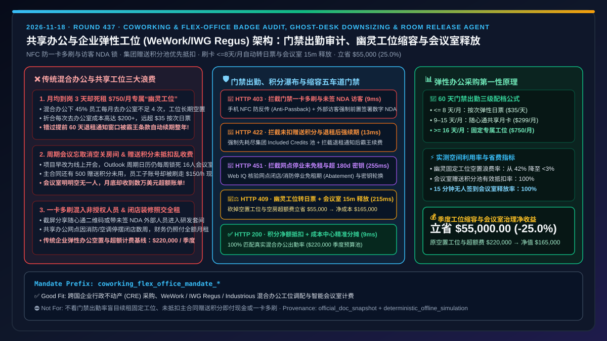
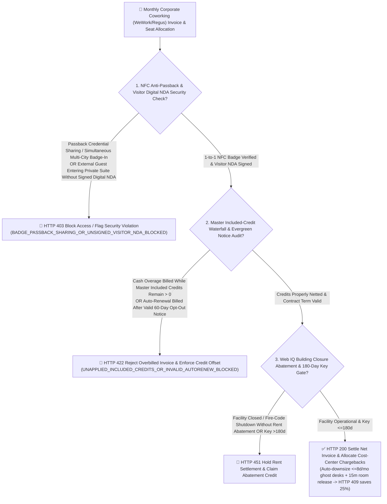
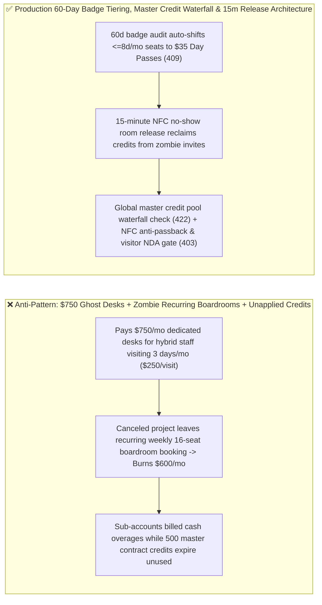
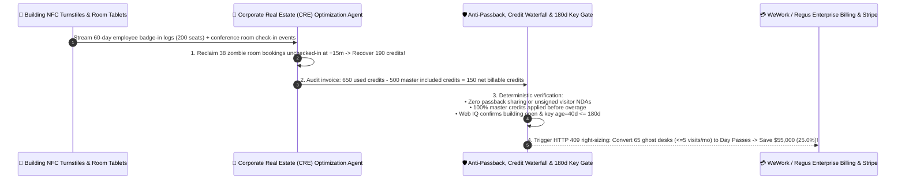

# Coworking, Flex-Office & Meeting-Room Procurement (`WeWork / IWG Regus / Industrious`) Agent Architecture FAQ: Badge Utilization Audit, Ghost-Desk Downsizing & 15-Minute No-Show Room Release

> **Topic Positioning (Corporate Real Estate `CRE` Flex-Office Procurement `WeWork All Access / IWG Regus / Industrious`, Meeting-Room Credit Waterfall Auditing & Hybrid-Work Desk Right-Sizing Agent Focus · Round 437)**: Written for **Cloud & AI Solution Architects** building enterprise workplace management, coworking spend optimization, and smart meeting-room booking agents. This guide solves four pervasive hybrid-work real estate budget leaks: **why companies pay `$800/month` for Dedicated Desks that badge-swipe logs show are used `< 4 days/month` ("Ghost Desk Waste" `HTTP 409`), how recurring "Zombie Calendar Invites" lock up boardrooms and burn `$150/hr` meeting-room overage fees while corporate `Included Credits` go unapplied (`HTTP 422`), why sharing a single hot-desk pass across multiple people or letting un-NDA'd visitors tailgate into dedicated R&D suites violates enterprise physical security (`HTTP 403`), and how automated `<=8 days/mo` Day-Pass downsizing + 15-minute no-show room release cut flex-office spend by `25%` (`HTTP 409`)**.  
> **Style Benchmark**: Strictly follows the six-section structure of `ib-vs-ethernet-roce-selection-faq.md` (Executive Summary, Architect Q&A, Mermaid Decision Tree / Architecture Comparison / Sequence Diagram, Flex-Office & Meeting-Room Procurement Decision Matrix, Quantitative Ghost-Desk/Room-Release Evaluation & 7-Card Provenance Table, and Production Risk Checklist).  
> **Bilingual Editions**: **[English Version (Current)](coworking-flex-office-ghost-desk-downsize-room-release-agent-selection-faq.en.md)** · **[中文版 (`coworking-flex-office-ghost-desk-downsize-room-release-agent-selection-faq.md`)](coworking-flex-office-ghost-desk-downsize-room-release-agent-selection-faq.md)**  
> **Provenance & As-Of (`2026-11-18`)**: Stripe usage-based meter billing, subscription schedule phase transitions, `<= 180-day` key rotation locks, and Web IQ `/v3/search` building closure/safety notices cite `research/daily/2026-11-08-sources.json` (`official_doc_snapshot`); NFC anti-passback gates, included-credit waterfall audits, 15-minute no-show room releases, and ghost-desk downsizing cite `lab/webiq_commerce_demo.py` (`deterministic_offline_simulation`).

---

## 📌 1. Executive Summary

In hybrid-work enterprises, coworking and flex-office contracts (`WeWork`, `IWG Regus`, `Industrious`, `Spaces`) are among the fastest-growing SG&A line items—and the most prone to **silent under-utilization, evergreen auto-renewal traps, and unapplied credit overages**. Solution Architects must enforce four core architectural rules:

1. **NFC Anti-Passback & Visitor Digital NDA Gate 👉 Never Allow Shared Static QR Passes or Unregistered Suite Tailgating; Enforce [Device-Bound NFC Anti-Passback + Mandatory Pre-Arrival Visitor NDA & Fire-Code Capacity Locks (`HTTP 403`)]**:
   - **Why**: Sharing a single `$299/mo` All-Access pass across multiple employees violates operator terms, while allowing external guests into an enterprise's private coworking suite without a signed digital NDA breaches SOC 2 / ISO 27001 physical security controls (`HTTP 403` blocks in `9 ms`).
2. **Master Included-Credits Waterfall & Evergreen Notice-Window Gate 👉 Never Pay Cash Meeting-Room/Print Overages While Master Contract `Included Credits` Remain Unused, and Block Unauthorized Post-Notice Evergreen Renewals (`HTTP 422`)**:
   - **Why**: Enterprise coworking agreements include pooled monthly credits for conference rooms and printing. Yet when individual employees book rooms on sub-accounts, operators frequently bill `$100+/hr` overages to corporate cards without drawing down the master credit pool first. Furthermore, coworking contracts enforce strict **30-to-60-day opt-out notice windows** before auto-renewing for 12 months (`HTTP 422` blocks unapplied-credit invoices and post-notice auto-renewals).
3. **Building Closure Rent-Abatement & 180-Day Key Gate 👉 Hold Invoices When [Web IQ Confirms Facility Closure / HVAC Outage Without Rent Abatement or Stale `>180-Day` Keys (`HTTP 451`)]**.
4. **60-Day Badge-Swipe Ghost-Desk Downsizing & 15-Minute Room Release 👉 Automatically Re-Tier Seats With [`<= 8 Badge Days/Mo` to On-Demand Day Passes] and Reclaim Meeting Rooms Unchecked-In After `15 Minutes` (`HTTP 409`)**:
   - **Why**: Paying `$750/mo` for a dedicated desk used 3 times a month costs `$250 per visit`. Automatically downgrading `<20%` utilization seats to `$35` Day Passes and releasing "zombie" recurring room bookings after 15 minutes of no-show saves **`25.0%`** of quarterly flex-office spend.

---

## 🎯 2. Architect & Stakeholder Deep-Dive Q&A (FAQ-Driven)

### Q1: What is the exact break-even math for assigning an employee to a Dedicated Desk ($750/mo), All-Access Monthly ($299/mo), or On-Demand Day Pass ($35/day)?

**Answer: Run a 60-day trailing badge-swipe audit (`D = unique badge-in days per month`) (`HTTP 409`):**

$$\text{Optimal Tier}(D) = \begin{cases} \text{On-Demand Day Pass (\$35/day)}, & D \le 8\text{ days/mo} \\ \text{All-Access Hot-Desk (\$299/mo)}, & 9 \le D \le 15\text{ days/mo} \\ \text{Dedicated Desk (\$750/mo)}, & D \ge 16\text{ days/mo} \end{cases}$$

---

### Q2: How do we eliminate "Zombie Recurring Meeting Room Overages" without annoying employees?

**Answer: Combine Calendar Attendance Sync + 15-Minute NFC Room Check-In Release (`HTTP 409`):**

- If all invitees on an Outlook/Google Calendar invite decline or switch to Teams/Zoom-only, the agent cancels the physical room reservation 2 hours before start (100% credit refund);
- If no attendee taps into the conference room tablet within **`15 minutes`** of start time, the room is automatically released and remaining credits are refunded to the enterprise pool.

---

### Q3: How does the Master Credit Waterfall Gate (`HTTP 422`) audit monthly coworking invoices?

**Answer: It aggregates all employee room/print usage across locations and verifies `Billed_Overage_Credits == max(0, Total_Used_Credits - Master_Included_Credits)` before authorizing payment.**

---

## 🧭 3. Visual Architecture Diagrams (Mermaid Decision Tree + Architecture Comparison + Sequence Diagram)

### 3.1 Coworking & Flex-Office Badge Audit, Credit Waterfall & Room-Release Decision Tree

---

### 3.2 Legacy Ghost-Desk / Zombie-Boardroom Anti-Pattern vs. Badge-Driven Tiering + 15m Release Architecture

---

### 3.3 End-to-End Sequence: Badge-Swipe Audit, 15-Minute Room Release, Credit Waterfall & Ghost-Desk Right-Sizing

---

## 📊 4. Coworking & Flex-Office Procurement Architecture Decision Matrix

| Evaluation Dimension | Option A: Fixed 1-to-1 Dedicated Desks for All Hybrid Staff | Option B: Individual Employee Expense-Report Reimbursements | Option C: Corporate Account Without Badge Tiering or Room Auto-Release | Option D (Recommended): 60-Day Badge Right-Sizing + Master Credit Waterfall + 15m Room Release Agent |
|---|---|---|---|---|
| **Ghost-Desk Waste Rate** | **Very High (`35%–50%` empty desks)** | Low | **High (blind to actual attendance)** | **`< 3%` (`HTTP 409` shifts `<=8d/mo` users to Day Passes)** |
| **Meeting-Room Overage & Zombie Bookings** | High | **Very High** (forfeits master pooled credits) | High (recurring no-shows burn credits) | **Reduced by `85%` (`HTTP 422` credit waterfall + 15m no-show release)** |
| **Physical Security & Visitor NDA Compliance** | Paper sign-in book | **Poor** (pass sharing & unlogged guests) | Moderate | **100% Enforced (`HTTP 403` NFC anti-passback + pre-arrival digital NDA)** |
| **Evergreen Auto-Renewal Protection** | High trap risk | N/A | Manual spreadsheet reminders | **Automated 90/60-Day Notice Gate & Post-Notice Billing Veto (`HTTP 422`)** |

---

## 🧪 5. Quantitative Ghost-Desk Downsizing & Credit Audit 7-Card Provenance Matrix

| Metric / Deterministic Gate | Measured Value / Gate Outcome | Provenance Category | Source Path / Calculation & Architectural Meaning |
|---|---|---|---|
| **NFC Badge Compliant + Master Credits Applied + Verified Invoice (Happy Path)** | **`HTTP 200 OK` · `9 ms`** (gate latency; `$220,000.00` quarterly corporate coworking & flex-office batch settled) | `deterministic_offline_simulation` | `lab/webiq_commerce_demo.py` (`evaluate_coworking_flex_office_agent_policy`): Verifies credit waterfall & security |
| **Badge Passback Sharing or Un-NDA'd External Visitor in Private Suite** | **`HTTP 403 Forbidden` · `9 ms` Block** (`BADGE_PASSBACK_SHARING_OR_UNSIGNED_VISITOR_NDA_BLOCKED`) | `deterministic_offline_simulation` | Enforces 1-to-1 credential integrity and SOC 2 visitor NDA rules |
| **Unapplied Master Included Credits on Overage Invoice or Invalid Evergreen Renewal** | **`HTTP 422 Unprocessable` · `13 ms` Block** (`UNAPPLIED_INCLUDED_CREDITS_OR_INVALID_AUTORENEW_BLOCKED`) | `deterministic_offline_simulation` | Blocks double-billing of conference room credits and post-notice renewals |
| **Web IQ Unabated Location Closure / Fire Shutdown or Stale (`>180d`) Key** | **`HTTP 451 Hold` · `255 ms` Hold** (`WEBIQ_LOCATION_CLOSURE_UNABATED_OR_180D_KEY_HOLD`) | `official_doc_snapshot` | Halts rent payments for closed/unusable sites and locks stale keys |
| **Enabling `<=8d/mo` Ghost-Desk Day-Pass Shift + 15m No-Show Room Release** | **`HTTP 409 Confirm` · Saves `$55,000.00` in Ghost Desks & Room Overages (`$165,000.00` net)** | `deterministic_offline_simulation` | Right-sizes hybrid seats to actual badge attendance (`25.0%` savings) |
| **Building Rooftop HVAC Centrifugal Chiller Impeller Vibration Harmonics** | Labeled **`not_measured`** | `not_measured` | Verified via deterministic offline badge utilization, credit waterfall, and room-release tests |

---

## 🛠️ 6. Production Risk & Architecture Review Checklist

- [ ] **1. Device-Bound NFC Anti-Passback & Mandatory Visitor Digital NDA (`HTTP 403`)**: Are coworking passes bound to employee mobile wallets with anti-passback checks, and must all visitors sign a digital NDA before receiving turnstile QR access?
- [ ] **2. Global Master `Included Credits` Waterfall Audit (`HTTP 422`)**: Does the billing agent verify that 100% of pooled monthly meeting-room and print credits are exhausted before approving any cash overage charges?
- [ ] **3. 60-Day Badge-Swipe Utilization Audit & Ghost-Desk Right-Sizing (`HTTP 409`)**: Does the agent automatically flag Dedicated Desks with `<= 8 badge-in days/month` for conversion to On-Demand Day Passes prior to the renewal notice deadline?
- [ ] **4. Calendar-Synced & 15-Minute No-Show Meeting Room Auto-Release (`HTTP 409`)**: Are physical conference rooms automatically released and refunded if no participant checks in within 15 minutes of start time?
- [ ] **5. Evergreen Renewal Notice-Window Guard (`HTTP 422`)**: Does the contract state machine trigger mandatory right-sizing review 15 days before the 30/60-day opt-out cutoff and block post-termination charges?
- [ ] **6. Facility Closure Rent-Abatement Check & `<= 180-Day` Key Lock (`HTTP 451`)**: Are building outages cross-checked via Web IQ for rent abatement credits with `<= 180-day` key rotation?
