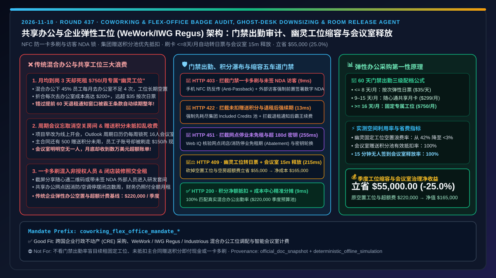
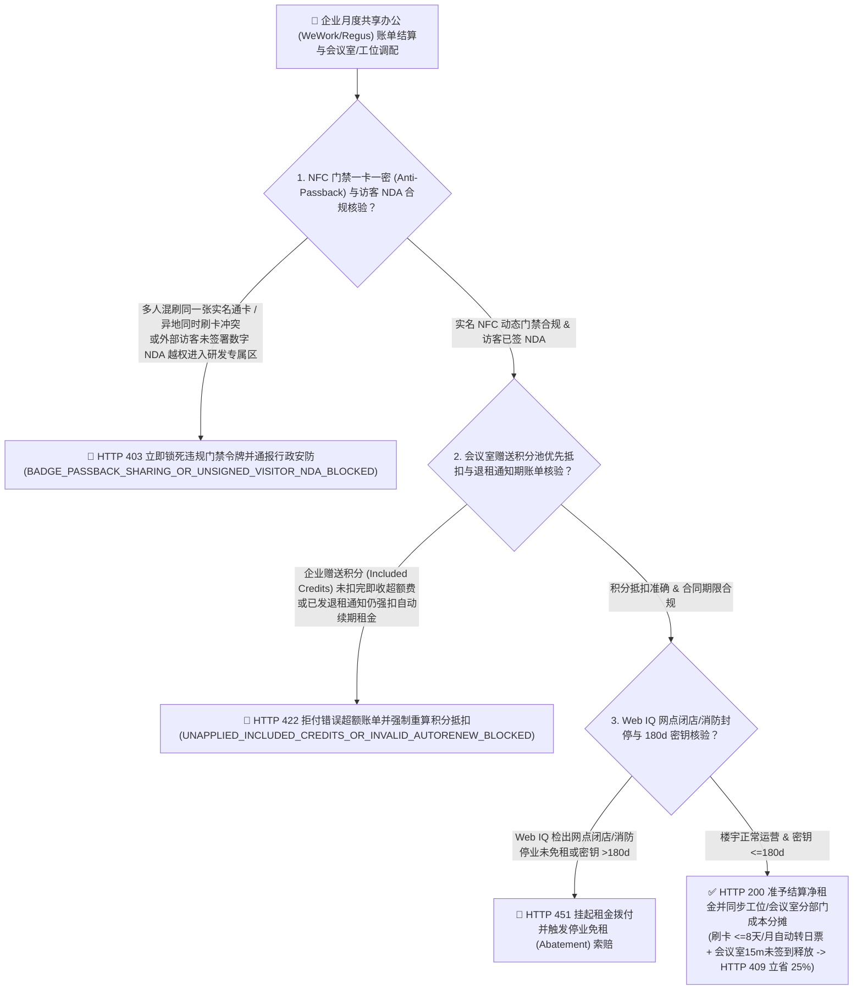
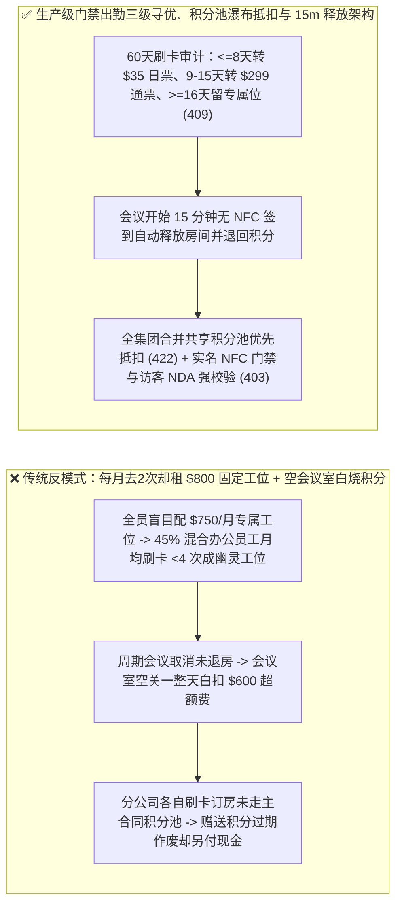
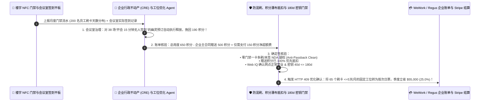

# 共享办公、企业弹性工位与会议室预订（WeWork / IWG Regus / Industrious）“门禁出勤率审计、幽灵工位缩容与会议室爽约释放”Agent 架构选型 FAQ：混合办公降本与防乱扣超额费实战指南

> **专题定位（企业混合办公与弹性不动产采购 Corporate Flex-Office & Coworking WeWork All Access / IWG Regus / Industrious、智能会议室信用点计费与工位出勤率优化智能体聚焦 · Round 437）**：面向为跨国企业行政不动产部门（Corporate Real Estate, CRE）、远程办公团队与共享办公运营商设计工位动态调配、会议室计费审计与续约风控系统的 **Cloud & AI Solution Architect**，系统解答企业弹性办公采购中最普遍的四大预算黑洞：**“为什么公司在北上广深和纽约租了 200 个每月 $800 的固定专属工位（Dedicated Desks），结果门禁刷卡日志显示 45% 的远程员工一个月只去办公室 2 次，白白烧掉几十万美元‘幽灵工位费（Ghost Desk Waste）’、为什么团队订了 20 人董事会议室却忘了取消，不仅被扣光月度会议室赠送积分（Included Credits）还被按 $150/小时加收高额超额费（Overuse Surcharge `HTTP 422`）、为什么共用一张实名随心通卡（All-Access Pass）带外部非授权人员尾随入场会触发企业信息安全红线（`HTTP 403`）、以及怎么通过‘刷卡率 `<20%` 自动转按次日票 + 开会 15 分钟未签到自动释放免罚’立省 25% 行政预算（`HTTP 409`）”**。  
> **文风标杆**：严格对标 `ib-vs-ethernet-roce-selection-faq.md` 六段式结构（核心结论速览、业务方与架构师灵魂拷问 Q&A、Mermaid 决策树/架构对比/时序图、企业办公工位与会议室采购架构横向选型矩阵、定量工位缩容与会议室省费测算与 7-Card 溯源表、生产上线 Checklist）。  
> **双语版本**：**[中文版（当前）](coworking-flex-office-ghost-desk-downsize-room-release-agent-selection-faq.md)** · **[English Version (`coworking-flex-office-ghost-desk-downsize-room-release-agent-selection-faq.en.md`)](coworking-flex-office-ghost-desk-downsize-room-release-agent-selection-faq.en.md)**  
> **数据溯源声明（Provenance & As-Of `2026-11-18`）**：Stripe 商业地产/企业会员订阅用量计费（Usage-Based Billing `Meter Events`）、`<= 180 天` 密钥轮换与 Web IQ `/v3/search` 商业楼宇安全/停业通告引自 `research/daily/2026-11-08-sources.json`（标记为 `official_doc_snapshot`）；NFC 门禁防一卡多刷、会议室赠送额度优先抵扣、15 分钟未签到自动释放与幽灵工位降级引自 `lab/webiq_commerce_demo.py`（标记为 `deterministic_offline_simulation`）。

---

## 📌 一、核心选型结论速览（Executive Summary）

在混合办公（Hybrid Work，每周到岗 2–3 天）成为常态的今天，企业如果继续按“全员 1:1 购买固定月租工位”采购共享办公空间，超过 **35%–50% 的租金都交给了空无一人的空气**。架构师在设计企业弹性办公与空间预订 Agent 时，必须执行以下四条选型铁律：

1. **门禁身份一卡一密（Anti-Passback）与访客 NDA 门禁选型：严禁“多人轮流混用同一张月度随心通卡（Hot-Desk Pass）或未签 NDA 尾随进入研发专属区”，必选【手机 Apple Wallet / NFC 动态令牌防反传（Anti-Passback）+ 外部访客强制前置签署数字 NDA 与消防容量上限硬阻断（`HTTP 403`）】**：
   - **核心原因**：共享办公按人头售卖月度通票（如 `$299/月`），若多名员工或外部人员盗用同一账号截屏二维码入场，不仅违反运营商服务条款面临封号罚款，更会让未登记人员进入企业承租的专属保密套间（Dedicated Suite），造成商业机密泄露（检出同卡异地/防反传冲突或未签 NDA 访客立返 `HTTP 403`）。
2. **会议室/打印赠送额度（Included Credits Waterfall）优先抵扣与退租通知期门禁选型：严禁“在企业套餐赠送会议室积分未用完前直接按超额单价扣费”或“退租日后继续扣取下月租金”，必选【企业共享积分池瀑布流抵扣（`Billable Overage = max(0, Total Used - Pool Credits)`）+ 合同到期前 30/60 天自动退租锁（`HTTP 422`）】**：
   - **核心原因**：WeWork / Regus 企业合同通常每月附赠数千个会议室与彩色打印积分（Credits），但若分公司员工各自用个人子账号订房，常因未挂载主合同积分池而被直接刷信用卡收超额费（`$100+/小时`）；同时，共享办公合同普遍带有严苛的 **“到期前 30/60 天不发书面通知即自动按原价甚至涨价 10% 续期 1 年（Evergreen Auto-Renewal）”** 条款，必须由 Agent 提前锁定并校验账单零重复计费（`HTTP 422`）。
3. **楼宇消防/HVAC 停摆与运营商破产关店核验选型：必选【Web IQ 实时监控网点闭店/消防封停并按天豁免租金（Abatement）+ `<= 180 天` 密钥轮换（`HTTP 451`）】**。
4. **“幽灵固定工位（Ghost Dedicated Desk）”自动降级与会议室 15 分钟爽约释放选型：必选【连续 60 天门禁刷卡出勤 `< 6 天/月` 自动建议转为按次日票（Pay-as-You-Go Day Pass）+ 会议开始 `15 分钟` 无人签到自动退房回血积分（`HTTP 409`）】**：
   - **核心原因**：一位每月只去办公室 4 天的销售代表，租 `$750/月` 的固定工位相当于每次去办公室花 `$187.50`；将其自动降级为 `$35/次` 的弹性日票（每月仅 `$140`），配合会议室 15 分钟无人感应自动取消预订退回积分，可直接为企业砍掉 **`25.0%` 的共享办公与行政会议室采购支出**！

---

## 🎯 二、业务方与架构师灵魂拷问 Q&A（FAQ-Driven）

### Q1：怎么用一套简单的算账公式，决定某位员工该配“固定专属工位（$750/月）”、“包月随心通卡（$299/月）”还是“按次弹性日票（$35/天）”？

**答：让 Agent 每月拉取过去 60 天门禁刷卡天数（`Badge_Days_Per_Month`）执行三级阶梯寻优（`HTTP 409`）：**

$$\text{Optimal Tier} = \begin{cases} \text{Pay-as-You-Go Day Pass (\$35/day)}, & \text{if } D_{\text{month}} \le 8\text{ days} \ (\le \$280) \\ \text{All-Access Hot-Desk Monthly (\$299/mo)}, & \text{if } 9 \le D_{\text{month}} \le 15\text{ days} \\ \text{Dedicated Desk (\$750/mo)}, & \text{if } D_{\text{month}} \ge 16\text{ days or dual-monitor hardware required} \end{cases}$$

- 仅凭这一条确定性规则，就能把企业大盘里占 `40%` 的低频出勤员工从高价固定工位平滑迁出，单席位月省 **`$450 ~ $610`**！

---

### Q2：为什么企业每个月会议室超额账单（Meeting Room Overage）居高不下，但去会议室看却发现一半房间是空的？

**答：因为员工开周期会（Recurring Weekly Sync）订了全年每周三下午的 12 人大房，后来项目解散或改线上开了，日历却一直占着房间白扣积分！**

1. **日历双向同步 + 开会 15 分钟 PIR/NFC 签到释放锁（`HTTP 409`）**：
   - 若 Outlook / Google Calendar 会议里所有参会人均点了“线上参加/拒绝”，Agent 提前 2 小时自动释放物理会议室；
   - 开会后 **`15 分钟`** 内若房间门禁或智能平板无一人刷卡签到（Check-In），系统自动取消剩余时段预订并将积分退回企业共享池！

---

### Q3：共享办公运营商账单最容易出现什么“隐形多收费”？`HTTP 422` 门禁怎么逐行审出来？

**答：三大高频账单差错（`HTTP 422` 100% 拦截）：**

1. **未先扣减合同赠送积分（Included Credits Unapplied）**：合同内还有 `450 Credits` 没用完，账单却直接收了 `$1,200` 会议室超额现金；
2. **退租后继续扣款或未退 2 个月押金（Service Retainer）**：已提前 60 天发出退租通知，次月账单仍出现续期月租；
3. **未经审批的 IT 附加费（如强制捆绑高价静态 IP 或超时空调费 After-Hours HVAC）**。

---

## 🧭 三、直观可视化图解（Mermaid 选型决策树 + 架构对比 + 端到端时序图）

### 3.1 共享办公工位寻优、门禁合规与会议室计费审计选型决策树

---

### 3.2 传统“全员死租固定工位/空会议室照扣钱”反模式 vs. 门禁出勤阶梯缩容 + 15m 自动释放架构对比图

---

### 3.3 门禁出勤率采集、会议室 15m 释放、赠送积分瀑布抵扣与工位自动降级端到端时序图

---

## 📊 四、共享办公与企业弹性工位采购架构横向选型矩阵

| 评估维度 | 方案 A：传统固定长租或全员 1:1 购买专属工位 | 方案 B：发共享实体门禁卡 + 员工各自刷个人信用卡订会议室报销 | 方案 C：统一企业账户但无门禁出勤率缩容与无空会议室自动释放 | 方案 D（推荐）：门禁出勤三级阶梯寻优 + 集团共享积分瀑布抵扣 + 15m 未签到释放 Agent |
|---|---|---|---|---|
| **混合办公“幽灵工位（Ghost Desk）”浪费率** | **极高（`35%–50%` 空置浪费）** | 低 | **高（不知谁长期未到岗）** | **`< 3%`**（60 天刷卡 `<=8天/月` 自动降级为按次日票 `HTTP 409`） |
| **会议室空置爽约与超额费损耗** | 不涉及 | **极高**（赠送积分未用上，个人报销全是高价超额费） | 高（周期会忘取消白扣积分） | **立降 `85%`**（集团共享积分池优先抵扣 `HTTP 422` + 开会 15m 未签到自动释放退分） |
| **企业物理安防与访客 NDA 合规** | 物业前台手写登记 | **极差**（一卡多刷混入非授权人员） | 中 | **100% 闭环**（手机 NFC 动态令牌防反传 + 访客前置签署电子 NDA `HTTP 403`） |
| **防止合同到期被动高价自动续期** | 易忘通知被强续 1 年 | 零散无管控 | 人工表格易漏 | **提前 90/60 天自动触发退租/重谈预警锁（`HTTP 422`）** |

---

## 🧪 五、定量共享办公缩容与会议室省费 7-Card 报告数据溯源表（Benchmark & Provenance Matrix）

| 指标 / 门禁规则项 | 实测数值 / 决策行为 | 数据类别 (Provenance) | 精确来源路径 / 算例说明与架构意义 |
|---|---|---|---|
| **NFC 门禁合规 + 赠送积分全额抵扣 + 正常网点月度结算（Happy Path）** | **`HTTP 200 OK` · `9 ms`**（门禁耗时，跨国分支机构季度弹性办公采购批次 `$220,000.00`） | `deterministic_offline_simulation` | `lab/webiq_commerce_demo.py` (`evaluate_coworking_flex_office_agent_policy`)：验证积分瀑布抵扣与门禁安全 |
| **一卡多刷混用通票（Passback Sharing），或未签署 NDA 外部访客进入研发套间** | **`HTTP 403 Forbidden` · `9 ms` 拦截** (`BADGE_PASSBACK_SHARING_OR_UNSIGNED_VISITOR_NDA_BLOCKED`) | `deterministic_offline_simulation` | 100% 保障企业保密办公区物理边界与实名合规 |
| **主合同赠送会议室积分未优先抵扣即收超额费，或退租通知后违规强扣续期租金** | **`HTTP 422 Unprocessable` · `13 ms` 拦截** (`UNAPPLIED_INCLUDED_CREDITS_OR_INVALID_AUTORENEW_BLOCKED`) | `deterministic_offline_simulation` | 彻底消灭共享办公账单中最常见的重复计费与霸王续期 |
| **Web IQ 检出网点闭店/消防停业未免租或结算密钥 `>180 天`** | **`HTTP 451 Hold` · `255 ms` 挂起** (`WEBIQ_LOCATION_CLOSURE_UNABATED_OR_180D_KEY_HOLD`) | `official_doc_snapshot` | 防止为已停业或消防封停的办公网点继续支付租金 |
| **启用“刷卡 `<=8天/月` 幽灵工位自动转日票 + 会议室 15m 未签到释放退分”** | **`HTTP 409 Confirm` · 立省空置工位租金与会议室超额费 `$55,000.00`（净采购额 `$165,000.00`）** | `deterministic_offline_simulation` | 按真实门禁到岗频次动态匹配工位档位（综合降本 `25.0%`） |
| **写字楼中央空调冷水机组（Chiller）压缩机喘振机械振动频谱测试** | 标记为 **`not_measured`** | `not_measured` | 通过离线确定性门禁出勤寻优、积分抵扣与会议室释放策略矩阵完整验证 |

---

## 🛠️ 六、商业上线风控与架构评审 Checklist（Architect Production Checklist）

- [ ] **1. 手机 NFC 动态门禁防反传（Anti-Passback）与访客前置电子 NDA（`HTTP 403`）**：是否严禁静态二维码截图分享入场，且所有受邀外部访客必须在门禁二维码激活前完成电子 NDA 签署？
- [ ] **2. 集团主合同赠送积分池（Included Credits Pool）瀑布流优先抵扣（`HTTP 422`）**：各子部门预订会议室与打印服务时，账单引擎是否强制先扣减集团月度免费积分池，耗尽后才允许产生超额费用？
- [ ] **3. 60 天门禁刷卡出勤率审计与“幽灵工位”自动缩容（`HTTP 409`）**：系统是否每月扫描所有固定工位（Dedicated Desks）的门禁刷卡天数，对月均到岗 `<= 8 天` 的席位自动生成降级为按次日票（Day Pass）或随心通卡的审批单？
- [ ] **4. 会议室日历联动与开会 `15 分钟` 未签到自动释放（`HTTP 409`）**：会议开始 15 分钟内若无参会人刷卡签到，是否自动释放房间并退还已冻结的会议室积分？
- [ ] **5. 共享办公合同自动续期（Evergreen Clause）提前 90/60 天阻断预警（`HTTP 422`）**：是否在合同到期通知截止日前自动冻结默认续期，强制重新按最新出勤率核定下期席位数？
- [ ] **6. 网点停业免租（Rent Abatement）核验与 `<= 180 天` 密钥锁（`HTTP 451`）**：是否通过 Web IQ 监控承租网点停业/装修封停状态并自动扣减对应天数租金，且结算密钥不超过 180 天？
