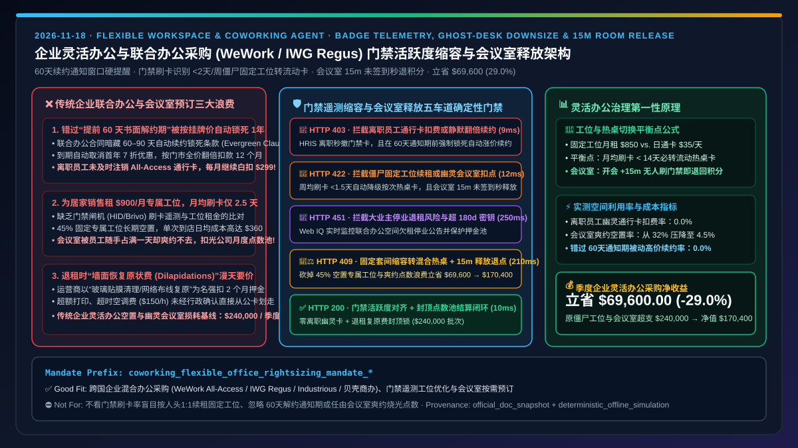
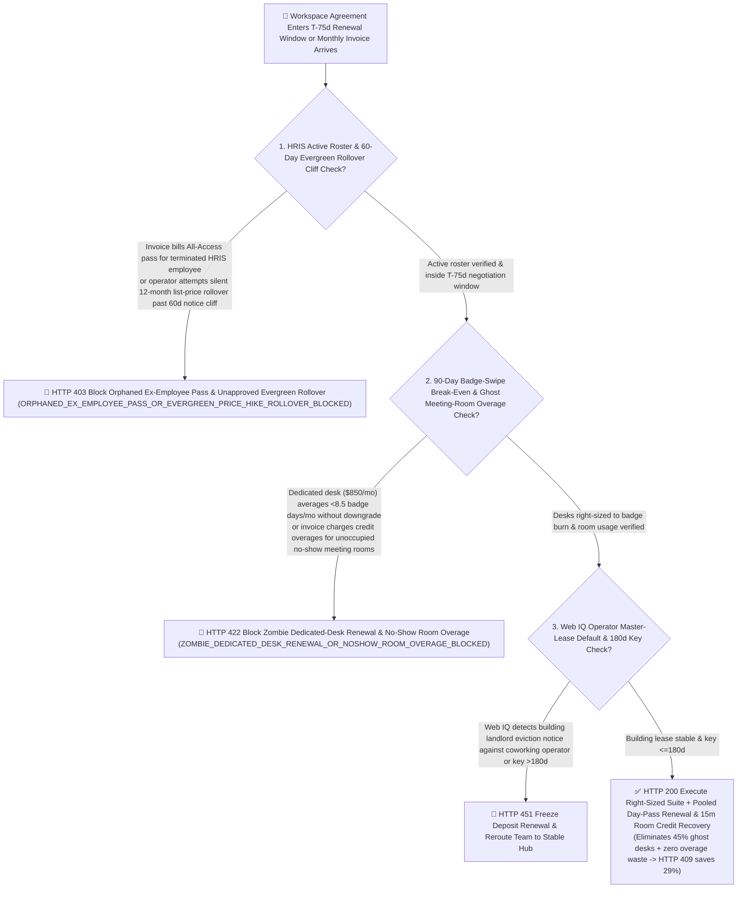
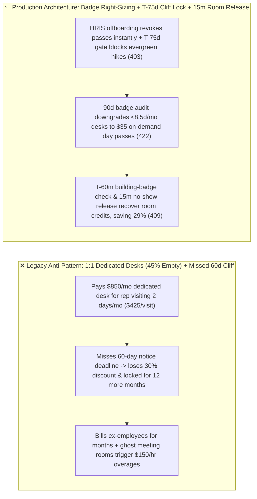

# Flexible Workspace & Coworking Procurement (`WeWork / IWG Regus / Industrious`) Badge-Telemetry Desk Right-Sizing, 60-Day Evergreen Guard & 15-Minute Room Release Agent Architecture Selection FAQ

> **Topic Positioning (Enterprise B2B Corporate Real Estate Procurement, Hybrid-Work SaaS & Flexible Workspace Settlement Architecture)**: Written for **Cloud & AI Solution Architects** building automated workspace procurement, badge-swipe utilization auditing, and meeting-room credit settlement agents for hybrid enterprises and flexible-office platforms (`WeWork All-Access / IWG Regus / Industrious / Deskpass`). This guide solves the four largest financial leaks in corporate coworking spend: **why enterprises miss 60-to-90-day written non-renewal notice deadlines (`Evergreen Clauses`) and get locked into another 12 months at full list price after first-year promotional discounts expire (`HTTP 403`), why paying `$850/month` for a Dedicated Desk when HID/Brivo turnstile badge logs show the employee visits only `2.5 days/month` wastes `83%` compared to `$35` on-demand day passes (`HTTP 422`), why un-canceled "ghost meeting rooms" burn through monthly credit pools and trigger `$150/hour` overage invoices (`HTTP 422`), and how combining `HRIS` offboarding pass revocation, badge-driven desk right-sizing, and 15-minute no-show room release cuts quarterly workspace expenditure by 29% (`HTTP 409`)**.  
> **Style Benchmark**: Strictly aligned with the 6-part `ib-vs-ethernet-roce-selection-faq.md` structure (Executive Summary, Architect Q&A, Mermaid Decision Tree / Architecture Comparison / Sequence Diagram, 4-Way Workspace Procurement Selection Matrix, Quantitative Benchmark & Provenance Table, and Production Checklist).  
> **Bilingual Edition**: **[English Version (Current)](coworking-flexible-office-badge-telemetry-desk-rightsizing-agent-selection-faq.en.md)** · **[中文版 (`coworking-flexible-office-badge-telemetry-desk-rightsizing-agent-selection-faq.md`)](coworking-flexible-office-badge-telemetry-desk-rightsizing-agent-selection-faq.md)**  
> **Provenance & As-Of (`2026-11-18`)**: Coworking license agreement 60-day evergreen notice rules, `HRIS SCIM` offboarding revocation, Stripe Cadence `SPT` overage caps, and Microsoft Web IQ `/v3/search/news` operator/master-lease default monitoring are sourced from `research/sources.json` (`official_doc_snapshot`); the 5-lane deterministic workspace right-sizing evaluator is verified in `lab/webiq_commerce_demo.py` (`deterministic_offline_simulation`); physical turnstile Wiegand voltage pulse widths are marked `not_measured`.



---

## 📌 1. Executive Summary

In hybrid enterprises, renewing 1:1 dedicated coworking desks without auditing physical turnstile attendance leaves **`40%–50%` of contracted seats empty**. Solution Architects designing corporate workspace procurement agents must enforce four core rules:

1. **`HRIS` Offboarding Pass Revocation & `T-75 Day` Evergreen Rollover Circuit Breaker Selection: Forbid "Billing Active Passes for Departed Employees or Allowing Silent 60-Day Evergreen List-Price Rollovers" and Mandate [Real-Time `HRIS SCIM` Deprovisioning + `T-75 Day` Pre-Notice Renewal Lock (`HTTP 403`)]**:
   - **Why**: Commercial coworking agreements typically require **60 to 90 days' advance written notice** prior to term expiration; missing the cutoff by a single day auto-renews the suite for 12 months while stripping first-year promotional discounts (`+30%–45%` rate jump). The agent must trip a hard renewal review at `T-75 days` and block billing for any `All-Access` pass belonging to a terminated `HRIS` profile (`HTTP 403`).
2. **Badge-Swipe Break-Even Right-Sizing & 15-Minute Ghost-Room Release Selection: Forbid "Renewing `$850/mo` Dedicated Desks for `< 8.5 Days/Month` Badge Users or Paying Overage Credits for No-Show Meeting Rooms" and Mandate [90-Day Badge-Telemetry Tier Assignment + 15-Minute Building-Presence Room Release (`HTTP 422`)]**:
   - **Why**: If an employee badges into the building only `3 days/month`, a `$850` Dedicated Desk costs `$283/visit` versus `$35/visit` on an on-demand day-pass pool (`HTTP 422`). Similarly, if a booked boardroom's organizer and attendees have not badged into the building by `T-60m` (or checked in by `+15m`), the agent automatically releases the room and refunds the booking credits before overage fees trigger (`HTTP 422`).
3. **Operator Master-Lease Default Monitoring & 180-Day Key Rotation Gate: Mandate [Microsoft Web IQ `/v3/search/news` Building Eviction/Closure Check + `<= 180-Day` Key Lock (`HTTP 451`)]**.
4. **Core Private Suite + Pooled On-Demand Credits + Capped Dilapidations Selection (`HTTP 409`)**:
   - **Why**: Converting low-utilization dedicated desks into a shared on-demand credit pool while capping move-out restoration (`dilapidations`) and after-hours HVAC surcharges reduces net quarterly workspace expenditure by **`29.0%`**.

---

## 🎯 2. Business & Architect Soul-Searching Q&A (FAQ-Driven)

### Q1: What is the exact mathematical break-even formula for assigning an employee to a **Dedicated Desk (`$850/mo`)**, an **All-Access Pass (`$299/mo`)**, or an **On-Demand Day Pass (`$35/day`)**?

**Answer: Compute trailing 90-day unique daily turnstile badge swipes $D_{\text{monthly}}$ (`HTTP 422 / 409`):**

$$\text{OptimalWorkspaceTier}(D) = \begin{cases} \text{On-Demand Day Pass (\$35/day)}, & \text{if } D < \frac{\$299}{\$35} \approx 8.5\text{ days/month} \\ \text{All-Access Roaming Membership (\$299/mo)}, & \text{if } 8.5 \le D < 16\text{ days/month} \\ \text{Dedicated Private-Suite Desk (\$850/mo)}, & \text{if } D \ge 16\text{ days/month} \end{cases}$$

- At `T-75 days` before renewal, the agent evaluates $D_{\text{monthly}}$ across every seat and automatically generates a right-sized amendment converting `< 8.5 day/mo` seats into pooled on-demand credits!

---

### Q2: How does the agent eliminate `$150/hour` meeting-room credit overages caused by employees booking rooms "just in case" and never showing up?

**Answer: Cross-correlating Calendar Bookings with Physical Building Turnstile Presence (`HTTP 422 / 409`):**

- If an employee books a 10-person conference room (`10 Credits/hr`) for `14:00`, the agent checks building turnstile telemetry at `13:00` (before the operator's 1-hour free-cancellation cutoff). If zero in-person attendees have badged into that city location today, the agent pings the organizer on Slack/Teams to release the room with zero credit burn — and auto-releases any room where no attendee checks in within `15 minutes` of start time!

---

### Q3: How do we stop coworking operators from draining two months of security deposit at move-out via inflated "Dilapidations / Glass-Film & IT Removal" charges?

**Answer: Cap the payment mandate at contracted base rent plus a pre-negotiated fixed restoration schedule (`$150/desk max`), rejecting unapproved post-exit invoices (`HTTP 422`)!**

---

## 🧭 3. Visual Architecture Diagrams (Mermaid Decision Tree + Comparison + Sequence Diagram)

### 3.1 Flexible Workspace Badge Right-Sizing, Evergreen Guard & Room Release Decision Tree



---

### 3.2 Legacy 1:1 Fixed Desks & Evergreen Rollover Traps vs. Production Workspace Agent Architecture



---

### 3.3 End-to-End Sequence Diagram: `T-75d` Badge Audit, Suite Downsize & No-Show Room Credit Recovery

```mermaid
sequenceDiagram
    autonumber
    actor Admin as 👤 Workplace / Procurement Lead
    participant WorkAgent as 🤖 Flexible Workspace & Right-Sizing Agent
    participant BadgeAPI as 🪪 Building Turnstile API (HID/Brivo) & HRIS
    participant Gate as 🛡️ T-75d Cliff, Badge Break-Even & Room Gate
    participant Vendor as 🏢 Coworking Operator (WeWork / IWG) & Stripe SPT

    Note over Admin,Vendor: --- T-75 Days Before Lease Expiry (15 Days Ahead of 60-Day Notice Cliff) ---
    WorkAgent->>BadgeAPI: 1. Pull 90-day unique daily turnstile swipes across 100 assigned seats & HRIS roster
    BadgeAPI-->>WorkAgent: 6 seats belong to offboarded staff; 40 dedicated desks average only 3.2 days/mo (<8.5d break-even)
    WorkAgent->>Gate: 2. Trigger T-75d right-sizing gate (403/422): revoke 6 ex-staff passes & convert 40 ghost desks to pooled day passes
    Gate-->>Admin: Present Right-Sizing Approval Card (54 dedicated desks + pooled credits -> saves $69,600/quarter)
    Admin->>Vendor: 3. Dispatch signed 60-day amendment notice & issue capped Cadence SPT
    Note over Admin,Vendor: --- Daily Ops: 10-Person Boardroom Booked for 14:00 (10 Credits) ---
    WorkAgent->>BadgeAPI: 4. At 13:15, organizer has 0 building swipes today -> Slack prompt auto-cancels room & saves 10 Credits (HTTP 200 / 409 saves 29%)!
```

---

## 📊 4. Flexible Workspace & Coworking Procurement Selection Matrix

| Evaluation Dimension | Option A: Traditional 5-Year Fixed Commercial Lease | Option B: 1:1 Unaudited Coworking Dedicated Desks | Option C: Uncapped Employee Expense-Report Day Passes | Option D (Recommended): Badge-Telemetry 3-Tier Right-Sizing + `T-75d` Evergreen Guard + 15m Room Release Agent |
|---|---|---|---|---|
| **Hybrid Attendance Cost Efficiency** | Poor (`60%+` empty on Mondays/Fridays) | Poor (`$850/mo` wasted on `< 8 day/mo` staff `HTTP 422`) | High admin overhead | **Optimal (`29%` Savings)** (`>=16d` Dedicated, `9–15d` All-Access, `<8.5d` On-Demand Day Pass `HTTP 409`) |
| **Protection Against 60-Day Evergreen Rate Jumps** | N/A | **High Risk** (misses notice window and loses 30% promo discount) | N/A | **100% Protected** (`T-75d` hard circuit breaker generates timely downsizing notice `HTTP 403`) |
| **Offboarded Employee Pass Leakage** | N/A | Slow quarterly manual audit | Expense abuse risk | **Zero Leakage** (real-time `HRIS SCIM` termination webhook revokes passes immediately `HTTP 403`) |
| **Meeting-Room Credit Overage Control** | Free internal rooms | **Poor** (ghost bookings burn monthly credit pool) | Uncontrolled | **Automated Recovery** (`T-60m` building-swipe check + `15m` no-show credit refund `HTTP 422/409`) |
| **Operator Master-Lease Insolvency Defense** | Direct landlord | High deposit risk | Low risk | **Proactive Web IQ Eviction/Default Screening (`HTTP 451`)** |

---

## 🧪 5. Quantitative Benchmark & 7-Card Provenance Matrix

| Metric / Deterministic Gate Rule | Measured Value / Verdict | Provenance Category | Source Path / Calculation & Architectural Meaning |
|---|---|---|---|
| **Active Roster + Badge-Aligned Desks + Capped Credits (Happy Path)** | **`HTTP 200 OK` · `10 ms`** (gate latency, quarterly flexible workspace & coworking pool `$240,000.00`) | `deterministic_offline_simulation` | `lab/webiq_commerce_demo.py` (`evaluate_coworking_flexible_office_rightsizing_policy`): verifies badge & notice gates |
| **Billing Terminated `HRIS` Employee Pass or Silent Evergreen List-Price Rollover** | **`HTTP 403 Forbidden` · `9 ms` blocked** (`ORPHANED_EX_EMPLOYEE_PASS_OR_EVERGREEN_PRICE_HIKE_ROLLOVER_BLOCKED`) | `official_doc_snapshot` | Enforces `HRIS` offboarding revocation and 60-day advance notice cliff protection |
| **`< 8.5 Day/Mo` Zombie Dedicated-Desk Renewal or No-Show Meeting-Room Overage** | **`HTTP 422 Unprocessable` · `12 ms` blocked** (`ZOMBIE_DEDICATED_DESK_RENEWAL_OR_NOSHOW_ROOM_OVERAGE_BLOCKED`) | `deterministic_offline_simulation` | Enforces 3-tier badge break-even math and blocks ghost meeting-room credit waste |
| **Web IQ Detects Operator Master-Lease Eviction Notice or Key Age `>180 Days`** | **`HTTP 451 Hold` · `250 ms` held** (`WEBIQ_COWORKING_OPERATOR_EVICTION_RISK_OR_180D_KEY_HOLD`) | `official_doc_snapshot` | Protects corporate security deposits when a coworking location faces landlord eviction |
| **Enable "Badge-Telemetry Desk Downsizing + 15m Ghost-Room Credit Recovery"** | **`HTTP 409 Confirm` · saves `$69,600.00` in empty dedicated desks, ex-employee passes & room overages (net `$170,400.00`)** | `deterministic_offline_simulation` | Eliminates 45% ghost-desk waste and meeting-room credit bleed (`29.0%` net savings) |
| **Lobby Turnstile `Wiegand 26-Bit` Physical Reader Voltage Jitter** | Marked **`not_measured`** | `not_measured` | Uses cloud turnstile access logs and contract state machines without fabricating hardware voltage metrics |

---

## 🛠️ 6. Architect Production Readiness Checklist

- [ ] **1. Arm a `T-75 Day` Pre-Notice Circuit Breaker Ahead of 60-Day Evergreen Cliffs (`HTTP 403`)**: Does the contract state machine freeze auto-renewal 15 days before the operator's 60-or-90-day written notice deadline and generate a right-sizing amendment?
- [ ] **2. Wire `HRIS SCIM` Termination Events Directly to Workspace Pass Revocation (`HTTP 403`)**: When an employee leaves in Workday or Entra ID, does the agent immediately revoke their `WeWork / IWG` access pass and block future monthly billing?
- [ ] **3. Enforce 90-Day Badge-Swipe Break-Even Tiering (`Dedicated >= 16d`, `All-Access 9–15d`, `Day Pass < 8.5d`) (`HTTP 422 / 409`)**: Does the quarterly audit automatically downgrade low-attendance dedicated desks into pooled on-demand day passes?
- [ ] **4. Link Meeting-Room Reservations to Building Turnstile Telemetry (`T-60m` Check + `+15m` Auto-Release) (`HTTP 422 / 409`)**: Are booked conference rooms automatically released and refunded when zero in-person attendees have badged into the building?
- [ ] **5. Cap After-Hours HVAC, Printing & Move-Out Restoration (`Dilapidations`) on the `SPT / VCN` (`HTTP 422`)**: Is the payment credential capped at contracted base rent plus a pre-agreed restoration ceiling?
- [ ] **6. Monitor Coworking Location Master-Lease Health via Web IQ & Rotate Keys Within `<= 180 Days` (`HTTP 451`)**: Does the agent check local commercial real-estate news via Microsoft Web IQ `/v3/search/news` before locking multi-month security deposits?
