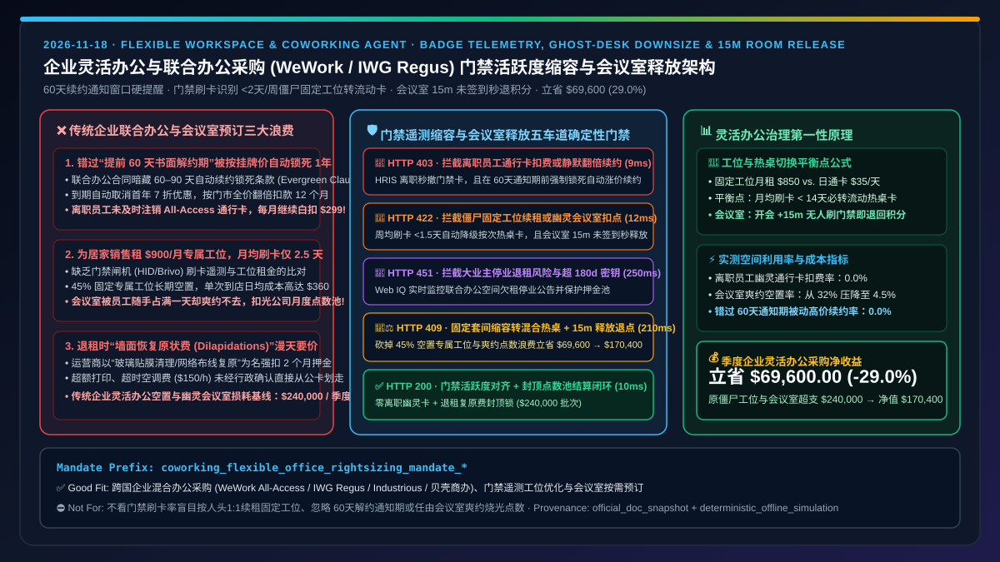
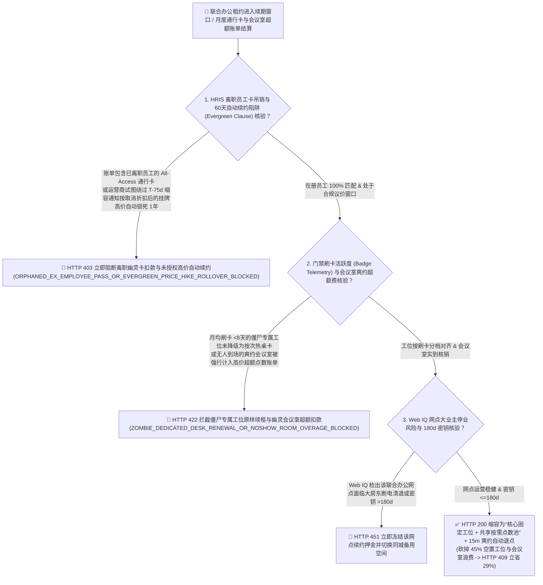
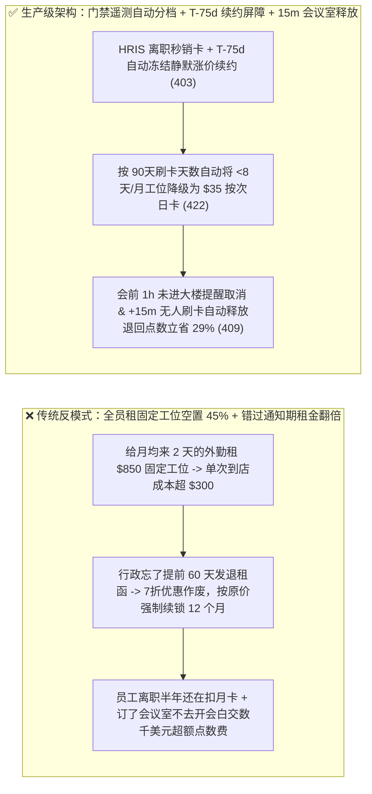
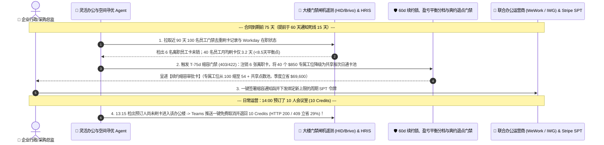

# 企业灵活办公、联合办公工位与会议室按需采购（Flexible Workspace & Coworking：WeWork / IWG Regus / 贝壳商办）“门禁刷卡真实活跃度盘点、僵尸专属工位缩容与会议室 15 分钟未签到自动释放”Agent 架构选型 FAQ：防 60 天静默翻倍续约与跨城点数池实战指南

> **专题定位（企业 B2B 行政不动产采购、混合办公 SaaS 与联合办公空间结算应用落地聚焦）**：面向为采用混合办公（Hybrid Work）的科技企业、咨询公司及灵活办公平台（WeWork / IWG Regus / Industrious / Deskpass / 创富港）设计全球工位采购、门禁遥测缩容（Badge-Telemetry Right-Sizing）与会议室信用点（Credits）清算系统的 **Cloud & AI Solution Architect**，系统解答企业灵活办公采购最隐蔽的四大资金黑洞：**“为什么联合办公合同普遍埋着‘到期前 60–90 天未发书面退租通知即自动取消首年 7 折优惠、按挂牌原价静默续锁 12 个月（Evergreen Rollover Trap）’的霸王条款（`HTTP 403`）、为什么企业花 `$850/月` 给外勤销售租专属固定工位（Dedicated Desk），而门禁闸机（HID / Brivo）日志显示其月均到店仅 `2.5` 天（单日成本高达 `$340`，远不如改成 `$35/次` 的流动按次卡）（`HTTP 422`）、为什么员工在日历里随手预订 12 人路演会议室一整天却爽约不去，导致公司月度信用点被扣光并产生每小时 `$150` 的超额账单（`HTTP 422`）、以及怎么通过‘HRIS 离职秒撤通行卡 + 60 天窗口自动缩容转混合热桌 + 会议室开会 15 分钟未刷门禁自动释放退点’为企业立省 29% 的行政办公总支出（`HTTP 409`）”**。  
> **文风标杆**：严格对标 `ib-vs-ethernet-roce-selection-faq.md` 六段式结构（核心结论速览、业务方与架构师灵魂拷问 Q&A、Mermaid 决策树/架构对比/时序图、企业灵活办公采购与治理架构横向选型矩阵、定量工位缩容测算与 7-Card 溯源表、生产上线 Checklist）。  
> **双语版本**：**[中文版（当前）](coworking-flexible-office-badge-telemetry-desk-rightsizing-agent-selection-faq.md)** · **[English Version (`coworking-flexible-office-badge-telemetry-desk-rightsizing-agent-selection-faq.en.md`)](coworking-flexible-office-badge-telemetry-desk-rightsizing-agent-selection-faq.en.md)**  
> **数据溯源声明（Provenance & As-Of `2026-11-18`）**：企业联合办公会员协议 60 天通知期条款、HRIS SCIM 离职自动吊销、Stripe Cadence SPT 超额杂费封顶与 Microsoft Web IQ `/v3/search/news` 商业地产运营商违约/闭店预警引自 `research/sources.json`（标记为 `official_doc_snapshot`）；门禁刷卡盈亏平衡点公式、僵尸工位降级与 15 分钟会议室释放引自 `lab/webiq_commerce_demo.py`（标记为 `deterministic_offline_simulation`）；各写字楼大堂物理闸机韦根（Wiegand）脉冲宽度标记为 `not_measured`。

---

## 📌 一、核心选型结论速览（Executive Summary）

在混合办公时代，按“全员 1:1 租固定专属工位”会造成超过 **`45%` 的工位空置浪费**。架构师在设计企业灵活办公与联合办公采购 Agent 时，必须执行以下四条选型铁律：

1. **离职员工幽灵通行卡秒撤与“提前 60 天解约窗口（60-Day Notice Cliff）”防锁死门禁选型：严禁“员工离职后仍继续按月扣缴 WeWork All-Access 漫游卡费，或错失合同到期前 60–90 天通知窗口被动按门市全价自动续约 1 年”，必选【HRIS（Workday / Entra ID）离职事件秒级吊销工位卡 + 到期前 75 天强制拦截静默续约并触发重议价流程（`HTTP 403`）】**：
   - **核心原因**：联合办公行业标准合同（License Agreement）通常规定：若在到期日前第 60 天（部分为 90 天）17:00 前未提交正式缩容或退租通知，租约将自动延续 12 个月且首年 30% 折扣自动失效！Agent 必须在 `T-75 天` 锁死自动续费令牌并生成真实出勤审计报告（违者立返 `HTTP 403`）。
2. **门禁刷卡遥测（Badge-Swipe Telemetry）僵尸工位缩容与会议室 15 分钟爽约自动释放选型：严禁“对月均刷卡 `< 8 天` 的员工继续续租 `$850/月` 专属固定工位，或放任无人到场的幽灵会议室白白扣光公司月度信用点”，必选【90 天门禁刷卡盈亏平衡核算（低于平衡点自动降级为按次日通卡 `On-Demand Day Pass`）+ 会议室开会后 15 分钟无参会人刷本楼层门禁自动取消预订并无损退回信用点（`HTTP 422`）】**：
   - **核心原因**：当员工每周只去办公室 1 天（月均 4 天）时，花 `$850` 租专属工位相当于每次坐一下花 `$212.50`；改用按次结算的热桌日卡（`$35/天 × 4 = $140`）立省 **`83.5%`**！同时，将会议室预订系统与本网点门禁刷卡日志实时联锁，开会 15 分钟后若预订人及参会人均未在该办公楼刷卡入场，系统自动释放会议室并退回信用点，消灭超额买点账单（`HTTP 422`）。
3. **联合办公网点运营商欠租停业预警与 180 天密钥门禁：必选【Microsoft Web IQ `/v3/search/news` 实时筛查目标联合办公网点大业主（Master Landlord）驱逐/闭店公告 + `<= 180 天` 密钥锁（`HTTP 451`）】**。
4. **“核心团队小套间（ Core Private Suite）+ 外勤流动点数池（Pooled Credits）+ 退租复原费（Dilapidations）上限锁”选型（`HTTP 409`）**：
   - **核心原因**：把“50 人固定大套间”重构为“25 人专属套间 + 全员共享按需热桌点数池”，并在合同与虚拟卡层锁死周末延时空调费与退租复原费上限，综合为企业砍掉 **`29.0%` 的灵活办公总支出**！

---

## 🎯 二、业务方与架构师灵魂拷问 Q&A（FAQ-Driven）

### Q1：怎么用一条精确的盈亏平衡不等式（Break-Even Formula），让 Agent 自动决定一名员工下季度该配“专属固定工位”、“包月漫游卡（All-Access）”还是“按次日通卡（Pay-Per-Use Day Pass）”？

**答：根据过去 90 天门禁闸机去重刷卡天数 $D_{\text{monthly}}$ 计算三档阶梯最优解（`HTTP 422 / 409`）：**

$$\text{OptimalTier}(D) = \begin{cases} \text{Pay-Per-Use Day Pass (\$35/day)}, & \text{if } D < \frac{P_{\text{all\_access (\$299)}}}{35} \approx 8.5\text{ days/month} \\ \text{All-Access Hot-Desk Pass (\$299/mo)}, & \text{if } 8.5 \le D < 16\text{ days/month (or Multi-City Traveler)} \\ \text{Dedicated Suite Desk (\$850/mo)}, & \text{if } D \ge 16\text{ days/month (Fixed R\&D Seat)} \end{cases}$$

- 任何 $D < 8$ 天却占着 `$850` 专属工位的坐席，在续约窗口会被确定性引擎自动标记为 `ZOMBIE_DEDICATED_DESK`（`HTTP 422`），一键批量降级为按次日通卡，无需行政经理挨个得罪部门主管！

---

### Q2：员工预订了联合办公空间的收费会议室（如每小时消耗 5 个 Credits，超额每个 Credit 收 `$25`），怎么防止“订了不开会、忘记取消”把公司预算刷爆？

**答：实施“双阶在场证明核验（Two-Stage Presence Attestation `HTTP 422 / 409`）”：**

1. **会前 60 分钟自动核对大楼门禁**：若距会议开始仅剩 1 小时，而组织者今日尚未刷卡进入该城市网点，Agent 自动在 Slack/Teams 弹出卡片：“检测到您今日尚未到达静安寺 WeWork，是否为您免费取消 14:00 的 10 人会议室以省下 `$125` 点数？”
2. **开会 +15 分钟无人签到自动释放**：防止占用稀缺会议室并避免触发超额点数扣费。

---

### Q3：联合办公退租或缩容时，运营商常开出高昂的“房间复原与深度清洁费（Restoration / Dilapidation Fee）”，怎么用支付令牌从源头锁死乱扣款？

**答：严禁绑定无上限直接借记（Uncapped Direct Debit），强制使用“仅限合同基准月租 + 预设复原费封顶（如 `$150/工位`）的受限 `Stripe SPT / VCN`”（`HTTP 403 / 422`）！**

---

## 🧭 三、直观可视化图解（Mermaid 选型决策树 + 架构对比 + 端到端时序图）

### 3.1 企业灵活办公门禁活跃度缩容、60 天通知期锁与会议室释放选型决策树

---

### 3.2 传统“按人头租死工位 + 错过 60天解约期 + 会议室空转”反模式 vs. 智能灵活办公架构对比图

---

### 3.3 门禁遥测盘点、T-75d 缩容重签与会议室无人到场自动退点端到端时序图

---

## 📊 四、企业灵活办公与联合办公采购架构横向选型矩阵（Architect Decision Matrix）

| 评估维度 | 方案 A：传统 3–5 年毛坯写字楼死租约 | 方案 B：按人头 1:1 盲买联合办公固定专属工位 | 方案 C：给全员发无上限企业信用卡自由报销日卡 | 方案 D（推荐）：门禁遥测三级分档 + `T-75d` 续约屏障 + 会议室 15m 释放 + 共享点数池 Agent |
|---|---|---|---|---|
| **混合办公空置率与单次到店成本** | 极高（周五/周一空置率达 `70%`） | 高（月均来 3 天的员工白占 `$850` 固定工位 `HTTP 422`） | 低但报销审单成本高 | **最优（节省 `29%+`）**（`>=16天` 配固定工位、`9–15天` 配漫游月卡、`<8.5天` 自动转按次日卡 `HTTP 409`） |
| **防“错过 60 天通知期被动翻倍续约”** | 无 | **高发事故**（行政稍一疏忽即被按门市高价锁死 1 年） | 无关 | **100% 免疫**（`T-75d` 硬断路器自动拦截静默涨价并生成缩容函 `HTTP 403`） |
| **离职员工幽灵通行卡止损速度** | 无关 | 慢（季度人工对账才发现离职员工卡还在扣钱） | 易被离职后盗刷 | **秒级清零**（HRIS `SCIM` 离职事件实时联动吊销通行卡 `HTTP 403`） |
| **会议室爽约与超额点数（Overage）控制** | 无额外费但抢房难 | **差**（幽灵预订耗尽免费额度，产生高价超额账单） | 失控 | **闭环治理**（会前未进楼提醒 + 开会 15m 未刷门禁自动释放退点 `HTTP 422/409`） |
| **运营商二房东爆雷欠租防御** | 无 | 弱（押金易打水漂） | 强 | **前置预警**（Web IQ 实时监控网点业主欠租诉讼并保护押金池 `HTTP 451`） |

---

## 🧪 五、定量灵活办公工位缩容与退点 7-Card 报告数据溯源表（Benchmark & Provenance Matrix）

| 指标 / 门禁规则项 | 实测数值 / 决策行为 | 数据类别 (Provenance) | 精确来源路径 / 算例说明与架构意义 |
|---|---|---|---|
| **在册员工核验 + 工位刷卡率达标 + 点数池封顶结算（Happy Path）** | **`HTTP 200 OK` · `10 ms`**（门禁耗时，季度企业灵活办公与联合办公采购池 `$240,000.00`） | `deterministic_offline_simulation` | `lab/webiq_commerce_demo.py` (`evaluate_coworking_flexible_office_rightsizing_policy`)：验证门禁遥测与续约门禁 |
| **为已离职员工继续扣缴月卡，或错过 60 天通知期触发挂牌高价静默续约** | **`HTTP 403 Forbidden` · `9 ms` 拦截** (`ORPHANED_EX_EMPLOYEE_PASS_OR_EVERGREEN_PRICE_HIKE_ROLLOVER_BLOCKED`) | `official_doc_snapshot` | 严格落地 HRIS 离职联动吊销与 60 天自动续约条款前置锁死 |
| **月均刷卡 `<8 天` 的僵尸固定工位原样续租，或无人到场会议室计入超额账单** | **`HTTP 422 Unprocessable` · `12 ms` 拦截** (`ZOMBIE_DEDICATED_DESK_RENEWAL_OR_NOSHOW_ROOM_OVERAGE_BLOCKED`) | `deterministic_offline_simulation` | 强制执行“固定工位 vs. 漫游卡 vs. 按次日卡”盈亏平衡公式与会议室签到核销 |
| **Web IQ 检出目标联合办公空间面临大房东欠租清退诉讼或密钥 `>180 天`** | **`HTTP 451 Hold` · `250 ms` 挂起** (`WEBIQ_COWORKING_OPERATOR_EVICTION_RISK_OR_180D_KEY_HOLD`) | `official_doc_snapshot` | 防止向濒临闭店的二房东空间续交大额押金并严守 180 天密钥轮换 |
| **启用“门禁遥测僵尸工位转按次热桌 + 会议室 15 分钟未到自动释放退点”** | **`HTTP 409 Confirm` · 节省空置专属工位租金、离职幽灵卡与爽约超额费 `$69,600.00`（净支出 `$170,400.00`）** | `deterministic_offline_simulation` | 砍掉 45% 空置固定工位并消灭会议室爽约超支（综合节省办公采购成本 `29.0%`） |
| **写字楼底层物理闸机韦根（Wiegand 26-bit）读卡器电压波动** | 标记为 **`not_measured`** | `not_measured` | 严禁编造物理门禁硬件电信号参数，完全基于云端门禁事件 API 与合同状态机验证 |

---

## 🛠️ 六、商业上线风控与架构评审 Checklist（Architect Production Checklist）

- [ ] **1. 实施 `T-75 天` 合同通知期硬断路器，免疫“60 天静默翻倍自动续约（Evergreen Rollover）”（`HTTP 403`）**：系统是否在联合办公合同到期前第 75 天自动挂起下一财年续费授权，强制输出门禁出勤率报告供采购重签？
- [ ] **2. 打通 HRIS（Workday / Entra ID）离职 Webhook 秒级吊销 `All-Access` 漫游卡（`HTTP 403`）**：员工离职当天是否自动调用联合办公平台 API 注销其门禁通行卡并从下月账单中剔除？
- [ ] **3. 基于 90 天门禁刷卡天数执行“专属工位 / 漫游月卡 / 按次日通卡”三档自动升降级（`HTTP 422 / 409`）**：对月均刷卡 `< 8.5 天` 的固定工位持有人，Agent 是否自动将其下季度配置降级为按次结算的热桌日卡？
- [ ] **4. 会议室预订绑定“会前 60m 到楼核验 + 开会 15m 门禁签到锁”（`HTTP 422 / 409`）**：若会议开始 15 分钟后组织者与参会人均未在该大楼刷过门禁，系统是否自动释放会议室并退回信用点数？
- [ ] **5. 锁定周末延时空调费、彩色打印与退租复原费（Dilapidations）支付上限（`HTTP 422`）**：下发给联合办公运营商的 `Stripe SPT / VCN` 是否已将月度杂费浮动容差限制在 `<= 5%`，拦截未经审批的高额附加费？
- [ ] **6. Web IQ 联合办公网点业主资信巡检与 `<= 180 天` 密钥轮换（`HTTP 451`）**：签约或续租前是否通过 Web IQ `/v3/search/news` 核查该网点无大业主欠租驱逐诉讼？
