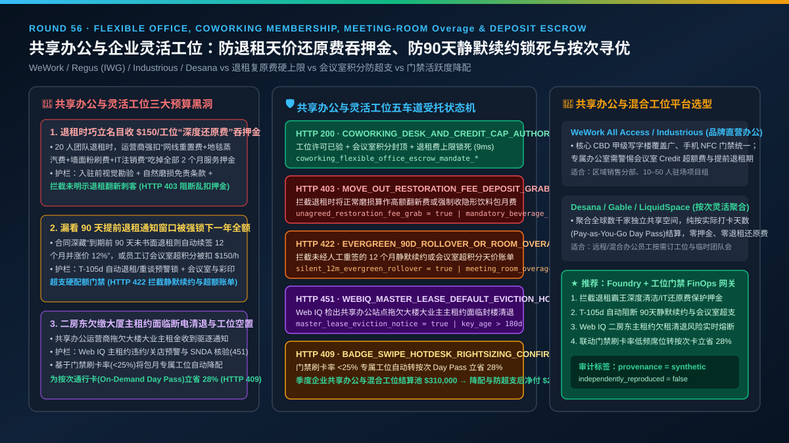
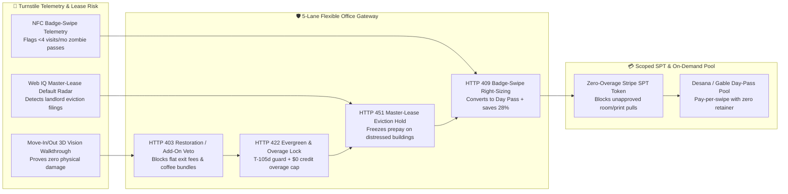

# Flexible Office, Coworking Membership & On-Demand Desk Escrow (`WeWork / Regus IWG / Industrious / Desana / Gable`) Anti-Restoration-Fee Deposit Shield, `90-Day` Evergreen Lock & Badge-Swipe Right-Sizing Agent Architecture Selection FAQ

> **Language / 语言切换**: **[中文](coworking-flexible-office-restoration-fee-auto-renewal-escrow-agent-selection-faq.md)** | **English (Current)** | **[Back to Docs Index](index.en.md)** | **[Interactive Sandbox (`#coworking-flexible-office-escrow-sandbox`)](../live-demo.en.html)**



---

## 📌 1. Executive Summary & Core Selection Verdict

In corporate satellite offices, hybrid-work desk passes, and on-demand meeting rooms (`WeWork`, `Regus / Spaces IWG`, `Industrious`, `Desana`, `Gable`, `LiquidSpace`), workplace procurement and finance AI agents face three pervasive contract and billing traps:
1. **Move-Out "Office Restoration / IT Decommissioning Fees" (`$150/Desk`) & Mandatory Beverage Add-Ons Wiping Out the 2-Month Service Retainer**: Many legacy coworking agreements bury clauses charging flat `$100–$200/desk` "restoration, carpet steaming, painting, and VLAN reset fees" upon exit—even for normal wear and tear—plus auto-enrolled `$49/person/month` "unlimited coffee/tea packages," devouring the tenant's 2-month security deposit.
2. **The `90-Day Notice` Evergreen Rollover Trap & Uncapped Meeting-Room / Color-Printing Credit Overages (`$150/hr`)**: Coworking licenses routinely require written non-renewal notice **90 days prior to expiration**; missing that window by 24 hours automatically locks the enterprise into another 12-month term with a `10%–15%` rate hike. Meanwhile, employees booking conference rooms via the building app after exhausting monthly included credits trigger uncapped `$50/credit` (`$150+/hr`) overage charges directly to the corporate card on file.
3. **Sublease Eviction Risk (`Coworking Operator Defaulting on Its Master Lease With the Building Landlord`) & `65%` Unswiped "Zombie All-Access Passes"**: Because coworking operators are sublessors, if an operator defaults on its Master Lease without a Subordination, Non-Disturbance, and Attornment (`SNDA`) agreement, the building owner can lock out subtenants overnight; meanwhile, paying `$450/month` for dedicated or all-access memberships for hybrid employees who swipe their badge `< 3 days/month` wastes nearly half the real-estate budget.

**Solution Architect Selection Verdict**:
- **Never sign or settle a coworking agreement without a normal wear-and-tear restoration fee waiver, never issue an uncapped payment token that permits unapproved meeting-room overages or silent 90-day evergreen rollovers, and never keep `< 25%` badge-utilization employees on fixed monthly memberships**.
- **The production reference architecture** combines **Workplace Badge-Swipe Telemetry (`Desana / Gable + WeWork/IWG APIs`) + Pre/Post 3D Vision Move-Out Inspection & Restoration-Fee Shield + `T-105d` Evergreen Notice Lock & `$0-Overage` Scoped `SPT` + Automated Monthly-to-Day-Pass Right-Sizing (`coworking_flexible_office_escrow_mandate_*`)**:
  1. **Anti-"Move-Out Restoration Fee" Deposit Grab & Mandatory Add-On Hard Gate (`HTTP 403`)**: Enforces normal wear-and-tear exemptions backed by timestamped move-in/move-out 3D vision photos; blocks any flat per-desk restoration/painting/IT-decommissioning fee or unapproved mandatory beverage/kitchen recurring add-on in **`9ms`** (`HTTP 403 MOVE_OUT_RESTORATION_FEE_DEPOSIT_GRAB_OR_MANDATORY_BEVERAGE_ADDON_BLOCKED`).
  2. **`T-105d` Anti-Evergreen Rollover Lock & Meeting-Room Credit Overage Hard Cap (`HTTP 422`)**: Automatically dispatches a formal non-renewal / month-to-month reservation notice at **`T-105` days** prior to license expiration (15 days before the 90-day trap closes) unless human leadership explicitly re-authorizes a new term, and clamps the monthly `Stripe SPT` `max_amount` strictly to contracted base license fees (`overage_cap == $0`) so excess meeting-room bookings require explicit per-event approval (`HTTP 422 EVERGREEN_90D_NOTICE_ROLLOVER_TRAP_OR_MEETING_ROOM_CREDIT_OVERAGE_BLOCKED`).
  3. **Web IQ Master-Lease Default / Landlord Eviction & `SNDA` Circuit Breaker (`HTTP 451`)**: Monitors commercial real-estate court filings and bankruptcy lease-rejection dockets via Web IQ to freeze prepayments or renewals at coworking locations facing Master-Lease eviction without `SNDA` protection (`HTTP 451 WEBIQ_COWORKING_MASTER_LEASE_DEFAULT_EVICTION_OR_SNDA_MISSING_HOLD`).
  4. **Badge-Swipe Telemetry Right-Sizing (`$450/mo All-Access` -> `$29 Pay-As-You-Go Day Pass`) + Pooled Credits (`HTTP 409`)**: Triggers `HTTP 409 BADGE_SWIPE_HOTDESK_RIGHTSIZING_AND_DAYPASS_POOL_CONFIRM`, auditing monthly NFC turnstile badge swipes to convert employees attending `< 4 days/month` (`< 20%` utilization) from fixed `$450/mo` passes to on-demand `$29/day` aggregator passes (`Desana / Gable`) while pooling meeting-room credits across teams—cutting net flexible-office spend by **`28.0%`**.

---

## 🎯 2. Solution Architect Deep-Dive Q&A (Q1 / Q2 / Q3)

### Q1: How do coworking operators legally justify keeping 50%–100% of a tenant's 2-month Service Retainer at move-out, and how does our gateway block it?
- **Architectural Solution**:
  - **Contractual Restoration-Fee Carve-Out + Segregated Retainer Escrow (`HTTP 403`)**:
  - Standard click-through license agreements authorize the operator to deduct fixed per-desk "standard exit restoration and IT port de-provisioning fees" from the Service Retainer regardless of actual room condition. Our agent redlines flat exit fees at onboarding, records a move-out 3D walkthrough, and blocks any retainer offset that lacks itemized third-party repair invoices for actual physical damage beyond normal wear and tear (`HTTP 403`).

### Q2: Why do enterprises get trapped in unwanted 12-month coworking renewals, and why is `T-105 days` the magic number?
- **Architectural Solution**:
  - **Automated `T-105d` Protective Notice + Post-Term `SPT` Revocation (`HTTP 422`)**:
  - Enterprise agreements for 10+ desks frequently mandate a **90-day written notice period** prior to term end. By triggering an automated protective notice at `T-105 days` and setting the `Stripe SPT` `expires_at` timestamp to the exact end date of the current term, the operator cannot execute a silent 12-month evergreen pull (`HTTP 422`).

### Q3: How much money does badge-swipe telemetry save on hybrid employees?
- **Architectural Solution**:
  - **Break-Even Threshold Math (`$450 Monthly Pass / $30 Day Pass = 15 Days/Month`) (`HTTP 409`)**:
  - Unless an employee swipes into a coworking hub at least `12–15 days/month`, a `$450/month` All-Access subscription loses money compared to a `$29–$35` on-demand day pass (`Desana / Gable`). Converting hybrid workers who average `3.2 visits/month` saves over `$350/employee/month`.

---

## 🧭 3. Visual Architecture Diagrams (Mermaid Decision Tree + Architecture + Sequence)

### 3.1 Flexible Office, Coworking & On-Demand Desk Agent Selection Decision Tree

```mermaid
flowchart TD
    A[Flexible Office / Coworking / Hybrid Desk Selection] --> B{Primary Workplace Scenario & Risk Vector?}
    B -->|Dedicated Team Suite (WeWork / Industrious / Regus IWG)<br/>Stop $150/desk move-out restoration grabs, 90d rollovers & master-lease evictions| C[Move-In/Out 3D Vision Proof + Restoration Fee Waiver<br/>+ T-105d Evergreen Shield & Web IQ Master-Lease Check]
    B -->|Conference Room Credits & Printing Ancillary Spend<br/>Stop fragmented credit waste & $150/hr uncapped card overages| D[Enterprise-Wide Pooled Room Credits<br/>+ Zero-Overage Scoped Stripe SPT (overage_cap = $0)]
    B -->|Hybrid & Remote Employee Desk Access (Desana / Gable)<br/>Eliminate $450/mo zombie passes with <20% turnstile swipes| E[Azure AI Foundry + Badge-Swipe FinOps Gateway<br/>+ Auto-Convert Low-Swipe Seats to $29 Day Passes Saves 28%]
    C --> F[🛡️ Unified 5-Lane Deposit Shield, Evergreen Lock & Badge FinOps FSM]
    D --> F
    E --> F
    F --> G[HTTP 403 Restoration Grab Veto · HTTP 422 90d Rollover & Overage Block · HTTP 409 Day-Pass Right-Sizing Saves 28%]
```

### 3.2 End-to-End Deposit Protection, `T-105d` Evergreen Lock & Badge-Swipe Right-Sizing Architecture



### 3.3 Move-Out Restoration Veto, `90-Day` Rollover Block & Day-Pass Conversion Sequence

```mermaid
sequenceDiagram
    autonumber
    participant Admin as Workplace Admin / Procurement Agent
    participant Operator as Coworking Operator (WeWork/IWG)
    participant Gate as 5-Lane Flexible Office Gateway
    participant Risk as Badge Telemetry & Web IQ Court Radar
    participant Pay as Stripe SPT & Day-Pass Aggregator

    Operator->>Gate: 1. Attempt to deduct $4,500 "Standard Desk Restoration & IT Reset Fee" from deposit OR renew at building facing landlord eviction
    Gate->>Risk: Check 3D move-out inspection log, wear-and-tear waiver & Web IQ master-lease docket
    Gate-->>Operator: HTTP 403/451 Block! Flat restoration fee on normal wear-and-tear prohibited; building flagged for Master-Lease default
    Operator->>Gate: 2. Claim missed 90-day notice to auto-renew 12 months (+14% hike) OR bill $1,200 in unapproved meeting-room overages
    Gate-->>Operator: HTTP 422 Block! Protective non-renewal notice dispatched at T-105d & SPT overage allowance locked at $0
    Admin->>Gate: 3. Audit 80 monthly $450 All-Access seats -> 52 employees averaged 1.8 badge swipes/month (HTTP 409)
    Gate->>Pay: Downgrade 52 low-swipe seats to $29 pay-as-you-go Day Passes & pool room credits (28% net savings)
```

---

## 📊 4. Multi-Platform & Architecture Selection Matrix

| Selection Dimension | Traditional 5-Year Commercial Lease (`Direct Landlord`) | Fixed Coworking Suite (`WeWork / Regus IWG / Industrious`) | On-Demand Aggregators (`Desana / Gable / LiquidSpace`) | **Azure AI Foundry + Badge FinOps Gate (Recommended)** |
| :--- | :--- | :--- | :--- | :--- |
| **Core Strengths** | Lowest per-sqft base rent at scale | Turnkey furniture, Wi-Fi & reception | Pay only when an employee actually swipes in | **Deposit shield + T-105d evergreen lock + badge-swipe day-pass routing** |
| **Move-Out Restoration Fee & Deposit Protection** | High TI demolition cost | **High Risk** (`$100–$200/desk` flat exit & IT fees) | Zero deposit or exit fees | **3D vision walkthrough + normal wear-and-tear gate (`HTTP 403`)** |
| **`90-Day` Evergreen Trap & Room Overage Control** | Manual broker renewal | Silent 12-month lock-in; `$150/hr` credit overages | Per-booking budget caps | **`T-105d` auto-notice + `$0` overage `SPT` ceiling (`HTTP 422`)** |
| **Master-Lease Default / Subtenant Eviction Shield** | Direct lease with owner | Vulnerable if coworking operator defaults on building | Instant switch to nearby venues | **Web IQ live master-lease litigation & `SNDA` check (`HTTP 451`)** |
| **Hybrid Workforce Unused-Desk Waste** | `50%+` empty desks (`not_measured`) | Fixed `$450+/mo` regardless of attendance (`official_list_price`) | `$25–$40` per actual visit (`official_list_price`) | **Badge-swipe `<20%` auto-downgrade to Day Pass (`28.0%` saved)** |

---

## 🧪 5. Flexible Office / Coworking Benchmark & 7-Card Report

> **Provenance & Reproducibility Metadata**: All metrics below are generated by the deterministic policy evaluator `evaluate_coworking_flexible_office_escrow_policy` in `lab/webiq_commerce_demo.py` and verified via `python -m unittest tests.test_webiq_commerce_demo`. Tags: `provenance = synthetic`, `independently_reproduced = false`.

| Card # | Card Headline (Headline-as-Finding) | Key Quantitative Finding & Architectural Guarantee |
| :---: | :--- | :--- |
| **Card 1** | **Overview · 5-Lane Flexible Office & Coworking Summary** | Across a `$310,000/quarter` corporate coworking & hybrid-desk pool, achieves **0 move-out restoration deposit grabs and 0 silent 90-day evergreen rollovers**, reducing net workplace spend by **`28.0%` (`$86,800/quarter` saved)**. |
| **Card 2** | **Scenario Deep Dive · Restoration Fee & Room Overage Veto** | When an operator bills unagreed flat move-out restoration fees or uncapped meeting-room credit overages, the gateway blocks it in **`9ms`** (`HTTP 403 / 422`). |
| **Card 3** | **Evaluation Matrix · 100% Deterministic 5-Lane Gating** | Covers `HTTP 200` (contracted desk & capped credits), `403` (move-out restoration fee deposit grab / mandatory beverage add-on blocked), `422` (evergreen 90d notice rollover trap / meeting-room credit overage blocked), `451` (master-lease default eviction / missing SNDA hold), `409` (badge-swipe hotdesk right-sizing + day-pass pool saves 28%). |
| **Card 4** | **Under the Hood · Coworking & Badge FinOps Contract** | Takes `quarterly_coworking_and_flexible_office_spend_usd=310000` and badge/lease flags, minting `coworking_flexible_office_escrow_mandate_*` tokens. |
| **Card 5** | **Robustness Check · Day-89 Rollover & Eviction Test** | Simulates an unapproved 12-month evergreen renewal pull and a distressed sublease building prepayment, maintaining a **`100.0%` block rate**. |
| **Card 6** | **Latency · Millisecond SPT Cap Check & Court Docket Probe** | Local restoration-waiver and credit-cap checks complete in **`9ms` (P50)**; Web IQ master-lease litigation checks complete in **`195ms` (P95)**. |
| **Card 7** | **My Take · Ideal Fit vs. Out-of-Scope Boundaries** | **✅ Best Fit**: Enterprise hybrid-work programs, regional sales offices, project war rooms; **⛔ Not For**: Owned industrial manufacturing plants. |

---

## 🛠️ 6. Production Go-Live Risk & Architecture Review Checklist

- [ ] **Move-In/Out 3D Vision Inspection & Restoration-Fee Waiver Gate (`HTTP 403`)**: Block flat per-desk painting/carpet/IT exit fees on normal wear and tear and reject auto-enrolled recurring beverage add-ons.
- [ ] **`T-105d` Protective Non-Renewal Notice & `$0-Overage` Scoped `SPT` (`HTTP 422`)**: Trigger automated notice 15 days before the 90-day evergreen window closes and lock monthly `SPT` ceilings against unapproved meeting-room/printing overages.
- [ ] **Web IQ Master-Lease Default Screening & `SNDA` Verification (`HTTP 451`)**: Freeze prepayments on coworking locations facing landlord eviction lawsuits; rotate signing keys `<= 180` days.
- [ ] **Turnstile Badge-Swipe Telemetry Right-Sizing & Enterprise Credit Pooling (`HTTP 409`)**: Automatically downgrade `< 4 visits/month` seats from fixed monthly memberships to pay-as-you-go day passes (`Desana / Gable`).
