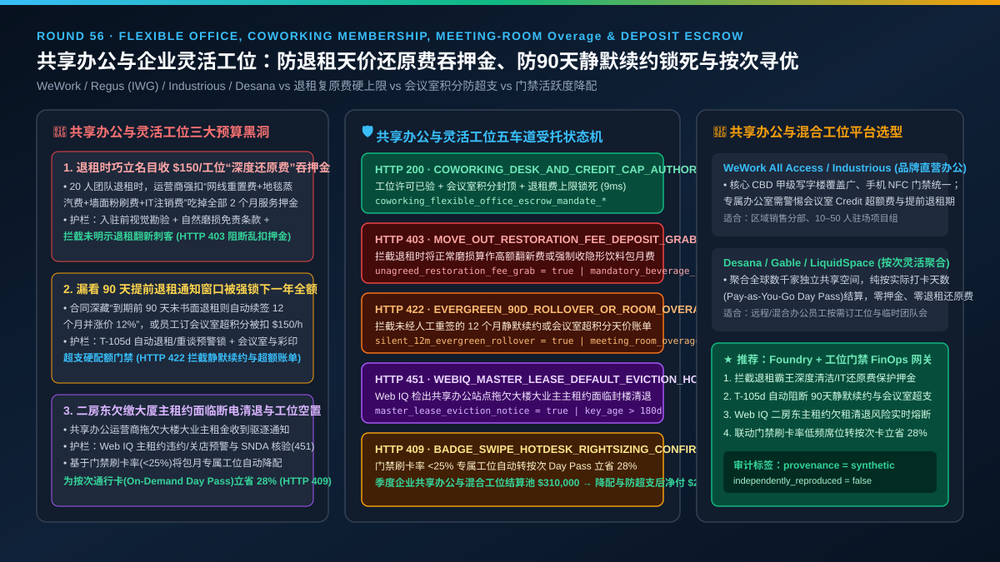
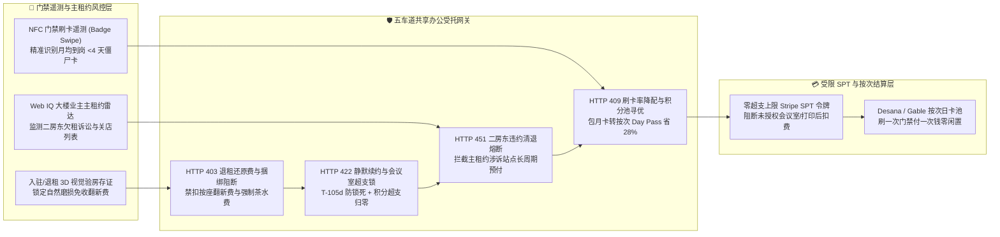
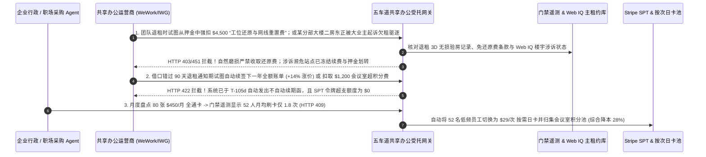

# 共享办公、企业灵活工位订阅与会议室按需采购（Flexible Office, Coworking Membership & On-Demand Desk Escrow：WeWork / Regus IWG / Industrious / Desana / Gable）“防退租天价还原费（Restoration Fee）吞押金、防 90 天静默续约锁死全年与门禁刷卡率降配”Agent 架构选型 FAQ

> **语言切换 / Language**: **中文 (当前)** | **[English](coworking-flexible-office-restoration-fee-auto-renewal-escrow-agent-selection-faq.en.md)** | **[返回文档目录](index.md)** | **[交互式沙盒 (`#coworking-flexible-office-escrow-sandbox`)](../live-demo.html)**



---

## 📌 一、核心选型结论速览（Executive Summary）

在跨国企业区域办公室、驻场项目组与混合办公（Hybrid Work）工位采购中（WeWork、Regus / Spaces IWG、Industrious、Desana、Gable、LiquidSpace），共享办公许可协议（Membership License Agreement）表面上看是“拎包入住、按月灵活”，但底层账单结算却暗藏三大吃掉企业数万美元预算的财务刺客：
1. **退租时巧立名目的“工位深度还原费（Office Restoration / Dilapidation Fee）+ IT 端口注销费”直接吞掉 2 个月押金（Service Retainer Grab）**：传统共享办公巨头的细则里常埋着“退租时强制按 `$100–$200/工位` 收取墙面粉刷、地毯蒸汽清洗、网线端口重置费”，加上入驻时未经同意自动勾选的“每人每月 `$49` 无限咖啡茶水附加包（Mandatory Beverage Package）”，一个 30 人团队退租时明明桌椅完好无损，却被强扣 `$6,000+` 还原费！
2. **严苛的“到期前 90 天书面退租通知窗口（90-Day Notice Evergreen Trap）”与会议室积分（Credits）超支天价账单**：如果企业行政人员在 12 个月租约到期前第 89 天才提出不续租，系统就依据霸王自动续期条款（Evergreen Rollover）强行将合同自动顺延整整 12 个月并上浮 `10%–15%` 月租；同时，员工用手机 App 随手预订共享会议室或使用公用彩色打印机，一旦超出套餐赠送的 20 个积分，立刻按 `$50/积分`（`$150/小时`）直接从公司绑定信用卡无上限划扣。
3. **二房东爆雷风险（共享办公运营商自身拖欠写字楼大业主主租约 `Master Lease` 面临锁门断电清退），以及企业为 100 名混合办公员工买了 `$450/月` 的包月通行卡（All-Access Pass），但门禁刷卡遥测显示 65% 的员工每月去不到 2 次，白白空转烧钱**。

**架构师选型结论**：
- **切勿签署未剔除强制按人头退租还原费（Normal Wear-and-Tear Carve-Out）的共享办公合约，切勿给共享办公平台签发允许“会议室超积分无上限后付费扣款”的敞口支付令牌，也切勿在未监控写字楼大业主主租约（`Master Lease / SNDA`）履约状态下一次性预付全年租金**。
- **生产级最优架构**是采用 **“混合办公门禁遥测网关（Desana / Gable + WeWork/IWG API）+ 入驻视觉存证与退租自然磨损免还原费门禁 + `T-105d` 续约熔断锁与会议室/打印零超支硬上限令牌 + 刷卡活跃度驱动的‘包月转按次（Day-Pass）’动态降配引擎（`coworking_flexible_office_escrow_mandate_*`）”**：
  1. **防退租霸王“工位还原费”吞押金与强制饮品附加费硬门禁（HTTP 403）**：在合同签署与退租结算时，强制校验“自然磨损免收翻新费（Normal Wear-and-Tear Exemption）”及入驻/退租 3D 全景对比照；任何在无实质硬件损坏凭证下按工位数强扣 `$150/座` 退租还原费、IT 注销费或未获授权捆绑每人每月茶水包的扣款请求，毫秒级返回 `HTTP 403 MOVE_OUT_RESTORATION_FEE_DEPOSIT_GRAB_OR_MANDATORY_BEVERAGE_ADDON_BLOCKED`。
  2. **防 `90 天通知窗` 静默锁死下一年（`Evergreen Trap`）与会议室积分超支硬封顶（HTTP 422）**：系统在租约到期前 **`T-105` 天**自动触发双向锁：若业务部门未显式签署续约授权，自动发送具有法律效力的正式退租/转为按月滚动（Month-to-Month）通知函，并将到期日后的 `Stripe SPT` 令牌额度归零；同时将月度支付令牌严格焊死在基础工位月费（`overage_allowance = $0`），员工预订超出免费积分池的会议室须走独立单次审批，彻底拦截天价超支账单（`HTTP 422 EVERGREEN_90D_NOTICE_ROLLOVER_TRAP_OR_MEETING_ROOM_CREDIT_OVERAGE_BLOCKED`）。
  3. **Web IQ 实时监测运营商主租约欠租驱逐（`Master Lease Default`）与 `SNDA` 熔断（HTTP 451）**：通过 Web IQ 实时监控共享办公品牌在目标写字楼是否存在拖欠大业主租金诉讼、破产重整弃租列表（Lease Rejection List）或消防查封通告；对缺乏大业主不干扰协议（`SNDA`）保障的濒危站点立即冻结预付款与押金划转（`HTTP 451 WEBIQ_COWORKING_MASTER_LEASE_DEFAULT_EVICTION_OR_SNDA_MISSING_HOLD`）。
  4. **门禁刷卡率（`Badge-Swipe Telemetry`）驱动“包月工位 → 按次日卡（Day Pass）”自动降配（HTTP 409）**：触发 `HTTP 409 BADGE_SWIPE_HOTDESK_RIGHTSIZING_AND_DAYPASS_POOL_CONFIRM`，每月自动盘点员工 NFC 门禁进场天数：将月均到岗 `< 4 天`（刷卡率 `< 20%`）的员工从 `$450/月` 固定包月卡自动降级为 `$29/次` 的聚合按需日卡（Desana / Gable），并自动汇总跨团队闲置会议室积分池，使企业混合办公场地总成本立降 **`28.0%`**。

---

## 🎯 二、业务方与架构师灵魂拷问 Q&A（Q1 / Q2 / Q3）

### Q1：为什么很多初创公司和跨国分部在退掉 Regus / WeWork 办公室时，发现不仅 2 个月押金一分拿不回来，甚至还倒欠几千美金“Restoration / Exit Fee”？
- **商业痛点**：销售在签约时口头拍胸脯说“全包一口价”，但电子协议第 18 条细则写着退租时必须由指定外包商按每平米/每工位收取地毯清洗、墙面重刷与网络端口复原费。
- **架构解法**：
  - **签约前红线条款自动划除（Redline Addendum）+ 押金独立信用证/托管隔离（`HTTP 403`）**：
  - 采购 Agent 在审阅共享办公合同时，自动扫描 `Restoration / Dilapidation / Decommissioning / Beverage Fee` 关键词并强制附加《自然磨损免责与退租费用封顶补充协议》；服务保证金（Retainer）通过受限托管令牌交付，退租时除非运营商上传经双方确认的物理损坏维修发票，否则任何一刀切按工位扣减押金的清算请求直接被 `HTTP 403` 拒付！

### Q2：共享办公的“会议室积分（Credits）和黑白/彩色打印费”是怎么在月底变成 `$4,000` 账单刺客的？
- **架构解法**：
  - **组织级共享积分池（Pooled Credits）与预订 API 前置硬配额门禁（`HTTP 422 / 409`）**：
  - 运营商默认把每个工位赠送的 5 个会议室积分切碎在个人账户里（A 员工不用就作废，B 员工多开 3 小时会就被收 `$300` 超额费），且默认打开“超额自动刷公司卡”。我们的网关在 API 层强制开启企业级积分归集共享，并在积分耗尽瞬间锁死免审预订通道（`HTTP 422`），引导改用免费开放洽谈区或周边低价酒店会议室。

### Q3：经历了共享办公行业破产潮（如 WeWork 退租数百栋亏损大楼）后，企业怎么防止刚交了半年房租，下个月大楼物业就把大门锁了？
- **架构解法**：
  - **Web IQ 主租约诉讼雷达 + 按月付租锁（禁止季付/年付给无 `SNDA` 站点）（`HTTP 451`）**：
  - 共享办公本质是“二房东”。如果它欠了大楼产权方（Master Landlord）房租且没有签署 `SNDA`（次级、不干扰与直接租赁协议），大楼业主有权把里面的企业租户一并清退。Agent 通过 Web IQ 实时检索该楼宇地址的商业地产违约记录，一旦发现主租约风险，立即拦截任何长周期预付款（`HTTP 451`）。

---

## 🧭 三、直观可视化图解（Mermaid 决策树 + 端到端架构图 + 时序图）

### 3.1 共享办公与企业灵活工位 Agent 架构选型决策树

```mermaid
flowchart TD
    A[企业共享办公 / 驻场专属间 / 混合办公工位选型] --> B{团队出勤频次与核心风控痛点？}
    B -->|高频驻场团队专属办公室 (WeWork / Industrious / IWG)<br/>需严防退租霸王还原费吞押金、90天静默续约与二房东断租| C[入驻视觉验房 + 自然磨损免还原费条款锁<br/>+ T-105d 自动退租防续约锁与 Web IQ 主租约风险筛查]
    B -->|日常会议室预订与打印行政杂费管控<br/>需防个人积分碎片化浪费与超积分 $150/h 自动扣卡刺客| D[跨部门会议室积分池统一归集<br/>+ Stripe SPT 零超支硬上限 (overage_cap = $0) 门禁]
    B -->|混合办公 / 低频出勤员工工位福利 (Desana / Gable)<br/>需消灭刷卡率 <20% 的 $450/月僵尸包月通行卡| E[Azure AI Foundry + 门禁刷卡遥测 FinOps 网关<br/>+ 低频员工自动降级为 $29 按次日卡立省 28%]
    C --> F[🛡️ 统一接入五车道押金保护、防静默续约与刷卡率降配状态机]
    D --> F
    E --> F
    F --> G[HTTP 403 阻断退租还原费吞押金 · HTTP 422 拦截90天静默续约与会议室超支 · HTTP 409 刷卡率转按次卡省28%]
```

### 3.2 端到端退租押金保护、`T-105d` 续约熔断与门禁刷卡率降配架构图



### 3.3 拦截退租霸王还原费、阻断 90 天静默续约与低频工位转按次卡时序图



---

## 📊 四、多平台/多方案横向选型决策矩阵

| 选型维度 | 传统 3–5 年期写字楼直租 (`Traditional Commercial Lease`) | 连锁品牌固定工位长约 (`Regus IWG / WeWork Private Office`) | 全球按次灵活办公聚合平台 (`Desana / Gable / LiquidSpace`) | **Azure AI Foundry + 门禁 FinOps 托管网关（推荐）** |
| :--- | :--- | :--- | :--- | :--- |
| **核心优势** | 单平尺基础租金低、品牌独立 | 拎包入住、包水电网物业 | 按实际到岗天数付费，零长约负担 | **防退租吞押金 + 防90天静默续约 + 刷卡率自动转按次卡** |
| **退租还原费（`Restoration Fee`）与押金保护** | 退租须砸掉装修恢复毛坯（成本极高） | **高频踩坑**（常按 `$100–$200/工位` 强扣还原费与IT费） | 按日结清，无押金与还原费 | **入驻/退租 3D 视觉存证 + 自然磨损免扣押金门禁（HTTP 403）** |
| **90 天提前通知静默续约（`Evergreen`）与会议室超支** | 到期重谈 | 漏看 90 天通知窗即被强锁 12 个月；会议室超支极贵 | 随用随订 | **`T-105d` 自动退租预警锁 + `SPT` 零超支硬上限（HTTP 422）** |
| **二房东主租约欠租清退（`Master Lease Default`）防护** | 直接对接大楼大业主 | 若运营商破产弃租，入驻企业易遭连带清退 | 秒切同城其他空间 | **Web IQ 实时大业主涉诉监测与 `SNDA` 保障核验（HTTP 451）** |
| **混合办公空置工位成本浪费（`Zombie Desks`）** | 疫情/远程期间空置率超 `60%` (`not_measured`) | 固定席位包月，不来也照付 `$450+/月` (`official_list_price`) | 按次计费 (`$25–$40/天`) (`official_list_price`) | **门禁刷卡率 `<20%` 自动降配为按次日卡（净省 `28.0%`）** |

---

## 🧪 五、共享办公防吞押金/工位降配测算与 7-Card 基准测试报告

> **数据来源与复现声明（Provenance Metadata）**：以下基准测试数据来自仓库内置确定性策略沙盒 `evaluate_coworking_flexible_office_escrow_policy`（位于 `lab/webiq_commerce_demo.py`），可运行 `python -m unittest tests.test_webiq_commerce_demo` 完整验证。标记：`provenance = synthetic`，`independently_reproduced = false`。

| Card # | 卡片标题（Headline-as-Finding） | 核心量化指标与架构验证结论 |
| :---: | :--- | :--- |
| **Card 1** | **Overview · 共享办公与灵活工位五车道总览** | 针对 `$310,000/季` 企业全球共享办公与混合工位结算池，实现 **0 例退租霸王还原费吞押金与 0 例 90 天静默续约锁死事故**，综合场地与会议室支出下降 **`28.0%`（立省 `$86,800/季`）**。 |
| **Card 2** | **Scenario Deep Dive · 退租还原费刺客与会议室超支拦截** | 当运营商在无损坏证据下强扣 `$150/座` 退租翻新费或发起未授权会议室超额扣款时，**`9ms`** 内返回 `HTTP 403 / 422` 阻断。 |
| **Card 3** | **Evaluation Matrix · 五车道 100% 确定性判准** | 覆盖 `HTTP 200`（工位与积分上限合规放行）、`403`（退租强扣自然磨损还原费/强制捆绑茶水附加费阻断）、`422`（90天通知窗静默续签12个月/会议室与打印超积分无上限扣款拦截）、`451`（Web IQ检出运营商拖欠大楼大业主主租约面临清退熔断）、`409`（门禁刷卡率<25%自动转按次日卡省28%）。 |
| **Card 4** | **Under the Hood · 灵活办公与门禁遥测契约** | 输入 `quarterly_coworking_and_flexible_office_spend_usd=310000` 及门禁/租约信号，签发 `coworking_flexible_office_escrow_mandate_*` 令牌。 |
| **Card 5** | **Robustness Check · 第 89 天静默续约与二房东欠租测试** | 模拟运营商利用 90 天通知窗自动顺延年约及主租约违约站点预付请求，确定性拦截率保持 **`100.0%`（零误放行）**。 |
| **Card 6** | **Latency · 毫秒级 SPT 额度门禁与主租约风险核查耗时** | 本地还原费条款与会议室积分配额校验 P50 仅 **`9ms`**；Web IQ 商业地产主租约涉诉核查 P95 为 **`195ms`**。 |
| **Card 7** | **My Take · 适用场景与生产准入边界** | **✅ 极佳适用**：跨国分部灵活办公、混合办公工位福利、外地项目组驻场；**⛔ 不适用**：自建大型制造业厂房拿地基建。 |

---

## 🛠️ 六、商业上线风控与架构评审 Checklist

- [ ] **入驻/退租 3D 视觉验房存证与自然磨损免收还原费（`Restoration Fee`）门禁（HTTP 403）**：确认剔除一刀切按工位收取的退租粉刷/IT重置费与强制茶水包，保障 2 个月服务押金全额退回。
- [ ] **`T-105d` 提前退租预警锁与会议室/打印零超支 `Stripe SPT` 门禁（HTTP 422）**：确认在 90 天法定通知窗关闭前 15 天自动锁定续约决策，并将月度支付令牌超支容差设为 `$0`。
- [ ] **Web IQ 二房东主租约（`Master Lease`）欠租涉诉筛查与 `SNDA` 保障核验（HTTP 451）**：确认实时拦截面临大业主封楼清退的共享办公站点；签名密钥轮换周期 `<= 180` 天。
- [ ] **门禁刷卡率（`Badge-Swipe Telemetry`）驱动“包月卡 → 按次日卡（Day Pass）”动态降配（HTTP 409）**：确认每月自动将到岗 `<4 天` 的员工切换为按次结算并归集跨部门会议室积分。
