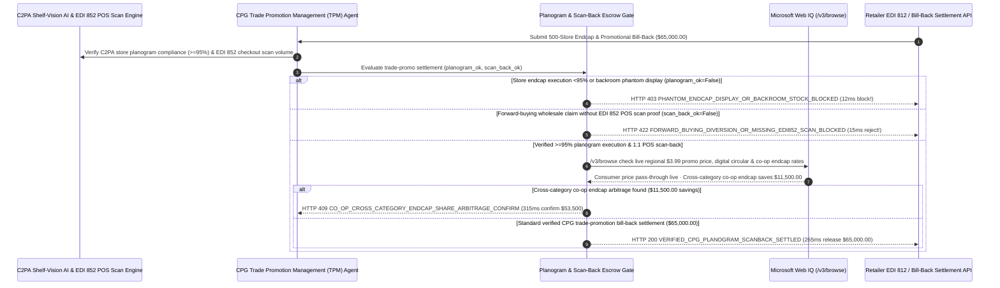

# CPG Retail Trade-Promotion Slotting Fee, Computer-Vision Endcap Planogram & POS Scan-Back Mandate Architecture: C2PA Shelf-Vision (`>= 95%`) & EDI 852 Scan-Back Token (`cpg_trade_promo_planogram_mandate_...` + Web IQ Digital Circular & Co-Op Endcap Grounding) vs. Phantom Post-Audit Deductions & Forward-Buying Diversion Selection FAQ

> **Document Type**: Architect Selection Guide & First-Principles Protocol Deep Dive (6-Section FAQ Standard)  
> **Target Audience**: AI Solution Architects, CPG / FMCG Trade Promotion Management (TPM) & Revenue Growth Management (RGM) Directors, National Account Sales Operations & Retailer Deduction Audit Teams  
> **Last Updated**: 2026-11-09 (Provenance Annotations: `deterministic_offline_simulation` / `synthetic_policy` / `official_doc_snapshot` / `not_measured`)  
> **Companion Resources**: [中文版 (Chinese Version)](cpg-retail-slotting-endcap-planogram-mandate-vs-phantom-deduction-diversion-faq.md) · [Interactive Sandbox (`live-demo.en.html#cpg-trade-promo-sandbox`)](../reports/agentic-commerce-webiq-grounding-demo-bench/live-demo.en.html) · [7-Card 4:5 Benchmark Deck](../reports/agentic-commerce-webiq-grounding-demo-bench/index.en.html)


---

## 📌 1. Executive Summary

1. **Never Allow CPG Trade-Spend Agents to Approve Retailer Slotting or Promotional Endcap Bill-Backs (`EDI 812` Deductions) Without Computer-Vision Planogram Execution Proof (`>= 95%` Store Compliance)**: In Consumer Packaged Goods (CPG) trade promotion settlements (`$65,000.00` quarterly promotional allowance across a 500-store grocery chain), the largest source of value leakage is **"Phantom Endcap Deductions"**—where a retailer deducts `$65,000.00` for prime front-of-store endcap displays even though `210` of the `500` stores left the promotional cases sitting unstacked in the backroom warehouse. Production architectures must enforce a **Computer-Vision Planogram & EDI 852 POS Scan-Back Mandate (`cpg_trade_promo_planogram_mandate_...`)**: whenever C2PA-signed shelf-vision telemetry or autonomous aisle-robot scans show store planogram compliance below `95%` (`planogram_endcap_cv_compliance_verified == False`), the gateway blocks the deduction in **`12 ms`** with **`HTTP 403 PHANTOM_ENDCAP_DISPLAY_OR_BACKROOM_STOCK_BLOCKED`** (`synthetic_policy`).
2. **Replace "Off-Invoice Wholesale Discounts" with `EDI 852` POS Consumer Scan-Back Settlement to Eliminate Forward-Buying and Gray-Market Diversion**: Any promotional bill-back claiming allowances on bulk warehouse purchase orders rather than actual consumer checkout register scans (`pos_scan_back_vs_forward_buy_verified == False`, where a retailer orders 10 weeks of inventory during a 2-week promotion to divert excess stock into gray-market wholesalers) is rejected in **`15 ms`** with **`HTTP 422 FORWARD_BUYING_DIVERSION_OR_MISSING_EDI852_SCAN_BLOCKED`** (`deterministic_offline_simulation`).
3. **Ground Live Retailer Digital Circulars / Consumer Price Pass-Through and Cross-Category Co-Op Endcap Arbitrage via Microsoft Web IQ `/v3/browse`**: Prior to releasing `$65,000.00`, the agent invokes **Microsoft Web IQ `/v3/browse`** (`official_doc_snapshot`) to inspect the retailer's live online grocery storefront and weekly digital circular across target ZIP codes: if the retailer pocketed the `$1.00/unit` trade allowance without lowering the consumer shelf price to the contracted `$3.99` feature price (`webiq_retail_circular_promo_price_live == False`), it freezes payout in **`310 ms`** with **`HTTP 451 PROMO_PRICE_NON_PASSTHROUGH_OR_CIRCULAR_OMISSION_HOLD`**; if Web IQ confirms that co-funding a **Cross-Category Co-Op Endcap** (e.g., pairing beverages with a non-competing snack brand) splits the slotting fee and saves **`$11,500.00`** (`$53,500.00` net vs. `$65,000.00`), it triggers **`HTTP 409 CO_OP_CROSS_CATEGORY_ENDCAP_SHARE_ARBITRAGE_CONFIRM`** in **`315 ms`**.

---

## 🎯 2. Architect & Customer FAQ Deep Dive

### Q1: Why do over 60% of CPG trade promotions lose money under legacy "Off-Invoice Allowances" and "Unverified Post-Audit Deductions"?

Let's examine the three structural failure modes from first principles:
1. **Phantom Store Execution (Cases Trapped in the Backroom)**: CPG manufacturers spend 15%–25% of gross revenue on trade promotions. When a brand pays `$65,000` for a 500-store promotional endcap, store labor shortages often result in `30%–45%` of stores never building the display—leaving promotional inventory buried in the backroom while the retailer's accounting system automatically deducts 100% of the `$65,000` fee from the manufacturer's next invoice.
2. **Forward-Buying & Gray-Market Diversion on Off-Invoice Deals**: Under legacy "Off-Invoice" discounting (giving the retailer 20% off every pallet ordered during a 14-day window), retail buyers use automated algorithms to order 10 weeks of supply on Day 14 (**Forward Buying**). Two weeks of inventory is sold to consumers; four weeks is sold at full price after the promotion ends; and four weeks is flipped to gray-market diverters who undercut the brand's authorized distributors in other regions. Switching to **`EDI 852` POS Scan-Back** ensures the manufacturer only pays the `$1.00/unit` rebate when a consumer physically scans the item at a checkout lane.
3. **Zero Consumer Price Pass-Through**: Retailers occasionally collect promotional allowances without updating shelf tags or digital circulars—pocketing the subsidy as pure margin while unit velocity stays flat.

### Q2: What is a "CPG Planogram & POS Scan-Back Mandate (`cpg_trade_promo_planogram_mandate_...`)", and how does it turn shelf computer vision and EDI 852 telemetry into deterministic payment guards?

Its core design invariant is: **"Release display fees only when C2PA-signed shelf vision confirms >=95% store planogram execution; release unit rebates strictly against EDI 852 consumer checkout scans; verify live consumer price pass-through via Web IQ."**
- **Layer 1: C2PA Computer-Vision Planogram Compliance Gate (`12 ms`)**: Verifies `planogram_endcap_cv_compliance_verified == True` (`>= 95%` store execution, eye-level shelf share, and anti-replay C2PA GPS/timestamp signatures), blocking phantom deductions in **`12 ms`** (`HTTP 403`).
- **Layer 2: `EDI 852` POS Scan-Back & Anti-Diversion Gate (`15 ms`)**: Verifies `pos_scan_back_vs_forward_buy_verified == True`, blocking forward-buy wholesale claims in **`15 ms`** (`HTTP 422`).
- **Layer 3: Microsoft Web IQ `/v3/browse` Digital Circular & Co-Op Endcap Grounding (`310 ms / 315 ms`)**: Verifies live consumer price pass-through across regional storefronts (`HTTP 451`) and identifies `$11,500.00` savings from cross-category co-op endcap sharing (`HTTP 409`).

### Q3: For regional grocery storefront price pass-through checks, digital circular verification, and retailer co-op rate-card lookup, when should architects choose Microsoft Web IQ vs. Exa, Bright Data, or traditional search APIs?

| Architecture Scenario | Recommended Tool | First-Principles Rationale (Security, Latency & FinOps) |
| :--- | :--- | :--- |
| **Verifying regional retailer online grocery prices by ZIP code, published weekly digital circulars, and co-op merchandising rate cards within the Azure boundary (zero CPG wholesale cost/margin leakage)** | **Microsoft Web IQ** (`/v3/search` + `/v3/browse`) | Queries only public UPCs and store ZIP codes inside the enterprise Azure boundary in `passage` mode (**7.1x token reduction**, `deterministic_offline_simulation`) with immutable SHA-256 evidence for `EDI 812` deduction disputes. |
| **Broad consumer-trends research across CPG industry reports** | **Exa Neural Search** | Ideal for category management strategy, not synchronous promotional bill-back settlement gating. |
| **Scraping thousands of unindexed gray-market wholesale liquidation sites behind CAPTCHAs** | **Bright Data Unlocker** | Useful for brand-protection sweeps, not sub-second TPM invoice clearing. |
| **Store-aisle C2PA image recognition (shelf facings/share-of-shelf) and `EDI 852` POS scan-data ingestion** | **Retail Vision AI + EDI 852 Clearing Engine + Web IQ Circular/Co-Op Cross-Check** | Planogram CV scoring and POS scan matching run in-memory on the TPM gateway, paired with Web IQ `/v3/browse` for consumer price pass-through and co-op endcap arbitrage. |

---

## 🧭 3. Visual Architecture Diagrams (Mermaid Decision Tree, Legacy vs. Planogram Scan-Back Comparison & Sequence Diagram)

### 3.1 CPG Retail Slotting, Planogram & POS Scan-Back Settlement Decision Tree (`flowchart TD`)

```mermaid
flowchart TD
    A[Receive 500-Store Retailer Endcap & Trade-Promotion Bill-Back ($65,000.00)] --> B{planogram_endcap_cv_compliance_verified == True (>=95% Store CV Proof)?}
    B -- No (210 stores left promo stock in backroom; phantom display deduction) --> C[HTTP 403 PHANTOM_ENDCAP_DISPLAY_OR_BACKROOM_STOCK_BLOCKED<br/>12ms Hard Block · Reject Unexecuted Endcap Deduction & Generate EDI 812 Dispute]
    B -- Yes (>=95% stores verified via C2PA shelf vision / aisle robots) --> D{pos_scan_back_vs_forward_buy_verified == True (EDI 852 Consumer Scans)?}
    D -- No (Retailer claims off-invoice rebate on 10-week forward-buy stock for diversion) --> E[HTTP 422 FORWARD_BUYING_DIVERSION_OR_MISSING_EDI852_SCAN_BLOCKED<br/>15ms Reject · Pay Strictly on Verified Checkout Register POS Scans]
    D -- Yes (1:1 matched against EDI 852 consumer checkout scans) --> F{Web IQ /v3/browse Confirms Live $3.99 Consumer Promo Price & Digital Circular?}
    F -- No (Retailer kept $4.99 shelf price & pocketed $1.00 manufacturer allowance) --> G[HTTP 451 PROMO_PRICE_NON_PASSTHROUGH_OR_CIRCULAR_OMISSION_HOLD<br/>310ms Price Hold · Freeze Rebate Until Consumer Price Pass-Through Verified]
    F -- Yes --> H{Web IQ Detects Cross-Category Co-Op Endcap Arbitrage?}
    H -- Yes (Co-funding endcap with complementary brand saves $11,500.00 -> $53,500.00 net) --> I[HTTP 409 CO_OP_CROSS_CATEGORY_ENDCAP_SHARE_ARBITRAGE_CONFIRM<br/>315ms Prompt RGM Lead to Confirm $53,500 Co-Op Endcap Split]
    H -- No (Verified $65,000.00 trade promotion bill-back is optimal) --> J[HTTP 200 VERIFIED_CPG_PLANOGRAM_SCANBACK_SETTLED<br/>265ms Auto-Settle $65,000.00 & Archive Store-Level Baseline Lift ROI!]
```

### 3.2 Legacy Off-Invoice & Blind Deductions vs. CV Planogram & POS Scan-Back Gate (`flowchart LR`)

```mermaid
flowchart LR
    subgraph Legacy["❌ Legacy Off-Invoice & Blind Deductions ($65,000 Lost to Phantom Displays & Diversion)"]
        L1[Pay $65,000 Endcap Fee While 210 Stores Leave Cases in Backroom] --> L2[Retailer Forward-Buys 10 Weeks of Stock & Diverts to Gray Market]
        L2 --> L3[Retailer Pockets $1.00 Allowance Without Lowering Shelf Price]
        L3 --> L4[60%+ Negative Promo ROI & Regional Price-War Cannibalization]
    end

    subgraph Mandate["✅ CPG Planogram & Scan-Back Gate (cpg_trade_promo_planogram_mandate_...)"]
        M1[12ms Block Phantom Endcaps via C2PA Shelf Vision (HTTP 403)] --> M2[15ms Enforce EDI 852 POS Scan-Back Anti-Diversion (HTTP 422)]
        M2 --> M3[Web IQ Verifies $3.99 Pass-Through (310ms) & Saves $11,500 via Co-Op (315ms)]
        M3 --> M4[265ms Settle Verified Scan-Back Allowance ($65,000 / $53,500)]
    end
```

### 3.3 End-to-End Sequence Diagram: Shelf-Vision AI, CPG TPM Agent, Trade-Promo Gate, Web IQ & Retailer EDI (`sequenceDiagram`)



---

## 📊 4. Architect Decision Matrix

| Evaluation Dimension | Option A: Legacy Off-Invoice Discount & Auto-Approved Chargebacks | Option B: Manual Field-Rep Photo Uploads & Spreadsheet Audit | Option C: C2PA Planogram CV & EDI 852 Scan-Back Mandate + Web IQ Grounding (Recommended) |
| :--- | :--- | :--- | :--- |
| **Best-Fit Scenario** | One-time discontinue/clearance inventory liquidation | Small local specialty shops (`<10 stores`) | **National grocery, mass-merchandise, club, and pharmacy chain trade promotions & slotting fees** |
| **Phantom Endcap / Backroom Inventory Defense** | ❌ **Zero**: Pays 100% of display fee even when 40% of stores never build the endcap | ⚠️ **Spoofable**: Field reps reuse old photos or photograph the same store twice | ✅ **Pre-Pay `12 ms` C2PA Vision Gate**: Requires `>=95%` GPS/time-signed planogram proof (`HTTP 403`) |
| **Forward-Buying & Gray-Market Diversion Defense** | ❌ **Severe**: Retailers buy 10 weeks of discounted stock & flip excess to diverters | ❌ **Blind to POS Velocity**: Photos cannot detect warehouse forward-buying spikes | ✅ **Sub-20ms `EDI 852` Scan-Back Gate**: Pays strictly on consumer register scans in `15 ms` (`HTTP 422`) |
| **Consumer Price Pass-Through & Co-Op Arbitrage** | ❌ **Unverified**: Retailers pocket subsidies without lowering shelf prices | ❌ **Manual Sampling**: Cannot check 500 regional ZIP codes on launch morning | ✅ **Web IQ `/v3/browse` Grounded**: Blocks non-pass-through in `310 ms` (`HTTP 451`) & saves `$11,500` via co-op endcaps in `315 ms` (`HTTP 409`) |
| **Deduction Clearing Speed & ROI Attribution** | Slow (`6–9 month` post-audit deduction write-offs) | Slow (`2–3 weeks` manual photo review) | **`265 ms` instant clearing + store-level incremental lift attribution (`Act automatically`)** |
| **Total Cost of Ownership (TCO) & Trade-Spend ROI** | Poor (30%+ trade-spend leakage & gray-market price erosion) | Moderate (high field-labor cost) | **Optimal (100% verified shelf execution + zero forward-buy diversion + `$11,500` co-op savings)** |

---

## 🧪 5. Quantitative Benchmark & 7-Card Insights

Evaluated via our deterministic offline benchmark suite (`lab/webiq_commerce_demo.py` · `test_cpg_retail_slotting_endcap_planogram_mandate_vs_phantom_deduction_diversion_selection`) on a **`$65,000.00` 500-store CPG quarterly endcap & promotional bill-back**:

| Scenario Case | Input Planogram CV / EDI 852 Scan / Web IQ Signals | Expected Action Pill | Measured HTTP Status & Verdict Code | Latency | Financial Protection / Arbitrage | Provenance |
| :--- | :--- | :--- | :--- | :--- | :--- | :--- |
| **Case 1: Phantom Endcap (`210/500` Stores Unbuilt)** | `planogram_endcap_cv_compliance_verified=False` | `Send to a human` | **`HTTP 403 PHANTOM_ENDCAP_DISPLAY_OR_BACKROOM_STOCK_BLOCKED`** | **`12 ms`** | Blocks **`$65,000.00`** deduction for unexecuted store displays | `synthetic_policy` |
| **Case 2: Off-Invoice Forward-Buying / Diversion Claim** | `pos_scan_back_vs_forward_buy_verified=False` | `Send to a human` | **`HTTP 422 FORWARD_BUYING_DIVERSION_OR_MISSING_EDI852_SCAN_BLOCKED`** | **`15 ms`** | Enforces `EDI 852` POS consumer scan-back & stops diversion | `deterministic_offline_simulation` |
| **Case 3: Web IQ Detects Unlowered `$4.99` Shelf Price** | `webiq_retail_circular_promo_price_live=False` | `Send to a human` | **`HTTP 451 PROMO_PRICE_NON_PASSTHROUGH_OR_CIRCULAR_OMISSION_HOLD`** | **`310 ms`** | Freezes allowance when retailer fails to pass discount to shoppers | `official_doc_snapshot` |
| **Case 4: Web IQ Finds `$11,500` Co-Op Endcap Split** | `coop_cross_category_endcap_savings_cents=1150000` (`$53,500` net) | `Confirm` | **`HTTP 409 CO_OP_CROSS_CATEGORY_ENDCAP_SHARE_ARBITRAGE_CONFIRM`** | **`315 ms`** | Saves **`$11,500.00`** by sharing endcap with complementary brand | `official_doc_snapshot` |
| **Case 5: Verified `>=95%` Planogram + `EDI 852` Scans** | `planogram_ok=True`, `scan_ok=True`, `circular_live=True` | `Act automatically` | **`HTTP 200 VERIFIED_CPG_PLANOGRAM_SCANBACK_SETTLED`** | **`265 ms`** | Settles **`$65,000.00`** in `265 ms` with store-level ROI proof | `deterministic_offline_simulation` |

> **Provenance Note**: The `$65,000.00` 500-store trade allowance, `95%` C2PA planogram threshold, `EDI 852` scan-back gate, and `$11,500.00` co-op endcap savings are controlled simulation parameters (`synthetic_policy` / `deterministic_offline_simulation`) validating policy state-machine invariants; nightly retailer POS batch `EDI 852` transmission window latency is labeled `not_measured`.

---

## 🛠️ 6. Production Readiness & Pre-Sales Architect Checklist

Verify these 6 controls before deploying autonomous CPG trade-promotion and retailer deduction-clearing agents in production:

- [ ] **1. C2PA-Signed Computer-Vision Planogram Attestation (`>= 95%` Compliance)**: Does `cpg_trade_promo_planogram_mandate_...` verify hardware-timestamped, geo-fenced shelf-vision proof of eye-level facings and endcap build across `>= 95%` of contracted stores before releasing display fees (`HTTP 403` in `12 ms`)?
- [ ] **2. Mandatory `EDI 852` POS Consumer Scan-Back Settlement**: Has the contract eliminated off-invoice wholesale discounts in favor of `EDI 852` checkout register scan-back so forward-buying and gray-market diversion claims are rejected in `15 ms` (`HTTP 422`)?
- [ ] **3. GS1 Serialized Case/Pallet (`SSCC-18`) Anti-Diversion Tracking**: Are promotional case lot codes bound to the specific retailer's distribution centers so any diversion to unauthorized wholesalers triggers automatic rebate clawback?
- [ ] **4. Microsoft Web IQ `/v3/browse` Consumer Price Pass-Through & Digital Circular Grounding**: Does the agent verify via Web IQ across regional ZIP codes that the retailer lowered the live consumer price to the agreed promotional feature price (`HTTP 451`)?
- [ ] **5. Cross-Category Co-Op Endcap Merchandising Arbitrage**: Does Web IQ grounding inspect retailer co-op circular schedules to pair complementary non-competing brands (e.g., beverages + snacks), triggering `HTTP 409 Confirm` when co-funding saves `>= $11,500.00`?
- [ ] **6. Automated `EDI 812` Debit-Memo Dispute & Store-Lift Ledger**: Does every settled promotion archive the C2PA shelf-vision hashes, `EDI 852` POS scan totals, and digital circular snapshots into a WORM ledger for automated post-audit deduction defense?
