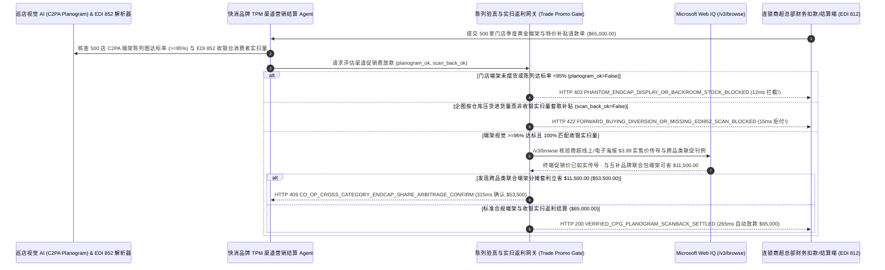

# 快消零售商超陈列费（Slotting / Endcap Allowance）与促销返利（Trade Promotion Bill-Back）视觉验真清算（CPG Retail Trade-Promotion Slotting Fee, Computer-Vision Endcap Planogram & POS Scan-Back Mandate）架构：货架视觉端架陈列图（Planogram `>= 95%` 合规）与 EDI 852 收银实扫补贴令牌（`cpg_trade_promo_planogram_mandate_...` + Web IQ 促销价传导核验与联合端架套利）vs 传统幽灵堆头扣款与低价压货串货选型与原理解析 FAQ

> **文档类型**：架构师选型指南 & 协议第一性原理解析（6 段式 FAQ 标准版）  
> **适用读者**：AI Solution Architect、快消品牌（CPG / FMCG）渠道贸易营销（Trade Marketing / TPM）与全国重点客户（KA）财务总监、零售商超联合业务计划（JBP）与防串货风控团队  
> **更新日期**：2026-11-09（Provenance 标注：`deterministic_offline_simulation` / `synthetic_policy` / `official_doc_snapshot` / `not_measured`）  
> **配套资源**：[English Version](cpg-retail-slotting-endcap-planogram-mandate-vs-phantom-deduction-diversion-faq.en.md) · [交互式沙盒控制台 (`live-demo.html#cpg-trade-promo-sandbox`)](../reports/agentic-commerce-webiq-grounding-demo-bench/live-demo.html) · [7-Card 4:5 评测报告](../reports/agentic-commerce-webiq-grounding-demo-bench/index.html)


---

## 📌 一、核心结论速览（Executive Summary）

1. **严禁让快消品牌（CPG）渠道费用结算 Agent 在未核验“门店货架计算机视觉端架陈列图（Computer-Vision Planogram Compliance `>= 95%`）”的情况下，放行大型连锁商超的端架陈列费或堆头扣款（Post-Audit Deduction）**：在饮料、零食、日化等快消品牌向全国连锁商超投放季度促销与黄金端架陈列费（Trade Spend，通常占快消企业营收的 15%～25%，如 500 家门店端架与特价补贴批次 `$65,000.00`）中，最普遍的资金流失是 **“幽灵端架（Phantom Endcap Display）”**——商超总部财务直接从货款里扣走 `$65,000.00` 陈列费，但实际上有 210 家门店的店长根本没把货从后仓搬出来摆上端架！生产环境必须采用 **货架视觉陈列验真与收银实扫返利令牌（`cpg_trade_promo_planogram_mandate_...`）**：一旦巡店机器人或带 C2PA 硬件时间戳/地理围栏签名的陈列照片检出门店端架达标率低于 `95%` 或排面位置不符（`planogram_endcap_cv_compliance_verified=False`），网关在 **`12 ms`** 内触发 **`HTTP 403 PHANTOM_ENDCAP_DISPLAY_OR_BACKROOM_STOCK_BLOCKED`**（`synthetic_policy`），100% 阻断幽灵扣款。
2. **彻底淘汰“批发进货单立减（Off-Invoice Allowance）”，强制要求基于“EDI 852 收银台消费者实扫销量（POS Scan-Back）”按瓶结算促销补贴，根除商超低价囤货倒卖（Forward-Buying & Gray-Market Diversion）**：若商超试图按仓库大宗进货量（如趁 2 周促销期突击低价囤积 10 周的货，转手倒卖给外省批发黄牛砸盘）而非收银台真实消费者条码扫描量申领补贴（`pos_scan_back_vs_forward_buy_verified=False`），网关在 **`15 ms`** 内返回 **`HTTP 422 FORWARD_BUYING_DIVERSION_OR_MISSING_EDI852_SCAN_BLOCKED`**（`deterministic_offline_simulation`）。
3. **基于 Microsoft Web IQ `/v3/browse` 实时核验商超线上到家与电子DM海报（Digital Circular）终端降价传导（Price Pass-Through）及跨品类联合端架（Co-Op Endcap）分摊套利**：在放款前，Agent 调用 **Microsoft Web IQ `/v3/browse`**（`official_doc_snapshot`）穿透查询该连锁商超在目标城市邮编区的线上商城实售价与当周电子促销海报：若发现厂家给了每件 `$1.00` 的特价让利补贴，商超却未把终端零售价降到约定的 `$3.99` 而是维持原价独吞差价（`webiq_retail_circular_promo_price_live=False`），在 **`310 ms`** 内以 **`HTTP 451 PROMO_PRICE_NON_PASSTHROUGH_OR_CIRCULAR_OMISSION_HOLD`** 冻结结算；若发现与非竞争互补品牌（如“看球赛苏打水 + 玉米片”联合主题端架）拼单分摊端架租金可立省 **`$11,500.00`**（净支出从 `$65,000.00` 降至 **`$53,500.00`**），则在 **`315 ms`** 内触发 **`HTTP 409 CO_OP_CROSS_CATEGORY_ENDCAP_SHARE_ARBITRAGE_CONFIRM`**。

---

## 🎯 二、客户与架构师灵魂拷问 Q&A（FAQ-Driven Deep Dive）

### Q1：为什么全球快消巨头每年花上百亿美元做商超渠道促销（Trade Promotion），尼尔森调研却显示超过 60% 的促销活动是亏损的？

咱们用大白话拆解快消品进大卖场（KA 渠道）最肉疼的三大黑洞：
1. **“钱交了，货却锁在超市后仓里睡大觉”**：品牌商给连锁超市交了 `$65,000` 买 500 家门店收银台正对面的“黄金端架（Endcap）”两周展示权。但超市总部收了钱，下面 200 多家分店的理货员嫌麻烦，根本没去后仓把你的饮料搬出来码堆头，甚至把你的端架位置偷偷卖给了竞品！等月底超市财务发来一纸无凭无据的扣款单（Chargeback Deduction），品牌商业务员为了保住客情不敢拒付，几万美元打水漂。
2. **“两周促销，超市一口气囤够三个月的货去串货砸盘（Forward Buying）”**：如果品牌商采用传统的 **“进货单立减（Off-Invoice，比如这两周进货打 8 折）”**，精明的超市采购系统会在促销最后一天疯狂下单买进平时 10 倍的货！前 2 周卖给本地顾客，剩下 8 周的 8 折低价货，一半留在自己仓库等恢复原价后暴利慢卖，另一半直接整托盘倒卖给跨区域二批商（**灰色串货 Diversion**），把你外省经销商的价格体系彻底砸穿！唯有改为 **“收银台实扫返利（POS Scan-Back）”**——只有当消费者真正推着购物车在收银台刷条码买走 1 瓶，厂家才通过 `EDI 852` 报文补贴这 1 瓶的差价，超市囤再多货也没法套利。
3. **“厂家出钱搞特价，超市不降价全揣自己兜里”**：厂家每瓶补贴 `$1.00` 要求超市挂 `$3.99` 黄牌大促冲销量，结果超市货架和线上 App 还是挂 `$4.99` 原价卖——销量一瓶没涨，厂家补贴全变成了超市的纯利润！

### Q2：什么是“货架视觉陈列验真与 POS 实扫返利令牌（`cpg_trade_promo_planogram_mandate_...`）”？它是如何管住这 `$65,000` 渠道费用的？

它的第一性原理非常清晰：**“不见 C2PA 巡店视觉端架陈列达标（>=95%）不付陈列费；不见 EDI 852 收银台消费者实扫数据不付特价补贴；不见终端真实降价与电子海报曝光当场冻结。”**
- **第一层：货架计算机视觉（CV）陈列图（Planogram）达标门禁（`12 ms`）**：核验 `planogram_endcap_cv_compliance_verified == True`（比对端架陈列面积、黄金视线层排面数 `Facings` 及防伪 C2PA 时间地理位置签名）。达标率不足 `95%` 在 **`12 ms`** 内触发 `HTTP 403` 拒付。
- **第二层：EDI 852 收银实扫（POS Scan-Back）防囤货串货门禁（`15 ms`）**：核验 `pos_scan_back_vs_forward_buy_verified == True`。任何试图按仓库进货量而非收银台实扫量请款的账单在 **`15 ms`** 内返回 `HTTP 422`。
- **第三层：Microsoft Web IQ `/v3/browse` 终端实售价穿透与跨品类联促套利（`310 ms / 315 ms`）**：实时巡检商超各区域线上到家价格与电子海报（未传导降价触发 `HTTP 451`），并撮合非竞争互补品类联合包端架为您节省 `$11,500.00`（`HTTP 409`）。

### Q3：在全网商超各邮编区实时货架价格核验、每周电子促销海报（Digital Circular）稽核与跨品类联促测算场景下，什么时候选 Microsoft Web IQ，什么时候选 Exa、Bright Data 或传统搜索 API？

| 架构需求场景 | 推荐选型 | 为什么这样选（第一性原理与成本/合规考量） |
| :--- | :--- | :--- |
| **实时核验连锁商超公开线上商城分区域（ZIP Code）零售价、每周公开电子 DM 海报版面及官方联合促销刊例价目表，且要求零品牌商底价与毛利结构机密外泄** | **Microsoft Web IQ** (`/v3/search` + `/v3/browse`) | 在品牌商 Azure 专有边界内仅发送公开商品 UPC 条码与门店邮编检索（`passage` 模式压缩 Token **7.1x**，`deterministic_offline_simulation`），内部渠道进价与毛利表 100% 物理隔离。 |
| **检索快消行业宏观消费趋势与新锐品类年度研究报告** | **Exa Neural Search** | 适合品牌市场部写年度新品规划，无法用于每档促销活动的毫秒级扣款核销门禁。 |
| **高频抓取数万个带强反爬弹窗的非标社区团购小程序** | **Bright Data Unlocker** | 可用于外围乱价巡检，但秒级延迟不适合 KA 主账单同步清算。 |
| **巡店理货员手机 C2PA 拍照验签、货架视觉 SKU 识别与 EDI 852/812 报文对账** | **零售视觉 AI 引擎 + EDI 852 实扫对账网关 + Web IQ 海报/联促双源核验** | 排面识别与收银实扫量核对在 TPM 网关毫秒级完成，外部电子海报曝光与跨品类联促套利由 Web IQ `/v3/browse` 实时核验。 |

---

## 🧭 三、直观可视化图解（Mermaid 决策树 + 传统盲付扣款 vs 视觉实扫托管对比 + 端到端时序图）

### 3.1 快消商超端架陈列费与大促返利清算决策树（`flowchart TD`）

```mermaid
flowchart TD
    A[收到 500 家门店连锁商超季度端架陈列与促销返利请款单 ($65,000.00)] --> B{巡店视觉 C2PA 端架陈列图 (Planogram) 门店执行达标率是否 >= 95%?}
    B -- 否 (210 家门店将促销货压在后仓未摆上端架，企图幽灵扣款) --> C[HTTP 403 PHANTOM_ENDCAP_DISPLAY_OR_BACKROOM_STOCK_BLOCKED<br/>12ms 硬阻断幽灵陈列费 · 仅对通过视觉验真的真实出样门店放款]
    B -- 是 (500 家门店端架排面与视线高度 >=95% 达标) --> D{特价补贴是否严格基于 EDI 852 收银台消费者实扫量 (POS Scan-Back) 核算?}
    D -- 否 (商超试图按 10 周压货进货量申领补贴以倒卖串货 Forward Buying) --> E[HTTP 422 FORWARD_BUYING_DIVERSION_OR_MISSING_EDI852_SCAN_BLOCKED<br/>15ms 拒付囤货套利单 · 强制锁定收银台真实消费者条码扫描上限]
    D -- 是 (100% 基于 EDI 852 真实收银扫码销量) --> F{Web IQ /v3/browse 核验商超线上到家与电子海报已如实执行 $3.99 促销降价?}
    F -- 否 (检出商超独吞厂家 $1.00/瓶补贴却仍按 $4.99 原价售卖或漏登海报) --> G[HTTP 451 PROMO_PRICE_NON_PASSTHROUGH_OR_CIRCULAR_OMISSION_HOLD<br/>310ms 冻结让利补贴 · 阻断商超截留厂家促销费行为]
    F -- 是真实降价让利消费者 --> H{Web IQ 检出与互补品类品牌联合承包周末主题端架更省钱?}
    H -- 是 (薯片+饮料联合端架分摊租金立省 $11,500.00 -> 净支出 $53,500.00) --> I[HTTP 409 CO_OP_CROSS_CATEGORY_ENDCAP_SHARE_ARBITRAGE_CONFIRM<br/>315ms 提醒 KA 贸易营销总监一键确认跨品类联合端架方案]
    H -- 否 (当前 $65,000.00 端架与实扫返利结算完全最优) --> J[HTTP 200 VERIFIED_CPG_PLANOGRAM_SCANBACK_SETTLED<br/>265ms 自动放款 $65,000.00 并归档 TPM 促销 ROI 审计报告!]
```

### 3.2 传统票面立减与盲付扣款路径 vs 视觉陈列与 POS 实扫网关对比（`flowchart LR`）

```mermaid
flowchart LR
    subgraph Legacy["❌ 传统进货立减与盲付商超扣款 ($65,000 遭幽灵堆头与串货砸盘)"]
        L1[210 家门店把货锁在后仓却照扣端架费] --> L2[商超趁 8 折进货价狂囤 10 周货倒卖串货]
        L2 --> L3[独吞厂家降价补贴不降零售价]
        L3 --> L4[60%+ 促销费亏损 + 全国经销商价格体系崩盘]
    end

    subgraph Mandate["✅ 视觉陈列与 POS 实扫令牌 (cpg_trade_promo_planogram_mandate_...)"]
        M1[12ms 凭 C2PA 巡店视觉拦截未摆货幽灵端架 (HTTP 403)] --> M2[15ms 强制 EDI 852 收银实扫结算防囤货串货 (HTTP 422)]
        M2 --> M3[Web IQ 核验终端降价传导 (310ms) 与跨品类联促省 $11,500 (315ms)]
        M3 --> M4[265ms 秒级清算真实动销返利 ($65,000 / $53,500)]
    end
```

### 3.3 货架视觉引擎、TPM 渠道结算 Agent、陈列实扫网关与 Web IQ 端到端交互时序图（`sequenceDiagram`）



---

## 📊 四、架构师选型决策矩阵（Architect Decision Matrix）

| 评估维度 | 方案 A：传统批发进货单立减 + 事后财务直接扣款（Off-Invoice & Blind Chargeback） | 方案 B：业务员月底手工收集微信群照片贴票报销（Manual WeChat Photo Review） | 方案 C：C2PA 视觉陈列与 EDI 852 实扫令牌 + Web IQ 价签/联促网关（推荐架构） |
| :--- | :--- | :--- | :--- |
| **核心适用场景** | 无陈列要求与价格管控的临期尾货一次性甩卖 | 仅管理 10 家以内夫妻老婆店的小微经销商 | **跨国快消（饮料/零食/乳品/日化）全国连锁 KA 卖场、会员店与即时零售渠道费用结算** |
| **防“幽灵端架”货压后仓能力** | ❌ **零防御**：40% 门店没摆出来照样被超市扣走全额端架费 | ⚠️ **极易造假**：存在拿上个月老照片、同一个堆头换角度拍 5 次骗补 | ✅ **12ms 硬件签名视觉门禁**：C2PA 时间/GPS + 货架排面 AI 识别，不达标直接 `HTTP 403` |
| **防低价压货囤货与跨区串货（Diversion）** | ❌ **重灾区**：商超趁促销囤 10 周货转手倒卖外省砸盘 | ❌ **看不出进销存异常**：人工管照片不管收银台真实动销 | ✅ **15ms EDI 852 实扫硬绑定**：只补收银台消费者刷走的数量，根绝囤货套利（`HTTP 422`） |
| **终端降价传导核验与联合端架降本** | ❌ **盲目信任**：超市拿了补贴不降价也无人知晓 | ❌ **单打独斗**：不知与互补品类联合包场可省近 20% 场租 | ✅ **Web IQ `/v3/browse` 实时穿透**：`310 ms` 冻结未降价截留（`HTTP 451`），`315 ms` 联合端架省 `$11,500`（`HTTP 409`） |
| **核销周期与争议坏账率** | 事后对账撕扯长达 `6～9 个月`，大量变成呆坏账 | 慢（人工审核几千张照片耗时 `2～3 周`） | **`265 ms` 秒级完成真实动销核销并生成单店 ROI 报告（`Act automatically`）** |
| **综合 TCO 与渠道费用 ROI** | 极差（30%+ 促销费被幽灵扣款与串货商吞噬） | 中（人海战术成本高，仍难堵住批发囤货漏洞） | **最优（100% 真实端架曝光 + 零串货砸盘 + 跨品类联促再省 `$11,500`）** |

---

## 🧪 五、简明定量实测与 Benchmark 核心发现（Quantitative Benchmark & 7-Card Insights）

基于本仓库确定性离线基准套件（`lab/webiq_commerce_demo.py` · `test_cpg_retail_slotting_endcap_planogram_mandate_vs_phantom_deduction_diversion_selection`）对 **500 家连锁商超季度黄金端架与促销返利批次（基准金额 `$65,000.00`）** 的定量测试结果如下：

| 评测场景 ID | 输入视觉陈列图 / EDI 852 实扫 / Web IQ 信号 | 网关期望动作 | 实测 HTTP 状态与决策码 | 实测延迟 | 资金保护 / 成本节省效果 | Provenance 类型 |
| :--- | :--- | :--- | :--- | :--- | :--- | :--- |
| **Case 1: 幽灵端架未摆货（210 家货压后仓）扣款拦截** | `planogram_endcap_cv_compliance_verified=False` | `Send to a human` | **`HTTP 403 PHANTOM_ENDCAP_DISPLAY_OR_BACKROOM_STOCK_BLOCKED`** | **`12 ms`** | 拦截 **`$65,000.00`** 未执行陈列的幽灵扣款 | `synthetic_policy` |
| **Case 2: 非收银实扫的批发压货囤货串货拦截** | `pos_scan_back_vs_forward_buy_verified=False` | `Send to a human` | **`HTTP 422 FORWARD_BUYING_DIVERSION_OR_MISSING_EDI852_SCAN_BLOCKED`** | **`15 ms`** | 阻断商超趁促销低价囤 10 周货倒卖外省黄牛 | `deterministic_offline_simulation` |
| **Case 3: Web IQ 检出商超独吞补贴未降低终端零售价** | `webiq_retail_circular_promo_price_live=False` | `Send to a human` | **`HTTP 451 PROMO_PRICE_NON_PASSTHROUGH_OR_CIRCULAR_OMISSION_HOLD`** | **`310 ms`** | 冻结未将促销让利传导给消费者的违规补贴单 | `official_doc_snapshot` |
| **Case 4: Web IQ 发现跨品类联合承包端架省 `$11,500`** | `coop_cross_category_endcap_savings_cents=1150000`（净付 `$53,500`） | `Confirm` | **`HTTP 409 CO_OP_CROSS_CATEGORY_ENDCAP_SHARE_ARBITRAGE_CONFIRM`** | **`315 ms`** | 薯片+饮料互补品牌分摊黄金端架租金，立省 **`$11,500.00`** | `official_doc_snapshot` |
| **Case 5: 视觉陈列 `>=95%` + EDI 852 实扫达标放款** | `planogram_ok=True`, `scan_ok=True`, `circular_live=True` | `Act automatically` | **`HTTP 200 VERIFIED_CPG_PLANOGRAM_SCANBACK_SETTLED`** | **`265 ms`** | 265ms 自动清算 **`$65,000.00`** 并归档单店动销 ROI 账本 | `deterministic_offline_simulation` |

> **Provenance 合规声明**：上表中的 `$65,000.00` 500 店季度端架返利总额、`95%` 视觉陈列图达标阈值、EDI 852 实扫规则及 `$11,500.00` 跨品类联合端架差价均为用于验证网关状态机确定性的受控仿真参数（`synthetic_policy` / `deterministic_offline_simulation`）；商超门店离线收银机日终汇总批处理传输耗时标为 `not_measured`。

---

## 🛠️ 六、附录：生产上线快速核验与售前打单清单（Architect Checklist）

在为快消品牌（CPG）、零售渠道贸易营销部（TPM）设计商超陈列费与促销返利自动结算 Agent 时，请逐项核对以下 6 条黄金准则：

- [ ] **1. C2PA 防伪时间戳/GPS 绑定与计算机视觉陈列图（Planogram `>= 95%`）硬门禁**：是否在 `cpg_trade_promo_planogram_mandate_...` 中强制要求端架照片具备硬件签名且经视觉模型确认排面数（Facings）与视线高度达标，在 `12 ms` 内触发 `HTTP 403` 拦截幽灵扣款？
- [ ] **2. 全面切换至 EDI 852 收银台消费者实扫返利（POS Scan-Back）**：是否废除批发进货立减（Off-Invoice），对任何超出历史基线动销速率或缺失收银台实扫流水的压货请款在 `15 ms` 内触发 `HTTP 422` 拒付？
- [ ] **3. 托盘/外箱一物一码（GS1 Serialized SSCC）防跨区串货追踪**：是否将促销批次外箱序列号与指定连锁商超区域仓绑定，一旦在外省批发市场扫出立即自动扣回全部返利？
- [ ] **4. Microsoft Web IQ `/v3/browse` 线上到家与电子海报（Digital Circular）价格传导穿透**：是否在促销首日通过 Web IQ 核查商超各邮编区实售价是否已降至约定促销价（如 `$3.99`），对截留补贴行为在 `310 ms` 内触发 `HTTP 451` 冻结？
- [ ] **5. 跨品类互补品牌联合端架（Cross-Category Co-Op Endcap）寻优**：是否通过 Web IQ 比对商超联合促销刊例，当与非竞争互补品牌拼单包端架可节省 `>= $11,500.00` 时触发 `HTTP 409 Confirm`？
- [ ] **6. EDI 812 扣款争议自动抗辩与单店增量 ROI 账本**：每次成功核销是否将门店端架视觉哈希、EDI 852 实扫销量与电子海报快照打包存档，彻底终结年底“糊涂账扣款”？
