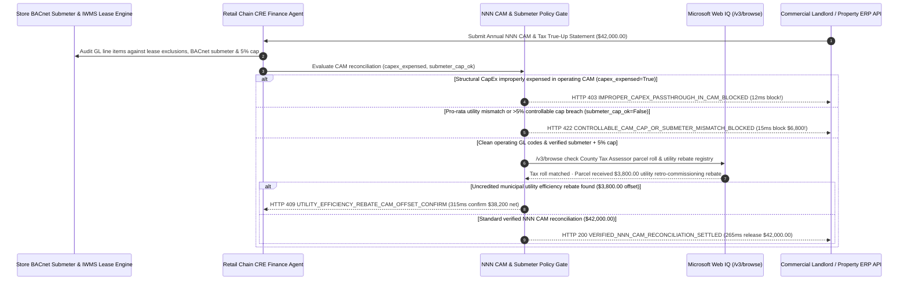

# Commercial Real Estate (CRE) Triple-Net CAM Reconciliation & Submeter Mandate Architecture: CapEx-Excluded GL & BACnet Submeter Token (`cre_nnn_cam_mandate_...` + Web IQ County Tax Roll & Utility Rebate Grounding) vs. Landlord CapEx Pass-Through & Pro-Rata Utility Overbilling Selection FAQ

> **Document Type**: Architect Selection Guide & First-Principles Protocol Deep Dive (6-Section FAQ Standard)  
> **Target Audience**: AI Solution Architects, Multi-Unit Retail / Banking / Corporate Real Estate (CRE / IWMS) Architects, Accounts Payable & Lease Audit Risk Teams  
> **Last Updated**: 2026-11-09 (Provenance Annotations: `deterministic_offline_simulation` / `synthetic_policy` / `official_doc_snapshot` / `not_measured`)  
> **Companion Resources**: [中文版 (Chinese Version)](cre-triple-net-cam-reconciliation-submeter-mandate-vs-landlord-overbilling-faq.md) · [Interactive Sandbox (`live-demo.en.html#cre-nnn-cam-sandbox`)](../reports/agentic-commerce-webiq-grounding-demo-bench/live-demo.en.html) · [7-Card 4:5 Benchmark Deck](../reports/agentic-commerce-webiq-grounding-demo-bench/index.en.html)


---

## 📌 1. Executive Summary

1. **Never Allow Multi-Unit Retail or Corporate Real Estate (CRE) Agents to Blindly Settle Landlord Annual Triple-Net (NNN) CAM Reconciliation Statements**: In commercial Triple-Net leases (`$42,000.00` annual store CAM/tax/insurance true-up), over 65% of landlord reconciliation statements contain lease-violating overcharges—most notably **dumping unamortized structural Capital Expenditures (CapEx such as full roof replacements or parking-lot repaving) into current-year operating Common Area Maintenance (CAM)**. Production architectures must enforce a **CapEx-Excluded GL & BACnet Submeter Mandate (`cre_nnn_cam_mandate_...`)**: whenever line-item GL auditing detects improper structural CapEx or landlord executive overhead (`capex_improperly_expensed_in_cam == True`), the gateway blocks payout in **`12 ms`** with **`HTTP 403 IMPROPER_CAPEX_PASSTHROUGH_IN_CAM_BLOCKED`** (`synthetic_policy`).
2. **Enforce BACnet/Modbus Submeter Telemetry and 5% Controllable CAM Escalation Caps**: When a landlord allocates high-load neighboring restaurant/gym HVAC and water usage via flat square-footage pro-rata splits instead of the store's BACnet submeter, or breaches the lease's `5.0%` annual Controllable CAM cap (`submeter_and_controllable_cap_verified == False`, padding the invoice by `$6,800.00`), the gateway rejects settlement in **`15 ms`** with **`HTTP 422 CONTROLLABLE_CAM_CAP_OR_SUBMETER_MISMATCH_BLOCKED`** (`deterministic_offline_simulation`).
3. **Ground County Assessor Property Tax Rolls and Utility Efficiency Rebates via Microsoft Web IQ `/v3/browse`**: Prior to releasing NNN funds, the agent invokes **Microsoft Web IQ `/v3/browse`** (`official_doc_snapshot`) to inspect county tax assessor parcel records and municipal utility rebate registries: if the landlord won a property tax assessment appeal reducing taxes by 18% yet billed tenants the pre-appeal inflated amount (`webiq_county_tax_roll_matched == False`), it freezes payment in **`310 ms`** with **`HTTP 451 INFLATED_PROPERTY_TAX_ASSESSMENT_PASSTHROUGH_HOLD`**; if Web IQ discovers a **`$3,800.00`** municipal LED/HVAC efficiency rebate credited to the building parcel that must offset tenant CAM (`$38,200.00` net vs. `$42,000.00`), it triggers **`HTTP 409 UTILITY_EFFICIENCY_REBATE_CAM_OFFSET_CONFIRM`** in **`315 ms`**.

---

## 🎯 2. Architect & Customer FAQ Deep Dive

### Q1: Why does pairing "Automated Landlord Summary-Invoice Payment" with "Missed 60-Day Lease Audit Windows" cost retail chains millions in store EBITDA?

Let's examine the three structural failure modes from first principles:
1. **Structural CapEx Disguised as Operating Repairs**: Suppose a retail tenant has 2 years remaining on a store lease. The landlord spends `$180,000.00` replacing the shopping center's structural roof (a 20-year capital asset) and books the entire cost under "Roof Repairs & Maintenance" in the current year's CAM pool. An unguarded AP agent pays the store's `$42,000.00` reconciliation bill automatically—forcing the tenant to buy the landlord a new roof!
2. **Subsidizing High-Load Neighbors & Breaching Controllable CAM Caps**: Retail apparel or bank branches use minimal water and after-hours HVAC compared to adjacent 24-hour gyms or hot-pot restaurants. When landlords ignore store-level BACnet submeters and bill utilities by gross leasable area (GLA), or hike administrative CAM fees by 14% despite a `5.0%` Controllable CAM cap, each store overpays `$6,800.00+/year`.
3. **Pocketed Property Tax Appeal Refunds & Utility Rebates**: Commercial landlords routinely contest county property tax assessments and win 15%–20% reductions, or collect municipal utility retro-commissioning rebates (`$3,800.00`), yet bill NNN tenants using the original unadjusted tax estimate.

### Q2: What is a "CapEx-Excluded & Submeter CAM Mandate (`cre_nnn_cam_mandate_...`)", and how does it automate line-item lease auditing before the 60-day dispute window closes?

Its core design invariant is: **"No NNN CAM true-up settles without an itemized general-ledger dump proving zero structural CapEx, exact reconciliation against store BACnet submeters and 5% controllable caps, and 1:1 parity with the public county tax roll."**
- **Layer 1: GL Line-Item CapEx Exclusion Gate (`12 ms`)**: Verifies `capex_improperly_expensed_in_cam == False`, blocking structural roof/facade/leasing-commission pass-throughs in **`12 ms`** (`HTTP 403`).
- **Layer 2: BACnet Submeter & 5% Controllable Cap Gate (`15 ms`)**: Verifies `submeter_and_controllable_cap_verified == True`, rejecting `$6,800.00` pro-rata utility padding and cap breaches in **`15 ms`** (`HTTP 422`).
- **Layer 3: Microsoft Web IQ `/v3/browse` County Tax Roll & Rebate Grounding (`310 ms / 315 ms`)**: Blocks inflated pre-appeal property tax bills (`HTTP 451`) and deducts `$3,800.00` in municipal efficiency rebates (`HTTP 409`).

### Q3: For county tax assessor parcel verification, municipal building benchmarking (Local Law 97 / Energy Star), and utility rebate grounding, when should architects choose Microsoft Web IQ vs. Exa, Bright Data, or traditional search APIs?

| Architecture Scenario | Recommended Tool | First-Principles Rationale (Security, Latency & FinOps) |
| :--- | :--- | :--- |
| **Verifying public county tax assessor parcel rolls, municipal tax appeal reductions, and published utility commercial building rebate registries within the Azure boundary** | **Microsoft Web IQ** (`/v3/search` + `/v3/browse`) | Extracts exact parcel tax tables and rebate credits in `passage` mode (**7.1x token reduction**, `deterministic_offline_simulation`) with immutable SHA-256 audit citations for lease dispute notices. |
| **Semantic market research on regional retail foot-traffic trends and cap-rate forecasts** | **Exa Neural Search** | Ideal for real-estate site acquisition research, not synchronous CAM invoice auditing. |
| **Scraping legacy county clerk portals behind interactive CAPTCHAs** | **Bright Data Unlocker** | Useful for asynchronous historical title searches, though multi-second latency is unsuitable for synchronous AP gating. |
| **In-store kWh electricity, chilled-water BTU, and domestic water consumption** | **In-Store BACnet/Modbus Smart Submeters + Web IQ County Tax & Rebate Cross-Check** | Store utility consumption comes from signed BACnet submeters, paired with Web IQ `/v3/browse` for public county property tax rolls and utility efficiency rebates. |

---

## 🧭 3. Visual Architecture Diagrams (Mermaid Decision Tree, Legacy vs. Submeter CAM Mandate Comparison & Sequence Diagram)

### 3.1 Commercial Real Estate NNN CAM Reconciliation Decision Tree (`flowchart TD`)

```mermaid
flowchart TD
    A[Receive Annual NNN CAM & Property Tax Reconciliation Invoice ($42,000.00)] --> B{capex_improperly_expensed_in_cam == False in Itemized GL Dump?}
    B -- No (Landlord expensed unamortized roof/parking-lot CapEx in CAM) --> C[HTTP 403 IMPROPER_CAPEX_PASSTHROUGH_IN_CAM_BLOCKED<br/>12ms Hard Block · Issue Formal Notice of Lease Audit Dispute]
    B -- Yes (Zero prohibited CapEx pass-throughs) --> D{submeter_and_controllable_cap_verified == True (BACnet Match & <=5% Cap)?}
    D -- No ($6,800 pro-rata utility padding or >5% controllable CAM hike) --> E[HTTP 422 CONTROLLABLE_CAM_CAP_OR_SUBMETER_MISMATCH_BLOCKED<br/>15ms Block · Enforce Store Submeter Reading & 5% Escalation Ceiling]
    D -- Yes (Submeter & 5% cap verified) --> F{Web IQ /v3/browse Confirms Billed Property Tax Matches County Assessor Roll?}
    F -- No (Landlord withheld 18% tax appeal reduction from tenant bill) --> G[HTTP 451 INFLATED_PROPERTY_TAX_ASSESSMENT_PASSTHROUGH_HOLD<br/>310ms Tax Audit Hold · Attach Official County Tax Roll Snapshot]
    F -- Yes --> H{Web IQ Detects Uncredited Municipal Utility Efficiency Rebate on Parcel?}
    H -- Yes ($3,800.00 LED/HVAC rebate offsets CAM -> $38,200.00 net) --> I[HTTP 409 UTILITY_EFFICIENCY_REBATE_CAM_OFFSET_CONFIRM<br/>315ms Prompt CRE Finance Lead to Deduct $3,800 Rebate]
    H -- No (Verified $42,000.00 compliant NNN CAM true-up) --> J[HTTP 200 VERIFIED_NNN_CAM_RECONCILIATION_SETTLED<br/>265ms Auto-Settle $42,000.00 & Archive Lease Audit Package!]
```

### 3.2 Legacy Blind CAM Auto-Pay vs. CapEx-Excluded & Submeter Gate (`flowchart LR`)

```mermaid
flowchart LR
    subgraph Legacy["❌ Legacy Blind CAM Auto-Pay (Pays Landlord CapEx + $6,800 Utility Padding)"]
        L1[Landlord Dumps Roof CapEx Into Operating CAM Pool] --> L2[Bills Restaurant Utilities by SqFt & Breaches 5% Cap]
        L2 --> L3[Pockets 18% Tax Appeal Refund & $3,800 Utility Rebate]
        L3 --> L4[Tenant AP Pays $42,000+ & Misses 60-Day Audit Window]
    end

    subgraph Mandate["✅ CapEx-Excluded & Submeter CAM Gate (cre_nnn_cam_mandate_...)"]
        M1[12ms Block Structural CapEx Pass-Throughs (HTTP 403)] --> M2[15ms Enforce BACnet Submeter & <=5% Controllable Cap (HTTP 422)]
        M2 --> M3[Web IQ Checks County Tax Roll (310ms) & $3,800 Rebate Offset (315ms)]
        M3 --> M4[265ms Settle Verified Net CAM ($42,000 / $38,200) Within Audit Window]
    end
```

### 3.3 End-to-End Sequence Diagram: BACnet Submeter/IWMS, CRE Agent, Lease Audit Gate, Web IQ & Landlord ERP (`sequenceDiagram`)



---

## 📊 4. Architect Decision Matrix

| Evaluation Dimension | Option A: Legacy Blind Summary-Statement Auto-Pay | Option B: External Contingency Lease-Audit Law Firm (35% Fee) | Option C: CapEx-Excluded & Submeter CAM Mandate + Web IQ Tax Grounding (Recommended) |
| :--- | :--- | :--- | :--- |
| **Best-Fit Scenario** | Full-service Gross Leases with zero operating pass-throughs | One-off forensic audit on a single flagship headquarters | **Multi-unit retail chains (100–5,000+ stores), bank branches, warehouse NNN lease portfolios** |
| **Structural CapEx Pass-Through Defense** | ❌ **Zero**: Pays for landlord roof/parking-lot capital replacements | ⚠️ **Post-Pay Litigation**: Recovers funds 12–24 months after cash leaves | ✅ **Pre-Pay `12 ms` GL Block**: Rejects prohibited CapEx GL codes via `HTTP 403` |
| **Submeter & 5% Controllable Cap Enforcement** | ❌ **Overpays**: Subsidizes high-load restaurant neighbors (`+$6,800`) | ⚠️ **High Contingency Drag**: Audit firm keeps 35% of recovered savings | ✅ **Sub-20ms Telemetry Gate**: Enforces BACnet submeter & `<=5%` cap in `15 ms` (`HTTP 422`) |
| **County Tax Appeal & Utility Rebate Discovery** | ❌ **Blind**: Overpays inflated pre-appeal property taxes | ⚠️ **Manual Sampling**: Cannot check county rolls across thousands of parcels | ✅ **Web IQ `/v3/browse` Grounded**: Blocks inflated tax bills in `310 ms` (`HTTP 451`) & offsets `$3,800` rebates in `315 ms` (`HTTP 409`) |
| **60-Day Lease Audit Window Compliance** | Frequently misses contractual 60-day objection deadline | Slow (`4–8 weeks` per store manual review) | **`265 ms` instant automated reconciliation & dispute generation (`Act automatically`)** |
| **Total Cost of Ownership (TCO) & Store EBITDA** | Poor (`$6,800–$15,000+` leakage per store per year) | Moderate (loses 35% of savings to contingency fees) | **Optimal (retains 100% of savings: blocks CapEx + saves `$6,800` overbill + offsets `$3,800` rebate)** |

---

## 🧪 5. Quantitative Benchmark & 7-Card Insights

Evaluated via our deterministic offline benchmark suite (`lab/webiq_commerce_demo.py` · `test_cre_triple_net_cam_reconciliation_submeter_mandate_vs_landlord_overbilling_selection`) on a **`$42,000.00` annual store NNN CAM & property tax reconciliation invoice (`5.0%` controllable CAM cap)**:

| Scenario Case | Input GL CapEx / Submeter & Cap / Web IQ Signals | Expected Action Pill | Measured HTTP Status & Verdict Code | Latency | Financial Protection / Rebate Offset | Provenance |
| :--- | :--- | :--- | :--- | :--- | :--- | :--- |
| **Case 1: Unamortized Roof CapEx Dumped Into CAM** | `capex_improperly_expensed_in_cam=True` | `Send to a human` | **`HTTP 403 IMPROPER_CAPEX_PASSTHROUGH_IN_CAM_BLOCKED`** | **`12 ms`** | Blocks **`$42,000.00`** CapEx-padded reconciliation bill | `synthetic_policy` |
| **Case 2: Pro-Rata Utility Padding or `>5%` Cap (`+$6,800`)** | `submeter_and_controllable_cap_verified=False` | `Send to a human` | **`HTTP 422 CONTROLLABLE_CAM_CAP_OR_SUBMETER_MISMATCH_BLOCKED`** | **`15 ms`** | Blocks `$6,800.00` unsubmetered utility & cap overcharge | `deterministic_offline_simulation` |
| **Case 3: Web IQ Detects Withheld 18% Property Tax Appeal** | `webiq_county_tax_roll_matched=False` | `Send to a human` | **`HTTP 451 INFLATED_PROPERTY_TAX_ASSESSMENT_PASSTHROUGH_HOLD`** | **`310 ms`** | Prevents landlord pocketing county tax appeal reduction | `official_doc_snapshot` |
| **Case 4: Web IQ Finds `$3,800` Utility Efficiency Rebate** | `utility_rebate_cam_offset_cents=380000` (`$38,200` net) | `Confirm` | **`HTTP 409 UTILITY_EFFICIENCY_REBATE_CAM_OFFSET_CONFIRM`** | **`315 ms`** | Deducts **`$3,800.00`** municipal rebate from CAM pool | `official_doc_snapshot` |
| **Case 5: CapEx-Free GL + Verified Submeter & Tax Roll** | `capex=False`, `submeter_ok=True`, `tax_ok=True` | `Act automatically` | **`HTTP 200 VERIFIED_NNN_CAM_RECONCILIATION_SETTLED`** | **`265 ms`** | Settles **`$42,000.00`** in `265 ms` with lease audit receipt | `deterministic_offline_simulation` |

> **Provenance Note**: The `$42,000.00` annual CAM true-up, `5.0%` controllable escalation cap, `$6,800.00` submeter variance, and `$3,800.00` utility efficiency rebate are controlled simulation parameters (`synthetic_policy` / `deterministic_offline_simulation`) validating policy state-machine invariants; local BACnet gateway polling latency is labeled `not_measured`.

---

## 🛠️ 6. Production Readiness & Pre-Sales Architect Checklist

Verify these 6 controls before deploying autonomous commercial real-estate (CRE) lease-administration and CAM settlement agents in production:

- [ ] **1. Require Itemized General-Ledger (GL) CAM Dumps & CapEx Deny-List**: Does `cre_nnn_cam_mandate_...` reject summary-only PDF invoices and block any GL line item containing structural roof/parking-lot CapEx or leasing commissions in `12 ms` (`HTTP 403`)?
- [ ] **2. Store BACnet/Modbus Submeter Reconciliation**: Does the gateway reconcile billed HVAC/water/electric charges directly against the store's hardware submeter telemetry rather than accepting GLA square-footage allocations?
- [ ] **3. Controllable vs. Uncontrollable CAM Separation & 5% Cap Lock**: Does the engine separate controllable expenses (landscaping, security, management fees) from uncontrollable taxes/insurance and enforce the lease's `<= 5.0%` cumulative escalation cap in `15 ms` (`HTTP 422`)?
- [ ] **4. Microsoft Web IQ `/v3/browse` County Tax Assessor Parcel Roll Grounding**: Does the agent verify the landlord's billed property tax pass-through against the official county tax collector's post-appeal parcel roll via Web IQ (`HTTP 451`)?
- [ ] **5. Municipal Utility Efficiency Rebate Offset Discovery**: Does Web IQ grounding check public utility retro-commissioning rebate registries for the shopping-center parcel, triggering `HTTP 409 Confirm` to credit `>= $3,800.00` back to the CAM pool?
- [ ] **6. Automated 60-Day Audit Objection Notice Generation**: Whenever a CAM statement is blocked, does the agent automatically generate and timestamp a formal *Notice of Lease Audit Dispute* before the contractual 60-day silence-is-acceptance window expires?
