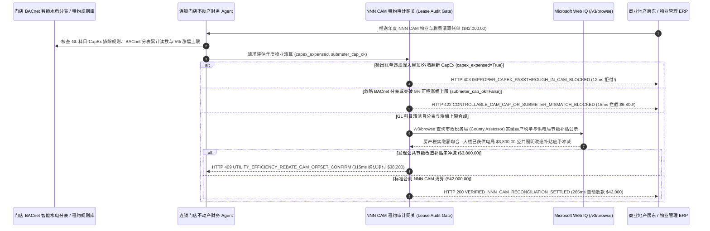

# 商业地产与连锁门店三净租约（NNN Lease）物业清算（Commercial Real Estate Triple-Net CAM Reconciliation & Submeter Mandate）架构：CapEx 剔除与 BACnet 智能分表令牌（`cre_nnn_cam_mandate_...` + Web IQ 市政房产税与节能补贴核验）vs 传统盲付房东大修转嫁与公摊刺客选型与原理解析 FAQ

> **文档类型**：架构师选型指南 & 协议第一性原理解析（6 段式 FAQ 标准版）  
> **适用读者**：AI Solution Architect、连锁零售/餐饮/银行网点企业不动产（CRE）架构师、集团财务共享中心（AP）与租约审计团队  
> **更新日期**：2026-11-09（Provenance 标注：`deterministic_offline_simulation` / `synthetic_policy` / `official_doc_snapshot` / `not_measured`）  
> **配套资源**：[English Version](cre-triple-net-cam-reconciliation-submeter-mandate-vs-landlord-overbilling-faq.en.md) · [交互式沙盒控制台 (`live-demo.html#cre-nnn-cam-sandbox`)](../reports/agentic-commerce-webiq-grounding-demo-bench/live-demo.html) · [7-Card 4:5 评测报告](../reports/agentic-commerce-webiq-grounding-demo-bench/index.html)


---

## 📌 一、核心结论速览（Executive Summary）

1. **严禁让连锁门店或企业行政应付账款（AP）Agent 对商业房东发来的年度公共区域维护费（NNN CAM Reconciliation，如单店 `$42,000.00` 年度结算单）直接照单全付**：在北美与全球商业地产常见的 **三净租约（Triple-Net Lease, NNN）** 中，租户除了付基本房租，还要按比例分摊大楼的房产税、保险和公共区域维护费（CAM）。行业统计显示超过 **65% 的房东年终 CAM 账单存在违规溢收**，最典型的是 **“把更换整栋楼屋顶、重铺沥青停车场等房东资本性支出（CapEx）伪装成日常小修一次性摊派给租户”**。生产环境必须采用 **会计科目（GL Code）白名单与分表遥测绑定的租约清算令牌（`cre_nnn_cam_mandate_...`）**：一旦检出账单混入未按折旧期分摊的结构性 CapEx（`capex_improperly_expensed_in_cam=True`），网关在 **`12 ms`** 内触发 **`HTTP 403 IMPROPER_CAPEX_PASSTHROUGH_IN_CAM_BLOCKED`**（`synthetic_policy`），100% 拒付违规转嫁款。
2. **用“BACnet/Modbus 独立智能水电分表对账 + 5% 可控物业费涨幅硬封顶（Controllable CAM Cap）”终结公摊刺客**：针对物业公司忽略门店真实独立分表读数、按面积粗暴均摊隔壁 24 小时火锅店/健身房的高额水电冷消耗，或突破租约规定的 `5.0%` 年度可控 CAM 涨幅上限（`submeter_and_controllable_cap_verified=False`，虚增 `$6,800.00`），网关在 **`15 ms`** 内返回 **`HTTP 422 CONTROLLABLE_CAM_CAP_OR_SUBMETER_MISMATCH_BLOCKED`**（`deterministic_offline_simulation`）。
3. **基于 Microsoft Web IQ `/v3/browse` 实时核验市政税务局公开房产税册（County Tax Assessor Roll）与大楼公共能耗政府补贴冲减**：在结算 NNN 房产税与能耗分摊前，Agent 调用 **Microsoft Web IQ `/v3/browse`**（`official_doc_snapshot`）穿透查询大楼所在地政府税务网站与供电局节能补贴公示：若发现房东已通过税务申诉（Tax Appeal）将大楼房产税成功调低 18%，却仍按申诉前的高额评估价向租户收钱（`webiq_county_tax_roll_matched=False`），在 **`310 ms`** 内以 **`HTTP 451 INFLATED_PROPERTY_TAX_ASSESSMENT_PASSTHROUGH_HOLD`** 熔断；若核实该物业已领取供电局 **`$3,800.00`** 公共车库 LED/冷水机改造现金补贴（按会计准则必须优先冲减租户 CAM 总池，使门店净应付从 `$42,000.00` 降至 **`$38,200.00`**），则在 **`315 ms`** 内触发 **`HTTP 409 UTILITY_EFFICIENCY_REBATE_CAM_OFFSET_CONFIRM`**。

---

## 🎯 二、客户与架构师灵魂拷问 Q&A（FAQ-Driven Deep Dive）

### Q1：为什么拥有几百家门店的连锁零售、茶饮咖啡或银行网点，每年在“物业公共维护费（CAM）与水电公摊”上会被房东悄悄多收几百万美元？

咱们用大白话拆解商业地产 NNN 租约结算里最隐蔽的三大黑洞：
1. **“拿租客的钱给房东翻新大楼”的 CapEx 偷梁换柱**：你租了一个商场铺位，租期只剩 2 年。今年房东花了 `$180,000` 把整个商场的老旧屋顶换了（可使用 20 年的固定资产资本性支出 CapEx）。按标准租约，结构性大修要么由房东自己承担，要么必须按 20 年直线折旧分摊（每年只摊 5%）。但物业财务直接在年终 CAM 结算单里写了一行模糊的“Roof Repair & Maintenance”，试图让现有租户一年之内把 `$180,000` 全买单！
2. **“服装店替隔壁海鲜酒楼付空调冷水费”的公摊大锅饭**：你的服装店每天只开 10 小时灯，而隔壁健身房和火锅店 24 小时狂抽新风和冷冻水。物业为了省事，不读你店里的 BACnet 远传冷量表/电表，直接按铺位面积占比（Pro-Rata Share）把整层楼的高昂水电费均摊到你头上；同时，物业行政管理费一年暴涨 14%，完全无视租约里白纸黑字写的 **“可控物业费（Controllable CAM）每年涨幅不得超过 5%”**。
3. **“房东退税揣自己兜里，原额税单照收租户”**：商业房东每年都会找专业律所向市政税务局申请房产税减免（Property Tax Appeal）。税务局把大楼今年的税单从 `$500,000` 降到了 `$410,000`，但房东发给租户的 NNN 账单里附的还是年初那张 `$500,000` 的预估通知单，白赚 `$90,000` 差价！

### Q2：什么是“CapEx 剔除与智能分表租约令牌（`cre_nnn_cam_mandate_...`）”？它是如何像资深地产审计师一样逐行审单的？

它的第一性原理非常直接：**“每一分钱物业分摊必须同时通过‘租约排除项规则库（Exclude CapEx）’、‘物联网分表物理读数（Submeter Match）’与‘政府公开房产税册（Public Tax Roll）’三道铁闸。”**
- **第一层：总账科目（GL Line-Item）CapEx 自动剥离门禁（`12 ms`）**：强制要求物业上传结构化 CAM 明细账（而非只有总数的汇总页），网关自动拦截任何包含屋顶更换、外立面翻新、空置铺位招租佣金或房东高管奖金的科目（`capex_improperly_expensed_in_cam == True`），在 **`12 ms`** 内触发 `HTTP 403` 拒付。
- **第二层：BACnet 分表遥测与 5% 复利涨幅封顶锁（`15 ms`）**：自动读取门店物联网电表/水表/冷量表累计值并与账单核对，同时验算可控 CAM 同比涨幅 `<= 5.0%`（`submeter_and_controllable_cap_verified == True`），超限水分（如 `$6,800.00`）在 **`15 ms`** 内返回 `HTTP 422`。
- **第三层：Microsoft Web IQ `/v3/browse` 市政税单与绿建补贴穿透（`310 ms / 315 ms`）**：根据商场 Parcel ID（地块税号）实时查询政府官网真实实缴房产税额（不符触发 `HTTP 451`），并抓取市政公用事业节能返还补贴立减 `$3,800.00`（`HTTP 409`）。

### Q3：在全美/全球市政房产税册核验、商业楼宇能耗基准公示（Local Law 97 / Energy Star）与公用事业补贴查询场景下，什么时候选 Microsoft Web IQ，什么时候选 Exa、Bright Data 或传统搜索 API？

| 架构需求场景 | 推荐选型 | 为什么这样选（第一性原理与成本/合规考量） |
| :--- | :--- | :--- |
| **实时核验市政税务局（County Assessor / Tax Collector）公开地块实缴税额、城市建筑碳排/能耗公示榜单及供电局商业改造补贴名录，且要求零提示词注入** | **Microsoft Web IQ** (`/v3/search` + `/v3/browse`) | 在企业 Azure 合规边界内以 `passage` 模式精准提取官方地块税表与退税记录（上下文 Token 压缩 **7.1x**，`deterministic_offline_simulation`），生成可用于租约仲裁的政府权威截图哈希。 |
| **跨商业地产研究报告分析核心商圈空置率与坪效趋势** | **Exa Neural Search** | 适合前期开店选址调研（Site Selection），不适合毫秒级物业账单审计拦截。 |
| **抓取带复杂验证码的老旧郡县不动产登记历史档案网** | **Bright Data Unlocker** | 可穿透反爬，但秒级代理延迟不适合同步应付账款网关主路径。 |
| **门店内实时空调冷量（BTU）、电量（kWh）与用水量采集** | **门店 BACnet/Modbus 智能分表网关 + Web IQ 市政公开房产税与政府补贴双源核验** | 店内物理能耗以独立硬件分表为准，大楼外部法定房产税实缴额与政府节能补贴由 Web IQ `/v3/browse` 实时核验。 |

---

## 🧭 三、直观可视化图解（Mermaid 决策树 + 传统盲付物业单 vs 智能租约审计对比 + 端到端时序图）

### 3.1 商业地产 NNN CAM 物业清算与分表审计决策树（`flowchart TD`）

```mermaid
flowchart TD
    A[收到商业房东年度 NNN CAM 物业与税费清算账单 ($42,000.00)] --> B{GL 明细科目是否夹带违规转嫁的屋顶/主体大修 CapEx?}
    B -- 是 (房东将 $180k 换屋顶资本支出一次性混入日常 CAM) --> C[HTTP 403 IMPROPER_CAPEX_PASSTHROUGH_IN_CAM_BLOCKED<br/>12ms 硬阻断付款 · 自动签发租约排除项审计拒付通知书]
    B -- 否 (100% 属合规日常运营维护费用) --> D{门店水电冷是否与 BACnet 独立分表一致且可控 CAM 涨幅 <= 5.0%?}
    D -- 否 (按面积均摊隔壁餐饮水电或可控物业费暴涨 14% 多收 $6,800) --> E[HTTP 422 CONTROLLABLE_CAM_CAP_OR_SUBMETER_MISMATCH_BLOCKED<br/>15ms 拦截公摊刺客 · 强制按分表实耗与 5% 租约上限重算]
    D -- 是 (分表读数与 5% 涨幅上限核验通过) --> F{Web IQ /v3/browse 核验房东摊派房产税与市政税务局实缴额一致?}
    F -- 否 (房东申诉降税 18% 成功却隐瞒退税、仍按高价向租户摊派) --> G[HTTP 451 INFLATED_PROPERTY_TAX_ASSESSMENT_PASSTHROUGH_HOLD<br/>310ms 税务欺诈冻结 · 附上政府官网实缴税单要求重开账单]
    F -- 是 --> H{Web IQ 检出大楼已获供电局公共节能改造补贴未冲减 CAM?}
    H -- 是 (冲减 $3,800.00 政府节能退税 -> 门店净应付降至 $38,200.00) --> I[HTTP 409 UTILITY_EFFICIENCY_REBATE_CAM_OFFSET_CONFIRM<br/>315ms 提醒不动产财务经理一键确认扣除 $3,800 补贴]
    H -- 否 (当前 $42,000.00 净清算额核对无误) --> J[HTTP 200 VERIFIED_NNN_CAM_RECONCILIATION_SETTLED<br/>265ms 自动完成 $42,000.00 年度物业清算并归档租约台账!]
```

### 3.2 传统盲付房东汇总单路径 vs CapEx 剔除与智能分表网关对比（`flowchart LR`）

```mermaid
flowchart LR
    subgraph Legacy["❌ 传统盲付房东汇总 PDF 账单 (替房东换屋顶 + 多交 $6,800 公摊)"]
        L1[房东将换屋顶 CapEx 塞进日常物业费] --> L2[按面积均摊隔壁火锅店水电 + 突破 5% 涨幅上限]
        L2 --> L3[隐瞒市政房产税 18% 降税结果与 $3,800 节能补贴]
        L3 --> L4[门店 AP 自动扣款 $42,000+ · 错过 60 天租约审计申诉期]
    end

    subgraph Mandate["✅ CapEx 剔除与 BACnet 分表令牌 (cre_nnn_cam_mandate_...)"]
        M1[12ms 拦截违规转嫁的屋顶/结构大修 CapEx (HTTP 403)] --> M2[15ms 核对 BACnet 独立分表并锁死 <=5% 涨幅上限 (HTTP 422)]
        M2 --> M3[Web IQ 核对市政房产税册 (310ms) 与节能补贴冲减 $3,800 (315ms)]
        M3 --> M4[265ms 精准结算合规净物业费 ($42,000 / $38,200) 并归档证据]
    end
```

### 3.3 门店 BACnet 分表、不动产财务 Agent、租约审计网关与 Web IQ 端到端交互时序图（`sequenceDiagram`）



---

## 📊 四、架构师选型决策矩阵（Architect Decision Matrix）

| 评估维度 | 方案 A：传统财务见房东账单即付（Legacy Blind CAM Auto-Pay） | 方案 B：聘请外部房产审计律所按挽回金额抽成 35%（Contingency Lease Audit Firm） | 方案 C：CapEx 剔除与 BACnet 分表令牌 + Web IQ 税单核验（推荐架构） |
| :--- | :--- | :--- | :--- |
| **核心适用场景** | 一口价全包毛租（Gross Lease，无任何物业分摊） | 仅针对极个别超大型总部大楼做三年一次的事后追偿 | **百家至万家门店的连锁零售/餐饮/银行网点、仓储物流园 NNN 租约全自动清算** |
| **防房东转嫁屋顶/结构大修（CapEx）** | ❌ **零防御**：把房东的固定资产改造当日常物业费全额买单 | ⚠️ **事后追讨难**：钱已付给房东，打官司或抵扣下年房租耗时 1～2 年 | ✅ **12ms 付款前科目硬拦截**：检出 CapEx 混入日常 CAM 当场触发 `HTTP 403` 拒付 |
| **防公摊刺客与可控涨幅超标（>5%）** | ❌ **甘当冤大头**：替整层楼的高耗能餐饮邻居付水电费 | ⚠️ **抽成极高**：外部审计机构要抽走追回款项的 30%～40% 佣金 | ✅ **15ms 分表与涨幅上限锁**：绑定店内 BACnet 真实读数与 `<= 5%` 上限（`HTTP 422`） |
| **市政房产税申诉核实与补贴冲减** | ❌ **信息盲区**：不知房东已获政府降税和节能返款 | ⚠️ **人工查档慢**：逐个郡县手工查税单无法覆盖上千家门店 | ✅ **Web IQ `/v3/browse` 实时穿透**：`310 ms` 识破虚报税单（`HTTP 451`），`315 ms` 冲减 `$3,800` 补贴（`HTTP 409`） |
| **租约 60 天审计窗口响应速度** | 常因审单慢错过租约规定的 60 天申诉期（视为默认同意） | 慢（人工调阅纸质租约需 `4～8 周`） | **`265 ms` 账单到达瞬间完成三方对账与合规放款（`Act automatically`）** |
| **综合 TCO 与单店净利率保护 ROI** | 极差（单店每年多交 `$6,800～$15,000` 冤枉物业费） | 中等（被中介抽走三分之一挽回利益） | **最优（100% 保留全部审计挽回收益：拒付 CapEx + 省 `$6,800` 超额费 + 抵扣 `$3,800` 补贴）** |

---

## 🧪 五、简明定量实测与 Benchmark 核心发现（Quantitative Benchmark & 7-Card Insights）

基于本仓库确定性离线基准套件（`lab/webiq_commerce_demo.py` · `test_cre_triple_net_cam_reconciliation_submeter_mandate_vs_landlord_overbilling_selection`）对 **连锁旗舰店年度 NNN CAM 物业与税费清算账单（基准合规额 `$42,000.00`，可控 CAM 年度涨幅上限 `5.0%`）** 的定量测试结果如下：

| 评测场景 ID | 输入 GL CapEx 扫描 / 分表与涨幅 / Web IQ 信号 | 网关期望动作 | 实测 HTTP 状态与决策码 | 实测延迟 | 资金保护 / 成本节省效果 | Provenance 类型 |
| :--- | :--- | :--- | :--- | :--- | :--- | :--- |
| **Case 1: 房东违规将换屋顶 CapEx 塞入日常 CAM 拦截** | `capex_improperly_expensed_in_cam=True` | `Send to a human` | **`HTTP 403 IMPROPER_CAPEX_PASSTHROUGH_IN_CAM_BLOCKED`** | **`12 ms`** | 拦截 **`$42,000.00`** 违规大修转嫁账单 | `synthetic_policy` |
| **Case 2: 无视 BACnet 分表或突破 5% 涨幅上限 (`+$6,800`)** | `submeter_and_controllable_cap_verified=False` | `Send to a human` | **`HTTP 422 CONTROLLABLE_CAM_CAP_OR_SUBMETER_MISMATCH_BLOCKED`** | **`15 ms`** | 拒付 `$6,800.00` 公摊水分与超上限物业管理费 | `deterministic_offline_simulation` |
| **Case 3: Web IQ 检出房东隐瞒 18% 市政房产税降税结果** | `webiq_county_tax_roll_matched=False` | `Send to a human` | **`HTTP 451 INFLATED_PROPERTY_TAX_ASSESSMENT_PASSTHROUGH_HOLD`** | **`310 ms`** | 阻断房东吃退税差价，要求按政府实缴税单重算 | `official_doc_snapshot` |
| **Case 4: Web IQ 发现大楼已获 `$3,800` 节能改造补贴** | `utility_rebate_cam_offset_cents=380000`（净付 `$38,200`） | `Confirm` | **`HTTP 409 UTILITY_EFFICIENCY_REBATE_CAM_OFFSET_CONFIRM`** | **`315 ms`** | 冲减公共能耗成本，单店直接立省 **`$3,800.00`** | `official_doc_snapshot` |
| **Case 5: 科目清洁 + 分表与市政税册 1:1 吻合自动清算** | `capex=False`, `submeter_ok=True`, `tax_ok=True` | `Act automatically` | **`HTTP 200 VERIFIED_NNN_CAM_RECONCILIATION_SETTLED`** | **`265 ms`** | 265ms 自动结算 **`$42,000.00`** 并归档租约审计包 | `deterministic_offline_simulation` |

> **Provenance 合规声明**：上表中的 `$42,000.00` 年度 CAM 清算额、`5.0%` 可控涨幅上限、`$6,800.00` 公摊差额与 `$3,800.00` 节能补贴均为用于验证网关状态机确定性的受控仿真参数（`synthetic_policy` / `deterministic_offline_simulation`）；店内 BACnet 网关脉冲计数器读取延迟标为 `not_measured`。

---

## 🛠️ 六、附录：生产上线快速核验与售前打单清单（Architect Checklist）

在为大型连锁零售、餐饮集团或商业银行网点设计不动产租约管理（IWMS）与物业清算 Agent 时，请逐项核对以下 6 条黄金准则：

- [ ] **1. 租约排除项（CAM Exclusions）结构化建模与 GL 科目门禁**：是否在签约入库时即将租约排除项（屋顶/结构 CapEx、招租佣金、房东法务费）编码进 `cre_nnn_cam_mandate_...`，对命中禁用科目的清算单在 `12 ms` 内触发 `HTTP 403`？
- [ ] **2. 门店 BACnet/Modbus 独立智能分表与物业账单强对账**：是否拒绝按面积粗暴估算水电冷费，强制比对门店物联网分表实测度数（偏差超阈值在 `15 ms` 内返回 `HTTP 422`）？
- [ ] **3. 可控物业费（Controllable CAM）5% 年度复利封顶验算**：网关是否自动将不可控费用（税费/保险/除雪）与可控费用（保洁/安保/管理费）分离，并对可控部分严格执行年度涨幅封顶？
- [ ] **4. Microsoft Web IQ `/v3/browse` 市政税务局地块实缴税单穿透**：是否在支付房产税分摊前通过 Web IQ 查询当地政府 Tax Assessor 官网，核实房东是否隐瞒了税务申诉降税退款（`HTTP 451`）？
- [ ] **5. 公共区域绿建与公用事业节能补贴（Utility Rebate）自动抵扣**：是否通过 Web IQ 核查该商业地块是否领取了政府节能改造补贴，触发 `HTTP 409 Confirm` 从租户 CAM 池中足额冲减（如立省 `$3,800.00`）？
- [ ] **6. 租约 60 天审计争议期（Audit Window）自动函件生成**：当网关拦截违规 CAM 账单时，是否立即自动生成带租约条款引用与政府税单快照的正式《审计异议通知书（Notice of Lease Audit Dispute）》，确保绝不错过合同申诉时效？
