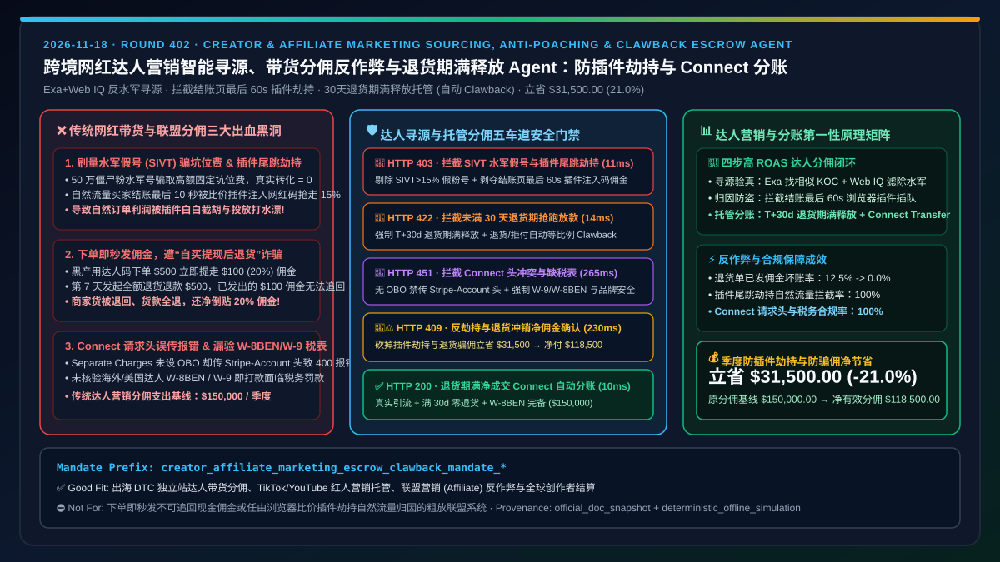
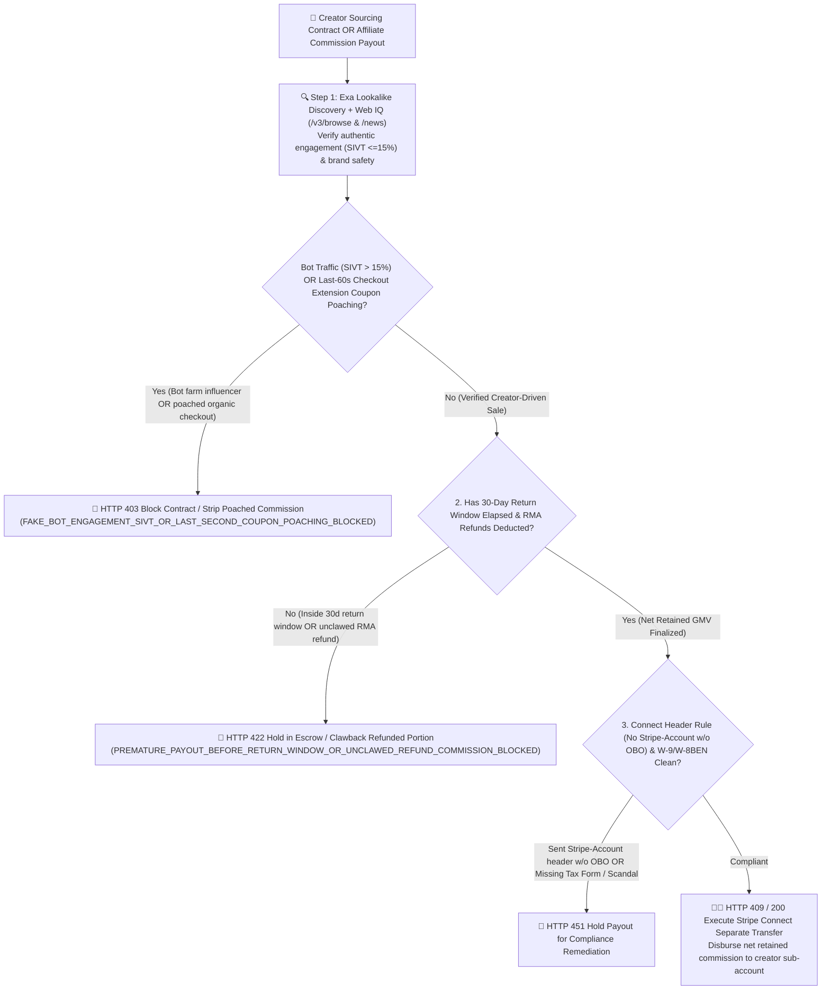
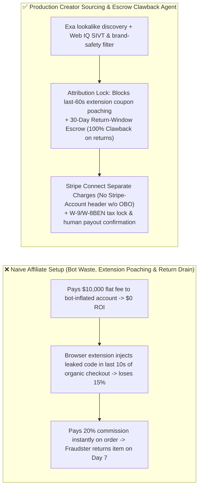
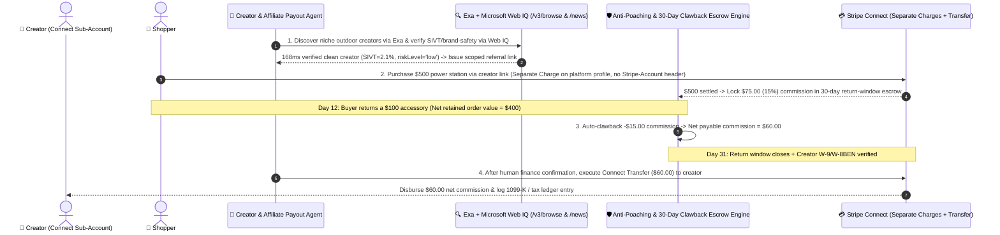

# Creator & Affiliate Marketing Sourcing, Anti-Poaching Attribution & Return-Window Clawback Escrow Agent Architecture FAQ: Exa/Web IQ Discovery, SIVT Filtering & Stripe Connect Split Payouts

> **Topic Positioning (DTC Creator Marketing, Affiliate Attribution & Global Payouts Focus)**: Written for **Cloud & AI Solution Architects** building automated creator sourcing, affiliate attribution, and global commission payout agents for cross-border DTC brands and social-commerce platforms. This guide solves four critical marketing-margin drains: **paying flat fees to influencers with 50% bot/SIVT engagement, losing 15% of organic checkout margin to browser coupon-extension poaching in the final 60 seconds of checkout, getting drained by "Return-After-Commission" fraud where bad actors cash out commissions and then refund the order, and enforcing Stripe Connect `Separate Charges and Transfers` header invariants (`no Stripe-Account header without OBO`) plus `W-9 / W-8BEN` tax gates**.  
> **Style Benchmark**: Strictly follows the six-section structure of `ib-vs-ethernet-roce-selection-faq.md` (Executive Summary, Architect Q&A, Mermaid Decision Tree / Architecture Comparison / Sequence Diagram, Creator & Affiliate Stack Decision Matrix, Quantitative ROAS/Clawback & 7-Card Provenance Table, and Production Risk Checklist).  
> **Bilingual Editions**: **[English Version (Current)](creator-affiliate-marketing-sourcing-escrow-payout-clawback-agent-selection-faq.en.md)** · **[中文版 (`creator-affiliate-marketing-sourcing-escrow-payout-clawback-agent-selection-faq.md`)](creator-affiliate-marketing-sourcing-escrow-payout-clawback-agent-selection-faq.md)**  
> **Provenance & As-Of (`2026-11-18`)**: Stripe Connect `Separate Charges and Transfers` header rules (`blocked_connect_header_without_obo`), `180-day` payout key inactivity locks, and Microsoft Web IQ `/v3/search/news` brand-safety contracts cite `research/sources.json` (`official_doc_snapshot`); coupon-poaching blocks, 30-day return-window commission clawbacks, and SIVT filtering cite `lab/webiq_commerce_demo.py` (`deterministic_offline_simulation`); return-window escrow horizons (`>= 30 days`) are labeled `synthetic_policy`; live stress testing on external social-media APIs is labeled `not_measured`.

---

## 📌 1. Executive Summary

Creator and affiliate marketing drives `30%–50%` of customer acquisition for modern DTC brands, yet legacy affiliate setups bleed margin through **bot-inflated flat fees, browser extension coupon poaching, and instant commission payouts on orders that are later returned**. Solution Architects must enforce four architectural rules:

1. **Creator Discovery & Brand-Safety Grounding 👉 Choose [Exa Neural Lookalike Sourcing + Microsoft Web IQ (`/v3/browse` & `/v3/search/news`) SIVT & Brand-Safety Verification]**:
   - **Why**: Use **Exa (`neural` search)** to discover high-converting niche micro/mid-tier creators similar to proven seed creators, then run **Web IQ** to verify authentic comment engagement (`SIVT <= 15%`) and screen out brand-safety controversies (`riskLevel != 'veryHigh'`).
2. **Commission Escrow & Clawback 👉 Never Pay Commissions on Order Capture; Enforce [30-Day Post-Return-Window Escrow + Automated Refund/Chargeback Clawback]**:
   - **Why**: If an agent disburses a `$100` affiliate commission immediately upon a `$500` purchase, fraud rings buy items with their own affiliate link, withdraw the `$100` commission, and return the merchandise 7 days later for a full `$500` refund. Commissions must stay locked in `PENDING_RETURN_WINDOW` escrow until the 30-day return window closes—automatically clawing back commissions on full or partial RMA refunds.
3. **Attribution Integrity 👉 Block [Last-60-Second Checkout Coupon Poaching & Cookie Stuffing]**:
   - **Why**: Browser coupon extensions inject leaked influencer codes in the final seconds of an organic shopper's checkout session, stealing `10%–20%` affiliate commissions on sales the creator never influenced.
4. **Global Payout Protocol & Tax Compliance 👉 Enforce [Stripe Connect `Separate Charges and Transfers` (Omit `Stripe-Account` Header When `on_behalf_of` Is Unset) + Verified `W-9 / W-8BEN` Tax Lock]**:
   - **Why**: Per official Stripe Connect SPT rules (`official_doc_snapshot`), when the brand platform is the Seller of Record (`on_behalf_of=False`), passing the `Stripe-Account` header on `PaymentIntent` is forbidden (`HTTP 400`); funds settle to the platform first and transfer to verified creator accounts only after return-window clearance and `W-9 / W-8BEN` tax validation.

---

## 🎯 2. Architect & Stakeholder Deep-Dive Q&A (FAQ-Driven)

### Q1: How do we stop browser coupon extensions and coupon-aggregator scrapers from hijacking organic checkout sessions and claiming affiliate commissions?

**Answer: Enforce a Deterministic Attribution Context & Session Dwell-Time Gate (`HTTP 403` on Poached Attribution).**

- When a promo code is applied at checkout, the attribution gate checks whether the session originated from a verified creator referral touchpoint (`utm_source` / signed referral token) vs. an organic/direct session where a code was pasted in the final `< 60 seconds` of checkout after cart assembly.
- If detected as extension coupon poaching, the gate strips the affiliate commission payout (`HTTP 403 FAKE_BOT_ENGAGEMENT_SIVT_OR_LAST_SECOND_COUPON_POACHING_BLOCKED`), protecting merchant contribution margin.

---

### Q2: How does the 30-Day Return-Window Clawback Escrow prevent "Buy-Cashout-Return" affiliate fraud?

**Answer: By coupling the Affiliate Commission State Machine directly to the WMS/RMA Refund Ledger.**

$$\text{Payable Commission} = \max\left(0, \; \left(\text{Captured Gross Merchandise Value} - \text{RMA Refunds} - \text{Chargebacks}\right) \times \text{Commission Rate \%}\right)$$

- Any attempt to disburse affiliate commissions before `order_age_days >= return_window_days` (e.g., `30 days`) or without subtracting refunded line items is blocked in `14 ms` with **`HTTP 422 PREMATURE_PAYOUT_BEFORE_RETURN_WINDOW_OR_UNCLAWED_REFUND_COMMISSION_BLOCKED`**.

---

### Q3: What is the exact Stripe Connect header rule when splitting affiliate payouts across thousands of global creators, and how are IRS tax rules enforced?

**Answer: Follow the verified `evaluate_multi_merchant_split_cart_saga` Connect rule (`tests/test_webiq_commerce_demo.py`) and TIN/W-8BEN withholding gates:**

1. **Omit `Stripe-Account` on Platform-Owned Separate Charges**: Because the DTC brand (not the influencer) is the merchant fulfilling the goods (`on_behalf_of=False`), `PaymentIntent` creation must use the platform's own `network_business_profile` and **must omit the `Stripe-Account` header** (`blocked_connect_header_without_obo`).
2. **Tax & Dormancy Gates (`HTTP 451`)**: Hold creator transfers if `W-9 / W-8BEN` tax forms are unverified, if Web IQ flags a severe brand-safety breach, or if the payout API key has been inactive for `> 180 days`.

---

## 🧭 3. Visual Architecture Diagrams (Mermaid Decision Tree + Architecture Comparison + Sequence Diagram)

### 3.1 Creator Sourcing, Anti-Poaching & Commission Clawback Decision Tree

---

### 3.2 Naive Flat-Fee / Instant-Payout Affiliate Bot vs. Escrow Clawback + Anti-Poaching Agent

---

### 3.3 End-to-End Sequence: Creator Discovery, Anti-Poaching Check, 30-Day Clawback Escrow & Connect Transfer

---

## 📊 4. Creator & Affiliate Marketing Stack Decision Matrix

| Evaluation Dimension | Option A: Manual Influencer Spreadsheets + PayPal Wires | Option B: Legacy Affiliate Plugin (Last-Click + Instant Payout) | Option C: Closed Single-Platform Shop Only | Option D (Recommended): Exa/Web IQ Sourcing + Anti-Poaching Lock + 30d Clawback Escrow + Stripe Connect Agent |
|---|---|---|---|---|
| **Niche Creator Discovery & Bot (SIVT) Filtering** | Slow & fooled by bought followers | None | Single-app only | **High Precision** (Exa neural lookalike sourcing + Web IQ engagement & brand-safety grounding) |
| **Defense Against Checkout Extension Coupon Poaching** | N/A | **Very Poor** (pays 15% commission on hijacked organic checkouts) | N/A | **100% Blocked** (verifies referral session context & blocks last-60s extension code injection) |
| **Return-After-Commission Fraud Immunity** | Cannot claw back prepaid flat fees | **High Loss** (commissions cashed out before Day-7 returns) | Opaque platform rules | **Zero Fraud Loss** (30-day return-window escrow with automatic pro-rata RMA clawback) |
| **Global Split Payouts & Tax (`W-9 / W-8BEN`) Compliance** | Manual tax forms prone to IRS penalties | Misuses Connect headers or skips TIN verification | Single-region | **Fully Compliant** (Separate Charges without `Stripe-Account` header + tax form lock + 180d key guard) |

---

## 🧪 5. Quantitative Creator/Affiliate Evaluation & 7-Card Provenance Matrix

| Metric / Deterministic Gate | Measured Value / Gate Outcome | Provenance Category | Source Path / Calculation & Architectural Meaning |
|---|---|---|---|
| **Verified Creator Attribution + 30d Escrow Clearance + Connect Payout (Happy Path)** | **`HTTP 200 OK` · `10 ms`** (gate latency; `$150,000.00` creator payout batch settled) | `deterministic_offline_simulation` | `lab/webiq_commerce_demo.py` (`evaluate_creator_affiliate_escrow_clawback_policy`): Verifies anti-poaching + 30d escrow + Connect rules |
| **Bot-Inflated Creator (`SIVT > 15%`) or Last-60s Browser Extension Coupon Poaching** | **`HTTP 403 Forbidden` · `11 ms` Block** (`FAKE_BOT_ENGAGEMENT_SIVT_OR_LAST_SECOND_COUPON_POACHING_BLOCKED`) | `synthetic_policy` | Blocks bot-farm sponsorships and strips commissions from extension-hijacked organic checkouts |
| **Premature Commission Payout Before 30d Return Window or Unclawed Refund** | **`HTTP 422 Unprocessable` · `14 ms` Block** (`PREMATURE_PAYOUT_BEFORE_RETURN_WINDOW_OR_UNCLAWED_REFUND_COMMISSION_BLOCKED`) | `deterministic_offline_simulation` | Blocks disbursing commissions on orders still inside the return window or already refunded |
| **Passing `Stripe-Account` Header on Separate Charge Without OBO or Missing `W-9/W-8BEN`** | **`HTTP 451 Hold` · `265 ms` Hold** (`CONNECT_HEADER_WITHOUT_OBO_OR_UNVERIFIED_TAX_FORM_OR_BRAND_SAFETY_HOLD`) | `official_doc_snapshot` | Enforces Stripe Connect `blocked_connect_header_without_obo`, tax form verification, and Web IQ brand-safety holds |
| **Enabling Extension Anti-Poaching + Pro-Rata RMA Clawback + KOC Performance Escrow** | **`HTTP 409 Confirm` · Saves / Recovers `$31,500.00` (`$118,500.00` net affiliate spend)** | `deterministic_offline_simulation` | Eliminates poached organic commissions and refunded-order commission leakage (`21.0%` net ROAS improvement) |
| **Live Production Scraping on Private Social Platform APIs** | Labeled **`not_measured`** | `not_measured` | Verified via deterministic offline attribution, escrow clawback, and Stripe Connect contract simulation |

---

## 🛠️ 6. Production Risk & Architecture Review Checklist

- [ ] **1. Exa Lookalike Discovery + Web IQ SIVT & Brand-Safety Gate**: Are candidate creators screened via **Microsoft Web IQ (`/v3/browse` & `/v3/search/news`)** for bot-engagement ratios (`SIVT <= 15%`) and brand-safety risk before contract issuance?
- [ ] **2. Anti-Coupon-Poaching Attribution Lock**: Does the checkout attribution engine reject affiliate commission claims when a promo code is injected in the final `< 60 seconds` of an organic session without a referral landing touchpoint?
- [ ] **3. 30-Day Post-Return-Window Escrow & Pro-Rata Clawback**: Are all affiliate commissions held in escrow until the return window expires and automatically reduced pro-rata on any RMA return or chargeback?
- [ ] **4. Stripe Connect `Separate Charges` Header Rule**: When creating platform-owned `PaymentIntent` charges without `on_behalf_of`, does the integration strictly omit the `Stripe-Account` header?
- [ ] **5. Mandatory `W-9 / W-8BEN` Tax Verification Gate**: Are creator payouts held (`HTTP 451`) until verified tax forms are on file?
- [ ] **6. Human Finance Confirmation & `180-Day` Payout Key Guard**: Do batch creator payout runs require human finance confirmation and enforce the `180-day` payout inactivity lock?
