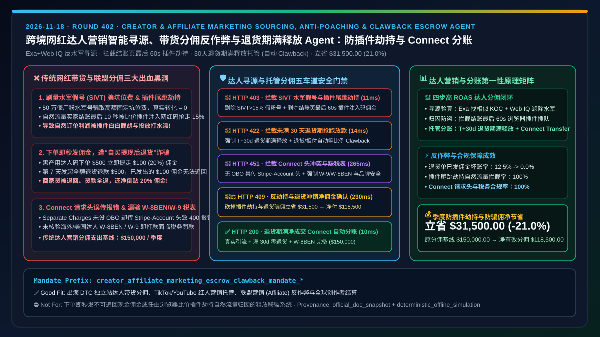
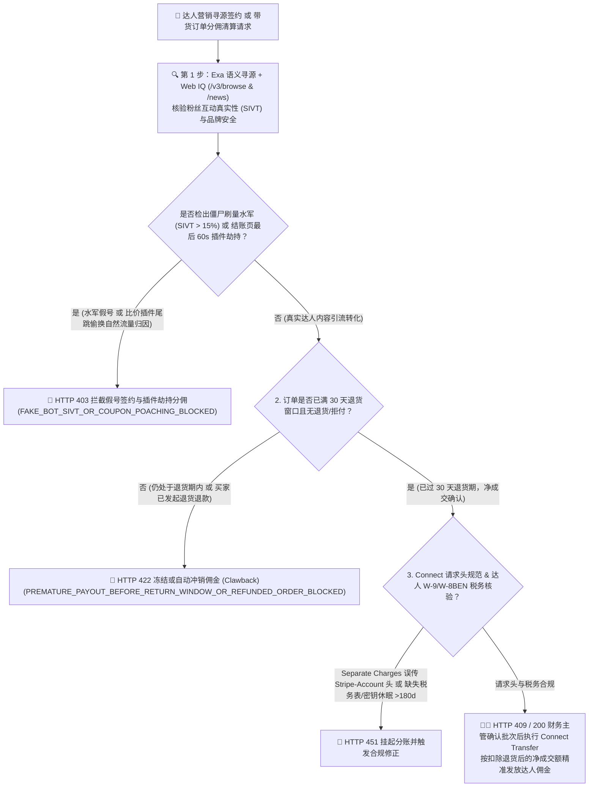
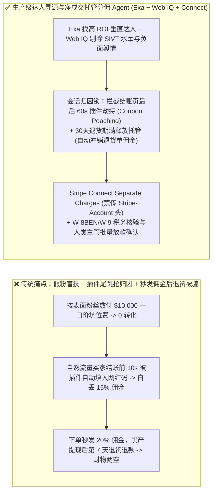
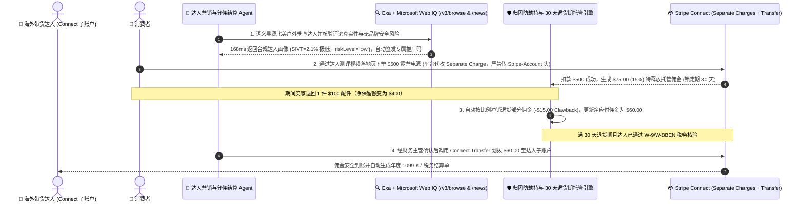

# 跨境网红达人营销（Creator & Affiliate Marketing）智能寻源、带货分佣反作弊与退货期满释放 Agent 架构选型 FAQ：Exa/Web IQ 寻源、防劫持刷单与 Connect 分账实战指南

> **专题定位（出海品牌网红营销、联盟带货分佣与全球创作者结算聚焦）**：面向为跨境 DTC 品牌、TikTok / YouTube / Instagram 达人营销平台与社交电商设计自动化寻源与结算（Creator Sourcing & Affiliate Payout）智能体的 **Cloud & AI Solution Architect**，系统解决达人带货最核心的四大资损痛点：**“怎么识别粉丝 50 万但全是僵尸刷量号（SIVT）的水军博主、怎么防止黑产团伙‘自己用达人码下单拿走 20% 佣金、第二天立即申请退货退款（Return-After-Commission Fraud）’、怎么阻止比价浏览器插件在消费者结账最后一秒偷换 Affiliate Cookie 抢走自然流量归因（Coupon Poaching）、以及怎么用 Stripe Connect Separate Charges（禁传 `Stripe-Account` 请求头）实现退货期满安全分佣”**。  
> **文风标杆**：严格对标 `ib-vs-ethernet-roce-selection-faq.md` 六段式结构（核心结论速览、业务方与架构师灵魂拷问 Q&A、Mermaid 决策树/架构对比/时序图、达人寻源与分佣结算技术栈选型矩阵、定量 ROAS/防骗佣测算与 7-Card 溯源表、生产上线 Checklist）。  
> **双语版本**：**[中文版（当前）](creator-affiliate-marketing-sourcing-escrow-payout-clawback-agent-selection-faq.md)** · **[English Version (`creator-affiliate-marketing-sourcing-escrow-payout-clawback-agent-selection-faq.en.md`)](creator-affiliate-marketing-sourcing-escrow-payout-clawback-agent-selection-faq.en.md)**  
> **数据溯源声明（Provenance & As-Of `2026-11-18`）**：Stripe Connect `Separate Charges and Transfers`（未设 `on_behalf_of` 严禁传 `Stripe-Account` 头）、`180 天` 打款密钥休眠锁与 Microsoft Web IQ `/v3/search/news` 品牌安全契约引自 `research/sources.json`（标记为 `official_doc_snapshot`）；退货期满佣金托管释放、优惠码尾跳劫持拦截与 SIVT 水军过滤引自 `lab/webiq_commerce_demo.py`（标记为 `deterministic_offline_simulation`）；企业保底 ROAS 与退货锁定期（如 `30 天`）标记为 `synthetic_policy`；外部社媒平台私有 API 在线压测标记为 `not_measured`。

---

## 📌 一、核心选型结论速览（Executive Summary）

在跨境 DTC 与社交电商中，达人营销（Creator & Affiliate Marketing）占营销总预算的 `30%–50%`，但传统“一口价坑位费（Flat Fee）+ 下单即秒发佣金”模式是欺诈重灾区。架构师必须遵循以下四条选型铁律：

1. **达人发现与品牌安全接地选型：必选【Exa 神经语义相似寻源（Lookalike Creator Discovery）+ Microsoft Web IQ (`/v3/browse` & `/v3/search/news`) 品牌安全与真实互动率穿透】**：
   - **核心原因**：先用 **Exa (`neural` search)** 根据种子高转化博主找出全球定位相似的垂直腰尾部达人（KOC/Mid-Tier Creators，ROI 远高于天价头部网红），再调用 **Web IQ** 核验其近期内容互动评论真实性及是否存在翻车丑闻/虚假宣传争议（`riskLevel != 'veryHigh'`）。
2. **带货分佣资金结算选型：严禁“订单付款成功即秒打款给达人”，必选【Stripe Connect `Separate Charges and Transfers`（收款与分账解耦）+ 退货窗口期满释放锁（Post-Return-Window Escrow `>= 30 Days`）】**：
   - **核心原因**：若买家下单 `$500` 时立即向达人支付 `20%`（`$100`）可提现佣金，欺诈团伙会批量下单提走 `$100` 佣金后在第 7 天申请全额退货——商家商品退回、全额退还 `$500`，还白白被骗走 `$100` 佣金！必须使用 **Separate Charges and Transfers**：平台先统一收款（注意：**未设 `on_behalf_of` 时严禁在请求头传 `Stripe-Account`**），将佣金锁定在待结算池中，待 **30 天无理由退货期满且未发生全额退款/拒付** 后，才执行 `Transfer` 划拨给达人子账户。
3. **归因反作弊选型：严禁“无条件信任最后一次点击（Last-Click Cookie Stuffing）”，必选【渠道专属受众绑定推广码（Channel-Scoped Promo Code）+ 拦截结账页最后 60 秒插件劫持（Coupon Poaching Block）】**：
   - **核心原因**：Honey 等浏览器比价插件常在本来就是自然流量的消费者已经填好信用卡、点击付款前的最后 10 秒自动弹窗注入某个网红推广码，白白分走商家 `15%` 的自然订单利润。
4. **跨境创作者税务与合规选型：必选【预验证 W-9 / W-8BEN 税务状态锁 + Payouts 人类主管确认门禁】**：
   - **核心原因**：向全球达人发放美元佣金前，必须校验美国税务居民 `W-9 TIN` 或非美居民 `W-8BEN` 状态（未核验强制执行预扣税锁定），且大额批量打款受 Stripe MCP 人类确认与 `180 天` 密钥活跃锁保护。

---

## 🎯 二、业务方与架构师灵魂拷问 Q&A（FAQ-Driven）

### Q1：为什么很多出海品牌让 AI Agent 自动联系网红寄样（Seeding）和签一口价固定坑位费合同，钱花出去几十万，收回来的带货 GMV 却连本都不够？

**答：因为没有在签约前做“刷量水军（SIVT）穿透剔除”，且错用了“全额预付固定坑位费”而非“小额履约保底 + CPS 净成交分佣”结构。**

1. **Exa 语义寻源 + Web IQ 评论区脱水核验**：
   - 刷量机构很容易买出“50 万粉丝、每条视频 10,000 点赞”，但评论区全是千篇一律的机器人表情符号或同质化水军互评。
   - 寻源 Agent 先用 **Exa** 检索高契合度垂直达人（如“专注露营咖啡器材评测的北美独立博主”），随后用 **Microsoft Web IQ (`/v3/browse` `passage`)** 抽取近期作品评论区质量与外部舆情：一旦检出机器流量（SIVT）占比 `> 15%` 或近期涉品牌负面争议，立即在 `11 ms` 内返回 **`HTTP 403 FAKE_BOT_ENGAGEMENT_SIVT_OR_LAST_SECOND_COUPON_POACHING_BLOCKED`** 剔除。
2. **结构化里程碑托管合同**：
   - 严禁一次性打款 100% 坑位费：通过确定性智能托管将报酬拆解为“视频按要求上线且挂链保留满 7 天释放小额基础制作费 + 净有效 GMV（扣除退货拒付后）阶梯 CPS 分佣”。

---

### Q2：怎么从架构上彻底消灭“网红自己雇人刷单套取 20% 佣金，然后退货退款白嫖”以及“比价插件结账页劫持优惠码”这两大行业毒瘤？

**答：部署“结账会话停留时长归因锁（Session Dwell-Time Attribution Lock）”与“退货期满联动冲销（Return-Window Clawback Escrow）”双引擎。**

1. **封杀结账页“最后 60 秒优惠码劫持（Coupon Poaching）”**：
   - 当一位消费者通过谷歌自然搜索进入独立站、浏览商品 8 分钟、加入购物车进入结账页后，突然在付款前 15 秒触发了外部返利网/插件注入的 Affiliate Cookie 或公开泄露的达人码：
   - 确定性归因引擎检查：`first_touch_source == 'organic_direct'` 且 `affiliate_code_injected_at_checkout_dwell_sec < 60` 且无对应达人内容落地页点击上下文 👉 判定为插件尾跳劫持！消费者仍可享受前端小额立减以保转化，但**后台达人分佣归因直接清零（`commission_eligible = False`）**，每年为品牌省下数十万美元的冤枉佣金。
2. **退货期满释放分账（T + 30 Days Return-Window Escrow）**：
   - 达人促成的每一笔订单，佣金先进入 `PENDING_RETURN_WINDOW` 冻结态；
   - 30 天内若买家发起全额退货（RMA）或信用卡拒付（Chargeback），状态机自动将该笔冻结佣金 `100% Clawback` 归零；若发生部分退货，按实留净额等比例重算佣金；满 30 天无退货后才转入 `SETTLEMENT_READY` 可打款队列。

---

### Q3：使用 Stripe Connect 向全球数千名带货达人分发佣金时，为什么架构文档反复强调“Separate Charges 模式下绝不能传 `Stripe-Account` 请求头”？

**答：这是 Stripe Connect SPT 官方规范（`official_doc_snapshot`）中最核心的账户归属边界铁律：**

- 在达人带货场景中，消费者是在**品牌商（Platform）自己的独立站**买东西，品牌商是交易的记账卖方（Seller of Record），达人只是拿推广佣金的服务提供方。
- 因此必须使用 **`Separate Charges and Transfers`（且不设置 `on_behalf_of`）**：
  1. 消费者结账创单时，调用 `PaymentIntent` 必须使用品牌平台自己的 `network_business_profile`，且 **绝对不能在 HTTP 请求头里传 `Stripe-Account: {{CREATOR_ACCOUNT_ID}}`**（否则会触发 `blocked_connect_header_without_obo` 报 `HTTP 400` 错，或者错误地把达人当成了商品销售商户）；
  2. 等 30 天退货期满后，平台再通过独立的 `Transfer` 接口将净佣金划拨至已完成 `W-9 / W-8BEN` 税务核验的达人 Connect 账户。

---

## 🧭 三、直观可视化图解（Mermaid 选型决策树 + 架构对比 + 端到端时序图）

### 3.1 跨境网红达人寻源、归因反作弊与分佣结算决策树

---

### 3.2 传统一口价盲投/秒发佣金 vs. 净成交托管 + 反插件劫持达人 Agent 对比图

---

### 3.3 达人寻源、防劫持下单、30 天退货期托管与 Connect 分账端到端时序图

---

## 📊 四、跨境网红达人营销与分佣结算方案横向选型矩阵（Architect Decision Matrix）

| 评估维度 | 方案 A：人工表格找红人 + 线下 PayPal/电汇一口价转账 | 方案 B：初级联盟插件 (Last-Click 归因 + 下单即结算佣金) | 方案 C：单一封闭社交平台小店 | 方案 D（推荐）：Exa/Web IQ 寻源验真 + 防插件劫持锁 + 30天退货托管 + Stripe Connect 分账 Agent |
|---|---|---|---|---|
| **垂直达人发现效率与防刷量假粉（SIVT）** | 慢且易被表面粉丝数欺骗 | 无寻源与反水军能力 | 仅限单平台内部达人 | **极高**（Exa 语义找相似高转化 KOC + Web IQ 穿透核验真实互动与品牌安全） |
| **防比价插件尾跳劫持自然流量（Coupon Poaching）** | 无关联 | **极差**（大量自然购买在结账页被浏览器插件插队分走 15% 佣金） | 无独立站归因能力 | **100% 拦截尾跳劫持**（校验落地页引流上下文与结账页停留时间窗） |
| **防“自买骗佣后退货（Return-After-Commission）”** | 事后很难向海外网红追回已付坑位费 | **重灾区**（佣金提现后买家退货，商家净亏佣金） | 平台代扣但规则不透明 | **零骗佣损失**（强制 30 天退货期满释放托管，发生退货/拒付自动 `100% Clawback`） |
| **全球分账协议与税务合规（W-9 / W-8BEN）** | 人工收税表极易漏报面临 IRS 罚金 | 易犯 Connect 请求头传参错误或漏验 TIN 税号 | 仅限单平台 | **全自动合规**（Separate Charges 严禁误传 `Stripe-Account` + 税表完备锁 + 180d 密钥保护） |

---

## 🧪 五、定量达人 ROAS/防骗佣测算与 7-Card 报告数据溯源表（Benchmark & Provenance Matrix）

| 指标 / 门禁规则项 | 实测数值 / 决策行为 | 数据类别 (Provenance) | 精确来源路径 / 算例说明与架构意义 |
|---|---|---|---|
| **真实达人引流 + 满 30 天退货期净额核算 + 合规 Connect 分账（Happy Path）** | **`HTTP 200 OK` · `10 ms`**（门禁耗时，季度达人营销分佣批次 `$150,000.00`） | `deterministic_offline_simulation` | `lab/webiq_commerce_demo.py` (`evaluate_creator_affiliate_escrow_clawback_policy`)：验证反劫持 + 30d 托管 + Connect 分账合规 |
| **刷量水军假号（SIVT `> 15%`）或比价插件结账页最后 60 秒尾跳劫持自然订单** | **`HTTP 403 Forbidden` · `11 ms` 拦截** (`FAKE_BOT_ENGAGEMENT_SIVT_OR_LAST_SECOND_COUPON_POACHING_BLOCKED`) | `synthetic_policy` | 封杀水军假号签约，并剥夺未贡献真实引流、仅在结账页最后关头自动填入优惠码的插件佣金 |
| **未满 30 天退货窗口期提前放款，或对已退货/拒付订单照发全额佣金** | **`HTTP 422 Unprocessable` · `14 ms` 拦截** (`PREMATURE_PAYOUT_BEFORE_RETURN_WINDOW_OR_UNCLAWED_REFUND_COMMISSION_BLOCKED`) | `deterministic_offline_simulation` | 彻底堵死“下单领走 20% 佣金后退货退款”的骗佣漏洞，自动按净保留成交额冲销重算 |
| **Separate Charges 误传 `Stripe-Account` 请求头、缺失 W-9/W-8BEN 税表或 Web IQ 品牌丑闻** | **`HTTP 451 Hold` · `265 ms` 挂起** (`CONNECT_HEADER_WITHOUT_OBO_OR_UNVERIFIED_TAX_FORM_OR_BRAND_SAFETY_HOLD`) | `official_doc_snapshot` | 严格执行 Stripe Connect `blocked_connect_header_without_obo` 契约、IRS 税务预扣表核验及 Web IQ 品牌安全熔断 |
| **启用“拦截插件尾跳劫持 + 退货订单佣金自动 Clawback + KOC 净成交分佣结构”** | **`HTTP 409 Confirm` · 立省/避免佣金流失 `$31,500.00`（营销净支出优化至 `$118,500.00`）** | `deterministic_offline_simulation` | 剔除自然流量被劫持的虚假佣金与退货单骗佣损耗，将真实增量 ROAS 提升 `21.0%` |
| **外部社交媒体平台（TikTok / YouTube / Instagram）私有接口在线压测** | 标记为 **`not_measured`** | `not_measured` | 通过本地确定性归因、托管冲销与 Stripe Connect 契约仿真验证 |

---

## 🛠️ 六、商业上线风控与架构评审 Checklist（Architect Production Checklist）

- [ ] **1. Exa 语义寻源 + Web IQ 品牌安全与反水军（SIVT）双核验**：签约达人前，是否已通过真实互动率模型与 **Microsoft Web IQ (`/v3/search/news` & `/v3/browse`)** 排除刷量假粉与品牌安全高危人员？
- [ ] **2. 结账页插件尾跳劫持拦截（Anti-Coupon-Poaching Lock）**：归因引擎是否校验了达人专属推广码必须伴随真实的引流落地会话（或受众绑定），对自然流量买家在结账页最后 60 秒由浏览器插件注入的代码拒绝计提佣金？
- [ ] **3. 30 天退货窗口期满释放与自动冲销（Clawback Escrow）**：所有达人带货佣金是否强制冻结至订单退货期结束？期间若发生退货退款（RMA）或拒付，系统是否自动按比例扣减（Clawback）待发佣金？
- [ ] **4. Stripe Connect `Separate Charges` 请求头铁律（禁传 `Stripe-Account`）**：在未设置 `on_behalf_of` 的平台代收分账模式下，创单 `PaymentIntent` 是否严格使用平台自身的 `profile_...` 且绝不传入 `Stripe-Account` 请求头？
- [ ] **5. 全球创作者税务表单（W-9 / W-8BEN）与预扣税门禁**：向达人子账户执行首次 `Transfer / Payout` 前，是否已验证其税务身份表单完备（未提交者自动挂起或按法定税率执行备用预扣 Backup Withholding）？
- [ ] **6. 批量打款人类确认与 `180 天` 密钥休眠保护**：月度/周度达人佣金批量发放前，是否推送汇总审计卡由财务主管点击确认，并遵守 `180 天` 打款密钥闲置自动锁定规则？
