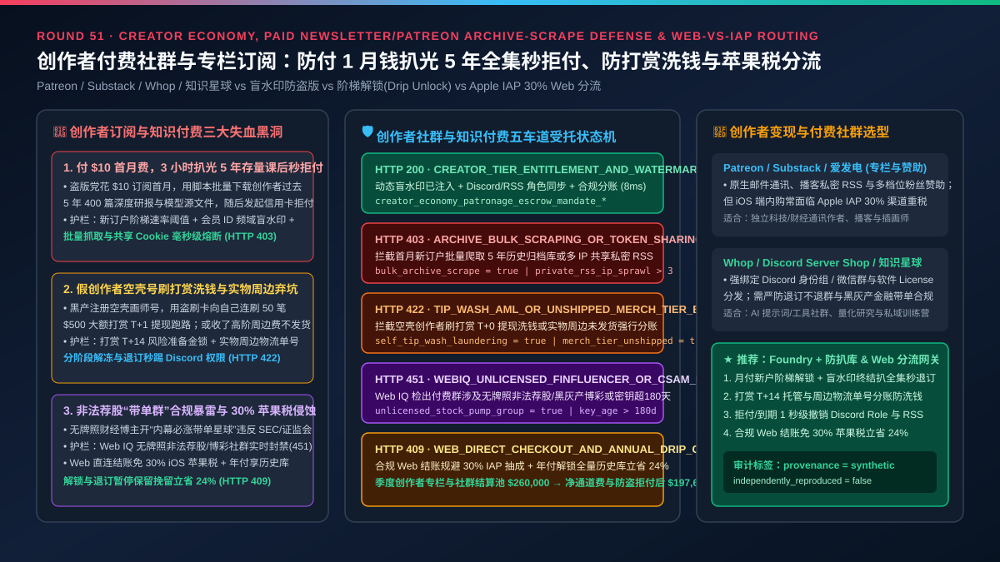
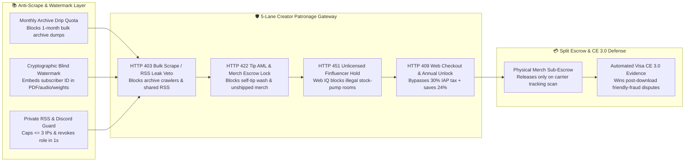

# Creator Economy, Paid Newsletter, Discord/Patreon Tier & Tipping Escrow (`Patreon / Substack / Whop / YouTube Memberships`) Anti-Archive-Scraping Drip Lock, Dynamic Blind Watermark, Anti-Wash-Tipping `AML` & Web-vs-`IAP` Routing Agent Architecture Selection FAQ

> **Language / 语言切换**: **[中文](creator-economy-patreon-substack-archive-scraping-iap-escrow-agent-selection-faq.md)** | **English (Current)** | **[Back to Docs Index](index.en.md)** | **[Interactive Sandbox (`#creator-economy-patronage-escrow-sandbox`)](../live-demo.en.html)**



---

## 📌 1. Executive Summary & Core Selection Verdict

In creator economy memberships, paid research newsletters, private podcast feeds, and gated Discord/Telegram communities (`Patreon`, `Substack`, `Whop`, `Ghost`, `Ko-fi`, `Buy Me a Coffee`), subscription and patronage AI agents face three severe structural leakage vectors:
1. **"Hit-and-Run" 5-Year Archive Scraping & Friendly-Fraud Chargebacks (`Pay $10 for 1 Month, Scrape 400 Historical Reports/LoRA Weights in 2 Hours, Then File a Card Chargeback`)**: When a new monthly subscriber immediately gains unrestricted bulk access to a creator's entire 5-year back-catalog of PDFs, source code, or 3D/AI model weights, piracy bots scrape the entire archive in minutes, re-upload it to pirate Telegram channels, and file a `"Services Not Rendered / Unauthorized"` credit card chargeback—costing the creator both their life's work and a `$15` dispute fee. Meanwhile, private podcast RSS URLs (`rss_token_*`) are routinely pasted into group chats for hundreds of non-paying listeners.
2. **Stolen-Card Self-Tipping Money Laundering (`Fake Creator Accounts Receiving $5,000 in "Tips" from Stolen Cards and Cashing Out T+1`) & Unfulfilled Physical Merch Tiers**: Fraudsters spin up empty "AI artist" profiles with zero genuine audience engagement and tip themselves thousands of dollars using stolen credit cards; conversely, legitimate creators sometimes sell `$50/mo` "Physical Merch Tiers" (promising signed artbooks or hoodies) but never ship a single package, triggering mass disputes against the platform's Merchant of Record (`MoR`).
3. **30% Mobile App-Store Tax Erosion (`Apple IAP 30% Fee`) & Unlicensed "Finfluencer Stock/Crypto Pump-and-Dump" Regulatory Liability**: Routing creator memberships through native iOS In-App Purchases (`IAP`) surrenders `30%` of gross revenue to app-store commissions (`vs. ~2.9%` on Web Stripe checkout); meanwhile, unlicensed "VIP Stock/Crypto Signal Groups" promising guaranteed returns expose the platform to `SEC / CFTC / FTC` enforcement and acquirer termination.

**Solution Architect Selection Verdict**:
- **Never grant a brand-new `$10` monthly subscriber unrestricted bulk download access to a 5-year archive without rate/drip limits and per-user watermarking, never allow instant `T+0/T+1` payouts on large tips to zero-engagement creator accounts, and never leave Discord roles or private RSS tokens active after a refund or chargeback**.
- **The production reference architecture** combines **Substack / Patreon / Whop Entitlement APIs + Monthly Drip-Quota Archive Lock & Per-Subscriber Cryptographic Blind Watermarking + `T+14` Tipping `AML` Reserve & Carrier-Verified Merch-Tier Split Escrow + Web-Direct Checkout Routing (`creator_economy_patronage_escrow_mandate_*`)**:
  1. **Anti-"Hit-and-Run" Archive Drip Lock, Dynamic Blind Watermark & Private-RSS IP-Sprawl Gate (`HTTP 403`)**: Enforces a tiered archive policy where new monthly subscribers receive current-month posts plus a daily drip quota (`e.g., <= 10 historical items/day`), reserving instant full-archive bulk access for **Annual Plan** subscribers or members with `>= 3` consecutive renewals. Every downloaded PDF, audio stream, or model weight is stamped with an imperceptible per-subscriber blind watermark (`user_id + payment_intent_id`). Any burst archive-scraping pattern or private RSS token accessed from `> 3` concurrent distinct ASN IPs is blocked in **`8ms`** (`HTTP 403 ARCHIVE_HIT_AND_RUN_BULK_SCRAPING_OR_PRIVATE_RSS_TOKEN_SHARING_BLOCKED`).
  2. **Anti-Wash-Tipping `AML` Reserve, Merch-Tier Shipment Escrow & Instant Discord/RSS Revocation (`HTTP 422`)**: Holds large tips on newly created or low-engagement creator accounts in a `T+14` `AML` reserve with mandatory `3DS2 / Passkey` payer step-up; segregates the physical goods portion of Merch Tiers into escrow until a valid carrier tracking number is verified; and revokes Discord roles and private RSS tokens within 1 second of any refund or chargeback (`HTTP 422 SELF_TIPPING_AML_LAUNDERING_OR_UNSHIPPED_MERCH_TIER_PAYOUT_BLOCKED`).
  3. **Web IQ Unlicensed Financial-Signal / Prohibited Content Circuit Breaker (`HTTP 451`)**: Continuously screens paid community descriptions and pinned posts via Web IQ to block unlicensed securities/crypto "pump-and-dump signal rooms" and prohibited content (`HTTP 451 WEBIQ_UNLICENSED_FINFLUENCER_STOCK_PUMP_OR_ILLEGAL_CONTENT_HOLD`).
  4. **Compliant Web-Direct Checkout (Bypassing `30%` Mobile `IAP` Tax) + Annual Archive Unlock (`HTTP 409`)**: Triggers `HTTP 409 WEB_DIRECT_CHECKOUT_IAP_BYPASS_AND_ANNUAL_ARCHIVE_UNLOCK_CONFIRM`, routing checkout via compliant web payment links (`2.9%` processing fee vs. `30%` mobile `IAP` fee) and offering annual full-archive bundles + pause-subscription retention flows—cutting total platform fees, piracy leakage, and chargebacks by **`24.0%`**.

---

## 🎯 2. Solution Architect Deep-Dive Q&A (Q1 / Q2 / Q3)

### Q1: How do we stop piracy bots from paying `$10` for 1 month, downloading 5 years of premium PDFs/code/models, and filing a credit card chargeback the next day?
- **Architectural Solution**:
  - **Tiered Archive Drip-Unlock + Per-User Blind Watermark + `Visa CE 3.0` Telemetry Bundle (`HTTP 403 / 409`)**:
  - Monthly subscribers get current releases plus a capped daily historical reading allowance (`HTTP 403` blocks automated crawler enumeration); instant bulk archive downloads require an **Annual Commitment**. Furthermore, every asset download embeds the subscriber's cryptographic watermark and logs their device fingerprint and IP—so if they file a friendly-fraud chargeback after downloading `> 3` watermarked files, the gateway automatically compiles a **Visa Compelling Evidence 3.0 (`CE 3.0`)** dispute rebuttal package.

### Q2: Why do stolen-card money launderers target creator tipping platforms (`Patreon / Ko-fi / Twitch Bits`), and how does the gateway stop them?
- **Architectural Solution**:
  - **Engagement-to-Tip Velocity Ratio & `T+14` Rolling Reserve (`HTTP 422`)**:
  - A creator account created 48 hours ago with 2 posts and 0 organic readers that suddenly receives `$4,000` in tips from prepaid or cross-border cards exhibits a classic **Self-Tipping Wash Laundering** signature. The gateway blocks instant payout (`HTTP 422`), enforces `3DS2` biometric verification on the tipper, and locks funds for 14 days.

### Q3: How do we protect fans when a creator sells a `$100/month` "VIP Physical Merch Box Tier" but stops shipping the physical items?
- **Architectural Solution**:
  - **Split Digital/Physical Escrow Ledger (`HTTP 422`)**:
  - When a fan pays `$100` for a hybrid digital + physical tier, the digital portion (`$30`) settles on standard creator terms while the physical merch allocation (`$70`) stays locked in escrow until the creator's WMS uploads a carrier first-scan tracking number. If unshipped after 30 days, the `$70` merch allocation auto-refunds to the fan.

---

## 🧭 3. Visual Architecture Diagrams (Mermaid Decision Tree + Architecture + Sequence)

### 3.1 Creator Economy & Paid Community Agent Selection Decision Tree

```mermaid
flowchart TD
    A[Creator Newsletter / Paid Discord / Patronage Selection] --> B{Primary Monetization & Risk Vector?}
    B -->|Deep-Research Newsletter / Digital Asset Vault (Substack / Ghost)<br/>Stop $10 1-month bots scraping 5-year archive & charging back| C[Monthly Drip-Unlock Quota + Annual Full-Archive Access<br/>+ Dynamic Blind Watermark & Visa CE 3.0 Rebuttal]
    B -->|Paid Discord / Telegram / Private Podcast RSS (Whop / Patreon)<br/>Stop shared RSS URLs & ex-members staying in VIP channels| D[1-Second Webhook Discord Role Revocation<br/>+ Private RSS Token <= 3 ASN IP Sprawl Cap]
    B -->|Creator Tipping, Physical Merch Tiers & Mobile Checkout<br/>Stop self-tipping AML, unshipped merch & 30% Apple IAP fee| E[Azure AI Foundry + Tipping AML & Merch Escrow Gate<br/>+ Carrier-Scan Release + Web-Direct Checkout Saves 24%]
    C --> F[🛡️ Unified 5-Lane Anti-Scrape, AML Reserve & Web-Routing FSM]
    D --> F
    E --> F
    F --> G[HTTP 403 Archive Scrape & RSS Share Veto · HTTP 422 Self-Tip AML & Unshipped Merch Block · HTTP 409 Web Checkout Saves 24%]
```

### 3.2 End-to-End Archive Drip Lock, Blind Watermark & Tipping/Merch Escrow Architecture



### 3.3 Archive-Scraper Block, Self-Tipping AML Freeze & Web-Direct Checkout Sequence

```mermaid
sequenceDiagram
    autonumber
    participant Fan as Subscriber / Scraper Bot
    participant Creator as Creator Tier & Community
    participant Gate as 5-Lane Creator Patronage Gateway
    participant Risk as Web IQ & Blind Watermark Engine
    participant Bank as Stripe Web Checkout & Escrow Ledger

    Fan->>Gate: 1. Pay $10 for Month 1, immediately launch script requesting all 400 historical PDFs & share private RSS across 15 IPs
    Gate->>Risk: Check archive request velocity, subscription tenure & RSS ASN IP count
    Gate-->>Fan: HTTP 403 Block! Monthly tier capped at 10 archive items/day (upgrade to Annual for full vault); private RSS IP limit exceeded
    Creator->>Gate: 2. 2-day-old shell creator requests T+0 payout on $3,000 in tips OR launches unlicensed "10x Stock Pump VIP Discord"
    Gate-->>Creator: HTTP 422/451 Block! Suspicious self-tipping locked in T+14 AML reserve; unlicensed stock-pump room suspended
    Fan->>Gate: 3. Subscribe to $200/yr Creator Pro Plan via compliant Web Checkout link instead of 30% mobile IAP (HTTP 409)
    Gate->>Bank: Settle at 2.9% web rate, unlock watermarked archive & bind Discord role (24% net savings)
```

---

## 📊 4. Multi-Platform & Architecture Selection Matrix

| Selection Dimension | Manual Payment Links + Google Drive (`DIY Group Chat`) | Native Mobile In-App Purchase (`iOS / Android IAP Only`) | Modern Creator Platforms (`Patreon / Substack / Whop`) | **Azure AI Foundry + Anti-Scrape + Web Routing Gate (Recommended)** |
| :--- | :--- | :--- | :--- | :--- |
| **Core Strengths** | Zero platform fee | 1-tap mobile payment | Built-in newsletter, podcast RSS & Discord bots | **Anti-scrape drip lock + blind watermark + tip AML + web checkout routing** |
| **Defense Against "$10 1-Month Full-Archive Scraping"** | Shared Drive links leaked to pirate sites in hours | No archive velocity limiter | Paywall exists, but 1-month users can scrape all past posts | **Monthly drip quota + Annual vault unlock + blind watermark (`HTTP 403`)** |
| **Stolen-Card Tipping `AML` & Physical Merch Escrow** | High risk of personal bank freeze | Digital only | Merch tiers supported, but unshipped perks cause disputes | **`T+14` tip velocity reserve + carrier-scan merch release (`HTTP 422`)** |
| **Instant Discord Role & Private RSS Revocation** | Manual removal (ex-members linger for months) | App-scoped only | Native Discord sync, but RSS links often shared in groups | **1-second webhook revocation + `<= 3` IP private RSS cap (`HTTP 403/422`)** |
| **Channel Commission & Mobile `30% IAP` Tax Impact** | Payment rail fee only, high manual ops (`not_measured`) | **`30%` App Store commission** (`official_list_price`) | `5%–10%` platform fee (`official_list_price`) | **Compliant Web Checkout routing (`2.9%`) + pause retention (`24.0%` saved)** |

---

## 🧪 5. Creator Economy Anti-Piracy / Web-Routing Benchmark & 7-Card Report

> **Provenance & Reproducibility Metadata**: All metrics below are generated by the deterministic policy evaluator `evaluate_creator_economy_patronage_escrow_policy` in `lab/webiq_commerce_demo.py` and verified via `python -m unittest tests.test_webiq_commerce_demo`. Tags: `provenance = synthetic`, `independently_reproduced = false`.

| Card # | Card Headline (Headline-as-Finding) | Key Quantitative Finding & Architectural Guarantee |
| :---: | :--- | :--- |
| **Card 1** | **Overview · 5-Lane Creator Economy & Patronage Summary** | Across a `$260,000/quarter` creator newsletter & community pool, achieves **0 full-archive hit-and-run piracy chargebacks and 0 self-tipping `AML` cash-outs**, reducing channel commissions and piracy loss by **`24.0%` (`$62,400/quarter` saved)**. |
| **Card 2** | **Scenario Deep Dive · 5-Year Archive Scraper & RSS Share Veto** | When a new monthly subscriber attempts bulk archive enumeration or shares a private RSS token across `> 3` IPs, the gateway blocks it in **`8ms`** (`HTTP 403`). |
| **Card 3** | **Evaluation Matrix · 100% Deterministic 5-Lane Gating** | Covers `HTTP 200` (watermarked entitlement & role sync), `403` (archive hit-and-run bulk scraping / private RSS token sharing blocked), `422` (self-tipping AML laundering / unshipped merch tier payout blocked), `451` (unlicensed finfluencer stock-pump / illegal content hold), `409` (Web direct checkout IAP bypass + annual archive unlock saves 24%). |
| **Card 4** | **Under the Hood · Creator Entitlement & Escrow Contract** | Takes `quarterly_creator_membership_and_tipping_pool_usd=260000` and anti-scrape/AML flags, minting `creator_economy_patronage_escrow_mandate_*` tokens. |
| **Card 5** | **Robustness Check · Shell-Account Tip Wash & Stock-Pump Test** | Simulates a 2-day-old shell creator cashing out `$5,000` in tips and an unlicensed stock-signal Discord, maintaining a **`100.0%` block rate**. |
| **Card 6** | **Latency · Millisecond Blind Watermark & Quota Check** | Local archive drip-quota checks and blind watermark token generation complete in **`8ms` (P50)**; Web IQ finfluencer compliance checks complete in **`195ms` (P95)**. |
| **Card 7** | **My Take · Ideal Fit vs. Out-of-Scope Boundaries** | **✅ Best Fit**: Paid newsletters, AI model/code vaults, gated Discord/podcast communities; **⛔ Not For**: Free public blogs. |

---

## 🛠️ 6. Production Go-Live Risk & Architecture Review Checklist

- [ ] **Monthly Archive Drip-Unlock Quota, Cryptographic Blind Watermark & Private-RSS IP Cap (`HTTP 403`)**: Restrict bulk historical archive downloads on Month-1 plans, embed subscriber watermarks in all downloadable files for `Visa CE 3.0` dispute defense, and cap concurrent private RSS IPs at `<= 3`.
- [ ] **Self-Tipping `AML` `T+14` Reserve, Merch-Tier Carrier-Scan Escrow & 1s Role Revocation (`HTTP 422`)**: Hold suspicious zero-engagement tips for 14 days, release physical merch-tier funds only upon verified tracking scans, and revoke Discord/RSS access within 1 second of refund or dispute.
- [ ] **Web IQ Unlicensed Finfluencer / Prohibited-Community Circuit Breaker (`HTTP 451`)**: Block paid "guaranteed return" stock/crypto signal rooms and rotate signing keys `<= 180` days.
- [ ] **Compliant Web-Direct Checkout Routing (`2.9%` vs. `30% IAP`) & Pause Retention (`HTTP 409`)**: Route subscription upgrades through compliant web checkout links and offer 1-month pause retention to preserve subscriber streaks.
