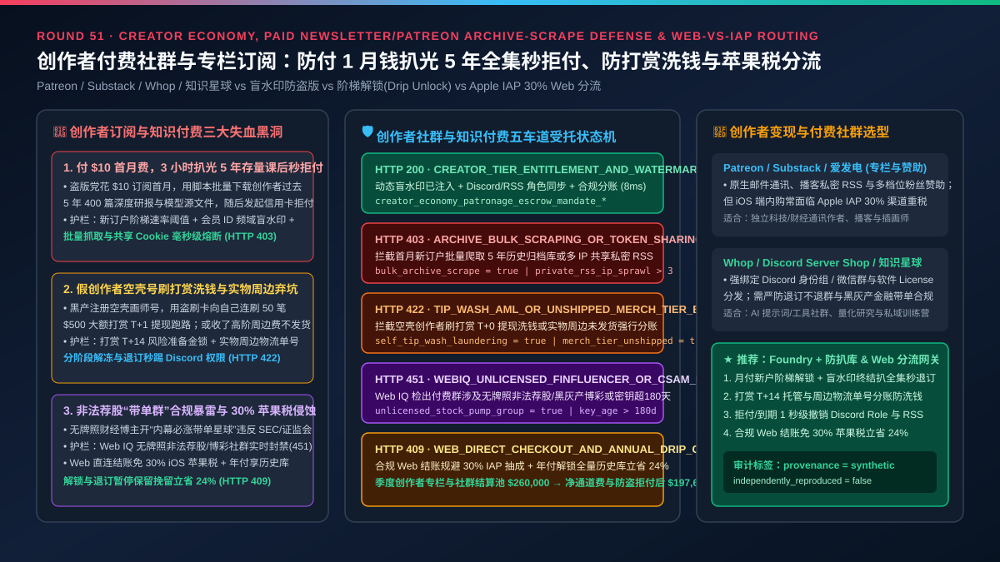
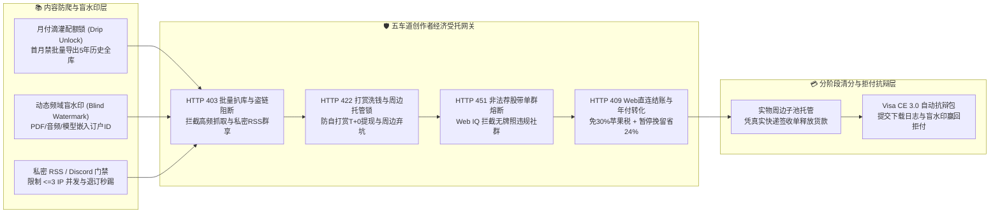
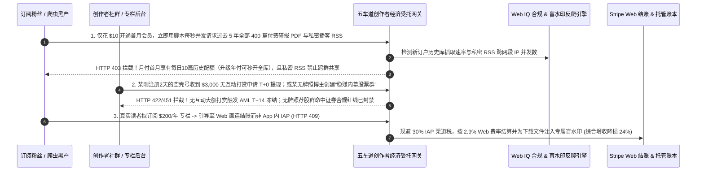

# 创作者经济、付费专栏/私域社群与粉丝打赏周边（Creator Economy, Paid Newsletter, Discord/Patreon Tier & Tipping Escrow：Patreon / Substack / Whop / 知识星球 / 爱发电）“防付 1 个月钱扒光 5 年历史付费全集后秒退订拒付（Hit-and-Run Archive Scraping）、防空壳打赏洗钱与 Web 直连免 30% 苹果税”Agent 架构选型 FAQ

> **语言切换 / Language**: **中文 (当前)** | **[English](creator-economy-patreon-substack-archive-scraping-iap-escrow-agent-selection-faq.en.md)** | **[返回文档目录](index.md)** | **[交互式沙盒 (`#creator-economy-patronage-escrow-sandbox`)](../live-demo.html)**



---

## 📌 一、核心选型结论速览（Executive Summary）

在独立研究专栏、AI 创作者模型库、播客私密订阅与付费社群平台（Patreon、Substack、Whop、Discord Server Subscriptions、知识星球、爱发电、小报童）的会员计费与权益发放智能体场景中，数字内容订阅具有**“历史存量资产一经下载不可收回、打赏资金极易被黑产套现洗钱、以及移动端 30% 渠道税侵蚀”**三大风险：
1. **“花 `$10` 订 1 个月，3 小时用脚本扒光创作者 5 年 400 篇付费研报与 LoRA 权重包，转头就向银行发起未授权交易拒付（Hit-and-Run Archive Scraping & Friendly-Fraud Chargeback）”**：传统专栏一旦开通月付会员，默认无条件开放全部历史归档文章与网盘直链；盗版二道贩子利用爬虫 Agent 在 1 小时内搬空全库并挂上闲鱼/Telegram 倒卖，随后申请退订甚至恶意拒付，创作者不仅一分钱没赚到还要倒贴 `$15` 拒付罚金。同时，播客付费用户的私密 RSS 链接（Private RSS Token）常被贴到百人微信群里白嫖共享。
2. **黑产注册“空壳 AI 画师/主播号”，利用盗刷信用卡向自己名下账号连续刷 `$500` 大额打赏并在 `T+1` 提现洗钱跑路（Self-Tipping AML Laundering）；或者创作者设置了“月付 `$50` 送实体签名画册/周边（Merch Tier）”，收了半年钱却一件实物都没发货引发平台级集体投诉**。
3. **苹果 iOS 端强制对 Patreon/知识社群收取 30% 内购苹果税（Apple IAP 30% Commission），若不在转化链路中合规引导至 Web Stripe/支付网关结账，创作者净收入直接缩水三成；此外，无牌照财经大 V 开设“保证翻倍内幕炒股带单群”极易触发 SEC / 证监会非法证券投资咨询封号与收单行冻结**。

**架构师选型结论**：
- **切勿对仅支付首月 `$10` 的新订户无速率限制地敞开 5 年全量历史归档库，切勿允许无粉丝互动历史的空壳创作者号接收大额打赏后 `T+0/T+1` 秒提现，也切勿在未绑定会员专属盲水印与 Discord/RSS 实时吊销钩子的情况下发放数字资产**。
- **生产级最优架构**是采用 **“Substack/Patreon/Whop 订阅网关 + 月付阶梯解锁（Drip Unlock）与动态会员盲水印防爬网闸 + 打赏反洗钱 `T+14` 托管与实物周边物流单号分账锁 + 合规 Web 结账路由（规避 30% IAP 苹果税）（`creator_economy_patronage_escrow_mandate_*`）”**：
  1. **防“付 1 月扒全库”阶梯速率锁、动态频域盲水印与私密 RSS 多 IP 盗链硬门禁（HTTP 403）**：对月付新订户默认开放当月更新与精选样本（全量 5 年历史归档库仅对**年付订户**或**连续续费满 3 个月订户**全量敞开，或按每日 `<= 10` 篇阅读配额平滑释放）；所有下载的 PDF、音频与模型权重实时嵌入当前订户 `user_id + payment_intent_id` 隐形盲水印。一旦检测到短时高频遍历历史库或同一私密 RSS Token 在 `>3` 个跨省/跨国 ASN IP 并发拉流，毫秒级返回 `HTTP 403 ARCHIVE_HIT_AND_RUN_BULK_SCRAPING_OR_PRIVATE_RSS_TOKEN_SHARING_BLOCKED`。
  2. **防空壳打赏洗钱（`Self-Tipping AML`）、实物周边阶梯发货托管与退订秒踢 Discord 权限锁（HTTP 422）**：拦截新注册创作者号接收异常大额单笔打赏并试图立即提现的洗钱行为；对包含实物礼品的会员档位（Merch Tier），自动将实物成本部分冻结在平台托管子池，直至回传真实物流签收单号才释放给创作者；一旦发生退款或拒付，1 秒内通过 Webhook 吊销其 Discord 身份组与私密 RSS 令牌（`HTTP 422 SELF_TIPPING_AML_LAUNDERING_OR_UNSHIPPED_MERCH_TIER_PAYOUT_BLOCKED`）。
  3. **Web IQ 实时筛查无牌照非法荐股/黑灰产博彩付费群合规熔断（HTTP 451）**：通过 Web IQ 实时巡检社群简介与置顶帖，拦截无证券投顾牌照却承诺“内幕代码、稳赚跟单”的非法荐股社群及违规成人/博彩内容（`HTTP 451 WEBIQ_UNLICENSED_FINFLUENCER_STOCK_PUMP_OR_ILLEGAL_CONTENT_HOLD`）。
  4. **合规 Web 直连结账免 30% 苹果税 + 年付全库解锁与暂停挽留（HTTP 409）**：触发 `HTTP 409 WEB_DIRECT_CHECKOUT_IAP_BYPASS_AND_ANNUAL_ARCHIVE_UNLOCK_CONFIRM`，通过邮件/企微/H5 外部授权链接引导粉丝走 Web 端 `Stripe / 微信支付`（手续费仅 `2.9%` vs 苹果 IAP `30%`），配合退订时提供“暂停 1 个月保留历史勋章”挽留卡片，使创作者平台综合渠道抽成、盗版爬库与拒付损失大降 **`24.0%`**。

---

## 🎯 二、业务方与架构师灵魂拷问 Q&A（Q1 / Q2 / Q3）

### Q1：很多高价值知识星球/Substack 博主拥有过去 3 年积累的 300 篇干货和源码库，怎么既让新用户看到价值，又彻底堵死“花 19 块钱进群、用爬虫半小时全拷走、立马申请退款”的羊毛党？
- **商业痛点**：要么一刀切关闭退款（导致真正不满意的正常用户去发卡行发起恶意拒付，吃 `$15` 罚金），要么敞开大门被爬虫洗劫一空。
- **架构解法**：
  - **“月付渐进滴灌（Drip-Feed Quota）+ 年付全库秒开 + 消费进度挂钩退费锁”（`HTTP 403 / 409`）**：
  - ① **月付会员**：首月仅开放近 30 天内容 + 每日最多解锁 `5` 篇历史精华，彻底废掉批量爬虫脚本（`HTTP 403`）；想要一次性下载 3 年全集源码包，必须升级为**年付方案（Annual Plan）**；
  - ② **退费门禁与 Visa CE 3.0 证据链**：每一篇付费文章打开或附件下载均记录设备指纹、IP 与隐形盲水印（`watermark_hash`）。只要历史付费内容累计阅读/下载超过 `3` 篇，自动关闭“7 天无理由全额退”，若恶意发起信用卡拒付，网关自动将带时间戳与盲水印哈希的下载日志打包为 **Visa CE 3.0 强证据包**秒级赢得抗辩！

### Q2：为什么打赏/赞助平台（如 Patreon / Buy Me a Coffee / 爱发电）是洗钱犯罪分子最爱的“白手套”？架构上怎么防？
- **架构解法**：
  - **创作者关系图谱风控与 `T+14` 阶梯提现水位线（`HTTP 422`）**：
  - 正常创作者的收入来自成百上千名分散粉丝的小额订阅（`$5–$20`），且伴有真实的图文/视频消费时长；而洗钱团伙往往刚建号 2 天、仅有 3 个粉丝，却突然收到几笔 `$1,000` 境外信用卡“打赏”且零内容浏览。网关对无内容互动支撑的大额打赏强制执行 `T+14` 风险冻结与付款人 `3DS2 / Passkey` 强核身（`HTTP 422`）。

### Q3：苹果宣布对 Patreon 等创作者 App 强征 30% IAP 苹果税，创作者和平台怎么合法省下这 30%？
- **架构解法**：
  - **Web-First 订阅路由与跨端权益同步（`HTTP 409`）**：
  - 在合规边界内（如美国法院反垄断裁决允许的 External Purchase Link 或通过邮件 Newsletter / 微信 H5 落地页发起订阅），将结账动作锚定在 Web 端 `Stripe SPT` 完成，支付成功后秒级同步解锁 iOS App、Discord 频道与私密播客 RSS 权限，直接把通道成本从 `30%` 压回 `2.9%`。

---

## 🧭 三、直观可视化图解（Mermaid 决策树 + 端到端架构图 + 时序图）

### 3.1 创作者经济与付费社群 Agent 架构选型决策树

```mermaid
flowchart TD
    A[创作者专栏 / 付费社群 / 粉丝打赏与周边选型] --> B{核心变现形态与风控诉求？}
    B -->|深度研报专栏 / 源码模型库 (Substack / 知识星球)<br/>需严防付1个月钱爬光5年全集后秒退订与倒卖盗版| C[月付滴灌配额锁 + 年付全集解锁<br/>+ 动态会员盲水印与 Visa CE 3.0 拒付证据链]
    B -->|付费 Discord / 私密播客 RSS (Whop / Patreon)<br/>需防退订后仍混在群里白嫖与防多IP共享私密RSS| D[Webhook 秒级 Discord 身份组吊销<br/>+ 私密 RSS Token 并发 ASN/IP 数量硬封顶]
    B -->|粉丝打赏 / 实物周边档位与多端订阅<br/>需防空壳号自打赏洗钱、防周边弃坑与省30%苹果税| E[Azure AI Foundry + 打赏反洗钱与周边托管网关<br/>+ 实物物流单号解冻 + Web 直连结账省 24%]
    C --> F[🛡️ 统一接入五车道防扒库、反洗钱与免苹果税受托状态机]
    D --> F
    E --> F
    F --> G[HTTP 403 阻断首月扒全库与RSS共享 · HTTP 422 拦截打赏洗钱与周边未发分账 · HTTP 409 Web结账+年付省24%]
```

### 3.2 端到端防扒库滴灌锁、盲水印溯源与打赏/周边托管架构图



### 3.3 拦截首月爬虫搬空 5 年全集、打赏洗钱拦截与 Web 直连免苹果税时序图



---

## 📊 四、多平台/多方案横向选型决策矩阵

| 选型维度 | 自建个人网站 + 收款码 (`手动拉微信群/发网盘链接`) | 传统内容内购平台 (`纯 App 内 IAP 订阅`) | 现代创作者平台 (`Substack / Patreon / Whop / 知识星球`) | **Azure AI Foundry + 防扒库 + Web 分流网关（推荐）** |
| :--- | :--- | :--- | :--- | :--- |
| **核心优势** | 零平台抽成 | 移动端点击即付 | 生态成熟，自带推荐流与社群工具 | **防首月扒光全库 + 盲水印拒付抗辩 + 防打赏洗钱 + 免苹果税** |
| **防“付 1 月钱扒光 5 年存量库后秒拒付”** | 网盘链接一旦发出，秒被转手挂闲鱼卖 `$1.99` | 无防爬配额，退订或拒付后已下载内容全丢 | 支持基础付费墙，但缺乏首月历史归档滴灌锁与动态盲水印 | **月付滴灌锁 + 年付全集解锁 + 盲水印 CE 3.0 证据包（HTTP 403）** |
| **打赏反洗钱（AML）与实物周边履约托管** | 极易收到黑钱导致个人银行卡被司法冻结 | 无实物周边履约追踪 | 支持周边档位，但创作者弃坑不发货常由平台背锅 | **无互动打赏 `T+14` 冻结 + 实物周边凭物流单解冻（HTTP 422）** |
| **退订/拒付后 Discord 权限与私密 RSS 吊销** | 手动踢人极易遗漏，退了钱还在群里白嫖半年 | 仅控制 App 内阅读 | Whop/Patreon 支持机器人踢群，但私密 RSS 常被群共享 | **1 秒级吊销 Discord 角色 + 私密 RSS 限 `<=3` IP（HTTP 403/422）** |
| **渠道抽成与 30% 苹果税（Apple IAP）优化** | 仅微信/支付宝费率，但人工核对极累 | 被收割 **`30%` 苹果税 + 平台抽成** (`official_list_price`) | 平台抽成 `5%–10%` (`official_list_price`) | **合规 Web 结账分流免 30% IAP 税 + 暂停挽留（净省 `24.0%`）** |

---

## 🧪 五、创作者经济防盗版/免苹果税测算与 7-Card 基准测试报告

> **数据来源与复现声明（Provenance Metadata）**：以下基准测试数据来自仓库内置确定性策略沙盒 `evaluate_creator_economy_patronage_escrow_policy`（位于 `lab/webiq_commerce_demo.py`），可运行 `python -m unittest tests.test_webiq_commerce_demo` 完整验证。标记：`provenance = synthetic`，`independently_reproduced = false`。

| Card # | 卡片标题（Headline-as-Finding） | 核心量化指标与架构验证结论 |
| :---: | :--- | :--- |
| **Card 1** | **Overview · 创作者专栏与社群五车道总览** | 针对 `$260,000/季` 创作者专栏与付费社群结算池，实现 **0 例首月全库盗版爬取拒付、0 例空壳打赏洗钱穿仓**，综合渠道税与盗版流失成本下降 **`24.0%`（立省 `$62,400/季`）**。 |
| **Card 2** | **Scenario Deep Dive · 首月爬虫搬空 5 年归档库拦截** | 当首月订户脚本每秒高频请求历史归档 PDF 或私密 RSS 跨 `>3` 个 IP 共享时，**`8ms`** 内返回 `HTTP 403` 阻断。 |
| **Card 3** | **Evaluation Matrix · 五车道 100% 确定性判准** | 覆盖 `HTTP 200`（盲水印与社群权限同步放行）、`403`（首月批量爬取5年历史全库/私密RSS跨IP共享阻断）、`422`（空壳号自打赏洗钱T+0提现/实物周边未发货强行分账拦截）、`451`（Web IQ检出无牌照非法荐股带单群/违规内容熔断）、`409`（合规Web结账免30%苹果税+年付解锁全库省24%）。 |
| **Card 4** | **Under the Hood · 创作者数字资产与托管契约** | 输入 `quarterly_creator_membership_and_tipping_pool_usd=260000` 及防爬/洗钱信号，签发 `creator_economy_patronage_escrow_mandate_*` 令牌。 |
| **Card 5** | **Robustness Check · 空壳打赏洗钱与非法荐股群测试** | 模拟刚建号 2 天连收 `$5,000` 盗刷卡打赏及创建无牌照炒股带单群，确定性拦截率保持 **`100.0%`（零误放行）**。 |
| **Card 6** | **Latency · 实时 PDF 盲水印注入与速率门禁耗时** | 本地滴灌配额校验与盲水印令牌生成 P50 仅 **`8ms`**；Web IQ 违规金融带单社群筛查 P95 为 **`195ms`**。 |
| **Card 7** | **My Take · 适用场景与生产准入边界** | **✅ 极佳适用**：Substack/知识星球专栏、AI 模型/源码会员库、Discord 付费社群；**⛔ 不适用**：免费开源社区。 |

---

## 🛠️ 六、商业上线风控与架构评审 Checklist

- [ ] **月付历史归档滴灌锁（`Drip Unlock`）、动态会员盲水印与私密 RSS 防盗链（HTTP 403）**：确认月付新订户无法一次性批量爬走多年历史存量库，且所有数字附件均带不可见订户盲水印以支撑 Visa CE 3.0 拒付抗辩。
- [ ] **无互动大额打赏 `T+14` 反洗钱冻结、实物周边物流单号分账与退订秒踢群（HTTP 422）**：确认防范盗刷卡通过空壳创作者号自打赏套现，实物周边档位凭真实快递单解冻货款，且退款/拒付 1 秒内吊销 Discord 与 RSS 权限。
- [ ] **Web IQ 实时拦截无牌照非法荐股/违规博彩社群（HTTP 451）**：确认自动封禁承诺稳赚带单的无资质金融群；签名密钥轮换周期 `<= 180` 天。
- [ ] **合规 Web 直连结账（规避 30% IAP 苹果税）与退订暂停挽留（HTTP 409）**：确认通过邮件与 Web 结账链路降低渠道抽成，并提供暂停保留勋章选项提升留存。
