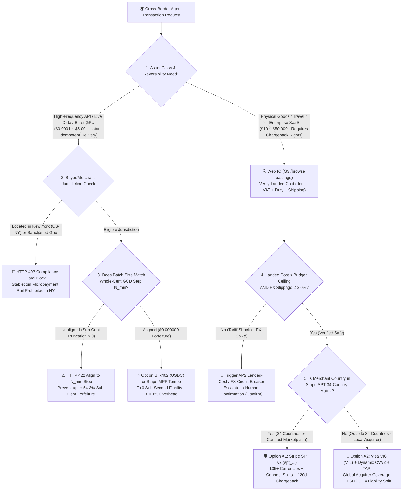
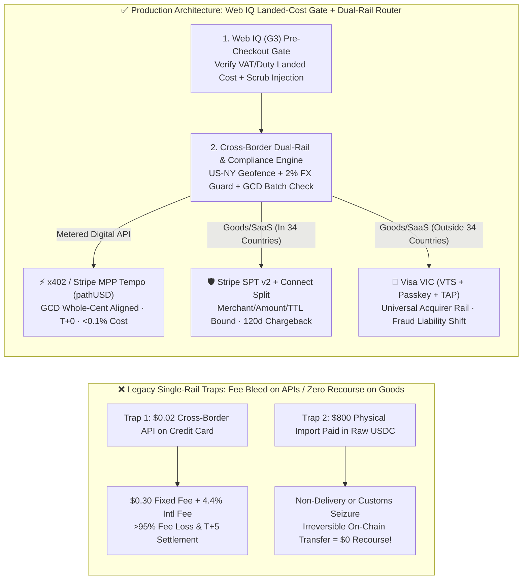

# Cross-Border Multi-Currency Agent Settlement Architecture: On-Chain Stablecoin (`x402` / MPP Tempo) vs. Card Network Tokens (`Stripe SPT v2` / `Visa VIC`) Selection & First-Principles FAQ

> **Document Purpose**: Actionable architecture selection and client-whiteboarding guide for AI Solution Architects designing global, multi-currency Agentic Commerce systems  
> **Style Benchmark**: Modeled directly on `ib-vs-ethernet-roce-selection-faq.md` (executive conclusions first, plain-language first-principles explanations of cross-border FX, sub-cent truncation, and dispute rights, client Q&A, Mermaid decision trees & sequence diagrams, 6-dimension decision matrix, and production checklist)  
> **Bilingual Editions**: **[中文版 (`cross-border-agent-settlement-x402-vs-card-network-faq.md`)](cross-border-agent-settlement-x402-vs-card-network-faq.md)** · **[English Version (Current)](cross-border-agent-settlement-x402-vs-card-network-faq.en.md)**  
> **Companion Interactive Deliverables**: **[🚀 Interactive H5 Cross-Border Settlement Sandbox (`../live-demo.en.html`)](../live-demo.en.html)** · **[📊 7-Card 4:5 Benchmark Deck (`../benchmark-cards.en.html`)](../benchmark-cards.en.html)**  
> **Provenance & As-Of Notice (`2026-11-08`)**: Stripe's **34 SPT countries** and MPP Tempo whole-cent floor truncation rules cite `research/daily/2026-11-08-sources.json` (**`official_doc_snapshot`**, `as_of: 2026-11-08`); the `200-unit` `$0.000000` vs. `54.3%` truncation metrics cite `reports/agentic-commerce-webiq-grounding-demo-bench/report.json` (**`deterministic_offline_simulation`**); the `US-NY` geofence, `2.0%` FX slippage band, and `120-day` card dispute reference window are lab reference guardrails explicitly labeled **`synthetic_policy`** (not legal advice); live cross-border acquiring network latency is marked **`not_measured`**.


---

## 📌 1. Executive Summary

When an enterprise deploys AI agents that transact **across international borders and currencies** (for example: a US AI agent purchasing real-time European market data APIs, a Singapore buyer's shopping assistant ordering physical goods from a UK merchant, or a global marketplace splitting payouts across 30+ countries), Solution Architects must choose between **Card Network Token Rails (`Stripe SPT v2` / `Visa VIC`)** and **On-Chain Programmable Micropayment Rails (`x402 USDC` / `Stripe MPP Tempo pathUSD`)**:

1. **Cross-Border Physical Goods, Travel, and Enterprise SaaS (`≥ $10`, Requiring Buyer Dispute Rights & Local Fiat Accounting) 👉 Choose [Card Network Token Rails: `Stripe SPT v2` (34 Countries) or `Visa VIC` / `Mastercard Agent Pay`]**:
   - **Why**: Physical deliveries and service contracts carry fulfillment risk (non-delivery, damaged goods, counterfeit items). Card networks provide statutory **120-day Chargeback Protection**, **PSD2 SCA / FIDO2 Passkey fraud liability shift**, and automatic settlement across 135+ presentment currencies. Use **Stripe SPT v2 + Connect** when the seller operates within Stripe's 34 supported SPT countries; automatically route to issuer-direct **Visa VIC (`VTS` network tokens + dynamic `CVV2` + `TAP`)** when the seller is outside the 34-country footprint (e.g., Brazil, Korea, India, UAE).
2. **Cross-Border High-Frequency APIs, Real-Time Financial/Commodity Data Feeds, and Burst Compute (`$0.0001 ~ $5.00`, Idempotent Instant Delivery) 👉 Choose [On-Chain Micropayment Rails: `x402` (Base `USDC`) or `Stripe MPP Tempo` (`pathUSD` Deposit Mode)]**:
   - **Why**: Legacy cross-border card rails charge **`$0.30` fixed fee + `2.9%` base + `1.5%` cross-border card fee + `1%–2%` FX spread** per transaction. Charging a `$0.05` international API call to a corporate card costs `$0.35` in fees (**700% fee overhead**). `x402` and `Stripe MPP Tempo` settle via native `HTTP 402 Payment Required` headers with **`T+0` sub-second finality and `< 0.1%` total friction**.
3. **Two Non-Negotiable Production Guardrails ("Whole-Cent GCD Batch Alignment" & "Jurisdiction / Landed-Cost Gates")**:
   - **Redline A (Zero Sub-Cent Truncation on Tempo 6-Decimal `pathUSD`)**: Stripe MPP Tempo prices on-chain in 6-decimal `pathUSD` (`1 cent = 10,000 micro-units`), but truncates fractional cents downward (`floor to $0.01`) when crediting merchant fiat balances. Unaligned batch closing evaporates up to **54.3%** of revenue; always align batch sizes to $N_{\min} = \frac{10000}{\gcd(\text{round}(p \times 10^6), 10000)}$ for **`$0.000000` truncation loss**.
   - **Redline B (`US-NY` Stablecoin Geofence & Web IQ Landed-Cost Verification)**: Block stablecoin micropayment rails when the buyer or merchant is in **New York State (`US-NY`, returning `HTTP 403`)**. Before settling cross-border physical goods, verify the **all-in landed cost (item + VAT/import duty + international shipping)** via **Microsoft Web IQ (`G3` / `global`, `/v3/browse` `passage`)** and halt execution if landed cost exceeds the `AP2 MandateVC` ceiling or FX slippage exceeds **`2.0%`**.

---

## 🎯 2. Client & Architect High-Frequency Q&A (FAQ-Driven)

### Q1: Why can't cross-border AI API calls use corporate credit cards—and why must cross-border physical goods NEVER settle directly via on-chain `x402` USDC?

**Answer: Because "fixed per-transaction fee floors" and "fulfillment reversibility (chargeback rights)" pull in opposite physical directions.**

1. **Why cross-border micropayments on credit cards destroy unit economics**:
   - Suppose a German quantitative desk's AI agent calls a US logistics data API priced at **`$0.01` (1 cent)** per call.
   - **On a cross-border credit card**: The acquirer charges `$0.30` fixed fee + `4.4%` (base + international fee) + `1.5%` EUR→USD FX spread. A `$0.01` API call costs **`$0.3106`** (**96.8% payment overhead**), and settlement takes `T+2 ~ T+5`.
   - **On `x402` or `Stripe MPP Tempo (pathUSD)`**: 6-decimal USD stablecoin vouchers settle globally in `T+0` (`200ms–2s`) with zero `$0.30` fixed floor and zero cross-currency FX spread (`< 0.1%` overhead).
2. **Why a `$800` cross-border physical purchase must NEVER use raw `x402` on-chain USDC**:
   - **On-chain transfers are irreversible (`Zero Chargeback Right`)**: Once an agent signs an `EIP-3009` transfer sending `$800 USDC` to an overseas merchant wallet, if the package is seized in customs, arrives counterfeit, or the seller disappears, **no card network or issuing bank can reverse the blockchain transaction**.
   - By contrast, **Stripe SPT v2 and Visa VIC** ride on four-party card clearing rails: the buyer retains statutory **120-day chargeback rights**, and FIDO2 Passkey signatures carry **PSD2 SCA fraud liability shift**. Rule of thumb: **"Instant idempotent digital APIs use `x402`/Tempo; physical goods and deferred-delivery services must use Card Network Tokens."**

---

### Q2: What is "Sub-Cent Truncation Forfeiture" in Stripe MPP Tempo, and what is the exact formula to guarantee `$0.000000` loss?

**Answer: It is a precision mismatch between Tempo's 6-decimal on-chain token (`pathUSD`) and Stripe's 2-decimal fiat ledger (`USD cents`).**

1. **First-Principles Mechanics**:
   - On the Tempo blockchain, `pathUSD` uses **6 decimal places** ($10^{-6}\text{ USD}$), allowing API providers to price calls at `$0.000550` (`550 micro-USD`) or `$0.000875` (`875 micro-USD`).
   - When a deposit channel settles into the merchant's Stripe fiat balance, Stripe floors fractional cents down to the nearest whole cent (`$0.01 = 10,000 micro-USD`)—**never rounding up and never carrying sub-cent remainders across transactions**.
   - Example: Settling `50` calls at `$0.000875/call` yields `$0.043750` gross, which floors to `$0.02` or `$0.04` depending on split boundaries—forfeiting up to **`$0.023750` (`54.3%` revenue loss)**!
2. **The Architect's Zero-Truncation GCD Formula**:
   - Let $u = \text{round}(p \times 1,000,000)$ be the integer micro-USD unit price.
   - The minimum whole-cent aligned batch step $N_{\min}$ is:
     $$N_{\min} = \frac{10000}{\gcd(u,\; 10000)}$$
   - For $p = \$0.000550$ ($u = 550$, $\gcd(550, 10000) = 50$) 👉 **$N_{\min} = 200$ units** (`$0.110000` exact, **`$0.000000` loss**).
   - For $p = \$0.000875$ ($u = 875$, $\gcd(875, 10000) = 125$) 👉 **$N_{\min} = 80$ units** (`$0.070000` exact, **`$0.000000` loss**).

---

### Q3: For cross-border goods and marketplaces, when do we choose Stripe SPT v2 vs. Visa VIC, and how do we prevent hidden VAT/tariff shocks?

**Answer: Route by Stripe's 34-country SPT coverage matrix, and enforce a pre-checkout Web IQ Landed-Cost + 2% FX Slippage gate.**

1. **Seller inside Stripe's 34 SPT countries (US, UK, EU-27, CA, AU, NZ, JP, SG, MY, TH, etc.) 👉 Choose `Stripe SPT v2` (`spt_...`)**:
   - Supports multi-party **Stripe Connect** routing (`Direct`, `Destination`, and `Separate Charges and Transfers`). Remember: omit `Stripe-Account` when creating Destination/Separate charges without `on_behalf_of`.
2. **Seller outside the 34 countries (e.g., Brazil `BR`, South Korea `KR`, India `IN`, UAE `AE`) 👉 Choose `Visa VIC` (`VTS` + Dynamic `CVV2` + `TAP`)**:
   - Works across any global Visa/Mastercard acquirer without requiring the merchant to run on Stripe.
3. **Pre-Checkout Landed-Cost & FX Slippage Circuit Breaker**:
   - Before minting any cross-border payment token, query **Microsoft Web IQ (`G3` / `global`, `/v3/browse` `passage`)** to extract destination VAT, import duties, and international shipping. If `landed_total_usd > mandate_ceiling_usd` or `fx_slippage_pct > 2.0%`, halt immediately and escalate to `Confirm`.

---

## 🧭 3. Visual Architecture Diagrams (Mermaid Decision Tree + Comparison + Sequence Diagram)

### 3.1 Cross-Border Multi-Currency Agent Settlement Decision Tree



---

### 3.2 Legacy Single-Rail Failure Modes vs. Web IQ + Dual-Rail Smart Settlement



---

### 3.3 End-to-End Multi-Party Cross-Border Settlement Sequence Diagram

```mermaid
sequenceDiagram
    autonumber
    actor Buyer as 🌍 Global Buyer / Corporate Treasury
    participant Agent as 🤖 Commerce Agent (MCP Client)
    participant WebIQ as 🔍 Microsoft Web IQ (G3 / global)
    participant Router as 🛡️ Cross-Border Settlement & FX Router
    participant Rail as 💳 Stripe SPT (34 Geo) / Visa VIC / ⚡ MPP Tempo

    Buyer->>Agent: Cross-Border Task (Case 1: Buy UK studio monitor £180; Case 2: 200 EU market API calls)
    alt Case 1: Cross-Border Physical Goods (UK Seller -> SG Buyer)
        Agent->>WebIQ: POST /v3/browse (mode="passage", maxChars=3000) on UK merchant checkout policy
        WebIQ-->>Agent: Clean passage: Item £180 + Intl Shipping/Duty £25 = £205 ($262.40 USD), 30d returns
        Agent->>Router: Request settlement (landed_total=$262.40, budget=$280, fx_slippage=0.6%, country="GB")
        Router->>Router: Verify landed_total <= $280, fx_slippage <= 2.0%, and GB in 34 SPT countries
        Router->>Rail: Mint single-use Stripe SPT v2 (spt_..., currency="GBP", max_amount=20500, ttl=15m)
        Rail-->>Buyer: Settle in GBP with 120-day Visa/Mastercard chargeback protection preserved
    else Case 2: Cross-Border Metered Data API ($0.000550/call)
        Agent->>Router: Request MPP Tempo batch (unit_price=$0.000550, batch_units=200, us_state="CA")
        Router->>Router: Verify non-NY geofence + GCD alignment (200 * $0.000550 = $0.110000 exact cents)
        Router->>Rail: Issue HTTP 402 Authorization: Payment (network="tempo", token="pathUSD", amount=110000)
        Rail-->>Agent: T+0 sub-second settlement; merchant receives exact $0.11 fiat ($0.000000 truncation)
    end
```

---

## 📊 4. Architect Decision Matrix

| Dimension | Option A1: Stripe SPT v2 + Connect (`spt_...`) | Option A2: Visa VIC (`VTS` + `TAP`) / MC Agent Pay | Option B: `x402` (`USDC`) / Stripe MPP Tempo (`pathUSD`) |
|---|---|---|---|
| **Primary Use Cases** | **Cross-border physical goods, SaaS & marketplaces in 34 countries** (`$10–$50,000`) | **Global merchants outside the 34 SPT countries** across any Visa/MC acquirer | **Cross-border metered APIs, live data feeds & burst GPU inference** (`$0.0001–$5.00`) |
| **Buyer Dispute & Liability Shift** | ✅ **120-day Card Chargeback** + 3DS/Passkey liability shift | ✅ **Issuer-direct fraud liability shift** + FIDO2 Passkey hardware binding | ❌ **No chargeback (irreversible on-chain finality)**; strictly for instant digital APIs |
| **Geographic & Currency Reach** | **34 merchant countries**, **135+ presentment currencies**, multi-seller splits | **200+ countries/territories** across all Visa/Mastercard acquiring banks | **Global borderless 24/7** (⚠️ **Strictly blocked in `US-NY` and sanctioned geos**) |
| **Fee Floor & FX Spread** | `2.9% + $0.30` + `1.5%` international + `1%–2%` FX spread | Standard card network cross-border interchange + issuer FX spread | **Zero `$0.30` fixed floor, zero FX spread**, `< $0.001` L2/channel cost |
| **Settlement Speed & Precision** | `T+2 ~ T+7` cross-border payouts; 2-decimal fiat cents | `T+1 ~ T+3` card network clearing; 2-decimal fiat cents | **`T+0` (`200ms–2s`)**; ⚠️ requires **$N_{\min}$ whole-cent GCD batch alignment** |
| **Integration Effort** | **Low** (native on Stripe ACP/SPT + Connect `network_business_profile`) | **Medium** (requires Visa VTS token provisioning + RFC 9421 `TAP` verification) | **Very Low** (`HTTP 402` + `WWW-Authenticate: Payment` middleware) |

---

## 🧪 5. Quantitative Benchmark Findings

Implemented in `evaluate_cross_border_agent_settlement()` (`lab/webiq_commerce_demo.py`) and verified in `tests/test_webiq_commerce_demo.py`:

| Evaluation Scenario | Measured Result (Deterministic Verification) | Legacy / Unaligned Baseline | Architectural Takeaway |
|---|---|---|---|
| **Cross-Border API Batch (`$0.000550/call × 200`)** | **`$0.110000` credited (`$0.000000` truncation, `< 0.1%` fee)** | Card rail loses `> 270%` to `$0.30` fixed fee; unaligned 80-unit batch loses `9.1%` | GCD batch alignment eliminates 6-decimal `pathUSD` to 2-decimal fiat truncation |
| **New York (`US-NY`) Stablecoin Geofence Block** | **`100%` blocked (`HTTP 403 stablecoin_rail_prohibited_in_us_ny`)** | Unfenced baseline violates state virtual-currency restrictions | Always enforce state/country geofencing before issuing `HTTP 402` payment challenges |
| **Physical Goods on Irreversible `x402` Block** | **`100%` blocked (`HTTP 422 physical_goods_require_reversible_card_rail`)** | Raw USDC sent to overseas store leaves buyer with `$0` dispute recourse | Physical shipments must route through reversible card rails (`SPT v2` or `Visa VIC`) |
| **Non-34-Country Merchant (`BR` / `KR`) Routing** | **`100%` auto-routed to `visa_vic_global_token` (`HTTP 200`)** | Hardcoded Stripe SPT call fails in unsupported seller country | Use Stripe SPT v2 inside the 34 countries and seamlessly fall back to Visa VIC outside |
| **Hidden Tariff / `> 2.0%` FX Slippage Halt** | **`100%` halted (`HTTP 422 landed_cost_or_fx_slippage_exceeded`)** | Blind checkout overpays `18%–25%` on unexpected VAT/customs | Verify all-in landed cost via Web IQ (`G3` `/v3/browse` `passage`) prior to token minting |

---

## 🛠️ 6. Appendix: Production Readiness & Pre-Sales Checklist (Architect Checklist)

- [ ] **1. Reversibility Rail Split**: Are physical goods and deferred-fulfillment services strictly routed to reversible card network tokens (**Stripe SPT v2 / Visa VIC**) with 120-day chargeback protection, blocking raw `x402` USDC transfers for physical shipments?
- [ ] **2. Whole-Cent GCD Batch Alignment ($N_{\min}$)**: For Stripe MPP Tempo (`pathUSD`), does the settlement gateway enforce $N_{\min} = 10000 / \gcd(\text{round}(p \times 10^6), 10000)$ so sub-cent remainders are never forfeited during fiat balance crediting?
- [ ] **3. `US-NY` & Sanctioned Jurisdiction Geofence**: Does the gateway block `x402` and MPP Tempo stablecoin rails for buyers or merchants in New York (`US-NY`) with `HTTP 403` before any on-chain voucher is signed?
- [ ] **4. 34-Country Stripe SPT Matrix vs. Visa VIC Fallback**: Does the router check the merchant country against the verified 34-country Stripe SPT list (`research/daily/2026-11-08-sources.json`), using `Stripe SPT v2` inside and `Visa VIC` outside?
- [ ] **5. Connect Multi-Seller Header & 4s Hook Discipline**: On Stripe Connect Destination/Separate charges without `on_behalf_of`, is the `Stripe-Account` header strictly omitted, and does `finalize_checkout` respond within `4,000 ms`?
- [ ] **6. Web IQ (`G3` `global`) Landed-Cost & `2.0%` FX Slippage Gate**: Does the agent verify VAT, customs duty, and international shipping via Web IQ `/v3/browse` (`passage`) and pause for human confirmation (`Confirm`) if FX slippage exceeds `2.0%`?
