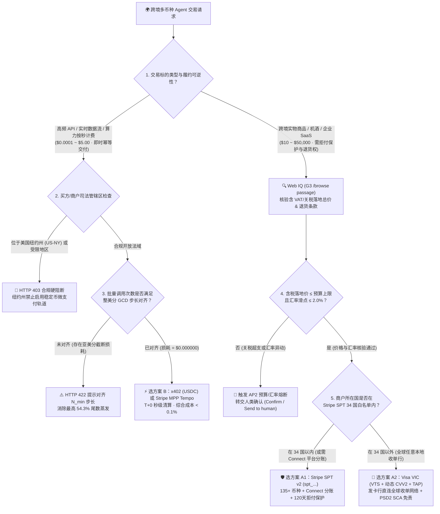
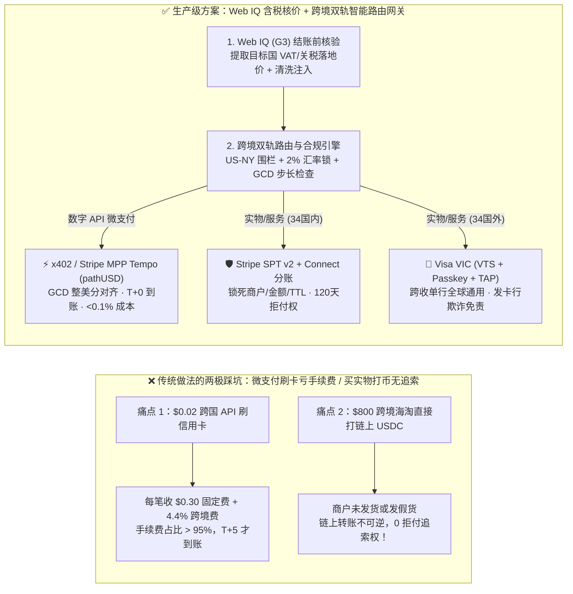
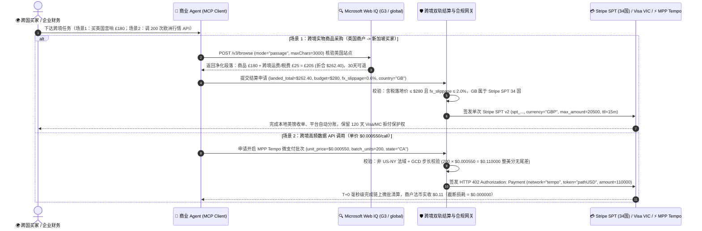

# 跨境多币种 Agent 结算架构：稳定币/x402 链上结算 vs 卡组令牌网络（Visa VIC / Stripe SPT v2）选型与原理解析 FAQ

> **文档定位**：面向 AI 解决方案架构师（AI Solution Architect）与跨境电商/SaaS/API 平台技术负责人的架构选型与售前宣讲实战指南  
> **文风标杆**：严格对标 `ib-vs-ethernet-roce-selection-faq.md`（先给一针见血的选型结论，再用第一性原理大白话讲透跨境清算机制、汇损陷阱与合规红线，提供客户高频灵魂拷问 Q&A、Mermaid 决策树与时序图、选型矩阵与上线核验清单）  
> **双语版本**：**[中文版（当前）](cross-border-agent-settlement-x402-vs-card-network-faq.md)** · **[English Version (`cross-border-agent-settlement-x402-vs-card-network-faq.en.md`)](cross-border-agent-settlement-x402-vs-card-network-faq.en.md)**  
> **配套可交互演示**：**[🚀 H5 跨境双轨结算与整美分对齐实时沙盒 (`../live-demo.html`)](../live-demo.html)** · **[📊 7-Card 4:5 视觉评测报告 (`../benchmark-cards.html`)](../benchmark-cards.html)**

---

## 📌 一、核心结论速览（Executive Summary）

当企业构建**跨国界、跨币种的 AI Agent 商业交易系统**（例如：美国企业的 AI Agent 自动调用欧洲金融数据 API、新加坡买家的购物助手在英国电商下单、或全球多商户平台向 30+ 国家子商户分账）时，架构师面临的核心抉择是：**到底走“卡组令牌跨境网络（Stripe SPT v2 / Visa VIC）”，还是走“HTTP 402 链上稳定币微支付轨道（x402 USDC / Stripe MPP Tempo `pathUSD`）”？**

1. **跨境实物商品、机酒旅游、企业 SaaS 订阅（单笔 `≥ $10`，需买家拒付保护与本地法币合规入账）👉 必选【卡组令牌跨境网络：Stripe SPT v2（覆盖 34 国）或 Visa VIC / Mastercard Agent Pay】**：
   - **核心原因**：实物与服务交易存在“未发货、货不对板、虚假描述”等履约风险。卡组网络自带 **120 天拒付追索权（Chargeback Protection）**、欧盟/英国 **PSD2 SCA / FIDO2 Passkey 强认证欺诈责任转移（Liability Shift）** 以及 135+ 币种自动换汇清算。若商户位于 Stripe SPT 支持的 34 个国家/地区内，优先用 **Stripe SPT v2 + Connect 多商户分账**；若商户位于拉美、中东、东南亚非新马泰等 34 国之外的地区，则切换至发卡行直连的 **Visa VIC（VTS 网络令牌 + 动态 CVV2）**。
2. **跨境高频 API 调用、实时金融/商品数据按次计费、边缘算力租用（单笔 `$0.0001 ~ $5.00`，幂等即时交付）👉 必选【链上微支付轨道：x402（Base USDC）或 Stripe MPP Tempo（`pathUSD` 存款模式）】**：
   - **核心原因**：传统跨境信用卡每笔固定收取 **`$0.30` 起步费 + `2.9%` 基础费率 + `1.5%` 跨境卡费 + `1%~2%` 货币转换费（FX Spread）**。一笔 `$0.05` 的跨国数据查询如果刷卡，手续费高达 `$0.35`（费率损耗 **700%**！）。而 `x402` 与 `Stripe MPP Tempo` 通过 `HTTP 402 Payment Required` 原生机器挑战，实现 **无国界 `T+0` 秒级清算、综合损耗 `< 0.1%`**。
3. **两大绝对生产红线（“整美分 GCD 步长对齐”与“司法管辖区/关税围栏”）**：
   - **红线 A（Tempo 6 位小数向整美分截断损耗）**：Stripe MPP Tempo 链上使用 6 位小数精度的 `pathUSD`（`1 美分 = 10,000 最小单位`），但商户法币余额入账时会**向下截断到整美分（floor to `$0.01`）**。若单次 API 定价为 `$0.000550`，未对齐批量结算会白白蒸发 **54.3%** 的收入；必须按最大公约数公式 $N_{\min} = \frac{10000}{\gcd(\text{round}(p \times 10^6), 10000)}$ 对齐批量步长（实现 **`$0.000000` 零截断损耗**）。
   - **红线 B（纽约州稳定币禁令与跨境隐性 VAT/关税熔断）**：买方或商户位于**美国纽约州（`US-NY`）**时，严禁启用稳定币微支付轨道（必须强制返回 `HTTP 403` 或回退法币卡轨）；在跨境实物结账前，必须先用 **Microsoft Web IQ (`G3` / `global`, `/v3/browse` `passage`)** 核验目标国含税落地价（VAT + 关税 + 跨境运费），若含税总价超出 `AP2 MandateVC` 预算上限或汇率滑点 `> 2.0%`，在换汇扣款前立即熔断！

---

## 🎯 二、客户与架构师灵魂拷问 Q&A（FAQ-Driven）

### Q1：为什么跨国调用 AI 工具或数据 API 不能直接走企业信用卡？为什么跨境买实物又绝不能直接用 x402 链上打 USDC？

**答：因为“单笔固定清算成本（Fixed Fee Floor）”与“履约可逆性（Reversibility / Dispute Right）”在物理机制上完全相反。**

我们可以用两个真实账单帮客户算一笔明白账：

1. **为什么跨境微支付走信用卡会亏穿底裤？**
   - 假设一家德国量化团队的 AI Agent 每秒调用一次美国供应商的实时供应链数据 API，单次标价 **`$0.01`（1 美分）**。
   - **如果每次调用刷企业信用卡**：跨国收单行每笔收取 `$0.30` 固定授权费 + `4.4%`（基础费率 + 跨境费）+ `1.5%` 欧元兑美元换汇点差。买 `$0.01` 的数据，实际要付 **`$0.3106`**，其中 **96.8% 全是支付通道过路费**，而且跨国银行清算要等 `T+2 ~ T+5` 才能到账。
   - **如果改用 `x402` 或 `Stripe MPP Tempo (pathUSD)`**：全球统一以美元稳定币（6 位小数精度）在链上或预存通道内毫秒级划转，没有 `$0.30` 固定起步费，也没有 `1.5%` 跨国换汇点差，综合成本低于 **`0.1%`**，且资金 **`T+0`（200ms～2s）** 即刻确认。
2. **那为什么跨境买 `$800` 的电子产品或机票，绝对不能让 Agent 直接用 x402 打 USDC？**
   - **链上转账是“不可逆的终局清算（Final Settlement without Chargeback）”**：一旦 Agent 通过 `EIP-3009` 签名把 `$800 USDC` 打给境外商户钱包，哪怕商户发了假货、包裹在海关丢件、或者根本是个钓鱼空壳站，**没有任何卡组或银行能帮你把链上的 USDC 追回来**。
   - 相反，走 **Stripe SPT v2 或 Visa VIC** 时，资金流经 Visa/Mastercard 四方清算网络：买家享有法定 **120 天拒付权（Chargeback）**，且持卡人通过 FIDO2 Passkey 签发的委托凭证具备 **PSD2 SCA 强认证免责保护**。因此：**“即时幂等交付的数字 API 走 x402/Tempo，有履约周期的实物与大额服务必走卡组令牌网络”**。

---

### Q2：在 Stripe MPP Tempo 链上微支付中，什么是“亚美分截断损耗（Sub-Cent Truncation Forfeiture）”？架构师如何通过数学公式做到 0 损耗？

**答：这是双轨制（链上 6 位小数稳定币 → 链下 2 位小数法币账户）交界处最隐蔽的资金黑洞。**

1. **第一性原理拆解“为什么钱会凭空少了一半”**：
   - 在 Tempo 区块链上，稳定币 `pathUSD` 的最小计量单位是 **$10^{-6}$ 美元（6 位小数）**，因此 AI 供应商可以把每次 API 调用精确标价为 **`$0.000550`**（即 `550 micro-USD`）或 **`$0.000875`**（即 `875 micro-USD`）。
   - 但是，当这笔链上存款关闭并结算进商户的 Stripe 美元法币余额（Fiat Balance）时，传统银行账本最小只认 **`1 美分（$0.01 = 10,000 micro-USD）`**。Stripe 的清算规则是：**不足 1 美分的尾数直接向下截断归零（Floor Truncation），既不四舍五入，也不滚入下一笔**！
   - 举例：若 Agent 调用了 `80` 次单价 `$0.000550` 的 API 就关闭通道结算，总金额是 `80 × $0.000550 = $0.044000`（4.4 美分）。入账时 `.004000` 被直接抹掉，商户只收到 `$0.04`，白白损失 `$0.004000`（损失率 **9.1%**）；若在 `50` 次（单价 `$0.000875`，总额 `$0.043750`）时结算，损失高达 **`$0.023750`（54.3% 收入蒸发）**！
2. **架构师的零损耗对齐公式（Zero-Truncation GCD Batch Step）**：
   - 设单次调用价格换算为微美元整数 $u = \text{round}(p \times 1,000,000)$（例如 `$0.000550` 对应 $u = 550$，`$0.000875` 对应 $u = 875$）。
   - 要让批量总金额刚好是 `1 美分（10,000 micro-USD）` 的整数倍，最小无损批量调用次数 $N_{\min}$ 为：
     $$N_{\min} = \frac{10000}{\gcd(u,\; 10000)}$$
   - **实战速查**：
     - 当 $p = \$0.000550$（$u = 550$，$\gcd(550, 10000) = 50$）👉 最小无损步长 **$N_{\min} = 200$ 次**（刚好 `$0.110000`，损耗 **`$0.000000`**）；
     - 当 $p = \$0.000875$（$u = 875$，$\gcd(875, 10000) = 125$）👉 最小无损步长 **$N_{\min} = 80$ 次**（刚好 `$0.070000`，或取公倍步长 `200 × 2 = 400` 次，损耗 **`$0.000000`**）。
   - 在我们的策略网关中，任何未对齐 $N_{\min}$ 的 MPP 批次关闭请求都会被拦截并返回 `HTTP 422 unaligned_mpp_batch_causes_sub_cent_truncation_forfeiture`！

---

### Q3：跨境买实物或平台分账时，什么时候选 Stripe SPT v2（含 Connect），什么时候选 Visa VIC？遇到跨境隐性关税和汇率波动怎么防？

**答：按“商户所在国是否在 Stripe SPT 34 国白名单内”选轨道，并用“Web IQ 结账前含税落地价核验 + 2% 汇率滑点锁”兜底。**

1. **Stripe SPT v2 vs. Visa VIC 的全球地域分工**：
   - **商户在 34 个支持国以内（美、英、欧盟 27 国、加、澳、新、日、新、马、泰等）👉 选 Stripe SPT v2 (`spt_...`)**：
     - 天然支持 **Stripe Connect 跨国多商户分账**（`Direct Charges` 直连子商户、`Destination Charges` 平台代收分账、`Separate Charges and Transfers` 拆单分账）。
     - **架构师必记铁律**：当平台采用 `Destination` 或 `Separate Charges` 模式且**未设置 `on_behalf_of`** 时，平台调 `PaymentIntent` 必须使用平台自己的 `profile_...` 标识，**严禁在 HTTP Header 中传入 `Stripe-Account`**；卖家实时价格/汇率 Webhook 超时（`> 4,000ms`）会自动回退 Catalog Feed，而最终风控审批（`finalize_checkout`）超时则立即拒单。
   - **商户在 34 国以外（如巴西、墨西哥、阿联酋、印度、韩国等独立收单行商户）👉 选 Visa VIC（Visa Intelligent Commerce）或 Mastercard Agent Pay**：
     - 不依赖商户是否使用 Stripe，直接由发卡行通过 Visa Token Service (`VTS`) 签发 16 位单次受限网络令牌 + 动态 `CVV2` + `RFC 9421` 信任代理签名（`TAP`），兼容全球任何接入 Visa/Mastercard 的本地收单行。
2. **如何防止跨境结账时的“隐性 VAT/关税刺客”与“汇率暴跌滑点”？**
   - 跨境电商最常见的坑是：商品详情页写着 `$199`，结果进入结账页加上英国 20% VAT、跨境关税和国际运费后变成 `$268`，或者实时换汇点差飙升了 `3.5%`。
   - **标准架构解法**：在签发支付令牌前，强制调用 **Microsoft Web IQ (`G3` / `global` endpoint, `/v3/browse` `passage`)** 实时抓取目标国配送条款与含税总价（Landed Cost = 商品价 + 预估关税/VAT + 跨境运费），并计算实时汇率相对于锁汇基准的偏离度（`fx_slippage_pct`）。一旦含税总价超出用户 `AP2 MandateVC` 硬上限，或汇率滑点 **`> 2.0%`**，策略网关立即熔断并暂停自动扣款！

---

## 🧭 三、直观可视化图解（Mermaid 决策树 + 传统跨境 vs 双轨智能结算对比 + 端到端时序图）

### 3.1 跨境多币种 Agent 结算架构选型决策树（Architect Decision Tree）

---

### 3.2 传统跨境刷卡/无护栏打币 vs. Web IQ + 双轨智能结算架构对比图

---

### 3.3 买家-Agent-Web IQ-跨境双轨网关-全球收单/链上网络端到端时序图

---

## 📊 四、架构师选型决策矩阵（Architect Decision Matrix）

| 评估维度 | 方案 A1：Stripe SPT v2 + Connect (`spt_...`) | 方案 A2：Visa VIC (`VTS` + `TAP`) / MC Agent Pay | 方案 B：x402 (`USDC`) / Stripe MPP Tempo (`pathUSD`) |
|---|---|---|---|
| **核心适用场景** | **34 国以内的跨境电商、SaaS、多商户平台分账**（`$10 ~ $50,000`） | **全球任意收单行（含 34 国以外新兴市场）的跨境零售与机酒** | **跨境高频 API 按量计费、实时数据流、边缘算力微支付**（`$0.0001 ~ $5.00`） |
| **买家拒付权与欺诈免责** | ✅ **120 天卡组拒付保护（Chargeback）** + 3DS/Passkey 免责 | ✅ **发卡行级直连免责（Liability Shift）** + FIDO2 Passkey 强绑定 | ❌ **无拒付追索权（链上终局清算）**，仅限即时验证交付的幂等数字服务 |
| **全球地域与币种覆盖** | **34 个国家/地区商户**，支持 **135+ 交易币种**与平台拆单分账 | **全球 200+ 国家/地区**所有支持 Visa/MC 的收单行，不限支付网关 | **全球无国界 7×24 结算**（⚠️ **美国纽约州 `US-NY` 及受制裁地区强制禁用**） |
| **单笔固定费与跨境汇损** | `2.9% + $0.30` + 跨境费 `1.5%` + 换汇费 `1%~2%`（微支付不可用） | 与发卡行/收单行卡组跨境费率一致（含国际卡组织清算费与 FX 点差） | **无 `$0.30` 固定费、无跨国换汇点差**，链上 Gas / 通道费 **`< $0.001`** |
| **资金到账速度与精度陷阱** | `T+2 ~ T+7` 跨国法币清算；精确到分（2 位小数） | `T+1 ~ T+3` 卡组清算；精确到分（2 位小数） | **`T+0`（200ms～2s 即时终局）**；⚠️ Tempo 6 位小数转法币需按 **$N_{\min}$ 整美分步长对齐** |
| **接入改造成本** | **低**（已用 Stripe 的商户开启 Agentic Commerce / Connect 即可） | **中**（需接入 Visa VTS 令牌解包与 RFC 9421 `TAP` 验签） | **极低**（HTTP `402` + `WWW-Authenticate: Payment` 标准请求头中间件） |

---

## 🧪 五、简明定量实测与 Benchmark 核心发现

我们在 `lab/webiq_commerce_demo.py` 中实现了确定性跨境结算路由与整美分对齐决策器 `evaluate_cross_border_agent_settlement()`，并在 `tests/test_webiq_commerce_demo.py` 中完成了全覆盖单测验证：

| 评测场景与对比项 | 实测指标（确定性验证结果） | 传统单轨/未对齐基线 | 架构师核心发现 |
|---|---|---|---|
| **跨境 API 微支付（`$0.000550/call × 200 次`）通道成本** | **实收 `$0.110000`（截断损耗 `$0.000000`，通道损耗 `< 0.1%`）** | 刷跨境信用卡需付手续费 `$0.30+`（损耗 `> 270%`）；未对齐 80 次批次损耗 `9.1%` | GCD 整美分步长对齐彻底消除 Tempo 6 位小数向法币入账的截断蒸发 |
| **纽约州（`US-NY`）请求稳定币微支付拦截率** | **`100%` 阻断（`HTTP 403 stablecoin_rail_prohibited_in_us_ny`）** | 无地理围栏基线违规放行，触发州金融监管合规风险 | 策略网关必须在签发 `402 Payment` 凭证前强制核验买方与商户州级地理围栏 |
| **跨境实物商品直连链上 `x402` 风险拦截率** | **`100%` 拦截（`HTTP 422 physical_goods_require_reversible_card_rail`）** | 允许 Agent 直接给境外陌生商户打 USDC，丢件后 `0` 追索权 | 凡是存在物流履约周期的实物商品，强制路由至带 120 天拒付保护的 SPT v2 或 Visa VIC |
| **非 34 国商户（如巴西 `BR` / 韩国 `KR`）自动切轨准确率** | **`100%` 自动路由至 `visa_vic_global_token`（`HTTP 200`）** | 硬调 Stripe SPT 接口报错 `country_not_supported` | 34 国内优先用 Stripe SPT v2（享 Connect 分账），34 国外无缝切 Visa VIC 网络令牌 |
| **跨境隐性关税超预算 / 汇率滑点 `> 2.0%` 熔断率** | **`100%` 熔断（`HTTP 422 landed_cost_or_fx_slippage_exceeded`）** | 按不含税展示价盲目扣款，导致账单超支 `18%~25%` | 结账前用 Web IQ (`G3` `/v3/browse` `passage`) 锁定含税落地总价与汇率滑点红线 |

---

## 🛠️ 六、附录：生产上线快速核验与售前打单清单（Architect Checklist）

在为出海电商、跨国企业采购或全球 AI API 平台评审跨境 Agent 结算方案时，请逐项核对以下 6 条黄金准则：

- [ ] **1. 履约可逆性分轨核验（Reversibility Split）**：是否已将“有物流/服务履约周期的实物与 SaaS 交易”强制锁定在带 120 天拒付保护的卡组令牌网络（**Stripe SPT v2 / Visa VIC**），并严禁 Agent 对实物商品直接发起不可撤回的链上 USDC 转账？
- [ ] **2. Tempo 6 位小数整美分 GCD 步长对齐（Zero-Truncation Alignment）**：在接入 Stripe MPP Tempo (`pathUSD`) 时，是否已在网关层配置最小无损批量步长公式 $N_{\min} = 10000 / \gcd(\text{round}(p \times 10^6), 10000)$，防止亚美分尾数在法币入账时被截断清零？
- [ ] **3. 纽约州（`US-NY`）与受限司法管辖区硬围栏（Geofence Gate）**：微支付网关是否已在请求入口校验买方与商户所在州/国家，对 `US-NY` 及受限法域强制返回 `HTTP 403` 或平滑降级至法币预付点数轨道？
- [ ] **4. Stripe SPT 34 国覆盖矩阵与 Visa VIC 全球回退（34-Country Matrix & Fallback）**：路由器是否已内置最新的 Stripe SPT 34 国白名单（`research/daily/2026-11-08-sources.json`），对 34 国内的多商户分账启用 `Stripe Connect SPT`，对 34 国外的商户自动切换 `Visa VIC (VTS + TAP)`？
- [ ] **5. Connect 跨国分账请求头与 4 秒非对称超时纪律（Connect Header & 4s Hook SLA）**：在 Stripe Connect `Destination` / `Separate Charges` 且未设 `on_behalf_of` 时，是否已确保**不传 `Stripe-Account` 请求头**？卖家 `finalize_checkout` 风控接口是否已压测确保在 `4,000 ms` 内返回？
- [ ] **6. Web IQ (`G3` `global`) 含税落地价与 2% 汇率滑点熔断（Landed Cost & FX Guard）**：在发起跨币种扣款前，是否已通过 Web IQ `/v3/browse` (`passage`) 核验包含 VAT、进口关税与国际运费的真实落地总价，并对 `> 2.0%` 的汇率异常滑点配置了自动暂停确认（`Confirm`）？
