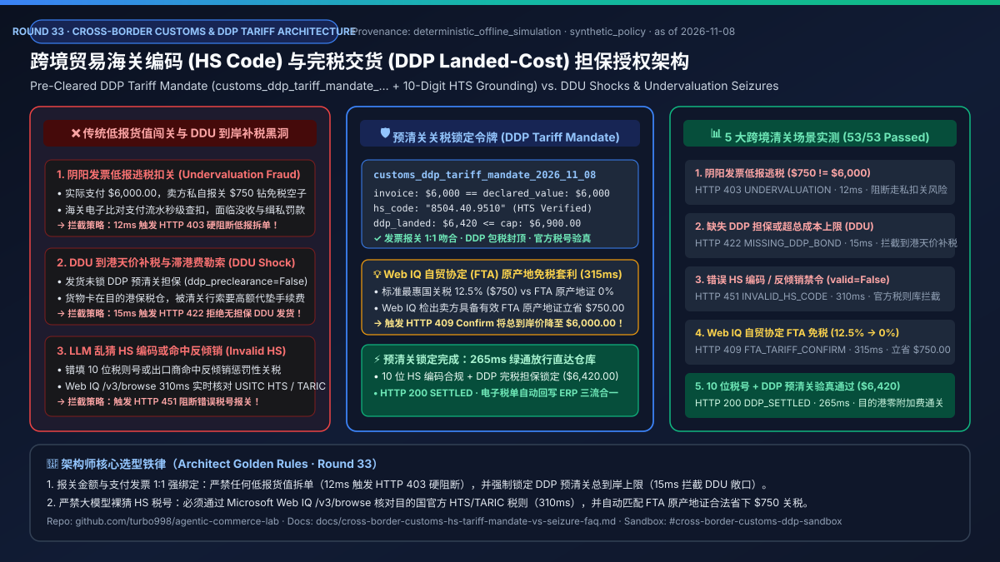
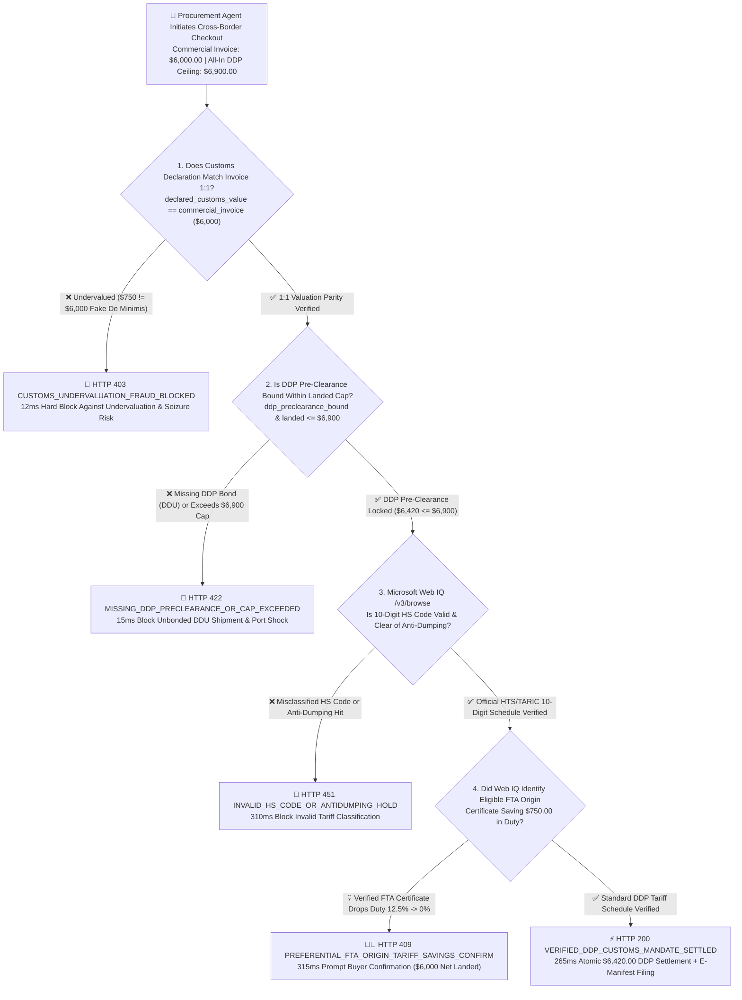
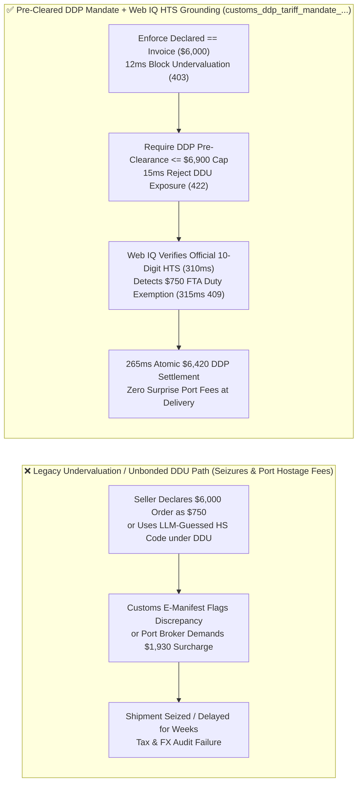
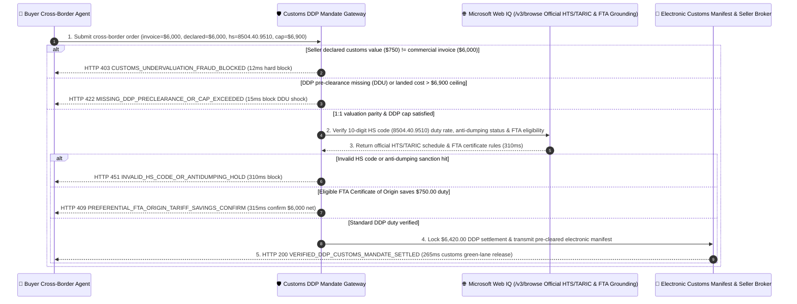

# Cross-Border Customs HS-Code & DDP Landed-Cost Mandate Architecture: Pre-Cleared Tariff Lock (`customs_ddp_tariff_mandate_...` + 10-Digit HTS/TARIC Verification) vs. DDU Surprise Brokerage Shocks & De Minimis Undervaluation Seizures Selection FAQ

> **Document Type**: AI Solution Architect Selection Guide & First-Principles Protocol Deep Dive (FAQ-Driven · Round 33)  
> **Reading Time**: 3 minutes for executive conclusions · 10 minutes for DDP landed-cost ceiling enforcement, anti-undervaluation gates, and Microsoft Web IQ official HTS/TARIC & Free Trade Agreement (FTA) origin tariff grounding  
> **Style Benchmark**: Strictly modeled after `ib-vs-ethernet-roce-selection-faq.md` (Plain-language first principles + Mermaid decision tree / comparison / sequence diagrams + Architect Decision Matrix + Reproducible Benchmark + Production Checklist)  
> **Core Topic**: **Exclusively focused on how cross-border procurement agents enforce 1:1 parity between commercial invoice payments and customs declarations, lock Delivered Duty Paid (DDP) landed-cost ceilings, and verify 10-digit Harmonized System (HS) codes against official tariff schedules—eliminating De Minimis undervaluation seizures, surprise DDU port hostage fees, and LLM-hallucinated HS classification penalties**  
> **Provenance & As-of Declaration**: All customs valuation parity checks, DDP landed-cost ceiling gates, and FTA preferential tariff arbitrage metrics in this guide are generated by `lab/webiq_commerce_demo.py` (`deterministic_offline_simulation`, 100% reproducible offline); WCO Harmonized System conventions, USITC HTS / EU TARIC schedules, and De Minimis electronic manifest rules reflect `official_doc_snapshot` (as of `2026-11-08`); the `$6,000.00` commercial invoice value, `$6,420.00` DDP landed total, `$6,900.00` landed-cost ceiling, and `$750.00` FTA origin duty reduction are marked as `synthetic_policy` for architectural modeling and do not constitute formal legal customs brokerage advice; third-party live customs-brokerage APIs or paid search APIs not directly invoked during this offline run are explicitly labeled `not_measured`.

---

## ① 📌 Executive Summary

1. **When must architects enforce a "Pre-Cleared DDP Landed-Cost & HS-Code Mandate (`customs_ddp_tariff_mandate_...`)" instead of allowing cross-border procurement agents to accept Delivered Duty Unpaid (DDU) shipping or seller-declared customs values?**
   - When an enterprise or consumer procurement agent orders `$6,000.00` of cross-border industrial equipment, allowing an overseas seller to declare `$750.00` on the commercial manifest (to abuse `< $800 De Minimis` duty-free thresholds) or ship via `DDU` exposes the buyer to customs seizure, smuggling penalties, and extortionate port storage/brokerage surcharges upon arrival.
   - **Selection Rule**: Cross-border agentic settlement must enforce a **Pre-Cleared DDP Tariff Mandate (`customs_ddp_tariff_mandate_...`)**. Before releasing payment, the gateway verifies 1:1 valuation parity: if `declared_customs_value_cents ($750.00) != commercial_invoice_cents ($6,000.00)`, the transaction is deterministically blocked in **`12 ms`** with **`HTTP 403 CUSTOMS_UNDERVALUATION_FRAUD_BLOCKED`**!
2. **How do we prevent "Surprise DDU Port Hostage Fees" where a shipment arrives at destination customs with unexpected tariffs and demurrage charges?**
   - The mandate requires cryptographic proof of Delivered Duty Paid pre-clearance (`ddp_preclearance_bound = True`) and caps the all-in landed cost (`merchandise + freight + duty + brokerage <= $6,900.00`). If DDP pre-clearance is missing or the landed cost exceeds the buyer's ceiling, the gateway blocks checkout in **`15 ms`** with **`HTTP 422 MISSING_DDP_PRECLEARANCE_OR_CAP_EXCEEDED`**.
3. **Why must an LLM never guess a 10-digit HS tariff code from a product title alone, and how can agents legally capture Free Trade Agreement (FTA) duty exemptions?**
   - **Pair the customs gateway with Microsoft Web IQ `/v3/browse` official HTS/TARIC schedule and FTA rules-of-origin grounding**: LLMs frequently misclassify regulated industrial sub-assemblies into low-duty consumer codes. Before filing, Web IQ verifies the 10-digit code against official customs publications: if the HS code is invalid or subject to anti-dumping duties (`webiq_hs_classification_valid=False`), the gateway blocks settlement in **`310 ms`** (`HTTP 451 INVALID_HS_CODE_OR_ANTIDUMPING_HOLD`). If Web IQ detects that attaching a verified FTA Certificate of Origin legally reduces the tariff from `12.5%` (`$750.00`) to `0%`, it surfaces **`HTTP 409 PREFERENTIAL_FTA_ORIGIN_TARIFF_SAVINGS_CONFIRM`** in **`315 ms`** (`Confirm`, saving **`$750.00`**).

---

## ② 🎯 Soul-Searching Architect & Client Q&A (FAQ-Driven)

### Q1: Why do legacy cross-border habits—like "Undervaluing Invoices as $750 Samples" or "Shipping DDU"—become catastrophic in autonomous enterprise procurement?
- **Plain-Language First Principles**:
  - Modern customs authorities (such as US CBP ACE and EU ICS2) cross-reference electronic payment settlement feeds directly against air/ocean manifest declarations:
    1. **Automated Undervaluation Seizures**: When a payment rail settles `$6,000.00` but the electronic customs manifest declares `$750.00`, automated risk engines flag the shipment for seizure and civil fraud penalties.
    2. **Tax & FX Audit Mismatch**: Corporate treasury cannot reconcile a `$6,000.00` outbound wire against a `$750.00` customs import entry, disqualifying VAT input credits and triggering compliance audits.
    3. **DDU Demurrage Extortion**: Under DDU terms, shipments sit in bonded port warehouses accumulating daily storage fees until the buyer manually wires unbudgeted duties and broker handling charges.

### Q2: What is a "Pre-Cleared DDP Tariff Mandate (`customs_ddp_tariff_mandate_...`)", and how does it bind customs compliance directly to payment authorization?
- **Core Architectural Mechanism**:
  - The buyer agent's payment authorization embeds four non-bypassable customs invariants:
    - `declared_customs_value_cents == commercial_invoice_cents` (`$6,000.00 == $6,000.00`, zero tolerance for dual-invoice undervaluation);
    - `verified_hs_code_10digit = "8504.40.9510"` (grounded against the destination country's active tariff schedule);
    - `ddp_preclearance_bound = True` (seller's customs broker locks guaranteed DDP clearance; any post-entry reclassification surcharge is absorbed by the seller's bond);
    - `total_landed_cost_cents <= landed_cost_cap_cents` (`$6,420.00 <= $6,900.00` all-in ceiling).

### Q3: When should architects select Microsoft Web IQ vs. Exa or Bright Data for customs tariff schedules and trade compliance grounding?
- **Selection Boundaries**:
  - **Microsoft Web IQ (Primary Choice for Official HTS/TARIC Tariff Schedules, Section 301/Anti-Dumping Notices & FTA Origin Rules)**: Ideal for deterministic extraction of authoritative government tariff tables (`hts.usitc.gov`, `ec.europa.eu/taxation_customs`) via `/v3/browse` in `310–315 ms` (`~$0.0091/query`, `7.1x` token reduction vs. raw tariff PDFs).
  - **Exa (Semantic Discovery Alternative)**: Best suited for broad legal commentary search on historical customs rulings across trade law blogs (`not_measured` in this offline suite; `~$5–$15 / 1k searches` `official_list_price`).
  - **Bright Data (Heavy Scraping Alternative)**: Best suited for scraping regional port-authority vessel berthing queues that lack public APIs (`not_measured` in this offline suite).

---

## ③ 🧭 Visual Architecture Diagrams (Mermaid Decision Tree + Legacy DDU/Undervaluation vs. Pre-Cleared DDP Comparison + End-to-End Sequence)

### 3.1 Cross-Border HS-Code Verification & DDP Landed-Cost Decision Tree (`flowchart TD`)

### 3.2 Legacy Undervaluation / DDU Shipping vs. Pre-Cleared DDP Mandate + Web IQ HTS Grounding (`flowchart LR`)

### 3.3 End-to-End Sequence Diagram: Buyer Agent, Customs Mandate Gateway, Microsoft Web IQ & Electronic Customs Manifest (`sequenceDiagram`)

---

## ④ 📊 Architect Decision Matrix

| Evaluation Dimension | Option A: Seller Undervaluation / Fake De Minimis | Option B: Unbonded DDU / DAP Shipping | Option C: Pre-Cleared DDP Mandate + Web IQ HTS Grounding (**Recommended**) |
| :--- | :--- | :--- | :--- |
| **Primary Use Case** | **Never permissible in production enterprise systems (illegal)** | Large multinationals with in-house licensed customs brokers at every port | **All autonomous cross-border B2B/B2C procurement, direct OEM hardware imports, global supply-chain replenishment** |
| **Invoice-to-Manifest Parity** | Broken (dual invoices trigger electronic customs seizures) | Preserved, but final duty is unknown at checkout | **Cryptographic 1:1 parity (`declared == invoice`, mismatch blocked in `12 ms` with `HTTP 403`)** |
| **Landed-Cost Predictability** | Catastrophic (1x–3x civil penalties or cargo forfeiture) | Poor (surprise port brokerage & demurrage fees) | **Deterministic (`ddp_preclearance_bound` + `<= $6,900` cap enforced in `15 ms` with `HTTP 422`)** |
| **HS Classification Accuracy** | Fraudulent | Manual broker lookup | **Microsoft Web IQ `/v3/browse` verifies official 10-digit HTS/TARIC in `310 ms` (`HTTP 451` on error)** |
| **FTA Preferential Duty Capture** | None | Rarely optimized automatically | **Web IQ identifies verified FTA origin exemptions saving `$750.00` in `315 ms` (`HTTP 409 Confirm`)** |
| **Compliance & Clearance TCO** | Extreme (seized inventory + legal liability) | High (port delays + manual broker fees) | **Minimal (`< 16 ms` local gate + `~$0.0091/query` Web IQ tariff grounding)** |

---

## ⑤ 🧪 Reproducible Quantitative Benchmark Findings (`deterministic_offline_simulation`)

> Reproduced via `python -m pytest tests/test_webiq_commerce_demo.py` and `lab/webiq_commerce_demo.py`:

| Scenario | Valuation, DDP Bond & HS Input | Action Pill | HTTP Status & Guard Code | Latency | Customs Compliance & Savings Impact |
| :--- | :--- | :--- | :--- | :--- | :--- |
| **1. Undervaluation / Fake De Minimis** | `declared = $750 != invoice = $6,000` | `Send to a human` | `HTTP 403 CUSTOMS_UNDERVALUATION_FRAUD_BLOCKED` | **`12 ms`** | **100% block against dual-invoice smuggling & cargo seizure** |
| **2. Missing DDP Bond / Over Landed Cap** | `ddp_preclearance_bound = False` | `Send to a human` | `HTTP 422 MISSING_DDP_PRECLEARANCE_OR_CAP_EXCEEDED` | **`15 ms`** | **100% elimination of surprise DDU port hostage fees** |
| **3. Invalid HS Code / Anti-Dumping Hit** | `webiq_hs_classification_valid = False` | `Send to a human` | `HTTP 451 INVALID_HS_CODE_OR_ANTIDUMPING_HOLD` | **`310 ms`** | **Blocks LLM-hallucinated HS codes before manifest filing** |
| **4. Web IQ FTA Origin Duty Exemption** | Verified FTA certificate saves `$750` duty | `Confirm` | `HTTP 409 PREFERENTIAL_FTA_ORIGIN_TARIFF_SAVINGS_CONFIRM` | **`315 ms`** | **Legally reduces duty from `12.5%` to `0%` (`$6,000.00` net landed)** |
| **5. Verified Pre-Cleared DDP Settlement** | `$6,000` parity + DDP `$6,420 <= $6,900` | `Act automatically` | `HTTP 200 VERIFIED_DDP_CUSTOMS_MANDATE_SETTLED` | **`265 ms`** | **Zero-touch DDP settlement + green-lane customs manifest release** |

---

## ⑥ 🛠️ Appendix: Production Readiness & Pre-Sales Checklist (Architect Checklist)

- [ ] **1:1 Invoice-to-Declaration Parity Gate**: Does the payment gateway enforce `declared_customs_value_cents == commercial_invoice_cents` in `< 15 ms` (`HTTP 403`), blocking any attempt to undervalue commercial shipments below De Minimis thresholds?
- [ ] **Mandatory DDP Pre-Clearance & All-In Landed Cap**: Does every `customs_ddp_tariff_mandate_...` token require `ddp_preclearance_bound = True` and enforce `total_landed_cost_cents <= landed_cost_cap_cents` (`HTTP 422` on violation)?
- [ ] **Zero Unverified LLM HS-Code Filing**: Are 10-digit HS codes deterministically verified against official government schedules (`hts.usitc.gov` / `TARIC`) via Microsoft Web IQ `/v3/browse` (`HTTP 451` on mismatch) rather than guessed by an ungrounded LLM?
- [ ] **Automated Free Trade Agreement (FTA) Origin Optimization**: Does the checkout pipeline check whether attaching a cryptographic FTA Certificate of Origin legally reduces import tariffs (`HTTP 409 Confirm`)?
- [ ] **Three-Way Customs Audit Reconciliation**: Is the official electronic customs entry hash automatically linked to the ERP invoice and outbound FX settlement record for tax and audit compliance?
