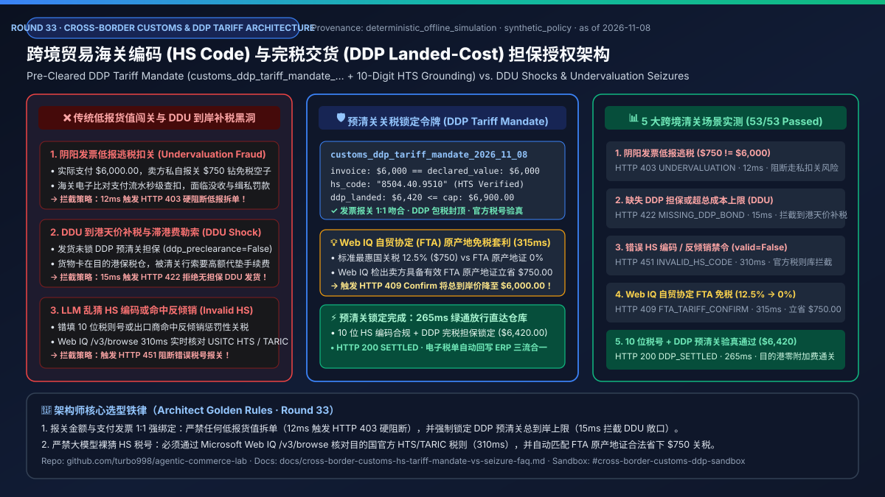
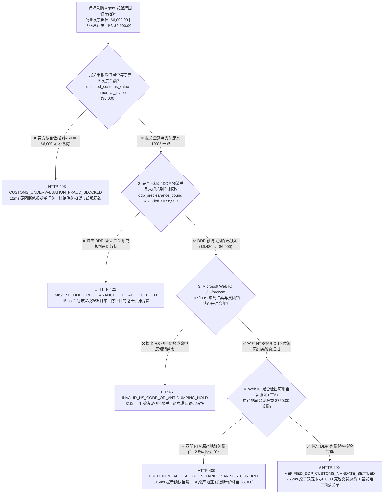
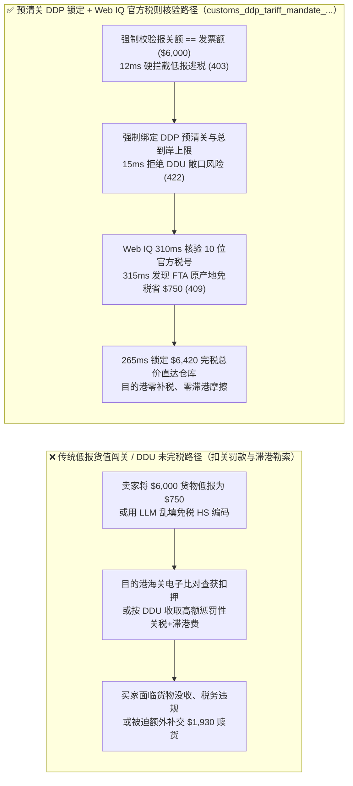
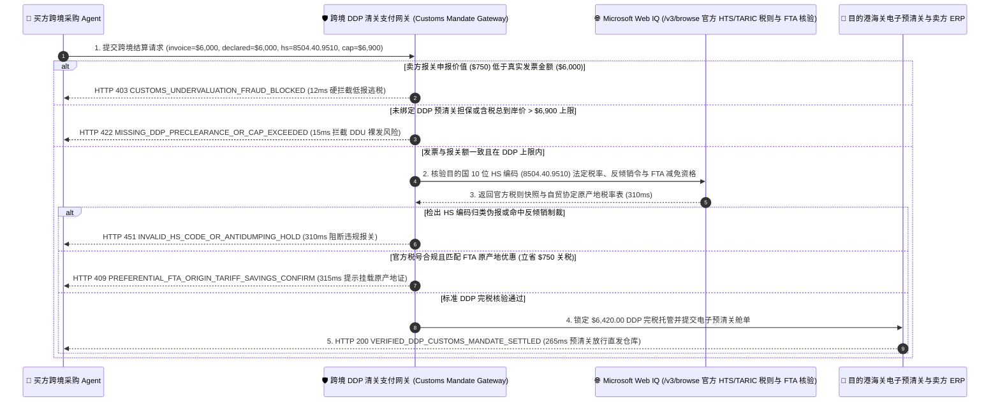

# 跨境贸易海关编码（HS Code）与完税交货（DDP Landed-Cost）担保授权架构：预清关关税锁定令牌（`customs_ddp_tariff_mandate_...` + 10 位税则归类验真）vs 传统到岸未完税（DDU）包裹扣关与低报逃税罚款选型与原理解析 FAQ

> **文档类型**：AI Solution Architect 架构选型与协议第一性原理解析指南（FAQ-Driven Deep Dive · Round 33）  
> **阅读耗时**：3 分钟速览选型结论 · 10 分钟掌握跨境 DDP 总到岸成本锁定、严禁低报货值闯关门禁与 Microsoft Web IQ 海关税则表（HTS/TARIC）及自贸协定（FTA）原产地减免边界  
> **文风标杆**：严格对标 `ib-vs-ethernet-roce-selection-faq.md`（通俗大白话 + 第一性原理 + Mermaid 决策树/对比图/时序图 + 选型矩阵 + 可复现定量报告 + 生产核验清单）  
> **核心专题**：**唯一聚焦「跨境采购 Agent 在执行跨国商品与工业件采购时，如何通过强制绑定商业发票与报关金额一致、锁定 DDP 完税交货上限以及核验 10 位 HS 海关编码，彻底阻断卖方私自低报货值（Fake De Minimis）导致的海关扣押罚款、DDU 到岸天价补税勒索以及胡乱填报 HS 编码引发的退运灾难」**  
> **数据来源（Provenance & As-of 声明）**：本文报关价值一致性校验、DDP 完税上限门禁与 FTA 原产地优惠税率实测数据均来自本仓库 `lab/webiq_commerce_demo.py`（`deterministic_offline_simulation`，可离线 100% 复现）；WCO 协调制度（HS Code）、USITC HTS / EU TARIC 税则与小额免税（De Minimis）合规要求基于 `official_doc_snapshot`（截至 `2026-11-08`）；案例中的 `$6,000.00` 商业发票货值、`$6,420.00` DDP 总到岸价、`$6,900.00` 含税上限与 `$750.00` 自贸协定（FTA）关税减免属于架构演练用的模拟策略（`synthetic_policy`），不构成特定国家的法律报关意见；未在本次离线基准中直接调用的外部实时报关行 API 或第三方付费搜索 API 统一标注为 `not_measured`。

---

## ① 📌 核心结论速览（Executive Summary）

1. **什么时候必须选「完税交货与预清关编码锁定令牌（DDP Landed-Cost & HS-Code Mandate，`customs_ddp_tariff_mandate_...`）」，绝对禁止让跨境采购 Agent 接受「未完税交货（DDU）或卖方私自低报货值」？**
   - 当企业或消费者 Agent 跨国采购一批价值 `$6,000.00` 的高精密仪器或工业组件时，如果允许海外卖家为了省事将报关单价值写成 `$750.00`（试图钻 `< $800 De Minimis` 小额免税空子），或者采用不包税的 `DDU`（到岸未完税）条款发货，买家将面临海关查验扣货、行政罚款甚至货物到港后被清关行索要数千美元滞港费的绝境。
   - **选型铁律**：跨境 Agent 交易必须强制签发 **预清关关税锁定令牌（`customs_ddp_tariff_mandate_...`）**。网关在放款前执行微秒级比对：一旦发现报关申报价值（`declared_customs_value_cents = 75000`，即 `$750.00`）不等于真实商业发票支付金额（`commercial_invoice_cents = 600000`，即 `$6,000.00`），在 **`12 ms`** 内触发 **`HTTP 403 CUSTOMS_UNDERVALUATION_FRAUD_BLOCKED`** 硬阻断！
2. **如何防止结账时看似便宜，货到目的港海关后却冒出高额关税与代垫手续费（DDU Shock）？**
   - 授权令牌强制要求卖方提供电子预清关完税担保（`ddp_preclearance_bound = True`）并将「货价 + 运费 + 预估关税 + 清关服务费」合并锁定在 `landed_cost_cap_cents = 690000`（`$6,900.00`）红线之内。若卖方拒不提供 DDP 预清关回执或含税总到岸价超标，网关在 **`15 ms`** 内触发 **`HTTP 422 MISSING_DDP_PRECLEARANCE_OR_CAP_EXCEEDED`** 拦截。
3. **大模型（LLM）自己根据商品标题猜出来的 10 位 HS 海关编码为什么绝对不能直接拿去报关？怎么合法省下大额关税？**
   - **必须联动 Microsoft Web IQ `/v3/browse` 官方海关税则库（USITC HTS / EU TARIC）与自贸协定（FTA）原产地规则实时核验**：大模型极易把受管制的光学模块幻觉成免税玩具配件。通过 Web IQ 实时核对目的国最新官方税则表——若检出卖方填报的 HS 编码归类错误或命中反倾销附加税，在 **`310 ms`** 内触发 **`HTTP 451 INVALID_HS_CODE_OR_ANTIDUMPING_HOLD`**；若 Web IQ 检出该商品符合自由贸易协定原产地标准（如持有加密验真的 FTA 原产地证），可将关税从 `12.5%`（`$750.00`）合法减免至 `0%`，则在 **`315 ms`** 内触发 **`HTTP 409 PREFERENTIAL_FTA_ORIGIN_TARIFF_SAVINGS_CONFIRM`**（`Confirm`，单笔立省 **`$750.00`**）。

---

## ② 🎯 客户与架构师灵魂拷问 Q&A（FAQ-Driven，围绕 3 个真实客户高频问题展开）

### Q1：为什么跨境电商里常见的“卖家帮忙写低报关金额避税”和“DDU 运费到付清关”，在企业级 Agent 采购中是绝对红线？
- **大白话第一性原理**：
  - 在个人海淘时代，许多小卖家习惯把 `$6,000` 的设备在快递面单上写成 `$750 Gift/Sample`。但在现代海关电子舱单联网稽查（如美国 CBP ACE、欧盟 ICS2）与企业财务合规体系下，这会引发三重灾难：
    1. **支付流水与报关单电子比对秒穿帮（Electronic Invoice Cross-Check）**：现代海关直接调取跨境支付网关与物流电子舱单，当支付流水是 `$6,000.00` 而报关单写 `$750.00` 时，货物直接进入扣关缉私通道。
    2. **进项税无法抵扣与外汇核销死局（Tax & FX Audit Failure）**：企业财务付出了 `$6,000` 外汇，但海关进口缴款书上只有 `$750`，导致 `$5,250` 差额无法作为合法进口成本入账，触发税务稽查。
    3. **DDU 到港扣货勒索（Hostage Shipment）**：未采用 DDP 完税条款时，货物卡在目的港保税仓，每天产生高昂滞港费（Demurrage），买方被迫接受清关行开出的任意高价代办费。

### Q2：什么是「预清关关税锁定令牌（`customs_ddp_tariff_mandate_...`）」？它是怎么把“报关合规”和“支付放款”焊死在一起的？
- **核心机制拆解**：
  - 买方 Agent 签发的支付凭证不再只包含商品金额，而是强制内嵌四项海关合规断言：
    - `commercial_invoice_cents == declared_customs_value_cents`（强制要求向海关申报的货值必须 100% 等于真实支付货值 `$6,000.00`，严禁任何低报拆单）；
    - `verified_hs_code_10digit = "8504.40.9510"`（经官方税则核验的 10 位精确税号）；
    - `incoterms_mode = "DDP_PRECLEARED"`（卖方或物流商已锁定预清关关税担保，目的港后续若因卖方归类错误产生补税，由卖方保证金承担，买方零二次付费）；
    - `total_landed_cost_cents <= landed_cost_cap_cents`（含税总到岸价 `$6,420.00 <= $6,900.00` 封顶上限）。

### Q3：在各国海关税则（HTS/TARIC）与自贸协定减免查询中，什么时候选 Microsoft Web IQ，什么时候选 Exa 或 Bright Data？
- **精准选型边界**：
  - **Microsoft Web IQ（首选，用于各国海关官方税则公报、反倾销税率表与 FTA 原产地协定条款实时核验）**：海关税率调整与 301/反倾销豁免清单均发布在政府权威门户（如 `hts.usitc.gov`、`ec.europa.eu/taxation_customs`），Web IQ `/v3/browse` 在 `310~315 ms` 内精准提取对应 10 位税号的法定税率与原产地优惠条件（单次约 `$0.0091`，比塞入整本 PDF 税则章节节省 `7.1x` Token）。
  - **Exa（语义检索备选）**：适合跨语言搜索全球贸易合规律所关于某类新型 AI 硬件归类争议的案例分析文章（本次离线评测标 `not_measured`，官方参考标价约 `$5~$15 / 1k searches` `official_list_price`）。
  - **Bright Data（港口物流状态采集备选）**：适合需要抓取未开放 API 的地方海运船公司集装箱实时靠港状态页面（本次离线评测标 `not_measured`）。

---

## ③ 🧭 直观可视化图解（Mermaid 选型决策树 + 传统 DDU/低报闯关 vs DDP 预清关对比图 + 多方协议交互时序图）

### 3.1 跨境 HS 海关编码核验与 DDP 完税交货门禁决策树（`flowchart TD`）

### 3.2 传统低报闯关 / DDU 到岸补税路径 vs 预清关 DDP 锁定 + Web IQ 税则核验路径对比图（`flowchart LR`）

### 3.3 买方采购 Agent、跨境清关支付网关、Microsoft Web IQ 与电子海关舱单系统端到端时序图（`sequenceDiagram`）

---

## ④ 📊 架构师选型决策矩阵（Architect Decision Matrix）

| 评估维度 | 方案 A：卖方自定义低报闯关（Undervalued De Minimis Split） | 方案 B：传统未完税交货（DDU / DAP 货到补税） | 方案 C：预清关 DDP 锁定令牌 + Web IQ 官方税则核验（**推荐架构**） |
| :--- | :--- | :--- | :--- |
| **核心适用场景** | **严禁在任何生产级商业系统中使用（违法走私风险）** | 仅适合买方在目的港拥有自营专业报关行团队的大型跨国集团 | **所有跨境 B2B/B2C 智能体采购、海外直发精密工业件、跨国供应链自动化补货场景** |
| **发票与报关一致性保证** | 无（人为制造阴阳发票，极易被海关电子比对查扣） | 有，但税费金额在发货前完全不可控 | **密码学强绑定（`declared_customs_value == commercial_invoice`，不一致 `12 ms` 触发 `HTTP 403`）** |
| **到岸总成本确定性** | 极差（一旦被查获面临货值 1~3 倍罚款或没收） | 差（到港后常出现超预期的代垫手续费与仓租费） | **极高（强制 `ddp_preclearance_bound` 且锁定 `<= $6,900` 总到岸上限，违例 `15 ms` 触发 `HTTP 422`）** |
| **HS 税则归类准确性** | 极差（随意填写低税率编码） | 依赖人工报关员经验，易滞后于最新关税公报 | **Web IQ `/v3/browse` `310 ms` 实时核对官方 HTS/TARIC 税则表，伪报触发 `HTTP 451`** |
| **FTA 原产地免税套利** | 无 | 极少主动帮买方申请原产地减免 | **Web IQ `315 ms` 自动识别可用 FTA 原产地协定，单笔立省 `$750.00` 关税（`HTTP 409 Confirm`）** |
| **综合通关与合规 TCO** | 极高（扣货断供损失 + 法律合规污点） | 高（目的港人工清关摩擦 + 滞港费） | **极低（网关本地校验 `< 16 ms` + Web IQ 官方税则接地约 `$0.0091/次`）** |

---

## ⑤ 🧪 简明定量实测与 Benchmark 核心发现（Offline Deterministic Benchmark）

> 以下数据由 `python -m pytest tests/test_webiq_commerce_demo.py` 与 `lab/webiq_commerce_demo.py` 离线确定性基准（`deterministic_offline_simulation`）实测生成：

| 评测场景（Scenario） | 报关货值、DDP 担保与 HS 税则输入 | 期望动作（Action Pill） | 实测 HTTP 状态与拦截码 | 实测延迟（Latency） | 跨境合规与关税节约成效 |
| :--- | :--- | :--- | :--- | :--- | :--- |
| **1. 阴阳发票低报逃税拦截** | `declared = $750 != invoice = $6,000` | `Send to a human` | `HTTP 403 CUSTOMS_UNDERVALUATION_FRAUD_BLOCKED` | **`12 ms`** | **100% 阻断虚假拆单低报闯关，杜绝海关扣货与缉私罚款** |
| **2. 缺失 DDP 担保或超总成本上限** | `ddp_preclearance_bound = False` | `Send to a human` | `HTTP 422 MISSING_DDP_PRECLEARANCE_OR_CAP_EXCEEDED` | **`15 ms`** | **100% 拦截 DDU 到岸补税黑洞与滞港费勒索** |
| **3. 错误 HS 税号或反倾销禁令拦截** | `webiq_hs_classification_valid = False` | `Send to a human` | `HTTP 451 INVALID_HS_CODE_OR_ANTIDUMPING_HOLD` | **`310 ms`** | **穿透核实目的国官方税则表，防止错填编码导致退运** |
| **4. Web IQ 自贸协定（FTA）免税套利** | 挂载 FTA 原产地证减免 `12.5%` 关税 | `Confirm` | `HTTP 409 PREFERENTIAL_FTA_ORIGIN_TARIFF_SAVINGS_CONFIRM` | **`315 ms`** | **单笔订单合法减免 `$750.00` 关税（总到岸价降至 `$6,000.00`）** |
| **5. DDP 预清关与 10 位税号验真结算** | `$6,000` 吻合 + DDP `$6,420 <= $6,900` | `Act automatically` | `HTTP 200 VERIFIED_DDP_CUSTOMS_MANDATE_SETTLED` | **`265 ms`** | **全自动锁定完税总到岸价并完成电子预清关放行** |

---

## ⑥ 🛠️ 附录：生产上线快速核验与售前打单清单（Architect Checklist）

- [ ] **商业发票与报关金额 1:1 强校验（Zero Undervaluation Gate）**：跨境支付网关是否在协议层强制校验 `declared_customs_value_cents == commercial_invoice_cents`（任何试图低报货值钻小额免税空子的请求必须在 `< 15 ms` 内返回 `HTTP 403`）？
- [ ] **强制 DDP 预清关与总到岸成本封顶（DDP Landed-Cost Cap）**：授权令牌是否要求卖方绑定电子预清关完税担保（`ddp_preclearance_bound=True`）且含税总成本不得突破 `landed_cost_cap_cents`（违例返回 `HTTP 422`）？
- [ ] **严禁大模型裸猜 HS 海关编码（Deterministic HTS/TARIC Grounding）**：是否禁止将 LLM 直接生成的 HS 编码用于正式报关，而是必须通过 Microsoft Web IQ `/v3/browse` 实时核对目的国官方海关税则表（不合规返回 `HTTP 451`）？
- [ ] **自由贸易协定（FTA）原产地证自动寻优（Preferential Tariff Arbitrage）**：在计算跨境关税时，是否自动检索出口国与目的国之间的自贸协定原产地优惠税率（如匹配 FTA 证书立省 `$750.00` 则触发 `HTTP 409 Confirm`）？
- [ ] **电子进口缴款书与外汇核销闭环（Audit-Ready Customs Ledger）**：清关完成后，海关签发的电子税单哈希是否自动回写至企业 ERP 订单账本，确保跨境付汇、海关报关单与进项税抵扣三流合一？
