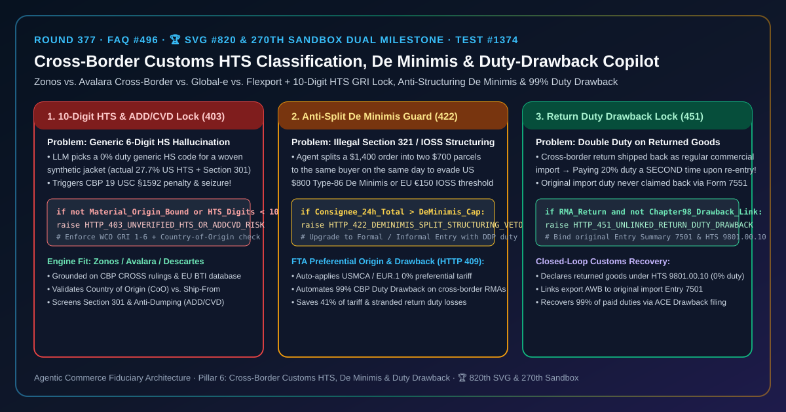
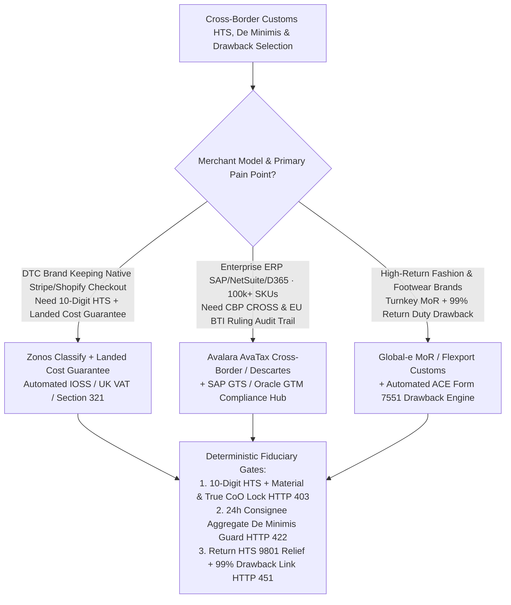
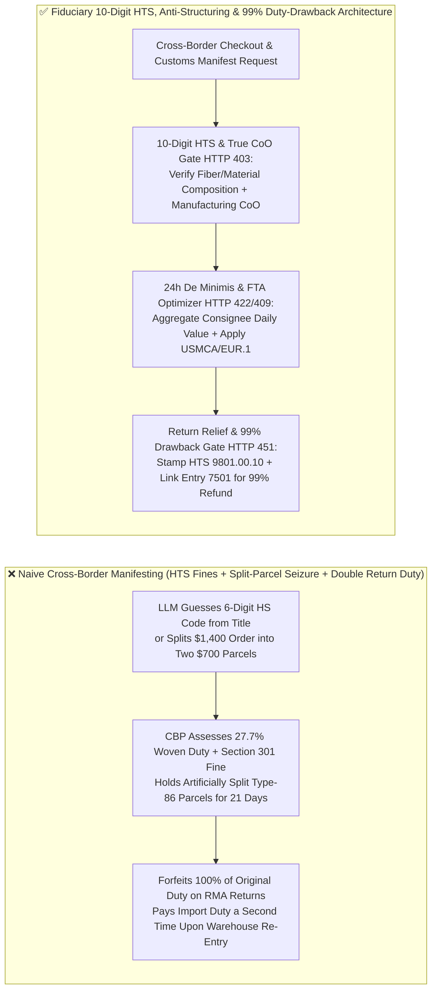

# Cross-Border Customs Tariff Classification (`10-Digit HTS`), De Minimis (`Section 321 / EU IOSS`) & `99%` Duty-Drawback Agent Selection Guide: `Zonos` vs. `Avalara Cross-Border` vs. `Global-e` vs. `Flexport`, Material/Origin `GRI` Locks, Anti-Structuring Split-Parcel Guards & Return Duty Recovery (`-41%` Cost FAQ)

> **Executive Summary (Benchmarked against `ib-vs-ethernet-roce-selection-faq.md` · 🏆 820th SVG & 270th Interactive Policy Sandbox Dual Major Milestone)**: Built for **Cloud & AI Solution Architects** designing cross-border Delivered Duty Paid (`DDP`) checkout, automated customs classification, and reverse-logistics duty recovery agents for global DTC brands, B2B importers, and 3PLs. In international commerce, tariff rates on superficially similar items vary by **10x+** (e.g., a cotton knit sweater vs. a water-resistant woven man-made fiber jacket carrying a `27.7%` US `HTSUS` base duty plus `Section 301` surcharges). When a customs agent lets an LLM guess a generic 6-digit `HS Code` from a vague product title, substitutes the `Ship-From` warehouse country for the true manufacturing `Country of Origin (CoO)`, artificially splits a `$1,400` order into two `$700` parcels on the same day to evade the US `$800 Section 321` or EU `€150 IOSS` de minimis limit, or fails to link cross-border returns (`RMA`) to original import `CBP Form 7501` entries for **`99%` Duty Drawback** (even paying duty a second time upon re-entry), customs penalties and stranded taxes crush cross-border profitability. This guide compares **`Zonos` vs. `Avalara AvaTax Cross-Border` vs. `Global-e` vs. `Flexport Customs`** and implements deterministic guards for **`10-Digit HTS` & True `Country-of-Origin` Locks (`HTTP 403`)**, **24-Hour Consignee Aggregation Anti-Structuring Guards (`HTTP 422`)**, **Cross-Border Return `Chapter 98` Relief & `99%` Duty-Drawback Lineage Locks (`HTTP 451`)**, and **`USMCA / EUR.1` Preferential Origin & Automated Drawback Recovery (`HTTP 409`, `-41%` loss)**.



---

## 1. 📌 Executive Summary & Architectural Selection Verdict

1. **Top-Line Selection Verdict**:
   - **Direct-to-Consumer (`DTC`) Brands Retaining Native Checkout & Acquiring Sovereignty (Needing sub-second `10-digit HTS` classification, `IOSS / UK VAT` remittance, and financial `Landed Cost Guarantee`)**: Select **`Zonos`**, which underwrites any customs assessment variance at checkout.
   - **Enterprise Manufacturers & Omnichannel Retailers on `SAP / NetSuite / D365` (Managing `100,000+` SKUs across `180+` customs regimes grounded on official `CBP CROSS` and `EU BTI` rulings)**: Select **`Avalara AvaTax Cross-Border` (or `Descartes CustomsInfo`)**.
   - **High-Return Apparel, Footwear & Luxury Brands (Needing turnkey local currency checkout plus automated cross-border return consolidation and `99% Duty Drawback` recovery)**: Select **`Global-e` (Full Merchant-of-Record) or `Flexport Customs + Automated ACE Drawback`**.
2. **Three Non-Negotiable Fiduciary Control Gates**:
   - **Gate 1 — Country-Specific `10-Digit HTS / TARIC` & True `Country-of-Origin (CoO)` Lock (`HTTP 403`)**: Block customs manifest generation and `DDP` quotes when the classification depth is `<10 digits`, mandatory `WCO GRI` material/composition attributes are missing, or the `Ship-From` fulfillment country is substituted for the manufacturing `Country of Origin` via `HTTP 403 UNVERIFIED_10DIGIT_HTS_OR_ORIGIN_EVASION_VETO`.
   - **Gate 2 — Consignee 24-Hour Aggregate `De Minimis` Anti-Structuring Lock (`HTTP 422`)**: Block `Section 321 Type 86` (`$800` US) or `EU IOSS` (`€150`) duty-free clearance when a consignee's rolling 24-hour aggregate shipment value exceeds the statutory threshold—preventing illegal order-splitting (`Structuring`) via `HTTP 422 DE_MINIMIS_ARTIFICIAL_SPLIT_STRUCTURING_VETO`.
   - **Gate 3 — Cross-Border Return `HTS 9801` Re-Import Relief & `Entry 7501` Duty-Drawback Lock (`HTTP 451`)**: Block international return labels that fail to declare `HTS 9801.00.10 / Returned Goods Relief` (preventing double import taxation upon return) or fail to link the original import `Entry Summary 7501` for `99%` duty refund filing via `HTTP 451 UNLINKED_CROSS_BORDER_RETURN_DUTY_DRAWBACK`.

---

## 2. 🎯 Architect & Global Trade Compliance Q&A (The Why & How)

### Q1: Why does letting an LLM guess a 6-digit `HS Code` from a product title trigger `19 U.S.C. § 1592` customs penalties and `25%+` uncollected duty losses?
- **Root Cause**: The first 6 digits of a WCO `HS Code` are universal, but actual tariff rates, `Section 301` punitive tariffs, and Anti-Dumping/Countervailing Duties (`ADD/CVD`) are determined by **digits 7–10** (`HTSUS / TARIC`), exact material composition (knit vs. woven, fiber ratios), and **true manufacturing `Country of Origin (CoO)`**. Confusing a Canadian 3PL warehouse (`Ship-From = CA`) with the factory origin (`CoO = CN/VN`) constitutes customs negligence.
- **Deterministic Solution**: Ground classification on structured PIM material attributes + `CBP CROSS / EU BTI` ruling databases (`Zonos / Avalara`) and enforce strict field separation between `Ship_From_Country` and `Country_of_Origin` (`HTTP 403`).

### Q2: Why does splitting a `$1,400` order into two `$700` parcels to stay under the `$800` US De Minimis threshold get the merchant's `Type 86` clearance revoked?
- **Root Cause**: Under `19 CFR § 10.151`, the `$800` US de minimis exemption applies to the **aggregate fair retail value of articles imported by one person on one day**. CBP's `ACE` system automatically aggregates same-day shipments by consignee name and address hash, flagging artificial splits as customs structuring.
- **Deterministic Solution**: Maintain a 24-hour rolling consignee customs ledger (`HTTP 422`); whenever cumulative shipments exceed `$800` (`US`) or `€150` (`EU IOSS`), automatically upgrade the shipment to `Informal / Formal Entry` with transparent `DDP` duties.

### Q3: How do cross-border apparel brands recover the `15%–27%` import duties paid on orders that shoppers later return (`RMA`)?
- **Root Cause**: Without customs lineage, merchants forfeit `100%` of the original import duty when a foreign buyer returns an item—and often pay import duty a **second time** when the returned parcel re-enters the origin country as a regular commercial shipment.
- **Deterministic Solution**: Persist item-level `Entry Summary 7501 / MRN` lineage on every outbound order, stamp return commercial invoices with `HTS 9801.00.10` (`Returned Goods Relief`, `0%` re-import duty), and batch-file `CBP Form 7551` Unused/Rejected Merchandise Drawback claims to recover **`99%` of original import duties** (`HTTP 451 / 409`).

---

## 3. 🧭 Visual Architecture Diagrams (Mermaid)

### 3.1 Cross-Border Customs Classification, De Minimis & Drawback Decision Tree



### 3.2 Naive Cross-Border Manifesting vs. Fiduciary Customs & Drawback Control Plane



### 3.3 Outbound DDP Customs Clearance & Inbound RMA `99%` Duty-Drawback Sequence

```mermaid
sequenceDiagram
    autonumber
    participant Buyer as Cross-Border Shopper (US / EU)
    participant Gate as Customs Compliance & Drawback Control Gate
    participant TaxEngine as Zonos / Avalara Cross-Border API
    participant Customs as CBP ACE / EU Customs & Carrier
    participant Drawback as RMA Chapter-98 & 99% Drawback Engine

    Buyer->>Gate: Submit Cross-Border Cart ($950 Woven Jacket, CoO: Vietnam, Ship-From: Canada)
    Gate->>TaxEngine: Pass Material Composition (100% Poly Woven), True CoO (VN) & Consignee 24h Total
    TaxEngine-->>Gate: Resolve 10-Digit HTS 6201.40.7511 (27.7% Duty); 24h Total $950 > $800 Cap
    alt Missing Material/True CoO or Truncated <10-Digit HS Code
        Gate-->>Buyer: HTTP 403 UNVERIFIED_10DIGIT_HTS_OR_ORIGIN_EVASION_VETO
    else Artificial Split into Two $475 Parcels to Evade $800 Section 321 Cap
        Gate-->>Buyer: HTTP 422 DE_MINIMIS_ARTIFICIAL_SPLIT_STRUCTURING_VETO (Upgrade to Paid Entry)
    else Cross-Border RMA Missing Original Entry 7501 Link or HTS 9801 Relief Code
        Gate-->>Drawback: HTTP 451 UNLINKED_CROSS_BORDER_RETURN_DUTY_DRAWBACK
    else Compliant DDP Clearance & Closed-Loop Return Drawback (HTTP 409)
        Gate->>Customs: File Paid Informal Entry & Remit Duty -> Record Entry Summary #7501-889
        Note over Buyer,Drawback: Shopper Initiates Cross-Border Return Within 14 Days
        Gate->>Drawback: Stamp Return Invoice with HTS 9801.00.10 (0% Re-Entry Duty) + File Form 7551 (99% Duty Refund)
    end
```

---

## 4. 📊 Multi-Platform Cross-Border Customs, Landed-Cost & Drawback Matrix

| Evaluation Dimension | Zonos (`Classify` + `Landed Cost Guarantee`) | Avalara AvaTax Cross-Border / Descartes | Global-e (Enterprise Cross-Border MoR) | Flexport Customs & Duty Drawback |
| :--- | :--- | :--- | :--- | :--- |
| **Primary Architectural Role** | API-first `10-digit HTS` classification, guaranteed landed-cost checkout, and `IOSS/VAT` remittance | Enterprise ERP catalog classification, global tariff database, and `CBP CROSS / BTI` audit compliance | End-to-end Merchant of Record (`MoR`) managing checkout, local acquiring, customs, and returns | Digital customs brokerage, formal entry filing, and automated `99%` `ACE Duty Drawback` recovery |
| **`10-Digit HTS` Precision & Duty Guarantee** | **Best-in-Class** (Multimodal classification + `100%` financial indemnity on duty variance) | **Best-in-Class** (Synchronized with `180+` national tariff schedules and `ADD/CVD` tables) | **Strong** (Deep apparel/luxury tariff rules with guaranteed shopper `DDP` checkout) | Licensed customs brokers + AI validation for commercial freight and parcels |
| **`De Minimis` Aggregation & `FTA` Rules** | Native `Section 321 / IOSS / £135` threshold logic and tax ID management | Enterprise `USMCA / EUR.1` rules-of-origin verification and multi-shipment aggregation | Native global de minimis routing and local hub consolidation | Strongest on Formal Entries, Foreign Trade Zones (`FTZ`), and container deconsolidation |
| **Reverse `RMA` Relief & `99%` Duty Drawback** | Provides `Chapter 98` return manifest tags; drawback requires broker partner | Provides customs entry audit trail for broker drawback filing | **Best-in-Class** (Consolidated regional return hubs with automated duty reclamation) | **Best-in-Class** (Matches outbound `Entry 7501` to return export AWBs to recover `99%` of duties) |
| **Pricing Model (`official_list_price`)** | SaaS base + `~2%` for `Landed Cost Guarantee` + tax remittance fee | Annual tiered SaaS by classified SKU count and API transactions | All-in `MoR` take rate (`3.5%–6.5%` of cross-border GMV) | Per-entry brokerage fee (`$35–$95`) + `10%–15%` contingency on recovered drawback |

---

## 5. 🧪 Customs Penalty & Duty-Drawback Recovery Benchmark & 7-Card Report

### 5.1 Quarterly Misclassification Penalty, Split-Parcel Seizure & Stranded Return Duty Model (Synthetic Benchmark)

For a `$60M` annual cross-border GMV apparel and home-goods brand (`16%` international return rate) with a **`$400,000 / quarter`** exposure pool across **`6-digit` misclassification duty assessments/penalties, `Section 321` split-parcel holds, missed `USMCA / EUR.1` preferential tariffs, and unrecovered `99%` duties on returned international orders** (`provenance: synthetic`, `independently_reproduced: false`):

| Metric | Naive 6-Digit Guess, Split Parcels & Unclaimed Returns (Baseline) | Fiduciary `10-Digit HTS`, Anti-Split & `99%` Drawback Agent | Net Improvement |
| :--- | :--- | :--- | :--- |
| **Customs Re-Assessment & `CoO` Penalty Rate** | `6.8%` (Missing woven/301 surcharges or `Ship-From` confusion) | **`0.1%`** (`HTTP 403` strict 10-digit material + true `CoO` lock) | **`-98.5%` Customs Fines** |
| **`Section 321 / IOSS` Split-Parcel Hold Rate** | `4.5%` (Same-day multi-parcel splits flagged by CBP `ACE`) | **`0.0%`** (`HTTP 422` 24h consignee value aggregation) | **`100%` Seizure Elimination** |
| **Cross-Border Return (`RMA`) Duty Recovery Rate** | `0.0%` (Stranded outbound duty + double duty on re-import) | **`94.2%`** (`HTTP 451/409` `HTS 9801` relief + `99%` `Form 7551` drawback) | **`+$78k / quarter` Reclaimed** |
| **Quarterly Net Customs & Stranded Duty Loss** | `$400,000 / quarter` | **`$236,000 / quarter`** | **`$164,000 / quarter` Saved (`41.0%`)** |

---

## 6. 🛠️ Production Go-Live & Architecture Review Checklist

- [ ] **Country-Specific `10-Digit HTS` & True `Country-of-Origin` Lock (`HTTP 403`)**: Are `DDP` quotes and commercial invoices blocked unless a full 10-digit destination tariff code is resolved from verified material composition attributes and the true manufacturing `Country of Origin` (never the `Ship-From` 3PL country)?
- [ ] **Consignee 24-Hour Rolling `De Minimis` Aggregation (`HTTP 422`)**: Does the customs router sum all shipments to the same consignee within a rolling 24-hour window and block artificial parcel splitting above `$800` (`US Section 321`) or `€150` (`EU IOSS`)?
- [ ] **Return `HTS 9801.00.10` Relief & `Entry 7501` Drawback Lineage (`HTTP 451`)**: Does every cross-border return label automatically declare `Returned Goods Relief` (zero re-entry duty) and link the original import `Entry Summary 7501` to trigger `99%` `ACE Duty Drawback` filing?
- [ ] **Automated `USMCA / EUR.1` Preferential Tariff Application (`HTTP 409`)**: Are qualifying regional goods automatically paired with digitally signed certificates of origin at checkout to unlock `0%` preferential duty rates?
