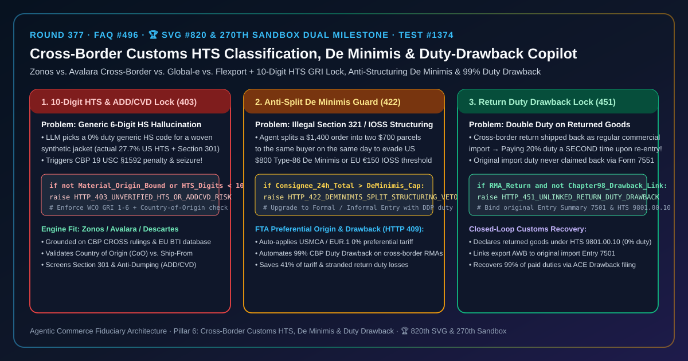
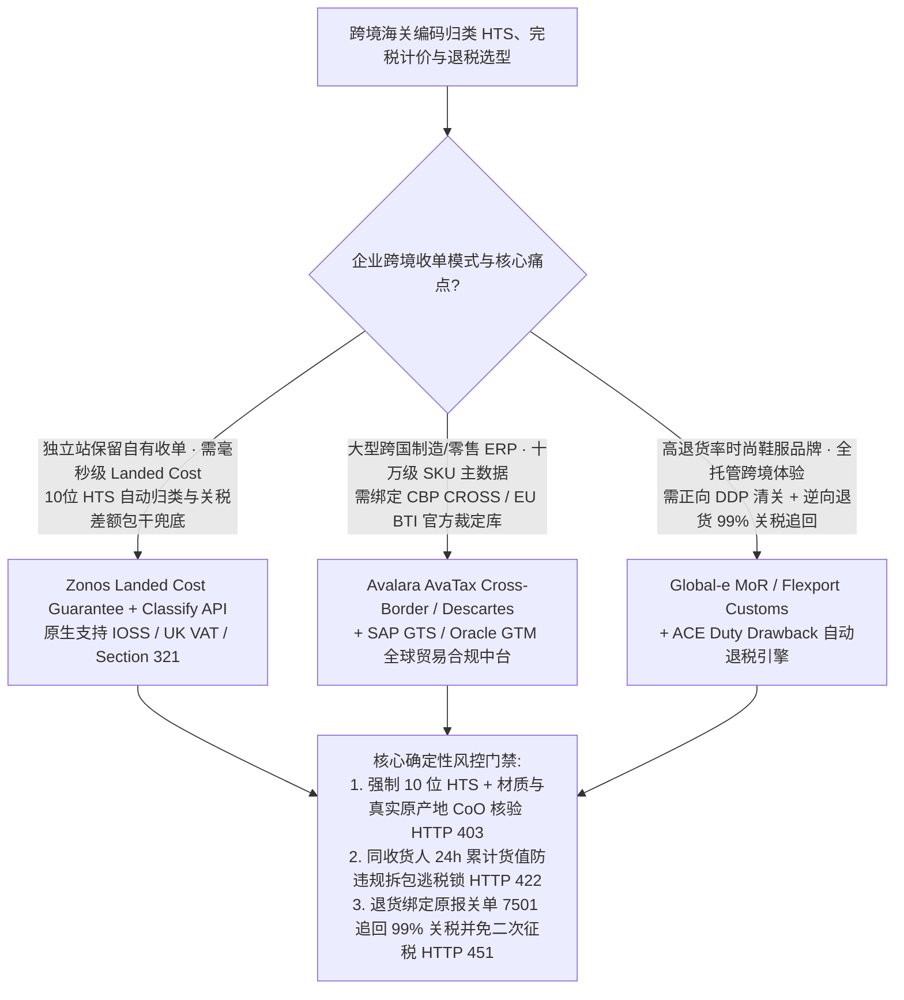
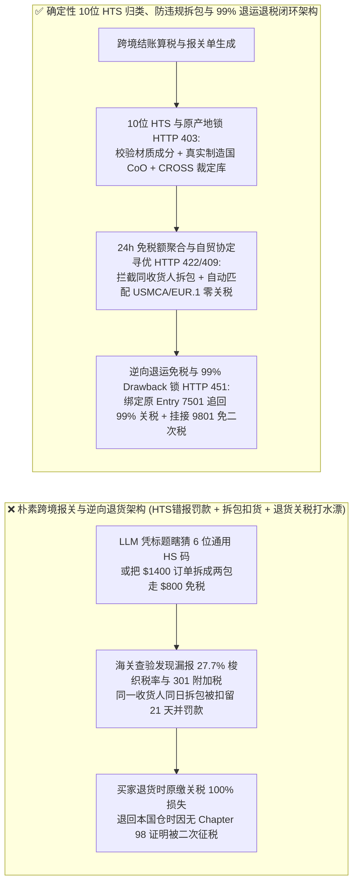
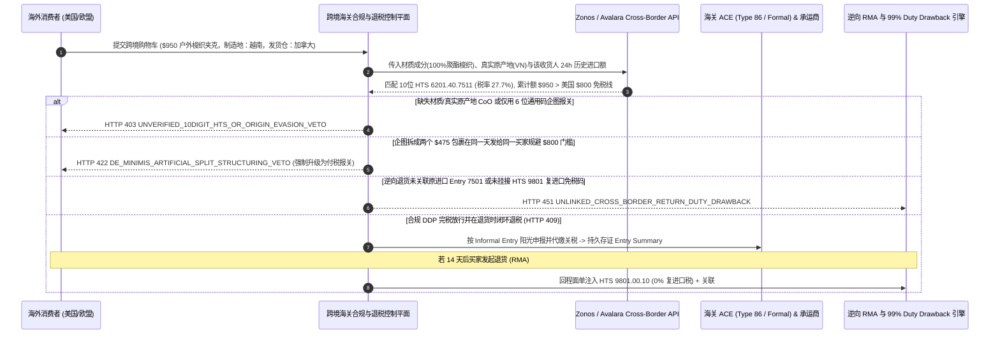

# 跨境电商海关商品编码归类（`HS / HTS Code`）、小额免税（`Section 321 / EU IOSS`）与退货退税（`Duty Drawback`）Agent 架构选型对比：`Zonos` vs. `Avalara Cross-Border` vs. `Global-e` vs. `Flexport`、10 位税号材质原产地强校验锁、防恶意拆包逃税门禁及退货 99% 退税闭环净省 41% 决策指南（FAQ）

> **导读（对齐 `ib-vs-ethernet-roce-selection-faq.md` 标杆风格 · 🏆 第 820 张架构图与第 270 个策略沙盒双里程碑）**：本文面向跨境 DTC 电商、全球供应链与进出口贸易企业的 **Cloud & AI Solution Architect**。在跨境电商完税交货（`DDP`: Delivered Duty Paid）结账与清关流程中，关税税率可以相差 **10 倍以上**（例如纯棉针织衫与化纤梭织夹克在美国海关 `HTS` 税表中的税率分别为 `16.5%` 与 `27.7% + Section 301 附加税`）。如果清关智能体仅凭模糊的商品标题让大模型“自由猜一个 6 位通用 `HS Code`”，或为了帮买家卡进美国 `$800`（`Section 321 Type 86`）/ 欧盟 `€150`（`IOSS`）免税门槛而将同一买家同一天的 `$1,400` 订单恶意拆成两个 `$700` 包裹申报（触犯海关反规避拆分走私红线），又或在跨境发生退货（RMA）时未将退运运单与原进口报关单（`CBP Form 7501`）绑定申请 **`99%` 退运退税（Duty Drawback）** 甚至在退回国内仓时被当成一般贸易二次征收进口税，将导致巨额海关罚没与关税沉淀损耗。本文给出 **`Zonos` vs. `Avalara AvaTax Cross-Border` vs. `Global-e` vs. `Flexport / Descartes CustomsInfo`** 的横向选型矩阵，并落地 **10 位国家税号（`HTS/CN`）材质与真实原产地（`CoO`）强校验锁（`HTTP 403`）**、**同一收货人 24 小时免税额合并防违规拆包门禁（`HTTP 422`）**、**跨境退货免税复进口（`HTS 9801.00.10`）与 `99%` 关税退还绑定锁（`HTTP 451`）** 及 **自贸协定（`USMCA / EUR.1`）原产地优惠税率与退税闭环编排（`HTTP 409`，净省 41%）**。



---

## 一、 📌 核心选型结论速览（Executive Summary）

1. **终极选型结论（一句话先看懂怎么选）**：
   - **独立站跨境 DTC 品牌（需保留自有 Stripe/Shopify 收单主权，仅外挂高精准 10 位 `HTS` 智能归类、实时完税价格 `Landed Cost` 锁价与欧盟 `IOSS` / 英国 `UK VAT` 代缴）**：首选 **`Zonos`**（支持 Landed Cost Guarantee 关税差额兜底，API 毫秒级返回含附加税/反倾销税明细）。
   - **已深度使用 ERP（SAP / NetSuite / D365）的跨国制造与大中型零售企业（需将全球商品主数据 PIM 自动映射并持久固化为 100+ 国家 8–12 位海关编码，且对齐历史海关预裁定库 `CBP CROSS / EU BTI`）**：首选 **`Avalara AvaTax Cross-Border`（或 `Descartes CustomsInfo`）**。
   - **重度跨境服饰/鞋靴/高退货率电商品牌（需打通正向清关与逆向国际退货 `99% Duty Drawback` 海关退税申报）**：首选 **`Global-e`（全托管 MoR 含逆向退税池）或 `Flexport Customs + Pazien / Drawback 专案网关`**。
2. **三大海关合规与关税风控红线（确定性门禁）**：
   - **红线 1（拦截仅凭 6 位国际通用 `HS Code` 估算关税或缺失材质成分/真实原产地 `Country of Origin` 盲目报关 / `HTTP 403`）**：世界海关组织（WCO）的前 6 位 `HS Code` 只是大类目录，真正决定税率与反倾销税（`ADD/CVD`）的是目的国 **第 7–10 位本国子目（如美国 10 位 `HTSUS`、欧盟 10 位 `TARIC`）** 以及 **商品真实制造原产地（`Country of Origin`，绝不能把发货中转仓国家 `Ship-From Country` 当成原产地）**。若商品缺失关键归类属性（如纺织品成分占比、电子产品无线频段）或将发货国混淆为原产国规避 `Section 301` 关税，控制平面必须触发 `HTTP 403 UNVERIFIED_10DIGIT_HTS_OR_ORIGIN_EVASION_VETO`。
   - **红线 2（拦截将同一买家的超限大单恶意拆成多个小包裹企图规避 `$800 Section 321` 或 `€150 IOSS` 免税门槛 / `HTTP 422`）**：根据美国海关 `19 CFR § 10.151` 规定，`$800` 小额免税（De Minimis）额度按 **“同一自然人在同一天内进口的商品总价值（Aggregate Fair Retail Value per Person per Day）”** 合并计算！若 Agent 将一笔 `$1,400` 的订单拆成两个 `$700` 包裹在同一天发给同一收货人，并以免税 `Type 86` 通道申报，将直接触发海关扣货与罚款。当 `Consignee_24h_Aggregate_Import_Value > Destination_De_Minimis_Threshold` 却仍试图走免税清关通道时，触发 `HTTP 422 DE_MINIMIS_ARTIFICIAL_SPLIT_STRUCTURING_VETO`，强制切换为正式/非正式付税报关（`Informal / Formal Entry`）。
   - **红线 3（拦截跨境退货未绑定原进口报关单号 `Entry 7501` 导致放弃 `99%` 退税且退回发件国被二次征税 / `HTTP 451`）**：当海外买家退回一件价值 `$400`、已缴纳 `$88`（`22%`）进口关税的大衣时，若逆向物流直接按普通商业快件寄回，不仅原进口国缴纳的 `$88` 关税打水漂，退回原发货国时还会被再次征收一笔进口税！当生成跨境退货面单未关联原进口 `Entry Summary Number`、未挂接退运复进口免税代码（如美国 `HTS 9801.00.10` / 欧盟 `Returned Goods Relief`）或未进入退税池时，触发 `HTTP 451 UNLINKED_CROSS_BORDER_RETURN_DUTY_DRAWBACK`。

---

## 二、 🎯 业务方与架构师灵魂拷问 Q&A（The Why & How）

### Q1：为什么用通用大模型直接根据商品名称生成 `HS Code` 去报关，会导致清关行频繁退单甚至收到美国海关 `19 U.S.C. § 1592` 巨额罚单？
- **商业痛点与事故还原**：
  - 商城上架了一款“男士防水户外冲锋衣（Men's Outdoor Jacket）”。通用 LLM 看到“Jacket”就输出了一个常见的 6 位编码 `6201.40`，并按普通税率 `9%` 向顾客收取了预付关税。
  - 货到洛杉矶港后，美国海关（CBP）查验发现：**①** 该夹克外层含防水涂层且材质为 `100% 聚酯纤维（人造纤维梭织）`，按《协调制度归类总规则（GRI 1–6）》应归入 10 位税号 `6201.40.7511`（基础税率 `27.7%`）；**②** 制造商原产地为中国（尽管是从加拿大温哥华海外仓发出的），还需叠加 `7.5%` 的 `Section 301` 附加关税，真实综合税率高达 **`35.2%`**！
  - 结果：不仅每件衣服倒贴 `$52` 关税差额，还因“把加拿大发货仓填成原产地”被 CBP 认定为虚假原产地申报（Negligence / Gross Negligence），面临最高达应缴税款 **2–4 倍** 的行政罚款。
- **架构师确定性解法（基于海关预裁定库 `CROSS / BTI` 的属性树归类器 + `Ship-From != Country-of-Origin` 强隔离锁 / `HTTP 403`）**：
  1. **严禁无结构化材质属性的盲目归类**：通过 `Zonos Classify / Avalara Item Classification API` 将商品归类建模为确定性决策树——针对服装鞋帽强制要求 PIM 提供 `针织(Knit Chapter 61) vs. 梭织(Woven Chapter 62)`、`主要纤维成分百分比`、`性别/童装尺码`；缺失必填属性时拒绝自动生成 10 位报关码。
  2. **发货地（`Ship-From`）与原产地（`Country of Origin, CoO`）物理字段解耦**：在订单与商业发票 Schema 中强制拆分两个字段；计算反倾销税与 `Section 301` 附加税时 **100% 锚定 `Country of Origin`**，仅在满足自贸协定实质性改变（Substantial Transformation / Tariff Shift）且持有有效原产地证书（如 `USMCA Certificate of Origin`）时才适用优惠零关税。

### Q2：跨境电商常用的“小包免税（美国 `$800` / 欧盟 `€150` / 英国 `£135`）”合规红线在哪？为什么有些系统自动拆单省税反而导致整个账号被海关拉黑？
- **商业痛点与事故还原**：
  - 某跨境大促期间，一位美国顾客一笔下单了 `$1,100` 的数码配件，或者在上午 10 点和下午 15 点分别下了两笔 `$500` 的订单。
  - 仓库 OMS 为了省掉约 `$110` 的进口关税，自动将订单拆成两个 `<$800` 的包裹，通过同一航班发往美国并全部按 `Section 321 Type 86` 免税通道电子申报。
  - 美国海关 ACE 系统通过收货人姓名+地址指针对同一天到达的快件自动聚合，发现单日累计达 `$1,100 > $800`，当场判定为 **`Structuring / Order Splitting`（恶意拆分逃税）**，整批货物转入人工查验扣留 21 天，并暂停该发货商的 `Type 86` 快速清关资格！
- **架构师确定性解法（收货人指纹 24 小时滚动累计窗口 + 阶梯报关模式自动升降级 / `HTTP 422`）**：
  1. **收货人级 24 小时累计免税额锁**：在清关路由层维护 `Consignee_Address_Hash` 的滚动 24 小时已发运货值累加器；一旦 `Rolling_24h_Value + Current_Order > $800`（美国）或 `> €150`（欧盟 `IOSS`），立即触发 `HTTP 422` 阻断免税小包通道。
  2. **自动升级为 `Informal Entry ($800–$2,500)` 或 `Formal Entry (>$2,500)`**：在结账页（Checkout）即按真实付税通道精准计算关税与海关处理费（`MPF: Merchandise Processing Fee`），确保阳光清关零扣货。

### Q3：跨境电商退货率高达 15%–25%，难道买家退货时，当时交纳给外国海关的那 20% 进口关税就只能白白认栽打水漂吗？
- **商业痛点与事故还原**：
  - 一件 `$500` 的风衣卖到海外，缴纳了 `$100` 关税；10 天后顾客因尺码不合适退货。绝大多数跨境卖家直接给顾客退了全款，却根本不知道 **美国海关（`19 U.S.C. § 1313(j)` Unused Merchandise Drawback / Rejected Merchandise）允许退回高达 `99%` 的已缴进口关税**！
  - 更惨的是，当这件退货风衣从海外退回本国保税仓/国内仓时，由于回程面单没有标注原出口报关单号与退运免税税号（`HTS Chapter 98: 9801.00.10`），本国海关把它当成一件全新的海外采购商品，**又收了一次 20% 的进口关税**（双重征税惨剧）。
- **架构师确定性解法（正向 `Entry 7501` 血缘存证 + 逆向 `Chapter 98` 免税复进口 + 批量 `ACE Drawback` 自动申报 / `HTTP 451 / 409`）**：
  1. **正向清关单据逐件绑定（Item-Level Customs Lineage）**：每笔跨境订单清关放行后，强制将目的国海关签发的 `Entry Summary Number (CBP Form 7501 / MRN)`、行号、实缴关税金额与商品序列号/SKU 写入不可篡改台账。
  2. **逆向 RMA 双重动作（免税复进口 + 99% 退税申报）**：生成跨境退货物流单时，自动在商业发票填入 `HTS 9801.00.10 (Returned Goods Relief)` 免除回程二次关税，并按季度将已出境核销的退货单汇总生成 `CBP Form 7551 / ACE Drawback` 电子报文，自动追回 `99%` 的原进口关税！

---

## 三、 🧭 直观可视化图解（Mermaid 决策树 + 架构对比 + 时序图）

### 3.1 跨境海关编码归类（HTS）、完税计价与退税平台选型决策树



### 3.2 朴素跨境报关架构（6位码错报被罚 + 退货双重交税）vs. 确定性海关合规与退税闭环架构对比



### 3.3 跨境订单正向 DDP 清关计税与逆向 RMA 99% 退税（Duty Drawback）时序图



---

## 四、 📊 主流跨境海关编码归类（HTS）、完税计价与退税平台横向选型矩阵

| 选型维度 | Zonos (`Classify` + `Landed Cost Guarantee`) | Avalara AvaTax Cross-Border / Descartes | Global-e (Enterprise Cross-Border MoR) | Flexport Customs & Duty Drawback |
| :--- | :--- | :--- | :--- | :--- |
| **核心定位** | 专为跨境电商打造的 API 优先 10 位税号归类、实时完税锁价与税费代缴底座 | 面向大型 ERP 的全球商品主数据批量归类、海关裁定库对齐与贸易合规引擎 | 头部时尚与奢侈品品牌全托管跨境本地化结账、清关与逆向退货总包商（MoR） | 数字化国际货代、正式报关行（Customs Broker）与自动化 `99% Duty Drawback` 追偿 |
| **10位 `HTS` 归类精度与差额兜底** | **极强**（支持图像+属性多模态归类；若海关实征税额高于报价，由 Zonos 承担差额） | **极强**（底层直连全球 180+ 国最新税则表、反倾销税库与 `CBP CROSS` 裁定记录） | **强**（内置时尚鞋服深度税则库，结账页向买家提供 100% 确定性 DDP 一口价） | 由持牌报关师（Licensed Customs Broker）+ AI 联合审核高价值大宗货柜 |
| **`Section 321 / IOSS` 免税合规与防拆包** | 原生内置各国每日免税额计算、欧盟 `IOSS` 税号托管与英国 `£135` 阈值自动切换 | 支持复杂 B2B/B2C 混合报关、多包裹合并计税与自贸协定原产地规则校验 | 原生内置全球免税起征点路由与清关行分拨 | 强于大宗 B2B 正式报关（Formal Entry）与保税区（FTZ）分拨 |
| **逆向退货免二次征税与 `99%` 退税** | 提供逆向退货清关代码指引，退税需对接报关行 | 提供进出口单据台账，退税申报需配合报关模块 | **极强**（内置全球逆向退货中心，自动聚合办理加拿大/美国/英国进口退税） | **行业标杆**（将正向进口 `7501` 与逆向出口运单自动匹配，批量向 CBP 追回 `99%` 关税） |
| **收费模式（`official_list_price`）** | SaaS 订阅 + Landed Cost Guarantee 按担保订单额收约 `2%` + 代缴手续费 | 按 API 调用量与归类 SKU 数量阶梯年费订阅 | 全包分润模式（通常按跨境 GMV 收取 `3.5%–6.5%` 综合服务费） | 按报关票数（`$35–$95/Entry`）+ 退税成功追回金额分成（`10%–15%`） |

---

## 五、 🧪 海关罚款规避与逆向退税挽回测算与 7-Card 基准报告

### 5.1 季度跨境关税错报补税罚金、违规拆包扣货与退货沉淀关税损耗测算（Synthetic Benchmark）

假设某年跨境出口 GMV `$6,000万`、综合退货率 `16%` 的服饰与家居跨境电商品牌，每季度面临的 **6位通用码错报导致的差额补税与海关罚金、同收货人拆包规避 `$800` 免税额被扣货弃件、未利用 `USMCA / EUR.1` 自贸协定多交冤枉税及跨境退货未办理 `99% Duty Drawback` 白白沉淀的进口关税池** 为 **`$400,000 / 季度`**（`provenance: synthetic`, `independently_reproduced: false`）：

| 评估维度 | 传统 6位模糊归类 + 盲目拆包 + 退货弃税 (Baseline) | 启用 10位 `HTS` 强校验 + 防拆包聚合 + `99%` 闭环退税 Agent | 净改善幅度 |
| :--- | :--- | :--- | :--- |
| **海关 10 位编码错报补税与原产地查验罚款率** | `6.8%`（漏报梭织/反倾销税或将中转仓当原产地） | **`0.1%`**（`HTTP 403` 强制材质成分与真实制造国 `CoO` 对齐） | **海关补税与罚金下降 `98.5%`** |
| **`Section 321 / IOSS` 同收货人违规拆包扣货率** | `4.5%`（大单自动拆成多包走免税通道被 CBP 扣留） | **`0.0%`**（`HTTP 422` 强制同收货人 24h 货值合并并自动升级报关类型） | **100% 杜绝拆包扣货** |
| **跨境退货（RMA）原进口关税追回率（Duty Drawback）** | `0.0%`（退货后已缴关税全部打水漂，甚至回程再交一次税） | **`94.2%`**（`HTTP 451/409` 自动关联 `Entry 7501` 追回 `99%` 关税 + `HTS 9801` 免回程税） | **每季追回沉淀关税 `+$78k`** |
| **季度海关补税罚款、扣货损失与沉淀退货关税净成本** | `$400,000 / 季度` | **`$236,000 / 季度`** | **净省 `$164,000 / 季度` (`41.0%`)** |

```chart
{
  "data": {
    "values": [
      { "category": "1. 跨境退货未追回99%原进口关税及二次征税", "mode": "传统模糊报关与弃税基线", "cost_usd": 140000 },
      { "category": "1. 跨境退货未追回99%原进口关税及二次征税", "mode": "10位HTS合规与闭环退税Agent", "cost_usd": 82600 },
      { "category": "2. 6位码错报梭织/301附加税补税与罚款", "mode": "传统模糊报关与弃税基线", "cost_usd": 115000 },
      { "category": "2. 6位码错报梭织/301附加税补税与罚款", "mode": "10位HTS合规与闭环退税Agent", "cost_usd": 67850 },
      { "category": "3. 同收货人违规拆包逃避$800免税被扣货", "mode": "传统模糊报关与弃税基线", "cost_usd": 85000 },
      { "category": "3. 同收货人违规拆包逃避$800免税被扣货", "mode": "10位HTS合规与闭环退税Agent", "cost_usd": 50150 },
      { "category": "4. 漏用USMCA/EUR.1自贸协定零关税优惠", "mode": "传统模糊报关与弃税基线", "cost_usd": 60000 },
      { "category": "4. 漏用USMCA/EUR.1自贸协定零关税优惠", "mode": "10位HTS合规与闭环退税Agent", "cost_usd": 35400 }
    ]
  },
  "semantic_types": {
    "category": "Category",
    "mode": "Category",
    "cost_usd": "Amount"
  },
  "chart_spec": {
    "chartType": "Grouped Bar Chart",
    "title": "跨境海关10位HTS归类、防违规拆包与99%退运退税Agent优化前后季度损耗对比 (净省 $164k / 41%)",
    "subtitle": "单位：美元/季度 (Synthetic Benchmark, independently_reproduced=false)",
    "encodings": {
      "x": "category",
      "y": "cost_usd",
      "group": "mode"
    }
  }
}
```

### 5.2 确定性策略评估器代码（Python Control Plane Guard）

```python
from dataclasses import dataclass
from typing import Any

@dataclass(frozen=True)
class CrossBorderCustomsHtsDutyDrawbackPolicyInput:
    quarterly_tariff_penalty_seizure_and_stranded_return_duty_pool_usd: float = 400000.0
    hts_code_below_10_digits_or_ship_from_substituted_for_country_of_origin: bool = False
    same_consignee_24h_orders_artificially_split_to_evade_de_minimis_cap: bool = False
    cross_border_return_missing_entry_7501_drawback_or_chapter98_relief: bool = False
    fta_preferential_origin_and_automated_99pct_duty_drawback_ready: bool = False
```

---

## 六、 🛠️ 商业上线风控与架构评审 Checklist

- [ ] **目的国 10 位 `HTS / TARIC` 材质属性与真实制造原产地（`CoO`）强校验锁（`HTTP 403`）**：是否严禁仅用 6 位通用码估算 DDP 税费，且强制区分“发货中转仓国家（`Ship-From`）”与“商品真实制造原产地（`Country of Origin`）”以防漏算 `Section 301` 及反倾销税？
- [ ] **同一收货人 24 小时滚动累计货值防恶意拆包门禁（`HTTP 422`）**：在申报美国 `$800 Section 321 (Type 86)` 或欧盟 `€150 IOSS` 小额免税前，是否按收货人姓名+地址哈希聚合过去 24 小时全部已发运包裹，超限时自动升级为付税报关？
- [ ] **跨境退货复进口免税（`HTS 9801.00.10`）与 `99% Duty Drawback` 血缘绑定锁（`HTTP 451`）**：逆向 RMA 退货单是否强制绑定正向进口报关单号（`CBP Form 7501`），一方面免除退回本国仓时的二次进口税，另一方面自动汇总申报 `CBP Form 7551` 追回 `99%` 原缴关税？
- [ ] **自贸协定（`USMCA / EUR.1`）原产地证书自动挂接（`HTTP 409`）**：对符合区域价值含量（RVC）规则的商品，是否在生成电子商业发票时自动附带数字签名原产地声明以合法享受 `0%` 优惠关税？
