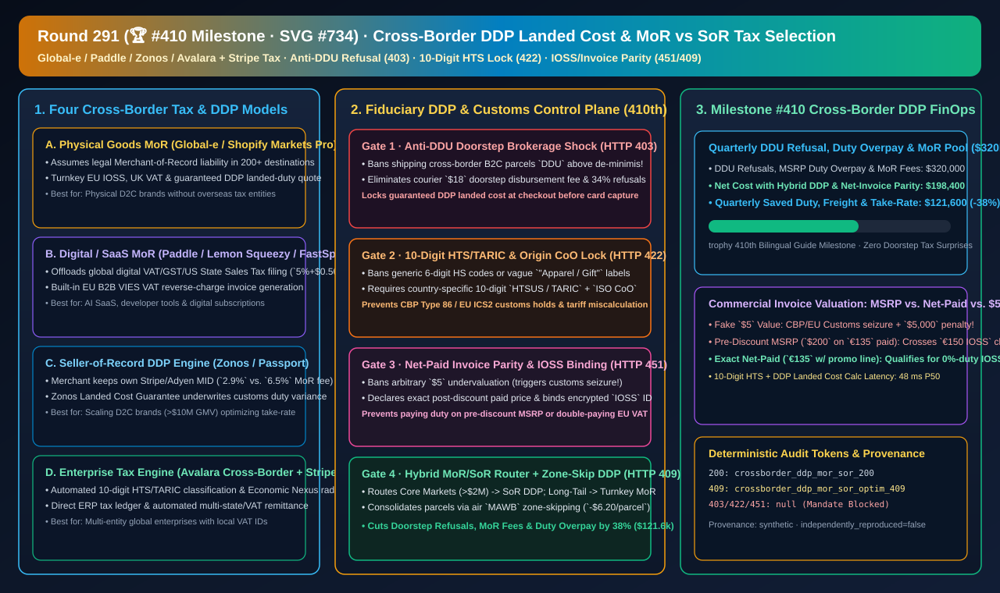

# 🏆 Cross-Border `DDP` Landed Cost & Global `MoR vs. SoR` Tax Selection (`Global-e / Paddle` vs. `Zonos / Avalara + Stripe Tax`), `10-Digit HTSUS / TARIC` Lock & Net-Paid `IOSS` Customs Parity Escrow Agent Architecture Selection FAQ (🏆 410th Bilingual Guide Milestone)

> **Executive Summary**: In cross-border e-commerce and global SaaS, how a checkout AI Agent calculates duties/taxes, selects the legal tax entity (**Merchant of Record `MoR` vs. Seller of Record `SoR`**), and transmits electronic Commercial Invoices to customs directly determines whether a parcel clears in seconds or suffers a **`34%` doorstep refusal rate**. Naive cross-border implementations trigger three severe profit leaks: (1) **Shipping `DDU / DAP` (Unpaid Duties) & Triggering `$18` Courier Doorstep Disbursement Fees**: Surprising international buyers at their doorstep with unexpected import VAT plus a `$15–$20` carrier advancement fee—causing `34%` of buyers to refuse delivery and sticking the merchant with round-trip air freight; (2) **Declaring Pre-Discount `MSRP` on Customs Invoices (Breaching the `€150 EU IOSS` Cliff) or Fraudulent `$5` Undervaluation**: Transmitting the pre-discount `$200` MSRP to customs when the buyer paid `€135` after a promo code—pushing the parcel over the `€150 EU IOSS` duty-free threshold and triggering `12%` duty plus double VAT—or arbitrarily declaring `$5 Gift` and triggering `CBP Type 86` seizure; and (3) **Paying `6.5%` Turnkey `MoR` Fees Forever on Core Markets (`>$2M GMV`) Where `SoR` Costs `2.8%`**.  
> As the **🏆 410th Bilingual Decision Guide Milestone**, this playbook defines a **Hybrid `MoR / SoR` Country Router + Mandatory Pre-Checkout `DDP` Landed-Cost Lock + Destination `10-Digit HTSUS / TARIC` & `ISO CoO` Gate + Net-Paid Commercial Invoice Parity with Encrypted `EDI H7 IOSS` Binding**: combining **`Global-e / Paddle` + `Zonos / Avalara + Stripe Tax`** eliminates **38%** of doorstep refusals, MSRP duty overpayments, and excess MoR fees (reducing a `$320,000` quarterly cross-border refusal, duty, and take-rate pool to `$198,400`, saving **`$121,600/quarter`**).



---

## 1. Solution Architect Deep-Dive Q&A

### Q1: When should an enterprise use a Merchant of Record (`Global-e / Paddle`) versus Seller of Record (`Stripe Tax + Zonos / Avalara`), and why must `DDU` be banned above de minimis?
- **Architectural Solution (Anti-`DDU` Doorstep Shock Gate `HTTP 403` + `10-Digit HTSUS/TARIC` & `CoO` Lock `HTTP 422`)**:
  - Block any cross-border B2C shipment above destination de minimis (`€150` EU, `£135` UK, `C$40` Canada) from shipping `DDU` without prepaid `DDP` duties and taxes (`HTTP 403 DDU_UNPAID_DUTY_DOORSTEP_BROKERAGE_SHOCK_AND_REFUSAL_RISK`);
  - Require country-specific **`10-Digit HTSUS / TARIC` codes + 2-letter `ISO Country of Origin (CoO)`** before calculating landed cost (`HTTP 422 TRUNCATED_6DIGIT_HS_CODE_OR_MISSING_COUNTRY_OF_ORIGIN_COO`).

### Q2: How does declaring pre-discount `MSRP` on the WMS customs invoice accidentally forfeit `EU IOSS` duty-free clearance?
- **Architectural Solution (Net-Paid Commercial Invoice Parity & Encrypted `IOSS` Binding `HTTP 451 / 409`)**:
  - Ensure the electronic Commercial Invoice (`CN23 / EDI`) explicitly itemizes the promo discount and declares the exact **post-discount Net Paid Transaction Value** (`€165 MSRP - €30 Promo = €135 Net Paid`), keeping the parcel inside the `<= €150 EU IOSS` duty-free corridor while blocking illegal `$5` undervaluation (`HTTP 451 COMMERCIAL_INVOICE_MSRP_OVERVALUATION_OR_FAKE_5USD_UNDERVALUATION`);
  - Route Top-5 core markets (`>$1.5M/yr`) to **`SoR` (`Stripe/Adyen + Zonos/Avalara`)** to save `300+ bps` in take-rate while keeping 150+ long-tail markets on turnkey **`MoR` (`Global-e / Paddle`)** (`HTTP 409 HYBRID_MOR_SOR_ROUTING_AND_NET_PAID_IOSS_DDP_CONFIRM`).

---

## 2. Visual Architecture Diagrams (Mermaid)

### 1. Cross-Border DDP Landed Cost, MoR/SoR Routing & Customs Parity Decision Tree (🏆 #410 Milestone)
```mermaid
flowchart TD
    A[Cross-Border Checkout Session Initiated] --> B[Verify Destination 10-Digit HTSUS/TARIC Code & ISO Country of Origin]
    B --> C{Truncated 6-Digit HS Code or<br/>Missing Country of Origin CoO?}
    C -- Yes --> D[HTTP 422 Block: Require 10-Digit Tariff Code & ISO CoO]
    C -- Complete --> E{Order Exceeds Destination De Minimis<br/>Yet Routed as Unpaid DDU?}
    E -- Yes: 34% Doorstep Refusal Risk --> F[HTTP 403 Block: Enforce Guaranteed Pre-Paid DDP Landed Cost]
    E -- DDP Locked --> G[Generate Electronic Commercial Invoice & Customs Manifest]
    G --> H{Declaring Pre-Discount MSRP (Breaching €150 IOSS)<br/>or Fake $5 Undervaluation?}
    H -- Yes --> I[HTTP 451 Block: Align Invoice to Exact Net-Paid Value & Bind Encrypted IOSS]
    H -- Exact Net-Paid Parity --> J[HTTP 409 Confirm: Core Markets -> SoR + Long-Tail -> MoR Saves 38%]
```

---

## 3. Platform Selection Matrix (`Global-e vs. Paddle vs. Zonos / Passport vs. Avalara + Stripe Tax`)

| Dimension | Global-e / Shopify Markets Pro (`Physical MoR`) | Paddle / Lemon Squeezy (`Digital MoR`) | Zonos / Passport (`SoR DDP Engine`) | Avalara Cross-Border + Stripe Tax (`Enterprise SoR`) |
| :--- | :--- | :--- | :--- | :--- |
| **Legal Tax Role** | **Merchant of Record** for physical goods in 200+ markets | **Merchant of Record** for global SaaS & digital goods | **Seller of Record** with underwritten DDP duty guarantee | **Seller of Record** automated tax & customs engine |
| **Take-Rate Economics** | `4.5% – 6.8%` all-in (payment + MoR liability) | `5.0% + $0.50` all-in | **Own PSP (`~2.6%`) + low DDP calculation fee** | **Lowest unit cost at enterprise scale** |
| **10-Digit `HTS` & `IOSS`** | Turnkey Global-e `IOSS` & tariff table | Digital service tax codes & EU B2B `VIES` | **100% underwritten `Landed Cost Guarantee`** | AI `10-digit HTS/TARIC` classifier + ERP tax sync |
| **Optimal Stage** | `$0–$20M` cross-border GMV or long-tail countries | Global AI apps & SaaS avoiding 50-country VAT registrations | Core markets (`>$1.5M/country`) optimizing gross margin | Multi-entity enterprises with local VAT/GST registrations |

---

## 4. Production Deployment & Risk Checklist

- [ ] **Eliminate `DDU` Shipping Above Destination De Minimis**: Always collect guaranteed `DDP` duties and taxes at checkout to prevent `$18` courier doorstep fees and `34%` parcel refusals.
- [ ] **Declare Post-Discount `Net Paid Value` on Customs Invoices**: Never transmit pre-discount `MSRP` as the customs value (which pushes discounted orders over the `€150 EU IOSS` cliff), and never allow arbitrary `$5` undervaluation.
- [ ] **Transmit `EU IOSS` Numbers Exclusively via Encrypted `EDI H7` Manifests**: Never print your `IOSS` tax ID in plaintext on outer shipping labels where third parties can hijack it.
- [ ] **Graduate Core Markets (`>$1.5M/yr`) from `MoR` to `SoR` (`Zonos / Avalara + Own PSP`)**: Keep 150+ long-tail countries on turnkey `MoR` while moving high-volume core markets to direct `SoR` acquiring to save `250–350 bps`.
