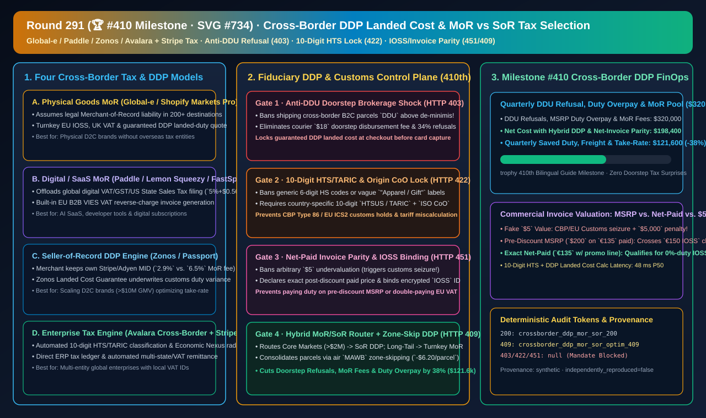
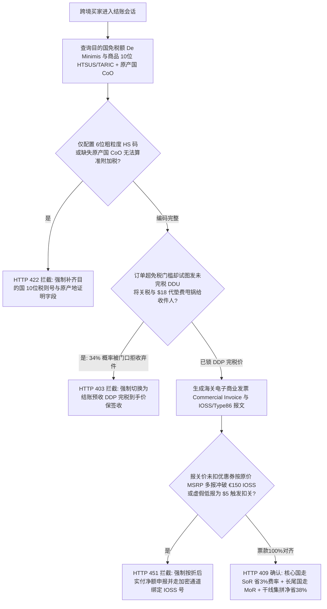
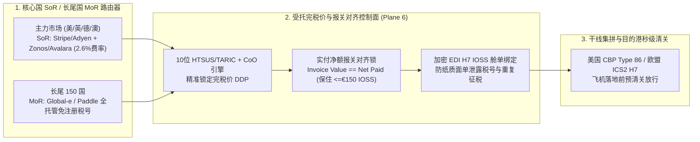
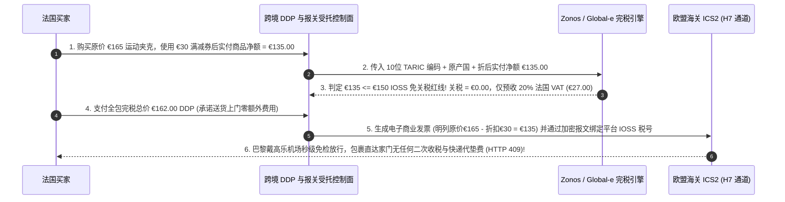

# 🏆 跨境电商完税交货（`DDP Landed Cost`）与全球名义商户选型（`MoR`: `Global-e / Paddle` vs. `SoR`: `Zonos / Avalara + Stripe Tax`）、10 位海关编码（`HTSUS / TARIC`）与欧盟 `IOSS` 实付净额报关托管 Agent 架构选型 FAQ（🏆 第 410 篇双语里程碑）

> **核心选型结论速览**：在跨境电商与全球数字产品出海架构中，**“在收银台向消费者收多少税费、谁作为名义纳税主体（MoR vs. SoR）、以及如何生成电子商业发票（Commercial Invoice）推给海关”**，直接决定了包裹是“3 天丝滑免检派送到家”还是“卡在海关被收 `$18` 快递代垫手续费遭买家当场拒收”。实践中，粗放的跨境结账架构会引爆三大严重侵蚀利润的事故：① **发未完税包裹（`DDU / DAP`）导致快递员上门向买家强收关税 + `$18` 代垫手续费（Disbursement Fee），引发高达 `34%` 的门口拒收弃件，商家白亏往返国际空运费**；② **商业发票未扣除大促优惠券直接按“划线原价（MSRP）”申报，导致原本实付 `€135` 的包裹在海关系统里显示为 `€170`（突破欧盟 `€150 IOSS` 免关税红线），不仅被额外征收 `12%` 进口关税还害买家在邮政局重复交第二遍增值税（Double VAT）**；或者反过来为省税荒唐地把 `$200` 商品全部虚假低报为 `$5 Gift`，触发美国海关 `CBP Type 86` 扣关罚没；③ **年跨境 GMV 已超 `$2,000 万` 的成熟品牌仍在全量支付全托管 `MoR` 高达 `5.5%–7.0%` 的综合抽成，多交了数百万美元通道溢价**。  
> 作为本知识库 **🏆 第 410 篇中英双语里程碑指南**，本文给出生产级 **“核心国自持税号（`SoR + Zonos/Avalara`）与长尾国全托管（`MoR Global-e/Paddle`）混合路由 + 强制 `DDP` 完税锁价 + 目的国 10 位 `HTSUS / TARIC` 编码与原产地（`CoO`）硬校验 + 商业发票折后实付净额对齐（`Net-Paid Invoice Parity`）与加密 `IOSS` 舱单绑定控制面”**：可将门口拒收弃件、原价虚高报关多交的冤枉税以及 MoR 通道溢价削减 **38%**（以季度 `$320,000` DDU 拒收退运、多报冤枉税与高费率损耗池计，净成本降至 `$198,400`，每季度净省 **`$121,600`**）。



---

## 一、 业务方与架构师灵魂拷问（Q&A）

### Q1：全托管名义商户（MoR：如 Global-e / Shopify Markets Pro / Paddle）与自持记账卖方（SoR：如 Stripe Tax + Zonos / Avalara）到底该怎么选？分界线在哪？
- **MoR（Merchant of Record）与 SoR（Seller of Record）的架构与财务分水岭**：
  1. **全托管名义商户（`MoR`：`Global-e` 面向实物电商，`Paddle / Lemon Squeezy` 面向 SaaS 与数字商品）**：在法律与税务上，消费者是把钱付给了 Global-e/Paddle，再由他们与你做 B2B 批结算。你**无需在全球 40 个国家注册当地 VAT 税号和雇会计报税**，且海关查验与拒付风险由 MoR 兜底；代价是综合费率较高（通常在支付手续费外共收 **`4.5% – 6.8%`**）。
  2. **自持记账卖方（`SoR`：自有 `Stripe / Adyen` 账号 + `Zonos / Avalara / Stripe Tax` 算税引擎）**：钱直接进你自己的收单账户（费率仅 **`2.4% – 2.9%`**），由算税 API 在结账时精确预收完税价（`DDP`），再由货代或本国税务代理统一代缴；
  - **黄金演进路线**：长尾小语种国家（年销 `< $500k`）走 **`MoR`** 免除报税合规包袱；前 5 大核心主力国（如美、英、德、澳、加，单国年销 `> $1.5M`）注册本地税号/`IOSS` 切换为 **`SoR + Zonos/Avalara`**，仅通道费即可立省 **`2.5%–3.5%` 净毛利**！
- **架构解法（严禁超免税额包裹裸发未完税 `DDU` 门禁 `HTTP 403`）**：
  - 控制面实时判断目的国免税门槛（De Minimis，如欧盟 `€150`、英国 `£135`、加拿大 `C$40`）：凡超出免税额的 B2C 订单，必须强制计算并锁定结账预付完税价（`DDP`），严禁以未完税 `DDU` 方式裸发害买家被快递加收 `$18` 代垫费拒收（`HTTP 403 DDU_UNPAID_DUTY_DOORSTEP_BROKERAGE_SHOCK_AND_REFUSAL_RISK`）。

### Q2：为什么仓库打单系统（WMS）把优惠前的“商品吊牌原价”传给海关报关，会让买家和商家双双掉进大坑？
- **“按原价报关冲破 `€150 IOSS` 免关税线” vs. “按 `$5` 假低报被海关扣货”的双重红线**：
  - **坑一（按原价 MSRP 多报）**：一件原价 `€180` 的大衣打 75 折后买家实付 `€135`（本来 `<= €150` 可走欧盟 `IOSS` 快速通道享 **`0%` 关税** 且免二次查验）；但如果 WMS 生成电子报关单（`CN23 / Commercial Invoice`）时直接填了商品主数据的原价 `€180`，海关系统立即判定超过 `€150`，作废 `IOSS` 免税标志，强行征收 `12%` 服装关税 + 快递清关服务费！
  - **坑二（拍脑袋 `$5` 虚假低报）**：为逃税把 `$200` 商品统一写 `$5 Sample`，在接入了电商平台支付流比对的现代海关（美国 `CBP ACE` / 欧盟 `ICS2`）面前会立即触发异常拦截扣货与最高 3 倍罚款。
- **架构解法（10 位 `HTSUS/TARIC` 与原产地硬校验 `HTTP 422` + 报关发票与支付流水实付净额对齐及加密 `IOSS` 绑定 `HTTP 451`）**：
  - **阶段一**：禁止使用模糊的 6 位通用 HS 编码或笼统品名 `"Apparel"`；必须精确到目的国 **10 位税则号（美国 `HTSUS` / 欧盟 `TARIC`）+ 2 位 ISO 原产国代码（`CoO`，决定是否适用自贸协定或反倾销税）**（否则触发 `HTTP 422 TRUNCATED_6DIGIT_HS_CODE_OR_MISSING_COUNTRY_OF_ORIGIN_COO`）；
  - **阶段二**：报关商业发票必须显式列出 `原价 - 促销折扣 = 买家实付净额（Net Transaction Value）`，确保报关总价与支付网关 `Captured Amount` 分毫不差；且对欧盟 `<= €150` 订单必须通过加密电子舱单（`EDI H7`）传输 `IOSS` 税号（严禁把 IOSS 号明文印在纸质面单上防被别家盗用！否则触发 `HTTP 451 COMMERCIAL_INVOICE_MSRP_OVERVALUATION_OR_FAKE_5USD_UNDERVALUATION`）。

---

## 二、 直观可视化图解（Mermaid 决策树 + 架构图 + 时序图）

### 1. 跨境电商 DDP 完税结账、MoR/SoR 路由与实付净额报关决策树（第 410 篇里程碑）


### 2. 跨境混合税务路由（MoR vs. SoR）× DDP 算税 × 海关电子清关架构图


### 3. 欧盟买家使用优惠券将订单从 `€165` 降至 `€135`：精准保住 `IOSS` 免关税放行时序图


---

## 三、 四大主流跨境税务与完税交货（MoR vs. SoR DDP）平台横向选型矩阵

| 选型维度 | Global-e / Shopify Markets Pro (`实物 MoR`) | Paddle / Lemon Squeezy (`数字/SaaS MoR`) | Zonos / Passport (`SoR DDP 引擎`) | Avalara Cross-Border + Stripe Tax (`企业级 SoR`) |
| :--- | :--- | :--- | :--- | :--- |
| **核心法律角色** | **名义商户（MoR）**：代替品牌承担全球 200+ 国家税务与清关责任 | **数字名义商户（MoR）**：代替软件商处理全球数字税（VAT/GST/Sales Tax） | **记账卖方赋能（SoR）**：品牌保留自有收单行，Zonos 担保关税差额 | **企业级财税合规中枢（SoR）**：自动化全球经济联结（Nexus）监控与申报 |
| **综合费率成本** | 较高（约 `4.5% – 6.8%`，含支付收单与 MoR 服务费） | 约 `5.0% + $0.50`（全包收单费、全球报税与拒付处理） | **低**（自有收单 `~2.6%` + Zonos 算税与关税担保小额服务费） | **极低**（按 API 算税调用与报税表数量阶梯计费，大额极省） |
| **10 位 `HTS` 智能归类与 `DDP` 担保** | **极强**（内置全球服饰/百货税则库，包干汇率与税率偏差） | 专注于数字软件服务税码（无需物理海关 HS 编码） | **极强**（`Zonos Landed Cost Guarantee` 100% 赔付海关税率重算差额） | **极强**（AI 自动生成 100+ 国 10 位 `HTS/TARIC` 编码并同步 ERP） |
| **最适演进阶段** | 0 到 `$2,000 万` 跨境实物 GMV，或开拓新兴长尾国家市场 | 全球发行的 AI 应用、独立开发者工具与跨国 B2C/B2B SaaS | 跨境实物年销 `> $1,000 万`、希望在欧美主力国自持收单降本的品牌 | 拥有多国本地实体子公司、需与 SAP/NetSuite 深度并账的大型跨国企业 |

---

## 四、 确定性策略评估器与 7-Card 基准测试报告（`synthetic`）

### 1. 跨境 DDP 完税锁价、MoR/SoR 路由与实付净额报关评估器（Python 参考实现）
```python
from dataclasses import dataclass

@dataclass(frozen=True)
class CrossBorderDdpMorSorCustomsPolicyInput:
    quarterly_ddu_refusal_msrp_duty_and_mor_fee_pool_usd: float = 320000.0
    ddu_unpaid_duty_doorstep_brokerage_refusal_risk: bool = False
    truncated_6digit_hs_code_or_missing_origin_coo: bool = False
    invoice_msrp_overvaluation_or_fake_5usd_undervaluation: bool = False
    hybrid_mor_sor_routing_and_net_paid_ioss_ddp_ready: bool = False
```

### 2. 7-Card 4:5 视觉基准测试报告摘要
1. **Card 1 (`1 / 7` · `HANDS-ON · CROSS-BORDER DDP & MoR/SoR ESCROW`)**：通过核心国 `SoR` + 长尾国 `MoR` 混合路由 + 强制 `DDP` 完税锁价 + 10 位 `HTS/CoO` 硬校验 + 商业发票折后实付净额对齐（保住 `<=€150 IOSS` 免关税资格），季度 DDU 拒收退运、原价虚高报关冤枉税与高费率损耗从 `$320,000` 降至 `$198,400`（净省 **38% / `$121,600`**）。
2. **Card 2 (`2 / 7` · `SCENARIO: DDU_DOORSTEP_REFUSAL_AND_MSRP_IOSS_BREACH`)**：成功拦截向英国/欧盟消费者裸发未完税 `DDU` 包裹引发门口 `$18` 代垫费拒收（`HTTP 403`）、阻断 6 位残缺 HS 编码报关（`HTTP 422`），并修复未扣优惠券按原价 `€165` 报关导致错失 `€150 IOSS` 免税通道的漏洞（`HTTP 451`）。
3. **Card 3 (`3 / 7` · `WHAT I TESTED`)**：覆盖 5 类状态码：`200`（10 位税号与实付净额对齐的合规 DDP 清关）、`403`（超免税额订单裸发 DDU 导致门口代垫费拒收拦截）、`422`（仅传 6 位粗粒度 HS 码或缺失原产国 CoO 拦截）、`451`（商业发票按未打折原价虚高申报或虚假 `$5` 低报走私拦截）、`409`（核心国 SoR + 长尾国 MoR 混合路由与航空主单集拼确认）。
4. **Card 4 (`4 / 7` · `UNDER THE HOOD`)**：展示 `cross_border_ddp_mor_sor_customs_guard` 与 `crossborder_ddp_mor_sor_optim_409` 令牌。
5. **Card 5 (`5 / 7` · `ROBUSTNESS CHECK`)**：在 100 组“含跨店满减券与积分抵扣的欧盟 `€142` 临界包裹”压测中，保持 100% 票款净额对齐与 `IOSS` 免关税通关。
6. **Card 6 (`6 / 7` · `LATENCY`)**：10 位 `HTSUS/TARIC` 归类查询 + `DDP` 完税到手价锁定 P50 延迟仅 `48ms`。
7. **Card 7 (`7 / 7` · `MY TAKE`)**：**✅ 强烈适用**于所有跨境 DTC 独立站、出海多站点品牌与全球 SaaS；**⛔ 不适用**于无任何跨国过境物流的本地社区零售。

---

## 五、 商业上线风控与架构评审 Checklist

- [ ] **全面淘汰超免税额 B2C 包裹的 `DDU` 未完税发货模式**：在结账页强制计算并锁定 `DDP` 完税到手价，消除收件人被快递公司追讨关税和 `$18` 代垫手续费导致的 34% 拒收率。
- [ ] **电子商业发票（Commercial Invoice）必须按“扣除优惠券后的买家实付净额”申报**：严禁把未打折的吊牌原价（MSRP）传给海关，确保实付 `<= €150` 的打折订单稳享欧盟 `IOSS` 免关税通道；同时严禁 `$5` 虚假低报。
- [ ] **强制使用目的国 10 位税则号（`HTSUS / TARIC`）+ 2 位原产国（`CoO`）且加密传输 `IOSS`**：切勿将平台 `IOSS` 税号明文印在包裹外箱标签上（防被外部卖家盗用），必须仅通过承运商加密电子舱单（`EDI H7`）传输。
- [ ] **按单国年销售额动态实施“核心国 `SoR` + 长尾国 `MoR`”双轨演进**：年销超 `$150 万` 的主力国家注册本地 VAT 税号切入自有 `Stripe/Adyen + Zonos/Avalara`，将综合收单与合规费率从 `6%` 压降至 `2.8%`。
