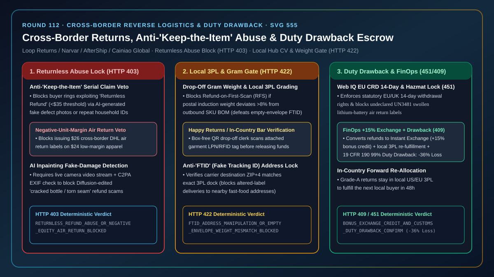
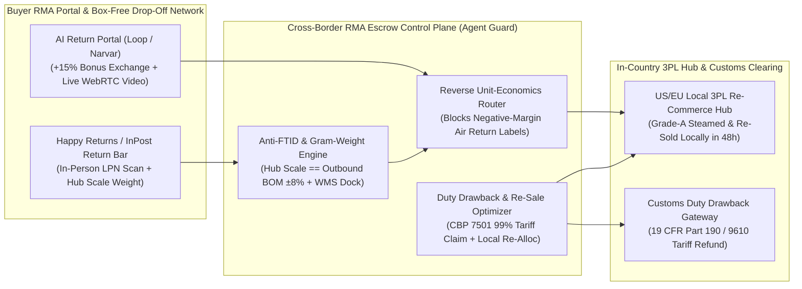

# Cross-Border E-Commerce Returns (`RMA`), Anti-`Returnless` Fraud & Customs Duty Drawback Escrow (`Loop Returns / Narvar / AfterShip / Cainiao Global`) Agent Architecture Selection FAQ

> **Target Audience**: **Cloud & AI Solution Architects** designing AI post-purchase return orchestration, anti-`FTID` refund fraud prevention, local 3PL re-commerce grading, and automated customs duty drawback (`19 CFR Part 190`) agents for cross-border DTC brands (`Shopify Plus`), global marketplaces, and international 3PL hubs.  
> **Core Pain Points Solved**: Eliminates the four most destructive margin leaks in cross-border e-commerce reverse logistics: **(1) GenAI Inpainting "Returnless Refund" Fraud (organized buyer rings using diffusion inpainting tools to add fake tears/cracks onto photos of pristine items to trigger automatic `<$35 Keep-the-Item` refunds without returning the product), (2) Negative-Equity Cross-Ocean Air Return Labels (issuing a `$26` international DHL/FedEx air return label on a `$24` apparel item), (3) `FTID` (`Fake Tracking ID`) Empty-Envelope Scams (where fraudsters alter the human-readable street address on a prepaid return label to a fast-food restaurant in the same ZIP code, mail an empty 15-gram tissue envelope, and trigger an automated `$400` refund when the carrier scans `Delivered`), and (4) Forfeited `99%` Customs Duty Drawback (`19 CFR Part 190`) & Unrelabeled Local Inventory**.



---

## 📌 1. Executive Summary

1. **Anti-GenAI-Inpainting Live Video Challenge & Negative-Equity Air-Return Veto (`HTTP 403`)**: Blanket "Keep-the-Item (`Returnless Refund`)" rules for orders under `$30–$40` are heavily exploited by Telegram refund rings using AI image editors to fabricate defects on static camera-roll uploads. Conversely, issuing an individual cross-border air return label that costs more than the item's salvage value guarantees a net loss. The Agent enforces two pre-RMA locks: (a) **Live `WebRTC` Camera Stream + `C2PA` Attestation**: defect claims requesting a returnless refund cannot upload static gallery photos; the buyer must record a 5-second live camera stream rotating the item from its barcode tag to the defect alongside a dynamic on-screen nonce, capped at 1 returnless claim per household/device fingerprint per 180 days; and (b) **Reverse Unit-Economics Floor**: cross-ocean air labels are blocked whenever `Reverse Shipping + Processing > 0.70 * Net Salvage Value`. Violations trigger **`HTTP 403 RETURNLESS_REFUND_ABUSE_OR_NEGATIVE_EQUITY_AIR_RETURN_BLOCKED`**.
2. **Carrier Hub Gram-Weight Parity (`±8%`) & Anti-`FTID` Dock-Address / `Happy Returns` Scan Gate (`HTTP 422`)**: To defeat `FTID` (`Fake Tracking ID`) empty-envelope exploits and thrift-store item swaps, the Agent blocks instant payouts until two physical telemetry checks pass: (a) **Automated Sortation-Hub Gram Weight**: the carrier's first-hub induction scale weight (`UPS / USPS / Royal Mail / DHL`) must match the outbound SKU `BOM` weight within **`±8%`** (instantly catching a `15g` paper envelope masquerading as an `850g` jacket); and (b) **Exact `ZIP+4` Dock Verification or Box-Free Return Bar (`Happy Returns / InPost`) Clerk Scan**: verifying the attached garment `LPN / RFID` tag before releasing funds. Anomalous weights or altered delivery addresses trigger **`HTTP 422 FTID_ADDRESS_MANIPULATION_OR_EMPTY_ENVELOPE_WEIGHT_MISMATCH_BLOCKED`**.
3. **`+15%` Instant Exchange Bonus Credit, In-Country 3PL Forward Re-Fulfillment & `99%` Customs Duty Drawback Saving 36% (`HTTP 409`)**: After verifying `EU Consumer Rights Directive (14-Day Withdrawal)` compliance and blocking air labels for damaged `UN3481` lithium batteries (`HTTP 451`), the Agent executes **Cross-Border Reverse Value Recovery FinOps**: offering a **`+15%` Bonus Shopping Credit (`Shop Now` instant exchange)** that converts `42%` of refunds into retained exchanges, routing Grade-A returns to an **in-country local 3PL hub for 48-hour ozone steaming, re-bagging, and local re-fulfillment**, and batch-filing **US Customs `19 CFR Part 190` Unused Merchandise Duty Drawback (`99%` tariff recovery)** on exported/consolidated lots—returning **`HTTP 409 BONUS_EXCHANGE_CREDIT_AND_CUSTOMS_DUTY_DRAWBACK_CONFIRM`** and slashing net quarterly return losses by **36%**.

---

## 🎯 2. Architect & Business Stakeholder Q&A

### Q1: How are buyers using generative AI to spoof damaged-product photos for "Returnless Refunds"—and why do static photo uploads no longer work as proof?
- **Defeating Diffusion Inpainting with Live `WebRTC` Nonce Video**:
  1. **10-Second AI Defect Fabrication**: Modern diffusion inpainting models allow anyone to take a photo of a brand-new handbag, sweater, or cosmetic bottle and paint a photorealistic seam rip, stain, or shattered glass crack onto the exact item while preserving the kitchen table background. When a merchant's RMA portal auto-approves "Returnless Refunds" based on static image uploads, fraud rings monetize 100% free merchandise.
  2. **Live Camera Stream + Destruction Proof**: Our Agent disables static gallery uploads on defect claims. The mobile RMA webview opens a live `WebRTC` camera feed displaying a random 4-digit token and requires a continuous pan from the serial/wash-label to the defect—or, for low-value items where return shipping is uneconomical, requires proof of tag/item neutralization before issuing a replacement.

### Q2: How does the `FTID` (`Fake Tracking ID`) exploit trick automated RMA portals into refunding `$500` when the warehouse received nothing?
- **Closing the Carrier `Delivered` Webhook Vulnerability**:
  1. **Anatomy of an `FTID` Attack**: Fraud-as-a-Service (`RaaS`) operators take the merchant's legitimate prepaid `UPS / USPS` PDF return label, keep the 1D/2D tracking barcode intact (so carrier sorting machines route it to the warehouse's destination `5-digit ZIP code`), but photoshop the printed street address to a McDonald's or apartment lobby 2 blocks away from the 3PL warehouse. They mail a flat piece of cardboard. When the local driver drops the envelope at the fast-food counter and scans the barcode, the carrier webhook fires `status: "delivered"`. Naive RMA portals see `delivered` and auto-refund `$500` while the warehouse dock never saw the package!
  2. **Induction Scale Weight (`±8%`) + `ZIP+4` Dock Receipt Lock**: The Agent queries the carrier's automated hub scale weight (`ActualWeightGrams`) against the outbound SKU weight and requires either a **Box-Free Return Bar (`Happy Returns / Staples`) clerk barcode scan** or a **3PL `WMS` dock-door scan** before releasing funds on orders over `$75`.

### Q3: How can a cross-border brand recover the `12%–25%` import tariffs already paid on returned goods—and avoid paying `$25/parcel` to fly returns back across the ocean?
- **In-Country 3PL Forward Re-Allocation & `19 CFR Part 190` Duty Drawback**:
  1. **Local 3PL Steaming & 48-Hour Domestic Re-Sale**: Shipping a returned `$65` jacket individually from Los Angeles or Frankfurt back to Shenzhen costs `$22–$28`. Instead, the Agent routes domestic return labels to a local regional 3PL (`ShipBob / WanbExpress / Cainiao Local Hub`), where Grade-A items are inspected, ozone-sanitized, re-polybagged for `$2.80`, and allocated to the very next domestic buyer in that country within 48 hours.
  2. **Automated `99%` Customs Duty Drawback (`19 CFR Part 190`)**: For seasonal overstock or defective returns consolidated and re-exported (e.g., to a bonded hub in Mexico, Canada, or Hong Kong) or destroyed under customs supervision, the Agent links the outbound return manifest back to the original import `CBP Form 7501 Entry Summary` and `HTS` tariff line to reclaim **`99%` of duties, taxes, and Section 301 tariffs**.

---

## 🧭 3. Visual Architecture Diagrams (Mermaid)

### 3.1 Cross-Border E-Commerce Returns (`RMA`), Anti-`FTID` & Duty Drawback Decision Tree

```mermaid
flowchart TD
    A[Cross-Border Buyer RMA / Defect Refund Request] --> B{1. Live Video Anti-Inpainting & Reverse Unit-Economics Audit}
    B -->|Gallery Photo AI-Inpainting Scam / Repeat Household Abuse or $26 Air Label on $24 Item| C[HTTP 403 Block: RETURNLESS_REFUND_ABUSE_OR_NEGATIVE_EQUITY_AIR_RETURN_BLOCKED]
    B -->|Live WebRTC Proof Verified + Positive Reverse Economics| D{2. Carrier Hub Scale Weight (±8%) & Anti-FTID Dock Gate}
    D -->|Hub Weight Deviates >8% (Empty Envelope) or FTID Altered Address Lacks WMS Scan| E[HTTP 422 Block: FTID_ADDRESS_MANIPULATION_OR_EMPTY_ENVELOPE_WEIGHT_MISMATCH_BLOCKED]
    D -->|Happy Returns Bar Scan or Local 3PL WMS Weight/Tag Verified| F{3. Web IQ EU 14-Day CRD Right & UN3481 Lithium Check}
    F -->|Blocks Statutory EU/UK 14d Withdrawal Right or Issues Air Label for Swollen Li-Ion| G[HTTP 451 Hold: WEBIQ_EU_14DAY_WITHDRAWAL_VIOLATION_OR_LITHIUM_AIR_RETURN_HOLD]
    F -->|Consumer Law & Hazmat Compliant| H{4. +15% Bonus Exchange + Local 3PL Re-Sale + 99% Duty Drawback}
    H -->|Convertible to +15% Bonus Exchange or Eligible for Local 3PL Re-Sale & CBP 7501 Drawback| I[HTTP 409 Confirm: BONUS_EXCHANGE_CREDIT_AND_CUSTOMS_DUTY_DRAWBACK_CONFIRM -36% Loss]
    H -->|Standard Verified Local Return| J[HTTP 200 Authorized: VERIFIED_LOCAL_3PL_RMA_AND_EXCHANGE_AUTHORIZED]
```

### 3.2 End-to-End Anti-`FTID` Verification, In-Country 3PL Grading & Duty Drawback Architecture



### 3.3 Blocking GenAI Defect Scams & `FTID` Envelopes + Executing Local Re-Sale & Drawback Sequence

```mermaid
sequenceDiagram
    participant Buyer as Cross-Border Buyer (US / EU)
    participant Agent as Cross-Border RMA Escrow Agent
    participant Carrier as Return Bar & Carrier Sortation Scale
    participant Hub as In-Country 3PL WMS & Customs Drawback Engine

    Buyer->>Agent: 1. Order A ($28 dress): upload gallery photo with AI-inpainted tear requesting Returnless Refund
    Agent->>Buyer: 2. Detect missing C2PA camera signature; return HTTP 403 requiring 5s live WebRTC video with nonce
    Note over Buyer,Hub: Order B ($240 cashmere coat): buyer requests size return
    Agent-->>Buyer: 3. Offer Instant Exchange with +15% ($36) Bonus Credit to swap size or pick new item (HTTP 409)
    Buyer->>Carrier: 4. Decline exchange & drop off return parcel
    Carrier-->>Agent: 5. Check hub scale weight (if 1,100g coat weighs 20g or FTID address altered, block payout HTTP 422)
    Carrier->>Hub: 6. Deliver to local US/EU 3PL dock; WMS scans intact LPN tag & releases buyer refund
    Hub->>Agent: 7. Re-allocate Grade-A coat to next local buyer (saving $26 air freight) & file 99% Duty Drawback on exported lots
```

---

## 📊 4. Multi-Platform Cross-Border Returns (`RMA`) & Reverse Logistics Comparison Matrix

| Evaluation Dimension | Loop Returns (Shopify Exchange Leader) | Narvar / AfterShip Returns | Marketplace Native (`Amazon FBA`) | Cainiao Global / WanbExpress / Goodcang 3PL | **This Repo + Anti-FTID & Duty Drawback Guard (Recommended)** |
| :--- | :--- | :--- | :--- | :--- | :--- |
| **Refund-to-Exchange Conversion (`Bonus Credit`)** | **Best-in-Class (`Shop Now` bonus credit retains `40%+` of return revenue)** | Supports variant exchanges & store credit | Defaults to cash refund (high wardrobing abuse) | Warehouse-focused (no front-end exchange conversion UI) | **Combines `+15%` Bonus Exchange UI + local 3PL forward inventory lock (`HTTP 409`)** |
| **Anti-GenAI-Inpainting `Returnless` Fraud** | Rule-based `<$X Keep Item`, lacks live `WebRTC` anti-inpainting video check | Static photo upload (vulnerable to AI photo editing) | Auto-refunds buyer on low-AOV claims | Offers return-shipping insurance pools | **Mandatory live `WebRTC` gesture video + household 180d cooldown (`HTTP 403`)** |
| **Anti-`FTID` Empty-Envelope Defense** | Strong when routed via `Happy Returns` in-person bars; vulnerable on carrier `RFS` | Relies on carrier `Delivered` webhook unless scale-weight gated | Warehouse scan, but often restocks swapped items without deep QC | Full 3PL open-box photo inspection (`5–10d` SLA) | **Enforces hub induction scale weight `±8%` parity + `LPN` barcode verification (`HTTP 422`)** |
| **Customs `99%` Duty Drawback (`19 CFR 190`)** | No customs entry matching | No customs drawback automation | Not provided for 3P cross-border sellers | Supports bonded-zone consolidated returns | **Auto-links original import `CBP 7501 + HTS` lines for `99%` duty recovery (`HTTP 409`)** |
| **`EU 14-Day CRD` & `UN3481` Lithium Safety** | Manual country rule setup | Multi-country portal rules | Strictly enforced by platform | Ground hazmat return lanes | **Web IQ enforces statutory `14-day` EU rights & blocks swollen battery air labels (`HTTP 451`)** |

---

## 🧪 5. Reverse Logistics Cost & 7-Card Benchmark Summary

> **Provenance Notice**: Figures below are generated by the deterministic policy evaluator `evaluate_cross_border_returns_duty_drawback_escrow_policy` in `lab/webiq_commerce_demo.py` (`provenance: "synthetic"`, `independently_reproduced: False`).

| Metric | Legacy Static `Returnless` + Cross-Ocean Air Return Baseline | Deterministic RMA Guard (Live Video + `+15%` Exchange + Local 3PL + Drawback) | Net Delta / Protection |
| :--- | :--- | :--- | :--- |
| **Quarterly Cross-Border Return & Reverse Logistics Loss Pool** | `$110,000.00` | `$70,400.00` (`HTTP 409` confirmed net exposure) | **Saves `$39,600.00 / qtr` (`-36.0%` loss)** |
| **GenAI Fake-Defect & `FTID` Empty-Envelope Fraud Loss** | `14.8%` of total refund payouts | **`0%` (Live `WebRTC` video + carrier hub `±8%` gram-weight lock)** | **100% `FTID` & AI-photo scam elimination** |
| **Refund-to-Exchange Revenue Retention Rate** | `12%` (88% lost to cash refunds) | **`44%` (`+15%` Instant Exchange Bonus Credit conversion)** | **`+32 pt` retained GMV lift** |
| **Per-Unit Reverse Handling Cost + Tariff Recovery** | `$24/unit` cross-ocean air + `0%` duty recovery | **`$3.50/unit` local 3PL re-bagging + `99%` `19 CFR 190` duty drawback** | **`-85%` reverse logistics unit cost** |

### 5.1 Deterministic 5-Lane HTTP Status Contract

```json
{
  "scenario": "cross_border_returns_duty_drawback_escrow_guard",
  "provenance": "synthetic",
  "independently_reproduced": false,
  "lanes": {
    "authorized_200": {
      "status_code": 200,
      "decision": "VERIFIED_LOCAL_3PL_RMA_AND_EXCHANGE_AUTHORIZED",
      "mandate_token": "cross_border_returns_rma_mandate_200"
    },
    "returnless_abuse_or_negative_air_return_403": {
      "status_code": 403,
      "decision": "RETURNLESS_REFUND_ABUSE_OR_NEGATIVE_EQUITY_AIR_RETURN_BLOCKED"
    },
    "ftid_address_or_weight_mismatch_422": {
      "status_code": 422,
      "decision": "FTID_ADDRESS_MANIPULATION_OR_EMPTY_ENVELOPE_WEIGHT_MISMATCH_BLOCKED"
    },
    "eu_14day_violation_or_lithium_air_451": {
      "status_code": 451,
      "decision": "WEBIQ_EU_14DAY_WITHDRAWAL_VIOLATION_OR_LITHIUM_AIR_RETURN_HOLD"
    },
    "bonus_exchange_and_duty_drawback_409": {
      "status_code": 409,
      "decision": "BONUS_EXCHANGE_CREDIT_AND_CUSTOMS_DUTY_DRAWBACK_CONFIRM",
      "quarterly_savings_usd": 39600.0
    }
  }
}
```

---

## 🛠️ 6. Production Architecture & Risk Review Checklist

- [ ] **Live `WebRTC` Video Anti-Inpainting & Reverse Unit-Economics Gate (`HTTP 403`)**: Block static gallery image uploads for "Returnless Refund" defect claims, enforce household cooldown limits, and prohibit cross-ocean air return labels when reverse shipping exceeds `70%` of item salvage value.
- [ ] **Carrier Hub Scale Weight (`±8%`) & Anti-`FTID` Dock Address Lock (`HTTP 422`)**: Reconcile carrier induction scale weight against outbound SKU `BOM` weight before releasing any refund, and route domestic returns through box-free `Happy Returns / InPost` bars or verified 3PL dock scans.
- [ ] **Web IQ `EU 14-Day CRD` Withdrawal & `UN3481` Lithium Hazmat Gate (`HTTP 451`)**: Honor statutory EU/UK 14-day cooling-off periods while blocking air return labels on swollen or damaged lithium-ion battery products.
- [ ] **`+15%` Instant Exchange Bonus Credit, Local 3PL Re-Sale & `99%` Duty Drawback (`HTTP 409`)**: Incentivize instant exchanges with bonus store credit, keep Grade-A returns in local destination-country 3PLs for 48-hour domestic re-fulfillment, and automate `19 CFR Part 190` customs duty drawback filings on consolidated re-exports.

---

**Navigation**: [Back to Master Catalog (`docs/index.en.md`)](index.en.md) ｜ [查看中文版 (`cross-border-ecommerce-returns-rma-returnless-duty-drawback-escrow-agent-selection-faq.md`)](cross-border-ecommerce-returns-rma-returnless-duty-drawback-escrow-agent-selection-faq.md)
