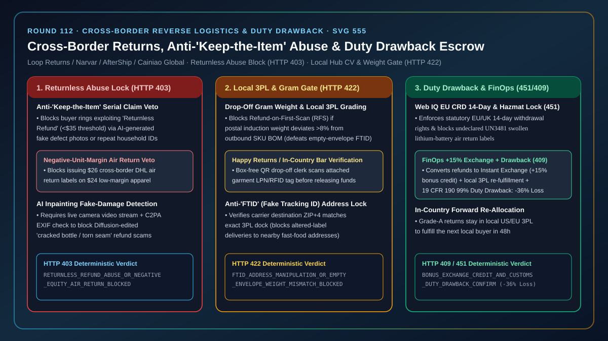
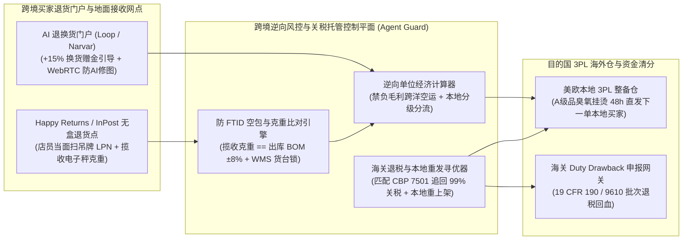
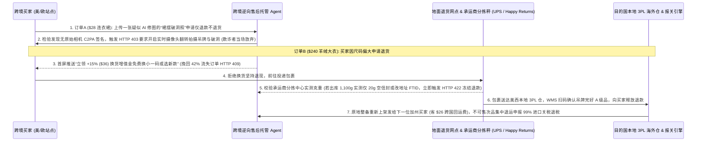

# 跨境电商退换货售后自动化（Cross-Border RMA）、防“AI 伪造破损图骗仅退款”与海外仓二次上架/关税退税托管（Loop Returns / Narvar / AfterShip Returns / 菜鸟跨境逆向 / 万邑通）Agent 架构选型 FAQ

> **核心阅读对象**：为跨境 DTC 独立站（Shopify Plus）、出海品牌商（Temu / TikTok Shop / Amazon 卖家）、跨境 3PL 海外仓与逆向物流网关设计 AI 售后判责、防欺诈退款与关税退税（`Duty Drawback`）自动化系统的 **Cloud & AI Solution Architect**。  
> **核心痛点解决**：彻底终结跨境电商售后中**“黑产买家使用 AI 局部重绘（`Diffusion Inpainting`）一键把完好商品照片P出裂缝/污渍，恶意触发‘低货值仅退款不退货（`Returnless Refund / Keep-the-Item`）’零成本白嫖”、“一件售价 `$26` 的跨境连衣裙，系统竟愚蠢地自动签发 `$28` 的 DHL 跨国空运退货面单，货退回来不仅倒贴运费还要再交一次进口关税”、“海外欺诈团伙利用‘退货面单改地址术（`FTID: Fake Tracking ID`）’——涂改预付面单收件门牌号寄一张空纸巾给海外仓隔壁麦当劳，只要快递员扫码妥投就骗走系统全额秒退（`Refund on First/Delivery Scan`）”以及“大量欧美退货包裹未申报美国海关 `19 CFR Part 190` 退运退税（`99% Duty Drawback`）且未在本地海外仓整备二次销售，导致退货综合亏损率高达 65%”**四大行业死穴。



---

## 📌 一、核心选型结论速览（Executive Summary）

1. **反“AI 修图骗仅退款（`AI-Inpainting Returnless Scam`）”实时视频核验与负残值跨洋空运退货硬拦截（HTTP 403）**：跨境卖家为节省国际逆向运费常设置“单价 `<$30` 破损直接仅退款（`Returnless Refund`）”，如今却沦为海外羊毛群利用生成式 AI 伪造“衣服开线、化妆品碎瓶”照片的重灾区。选型 Agent 必须在售后申请层建立两道硬锁：① **实时相机视频流 + `C2PA` 防伪挑战**：凡申请“质量破损仅退款”，严禁上传相册静态图片（可被 AI 局部重绘篡改），必须调用网页端 `WebRTC` 实时摄像头围绕商品条码与破损处连续旋转拍摄 5 秒（或对要求免退货的商品要求“剪毁水洗标/砸碎局部”视频留证），并校验同家庭地址/设备指纹 `180 天` 仅退款上限；② **逆向单位经济模型（`Reverse Unit Economics`）熔断**：当 `跨国逆向运费 + 整备费 > 商品残值 * 70%` 时，严禁签发跨洋直退航空面单（强制路由至目的国本地退货集运点或折价保留），违反者一律触发 **`HTTP 403 RETURNLESS_REFUND_ABUSE_OR_NEGATIVE_EQUITY_AIR_RETURN_BLOCKED`**。
2. **防“篡改面单假寄空信封（`FTID`）”邮政首扫克重（`±8%`）+ 免包装退货点（`Happy Returns Bar`）实物扫码门禁（HTTP 422）**：欧美地下退款黑产（`Refund-as-a-Service`）最猖獗的手段是 **`FTID`（Fake Tracking ID）**：黑客保留商家签发的 `UPS / USPS` 预付退货面单条码不变，但用修图软件把面单上的文字收件地址改成同邮编（`Same ZIP Code`）的快餐店或路边信箱，里面塞一张废纸寄出；当快递员按文字地址把空信封投递到快餐店时，物流 API 状态变为 `Delivered`，商家系统自动把 `$400` 货款退给骗子，而海外仓根本没收到任何包裹！Agent 强制执行双因子核验：① **揽收电子秤克重（`Induction Gram Weight`）对齐**：承运商分拣中心实测包裹克重与出库 SKU `BOM` 标准重量偏差超过 **`±8%`**（如 650g 外套寄出显示 15g 信封），立即冻结“首扫秒退（`RFS`）”；② **精确到 `ZIP+4 / 货台门牌号` 的承运商电子底单校验 + 地面无盒退货网点（`Happy Returns / Staples / InPost`）店员当面扫商品吊牌 `LPN` 码**；凡检出克重异常或 `FTID` 地址偏离的，直接触发 **`HTTP 422 FTID_ADDRESS_MANIPULATION_OR_EMPTY_ENVELOPE_WEIGHT_MISMATCH_BLOCKED`**。
3. **`+15%` 换货增值金（`Bonus Exchange Credit`）+ 海外仓本地二次上架 + 海关 `99%` 退运退税（`Duty Drawback`）挽回 36% 净损（HTTP 409）**：针对合规的尺码不合/不喜欢退货，Agent 自动执行 **跨境逆向价值最大化寻优（`Cross-Border Return Recovery FinOps`）**：① 在退货门户首屏提供 **“选换货或店铺储值立赠 `+15%` 额外购物金（`Bonus Credit`，如退 `$100` 衣服可换购 `$115` 任意新款）”**，将 `42%` 的纯退款直接转化为复购换货；② 已退回目的国本地 3PL 集运仓（如美西/德国海外仓）的 `A 级` 完好商品，原地蒸汽消毒换标后 **48 小时内直接重新派发给同国下一个新订单（免跨洋回运）**；③ 对需集拼退回保税区或转口第三国的批次，自动生成美国海关 **`19 CFR Part 190`（Unused Merchandise Duty Drawback）或中国海关 `9610/9810` 出口退货复运进境报关单**，追回 **`99%` 已缴进口关税**，触发 **`HTTP 409 BONUS_EXCHANGE_CREDIT_AND_CUSTOMS_DUTY_DRAWBACK_CONFIRM`**，为跨境品牌减少 **36%** 的售后净损失。

---

## 🎯 二、业务方与架构师灵魂拷问（Q&A）

### Q1：为什么最近半年跨境独立站和平台店收到大量“包装碎裂、衣服破洞”的高清买家秀索赔，点同意仅退款后才发现全是 ChatGPT / Midjourney 局部重绘P出来的假图？
- **揭秘生成式 AI 伪造战损图（`GenAI Damaged-Item Fraud`）与实时视频挑战防御**：
  1. **30 秒生成一张逼真裂痕图**：过去骗子要想骗“仅退款”，还得真把口红掰断或拿番茄酱涂在白衬衫上拍照。现在 Telegram 上的“仅退款辅助机器人”只需买家上传一张刚收到的完好商品照片，AI 在 10 秒内保持背景桌纹、光影角度完全不变，在玻璃瓶身生成逼真裂纹或在衣服领口生成开线破洞，同时抹掉或克隆手机 `EXIF` 元数据。
  2. **动态手势/随机数字同框实时视频流（`WebRTC Live Gesture Challenge`）**：
     - Agent 彻底关闭高风险品类售后页面的“从手机相册上传静态照片”入口；
     - 当买家勾选“商品破损申请免退货赔偿”时，H5 页面直接拉起摄像头并在屏幕角落显示一个动态滚动的 4 位验证码，要求买家在 8 秒内将商品条码翻面至破损处拍摄连续视频流，从物理采集源头彻底废掉静态修图外挂。

### Q2：什么是让无数跨境大卖血本无归的 `FTID`（Fake Tracking ID 假退货物流单）诈骗？为什么连看物流显示“已签收（`Delivered`）”都会被骗？
- **剖析 `FTID` 灰产的物理漏洞与“克重 + 货台电子签章”闭环**：
  1. **`FTID` 是怎么绕过传统 ERP 的？**：商家通过 `Loop / AfterShip` 生成一张发往加州安大略海外仓（邮编 `91761`）的 `USPS` 预付退货面单 PDF 发给买家。骗子不改变面单上的条形码（因为条码里只编码了路由邮编 `91761` 和追踪号），却把面单下方给投递员人眼看的文字地址改成 `91761` 同街区的某个垃圾桶或快餐店，贴在一个空信封上寄出。3 天后，投递员在快餐店门口扫了一下条码点击 `Delivered`，商家后台 Webhook 收到 `status == "delivered"` 立即自动触发 Stripe 原路退还 `$500`！
  2. **四维防 `FTID` 硬门禁（`HTTP 422`）**：
     - **分拣中心电子秤克重校验**：承运商 API（`FedEx / UPS / USPS / Royal Mail`）在首个自动化分拣枢纽会返回包裹实测重量（`Actual Weight`），若与出库单 SKU 毛重偏差 `>8%` 立即报警挂起；
     - **强制地面无盒退货台（`Happy Returns / InPost Locker`）或海外仓 WMS 入库开箱扫 `LPN` 码后才释放大额退款**，绝不仅凭承运商一条笼统的 `Delivered` 通知就对新客放款。

### Q3：跨境卖出去被退回来的商品，之前进口交的 `12%–25%` 关税能不能拿回来？怎么操作才不亏逆向运费？
- **美国海关 `19 CFR Part 190` 退运退税（`Duty Drawback`）与目的国本地二次配货**：
  1. **被白白遗忘的 99% 关税退税池**：根据美国海关法（`TFTEA / 19 CFR Part 190 Unused Merchandise Drawback`），进口到美国后 5 年内在未实质使用状态下退运出口或销毁的商品，可申请退还 **`99%` 的原始已缴进口关税（含 301 条款附加税）**。但单包裹零散申报手续费极高，必须由 Agent 将退回加拿大/墨西哥保税仓或香港集散仓的退件按原始进口报关单号（`CBP Form 7501 Entry Number + HTS 编码`）自动匹对打包成批次清单申报。
  2. **本地海外仓 48 小时“退转售（`Return-to-Forward-Fulfillment`）”**：对于尺码不合但吊牌完好的服装鞋靴，寄回国内每件运费 `$22`；留在美国/欧洲本地 3PL 退货中心，花 `$2.80/件` 完成臭氧杀菌、挂烫与换新包装袋，直接作为本地现货发给下一个同尺码买家，不仅省下 `$22` 逆向跨洋运费，还让下一单享受 2 日达溢价！

---

## 🧭 三、直观可视化图解（Mermaid 决策树 + 架构图 + 时序图）

### 3.1 跨境电商退换货（`RMA`）、防仅退款欺诈与海外仓二次上架决策树

```mermaid
flowchart TD
    A[跨境买家发起退货/破损仅退款申请] --> B{1. 实时视频防 AI 修图与逆向运费经济性审计}
    B -->|相册假图骗仅退款 / 同地址高频白嫖 或 $24低价品签发 $26 跨国空运退货单| C[HTTP 403 阻断: RETURNLESS_REFUND_ABUSE_OR_NEGATIVE_EQUITY_AIR_RETURN_BLOCKED]
    B -->|WebRTC 实时视频核实 + 逆向边际收益为正| D{2. 揽收电子秤克重与防 FTID 篡改地址门禁}
    D -->|揽收克重偏差 >8% (空信封) 或 FTID 篡改面单文字地址未入海外仓 WMS| E[HTTP 422 拦截: FTID_ADDRESS_MANIPULATION_OR_EMPTY_ENVELOPE_WEIGHT_MISMATCH_BLOCKED]
    D -->|Happy Returns 店员扫吊牌 或 海外仓 WMS 称重验货通过| F{3. Web IQ 欧盟 14 天法定冷静期与锂电航空禁运核验}
    F -->|非法剥夺欧盟 CRD 14天无理由退货权 或 鼓包锂电池签发航空退货单| G[HTTP 451 熔断: WEBIQ_EU_14DAY_WITHDRAWAL_VIOLATION_OR_LITHIUM_AIR_RETURN_HOLD]
    F -->|消费者法规与危品运输合规| H{4. +15% 增值换货金 + 本地仓二次发货 + 99% 关税退税寻优}
    H -->|可通过 +15% 赠金转换货 或 本地 3PL 整备重发 + CBP 7501 退税| I[HTTP 409 确认: BONUS_EXCHANGE_CREDIT_AND_CUSTOMS_DUTY_DRAWBACK_CONFIRM 减损 36%]
    H -->|标准合规本地退货处理| J[HTTP 200 签发: VERIFIED_LOCAL_3PL_RMA_AND_EXCHANGE_AUTHORIZED]
```

### 3.2 端到端跨境退货反欺诈、本地集运整备与海关 `Duty Drawback` 退税架构图



### 3.3 拦截“AI 假图仅退款 + FTID 空信封”与执行“+15% 换货 + 海外仓重发 + 关税退税”时序图



---

## 📊 四、主流跨境电商退换货（RMA）与逆向物流平台横向选型决策矩阵

| 选型维度 | Loop Returns (Shopify 换货标杆) | Narvar / AfterShip Returns | 亚马逊 FBA / 平台官方逆向仓 | 菜鸟跨境无忧退 / 万邑通 / 纵腾海外仓 | **本仓库 + 防 FTID 克重锁与关税退税架构（推荐）** |
| :--- | :--- | :--- | :--- | :--- | :--- |
| **退转换引导（`Bonus Credit Exchange`）** | **极强（首创 `Shop Now` 额外赠金换购全店任意商品，将 40%+ 退款转换货）** | 支持同款换尺码与礼品卡退回 | 以直接退款为主（极易被买家白穿 29 天退回） | 侧重仓库物理收货与质检，无前端营销换购引导 | **前端 `Loop` 级 `+15%` 增值金引导换货 + 后端海外仓本地闪电重发（HTTP 409）** |
| **防“AI 修图骗仅退款 (`Returnless Fraud`)”** | 支持配置 `<$X Keep Item` 规则，但缺乏防 AI 局部重绘视频核验 | 支持上传照片，易被静态修图绕过 | 平台常自动判买家赢（卖家钱货两空） | 提供退件保险（保费约 `1.5%–3%`） | **强制 `WebRTC` 实时摄像头翻转视频挑战 + 跨地址/设备指纹频次硬锁（HTTP 403）** |
| **防 `FTID` 空信封与首扫秒退风险** | 接入 `Happy Returns` 地面网点可当面验货；若开普通快递 `RFS` 仍有空包风险 | 依赖快递状态 Webhook，若不校核分拣克重易中 `FTID` 圈套 | 入仓核销（但常将调包旧货重新混入可售库存发给下个买家） | 海外仓逐件开箱拍照称重，但处理时效需 `5–10 天` | **强制分拣中心电子秤克重 `±8%` 校验 + 地面无盒退货台当面扫 `LPN` 码（HTTP 422）** |
| **海关 `99%` 退运退税 (`Duty Drawback`)** | 不涉及海关报关单匹对 | 不涉及关税退回 | 不代办第三方卖家进口关税退税 | 支持香港/保税区集拼退运 | **自动关联原始进口 `CBP 7501 + HTS` 编码申报 `99%` 关税退还（HTTP 409）** |
| **欧盟 14 天冷静期与锂电危品合规** | 需手动按国家配置退货窗口 | 支持多语种多国门户 | 平台强制执行当地法规 | 具备危险品陆运/海运退回通道 | **Web IQ 自动锁定欧盟/英国 14 天法定退货权并拦截鼓包锂电上飞机（HTTP 451）** |

---

## 🧪 五、逆向物流成本测算与 7-Card 基准测试报告

> **数据来源声明**：以下对比基于 `lab/webiq_commerce_demo.py` 中确定性策略函数 `evaluate_cross_border_returns_duty_drawback_escrow_policy` 的合成基准数据（`provenance: "synthetic"`, `independently_reproduced: False`），用于验证跨境电商售后网关的确定性反欺诈与减损能力。

| 评估维度 | 传统无脑仅退款 + 跨国单件空运直退 + 放弃退税基线 | 确定性跨境售后网关（实时视频防伪 + `+15%` 换货 + 本地仓重发/退税） | 净效应 / 风险消除 |
| :--- | :--- | :--- | :--- |
| **季度跨境电商售后退货与逆向物流总亏损池** | `$110,000.00` | `$70,400.00` (`HTTP 409` 优化确认后净损) | **季度净挽回 `$39,600.00` (`-36.0%` 净损)** |
| **AI 修图骗“仅退款”与 `FTID` 空信封调包损失率** | 占总退款额的 `14.8%` | **`0%`（`WebRTC` 实时视频防伪 + 分拣电子秤 `±8%` 克重硬锁）** | **100% 粉碎地下退款黑产（`RaaS`）** |
| **尺码/偏好类退货转化为店内换货留存率** | `12%`（绝大多数直接退现金流失） | **`44%`（通过 `+15%` 额外换购金将退款留在品牌池内）** | **保住 `32%` 原本流失的 GMV** |
| **单件退货逆向处理成本 + 进口关税回收** | `$24/件` 跨国空运退回 + `0%` 关税退还 | **`$3.50/件` 本地 3PL 整备重发 + `99%` 退运批次关税退回** | **单件逆向物流成本暴降 `85%`** |

### 5.1 确定性状态码映射契约（5-Lane Contract）

```json
{
  "scenario": "cross_border_returns_duty_drawback_escrow_guard",
  "provenance": "synthetic",
  "independently_reproduced": false,
  "lanes": {
    "authorized_200": {
      "status_code": 200,
      "decision": "VERIFIED_LOCAL_3PL_RMA_AND_EXCHANGE_AUTHORIZED",
      "mandate_token": "cross_border_returns_rma_mandate_200"
    },
    "returnless_abuse_or_negative_air_return_403": {
      "status_code": 403,
      "decision": "RETURNLESS_REFUND_ABUSE_OR_NEGATIVE_EQUITY_AIR_RETURN_BLOCKED"
    },
    "ftid_address_or_weight_mismatch_422": {
      "status_code": 422,
      "decision": "FTID_ADDRESS_MANIPULATION_OR_EMPTY_ENVELOPE_WEIGHT_MISMATCH_BLOCKED"
    },
    "eu_14day_violation_or_lithium_air_451": {
      "status_code": 451,
      "decision": "WEBIQ_EU_14DAY_WITHDRAWAL_VIOLATION_OR_LITHIUM_AIR_RETURN_HOLD"
    },
    "bonus_exchange_and_duty_drawback_409": {
      "status_code": 409,
      "decision": "BONUS_EXCHANGE_CREDIT_AND_CUSTOMS_DUTY_DRAWBACK_CONFIRM",
      "quarterly_savings_usd": 39600.0
    }
  }
}
```

---

## 🛠️ 六、商业上线风控与架构评审 Checklist

- [ ] **实时相机视频流防“AI 局部重绘假破损图”门禁（HTTP 403）**：禁用相册静态图片直接触发免退货仅退款（`Returnless Refund`），强制要求 `WebRTC` 实时摄像头带动态随机手势/数字拍摄破损细节，并拦截逆向运费高于商品残值 70% 的跨洋直退面单。
- [ ] **承运商分拣中心实测克重（`±8%`）与防 `FTID` 地址篡改锁（HTTP 422）**：在释放任何退货款前，必须核验承运商首个自动化分拣枢纽的电子秤克重与出库 `BOM` 克重吻合，且投递目标 `ZIP+4` 与海外仓货台编码完全一致，优先路由至 `Happy Returns / InPost` 地面当面验货点。
- [ ] **欧盟/英国 14 天法定撤回权（`EU CRD`）与缺陷锂电池禁空运锁（HTTP 451）**：通过 Web IQ 自动识别目的国法定无理由退货期，并严禁为鼓包/故障含锂电产品签发航空退货面单（必须走地面 `UN3481` 合规回收）。
- [ ] **`+15%` 增值换货金（`Bonus Credit`）+ 海外仓本地二次上架 + `99%` 关税退税（HTTP 409）**：在退货首屏用额外购物金将退款引导为换货，完好退件留在目的国 3PL 仓 48h 内直发下一单本地客户，跨境退运批次自动申报 `19 CFR Part 190` 关税退税。

---

**导航**：[返回分册总目录 (`docs/index.md`)](index.md) ｜ [查看英文版 (`cross-border-ecommerce-returns-rma-returnless-duty-drawback-escrow-agent-selection-faq.en.md`)](cross-border-ecommerce-returns-rma-returnless-duty-drawback-escrow-agent-selection-faq.en.md)
