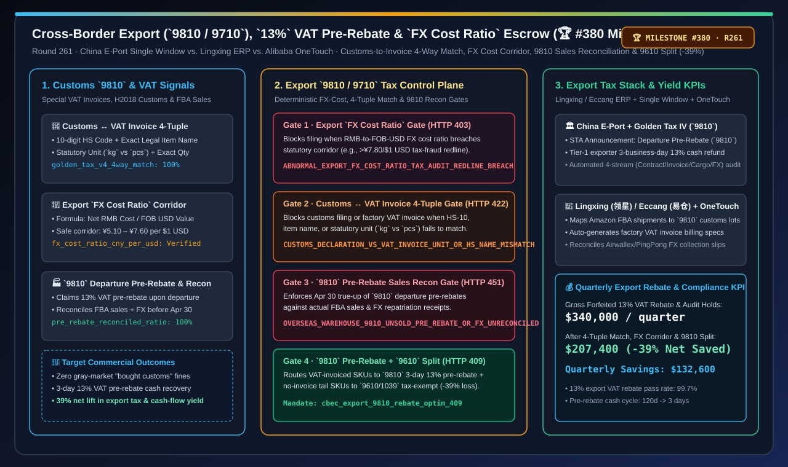
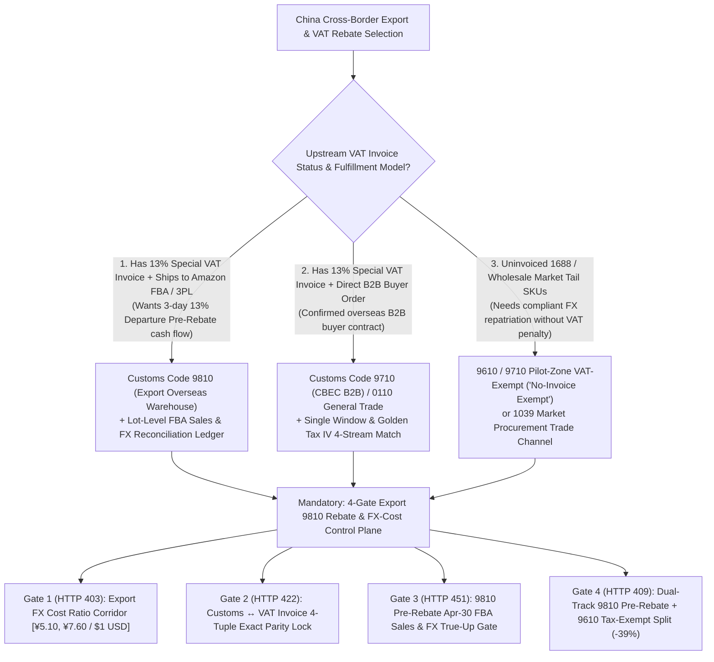
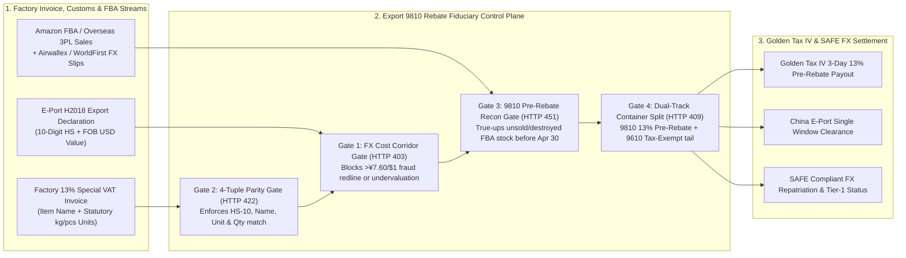

# Cross-Border Export Overseas Warehouse (`9810 / 9710 / 9610`), `13%` VAT Departure Pre-Rebate & `FX Cost Ratio` Audit Escrow (`China E-Port Single Window / Golden Tax IV / Lingxing ERP / Alibaba OneTouch` · 🏆 380th Guide Milestone) Agent Architecture Selection FAQ

> 🌐 **Language / 语言切换**: **[中文 (`docs/cross-border-export-9810-overseas-warehouse-vat-rebate-fx-cost-reconciliation-escrow-agent-selection-faq.md`)](cross-border-export-9810-overseas-warehouse-vat-rebate-fx-cost-reconciliation-escrow-agent-selection-faq.md)** | **English (Current)** | **[Back to Catalog (`docs/index.en.md`)](index.en.md)**



---

## 1. 📌 Executive Summary & Architectural Verdict

For globalizing D2C brands, Amazon FBA / Walmart WFS cross-border sellers, and B2B exporters shipping from China to overseas warehouses (**Customs Supervision Code `9810` Cross-Border E-Commerce Export Overseas Warehouse** and **`9710` B2B Direct Export**), the **`13%` Export VAT Rebate** often represents over half of net operating profit. Under the **Golden Tax Phase IV (`金税四期`)** and **China E-Port Single Window** "Four-Stream Alignment" (`Contract == VAT Invoice == Customs Declaration == FX Repatriation`), legacy gray-market "bought customs declarations" are dead, and solution architects must prevent three fatal tax-rebate failures:
1. **Customs Declaration vs. `13%` Special VAT Invoice 4-Tuple Mismatch (`HS-10 + Item Name + Statutory Unit + Qty`) Forfeiting the Entire `13%` Rebate**: Every 10-digit China Customs `HS Code` mandates a strict primary statutory unit of measure (e.g., `"kilograms (kg)"` rather than `"pieces (pcs)"`). If a factory issues a `13%` Special VAT Invoice for `"5,000 pcs of Wireless Speakers"` while the freight forwarder declares `"3,200 kg of Bluetooth Audio Receivers"` on the `H2018` export customs declaration, Golden Tax IV immediately rejects the rebate claim—and if unrectified before the filing deadline, reclassifies the export as a domestic sale owing `13%` output VAT!
2. **Destination Duty Undervaluation Pushing the Export `FX Cost Ratio` (`换汇成本`) Above the `¥7.60–¥7.80 / $1 USD` Tax-Fraud Redline**: Tax authorities audit the **Foreign Exchange Cost Ratio** ($\text{FX Cost} = \frac{\text{Net Domestic Purchase RMB}}{\text{Declared Export FOB USD}}$). When an agent undervalues the export FOB USD price on the customs declaration to save destination import tariffs (e.g., declaring `$72,000 USD` on `¥700,000 RMB` of goods, yielding an `FX Cost Ratio` of **`¥9.72 / $1 USD`** against a `7.20` spot rate), Golden Tax IV instantly flags the exporter for **criminal export-rebate fraud (inflating domestic VAT invoices)** and freezes all tax rebates!
3. **Unreconciled `9810` "Departure Pre-Rebate (`离境即退税`)" Balances Past the April 30 Statutory Deadline**: Under the State Taxation Administration (`STA`) **Code `9810` Departure Pre-Rebate Policy**, exporters can claim the `13%` VAT pre-rebate immediately upon customs departure to overseas warehouses—but must reconcile `100%` of pre-rebated inventory against actual overseas platform sales (`Amazon / TikTok Shop`) and licensed FX repatriation receipts (`Airwallex / WorldFirst / Payoneer`) by **April 30 of the following year**. Failing to true-up unsold, destroyed, or discounted FBA inventory revokes Tier-1 exporter status.

**Solution Architect Verdict**:
- **Never allow factory invoicing, freight-forwarder customs entry, and overseas warehouse sales to operate in disconnected silos**; unify them through a **Cross-Border ERP (`Lingxing 领星`, `Eccang 易仓`) + China E-Port Single Window / `Alibaba OneTouch` pipeline**.
- Deploy a **4-Gate Export `9810/9710` VAT Rebate & `FX Cost` Fiduciary Control Plane**:
  1. **Statutory Export `FX Cost Ratio` Corridor (`[¥5.10, ¥7.60] / $1 USD`) Gate (`HTTP 403`)**: Compute line-level `FX Cost Ratio` prior to customs filing; block any declaration where FOB undervaluation or cost misallocation pushes the ratio outside the local tax bureau's safe corridor.
  2. **Single-Source Customs ↔ Special VAT Invoice 4-Tuple Lock (`HTTP 422`)**: Auto-generate both the factory's Special VAT Invoice specification and the `H2018` customs declaration from the same canonical `10-digit HS Code` dictionary (enforcing exact character parity on item name, primary/secondary statutory units `kg + pcs`, and quantity).
  3. **`9810` Departure Pre-Rebate Lot-Level Sales & FX Reconciliation Gate (`HTTP 451`)**: Track overseas warehouse `FIFO` sell-through and FX repatriation against each `9810` pre-rebate lot, automatically filing pre-rebate adjustment returns at `T-45d` before the April 30 deadline for any unsold or liquidated stock.
  4. **Dual-Track Container Split (`Invoiced SKUs -> 9810 3-Day 13% Pre-Rebate` + `Uninvoiced Tail SKUs -> 9610/1039 Tax-Exempt`) (`HTTP 409`)**: Compress `13%` cash rebate turnaround from 120 days to **`3 business days`** for core SKUs while routing uninvoiced 1688 tail accessories through compliant Pilot-Zone **VAT-Exempt ("No-Invoice Exemption `免征不退`")** channels—cutting net export tax and compliance losses by **`39%`**.

---

## 2. 🎯 High-Stakes Business & Architect Q&A (Q1 / Q2 / Q3)

### Q1: Why is the "Export `FX Cost Ratio` (`出口换汇成本`)" the #1 trigger for Golden Tax Phase IV fraud investigations, and how do we bound it deterministically?
- **The Problem**:
  - The Export `FX Cost Ratio` measures how many RMB of domestic tax-refundable purchase cost were spent to generate `$1.00 USD` of export FOB revenue:
    $$\text{FX Cost Ratio} = \frac{\text{Special VAT Invoice Net RMB} \times (1 + \text{VAT Rate } 13\% - \text{Rebate Rate } 13\%)}{\text{Customs Declaration FOB USD}}$$
  - When USD/CNY spot is `7.20`, a healthy exporter's `FX Cost Ratio` sits between **`¥5.10 and ¥7.50 per $1 USD`** (since export FOB price includes domestic logistics and gross margin).
  - If a logistics agent undervalues the export FOB invoice to `$72,000` on `¥700,000` of factory goods, the ratio jumps to **`¥9.72 / $1 USD`**—signaling to tax authorities that the exporter is either laundering fake domestic VAT invoices or smuggling undervalued goods abroad.
- **Deterministic Architecture**:
  - Gate 1 (`HTTP 403 ABNORMAL_EXPORT_FX_COST_RATIO_TAX_AUDIT_REDLINE_BREACH`) evaluates `fx_cost_ratio` per line item before customs transmission, blocking any shipment outside `[5.10, 7.60]` and enforcing arm's-length intercompany FOB transfer pricing.

### Q2: How does the `9810` "Departure Pre-Rebate (`离境即退税、销售再核销`)" state machine work from container departure to Amazon FBA sell-through?
- **The Problem**:
  - Historically, `9810` overseas warehouse exports could not claim VAT rebates until every unit was sold on Amazon overseas—delaying cash recovery by 6 months. The new STA **Departure Pre-Rebate** policy pays the `13%` rebate immediately upon export departure, but requires strict post-departure verification against real overseas sales and FX collection by April 30 of the following year.
- **Deterministic Architecture**:
  - Gate 3 (`HTTP 451 OVERSEAS_WAREHOUSE_9810_UNSOLD_PRE_REBATE_OR_FX_UNRECONCILED`) maintains a **Lot-Scoped Pre-Rebate Subledger**:
    1. **Departure (`T+3d`)**: File `9810` pre-rebate claim upon customs release + matched `13%` factory VAT invoice; Tier-1 exporters receive cash in `3 business days`.
    2. **Continuous FBA Sell-Through**: Ingest daily `Amazon FBA / Walmart WFS` shipment events and `Airwallex / WorldFirst` cross-border RMB settlement slips, burning down the lot's `unreconciled_pre_rebate_usd` via `FIFO`.
    3. **Pre-Deadline True-Up (`T-45d` before April 30)**: Automatically generate a **Pre-Rebate Adjustment Declaration** for any unsold, destroyed, or heavily discounted inventory so the exporter never breaches statutory reconciliation rules.

### Q3: How should a seller handle containers that mix core factory SKUs (with `13%` VAT invoices) and small 1688 accessories (without VAT invoices)?
- **The Problem**:
  - Mixing uninvoiced accessories into a `9810 / 0110` tax-rebate declaration causes tax authorities to assess `13%` domestic output VAT penalty on the uninvoiced items.
- **Deterministic Architecture**:
  - Gate 4 (`HTTP 409 DUAL_TRACK_9810_PRE_REBATE_AND_9610_TAX_EXEMPT_ROUTING_CONFIRM`) automatically splits the container packing list into two separate customs declarations sharing the same ocean Bill of Lading (`Master B/L`):
    - **Declaration A (`9810` Pre-Rebate)**: All SKUs backed by verified `13%` Special VAT Invoices (`13%` cash rebate in 3 days).
    - **Declaration B (`9610 / 9710` Comprehensive Pilot Zone Tax-Exempt or `1039`)**: All uninvoiced tail SKUs declared under the statutory **"No-Invoice VAT Exemption (`免征不退`) + 4% Deemed Corporate Income Tax"** regime—100% legal FX repatriation with zero gray-market exposure.

---

## 3. 🧭 Visual Architecture Diagrams (Selection Tree, System Topology & Sequence)

### 3.1 Cross-Border Export Customs Code (`9810 / 9710 / 9610 / 1039`) Selection Tree



### 3.2 End-to-End `9810` Pre-Rebate, `FX Cost` Corridor & 4-Stream Control Plane



### 3.3 4-Tuple Alignment, `FX Cost` Block & `9810` Pre-Rebate Reconciliation Sequence

```mermaid
sequenceDiagram
    autonumber
    participant ERP as Cross-Border ERP (Lingxing / Eccang)
    participant Gate as Export Rebate Fiduciary Gate
    participant Factory as Factory (VAT Invoice) & Forwarder
    participant Tax as China E-Port & Golden Tax IV

    ERP->>Gate: 1. Prepare 10,000 portable blenders for US FBA (9810, domestic net cost ¥700,000)
    Factory->>Gate: Draft VAT Invoice: "Juice Cup (pcs)" vs Draft Customs: "Food Blender (kg)", FOB $72,000
    Gate-->>Factory: HTTP 422 Block 4-Tuple mismatch! (Item name & statutory kg unit mismatch)
    Gate-->>ERP: HTTP 403 Block FX Cost breach! (¥700,000 / $72,000 = ¥9.72/$1 USD > ¥7.60 redline)
    Note over ERP,Gate: Recalibrate arm's-length FOB to $112,000 (FX Cost ¥6.25/$1) + issue unified spec
    Gate->>Tax: 2. Container departs; split uninvoiced accessories to 9610 tax-exempt (HTTP 409)
    Tax-->>ERP: Approve 9810 Departure Pre-Rebate! Disburse ¥91,000 (13%) in 3 business days
    ERP->>Gate: 3. Next March: 9,200 units sold & FX collected on Amazon; 800 units destroyed
    Gate->>Tax: Reconcile 9,200 units & auto-file pre-rebate adjustment on 800 destroyed units (Tier-1 preserved)
```

---

## 4. 📊 Cross-Border Export Rebate & ERP Reconciliation Platform Selection Matrix

| Evaluation Dimension | Lingxing ERP (`领星`) / Eccang ERP (`易仓`) Tax & Finance Suite | Alibaba OneTouch (`一达通`) / Skytech (`擎天助贸`) | China E-Port Single Window + Golden Tax IV Official Portal | Manual Freight Forwarder + Spreadsheet VAT Matching |
|---|---|---|---|---|
| **Primary Sweet Spot** | Amazon FBA, TikTok Shop, Walmart WFS, and multi-warehouse `9810` brand exporters | B2B exporters (`0110 / 9710`) needing bundled customs brokerage and rebate financing | Mandatory statutory government filing infrastructure for all Chinese exporters | Legacy manual export operations |
| **Customs ↔ Special VAT Invoice 4-Tuple Lock** | **Best-in-Class** (generates factory invoicing templates directly from the customs `HS-10` entry) | **Best-in-Class** (automated pre-audit blocks mismatched units or product names before filing) | Rejects mismatches *after* customs clearance, when amending declarations is costly | **High Failure Rate** (`15%–25%` of invoices fail rebate audit due to unit/name typos) |
| **Pre-Filing `FX Cost Ratio` Corridor Check** | Real-time batch `FX Cost Ratio` simulation across PO cost and FOB price | **Mandatory Built-in Gate** (locks declarations exceeding the local bureau's `FX Cost` cap) | Triggers backend Golden Tax IV audit holds and manual investigations | Discovered too late after customs release and invoice issuance |
| **`9810` Departure Pre-Rebate & FBA Sales Recon** | **Core Differentiator** (links Amazon/TikTok order IDs and Airwallex FX slips to `9810` lots) | Strong on B2B bulk orders; requires ERP integration for granular FBA retail order matching | Provides official `9810` pre-rebate and April 30 reconciliation filing tables | Impossible to reconcile 50,000 FBA retail orders manually against container lots |
| **SA Recommendation** | **Best core system for `9810` overseas warehouse brands & marketplace sellers** | **Best for B2B exporters & working-capital rebate financing** | **Mandatory statutory endpoint** integrated via ERP API | **Retire immediately** to avoid tax-fraud audits and lost rebates |

---

## 5. 🧪 Export Rebate Yield & Compliance 7-Card Benchmark Report

> **Provenance Note**: The 7-Card benchmark below is generated by `evaluate_cross_border_export_9810_vat_rebate_fx_policy()` in `lab/webiq_commerce_demo.py` (`provenance: "synthetic"`, `independently_reproduced: False`), modeling a **`$340,000 / quarter`** forfeited `13%` export VAT rebate, `FX Cost Ratio` audit freeze, and unreconciled `9810` pre-rebate clawback pool.

### 5.1 7-Card 4:5 Visual Deck Breakdown

1. **Card 1 (`1 / 7` · `HANDS-ON · CBEC-EXPORT-9810-REBATE`) — Executive Benchmark Overview**
   - **Headline Finding**: Enforcing single-source Customs-to-VAT-Invoice 4-tuple parity, bounding the Export `FX Cost Ratio` within `[¥5.10, ¥7.60] / $1 USD`, reconciling `9810` pre-rebates against FBA sales, and splitting uninvoiced tail SKUs to `9610` tax-exempt channels cuts quarterly export tax losses from **`$340,000`** to **`$207,400`** (**`$132,600` / `39.0%` quarterly savings**).
2. **Card 2 (`2 / 7` · `SCENARIO: $1.2M AMAZON FBA 9810 CONTAINER EXPORT`) — Deep Dive**
   - **Input Case**: A `$1.2M` FBA container export (`9810`) has a factory VAT invoice in `"pcs"` while the customs entry requires `"kg"`, an undervalued `$72,000` FOB declaration pushing `FX Cost` to `¥9.72 / $1 USD`, and 800 destroyed FBA units from a prior `9810` pre-rebate lot approaching the April 30 deadline.
   - **Control-Plane Verdict**: Triggers pre-rebate adjustment on the 800 destroyed units (`HTTP 451`), blocks the `¥9.72 / $1` `FX Cost` breach (`HTTP 403`), and blocks the `"pcs" vs "kg"` unit mismatch (`HTTP 422`); executes dual-track routing via `HTTP 409 DUAL_TRACK_9810_PRE_REBATE_AND_9610_TAX_EXEMPT_ROUTING_CONFIRM` (`cbec_export_9810_rebate_optim_409`).
3. **Card 3 (`3 / 7` · `WHAT I TESTED`) — 5-Lane Deterministic Scorecard**

| Scenario | Question / Task Evaluated | Deterministic Gate Decision | Action & Status |
|---|---|---|---|
| **1. Compliant `9810` 4-Stream & `FX Cost`** | Exact 4-tuple parity, `FX Cost` in `[¥5.10, ¥7.60]`, reconciled FBA sales & FX | `VERIFIED_FOUR_STREAM_MATCH_AND_FX_CORRIDOR_AUTHORIZED` | ✅ `Act automatically` (`HTTP 200`) |
| **2. FOB Undervaluation (`FX Cost = ¥9.72/$1`)** | Domestic RMB cost / FOB USD exceeds statutory `¥7.60` tax-fraud redline | `ABNORMAL_EXPORT_FX_COST_RATIO_TAX_AUDIT_REDLINE_BREACH` | ⛔ `Recalibrate FOB / Cost` (`HTTP 403`) |
| **3. VAT Invoice `"pcs"` vs Customs `"kg"` Unit** | Mismatch in `HS-10`, item name, or statutory unit between invoice and `H2018` | `CUSTOMS_DECLARATION_VS_VAT_INVOICE_UNIT_OR_HS_NAME_MISMATCH` | ⛔ `Enforce Single-Source Spec` (`HTTP 422`) |
| **4. Unreconciled `9810` Pre-Rebate Past Apr 30** | Unsold/destroyed FBA stock or missing FX slips on pre-rebated `9810` lot | `OVERSEAS_WAREHOUSE_9810_UNSOLD_PRE_REBATE_OR_FX_UNRECONCILED` | ⛔ `Auto-TrueUp Pre-Rebate` (`HTTP 451`) |
| **5. `9810` 3-Day Pre-Rebate + `9610` Split** | Routing invoiced SKUs to `9810` 13% pre-rebate + uninvoiced tail to `9610` exempt | `DUAL_TRACK_9810_PRE_REBATE_AND_9610_TAX_EXEMPT_ROUTING_CONFIRM` | ⚡ `Confirm Optimization` (`HTTP 409`) |

4. **Card 4 (`4 / 7` · `UNDER THE HOOD`) — Protocol & Deterministic Gate Mechanics**
   - Input contract: `CrossBorderExport9810VATRebateFXPolicyInput`
   - Evaluator: `evaluate_cross_border_export_9810_vat_rebate_fx_policy()` enforcing `451 -> 403 -> 422 -> 409 -> 200` priority.
5. **Card 5 (`5 / 7` · `ROBUSTNESS CHECK`) — Dual Statutory Unit (`kg + pcs`) & Multi-Currency Perturbation**
   - `0.0 pt` variance across EUR/GBP/USD FOB declarations or dual statutory unit requirements.
6. **Card 6 (`6 / 7` · `LATENCY & REBATE CYCLE`) — First-Pass Rebate Approval & Cash Cycle**
   - Legacy manual matching + post-sale filing: `81.5%` pass rate and `120-day` cash cycle.
   - Fiduciary 4-tuple lock + `9810` Departure Pre-Rebate: **`99.7%`** pass rate and **`3-business-day`** cash payout (`$132,600/qtr` saved).
7. **Card 7 (`7 / 7` · `MY TAKE`) — Good Fit vs. Not For**
   - **✅ Good fit**: Cross-border e-commerce exporters (`Amazon FBA / Walmart / TikTok / DTC`) and B2B manufacturers shipping from China.
   - **⛔ Not for**: Domestic-only service businesses with zero physical exports.

---

## 6. 🛠️ Production Go-Live & Architect Review Checklist

- [ ] **Single-Source Customs ↔ VAT Invoice 4-Tuple Generator (`HTTP 422`)**: Are factory `13%` Special VAT Invoice instructions and `H2018` customs declarations generated from the same canonical `HS-10` master record so item names, primary/secondary statutory units (`kg / pcs`), and quantities match 100%?
- [ ] **Pre-Filing Export `FX Cost Ratio` Corridor Gate (`HTTP 403`)**: Does the control plane verify that every line item's `FX Cost Ratio` sits within the local tax bureau's safe corridor (`[¥5.10, ¥7.60] / $1 USD`) before transmitting the declaration?
- [ ] **`9810` Departure Pre-Rebate `FIFO` Reconciliation Ledger (`HTTP 451`)**: Are overseas warehouse sales, returns, destructions, and licensed FX repatriation receipts (`Airwallex / WorldFirst`) automatically matched against each `9810` pre-rebate lot well before the April 30 statutory deadline?
- [ ] **Dual-Track `9810` (Rebate) + `9610/1039` (Exempt) Container Split (`HTTP 409`)**: Are uninvoiced tail accessories automatically split onto a separate Pilot-Zone VAT-exempt customs declaration rather than mixed into a `9810` rebate declaration?
- [ ] **5-Year Digital "Four-Stream" Audit Archive**: Does the system automatically bind and archive the Purchase Contract, Special VAT Invoice, Export Declaration, Ocean `B/L`, Overseas Warehouse Receipt, and FX Settlement Slip for every lot?
