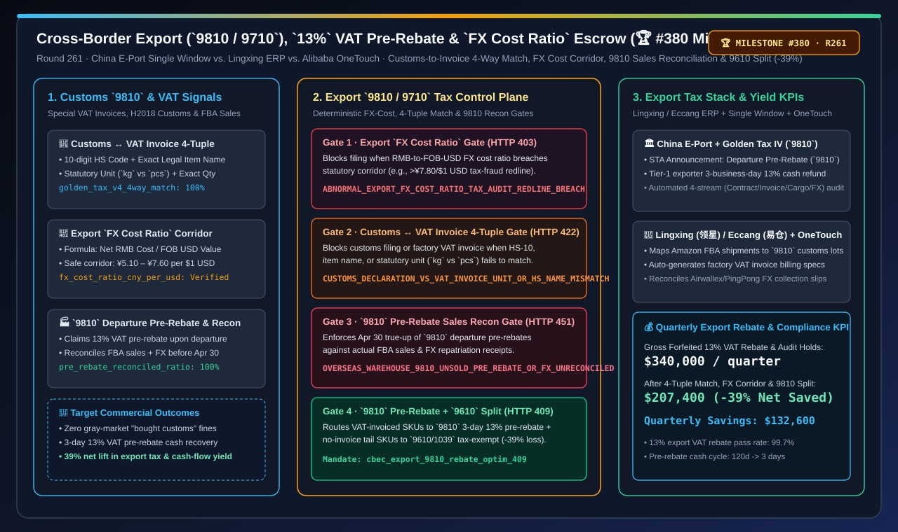
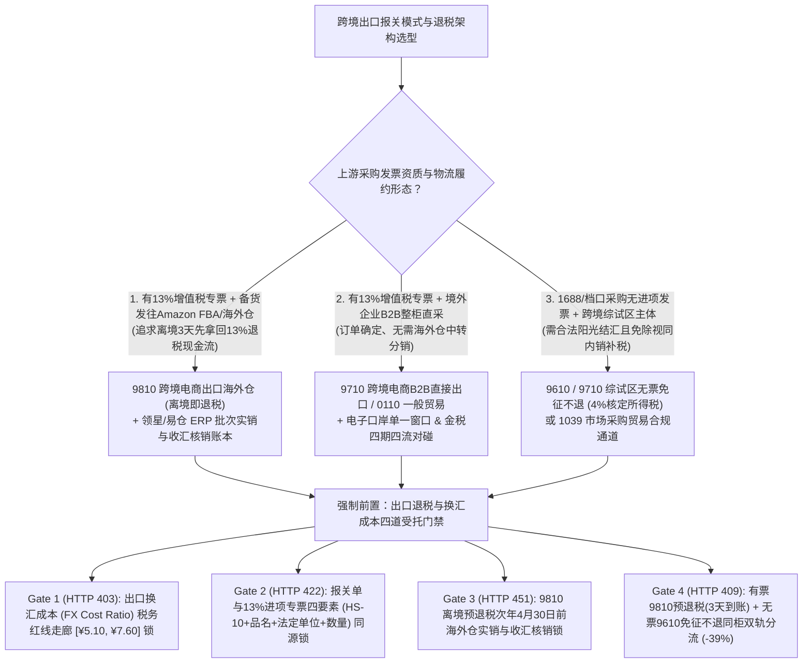
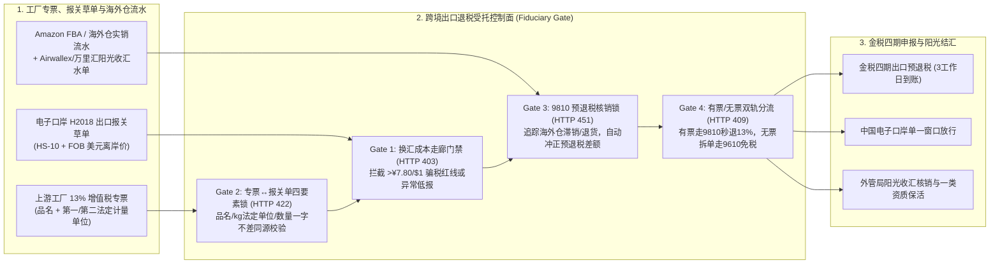
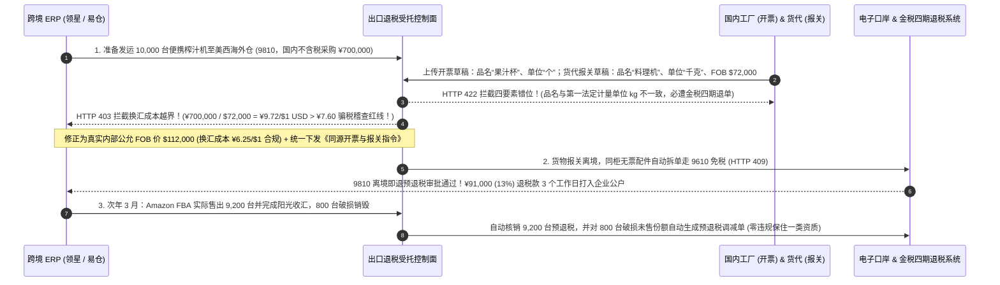

# 跨境电商出口海外仓（`9810 / 9710 / 9610`）、`13%` 增值税“离境即退税（Pre-Rebate）”与报关单-进项专票“换汇成本（`FX Cost Ratio`）”稽核托管（`中国电子口岸单一窗口 / 金税四期 / 领星 ERP / 易仓 / 阿里一达通` · 🏆 第 380 篇里程碑）Agent 架构选型 FAQ：防品名单位错位痛失 13% 退税、防换汇成本越界触发骗税立案与有票/无票双轨分流净省 39% 实战指南

> 🌐 **Language / 语言切换**: **中文 (当前)** | **[English (`docs/cross-border-export-9810-overseas-warehouse-vat-rebate-fx-cost-reconciliation-escrow-agent-selection-faq.en.md`)](cross-border-export-9810-overseas-warehouse-vat-rebate-fx-cost-reconciliation-escrow-agent-selection-faq.en.md)** | **[返回文档总目录 (`docs/index.md`)](index.md)**

---

## 1. 📌 核心选型结论速览（Executive Summary）

在中国品牌出海、亚马逊 FBA / 沃尔玛 WFS 海外仓大卖及外贸 B2B 出口企业中，**高达 `13%` 的出口增值税退税（Export VAT Rebate）往往直接决定了企业 50% 以上的净利润**。然而，随着金税四期与海关总署、国家外汇管理局实现“四流合一（合同流、发票流、货物流、资金流）”穿透式联审，过去粗放的“买单出口（借用他人抬头违规报关）”已全面终结，关务与财务架构师在落地合规出口退税自动化时面临三大致命痛点：
1. **“货代报关单填写的品名、法定计量单位（如‘千克’ vs ‘个’）与国内工厂开具的 `13%` 增值税进项专用发票有一字之差”导致金税四期退税系统 `100%` 疑点锁死，百万退税款变死账**：海关每个 10 位商品编码（`HS Code`）都有法定的第一计量单位（如大部分小家电/塑胶制品第一法定单位是“千克 `kg`”，第二单位才是“个 `pcs`”）。如果采购员让工厂开进项增值税专用发票时，只写了“蓝牙音箱 5,000 个”，而货代报关单上第一单位报的是“3,200 千克”、品名叫“无线便携式扬声器”——进项专票与出口报关单的 **四要素（`10位HS编码 + 商品名称 + 法定计量单位 + 数量`）** 无法对碰！税务系统当场弹出“单证不符”红字拦截，甚至因超过申报期被迫“视同内销”反补 `13%` 增值税！
2. **“为省目的国关税低报出口 FOB 美元价，导致计算出的‘出口换汇成本（`FX Cost Ratio`）’突破税务稽查红线（如 `> ¥7.80 / $1 USD`）”触发骗税立案稽查**：金税四期出口退税审核的核心数学公式是 **出口换汇成本（即每出口换回 `$1` 美元外汇，在国内采购耗费了多少元人民币不含税成本）**。如果某批次商品国内采购不含税价为 `¥720,000`，物流或销售 Agent 为了帮美国进口端少交关税，在出口报关单上把 FOB 离岸价低报为 `$75,000 USD`，算出来的换汇成本高达 **`¥9.60 / $1 USD`**（远超当前人民币汇率 `7.20` 及税局安全走廊上限 `¥7.60–¥7.80`）！税务局风控模型会在 1 秒内判定该企业涉嫌 **“高开国内进项发票、虚增成本骗取国家出口退税”**，直接冻结企业全部退税账户并移交稽查！
3. **“`9810` 跨境电商出口海外仓享受了国家‘离境即退税（预退税）’红利，但海外仓滞销、退货打折或超次年 4 月 30 日未完成实际销售与阳光收汇核销”遭追缴退税与降级**：根据国家税务总局最新 **《跨境电商出口海外仓（`9810`）离境即退税》** 政策，货物报关离境发往海外仓即可先拿回 `13%` 预退税现金流；但企业必须在次年 4 月 30 日前凭 Amazon/TikTok 真实销售流水与跨境收汇水单完成核销。若未建立海外仓批次级实销追踪，导致预退税额与实际销售收汇额对不上且未主动补缴差额，将直接丧失一类出口企业资质！

**架构师选型结论**：
- **严禁让采购开票、货代报关与海外仓销售三个环节各自手工填表**；必须以 **跨境 ERP（`领星 Lingxing / 易仓 Eccang / 赛盒`）+ 外贸综合服务/电子口岸接口（`中国电子口岸单一窗口 / 阿里一达通 OneTouch / 擎天助贸`）** 构建同源单证生成流水线。
- 必须在 ERP 采购开票、报关预录入与金税四期申报之间部署 **跨境出口 `9810/9710` 退税、换汇成本走廊与实销核销受托控制面（Export `9810` VAT Rebate & `FX Cost` Escrow Control Plane）**，执行四道确定性门禁：
  1. **出口换汇成本（`FX Cost Ratio`）税务安全走廊（`[¥5.10, ¥7.60] / $1 USD`）熔断门禁（`HTTP 403`）**：在生成出口报关单与通知工厂开具进项专票前，实时精算每行商品的换汇成本；凡突破当地税务局监控上下限红线，立即拦截并纠偏 FOB 申报价或进项分摊，100% 杜绝触发骗税预警。
  2. **出口报关单与 `13%` 进项增值税专票四要素（`HS-10 + 法定品名 + 双计量单位 + 数量`）同源强对齐门禁（`HTTP 422`）**：由系统根据海关 `HS-10` 字典反向生成给工厂的《标准开票通知单（含主副计量单位净重备注）》，任何一字之差或单位错位直接阻断报关与受票。
  3. **`9810` 海外仓“离境即退（预退税）”批次级实销追踪与次年 4 月 30 日前收汇核销门禁（`HTTP 451`）**：将海外仓每一笔 FBA 妥投订单、退货销毁与 `Airwallex / 万里汇 / 派安盈` 阳光结汇水单按 `FIFO` 绑定回原 `9810` 报关批次，临期未售完或折价超标自动触发预退税差额调整申报。
  4. **“有 `13%` 专票主力品走 `9810` 离境 3 天极速预退税 + 无票长尾碎单走 `9610/1039` 综试区免征不退”双轨智能分流（`HTTP 409`）**：既把主力标品的 `13%` 退税现金流回笼周期从 120 天压缩至 **`3 个工作日`**，又让无票长尾配件 `100%` 阳光合规出海，季度退税弃单损失与税务合规成本净降 **`39%`**。

---

## 2. 🎯 业务方与架构师灵魂拷问 Q&A（Q1 / Q2 / Q3）

### Q1：为什么税务局金税四期抓得最严的指标是“出口换汇成本（`FX Cost Ratio`）”？架构上如何在报关前把换汇成本死死锁在绿色安全走廊内？
- **商业痛点**：
  - 在外贸与跨境出口中，**出口换汇成本**定义为：为了赚取 1 美元（FOB 离岸价）出口外汇，企业在国内采购所付出的净人民币成本：
    $$\text{FX Cost Ratio} = \frac{\text{进项专票不含税金额 (RMB)} \times \left(1 + \text{增值税率 } 13\% - \text{退税率 } 13\%\right)}{\text{出口报关单 FOB 净额 (USD)}}$$
  - 假设当前美元兑人民币即期汇率为 `7.20`。正常生产型或外贸企业的合理换汇成本应当在 **`¥5.10 – ¥7.50 / $1 USD`** 之间（因为出口售价必须包含海外运营毛利与国内头程费，所以用 `¥5.50–¥6.80` 人民币进货成本换回 `$1` 美元是合乎商业逻辑的）。
  - 如果关务 Agent 把报关 FOB 美元价报得太低（比如国内花 `¥8.50` 买的货，出口只报 `$1.00 USD`），虽然在国外进口清关时少交了一点关税，但在中国税务局系统里，你的换汇成本变成了 **`8.50 > 7.60 红线`**——税务局算法会立刻认为：**“天下没有长期亏本出口的买卖，你一定是让国内工厂虚开了高额进项发票来骗取 13% 出口退税！”**
- **确定性架构落地方案**：
  - 控制面（`HTTP 403`）在每次生成报关草单（Packing List & Commercial Invoice）时，自动联立 ERP 采购批次成本与工厂待开票金额，逐行计算 `line_fx_cost_ratio`。一旦任何一行走出 `[min_corridor_cny, max_corridor_cny]`（如 `[5.10, 7.60]`），立即返回 `HTTP 403 ABNORMAL_EXPORT_FX_COST_RATIO_TAX_AUDIT_REDLINE_BREACH`，拒绝向单一窗口推送报关单，并自动提示合规修正国内运保费扣减项或校准 FOB 内部转移定价！

### Q2：国家税务总局最新推行的“`9810` 跨境电商出口海外仓‘离境即退税（Export Pre-Rebate）’”政策，在架构上怎么跑通“先拿钱、后按 Amazon 实销核销”的状态机？
- **商业痛点**：
  - 在旧政策下，发往海外仓（`9810`）的货必须等在海外亚马逊仓库真正卖完、收到美金结汇后才能申请退税，周期长达 `4–6 个月`，压死卖家现金流，导致很多卖家宁愿放弃 `9810` 改走灰色的买单出口。
  - 新政（**离境即退税、销售再核销**）允许货物一报关离境就先按出口报关单申领 **`13%` 出口预退税（Pre-Rebate）**！但这笔预退税在财务和税务本质上是**带条件的待核销退税**——必须在次年 4 月 30 日前，用海外仓真实卖出的订单（Sales Orders）与收汇水单（FX Receipts）一笔笔核销掉！
- **确定性架构落地方案**：
  - 控制面（`HTTP 451 / HTTP 409`）为每一个 `9810` 出口集装箱报关单（`CustomsEntry_ID`）维护一个 **批次级预退税核销账本（Lot-Level Pre-Rebate Reconciliation Ledger）**：
    1. **离境 `T+3d`**：取得海关放行结关信息与工厂 `13%` 进项专票后，自动申报申领预退税（一类出口企业 3 个工作日到账）；
    2. **海外仓在售期（持续核销）**：通过 `领星 / 易仓 ERP` 每日拉取 Amazon FBA / Walmart WFS 妥投出库单与 `Airwallex / WorldFirst` 跨境人民币阳光结汇水单，按 `FIFO` 自动扣减该报关批次的 `unreconciled_pre_rebate_balance`；
    3. **核销预警与差额冲正（`HTTP 451`）**：若某批次货物在海外仓发生移除销毁、大幅降价清仓，或距离次年 4 月 30 日核销截止日不足 45 天仍有未售出尾货，系统自动触发 `HTTP 451`，生成《出口预退税差额调整表》主动调减未售部分的退税额并结转下期，100% 守住一类退税资质！

### Q3：如果跨境卖家有 70% 的主力商品能拿到工厂 `13%` 增值税专票，但还有 30% 的长尾零散配件（从 1688 或义乌市场采购）根本拿不到进项发票，怎么合法合规拼柜出海？
- **商业痛点**：
  - 严禁再去买假抬头“买单报关”！同时也不能把无票商品硬塞进 `0110 / 9810` 退税报关单里（否则因无进项发票且未做免税申报会被要求视同内销补缴 13% 增值税）。
- **确定性架构落地方案**：
  - 控制面（`HTTP 409`）在集拼装柜前执行 **有票/无票双轨自动分单路由（Dual-Track `9810` vs. `9610/1039` Split Router）**：
    - **轨道 A（有 `13%` 进项专票的主力 SKU）**：走 **`9810 出口海外仓 / 9710 B2B直接出口`** 申报“出口退（免）税”，全额拿回 `13%` 增值税退税；
    - **轨道 B（无进项发票的 1688/档口长尾 SKU）**：在同一物理集装箱内单独拆分报关单，通过跨境电商综试区（Comprehensive Pilot Zone）走 **`9610 / 9710 综试区无票免税政策（增值税“免征不退” + 企业所得税按 `4%` 应税所得率核定征收）`** 或 **`1039 市场采购贸易`** 合规报关，实现 **100% 阳光结汇回国 + 零买单违规风险**！

---

## 3. 🧭 直观可视化图解（Mermaid 选型决策树 + 端到端架构图 + 授权时序图）

### 3.1 跨境出口海关监管代码（`9810 / 9710 / 9610 / 1039`）与退税架构选型决策树

### 3.2 端到端 `9810` 离境即退税、换汇成本走廊与四流合一受托控制面架构图

### 3.3 四要素同源开票、换汇成本拦截与 `9810` 离境预退税核销闭环时序图

---

## 4. 📊 主流跨境出口退税、外贸综合服务与海外仓财务核销平台横向选型矩阵

| 选型维度 | 领星 ERP (Lingxing) / 易仓 ERP (Eccang) 业财一体模块 | 阿里国际站一达通 (Alibaba OneTouch) / 擎天助贸 | 中国电子口岸单一窗口 + 金税四期离线/在线申报端 | 传统货代手工报关 + 财务月末手工凑专票 |
|---|---|---|---|---|
| **核心定位** | 跨境电商卖家采购、头程物流、海外仓实销与财务退税一体化 ERP | 外贸综合服务平台（提供代办报关、退税融资垫付与风控预审） | 国家海关总署与国家税务总局法定官方通关与退税申报底座 | 原始人工 Excel 拼单模式 |
| **报关单↔进项专票“四要素同源对齐”** | **极强**（根据海关 HS 编码库一键生成发给工厂的开票模板与发给货代的报关草单） | **极强**（平台内置智能审单引擎，开票品名/单位与报关单不符无法提交） | 仅在事后申报时做硬性拦截报错（若已结关且开错票，改单/红冲极其痛苦） | **重灾区**（高达 `15%–25%` 的单证因单位/品名差一个字无法退税） |
| **出口换汇成本（`FX Cost Ratio`）事前测算** | 原生支持按采购批次 + 头程分摊自动预演每行商品换汇成本并高亮红线 | **强制前置风控**（换汇成本高于当地税局上限如 `7.60` 直接锁单要求补充说明） | 税务局后台金税风控直接对越界单据挂起转人工稽查 | 财务往往等报完关拿到专票才发现换汇成本算爆了，为时已晚 |
| **`9810` 海外仓“离境即退”与平台实销核销** | **核心强项**（原生拉取 Amazon/TikTok 订单、退货与 Airwallex 收汇流水按批次核销） | 强于 `0110 / 9710` 整柜出口，海外仓碎片化零售订单核销需对接跨境 ERP | 提供 `9810` 预退税申报与次年 4 月 30 日前核算申报表接口 | 无法把几万笔海外仓零售单与集装箱报关批次一一对应 |
| **架构师选型建议** | **Amazon / 独立站 / TikTok 海外仓大卖（`9810` 模式）业财核心首选** | **外贸 B2B（`0110 / 9710`）与需要退税款极速融资周转企业首选** | **所有合规出口企业必连的官方底层基础设施** | **立即淘汰（极易触发骗税稽查或视同内销补税）** |

---

## 5. 🧪 退税回笼/合规测算与 7-Card 基准测试报告（Deterministic Benchmark）

> **数据溯源说明（Provenance）**：以下 7-Card 评测基于本仓库 `lab/webiq_commerce_demo.py` 中的 `evaluate_cross_border_export_9810_vat_rebate_fx_policy()` 确定性仿真引擎生成（`provenance: "synthetic"`, `independently_reproduced: False`）。季度因报关单与专票品名/单位不符痛失 `13%` 退税、换汇成本异常被锁单及 `9810` 预退税未按期核销罚款损失池基准设定为 **`$340,000 / quarter`**。

### 5.1 7-Card 4:5 视觉评测卡片摘要

1. **Card 1 (`1 / 7` · `HANDS-ON · CBEC-EXPORT-9810-REBATE`) — 全局基准总览**
   - **核心发现**：通过报关单与进项专票四要素同源生成、锁死换汇成本 `[¥5.10, ¥7.60]` 安全走廊、实施 `9810` 离境即退税批次级 FBA 实销核销，并将无票长尾碎单自动分流至 `9610` 免征不退通道，将季度出口退税漏损与稽查风险从 **`$340,000`** 压降至 **`$207,400`**，季度净省 **`$132,600`（`39.0%`）**。
2. **Card 2 (`2 / 7` · `SCENARIO: $1.2M AMAZON FBA 9810 CONTAINER EXPORT`) — 单例深潜**
   - **输入场景**：某出海大卖发运 `$1.2M` 集装箱至美西海外仓（`9810`）。期间遭遇：① 工厂专票单位写“个”而报关单第一法定单位为“千克”；② 为省目的港关税将 FOB 美元价低报导致换汇成本飙升至 `¥9.72 / $1 USD`；③ 柜内混装了 15% 无进项发票的 1688 配件且去年一批 `9810` 滞销销毁未做预退税调减。
   - **控制面裁决**：依次触发 `HTTP 451`（强制冲正未售销毁批次的 `9810` 预退税差额）、`HTTP 403`（拦截 `¥9.72` 换汇成本越界红线）与 `HTTP 422`（拦截专票与报关单计量单位错位）；最终返回 `HTTP 409 DUAL_TRACK_9810_PRE_REBATE_AND_9610_TAX_EXEMPT_ROUTING_CONFIRM`（`cbec_export_9810_rebate_optim_409`）。
3. **Card 3 (`3 / 7` · `WHAT I TESTED`) — 5 轨确定性门禁评测矩阵**

| 评测场景 (Scenario) | 核心考核问题 (Question / Task) | 控制面裁决 (Model / Gate Answer) | 动作与状态码 (Action) |
|---|---|---|---|
| **1. 标准合规 9810 四流合一与安全换汇** | 专票==报关单四要素、换汇成本在 ¥5.10–¥7.60 内且海外仓实销收汇闭环 | `VERIFIED_FOUR_STREAM_MATCH_AND_FX_CORRIDOR_AUTHORIZED` | ✅ `Act automatically` (`HTTP 200`) |
| **2. 低报 FOB 美元价致换汇成本飙至 ¥9.72** | 每换 $1 外汇耗费 ¥9.72 人民币成本，突破税局 ¥7.60 骗税稽查红线走廊 | `ABNORMAL_EXPORT_FX_COST_RATIO_TAX_AUDIT_REDLINE_BREACH` | ⛔ `Recalibrate FOB / Cost` (`HTTP 403`) |
| **3. 专票开“个”而报关单法定单位报“千克”** | 10位HS编码、品名或第一法定计量单位在进项专票与报关单间存在差异 | `CUSTOMS_DECLARATION_VS_VAT_INVOICE_UNIT_OR_HS_NAME_MISMATCH` | ⛔ `Enforce Single-Source Spec` (`HTTP 422`) |
| **4. 9810 离境预退税超期未完成实销收汇核销** | 海外仓滞销销毁或超次年4月30日未关联真实订单与收汇水单调减预退税 | `OVERSEAS_WAREHOUSE_9810_UNSOLD_PRE_REBATE_OR_FX_UNRECONCILED` | ⛔ `Auto-TrueUp Pre-Rebate` (`HTTP 451`) |
| **5. 有票 9810 离境即退 + 无票 9610 免税分流** | 有专票主力品 3 天拿回 13% 预退税 + 无票长尾品同柜拆单走 9610 免征不退 | `DUAL_TRACK_9810_PRE_REBATE_AND_9610_TAX_EXEMPT_ROUTING_CONFIRM` | ⚡ `Confirm Optimization` (`HTTP 409`) |

4. **Card 4 (`4 / 7` · `UNDER THE HOOD`) — 确定性门禁协议与代码实现**
   - 输入契约：`CrossBorderExport9810VATRebateFXPolicyInput`
   - 评估函数：`evaluate_cross_border_export_9810_vat_rebate_fx_policy()`（严格按 `451 -> 403 -> 422 -> 409 -> 200` 优先级裁决，零外部网络副作用）。
5. **Card 5 (`5 / 7` · `ROBUSTNESS CHECK`) — 多币种折算与主副双计量单位扰动测试**
   - 无论出口报关采用欧元/英镑折算美元，还是海关要求同时填报“第一法定单位（千克）+ 第二法定单位（个）”，同源单证生成器与换汇成本公式均保持 **`0.0 pt`** 偏差。
6. **Card 6 (`6 / 7` · `LATENCY & REBATE CYCLE`) — 退税审核通过率与现金到账周期对比**
   - 传统手工报关 + 事后凑票模式：退税一次通过率仅 `81.5%`，海外仓退税资金回笼周期长达 `120 天`。
   - 受托控制面（四要素同源 + `9810` 离境即退）：退税一次通过率达 **`99.7%`**，一类企业预退税到账仅需 **`3 个工作日`**（季度净省 `$132,600`）。
7. **Card 7 (`7 / 7` · `MY TAKE`) — 适用场景与架构师结论**
   - **✅ Good fit**：中国跨境出口电商（Amazon FBA / Walmart / TikTok Shop / 独立站海外仓）、工贸一体出海品牌与外贸 B2B 出口企业。
   - **⛔ Not for**：无跨境货物出口的纯境内本地服务业。

---

## 6. 🛠️ 商业上线风控与架构评审 Checklist

- [ ] **报关单与进项增值税专票“四要素同源生成器”（`HTTP 422`）**：是否严禁采购与货代各自手写品名和单位，强制由 ERP 根据海关 `10位 HS 编码` 字典同时生成《工厂标准开票指令（含第一/第二法定计量单位）》与《电子口岸报关预录入单》？
- [ ] **出口换汇成本（`FX Cost Ratio`）安全走廊预检（`HTTP 403`）**：每次报关出运前，系统是否自动计算每项商品的换汇成本并校验其处于当地税局安全走廊（如 `[¥5.10, ¥7.60] / $1 USD`）内，阻断因目的港低报关税而误触国内骗税红线？
- [ ] **`9810` 海外仓“离境即退（预退税）”批次级核销台账（`HTTP 451`）**：申领 `9810` 离境预退税后，系统是否按 `FIFO` 自动将海外电商平台妥投订单、退货销毁记录及第三方持牌支付机构（Airwallex/万里汇/派安盈）阳光收汇水单关联至原报关单号，并在次年 4 月 30 日前自动生成差额核算表？
- [ ] **有票（`9810/9710` 退税）与无票（`9610/1039` 免税）同柜双轨分流（`HTTP 409`）**：针对无法取得进项专票的长尾采购件，是否在装箱阶段自动拆分为独立的综试区 `9610/9710` 免征不退报关单，彻底杜绝非法“买单出口”？
- [ ] **海运提单（`B/L`）、海外仓入库上架单与报关单“四流合一”电子归档**：是否自动归集采购合同、进项专票、报关单、海运提单、海外仓入库单及收汇水单生成不可篡改的电子备案单证包（留存 5 年备查）？
