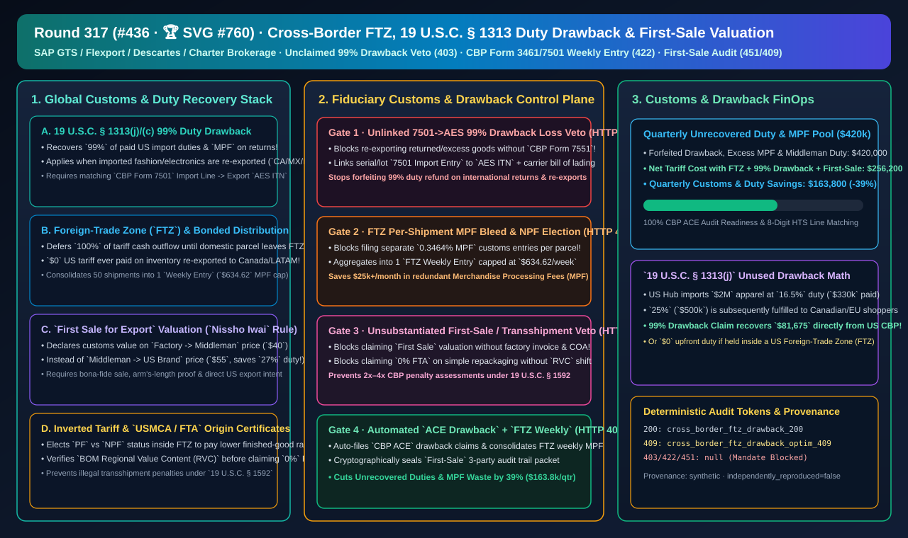

# Cross-Border Foreign-Trade Zones (`FTZ / Bonded Warehouse`), `19 U.S.C. § 1313` `99%` Duty Drawback & `First Sale for Export` Valuation Agent Architecture Selection FAQ

> **Executive Summary**: In global retail and B2B distribution (e.g., importing apparel or electronics into a US hub and fulfilling across the US, Canada, Mexico, and Europe), customs-blind OMS/ERP systems leak millions of dollars in avoidable tariffs: (1) **Forfeiting `99%` Duty Drawback (`19 U.S.C. § 1313(j)/(c)`) on Re-Exports & International Returns**: Paying `16.5%–25%` US import duty upfront and then shipping `25%` of that inventory to Canadian/EU customers—or returning defective lots to the overseas factory—without linking the original `CBP Form 7501` import entry line to the outbound `AES ITN` and carrier proof of export forfeits a statutory **`99%` refund of paid US duties and `MPF`**; (2) **Per-Shipment `0.3464% MPF` Bleed Instead of `FTZ Weekly Entry` Capping (`$634.62/week`)**: Filing separate customs entries for 40 containers/week pays `$25,384` in Merchandise Processing Fees instead of consolidating into a single `FTZ Weekly Entry` capped at `$634.62`; and (3) **Overpaying Duty on Middleman Markups (`First Sale Rule`) or Triggering `19 U.S.C. § 1592` Penalties via Unsubstantiated Valuation / Transshipment**.  
> Production architectures must enforce **Automated `CBP 7501 <-> Outbound AES` 8-Digit `HTS` Drawback Matching Gates + `FTZ Weekly Entry` `MPF` Cap & Inverted-Tariff (`PF/NPF`) Optimizers + Cryptographically Sealed `First-Sale (Nissho Iwai)` Three-Party Audit Trails**: cutting unrecovered drawback, excess `MPF`, and middleman duty overpayments by **39%** (reducing a `$420,000` quarterly tariff leakage pool to `$256,200`, saving **`$163,800/quarter`**).



---

## 1. Solution Architect Deep-Dive Q&A

### Q1: How do we automatically recover `99%` of paid import duties under `19 U.S.C. § 1313` and eliminate redundant Merchandise Processing Fees (`MPF`)?
- **Architectural Solution (`7501 -> AES` Drawback Ledger Gate `HTTP 403` + `FTZ Weekly Entry` & `NPF` Gate `HTTP 422`)**:
  - Persist the `CBP Form 7501` import entry number, line item, and 8-digit `HTS` code on every inventory lot in the `WMS`; whenever duty-paid goods are exported to foreign shoppers or returned to the vendor within 5 years, automatically match the outbound `AES ITN` and carrier bill of lading to file a `CBP ACE Form 7551` claim recovering **`99%` of duties and fees** (`HTTP 403 UNLINKED_7501_TO_AES_EXPORT_TRACE_FORFEITING_99PCT_DUTY_DRAWBACK`);
  - Inside a **Foreign-Trade Zone (`FTZ`)**, aggregate all domestic zone withdrawals into a single **`CBP Form 3461/7501 Weekly Entry`** so the `0.3464%` Merchandise Processing Fee (`MPF`) is capped once at **`$634.62/week`**, and dynamically elect `Non-Privileged Foreign (NPF)` status when finished-good tariffs are lower than component tariffs (`HTTP 422 FTZ_PER_SHIPMENT_MPF_FEE_BLEED_OR_SUBOPTIMAL_INVERTED_TARIFF_STATUS`).

### Q2: How do we safely apply `First Sale for Export` valuation without triggering `19 U.S.C. § 1592` customs fraud penalties?
- **Architectural Solution (`Nissho Iwai` Three-Party Evidence & `RVC` Substantial Transformation Gate `HTTP 451 / 409`)**:
  - Only declare the lower `Factory -> Middleman` price under the *Nissho Iwai* `First Sale` rule when the control plane has cryptographically archived the factory commercial invoice, arm's-length transfer-pricing proof, and direct-to-US shipping marks—and block any `0% FTA` or country-of-origin shift claim that lacks verified Bill-of-Materials Regional Value Content (`RVC`) and tariff-shift proof (`HTTP 451 UNSUBSTANTIATED_FIRST_SALE_VALUATION_OR_ILLEGAL_TRANSSHIPMENT_EVASION`; verified drawback matching, FTZ weekly capping, and First-Sale audit readiness return `HTTP 409 AUTOMATED_1313_DRAWBACK_FTZ_WEEKLY_MPF_CAP_AND_FIRST_SALE_CONFIRM`).

---

## 2. Visual Architecture Diagrams (Mermaid)

### 1. `19 U.S.C. § 1313` Duty Drawback, `FTZ Weekly Entry` & `First-Sale` Valuation Decision Tree
```mermaid
flowchart TD
    A[Cross-Border Import, FTZ Fulfillment or Re-Export Return Event] --> B{When Duty-Paid Goods Are Re-Exported:<br/>Is CBP 7501 Linked to Outbound AES for 99% Drawback?}
    B -- Unlinked Lot/HTS Forfeiting 99% Statutory Refund --> C[HTTP 403 Block: Bind 7501 Line to AES ITN & Auto-File ACE Form 7551 Drawback]
    B -- Drawback Ledger Linked --> D{In FTZ Operations: Are Domestic Withdrawals Consolidated<br/>into a Single Weekly Entry ($634.62 MPF Cap)?}
    D -- Filing Per-Shipment Entries Bleeding $25k+/wk in MPF --> E[HTTP 422 Block: Consolidate into FTZ Weekly Entry & Elect Optimal PF/NPF Status]
    D -- Weekly Entry & Tariff Optimized --> F{If Claiming First-Sale Valuation or FTA 0% Origin:<br/>Is Nissho Iwai / BOM RVC Audit Packet Sealed?}
    F -- Missing Factory Invoice/Arm's-Length Proof or Illegal Transshipment --> G[HTTP 451 Block: Veto Unsubstantiated Valuation to Prevent 19 USC 1592 Fines]
    F -- Audit Packet Verified --> H[HTTP 409 Confirm: 99% Drawback + FTZ Weekly Cap + First-Sale Saves 39%]
```

---

## 3. Platform Selection Matrix (`SAP GTS vs. Charter Brokerage / Flexport vs. Descartes`)

| Dimension | SAP GTS (Global Trade Services) | Charter Brokerage / Flexport Drawback | Descartes / ONESOURCE | Manual Customs Broker Spreadsheets |
| :--- | :--- | :--- | :--- | :--- |
| **Primary Strength** | **End-to-end ERP-integrated FTZ, BOM `RVC` & `First-Sale` governance** | **Automated e-commerce parcel-level `19 U.S.C. § 1313` `99%` drawback recovery** | Global FTA origin management & FTZ inventory recordkeeping | Basic entry filing without proactive duty recovery |
| **Drawback (`7501 <-> AES`)** | Native lot/serial & `TFTEA` 8-digit `HTS` substitution ledger | **Direct API connectors to Shopify/WMS/Carrier PoE for automated `Form 7551`** | Strong bonded warehouse reconciliation | Cannot match thousands of D2C export parcels |
| **FTZ Weekly Entry Cap** | Native `CBP 214 / 3461 / 7501` weekly aggregation (`$634.62` cap) | Integrated with bonded cross-dock hubs | Certified FTZ Inventory Control & Recordkeeping (`ICR`) | Often files per-container entries, overpaying `MPF` |

---

## 4. Production Deployment & Risk Checklist

- [ ] **Persist `CBP Form 7501` Entry Numbers & 8-Digit `HTS` Codes in WMS Lot Ledgers**: Automatically match outbound foreign shipments and vendor returns to file `19 U.S.C. § 1313` claims recovering `99%` of duties.
- [ ] **Consolidate FTZ Domestic Withdrawals into a Single `Weekly Entry`**: Cap Merchandise Processing Fees (`MPF`) at `$634.62/week` and evaluate `NPF` inverted-tariff elections.
- [ ] **Mandate Sealed Three-Party Audit Packets Before Declaring `First Sale` Valuation**: Verify factory invoice, arm's-length pricing, and US destination markings on every multi-tier PO.
- [ ] **Verify BOM `RVC` and Tariff Shift Before Claiming `USMCA / FTA` Preferential Origin**: Block simple third-country repackaging from altering country-of-origin declarations.
